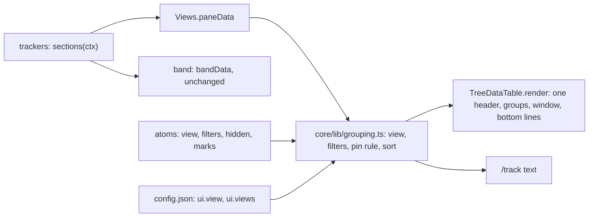
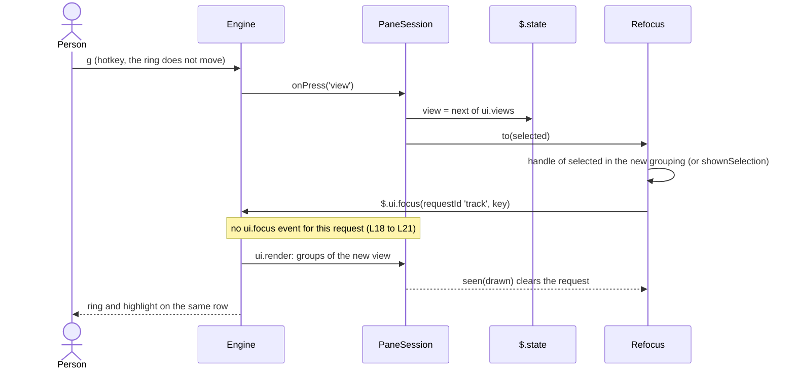
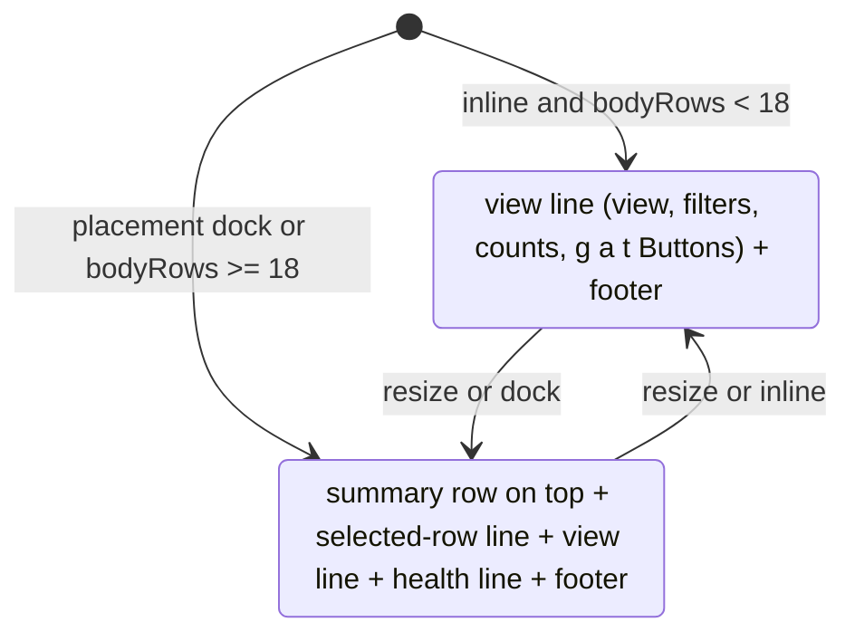

## Design study: grouped views over one tree table (#63)

Part 1 of 3: study. Part 2: evidence and judgments (https://github.com/martin-macak/claude-code-mod-tracking/issues/63#issuecomment-6310417876). Part 3: probe harness (https://github.com/martin-macak/claude-code-mod-tracking/issues/63#issuecomment-6310420343). `L<n>` refers to a log line in part 2.

Base: `origin/main` at [278d50c](https://github.com/martin-macak/claude-code-mod-tracking/tree/278d50c53d5bcd0bc0114eb20c739c030ba23493). Every `path:line` is at that commit, relative to `plugins/artifact-tracking/` unless it starts with `docs/`. Claude Code 2.1.306. The issue text predates #87, #100, #112, #113, #121 and #127; section A maps it to today's code.

### Verdict per phase

| Phase | Scope | Verdict |
| --- | --- | --- |
| **P1** one table | One header with shared columns, today's sections as the groups of the "by list" view, extras badges, group counts | **Go**, 78/100 |
| **P2** views and filters | Status tokens and facets; views by list, tracker, status, reason, flat; view key and `/track view`; pinned group; sort; the filter keys from #62 and #49; `/track` prints the view | **Go**, 75/100 |
| **P3** marks and status area, as written | Marks; a multi-line status area; a summary row in the pane | **Go with caveats**, 63/100. At 100x40 inline the issue's layout needs 12 rows in an 11-row body, so the engine scrolls the footer away again (the #109 bug) |
| **P3** marks and status area, recommended | Marks; an adaptive status area (one view line inline, the full area docked or in a body of 18 rows or more); the summary in the band inline | **Go**, 75/100 |
| Later | Group by file type (#57), the Clean button (#49 P2), two levels of groups | Not in this issue: no data, no command, not run |

The whole issue as written scores **Go with caveats** (72/100). The recommended 0.2.0 scope (P1 + P2) scores **Go** (76/100). No `Must` item is `Untested` or `Not feasible`. The weakest items: R10 status tokens (48, Partial: Jira rows with no `statusCategory` get `none`), R15 status area as written (49, overflows inline), R13 pinned (60, Partial: "manual top" does not exist).

### Owner decisions still open

Each has my recommended answer and the reason. Section 9 has the rest.

1. **Scope and PRs.** P1 + P2 ship in 0.2.0 as a stack of 3 PRs (L1 one table, L2 facets and status tokens, L3 views and keys); L3 closes #63. P3 becomes a new issue (Release `Later`, blocked by #63; pull it in as L4 if 0.2.0 has room). *Reason:* P1 + P2 meet the user goals (one table, failing items across trackers, pinned items); P3 needs the adaptive layout and adds a bulk-dismiss risk.
2. **Status area.** Adaptive: inline below 18 body rows, one view line (view, filters, hidden and marked counts, and the `g`, `a`, `t` Buttons) above today's footer; docked or 18+ rows, also the selected row and a health line; the pane summary row only docked or 18+ rows, the band carries it inline. *Reason:* as written the smallest window needs 12 rows in the 11-row inline body (L322); the adaptive layout fits with 4 data rows (L324).
3. **Default view.** By list. *Reason:* it is today's pane, so nothing moves for the person and most tests stay.
4. **Views in 0.2.0 and in the `g` cycle.** All five ship; `ui.views` defaults to `list`, `status`, `flat`; `tracker` and `reason` are reachable with `/track view` and the config. *Reason:* by tracker differs from by list for two trackers only (auto, github), and a short cycle keeps `g` quick.
5. **Keys.** `g` view, `a` show all (same as `/track show-all`), `t` touched only (hides `discovered` and `mentioned`), `m` mark (P3). *Reason:* `v` and `d` are #57's preview keys and `c`, `f` are #50's (`trackers/github/actions.ts:22-25`); these four are free.
6. **Pinned rule.** Pinned = effective level `top` (the rule ★) or the person's `high` (key `1`). Alternative: `top` only. *Reason:* a person cannot set `top` by hand (`core/interfaces/items.ts:24`, `core/infra/item-levels.ts:22-24`), so "manual top" pins nothing; side effect: key `1` moves a row out of its group.
7. **Column order.** control, name, description, type, status, extras (today's order). *Reason:* every section already uses this order (key, title, type, status, then the extra cells), so with each badge printed as its own text cell the `/track` text of the by-list view stays byte-identical, and the flex column stays where it is; the issue draft put type and status before description.
8. **Moved out.** The Clean button goes to the new #49 P2 issue; file-type grouping stays with #57, which supplies the facet. *Reason:* `/track clean` does not exist in 0.2.0, and the file tracker has no file type yet.

No repo file, branch, label or project field changed for this study.

<details><summary>How the study was run</summary>

- **Code.** A `git archive` export of `origin/main` 278d50c in scratch. The local checkout was not touched.
- **Kit suite** on the export: 2641 pass, 0 fail (L401 to L403).
- **Live probes** (fake API, no model, no login): a probe mod in a private tmux server, Claude Code 2.1.306, five runs at 100x40 inline, 120x37 docked and 100x60 inline (L1 to L102, screens L201 to L262). It drew the layout this issue proposes and tested the view switch, the ring, stable Button keys, a hidden hotkey, group fold Buttons, the dock pin and `rows` in `$.ui.open`. Part 3 has the harness.
- **Node runs of repo functions** (`footerRows`, `planWindow`, `solveColumns`) for the budget and the columns (L301 to L364).
- **Types.** The `Pane`, `PaneOpenArgs`, `SiteScroll`, `BoxProps` and focus blocks of the types 2.1.306 wrote are identical to the 2.1.302 snapshot. `ButtonProps` gained 3 doc lines on `key` (L501 to L512).
- **Environment.** The managed plugin `cc-plugin-sec-default` was active. Every probe hook that a claim needs fired (`ui.render`, `ui.focus`, `ui.close`, `command.run`, `session.start`). No claim here was blocked by it. The real mod was not run live: no tracker data was needed.
- **Decision model.** TypeSafe Jev (jev-1.13.0): one `jev_ask` per item for Ease, Safety and the verdict (24 calls), one `jev_check` per deciding claim in the final review (12 calls). I own every score; part 2 lists each answer and each override with its reason.
- **Reviewers.** The `advisor` tool before the design (step 6) and for the final review (step 10).
- **Arithmetic.** `.agents/skills/design-study/scripts/score.mjs`, output pasted as it came.
- **Cleanup.** The probe tmux server and the fake API were stopped and checked (L601 to L613). Scratch files were deleted after posting.
- **Not tested.** The real mod with a grouped view (the design is not built). Two levels of groups. A real mouse. The web and mobile surfaces. `rows` on a terminal taller than 60 rows. The bulk actions of marks.

</details>

### 1. Score

Evidence tags: `[observed]` a saved run of the real tool, `[observed: node run]` repo functions run in node, `[primary source]` code or types plus a passing repo test, `[inference]`.

**#63 P1 One table (by list)**

| Rank | Item | Priority | Verdict | Evidence | Ease | Safety | Score |
| --- | --- | --- | --- | --- | --- | --- | --- |
| 1 | R1 One TreeDataTable; sections become the groups of by list | Must | Feasible | 4 | 2 | 4 | 68 |
| 2 | R9 One header, shared columns, drop by priority | Must | Feasible | 4 | 3 | 4 | 74 |
| 3 | R4 Group header counts; caps and N more per group | Should | Feasible | 4 | 3 | 4 | 74 |
| 4 | R11 Extras column of display-only badges | Should | Feasible | 4 | 4 | 5 | 84 |
| 5 | R16 Window keeps header, footer and status in view | Must | Feasible | 5 | 4 | 4 | 90 |

**Overall: Go** (mean >= 75). Weighted mean: 78/100. Items are ranked weakest first.

**#63 P2 Views, keys and filters**

| Rank | Item | Priority | Verdict | Evidence | Ease | Safety | Score |
| --- | --- | --- | --- | --- | --- | --- | --- |
| 1 | R10 StatusToken plus label from every tracker | Must | Partial | 4 | 2 | 3 | 48 |
| 2 | R13 Pinned group at the top of every view | Should | Partial | 4 | 4 | 4 | 60 |
| 3 | R2b View by status | Must | Feasible | 4 | 3 | 3 | 70 |
| 4 | R3 View key, /track view, config list, session atom | Must | Feasible | 4 | 3 | 4 | 74 |
| 5 | R6 Key hides discovered and mentioned rows (#62) | Should | Feasible | 4 | 3 | 4 | 74 |
| 6 | R2a Views by list, by tracker, flat | Must | Feasible | 4 | 4 | 4 | 80 |
| 7 | R5 Sort by level, first seen, id; trees stay whole | Must | Feasible | 4 | 4 | 4 | 80 |
| 8 | R2c View by reason | Should | Feasible | 4 | 4 | 4 | 80 |
| 9 | R17 Key shows the rows the TTL hides (#49) | Should | Feasible | 4 | 4 | 5 | 84 |
| 10 | R8 /track prints the active view | Should | Feasible | 4 | 4 | 5 | 84 |
| 11 | R3b Selection and ring survive a view switch | Must | Feasible | 5 | 4 | 4 | 90 |

**Overall: Go** (mean >= 75). Weighted mean: 75/100. Items are ranked weakest first.

**#63 P3 Marks, status area, summary (as written)**

| Rank | Item | Priority | Verdict | Evidence | Ease | Safety | Score |
| --- | --- | --- | --- | --- | --- | --- | --- |
| 1 | R15 Multi-line status area, as written | Should | Partial | 4 | 3 | 2 | 49 |
| 2 | R14 Pane summary row and band line | Should | Partial | 4 | 4 | 4 | 60 |
| 3 | R12 Marks; x and 1-3 act on marked rows | Should | Feasible | 4 | 3 | 3 | 70 |
| 4 | R19 Marks as the seam for 'select a turn' (#69) | Could | Feasible | 4 | 4 | 4 | 80 |

**Overall: Go with caveats** (mean 55-74). Weighted mean: 63/100. Items are ranked weakest first.

**#63 P3 Marks, status area, summary (recommended: adaptive)**

| Rank | Item | Priority | Verdict | Evidence | Ease | Safety | Score |
| --- | --- | --- | --- | --- | --- | --- | --- |
| 1 | R12 Marks; x and 1-3 act on marked rows | Should | Feasible | 4 | 3 | 3 | 70 |
| 2 | R15r Adaptive status area (1 line inline, full in dock or tall) | Should | Feasible | 4 | 3 | 4 | 74 |
| 3 | R14r Band line everywhere; pane summary row in dock or tall bodies | Should | Feasible | 4 | 4 | 4 | 80 |
| 4 | R19 Marks as the seam for 'select a turn' (#69) | Could | Feasible | 4 | 4 | 4 | 80 |

**Overall: Go** (mean >= 75). Weighted mean: 75/100. Items are ranked weakest first.

**#63 Later (moved out)**

| Rank | Item | Priority | Verdict | Evidence | Ease | Safety | Score |
| --- | --- | --- | --- | --- | --- | --- | --- |
| 1 | R7 Group by file type (#57 supplies the type) | Could | Not feasible | 4 | 3 | 5 | 0 |
| 2 | R18 Clean button (#49 P2 command) | Could | Not feasible | 4 | 2 | 4 | 0 |
| 3 | R20 Two levels of foldable groups | Could | Untested | 2 | 2 | 4 | 14 |

**Overall: Rethink scope** (mean < 55). Weighted mean: 5/100. Items are ranked weakest first.

Evidence rule applied:
- R20: Partial lowered to Untested (evidence 2 < 4)

The Later verdict covers only the items moved out of this issue. It gates no phase.

<details><summary>Whole issue as written, and the recommended 0.2.0 scope</summary>

**#63 whole issue, as written (P1 + P2 + P3 as written + R7)**

| Rank | Item | Priority | Verdict | Evidence | Ease | Safety | Score |
| --- | --- | --- | --- | --- | --- | --- | --- |
| 1 | R7 Group by file type (#57 supplies the type) | Could | Not feasible | 4 | 3 | 5 | 0 |
| 2 | R10 StatusToken plus label from every tracker | Must | Partial | 4 | 2 | 3 | 48 |
| 3 | R15 Multi-line status area, as written | Should | Partial | 4 | 3 | 2 | 49 |
| 4 | R13 Pinned group at the top of every view | Should | Partial | 4 | 4 | 4 | 60 |
| 5 | R14 Pane summary row and band line | Should | Partial | 4 | 4 | 4 | 60 |
| 6 | R1 One TreeDataTable; sections become the groups of by list | Must | Feasible | 4 | 2 | 4 | 68 |
| 7 | R2b View by status | Must | Feasible | 4 | 3 | 3 | 70 |
| 8 | R12 Marks; x and 1-3 act on marked rows | Should | Feasible | 4 | 3 | 3 | 70 |
| 9 | R9 One header, shared columns, drop by priority | Must | Feasible | 4 | 3 | 4 | 74 |
| 10 | R3 View key, /track view, config list, session atom | Must | Feasible | 4 | 3 | 4 | 74 |
| 11 | R4 Group header counts; caps and N more per group | Should | Feasible | 4 | 3 | 4 | 74 |
| 12 | R6 Key hides discovered and mentioned rows (#62) | Should | Feasible | 4 | 3 | 4 | 74 |
| 13 | R2a Views by list, by tracker, flat | Must | Feasible | 4 | 4 | 4 | 80 |
| 14 | R5 Sort by level, first seen, id; trees stay whole | Must | Feasible | 4 | 4 | 4 | 80 |
| 15 | R2c View by reason | Should | Feasible | 4 | 4 | 4 | 80 |
| 16 | R19 Marks as the seam for 'select a turn' (#69) | Could | Feasible | 4 | 4 | 4 | 80 |
| 17 | R11 Extras column of display-only badges | Should | Feasible | 4 | 4 | 5 | 84 |
| 18 | R17 Key shows the rows the TTL hides (#49) | Should | Feasible | 4 | 4 | 5 | 84 |
| 19 | R8 /track prints the active view | Should | Feasible | 4 | 4 | 5 | 84 |
| 20 | R16 Window keeps header, footer and status in view | Must | Feasible | 5 | 4 | 4 | 90 |
| 21 | R3b Selection and ring survive a view switch | Must | Feasible | 5 | 4 | 4 | 90 |

**Overall: Go with caveats** (mean 55-74). Weighted mean: 72/100. Items are ranked weakest first.

**#63 recommended scope for 0.2.0 (P1 + P2)**

| Rank | Item | Priority | Verdict | Evidence | Ease | Safety | Score |
| --- | --- | --- | --- | --- | --- | --- | --- |
| 1 | R10 StatusToken plus label from every tracker | Must | Partial | 4 | 2 | 3 | 48 |
| 2 | R13 Pinned group at the top of every view | Should | Partial | 4 | 4 | 4 | 60 |
| 3 | R1 One TreeDataTable; sections become the groups of by list | Must | Feasible | 4 | 2 | 4 | 68 |
| 4 | R2b View by status | Must | Feasible | 4 | 3 | 3 | 70 |
| 5 | R9 One header, shared columns, drop by priority | Must | Feasible | 4 | 3 | 4 | 74 |
| 6 | R3 View key, /track view, config list, session atom | Must | Feasible | 4 | 3 | 4 | 74 |
| 7 | R4 Group header counts; caps and N more per group | Should | Feasible | 4 | 3 | 4 | 74 |
| 8 | R6 Key hides discovered and mentioned rows (#62) | Should | Feasible | 4 | 3 | 4 | 74 |
| 9 | R2a Views by list, by tracker, flat | Must | Feasible | 4 | 4 | 4 | 80 |
| 10 | R5 Sort by level, first seen, id; trees stay whole | Must | Feasible | 4 | 4 | 4 | 80 |
| 11 | R2c View by reason | Should | Feasible | 4 | 4 | 4 | 80 |
| 12 | R11 Extras column of display-only badges | Should | Feasible | 4 | 4 | 5 | 84 |
| 13 | R17 Key shows the rows the TTL hides (#49) | Should | Feasible | 4 | 4 | 5 | 84 |
| 14 | R8 /track prints the active view | Should | Feasible | 4 | 4 | 5 | 84 |
| 15 | R16 Window keeps header, footer and status in view | Must | Feasible | 5 | 4 | 4 | 90 |
| 16 | R3b Selection and ring survive a view switch | Must | Feasible | 5 | 4 | 4 | 90 |

**Overall: Go** (mean >= 75). Weighted mean: 76/100. Items are ranked weakest first.

</details>

### 2. Feasibility per item

| Item | Priority | Verdict | Mechanism | Caveat | Evidence |
| --- | --- | --- | --- | --- | --- |
| R1 One TreeDataTable; sections become the level-0 groups of "by list" | Must | Feasible | Each `SectionSpec` becomes a group (title, note, counts, rows). One header row above the window. A group title takes 1 line; `windowed.ts:40` `CHROME = 2` becomes 1 plus a fixed header line. One column solve for the table. | The rewrite touches the table, the window, the rows, the text and 8 trackers' column lists. | [observed] L4 to L6, L74, L201 to L213; [primary source] L405 to L409 |
| R9 One header, shared columns, drop by priority | Must | Feasible | Core column set: control `fixed(2)`, name `content(6,24)` tree, description `flex(10)`, type `content(≤12)` priority 2, status `content(≤10)`, extras `content(≤14)` priority 1. Today's cell ids map 1:1 (`core/lib/rows.ts:56-65`). The width memo key goes from `section/column` to `table/column` (`ux/tree-data-table/columns.ts:48`). | Section header words (PR, Branch, Checks, Worktree, Agents) vanish. | [observed: node run] L361 to L364; [primary source] L413, L414 |
| R16 The header, the footer and the status area stay in view; the window follows the selection | Must | Feasible | Built by #112. #63 adds lines to the fixed chrome, which the budget subtracts (`windowed.ts:77`). | A body under about 7 rows cannot hold the window (#109 floor). | [observed] KB `tree-table.md` 3.2 and L1 to L102; [primary source] L404 to L412 |
| R4 Group header with data-row and failing counts; caps and "N more" per group | Should | Feasible | Groups are drawn as sections, so `layout.ts:30-47` keeps its caps. The failing count reads token `failed` (in L1: the section's `band.failing`). | `shown` is keyed by group id, so the rows opened with "N more" reset on a view switch. | [primary source] L409; [observed] L204, L207 |
| R11 Extras column of display-only badges | Should | Feasible | `TreeRow.extras?: readonly Cell[]`, joined with one space and clipped. GitHub's merge chip, checks and mark become badges. No Button, so no Tab stop. | Docked (49 cells) the extras column drops first; the selected-row line shows the badges there. | [primary source] cell tests in L401; [observed: node run] L362 |
| R10 StatusToken plus a free label, from every tracker | Must | Partial | Each tracker maps its closed state set (section 5.4). A core map turns the token into a `ColorToken`. | A Jira row with no `statusCategory` (no `acli`, or before the first refresh, `trackers/jira/acli-tool.ts:44-52`) gets `none`. | [primary source] the state unions in each `types.ts` |
| R2a Views by list, by tracker, flat | Must | Feasible | Group by the section id, by `TreeRow.owner`, or one group. Both facets exist today (`core/interfaces/view.ts:46-63`, `core/infra/views.ts:142-157`). | By tracker differs from by list for auto and github only. | [primary source]; [observed] L18 to L20 |
| R2b View by status | Must | Feasible | Group by `facets.status.token`, failed first. | Inherits R10's `none` rows. | [observed] L20, L217 to L221; [primary source] |
| R3 View key, `/track view <name>`, config list, session atom | Must | Feasible | `global.ui.view` and `global.ui.views`; a session atom `view` like `hidden` (`hooks/register.tsx:37`); a core key and a core sub-command write only the atom, as `/track show-all` does (`core/infra/commands.ts:111-118`). | Reset by `/clear`, not restored on `/resume` (as show-all). | [primary source] L415, L416 |
| R3b The selected row and the ring survive a view switch | Must | Feasible | After the atom write, `Refocus.to(selected)` (`hooks/pane-refocus.ts:51-56`), as `x` does. A row the new view does not draw falls to a shown row (the `shownSelection` rule of PR #128). | The engine raises no `ui.focus` for this request (L18 to L21); `Refocus.seen` clears it. Stable Button keys do not help (L65 to L69). | [observed] L16 to L21, L31 to L35, L65 to L69; [primary source] L410, L411 |
| R5 Sort by level, first seen, id; trees stay whole | Must | Feasible | Facets `level` (`ViewContext.levelOf`) and `firstSeen` (items; process and repo `firstSeen`, agent `spawnedAt`, worktree `provenAt`). `byLevel` (`core/lib/levels.ts:15`) then `firstSeen` then id. Only top-level rows are grouped. | Slot rows have no level, so they sort as `normal`. | [primary source] `core/lib/rows.ts:95-103` and its tests |
| R2c View by reason | Should | Feasible | Group by `TreeRow.reasons.strongest` (`core/interfaces/view.ts:62`, `types/index.d.ts:45-49`), in the `CoreReason` order. Rows with no reasons go to "context". | Children follow their parent's reason. | [primary source] L418 |
| R13 Pinned group at the top of every view | Should | Partial | The grouping lifts pinned rows into a first group and leaves them out of their own group. | "Manual top" does not exist (C11 of part 2); the pin rule is decision 6. | [primary source] `core/interfaces/items.ts:24`, `trackers/github/rules.ts:27-44` |
| R6 Key `t` hides rows whose strongest reason is `discovered` or `mentioned` (#62) | Should | Feasible | A session atom beside `hidden`; the grouping drops those top-level rows; group notes count them like the TTL hide (#127). | Context rows (no reasons) stay. | [primary source] L418 |
| R17 Key `a` shows the rows the TTL hides (#49) | Should | Feasible | The same toggle as `/track show-all` (`core/infra/commands.ts:111-118`). | None. | [primary source] L415, L416; [observed] L29 |
| R8 `/track` prints the active view | Should | Feasible | The text renderer reads the same grouped model and prints each badge as its own cell, so the by-list text stays byte-identical. | A first line `View: <name>` only off the default view (section 9). | [primary source] `ux/tree-data-table/text.ts:13-36` |
| R12 Marks; `x` and `1` to `3` act on the marked rows | Should | Feasible | Session atom `marks`; `m` toggles; `PaneHost.dismiss` already takes a list (`hooks/pane-text.ts:19`); `setPriority` once per row. Marks clear after the action. | A dismiss has no undo, so a bulk `x` hides many rows for the run. | [observed] L23 to L28, L223 to L226; [primary source] |
| R14 Pane summary row and band line | Should | Partial (as written), Feasible (R14r) | The band line exists (`ux/band.ts:12-23`). A pane row costs one body row. | Inline at 100x40 it does not fit beside a status area (L322). | [observed: node run] L321 to L340 |
| R15 Status area | Should | Partial (as written), Feasible (R15r) | A column Box below the window, inside the dock pin of #112 (`ux/tree-data-table/table.ts:111-119`). R15r picks its lines from `bodyRows` and `placement` before the window plans. | As written it overflows at 100x40 inline (L322, L327). | [observed] L251 to L262; [observed: node run] L321 to L340 |
| R19 Marks as the seam for "select a turn" (#69) | Could | Feasible | A core call sets `marks` to a list of row ids and selects the first. #69's band key `9` can call it. | Needs R12 and #69 PR 1. | [primary source] #69 owner decisions of 2026-10-21 |
| R7 Group by file type (#57) | Could | Not feasible here | A generic `kind` facet; the file type comes from #57. | No file type exists until #57 ships. | [primary source] |
| R18 Clean button (#49) | Could | Not feasible here | It would run `/track clean` (#49 P2). | No such command in 0.2.0. | [primary source] #49 owner decisions |
| R20 Two levels of foldable groups | Could | Untested | One chrome line per level; header Buttons as stops. | One level ran (L7, L8, L76 to L86); two did not. | [observed] one level only |

### 3. Spikes

| # | Question | Answer | Tag |
| --- | --- | --- | --- |
| S1 | After a view switch, does a focus request for the selected row's new handle keep the ring on that row? | Yes. The next Tab selects the next row of the new order (L16 to L21). | [observed] |
| S2 | Without it, where is the ring? | At its old position among the Buttons. Tab selects an unrelated row (L31 to L35). | [observed] |
| S3 | Do stable Button keys (row ids) make the ring follow the row on 2.1.306? | No. The new `key` doc (L511) does not change this for a pane (L65 to L69). | [observed] |
| S4 | Does a status area plus the footer stay at the bottom of a docked body, and fit an inline body? | Yes, docked with a full and a short tree (L74, L86, L241 to L262). Inline it fits when the budget counts it (L4 to L6). | [observed] |
| S5 | Does `rows` in `$.ui.open` buy inline rows? | No gain: rows 20 gave 11 at 100x40; rows 20, none and 40 gave 18 at 100x60 (L39 to L47, L88 to L102). | [observed] |
| S6 | Does a hotkey inside a `display: 'none'` Box fire? | Yes (L29). Such a Button is a dead Tab stop (tree-table.md 3.2). | [observed] |
| S7 | Are group title Buttons Tab stops, and does Enter fold? | Yes, one stop per group (L8, L78 to L86). | [observed] |
| S8 | How many footer rows with `g`, `m`, `a` added? | 2 at 96 cells (1 today), 3 at 40 (L301 to L318). | [observed: node run] |
| S9 | How many data rows per layout? | Section 3 of part 2; the issue's layout overflows at 100x40 (L322). | [observed: node run] |
| S10 | Which shared columns stay at dock width? | control, name, status, description at 49 and 40 cells (L362, L363). | [observed: node run] |
| S11 | Can a person set `top`? | No (C11 of part 2). | [primary source] |

### A. The issue against today's code

| Part of #63 | Today on 278d50c | What #63 still needs |
| --- | --- | --- |
| "One section per tracker list" | 10 sections, by `rank`: worktrees 10, agents 11, prs 12, jira 20, github 30, artifact 40, repos 50, web 60, file 70, processes 80 (`trackers/*/sections.ts`). One `TreeDataTable` draws them all since #87 (`ux/tree-data-table/table.ts:50-125`), each with a title row and a header row (`ux/tree-data-table/rows.ts:157-159`). | Groups under one header (P1). |
| "Columns differ per section" | Each section has its own `ColumnDef[]` (`core/interfaces/view.ts:84`), solved per section (`ux/tree-data-table/rows.ts:117-121`, memo `columns.ts:48`). The cell ids already line up: `prio`, `key`, `title`, `type`, `status`, `extra`, `mark` (`core/lib/rows.ts:24`, `:56-65`), plus `merge` in GitHub (`trackers/github/sections.ts:30-51`). Drop by `priority` exists (`columns.ts:96-107`). | A table-level column set (P1). |
| "No place for tracker widgets" | #50 added a Merge column and a Checks column to the GitHub sections (`trackers/github/sections.ts:38-39`, `:49-50`). | The extras badge list (P1). |
| "Important items get lost" | Rows sort by level inside a section (`core/lib/rows.ts:95-103`). `top` (★) comes only from rules R7 and R8 (`trackers/github/rules.ts:27-44`); manual marks are `high`, `normal`, `low` (`core/infra/keys.ts:20-36`). | The pinned group and the status view (P2). |
| "The pane scrolls as one block" | Fixed by #112: a window over the rows (`ux/tree-data-table/window.ts:64-101`, `windowed.ts:72-90`), zero-height stops for hidden rows (`windowed.ts:107-121`), page keys through `ui.scroll` (`hooks/pane-session.ts:148-164`, `hooks/register.tsx:312-316`), the docked footer pin (`table.ts:108-119`), the keys hint budget (`hooks/pane-session.ts:75-79`, `ux/tree-data-table/hint.ts:16`). The windowing AC moved to #109 (comment of 2026-10-20). | Only the extra chrome lines (P1, P3). |
| Selection and keys | `selected` atom (`hooks/register.tsx:35`), written by the `ui.focus` hook (`:301-307`, `hooks/pane-session.ts:117-132`). A press selects the row (#113) and asks for the keys when the prompt has them (#121, `hooks/pane-session.ts:204-210`). After `x` or a digit the ring goes to the new row (`hooks/pane-refocus.ts:51-80`). Core keys `r h x 1 2 3 0` (`core/infra/keys.ts:20-28`), tracker keys `c f` (`trackers/github/actions.ts:22-25`), routing (`keys.ts:119-133`), footer (`ux/tree-data-table/footer.ts:19-69`). | `g`, `a`, `t` (P2), `m` (P3). |
| Reasons (#62) | `TreeRow.reasons` (`core/interfaces/view.ts:58-62`), `ReasonSet.strongest` (`types/index.d.ts:45-49`), slot rows through `Traceable` (`core/interfaces/reasons.ts:25-28`). The row detail lists them (#100). No filter. | The by-reason view and `t` (P2). |
| Hidden rows (#49) | Session atom `hidden.showAll` (`hooks/register.tsx:37`, `core/interfaces/view.ts:99-101`), `/track show-all` (`core/infra/commands.ts:111-118`), TTL hide in processes (`trackers/processes/sections.ts:60-73`) and agents (`trackers/auto/sections.ts:139-170`), hidden counts in the notes. PR #128 (open) adds the fold of finished runs, the process cap and `shownSelection`, the rule that moves the selection when its row hides (it rewrites `PaneSession.draw`). | `a` (P2); build P2 on #128. |
| Config | `global.ui` holds `maxRows` and `sectionRows` only (`core/interfaces/config.ts:36`). | `ui.view`, `ui.views` (P2). |
| `/track` text and band | `sectionsText` (`ux/tree-data-table/text.ts:13-36`) and `bandText` (`ux/band.ts:12-23`) read the same sections as the pane (`core/infra/views.ts:129-139`). | The view line (P2). The band line already exists. |
| Help | `helpModel` lists every key; the compact form (#92) and its cap (#105, in progress) decide what fits. | New keys add a help line. |

### B. What #63 receives from other issues

| From | What | Where it lands |
| --- | --- | --- |
| #49 (owner decision 4) | The show-hidden toggle and a Clean button. | `a` in P2. The Clean button needs `/track clean` (#49 P2, a new issue, not 0.2.0): move it there. |
| #69 (study decision 5, adopted 2026-10-21; in progress) | "Select all of a turn" through #63's marks or a turn facet. | Marks (P3) are the seam (R19); no turn facet. #69 keeps "first entry" until P3 lands. |
| #57 (scope comment of 2026-10-18) | The file type to group by. | A generic `kind` facet in P2; the by-type view comes with #57. |
| #62 (closed) | The hide filter by reason. | `t` and the by-reason view (P2). |
| #105 (in progress) | The compact help cap. | P2 adds three keys to the help; #105 should land first. |
| #109 / #112 (closed) | The windowing AC. | Done; P1 changes the chrome only. |
| #128 (open PR) | `shownSelection`, fold of runs, process cap. | P2 (L3) uses `shownSelection` after a view switch or filter. L1 rebases on it. |

### 4. Gaps and decisions

| # | Gap | Decision |
| --- | --- | --- |
| G1 | The issue's bottom area does not fit an 11-row inline body (L322). | Adaptive status area (owner decision 2). |
| G2 | `rows` in `$.ui.open` gives no more inline rows (S5). | Do not rely on it. Leave `ui.open` as it is (`hooks/register.tsx:157-158`). |
| G3 | "Manual top" does not exist. | Owner decision 6. |
| G4 | A view switch moves every handle; the ring stays at its position (S2). Stable keys do not help (S3). | `Refocus.to(selected)` after every view or filter change; rely on `seen`, not `take` (S1 raised no event). |
| G5 | A bulk `x` cannot be undone. | Act only on marked rows that are drawn; the `x` label shows the count (`x: dismiss 3`); marks clear after the action. No confirm step. |
| G6 | Mark, view and filter lifetime. | Session atoms like `hidden`: `/clear` resets them; a resume does not restore them. |
| G7 | Three more keys in the footer make it 2 rows at 96 cells (L303). | `g`, `a`, `t` sit as Buttons in the view line, not in the footer. The footer does not grow: 1 row, or 2 with a GitHub row selected, as today (L301, L302). |
| G8 | Health notes (gh, acli, git, docker) live in section notes; other views have no section titles. | By list keeps them in the group title. Other views: a short flag at the end of the view line (`⚠ gh`), the full text in help. |
| G9 | Section header words vanish; some cells change meaning under a shared header. | P1 crosswalk in section 5.3; L2 fixes processes (name and kind) and files (empty name). |
| G10 | Jira status without `statusCategory`. | Token `none`; no guess from the name. |
| G11 | `/track` text and tests. | Keep today's column order and print each badge as its own text cell: the by-list text stays byte-identical. 4 e2e features match pane text (`pane.feature`, `priority.feature`, `tracking.feature`, `config.feature`); the header regexes (`│ +Label +URL`, `│ +Label`) change. |
| G12 | The selected row can leave the drawing on a view switch, a filter or a fold. | Use `shownSelection` of PR #128; L3 waits for it. |
| G13 | Hidden counts in non-list views. | The view line shows the total hidden count; group notes show their own. |
| G14 | The help view grows by one line of keys. | #105 lands first; P2 adds its keys to the help groups. |
| G15 | The budget guard (values, chars). | One header instead of up to ten saves nodes; no change to `BUDGET` (`ux/tree-data-table/budget.ts:13`). |
| G16 | "N more" chunks are keyed by section id. | Key them by `<view>:<group>`; they reset on a view switch. |
| G17 | Group depth. | One level in 0.2.0; two levels and fold Buttons Later (each title Button is a Tab stop, S7). |
| G18 | Stack rule. | One sub-issue per layer, titled `#63 L<n>: <outcome>`; each PR `Closes` its sub-issue and `Refs #63`; the top layer also `Closes #63`. |

### 5. Design

#### 5.1 State and config

| Name | Where | Lifetime | Phase |
| --- | --- | --- | --- |
| `view: ViewId` | session atom (`PluginState`, `types/index.d.ts:98-116`) | `/clear` resets it; starts at `ui.view` | L3 |
| `filters: { touchedOnly: boolean }` | session atom | as `hidden` | L3 |
| `hidden.showAll` | exists | as today | — |
| `shown` family | key `<view>:<group>` instead of the section id | as today | L1 |
| `marks: string[]` | session atom | as `hidden` | P3 |
| `global.ui.view` | config, default `list` | file | L3 |
| `global.ui.views` | config, default `['list', 'status', 'flat']`; unknown names dropped with a problem line | file | L3 |

No key press writes `config.json`.

#### 5.2 Contracts (types only, names may change)

```ts
// core/interfaces/view.ts
export type ViewId = 'list' | 'tracker' | 'status' | 'reason' | 'flat'
export type StatusToken = 'failed' | 'waiting' | 'active' | 'done' | 'gone' | 'none'
export type ColumnId = 'control' | 'name' | 'description' | 'type' | 'status' | 'extras'

export interface Facets {
  readonly status?: { readonly label: string; readonly token: StatusToken } // L2
  readonly level?: Effective            // L2: ViewContext.levelOf(key)
  readonly firstSeen?: number           // L2
  readonly kind?: string                // L2: #57 fills it for files later
}
export interface TreeRow {               // + two optional fields
  // id, owner, cells (now keyed by ColumnId), children, detail, can, dim, reasons: as today
  readonly extras?: readonly Cell[]      // L1: one-cell badges, display only
  readonly facets?: Facets               // L2
}
export interface GroupSpec {             // L1: what the table draws per group
  readonly id: string                    // `${view}:${key}`, e.g. 'list:prs', 'status:failed'
  readonly title: string
  readonly note?: Cell                   // the section note in the by-list view
  readonly rows: readonly TreeRow[]
  readonly count: number                 // top-level data rows
  readonly failing: number
  readonly empty?: string
}
// SectionSpec loses `columns` (L1). It keeps id, title, note, rank, band, rows, empty.
```

#### 5.3 P1 crosswalk: today's cell ids to the shared columns

| Section | name | description | type | status | extras |
| --- | --- | --- | --- | --- | --- |
| prs | `key` (#n) | `title` | `type` (branch) | `status` | `merge`, `extra` (checks), `mark` |
| github | `key` (ref) | `title` | `type` | `status` | `merge`, `extra` |
| jira | `key` | `title` (summary) | `type` | `status` | — |
| worktrees | `key` | `title` (branch) | — | `status` | — |
| agents | `key` (● label) | `title` (branch) | `type` (worktree) | — (L2: from the state) | — |
| artifact | `key` | `title` (id) | `type` (origin) | `status` | — |
| repos | `key` | `title` (branch) | `type` (agents) | `status` (mode) | — |
| web | `key` (label) | `title` (url) | — | — | — |
| file | `key` (empty today) | `title` (path) | `type` (origin) | `status` (edits) | `extra` (views), `mark` (by) |
| processes | `key` (bg, docker) | `title` (name) | `type` | `status` | — |

The control column draws the level marker (`core/lib/rows.ts:37-39`); P3 adds the mark glyph `*` before it. Header words: `Name`, `Description`, `Type`, `Status`; control and extras have none.

#### 5.4 L2 status tokens

| Tracker | State | Token |
| --- | --- | --- |
| github (PR, issue) | open with checks `failure` or a merge conflict | failed |
| | open with checks `pending` | waiting |
| | open, other | active |
| | merged, closed | done |
| jira | `statusCategory` new / indeterminate / done; absent | waiting / active / done / none |
| processes | running, up | active |
| | failed, killed, exited, unhealthy (today's red set, `trackers/processes/sections.ts:24`) | failed |
| | completed | done |
| | unknown | gone |
| agents | running / waiting / ended / failed | active / waiting / done / failed |
| worktrees | live / removed | active / gone |
| artifact | deleted / other | gone / none |
| web, file, repos | — | none |

Token to color: failed `error`, waiting `warning`, active `success`, done and gone `inactive`, none no color.

#### 5.5 Data flow



#### 5.6 View switch



#### 5.7 The bottom area by body size



P2 ships the Compact form everywhere (view line plus footer). P3 adds the Full form. The table chooses the form before it plans the window, so the budget always counts what is drawn (`windowed.ts:77`).

#### 5.8 Rules

- Grouping reads facets, the section id and `owner`, never cell text.
- Only top-level rows are grouped, filtered and sorted. Children move with their parent.
- Pinned rows are drawn once, in the first group.
- A view or filter change keeps the selection (`Refocus.to`), or falls to a shown row (`shownSelection`).
- A render writes nothing (E8, E9). Keys write atoms only.
- The view line holds Buttons, so `g`, `a`, `t` are Tab stops after the rows and before the footer.

#### 5.9 Limits

- One group level.
- A body under about 7 rows cannot hold the window (#109).
- Inline at 100x40 the P2 layout shows 4 data rows where today shows 5 (L321, L324), because of the view line.
- Docked, the extras column drops at 49 cells.

#### 5.10 What ships first, and as how many PRs

| Layer | Sub-issue title | PR title | Content |
| --- | --- | --- | --- |
| L1 | `#63 L1: Draw the pane as one table with shared columns` | `feat(track): Draw the pane as one table with shared columns` | Shared column set, one header, sections as by-list groups with counts, extras badges, window chrome, `shown` keys, text. Rebased on #128. |
| L2 | `#63 L2: Give every row a status token and facets` | `feat(track): Give every row a status token and facets` | `Facets`, token maps and colors in 8 trackers, level and firstSeen facets, the processes and file cell fixes. |
| L3 | `#63 L3: Switch the pane between grouped views` | `feat(track): Switch the pane between grouped views` | `grouping.ts`, five views, `g`, `/track view`, config keys, pinned, `a`, `t`, view line, `/track` view line, help. `Closes #63`. |
| L4 (P3) | new issue | `feat(track): Mark rows and show an adaptive status area` | Marks, bulk keys, Full bottom form, pane summary row, the #69 seam. |

First PR: L1 only. It changes no behavior but the header and the group titles, so it is the safest base for L2 and L3.

### 6. Files to touch

| File | Change | Layer |
| --- | --- | --- |
| `core/interfaces/view.ts` | `ColumnId`, `GroupSpec`, `TreeRow.extras`; drop `SectionSpec.columns`. L2: `Facets`, `StatusToken`. L3: `ViewId`. | L1, L2, L3 |
| `core/lib/rows.ts` | `textCells` and `itemRow` write the shared ids and the extras list; L2 sets `facets`. | L1, L2 |
| `trackers/*/sections.ts` (8) | Drop the `COLUMNS` lists; map cells per 5.3. | L1 |
| `trackers/*/rows.ts`, `trackers/processes/sections.ts`, `trackers/auto/sections.ts` | Set `facets.status` per 5.4, `firstSeen`. | L2 |
| `ux/tree-data-table/columns.ts` | The shared column set; memo key per table. | L1 |
| `ux/tree-data-table/table.ts`, `windowed.ts`, `window.ts`, `rows.ts`, `cells.ts`, `layout.ts`, `shape.ts` | One header above the window; 1-line group titles; group ids for `shown`; the view line in the bottom area. | L1, L3 |
| `ux/tree-data-table/text.ts` | Each badge as its own cell; the view line. | L1, L3 |
| `ux/theme.ts` or a new `core/lib/status.ts` | Token to `ColorToken`. | L2 |
| `core/lib/grouping.ts` (new, pure) | Views, pin rule, sort, filters, counts. | L3 |
| `core/infra/views.ts` | `paneData` returns groups for the active view. | L3 |
| `core/infra/keys.ts`, `core/infra/command-text.ts`, `core/infra/commands.ts` | Core keys `g`, `a`, `t`; `/track view <name>`. | L3 |
| `core/interfaces/config.ts` and the global normalise | `ui.view`, `ui.views`. | L3 |
| `types/index.d.ts`, `core/interfaces/ports.ts`, `hooks/register.tsx` | Atoms `view`, `filters`; ports. | L3 |
| `hooks/pane-session.ts`, `hooks/pane-text.ts` | Press `g`, `a`, `t`; refocus; text with the view. | L3 |
| `ux/tree-data-table/help.ts` | New keys. | L3 |
| `README.md` | Views, keys, Known limits (4 data rows at 100x40). | L1, L3 |
| Tests: `table*.test.ts`, `pane.test.tsx`, `pane-session.test.ts`, `item-sections.test.ts`, `tracker-sections.test.ts`, `columns.test.ts`, `text.test.ts`, `keys.test.ts`, `commands.test.ts`, config tests; e2e `pane.feature`, `priority.feature`, `tracking.feature`, `config.feature` | Shared header; groups; views; keys. | all |

### 7. Tests

Unit (node and kit):

- `grouping`: each view on one fixture of mixed rows; the same cells with other facets give other groups (no cell text read); pinned rows once, first; sort level, firstSeen, id; a Jira sub-task stays under its parent in every view; `t` drops `discovered` and `mentioned` top-level rows and keeps context rows; counts and failing per group.
- Token maps: one case per state of 5.4; Jira without `statusCategory` gives `none`.
- `solveColumns` with the shared set at 96, 49, 40 cells (the L361 to L363 shapes).
- `planWindow` budget with the P2 bottom area at 11, 10 (hint), 18 and 31 rows: the tree never exceeds the body (the L324, L329, L334, L339 shapes).
- `pane-session`: `g` writes `view` and asks for the ring on the selected row's new handle (copy "x selects the next row and focuses its new handle", L410); a selected row that the new view does not draw falls to a shown row.
- Config: `ui.views` with an unknown name keeps the rest and adds one problem; no key press writes the file (copy the show-all test, L415).
- Text: the by-list text equal to today's, byte for byte, for every section (the `item-sections` and `tracker-sections` fixtures).

Live check (e2e, tmux, needs a login): 40 links plus one failing process; 100x40 inline: the header, the view line and the footer show at open; `g` to by status: the failing row is first, the ring and the highlight stay on the selected row, Tab moves to the next row of the new order; `a` and `t` change the counts in the view line. Repeat at 120x37 docked.

### 8. Acceptance criteria per phase

**P1 (L1)**

- [ ] The pane draws one header row (`Name`, `Description`, `Type`, `Status`) above the rows; no group draws its own header row.
- [ ] In the by-list view each of today's sections is one group, in today's order, with its title, its note, its data-row count and its failing count on one line.
- [ ] At 96 body columns all six columns show; at 49 and at 40, control, name, status and description stay and type and extras drop first.
- [ ] GitHub's merge chip, checks and mark show as badges in the extras column, with their color tokens; no badge is a Button.
- [ ] Caps and "N more" work per group; at 100x40 inline (11 body rows, also with the keys-in-prompt hint) and 120x37 docked the header and the footer stay in view (kit, and the e2e pane scenarios updated).
- [ ] `/track` prints the same text as before, byte for byte (each badge is its own text cell).

**P2 (L2, L3)**

- [ ] Every row of every tracker has a status token from the closed set, mapped as in 5.4; a Jira row without `statusCategory` has `none`; the status color comes from the token.
- [ ] The views list, tracker, status, reason and flat group by facets, the section id or the owner, never by cell text.
- [ ] Inside each group, top-level rows sort by level, then first seen, then id; child rows stay under their parent in every view.
- [ ] Pinned rows (per owner decision 6) show in a first group "Pinned" in every view and in no other group.
- [ ] `g` cycles `ui.views`; `/track view <name>` sets a view and an unknown name prints the usage with the view names; `/clear` resets the view to `ui.view`; no key press or command writes `config.json`.
- [ ] After `g`, `a` or `t` the selected row stays selected and the engine is asked for the ring on its new handle; a selected row that the new drawing lacks falls to a shown row.
- [ ] `a` toggles the same state as `/track show-all`; `t` hides top-level rows whose strongest reason is `discovered` or `mentioned`; group notes and the view line count the hidden rows.
- [ ] The view line shows the view, the filters and the counts, with the `g`, `a`, `t` Buttons; the footer has as many rows as today; at 100x40 inline the tree never exceeds the body.
- [ ] `/track` prints `View: <name>` as its first line when the active view is not `list`; the default reply stays as today.
- [ ] The help view lists `g`, `a` and `t`.

**P3 (L4, recommended scope)**

- [ ] `m` toggles a mark on the selected row; marked rows show `*` in the control column; `/clear` resets the marks.
- [ ] `x`, `1`, `2`, `3` and `0` act on every marked row that is drawn, else on the selected row; the `x` label shows the count; the marks clear after the action.
- [ ] Docked, or inline with 18 body rows or more, the bottom also shows the selected row (name, status, extras, reason) and a health line, and the top shows a summary row; below 18 inline rows it shows the view line and the footer only; the tree never exceeds the body at 11, 10, 18 and 31 rows.
- [ ] A core call marks a list of row ids and selects the first (the #69 seam).

**Changes to the issue's criteria.** AC 6, second half (grouping by file type) moves to #57. AC 7 ("`/track` prints the active view") becomes: `/track` prints `View: <name>` first when the view is not `list`, so the default reply stays as today. AC 12 changes "manual top priority (★)" to the rule of owner decision 6. AC 13 and AC 14 become the P3 criteria above (adaptive). AC 15 is done by #112 (#109). The Clean button (#49) moves to the #49 P2 issue.

### 9. Open questions

The owner decisions are at the top. Native links, for the owner to approve (no link was added):

- `#63 L3` blocked by #49 (the issue behind PR #128; a PR cannot be a native blocker).
- `#63 L3` blocked by #105 (the help cap).
- The new P3 issue blocked by #63; #69's "select a turn" follow-up blocked by the P3 issue.

Decided without the owner:

- Status tokens: the issue's set (failed, waiting, active, done, gone, none), mapped as in 5.4. Visible color changes: Jira in progress yellow to green, Jira done green to grey, completed processes plain to grey.
- The reason shows in the row detail (exists, #100) and in the P3 selected-row line, not as a column or badge.
- `/track` prints `View: <name>` as its first line only when the view is not `list`, so the default reply stays as today.
- Caps stay per leaf group (`ui.sectionRows`) with `ui.maxRows` in total, as per section today.
- Docked summary: the band is unchanged; the pane summary row is P3.
- PageUp, PageDown and the "N above / N below" hints stay as #112 built them.

### 10. Related

- Waits for: #128 (open PR of #49: `shownSelection`), #105 (help cap). Done before it: #55, #62, #87, #100, #109/#112, #113, #121, #127.
- Feeds: #69 (select a turn, after P3), #57 (file type facet), the #49 P2 issue (Clean button), #65 (version line, unchanged).
- KB: `docs/knowledge-base/claude-code-mod-architecture/tree-table.md` 3.2 (window, ring position, dock pin). Two facts here are new for it: on 2.1.306 stable Button keys do not move the ring with the row (S3), and `$.ui.focus` from a press raises no `ui.focus` event (L18 to L21).

Generated with Claude Code

