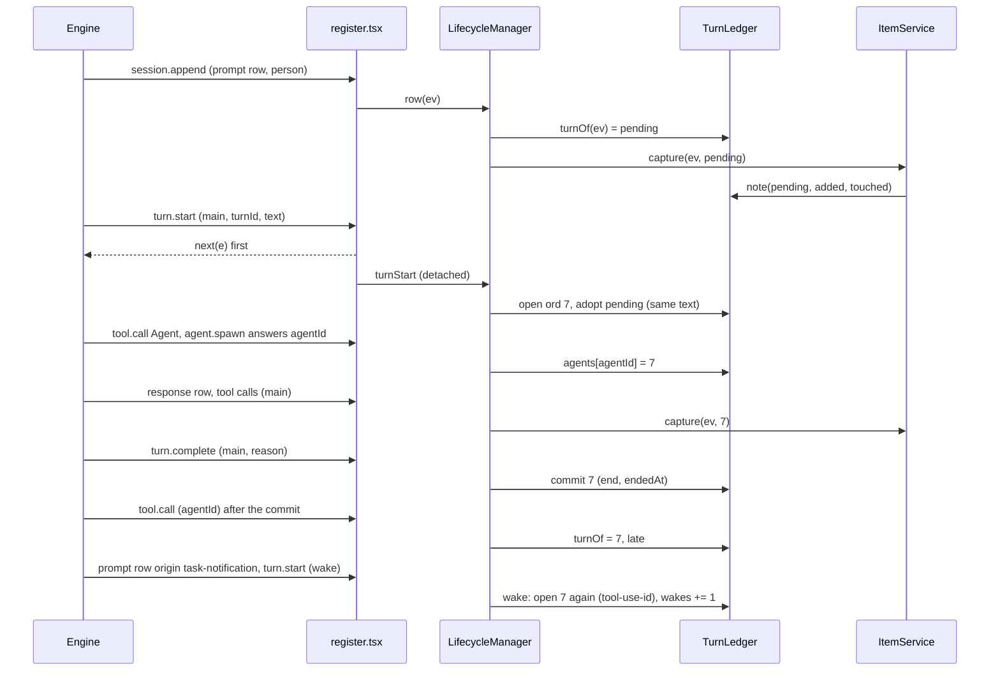
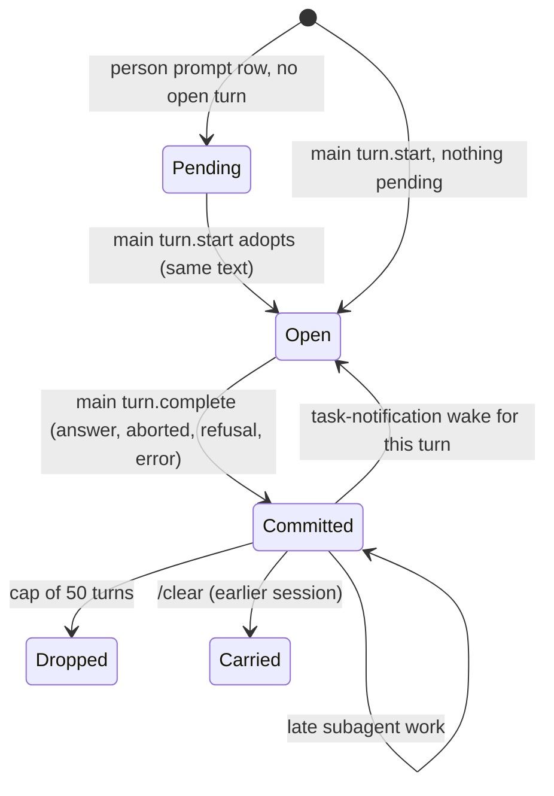

## Design study: Show what each turn tracked and link items to their turn

**Verdict per phase** (weighted mean from `score.mjs`, section 1):

| Phase | Scope | Verdict |
| --- | --- | --- |
| P1, PR 1 | Turn ledger, item lineage, `/track turn [n]`, band part and band key | **Go with caveats** (69/100). Every Must has an observed or test-backed mechanism. Six Musts are `Partial`. |
| P1b, PR 2 | Slot rows (processes, repos, agents) in the turn records | **Spike first.** One `Should`, `Untested` (16/100). The script prints "Rethink scope" for a lone Untested Should. The real gate is a small kit spike, not a new scope. |
| P2, spike + PR 3 | Per-answer strip: `ui.turnStrip` `off`, `text`, `interactive` | **Go** (82/100). This study ran the spike. `interactive` works by mouse on the fullscreen layout only. |

Not tested: `refusal` and `error` turn ends (typed only), nested and workflow agents and teammates, prompts queued during a running turn, a real mouse (the clicks were synthetic SGR bytes in tmux), the strip on a narrow terminal, P1b as a whole, and a machine without managed settings.

Evidence: [comment 2, evidence and judgments](https://github.com/martin-macak/claude-code-mod-tracking/issues/69#issuecomment-6303565557). Probe harness: [comment 3](https://github.com/martin-macak/claude-code-mod-tracking/issues/69#issuecomment-6303567808). Log lines are cited as `L<n>` from comment 2.

### Open owner decisions (recommended answer first)

1. **Which main turns get an ordinal?** All main turns except task-notification wakes. A wake adds its work to the turn that started the task. Reason: one `-p` prompt gave three main `turn.start` events (L5, L40, L49), because `agent.spawn` ran with `background: true` (L15) and each end woke the main loop. (Seen in a `-p` run; no TUI run spawned a subagent.) Counted as turns, "turn n" would not mean the n-th request, and the band would show an empty wake.
2. **The word for "seen again".** Use "seen again" (field `seen`), not "updated". Reason: #62 has a core reason `updated` that means Claude changed the item. A second mention is not an update.
3. **`/track turn` text reaches the model.** Accept it and change the AC to "no lineage in the prompt section or the strip". Reason: a command's `{ text }` reached the next model request as `<local-command-stdout>` (L69, L70), as every `/track` reply does today, and `claude -p` needs the text.
4. **Band key.** A plain band Button with the digit `9` ("9: open"). Reason: a bare digit in an empty prompt presses a band Button (probed with `7`, L102 to L104, L167 to L170). The survey uses 1 to 3 and the pane uses 0 to 3. Any digit works the same way.
5. **What the band key selects.** The first listed entry of the latest turn (new first, then seen again). The rest waits for the row marks or a turn facet of #63. Reason: the pane has one `selected` row today.
6. **Prompt excerpt in the ledger.** Keep the first 60 characters of the person's prompt, for person turns only. Reason: `/track turn` can then name the turn. The text is in the transcript already. The excerpt never goes to the prompt section.
7. **Ledger cap.** 50 turns. At most 50 entries per list, plus an overflow count. Reason: the worst case is about 250 KB per session copy, inside `store.maxBytes` (3 MB).
8. **Delivery.** Three PRs: PR 1 (P1), PR 2 (P1b, after a kit spike), PR 3 (P2, with the KB page of the spike). Reason: PR 1 already spans core, the state contract and the band. Slot rows change the tracker contract. The strip has its own risk.
9. **`ui.turnStrip` default.** Keep `off`. Reason: the engine puts plugin names in front of the line (L199: `s69-probe+cc-plugin-agents-md:`), and the line adds a row to every answer.

<details><summary>How the study was run</summary>

- Code: `origin/main` at 19b67b8 (PR #100 merged), read from an export in the scratchpad. The local checkout was not changed.
- Engine: Claude Code 2.1.305 for every run. Types: the 2.1.305 `index.d.ts` that the engine wrote for the probe. The turn, `TurnDuration`, `AbovePrompt`, `UserMessageTask` and `CommandRunResult` blocks are equal to 2.1.304. Line refs `d.ts:<n>` are 2.1.305.
- Method: the fake-API harness of the `design-study` skill (`probing.md`). A probe mod logged one JSON line per event. A fake Messages API played fixed tool calls and logged which probe markers each request body held (no system prompt is kept). Headless runs A, B, D with `claude -p`. Interactive runs C1 to C4 in a private tmux server (`-L s69probe`), fullscreen and main screen. Clicks were synthetic SGR mouse bytes, the method of PR #113 and PR #121.
- The managed `cc-plugin-sec-default` plugin is seated outermost on this machine (L217). It bypassed one `session.append` row per prompt for the probe (L220). The door of that row is unknown. The probe still got the prompt, response, tool-result, notice, queue and delivery rows. So the KB line "`session.append` is bypassed" (`claude-code-mod-architecture/lifecycle-manager.md:195`) is only partly right. Nothing tried to bypass or turn off the plugin.
- Reviewers: the `advisor` tool at step 6 (matrix and gaps) and step 10 (final check). Step 6 changed decision 1, the labels of the clicks and of the bypassed row, and added run D. Step 10 added the table of surfaces near the answer (section 3), fixed the R5 wording (today's code versus the change), and narrowed three labels: subagent facts are from `-p` only, a keyboard path to a transcript Button was not tried, and the strip rule for `refusal` and `error` is an inference.
- Decision model: Jev (`jev_ask`, one call per item, for Ease, Safety and verdict; `jev_check` per claim in the final review). Every judgment and each override is in comment 2.
- Repo writes: none. The KB slug of the skill is not written. Its content is in these three comments.

</details>

### 1. Score

**Phase 1, PR 1**

| Rank | Item | Priority | Verdict | Evidence | Ease | Safety | Score |
| --- | --- | --- | --- | --- | --- | --- | --- |
| 1 | R4 Background task links to its starting turn | Should | Heuristic | 5 | 3 | 4 | 42 |
| 2 | R7 Ledger in the session store, cap, /resume, /clear | Must | Partial | 4 | 3 | 4 | 56 |
| 3 | R3 Subagent work counts for its spawning turn | Must | Partial | 5 | 3 | 3 | 60 |
| 4 | R5 new and seen-again entries with the #62 reason | Must | Partial | 4 | 4 | 4 | 60 |
| 5 | R11 Band key opens /track with the turn's items selected | Must | Partial | 5 | 3 | 3 | 60 |
| 6 | R8 Lineage never reaches the model | Must | Partial | 5 | 4 | 3 | 65 |
| 7 | R10 Band shows the last turn | Must | Partial | 5 | 4 | 4 | 68 |
| 8 | R6 Item detail shows first and last turn | Must | Feasible | 4 | 3 | 4 | 74 |
| 9 | R12 Kit tests: ledger, attribution, band | Must | Feasible | 4 | 3 | 5 | 78 |
| 10 | R1 Turn ledger: open on turn.start, commit on turn.complete | Must | Feasible | 5 | 3 | 4 | 84 |
| 11 | R2 Main-loop attribution incl. the prompt row | Must | Feasible | 5 | 4 | 3 | 86 |
| 12 | R9 /track turn [n] on every surface | Must | Feasible | 5 | 4 | 4 | 90 |

**Overall: Go with caveats** (mean 55-74). Weighted mean: 69/100. Items are ranked weakest first.

**Phase 1b, PR 2**

| Rank | Item | Priority | Verdict | Evidence | Ease | Safety | Score |
| --- | --- | --- | --- | --- | --- | --- | --- |
| 1 | R13 Slot rows (processes, repos, agents) in turn records and detail | Should | Untested | 2 | 3 | 4 | 16 |

**Overall: Rethink scope** (mean < 55). Weighted mean: 16/100. Evidence rule applied: R13 Partial lowered to Untested (evidence 2 < 4).

**Phase 2, spike + PR 3**

| Rank | Item | Priority | Verdict | Evidence | Ease | Safety | Score |
| --- | --- | --- | --- | --- | --- | --- | --- |
| 1 | R17 interactive strip: buttons on the TurnDuration line | Could | Partial | 5 | 3 | 4 | 63 |
| 2 | R18 -p runs print no strip | Should | Partial | 5 | 5 | 4 | 72 |
| 3 | R15 config ui.turnStrip off\|text\|interactive, default off | Should | Feasible | 4 | 4 | 4 | 80 |
| 4 | R19 Live e2e check of the strip | Should | Feasible | 4 | 4 | 5 | 84 |
| 5 | R16 text strip: one line under each answer | Should | Feasible | 5 | 4 | 4 | 90 |
| 6 | R14 Spike: four answers recorded | Should | Feasible | 5 | 4 | 5 | 94 |

**Overall: Go** (mean >= 75). Weighted mean: 82/100.

The three weakest items: **R13** (no run: slot rows have no claims, so they need a small tracker contract change), **R4** (the link from a wake to its starter parses `<tool-use-id>` out of engine text), **R7** (lineage is lost when the stored copy is gone, and the cap drops old turns).

### 2. Feasibility per item

| Item | Pri | Verdict | Mechanism | Caveat | Evidence |
| --- | --- | --- | --- | --- | --- |
| R1 Ledger opens and commits turns | Must | Feasible | New matcherless `turn.start` hook, main loop only; `turn.complete` commits with the engine reason word. | `refusal` and `error` are typed, not run. | [observed] L5, L29; abort L132; [primary source] d.ts:14213 |
| R2 Main-loop attribution | Must | Feasible | The open turn stamps each main-loop claim. The person's prompt row comes before `turn.start`, so its claims wait in `pending`; the next `turn.start` adopts them (same text). | A prompt that a hook drops leaves `pending` for the next turn. Queued prompts not run. | [observed] L3 before L5; L87 before L89; text equal |
| R3 Subagent work | Must | Partial | `agent.spawn` answers the agent id; the ledger maps it to the open turn. Work with that `agentId` goes there, also after the commit (`late`). | Nested spawns (`parentAgentId`), workflow agents and teammates not run. The sub's `turn.start` came before the spawn answer (L16, L17), so an unmapped id falls back to the open turn. | [observed] L15 to L17, L25, L30, L35 |
| R4 Background task | Should | Heuristic | Capture reads no task-notification row (`core/infra/doors.ts:24-25`). The wake is exact: a prompt row with origin `task-notification` before `turn.start`. Its starter comes from `<tool-use-id>` in the text and a map of main-loop `tool_use_id` to turn. | The tag is engine text, not a field. `RowEvent.task` is not sent on 2.1.305. | [observed] L36 to L40, L46 to L49 |
| R5 new and seen again, with reason | Must | Partial | `mergeClaims` returns the added keys today (`{ list, added, changed }`); PR 1 makes it also return the known keys a claim touched. The entry keeps the strongest reason of the turn's claims. A refresh writes through `applyRefresh` with no claim. | Claims that a tracker pushes with `ctx.items.track` (the PR lane on a tick) carry no turn. | [primary source] `core/lib/records.ts:158-189`, `:237-257`; tests `records.test.ts:91`, `:230` |
| R6 Detail: first and last turn | Must | Feasible | `StoredItem.firstTurn` and `lastTurn`, stamped in `mergeClaims`, min and max in `foldRecords`. Views puts `turns` on each item row (row id = item key). One detail line after the reasons line. | Records from before #69 have no turns. | [primary source] `ux/tree-data-table/detail.ts:11-21`; test `table.test.ts:625` |
| R7 Storage, cap, resume, clear | Must | Partial | A persisted core `DataSlot` `turns` in `v2:s:<id>`; `SwitchRunner` carries it on `/clear` and loads it on `/resume`. | No lineage after a cold load with no stored copy (replayed claims have no turn). The cap drops old turns. | [primary source] `core/infra/persistence.ts:9`, `core/infra/switch-runner.ts:35-86`; tests `lifecycle.test.ts:226`, `:245` |
| R8 Never reaches the model | Must | Partial | No prompt section. The strip is a notice row that no request carried. | The `/track turn` reply reaches the model, as every `/track` reply does. | [observed] no strip marker in the 6 later main-conversation requests (L66, L67, L68 to L70, L225); command text in L69, L70 |
| R9 `/track turn [n]` | Must | Feasible | A core sub of the `Commands` router. | None. | [observed] L55 to L59, L78 |
| R10 Band part | Must | Partial | The `AbovePrompt` hook draws a last-turn part with the counts. No part for an empty turn. | The band exists on the terminal and the desktop only (d.ts:10788). | [observed] L200, L211 |
| R11 Band key selects the items | Must | Partial | A band Button with a digit hotkey opens the pane with `focus: true`, selects the first listed entry and asks for the ring. | One selected row only, until #63. Needs PR #112 (window follows the selection) and PR #121 (the pane takes the keys). | [observed] L102 to L104, L167 to L170 |
| R12 Kit tests | Must | Feasible | Unit tests over the observed orders; kit tests raise `turn.start`, `agent.spawn`, `tool.call`, `turn.complete` and draw the band. | None. | [primary source] `tests/auto-wiring.test.tsx:134`, `tests/register.test.tsx:1520` |
| R13 Slot rows | Should | Untested | `TrackerContext` gets the turn of the event; processes, repos and auto stamp their rows; `Traceable` gets an optional `turnsOf`. | Not run. A core diff of section rows was rejected: it misplaces subagent work that ends after the turn (L30). | [inference] |
| R14 Spike answers | Should | Feasible | This study (section 3). The KB page waits for a repo write. | None. | [observed] |
| R15 `ui.turnStrip` | Should | Feasible | A new key in `GLOBAL_SCHEMA.ui`; a small enum rule in the normaliser. | The normaliser has `int`, `bool`, `words`, `obj` only. | [primary source] `core/lib/global-config.ts:29`, `core/lib/normalise.ts:35-47` |
| R16 `text` strip | Should | Feasible | `turn.complete` returns `{ ...out, text }` for a main turn with entries, else `out`. | The engine adds the plugin names in front. The rule for that prefix is unknown. | [observed] L199, L134, L171 to L193 |
| R17 `interactive` strip | Could | Partial | A `TurnDuration` render hook maps `requestId` to the turn (the uuid of the `turn_duration` notice row) and draws an open Button. | Mouse on the fullscreen layout only (L151 versus L165 to L170). A keyboard path to a transcript Button was not tried. An aborted turn has no duration line. | [observed] L96, L98, L101, L151, L165 |
| R18 `-p` prints no strip | Should | Partial | No code. | `--output-format stream-json` emits a `system` event, subtype `informational`, with the text. | [observed] L74, L76, L80 |
| R19 Live e2e | Should | Feasible | A scenario in `e2e/features` with the SGR click helper (`e2e/support/tmux.ts:99-103`). | Real model turns: not in CI. | [primary source] |

### 3. Spikes

| # | Question | Answer | Tag |
| --- | --- | --- | --- |
| S1 | Which signals mark a main turn? | `turn.start` `{ turnId, text }` with no `agentId` (L5); `turn.complete` `{ turnId, reason, isAborted, durationMs, answer }` with the same id (L29). `text` is the person's prompt (L2, L5). | observed |
| S2 | Is there a prompt id? | `prompt_id` exists on classic hook inputs only (`BaseHookInput`, d.ts:860). Classic events are bypassed for a user-tier mod on a managed machine (KB `claude-code-auto-tracking/open-questions.md` R5). Use `turnId`. | primary source |
| S3 | Order of the prompt row and `turn.start`? | The prompt row comes first (L3 then L5; L87 then L89). | observed |
| S4 | Can subagent work be tied to its spawning turn? | Yes: the spawn answer id (L17) equals the sub's `turn.start` id (L16) and its `tool.call` id (L25). The spawn ran inside main turn 1 (L14, L15), with `background: true`. The sub's tool result and end came after the main end (L29, L30, L35). Seen in `-p` only. | observed |
| S5 | What does a finished background task do? | A queue row, then a prompt row with origin `task-notification` and `<task-id>`, `<tool-use-id>` in the text, then a new main `turn.start` with that text (L36 to L40, L46 to L49). | observed |
| S6 | End reasons? | `answer` (L29), `aborted` with `isAborted: true` and the same id (L132). Typed: `answer`, `aborted`, `refusal`, `error` (d.ts:14213). | observed, primary source |
| S7 | Where does a `turn.complete` text go? | A notice row (type `system`, name `informational`, L33), drawn as one line under the duration line (L198, L199). Returning `next(e)` unchanged adds no row (L180, L181 versus L191 to L193). | observed |
| S8 | Does the strip text reach the model? | No. None of the 6 main-conversation requests made after a strip row existed held it: L66, L67 (after L33), L68 to L70 (`--continue`, the stored transcript holds three strip rows), L225 (after L99). | observed |
| S9 | Can the `TurnDuration` line be matched to its turn? | Yes. `requestId` is the uuid of the `turn_duration` notice row (L96, L98). The row is appended inside `turn.complete`'s `next(e)` (L95 to L97). `props.durationMs` equals the turn's `durationMs` (L95, L98). An aborted turn has no such row (L118 to L134). | observed |
| S10 | Do clicks on a transcript Button reach the mod? | On the fullscreen layout, yes (L101, L151). On the main screen, no (L165 to L170 hold no press). With no layout variable, tmux came up fullscreen here (L148), against the types note "tmux by default" for the main screen (d.ts:1799-1800). | observed (synthetic SGR) |
| S11 | Can a band key open the pane with the keys? | Yes. Digit `7` alone in an empty prompt pressed the band Button; `$.ui.open({ focus: true })` gave `isPlaced: true` and a focused pane, docked and inline (L102 to L104, L167 to L170). | observed |
| S12 | Does a command reply reach the model? | Yes, as `<local-command-stdout>` in the next request (L59, L69). | observed |
| S13 | Does `-p` print the strip? | `text` and `json` output: no (L74, L76). `stream-json`: a `system`/`informational` event (L80). | observed |

**Surfaces that can show a line near the answer**

| Surface | What it gives | Per answer? | Evidence |
| --- | --- | --- | --- |
| Band (`AbovePrompt` render) | Tree above the prompt with Buttons; a bare digit in an empty prompt presses one | No: one band, the latest turn | observed (L200, L211, L102 to L104) |
| `turn.complete` returns `{ text }` | A notice row (`system`, `informational`), one line under the duration line, kept in the transcript, never in a request | Yes, every main answer | observed (L33, L199, S8) |
| `TurnDuration` render | The "Baked for" line as a tree with Buttons; `requestId` names the turn | Yes; a click works on the fullscreen layout only | observed (L98, L101, L151, L165) |
| `$.ui.toast(text)` | A floating line that times out; "leaves the transcript and the model untouched" (d.ts:2468-2483) | No: transient | types-only |
| `$.ui.status(text)` | One pinned line per plugin under the prompt, replaced by the next call (d.ts:2503-2513) | No: one line for the session | types-only |
| `$.ui.notice(tool_use_id, text)` | One line under an open permission dialog (d.ts:2371-2382) | No: dialogs only | types-only |
| Own `$.session.append` (a user-role row or a notice) | A transcript row (d.ts:2950-2960); a user-role row is a message the model reads | Possible | types-only; whether a request carries a plugin's notice row is untested |

The `turn.complete` text is the one surface that is per answer, works on every layout and stays out of the model. It needs no new state beyond the ledger.

<details><summary>Observed shapes (for unit fixtures)</summary>

```ts
// main turn.start input (L5): no agentId
{ turnId: '1cbb654c-…', text: 'probe turn one: track https://github.com/o/r/pull/5' }
// subagent turn.start (L16), heard before agent.spawn resolves (L17)
{ turnId: '01e72b75-…', agentId: 'afe3f3796716e44ee', text: 'SUBMARK run one echo' }
// agent.spawn input (L15) and answer (L17)
{ tool_use_id: 'tu_agent1_main2', subagentType: 'general-purpose', background: true /* no parentAgentId */ }
{ model: 'claude-opus-5-5', agentId: 'afe3f3796716e44ee' }
// turn.complete input, main (L29) and after Esc (L132)
{ turnId: '1cbb654c-…', reason: 'answer', isAborted: false, durationMs: 1290, answer: 'done, see …' }
{ turnId: 'd117df2f-…', reason: 'aborted', isAborted: true, durationMs: 3085, answer: '' }
// the wake: prompt row (L39) then turn.start (L40); the text holds the starter's call id
{ door: 'prompt', origin: { kind: 'task-notification' },
  text: '<task-notification>\n<task-id>afe3f3796716e44ee</task-id>\n<tool-use-id>tu_agent1_main2</tool-use-id>…' }
// TUI end of turn (L95-L99): turn.complete, then inside next(e) the duration row, then the render, then the strip row
{ door: 'notice', origin: { kind: 'engine' }, message: { type: 'system', name: 'turn_duration' }, uuid: '05c26614-…' }
// render TurnDuration: requestId '05c26614-…', props { word: 'Cogitated', durationMs: 300 }, viewport.isFullscreen true
{ door: 'notice', message: { type: 'system', name: 'informational' }, text: '<plugins>: <the returned text>' }
```

</details>

### 4. Gaps and decisions

| # | Gap | Decision |
| --- | --- | --- |
| G1 | The prompt row comes before `turn.start`. | Prompt-door claims with no open turn go to `pending` with the row text. The next main `turn.start` adopts them when its text equals that text, else by order. Claims of other doors with no open turn stay unstamped (for example the arguments of `/track prio`). |
| G2 | Subagent work ends after the main turn. | Map agent id to turn at `agent.spawn`, follow `parentAgentId` for a nested spawn. An unmapped id falls back to the open turn, then the latest. Late work amends the committed record and counts as `late`. |
| G3 | Wakes are main turns. | Owner decision 1. Recommended: no ordinal; the wake opens the starter's record again (from `<tool-use-id>` or `<task-id>`, else the latest turn) and adds `wakes += 1`. Fallback detection: `turn.start` text that starts with `<task-notification>`, for the case that the bypassed row was the prompt row. |
| G4 | "updated" clashes with #62. | Owner decision 2. Field `seen`, text "seen again". |
| G5 | `/track turn` reaches the model. | Owner decision 3. AC changes in section 8. |
| G6 | Store budget. | Entries hold `{ k, c, r }` only. Cap 50 turns, 50 per list plus `more`. Maps of agent ids and call ids keep 200 each, oldest out. |
| G7 | Hot path of `turn.start`. | The hook calls `next(e)` first and returns. The record runs detached (`void soft(...)`). A claim that comes before the record lands in `pending` (G1), so the race is safe. |
| G8 | Hot reload. | The ledger lives in a `$.state` atom `turns` (contract change), not in module memory. |
| G9 | Session switch. | `/clear`: carry the ledger, keep counting, mark older records "earlier session" by their `session` id. `/resume`: load that session's copy. `/track clear`: empty it. Cold load with no copy: no lineage. |
| G10 | Engine end words differ from the issue (`completed`). | Store the engine word: `answer`, `aborted`, `refusal`, `error`. |
| G11 | One selected row. | Owner decision 5. #63 owns marks and a turn facet. |
| G12 | Slot rows have no claims. | PR 2, after a kit spike. Needs an optional `Traceable.turnsOf`, so the AC "Trackers need no new method" changes. |
| G13 | Prompt text. | Owner decision 6. |
| G14 | Band digit. | Owner decision 4. |
| G15 | Engine prefix on the strip. | Not under the mod's control. Owner decision 9 keeps the default `off`. |
| G16 | Open PRs touch the same files. | PR #127 edits `commands.ts`, `lifecycle.ts`, `register.tsx`, `views.ts`. Start PR 1 after #127, #112 and #121 merge. |
| G17 | `/rewind` has no event. | Known limit (issue). |
| G18 | Work the turn did not do. | A PR that the lane finds on a tick, a status refresh and a priority mark add no entry. |

### 5. Design

**Today's architecture, mapped to the issue** (all paths under `plugins/artifact-tracking/`, `origin/main` 19b67b8):

| Part of the issue | Today | What #69 adds |
| --- | --- | --- |
| Turn signals | `hooks/register.tsx:266-270` hooks `turn.complete` and calls `LifecycleManager.turnComplete` (`core/infra/lifecycle.ts:273-277`), which emits `turnComplete` and rebuilds the prompt. No `turn.start` hook. `turnEvent` keeps the raw input (`hooks/events.ts:61-63`). | A `turn.start` hook and `TurnStartEvent`; the ledger opens and commits. |
| Capture | `session.append` (`register.tsx:220-243`) and `tool.call` (`:247-254`) go to `LifecycleManager.row` and `.toolCall` (`lifecycle.ts:255-266`), then `ItemService.capture` and `.toolCall` (`core/infra/items.ts:132-146`), then `ItemStore.track` (`core/infra/item-store.ts:76-86`), then `mergeClaims` (`core/lib/records.ts:158-189`). `Claim` holds a required `reason` (`core/interfaces/items.ts:30-48`). | The manager computes the turn of each event; `track` stamps it; `mergeClaims` reports added and touched keys. |
| Reasons (#62) | `CoreReason`, `ReasonSet` (`types/index.d.ts:38-49`), precedence `REASON_ORDER` (`core/lib/reasons.ts:14-22`), `sighted` adds the claim reason (`records.ts:81-89`), `Traceable` for slot trackers (`core/interfaces/reasons.ts:25-28`), `TreeRow.reasons` (`core/interfaces/view.ts:62`), the detail line (`ux/tree-data-table/detail.ts:11-12`). | Entries carry the strongest reason of the turn's claims. The detail gets a `turns` line beside `reasons`. |
| Store (#55) | `Persistence` keys `v2:s:<id>` (`core/infra/persistence.ts:9`); `DataSlot` (`core/interfaces/slots.ts:8-22`); `LifecycleDeps.extraSlots` (`lifecycle.ts:45`); `slots()` (`:346-348`); carry and load in `SwitchRunner` (`core/infra/switch-runner.ts:35-86`). | A core slot `turns`. |
| Config (#55) | `GLOBAL_SCHEMA.ui` (`core/lib/global-config.ts:29`); rules `int`, `bool`, `words`, `obj` (`core/lib/normalise.ts:35-47`). | `global.ui.turnStrip` (PR 3). |
| Command router (#55) | `Commands.run` (`core/infra/commands.ts:61-76`); `CORE_SUBS`, `USAGE`, `CORE_HINT` (`core/infra/command-text.ts:8-14`). | Core sub `turn [n]`. |
| Band | `AbovePrompt` hook (`register.tsx:287-292`), `bandText` and `renderBand` (`ux/band.ts:12-40`), `Views.bandData` (`core/infra/views.ts:130-135`). No Button. | A last-turn part and an open Button. |
| Pane and selection (#55 TreeDataTable, KeyRegistry) | `selected` atom (`register.tsx:35`), `ports.ui.open` (`:155-156`), `PaneSession.focused` (`hooks/pane-session.ts:80`), `Refocus.to` (`hooks/pane-refocus.ts:37`). KeyRegistry (`core/infra/keys.ts:45`) holds pane keys only. | A `select(id)` call on `PaneSession` for the band press. No pane key. |
| Strip | Nothing. | `turn.complete` text (PR 3) and a `TurnDuration` render hook (PR 3). |

**State** (new `core/interfaces/turns.ts`; the atom goes into `PluginState` in `types/index.d.ts`):

```ts
type TurnEntry = { readonly k: string; readonly c: string; readonly r: CoreReason; readonly late?: true }
type TurnRecord = {
  readonly ord: number; readonly turnId: string; readonly session: string
  readonly startedAt: number; readonly endedAt?: number
  readonly end?: 'answer' | 'aborted' | 'refusal' | 'error'   // engine word, absent while open
  readonly prompt?: string                                     // decision 6
  readonly durationRow?: string                                // PR 3: uuid of the turn_duration row
  readonly new: readonly TurnEntry[]; readonly seen: readonly TurnEntry[]
  readonly more?: number; readonly wakes?: number
}
type TurnLedger = {
  readonly next: number                                        // next ordinal; continues across /clear
  readonly open?: number                                       // the record the running main turn writes to
  readonly pending?: { readonly text: string; readonly entries: readonly TurnEntry[] }
  readonly wake?: { readonly toolUseId?: string; readonly taskId?: string }  // seen on the prompt row, read by turn.start
  readonly turns: readonly TurnRecord[]                        // newest last, cap 50
  readonly agents: readonly (readonly [agentId: string, ord: number])[]     // cap 200
  readonly calls: readonly (readonly [toolUseId: string, ord: number])[]    // main-loop calls, cap 200
}
// StoredItem gains: firstTurn?: number; lastTurn?: number
// Claim gains: turn?: number   (set by core in the capture funnel, never by a kind)
```

**Entry points.**

- `register.tsx`: a new `on('turn.start')`: `const r = await next(e)`; for the main loop only, `void soft(() => managerOf($).turnStart(...))`; return `r`. `agent.spawn` and `session.append` stay; `rowEvent` gains `uuid` and `name` (PR 3 needs them).
- `LifecycleManager`: `turnStart`, and three one-line hand-offs in `row`, `toolCall`, `agentSpawn`, `turnComplete`. The wiring goes to `lifecycle-parts.ts`, as for the other collaborators (the manager is 353 lines).
- `core/lib/turns.ts` (pure, about 150 lines): `turnOf(event, ledger)`, `open`, `adopt`, `commit`, `note`, `cap`, the `<tool-use-id>` parse.
- `core/infra/turn-ledger.ts` (about 150 lines): the atom, the `DataSlot`, `bandPart()`, `target()`, `record(n)`.
- `ItemStore.track(claims, { turn })`: only `ItemService.capture` and `.toolCall` pass a turn, so tracker calls (the lane) never stamp.
- `Views.collect`: a post-pass puts `turns` on item rows. `TreeRow` gains `turns?`.
- `Commands`: `turn [n]`, text from a pure `core/lib/turn-text.ts`.





**Band.** `tracking Links 2 · Repos 1   last turn +3 new · 1 seen again  9: open   /track`. The part shows the latest record with entries, live while the turn runs. The press opens the pane (`ui.open` with `focus: true`), selects the first entry that the pane lists, and asks for the ring (the path of PR #121). With no listed entry it opens the pane and toasts "turn 7: its rows are not listed".

**`/track turn [n]`.**

```
Turn 7 · answer · 12:31 · "fix the flaky test in …" · 3 new, 1 seen again
  new    PR o/r#12 Fix flaky test       created
  new    Issue o/r#13 Flaky on CI       mentioned
  new    example.com/runbook            read       late (subagent)
  again  PR o/r#5 Old fix               mentioned
```

`n` past the cap: "turn 3 is no longer kept (the last 50 turns are)". A carried record: "Turn 3 (earlier session)". No turns: "No turn tracked yet."

**Strip (PR 3).** `text`: `turn.complete` returns `+3 new · 1 seen again · /track turn 7` for a main turn with entries, and `out` itself otherwise (L180, L181: no row then). `interactive`: the `TurnDuration` hook finds the record by `requestId` (the ledger saves the uuid of the next main `turn_duration` row after a commit) and draws the counts and a plain open Button when `viewport.isFullscreen` is true, the counts only on the main screen. An aborted turn has no duration line (L118 to L134), so `interactive` returns the text line for `reason === 'aborted'`. Whether `refusal` and `error` draw a duration line is not known [inference: treat them like `aborted` until a run shows otherwise].

**Limits.** No lineage across `/rewind`, after a cold load with no stored copy, or past the cap. No band on the web and mobile surfaces. Lane finds and refreshes add no entry. Queued prompts, nested and workflow agents and teammates are untested.

### 6. Files to touch

| File | Change (PR) |
| --- | --- |
| `hooks/register.tsx` | `turn.start` hook; band Button; `TurnDuration` hook and strip return (PR 3) (PR 1) |
| `hooks/events.ts`, `core/interfaces/events.ts` | `TurnStartEvent`; `RowEvent.uuid`, `.name` (PR 1, PR 3) |
| `core/interfaces/turns.ts`, `core/lib/turns.ts`, `core/infra/turn-ledger.ts`, `core/lib/turn-text.ts` | New (PR 1) |
| `types/index.d.ts` | Atom `turns`; `StoredItem.firstTurn`, `.lastTurn` (PR 1) |
| `core/interfaces/items.ts` | `Claim.turn?`; `ItemsHost.capture` and `.toolCall` take a turn (PR 1) |
| `core/infra/lifecycle.ts`, `core/infra/lifecycle-parts.ts` | Ledger wiring, extra slot (PR 1) |
| `core/infra/items.ts`, `core/infra/item-store.ts`, `core/lib/records.ts` | Stamp, touched keys, fold of turns (PR 1) |
| `core/infra/views.ts`, `core/interfaces/view.ts`, `ux/tree-data-table/detail.ts` | `TreeRow.turns`, detail line (PR 1) |
| `ux/band.ts` | Turn part and Button (PR 1) |
| `hooks/pane-session.ts` | `select(id)` for the band press (PR 1) |
| `core/infra/commands.ts`, `core/infra/command-text.ts` | `turn [n]` (PR 1) |
| `core/interfaces/tracker.ts`, `core/interfaces/reasons.ts`, `trackers/{processes,repos,auto}/*` | `ctx.turn`, `Traceable.turnsOf` (PR 2) |
| `core/lib/global-config.ts`, `core/lib/normalise.ts` | `ui.turnStrip`, enum rule (PR 3) |
| `README.md`, `docs/knowledge-base/claude-code-mods/reference/events.md`, a new KB page | Docs; spike page; correct the bypass line (PR 1, PR 3) |

### 7. Tests

- Unit, `core/lib/turns.ts`, from the observed orders: prompt row then `turn.start` (L3, L5) adopts `pending`; a text mismatch adopts by order; a sub `turn.start` before the spawn answer (L16, L17) and a sub tool call after the main end (L29, L30) land in the spawning turn as `late`; a wake (L39, L40) opens the starter again by `<tool-use-id>`; an aborted end (L132) commits with `aborted`; the caps drop the oldest and count `more`.
- Unit, `records.ts`: `mergeClaims` stamps `firstTurn` and `lastTurn` and reports touched keys; `foldRecords` keeps min and max; `applyRefresh` stamps nothing.
- Unit, `turn-text.ts` and `band.ts`: the formats, "earlier session", past the cap, an empty turn shows no part.
- Kit (`claude plugin test`): raise `turn.start`, `tool.call`, `agent.spawn`, `turn.complete` in the observed order; check `/track turn` text and the band tree; press the band Button and check `selected` and `ui.open`.
- Persistence: `/clear` carries the ledger and the ordinals go on; `/resume` loads it; `/track clear` empties it.
- Live (tmux, PR 1): type the digit in an empty prompt, see the pane open with the row selected. Live e2e (PR 3): the strip line; a click on the open Button on the fullscreen layout.

### 8. Changes to the acceptance criteria

**PR 1 (P1): lineage, band and command.** Each item names its test.

- [ ] A core TurnLedger opens a record on a main-loop `turn.start` and commits it on `turn.complete` with the engine reason (`answer`, `aborted`, `refusal`, `error`). Each record keeps the engine `turnId` and an ordinal per session. *Unit + kit.*
- [ ] A task-notification wake opens no new ordinal. Its claims go to the turn that started the task (`<tool-use-id>` or `<task-id>`), else the latest turn. *Unit with the L39 to L40 fixture.* (Owner decision 1.)
- [ ] Claims of the person's prompt row, which comes before `turn.start`, land in the turn that the next `turn.start` opens. *Kit, observed order.*
- [ ] Claims with an `agentId` land in the turn that spawned the agent, also after that turn ended (marked late). An unmapped id falls back to the open turn, then the latest. *Kit, observed order.*
- [ ] A committed turn lists `new` and `seen` entries, each with the strongest reason of that turn's claims. A refresh and a tracker's own `items.track` add no entry. *Unit.* (Word: owner decision 2.)
- [ ] An item's detail shows its first and last turn. *Table test.*
- [ ] The ledger is a persisted slot in `v2:s:<id>`, capped at 50 turns and 50 entries per list. `/resume` loads it. `/clear` carries it, ordinals go on, older records read "earlier session". *Lifecycle tests.*
- [ ] No prompt section and no strip carries lineage. The `/track turn` reply is a transcript line, as every `/track` reply. *Prompt test.* (Owner decision 3.)
- [ ] `/track turn [n]` prints turn `n` (default: the latest) on every surface, `claude -p` too. *Commands test + kit.*
- [ ] The band shows the latest turn with entries ("+3 new · 1 seen again"). An empty turn adds no part. *Band test + kit render.*
- [ ] A band key opens `/track` with the first listed entry of that turn selected and the pane focused. *Kit press + live check.* (Owner decisions 4, 5.)

**PR 2 (P1b): slot rows.** Starts with a kit spike: a process row from a subagent's Bash lands in the spawning turn.

- [ ] `TrackerContext` carries the turn of the event it handles. Processes, repos and auto stamp their rows. `Traceable.turnsOf` is optional. *Tracker tests.* (This replaces "Trackers need no new method".)
- [ ] Slot rows appear in the records (`new`; repos also `seen`) and in the detail. *Kit.*

**Spike.** Answered by this study (S7 to S13). Its evidence goes to a KB page in PR 3.

**PR 3 (P2): per-answer strip.**

- [ ] `global.ui.turnStrip` takes `off`, `text` or `interactive`, default `off`. A bad value is a config problem and reads as `off`. *Config test.*
- [ ] `text`: one line under each main answer with entries; no line otherwise. *Kit + live e2e.*
- [ ] `interactive`: the duration line of each turn shows the counts and an open Button on the fullscreen layout; the counts only on the main screen; an aborted turn gets the text line. *Kit render + live e2e click.*
- [ ] `claude -p` with `text` or `json` output prints no strip. `stream-json` carries it as a `system`/`informational` event (accepted). *Live check.*
- [ ] A KB page records S7 to S13 with the logs.

### 9. Open questions

The nine owner decisions at the top. Also:

- Native links: #69 should follow PR #127, #112 and #121 (G16). Add them as "blocked by" only if you agree. #71 already waits for #69.
- Untested: `refusal` and `error` ends; queued prompts; nested spawns, workflow agents, teammates; a real mouse; a narrow terminal; a machine without managed settings.

Decided without the user:

- Engine end words are stored as they are (G10).
- The band shows the open turn live while it runs.
- Claims of non-prompt doors outside a turn stay unstamped (G1).
- The ledger lives in core, not in a tracker: every tracker's items share it.

### 10. Related

- Waits for: #55 and #62 (both closed). Should follow PR #127 (#49), PR #112 (#109), PR #121 (#115).
- Blocks: #71 (Q&A by turn uses the ledger's ordinal and `turnId`).
- #63 grouped views: #69 adds `TreeRow.turns` and one detail line. #63 must carry them into its `Facets` (`firstTurn`, `lastTurn`) and its status area, and owns marks (select all of a turn) and any view or filter by turn. If #63 lands first, PR 1 writes the facet instead.
- #109 / PR #112 pane window: #69 relies on the window that follows `selected`. No change there.
- #115 / PR #121 row click: #69 reuses `ui.open` with `focus: true` and `Refocus.to` for the band press. No change there.
- #49 / PR #127 hide ended rows: hidden process and agent rows matter to PR 2 only. `/track turn` lists every entry; the band key skips rows the pane does not list.
- #105 compact help: #69 adds no pane key, so the help line count does not change.

Generated with Claude Code


## Design study #69, part 2: evidence and judgments

Back to [the study](https://github.com/martin-macak/claude-code-mod-tracking/issues/69#issuecomment-6303560164) · [probe harness](https://github.com/martin-macak/claude-code-mod-tracking/issues/69#issuecomment-6303567808).

**How to read.** Every log line has a number `L<n>`, unique across this comment. The study cites these numbers. After `L<n>` comes `#<seq>`, the probe's own event counter for that process, so the order of events inside one run is exact. `<SCRATCH>` replaces the scratch folder; user names are removed. Rows of the doors `delivery` and `attachment` show `[omitted]` (they can hold engine text for the model). Row ids are cut to 8 characters, except the `turn_duration` rows and the `TurnDuration` request ids, which S9 compares. The fake API keeps no request text: it logs only which probe markers a request body holds and where.

Markers: `TL69-MARKER` is the text the probe returns from `turn.complete` (the strip). `CMD69-MARKER` is the reply of the probe command `/p69`. `TL69BTN` is the Button on the duration line. `TL69BAND` is the probe band.

Engine: Claude Code 2.1.305 (types: the `index.d.ts` the engine wrote for the probe; the turn, `TurnDuration`, `AbovePrompt`, `UserMessageTask` and `CommandRunResult` blocks are the same as in 2.1.304).

### Judgments (Jev `jev_ask`, one call per item)

Evidence comes from the claim tags, never from Jev. Each Jev cell: the expected level, its confidence and the action Jev gave. "Chosen" is the value in the score table. A reason is given for every value that differs from an `act` answer, and for each `review` or `abstain` that was decided by reading the evidence.

| Item | Ease: Jev → chosen | Safety: Jev → chosen | Verdict: Jev → chosen | Reason |
| --- | --- | --- | --- | --- |
| R1 | 2.81 (0.88 act) → 3 | 2.70 (0.14 abstain) → 4 | Partial (0.76 review) → **Feasible** | All four end reasons take one code path. `answer` and `aborted` are observed (L29, L132); `refusal` and `error` are typed (d.ts:14213), Evidence 4. Safety: every step runs in `soft()`; the worst case is a missing record. |
| R2 | 4.18 (0.65 review) → 4 | 3.22 (0.45 abstain) → 3 | Partial / Feasible (0.40 abstain) → Feasible | The only stale case (a prompt that a hook drops leaves `pending`) is rare; it is scored in Safety, not in the verdict. |
| R3 | 3.94 (0.67 review) → 3 | 3.03 (0.59 review) → 3 | Partial (0.65 review) → Partial | Late amends and the fallback for an unmapped id are new state, more than a small change. Nested spawns, workflow agents and teammates are the cases left out. |
| R4 | 3.57 (0.50 review) → 3 | 3.63 (0.49 abstain) → 4 | Feasible (0.50 review) → **Heuristic** | The link from a wake to its starter parses `<tool-use-id>` out of engine text (L39, L48). `scoring.md`: one guessing step makes the item Heuristic. The wake itself is exact (origin `task-notification`). |
| R5 | 4.03 (0.72 review) → 4 | 3.66 (0.47 abstain) → 4 | Partial (0.86 act) → Partial | Fails soft: a missing entry. Lane finds on a tick are the cases left out. |
| R6 | 3.06 (0.95 act) → 3 | 3.96 (0.59 review) → 4 | Feasible (0.79 review) → Feasible | Display only, plus a min/max in the fold. |
| R7 | 3.08 (0.92 act) → 3 | 2.59 (0.52 review) → 4 | Partial (0.65 review) → Partial | A slot that does not load leaves no lineage and nothing else; the size is bounded (G6). |
| R8 | 3.45 (0.57 review) → 4 | 2.87 (0.17 abstain) → 3 | Partial (0.31 abstain) → Partial | Two paths stay out of the model (observed); the `/track turn` reply goes in (L69, L70). Safety 3: lineage reaches the model's context when the person asks for it. |
| R9 | 3.68 (0.72 review) → 4 | 4.15 (0.60 review) → 4 | Feasible (0.49 abstain) → Feasible | The command path is observed (L59, L78). |
| R10 | 3.97 (0.77 review) → 4 | 3.80 (0.71 review) → 4 | Partial (0.56 review) → Partial | The band exists on the terminal and the desktop only (d.ts:10788). |
| R11 | 3.47 (0.58 review) → 3 | 3.19 (0.58 review) → 3 | Partial (0.91 act) → Partial | Selection races exist (PR #121 names one). One row only, until #63. |
| R12 | 3.07 (0.94 act) → 3 | 4.90 (0.96 act) → 5 | Feasible (0.47 abstain) → Feasible | The kit raises the events (`tests/auto-wiring.test.tsx:134`) and renders the band (`tests/register.test.tsx:1520`). |
| R13 | 2.85 (0.73 review) → 3 | 3.90 (0.61 review) → 4 | Partial (0.40 abstain) → Partial, lowered to **Untested** by `score.mjs` | Evidence 2: design from code only. |
| R14 | 3.95 (0.29 abstain) → 4 | 4.61 (0.75 review) → 5 | Partial (0.46 abstain) → **Feasible** | All four spike questions have an observed answer. The synthetic clicks are R17's caveat. |
| R15 | 4.17 (0.85 act) → 4 | 4.25 (0.74 review) → 4 | Feasible (0.74 review) → Feasible | Config pattern plus a small rule. |
| R16 | 4.12 (0.67 review) → 4 | 3.99 (0.83 act) → 4 | Feasible (0.84 act) → Feasible | |
| R17 | 3.04 (0.69 review) → 3 | 3.70 (0.73 review) → 4 | Partial (0.70 review) → Partial | Fullscreen mouse only; no keyboard path. |
| R18 | 2.30 (0.00 abstain) → 5 | 4.01 (0.69 review) → 4 | Not feasible (0.20 abstain) → **Partial** | No code is needed. `text` and `json` output print no strip (L74, L76); `stream-json` carries it (L80). |
| R19 | 4.18 (0.68 review) → 4 | 4.74 (0.83 act) → 5 | Feasible (0.47 abstain) → Feasible | The e2e harness sends SGR clicks already (`e2e/support/tmux.ts:99-103`). |

### Final review (step 10)

One check per claim. First pass: one `jev_ask` with a `check` question per claim over the cited excerpts. A low or uncertain answer was read again by hand; where the excerpt was too thin, a fuller excerpt went to a second check.

| # | Claim (study) | Cited lines | Jev p(yes) | Decision |
| --- | --- | --- | --- | --- |
| C1 | Main `turn.start` has `turnId` and the prompt text, no `agentId`; `turn.complete` has the same id (S1) | L2 to L7, L29 | 0.95 | Supported |
| C2 | The prompt row comes before `turn.start` (S3) | L3, L5, L87, L89 | 0.96 | Supported |
| C3 | Spawn answer id = sub `turn.start` id = sub `tool.call` id; `background: true` (S4) | L14 to L17, L25 | 0.93 | Supported |
| C4 | Sub tool result and sub end come after the main end (S4) | L29, L30, L35 | 0.89 | Supported |
| C5 | A finished task gives a `task-notification` prompt row with `<task-id>`, `<tool-use-id>`, then a new main `turn.start` (S5) | L36 to L40, L46 to L49 | 0.89 | Supported |
| C6 | Esc ends the turn `aborted`, `isAborted: true`, same id (S6) | L122 to L134 | 0.96 | Supported |
| C7 | A new text gives an `informational` row; an unchanged text gives none (S7) | L171 to L193, L82, L84 | 0.18, then 0.89 | First excerpt held only the tail of run D1. With the whole D1 log and its empty `stream-json` result: supported. |
| C8 | No later main-conversation request held the strip marker; L69, L70 held the command marker (S8, S12) | L66 to L70, L225 | 0.92 | Supported |
| C9 | `requestId` = `turn_duration` uuid, the row sits inside `turn.complete`, equal `durationMs` (S9) | L95 to L98, L145 to L148 | 0.63, then 0.93 | The first log cut ids to 8 characters. The log now keeps those ids whole: supported. |
| C10 | A click pressed the strip Button on fullscreen, not on the main screen (S10) | L148 to L151, L165 to L170 | 0.85 | Supported |
| C11 | The band press opened a focused pane, docked and inline (S11) | L102 to L104, L167 to L170 | 0.55 | Read by hand: L104 docked and focused; L169 inline and not yet focused, L170 focused. Supported. |
| C12 | A command reply reached the next request as `<local-command-stdout>` (S12) | L56, L59, L69 | 0.94 | Supported |
| C13 | `-p` text and json print no strip; `stream-json` carries it (S13) | L73 to L80 | 0.88 | Supported |
| C14 | One `session.append` row bypassed, yet prompt, response, notice, queue and delivery rows reached the probe | L217 to L221, L87 to L94 | 0.89 | Supported. The door of the bypassed row is unknown. |
| C15 | The engine puts plugin names before the strip text | L33, L199; harness `register.tsx` | 0.63 | Read by hand: the hook returns text that starts with `TL69-MARKER` (part 3); the row starts with `s69-probe+cc-plugin-agents-md:`. Supported. Why `cc-plugin-agents-md` is named is unknown; it hooks `turn.complete` too (L219). |
| C16 | One `-p` prompt gave three main `turn.start` events (decision 1) | L73, L5, L40, L49 | 0.34, then 0.83 | The first excerpt did not show that run A had one prompt. With L73: supported. |

Reviewer (`advisor`) findings that changed the study. Step 6: wakes take no ordinal (decision 1); the click evidence is labelled synthetic SGR; the door of the bypassed row is not named; run D was added to test an unchanged `turn.complete` text; the claims "a passing repo test covers it" were checked against the test files (`records.test.ts:91`, `:230`; `table.test.ts:625`; `lifecycle.test.ts:226`, `:245`; `auto-wiring.test.tsx:134`; `register.test.tsx:1520`). Step 10: a table of every surface near the answer, with labels (toast, status line, dialog notice and an own `session.append` are types-only); the R5 text now separates today's `mergeClaims` from the change; subagent facts are marked as `-p` only; "no keyboard path found" became "not tried"; the strip rule for `refusal` and `error` is marked as an inference.

Side note for the maintainers: on this machine every prompt also put a line "its session.append hook was skipped" into the transcript (L90, L195) and a `<task-notification>` queue row (L4, L88). That is the engine's report of the bypass for any user-tier mod that hooks `session.append`, the shipped mod included. #69 does not change it.

### Logs

<details><summary>L1-L54 · Run A, `claude -p`, one prompt, a subagent and a background Bash (probe event log)</summary>

```text
L1 #1 session.start cwd=<SCRATCH>/s69-work
L2 #2 prompt.submit {"text":"probe turn one: track https://github.com/o/r/pull/5","origin":{"kind":"sdk"}}
L3 #3 append door=prompt origin=unclassified uuid=2f87051f text="probe turn one: track https://github.com/o/r/pull/5"
L4 #5 append door=queue origin=engine uuid=7c21dc01 text="<task-notification>\\ns69-probe: its session.append hook was skipped. \"c"
L5 #6 turn.start turnId=1cbb654c text="probe turn one: track https://github.com/o/r/pull/5"
L6 #8 append door=delivery origin=unclassified name=queued_command uuid=252b9ee9 text=[omitted]
L7 #10 turn.start.out turnId=1cbb654c
L8 #12 append door=queue origin=engine uuid=207dfb0d text="<task-notification>\\ns69-probe: its session.append hook was skipped. \"c"
L9 #14 append door=response origin=model uuid=3efa6ad6 text="[tool_use]"
L10 #16 tool.call tool=Bash id=tu_bash1_main1
L11 #17 tool.call.out tool=Bash id=tu_bash1_main1
L12 #18 append door=tool-result origin=tool uuid=945ed4f6 text="[tool_result]"
L13 #20 append door=response origin=model uuid=45243928 text="[tool_use]"
L14 #22 tool.call tool=Agent id=tu_agent1_main2
L15 #23 agent.spawn tool_use_id=tu_agent1_main2 subagentType=general-purpose background=true parentAgentId=none
L16 #24 turn.start turnId=01e72b75 agentId="afe3f3796716e44ee" text="SUBMARK run one echo"
L17 #25 agent.spawn.out {"model":"claude-opus-5-5","agentId":"afe3f3796716e44ee"}
L18 #26 tool.call.out tool=Agent id=tu_agent1_main2
L19 #27 append door=prompt origin=coordinator agentId=afe3f3796716e44ee uuid=055c2270 text="SUBMARK run one echo"
L20 #28 turn.start.out turnId=01e72b75
L21 #29 append door=tool-result origin=tool uuid=a4f5e56e text="[tool_result]"
L22 #32 append door=response origin=model uuid=2341ae81 text="[tool_use]"
L23 #33 append door=response origin=model agentId=afe3f3796716e44ee uuid=a77272ca text="[tool_use]"
L24 #36 tool.call tool=Bash id=tu_bg1_main3
L25 #37 tool.call tool=Bash id=tu_sub1_sub1 agentId=afe3f3796716e44ee
L26 #38 tool.call.out tool=Bash id=tu_bg1_main3
L27 #39 append door=tool-result origin=tool uuid=5388ef9a text="[tool_result]"
L28 #41 append door=response origin=model uuid=e9827ebc text="done, see https://example.com/a"
L29 #43 turn.complete turnId=1cbb654c reason="answer" isAborted=false durationMs=1290 answer="done, see https://example.com/a"
L30 #44 tool.call.out tool=Bash id=tu_sub1_sub1
L31 #45 turn.complete.out text="done, see https://example.com/a"
L32 #46 append door=tool-result origin=tool agentId=afe3f3796716e44ee uuid=5bf0be4b text="[tool_result]"
L33 #47 append door=notice origin=engine name=informational uuid=4a61340c text="s69-probe+cc-plugin-agents-md: TL69-MARKER +2 new, 1 updated (turn 1cb"
L34 #50 append door=response origin=model agentId=afe3f3796716e44ee uuid=fc4435ab text="sub done"
L35 #52 turn.complete turnId=01e72b75 agentId="afe3f3796716e44ee" reason="answer" isAborted=false durationMs=230 answer="sub done"
L36 #53 append door=queue origin=engine uuid=eb760b7d text="<task-notification>\\n<task-id>afe3f3796716e44ee</task-id>\\n<tool-use-id>"
L37 #54 turn.complete.out text="sub done"
L38 #56 prompt.submit {"text":"<task-notification>\n<task-id>afe3f3796716e44ee</task-id>\n<tool-use-id>tu_agent1_","origin":{"kind":"task-notification"}}
L39 #57 append door=prompt origin=task-notification uuid=5daeed08 text="<task-notification>\\n<task-id>afe3f3796716e44ee</task-id>\\n<tool-use-id>"
L40 #59 turn.start turnId=ddb8e262 text="<task-notification>\\n<task-id>afe3f3796716e44ee</task-id>\\n<tool-use-id>"
L41 #61 turn.start.out turnId=ddb8e262
L42 #62 append door=response origin=model uuid=18f7e877 text="spare one https://example.com/spare1"
L43 #64 turn.complete turnId=ddb8e262 reason="answer" isAborted=false durationMs=63 answer="spare one https://example.com/spare1"
L44 #65 turn.complete.out text="spare one https://example.com/spare1"
L45 #66 append door=notice origin=engine name=informational uuid=36920103 text="s69-probe+cc-plugin-agents-md: TL69-MARKER +2 new, 1 updated (turn ddb"
L46 #68 append door=queue origin=engine uuid=0701c21b text="<task-notification>\\n<task-id>b7g00b3v2</task-id>\\n<tool-use-id>tu_bg1_m"
L47 #70 prompt.submit {"text":"<task-notification>\n<task-id>b7g00b3v2</task-id>\n<tool-use-id>tu_bg1_main3</tool","origin":{"kind":"task-notification"}}
L48 #71 append door=prompt origin=task-notification uuid=e0631f06 text="<task-notification>\\n<task-id>b7g00b3v2</task-id>\\n<tool-use-id>tu_bg1_m"
L49 #73 turn.start turnId=9e600e95 text="<task-notification>\\n<task-id>b7g00b3v2</task-id>\\n<tool-use-id>tu_bg1_m"
L50 #75 turn.start.out turnId=9e600e95
L51 #76 append door=response origin=model uuid=7565da8b text="spare two"
L52 #78 turn.complete turnId=9e600e95 reason="answer" isAborted=false durationMs=35 answer="spare two"
L53 #79 turn.complete.out text="spare two"
L54 #80 append door=notice origin=engine name=informational uuid=e79d31ef text="s69-probe+cc-plugin-agents-md: TL69-MARKER +2 new, 1 updated (turn 9e6"
```

</details>

<details><summary>L55-L59 · Run B2, `claude -p --continue "/p69"` (the probe command alone)</summary>

```text
L55 #1 session.start cwd=<SCRATCH>/s69-work
L56 #2 command.run {"args":"","presentation":{"isFullscreen":false,"columns":80}}
L57 #3 append door=command origin=unclassified uuid=b4c7d1da text="<local-command-caveat>The command below was run directly in Claude Cod"
L58 #5 append door=command origin=unclassified uuid=6ca2a8a0 text="<command-name>/p69</command-name>\\n            <command-message>p69</co"
L59 #7 append door=command origin=engine name=local_command uuid=df9f9508 text="<local-command-stdout>s69-probe: CMD69-MARKER last main turn </local-c"
```

</details>

<details><summary>L60-L72 · Fake API: per model request, which probe markers the request body held (runs A, B, D)</summary>

```text
L60 req role=main n=1 messages=2 markers=none
L61 req role=main n=2 messages=5 markers=none
L62 req role=main n=3 messages=8 markers=none
L63 req role=sub n=1 messages=2 markers=none
L64 req role=main n=4 messages=11 markers=none
L65 req role=sub n=2 messages=5 markers=none
L66 req role=main n=5 messages=13 markers=none
L67 req role=main n=6 messages=15 markers=none
L68 req role=main n=1 messages=18 markers=none
L69 req role=main n=2 messages=21 markers=CMD69-MARKER at=msg19/user: rgs></command-args>\n"},{"type":"text","text":"<local-command-stdout>s69-probe: CMD69-MARKER last main turn </
L70 req role=main n=3 messages=24 markers=CMD69-MARKER at=msg19/user: rgs></command-args>\n"},{"type":"text","text":"<local-command-stdout>s69-probe: CMD69-MARKER last main turn </
L71 req role=main n=1 messages=2 markers=none
L72 req role=main n=2 messages=5 markers=none
```

</details>

<details><summary>L73-L84 · Command outputs of the headless runs</summary>

```text
L73 $ s69-run.sh -p "probe turn one: track https://github.com/o/r/pull/5" --plugin-dir s69-probe --output-format json   (run A)
L74 {"result":"spare two","is_error":false,"num_turns":1,...}
L75 $ s69-run.sh -p --continue "second SECOND prompt" --plugin-dir s69-probe --output-format text                  (run B1)
L76 second answer
L77 $ s69-run.sh -p --continue "/p69" --plugin-dir s69-probe --output-format json                                    (run B2)
L78 {"result":"s69-probe: CMD69-MARKER last main turn ","num_turns":0,...}
L79 $ s69-run.sh -p --continue "fourth FOURTH prompt" --plugin-dir s69-probe --output-format stream-json --verbose   (run B4, informational events only)
L80 {"type":"system","subtype":"informational","content":"s69-probe+cc-plugin-agents-md: TL69-MARKER +2 new, 1 updated (turn 43e742ef)","level":"notice",...}
L81 $ s69-run.sh -p "nostrip turn" ... --output-format stream-json --verbose        (run D1: hook returned next(e) unchanged; informational events only)
L82 (none)
L83 $ s69-run.sh -p --continue "strip turn" ... --output-format stream-json --verbose   (run D2: hook returned a new text)
L84 "s69-probe+cc-plugin-agents-md: TL69-MARKER +2 new, 1 updated (turn 32e204ab)"
```

</details>

<details><summary>L85-L117 · Run C1, TUI in a private tmux server, fullscreen (CLAUDE_CODE_NO_FLICKER=1): one turn, a click on the strip Button, the band digit 7, a second turn</summary>

```text
L85 #2 session.start cwd=<SCRATCH>/s69-work
L86 #4 prompt.submit {"text":"interactive turn one https://github.com/o/r/pull/12","origin":{"kind":"composer"}}
L87 #6 append door=prompt origin=composer uuid=e5f92115 text="interactive turn one https://github.com/o/r/pull/12"
L88 #8 append door=queue origin=engine uuid=529484fe text="<task-notification>\\ns69-probe: its session.append hook was skipped. \"c"
L89 #9 turn.start turnId=0bd87277 text="interactive turn one https://github.com/o/r/pull/12"
L90 #10 append door=notice origin=engine name=informational uuid=f049ef2e text="s69-probe: its session.append hook was skipped. \"cc-plugin-sec-default"
L91 #12 append door=delivery origin=unclassified name=queued_command uuid=63e13b76 text=[omitted]
L92 #14 turn.start.out turnId=0bd87277
L93 #17 append door=queue origin=engine uuid=cd834b4c text="<task-notification>\\ns69-probe: its session.append hook was skipped. \"c"
L94 #18 append door=response origin=model uuid=12bb9426 text="answer one https://example.com/c1"
L95 #21 turn.complete turnId=0bd87277 reason="answer" isAborted=false durationMs=300 answer="answer one https://example.com/c1"
L96 #22 append door=notice origin=engine name=turn_duration uuid=05c26614-94d4-4b09-86c3-8ea6738495b2 text=""
L97 #24 turn.complete.out text="answer one https://example.com/c1"
L98 #26 render.TurnDuration requestId=05c26614-94d4-4b09-86c3-8ea6738495b2 word=Cogitated durationMs=300 isFullscreen=true
L99 #27 append door=notice origin=engine name=informational uuid=7719002f text="s69-probe+cc-plugin-agents-md: TL69-MARKER +2 new, 1 updated (turn 0bd"
L100 #29 render.TurnDuration requestId=05c26614-94d4-4b09-86c3-8ea6738495b2 word=Cogitated durationMs=300 isFullscreen=true
L101 #30 press.TurnDuration {"requestId":"05c26614-94d4-4b09-86c3-8ea6738495b2"}
L102 #31 press.band {}
L103 #32 band.open {"isPlaced":true}
L104 #34 render.Pane {"isFocused":true,"placement":"dock"}
L105 #35 render.TurnDuration requestId=05c26614-94d4-4b09-86c3-8ea6738495b2 word=Cogitated durationMs=300 isFullscreen=true
L106 #36 render.Pane {"isFocused":false,"placement":"dock"}
L107 #37 prompt.submit {"text":"turn two slow","origin":{"kind":"composer"}}
L108 #39 append door=prompt origin=composer uuid=7ef58fb0 text="turn two slow"
L109 #41 turn.start turnId=b2e06d64 text="turn two slow"
L110 #43 turn.start.out turnId=b2e06d64
L111 #44 append door=response origin=model uuid=b85efd0b text="answer after abort"
L112 #46 turn.complete turnId=b2e06d64 reason="answer" isAborted=false durationMs=96 answer="answer after abort"
L113 #47 append door=notice origin=engine name=turn_duration uuid=677f037a-aed8-4977-894b-8ce516750f1a text=""
L114 #49 turn.complete.out text="answer after abort"
L115 #51 render.TurnDuration requestId=677f037a-aed8-4977-894b-8ce516750f1a word=Worked durationMs=96 isFullscreen=true
L116 #52 append door=notice origin=engine name=informational uuid=a59c028a text="s69-probe+cc-plugin-agents-md: TL69-MARKER +2 new, 1 updated (turn b2e"
L117 #54 render.TurnDuration requestId=677f037a-aed8-4977-894b-8ce516750f1a word=Worked durationMs=96 isFullscreen=true
```

</details>

<details><summary>L118-L134 · Run C2, TUI fullscreen: a slow turn interrupted with Esc</summary>

```text
L118 #3 session.start cwd=<SCRATCH>/s69-work
L119 #4 prompt.submit {"text":"turn abort me","origin":{"kind":"composer"}}
L120 #6 append door=prompt origin=composer uuid=4e5bbce4 text="turn abort me"
L121 #8 append door=queue origin=engine uuid=5ec271ef text="<task-notification>\\ns69-probe: its session.append hook was skipped. \"c"
L122 #9 turn.start turnId=d117df2f text="turn abort me"
L123 #10 append door=notice origin=engine name=informational uuid=ab7ad98d text="s69-probe: its session.append hook was skipped. \"cc-plugin-sec-default"
L124 #13 turn.start.out turnId=d117df2f
L125 #15 append door=delivery origin=unclassified name=queued_command uuid=723fe6b8 text=[omitted]
L126 #17 append door=queue origin=engine uuid=e6d36f9b text="<task-notification>\\ns69-probe: its session.append hook was skipped. \"c"
L127 #18 append door=response origin=model uuid=44d81ef4 text="[tool_use]"
L128 #21 tool.call tool=Bash id=tu_s1_main2
L129 #23 tool.call.out tool=Bash id=tu_s1_main2 isError=true
L130 #24 append door=tool-result origin=tool uuid=a7321857 text="[tool_result]"
L131 #26 append door=note origin=engine uuid=709276cc text="[Request interrupted by user for tool use]"
L132 #28 turn.complete turnId=d117df2f reason="aborted" isAborted=true durationMs=3085 answer=""
L133 #29 turn.complete.out text=""
L134 #30 append door=notice origin=engine name=informational uuid=e034be63 text="s69-probe+cc-plugin-agents-md: TL69-MARKER +2 new, 1 updated (turn d11"
```

</details>

<details><summary>L135-L151 · Run C3, TUI with no layout variable set (it came up fullscreen): one turn and a click on the strip Button</summary>

```text
L135 #3 session.start cwd=<SCRATCH>/s69-work
L136 #4 prompt.submit {"text":"main screen turn","origin":{"kind":"composer"}}
L137 #6 append door=prompt origin=composer uuid=7197d124 text="main screen turn"
L138 #8 append door=queue origin=engine uuid=b94b7222 text="<task-notification>\\ns69-probe: its session.append hook was skipped. \"c"
L139 #9 turn.start turnId=c9db51ba text="main screen turn"
L140 #10 append door=notice origin=engine name=informational uuid=d0e984bd text="s69-probe: its session.append hook was skipped. \"cc-plugin-sec-default"
L141 #13 turn.start.out turnId=c9db51ba
L142 #15 append door=delivery origin=unclassified name=queued_command uuid=7eac52ea text=[omitted]
L143 #17 append door=queue origin=engine uuid=e18f29ed text="<task-notification>\\ns69-probe: its session.append hook was skipped. \"c"
L144 #18 append door=response origin=model uuid=0ec9dd3d text="main screen answer"
L145 #21 turn.complete turnId=c9db51ba reason="answer" isAborted=false durationMs=189 answer="main screen answer"
L146 #22 append door=notice origin=engine name=turn_duration uuid=589f4d1c-aa95-4acd-9d8a-5789bb05dc84 text=""
L147 #24 turn.complete.out text="main screen answer"
L148 #26 render.TurnDuration requestId=589f4d1c-aa95-4acd-9d8a-5789bb05dc84 word=Cogitated durationMs=189 isFullscreen=true
L149 #27 append door=notice origin=engine name=informational uuid=7f218287 text="s69-probe+cc-plugin-agents-md: TL69-MARKER +2 new, 1 updated (turn c9d"
L150 #29 render.TurnDuration requestId=589f4d1c-aa95-4acd-9d8a-5789bb05dc84 word=Cogitated durationMs=189 isFullscreen=true
L151 #30 press.TurnDuration {"requestId":"589f4d1c-aa95-4acd-9d8a-5789bb05dc84"}
```

</details>

<details><summary>L152-L170 · Run C4, TUI on the main screen (CLAUDE_CODE_NO_FLICKER=0): one turn, a click on the strip Button, the band digit 7</summary>

```text
L152 #2 session.start cwd=<SCRATCH>/s69-work
L153 #3 prompt.submit {"text":"main screen turn","origin":{"kind":"composer"}}
L154 #5 append door=prompt origin=composer uuid=c7ebe37a text="main screen turn"
L155 #7 append door=queue origin=engine uuid=1b4e4b50 text="<task-notification>\\ns69-probe: its session.append hook was skipped. \"c"
L156 #8 turn.start turnId=3d5bd37e text="main screen turn"
L157 #9 append door=notice origin=engine name=informational uuid=f20a2306 text="s69-probe: its session.append hook was skipped. \"cc-plugin-sec-default"
L158 #12 turn.start.out turnId=3d5bd37e
L159 #14 append door=delivery origin=unclassified name=queued_command uuid=1f453b72 text=[omitted]
L160 #16 append door=queue origin=engine uuid=a73c5601 text="<task-notification>\\ns69-probe: its session.append hook was skipped. \"c"
L161 #17 append door=response origin=model uuid=46ad0e0f text="main screen answer"
L162 #20 turn.complete turnId=3d5bd37e reason="answer" isAborted=false durationMs=194 answer="main screen answer"
L163 #21 append door=notice origin=engine name=turn_duration uuid=938b9acd-e35e-49a9-b6d3-320602d88f03 text=""
L164 #23 turn.complete.out text="main screen answer"
L165 #25 render.TurnDuration requestId=938b9acd-e35e-49a9-b6d3-320602d88f03 word=Crunched durationMs=194 isFullscreen=false
L166 #26 append door=notice origin=engine name=informational uuid=fa58c1a7 text="s69-probe+cc-plugin-agents-md: TL69-MARKER +2 new, 1 updated (turn 3d5"
L167 #28 press.band {}
L168 #29 band.open {"isPlaced":true}
L169 #30 render.Pane {"isFocused":false,"placement":"inline"}
L170 #31 render.Pane {"isFocused":true,"placement":"inline"}
```

</details>

<details><summary>L171-L193 · Run D, `claude -p`: the turn.complete hook returned next(e) unchanged (D1), then a new text (D2)</summary>

```text
L171 #1 session.start cwd=<SCRATCH>/s69-work
L172 #2 prompt.submit {"text":"nostrip turn","origin":{"kind":"sdk"}}
L173 #3 append door=prompt origin=unclassified uuid=3ec1947b text="nostrip turn"
L174 #5 append door=queue origin=engine uuid=8e662b36 text="<task-notification>\\ns69-probe: its session.append hook was skipped. \"c"
L175 #6 turn.start turnId=5f640104 text="nostrip turn"
L176 #8 append door=delivery origin=unclassified name=queued_command uuid=1e3f5182 text=[omitted]
L177 #10 turn.start.out turnId=5f640104
L178 #12 append door=queue origin=engine uuid=2375a13f text="<task-notification>\\ns69-probe: its session.append hook was skipped. \"c"
L179 #14 append door=response origin=model uuid=1ee6aa11 text="NOSTRIP plain answer"
L180 #16 turn.complete turnId=5f640104 reason="answer" isAborted=false durationMs=156 answer="NOSTRIP plain answer"
L181 #17 turn.complete.out text="NOSTRIP plain answer"
L182 #1 session.start cwd=<SCRATCH>/s69-work
L183 #2 prompt.submit {"text":"strip turn","origin":{"kind":"sdk"}}
L184 #3 append door=prompt origin=unclassified uuid=49e5850c text="strip turn"
L185 #5 append door=queue origin=engine uuid=04e0a1c6 text="<task-notification>\\ns69-probe: its session.append hook was skipped. \"c"
L186 #6 turn.start turnId=32e204ab text="strip turn"
L187 #8 append door=delivery origin=unclassified name=queued_command uuid=38876156 text=[omitted]
L188 #10 turn.start.out turnId=32e204ab
L189 #12 append door=queue origin=engine uuid=b1e0f720 text="<task-notification>\\ns69-probe: its session.append hook was skipped. \"c"
L190 #13 append door=response origin=model uuid=40b2305c text="strip answer"
L191 #16 turn.complete turnId=32e204ab reason="answer" isAborted=false durationMs=200 answer="strip answer"
L192 #17 turn.complete.out text="strip answer"
L193 #18 append door=notice origin=engine name=informational uuid=e3e023c9 text="s69-probe+cc-plugin-agents-md: TL69-MARKER +2 new, 1 updated (turn 32e"
```

</details>

<details><summary>L194-L204 · Screen of run C1 after turn one (fullscreen)</summary>

```text
L194 ❯ interactive turn one https://github.com/o/r/pull/12
L195 ⏺ s69-probe: its session.append hook was skipped. "cc-plugin-sec-default" runs first and sent the event on past it.
L196 ⏺ answer one https://example.com/c1
L197     [ TL69BTN ]
L198 ✻ Cogitated for 0s · done 12:18 AM
L199 ⏺ s69-probe+cc-plugin-agents-md: TL69-MARKER +2 new, 1 updated (turn 0bd87277)
L200 TL69BAND last turn +2 new, 1 updated [ open ]    [-]
L201 ────────────
L202 ❯
L203 ────────────
L204   ⏵⏵ bypass permissions on (shift+tab to cycle)    Debug
```

</details>

<details><summary>L205-L216 · Screen of run C4 after the turn (main screen)</summary>

```text
L205 ❯ main screen turn
L206 ⏺ s69-probe: its session.append hook was skipped. "cc-plugin-sec-default" runs first and sent the event on past it.
L207 ⏺ main screen answer
L208     [ TL69BTN ]
L209 ✻ Crunched for 0s · done 12:21 AM
L210 ⏺ s69-probe+cc-plugin-agents-md: TL69-MARKER +2 new, 1 updated (turn 3d5bd37e)
L211 TL69BAND last turn +2 new, 1 updated [ open ]    [-]
L212 ────────────
L213 ❯
L214 ────────────
L215   ⏵⏵ bypass permissions on (shift+tab to cycle)    tmux focus-events off · add 'set -g focus-events on' to ~/.tmux.conf and reattach for focus tracking
L216     Debug
```

</details>

<details><summary>L217-L221 · Debug log of run A, matching lines</summary>

```text
L217 2026-10-20T22:15:21.050Z [DEBUG] cc-plugin-sec-default@builtin seated outermost: this machine has managed settings
L218 2026-10-20T22:15:21.221Z [DEBUG] hooks module s69-probe@inline loaded (worker, environment 2, tier user); events: session.start,prompt.submit,turn.start,turn.complete,session.append,tool.call,agent.spawn,command.run,ui.render,ui.f
L219 2026-10-20T22:15:21.221Z [DEBUG] hooks module cc-plugin-agents-md@builtin loaded (native, environment 3, tier builtin); events: session.start,prompt.context,command.run,session.compact,prompt.submit,turn.start,turn.complete,agent.
L220 2026-10-20T22:15:21.373Z [DEBUG] s69-probe: session.append bypassed by cc-plugin-sec-default (tier user); beneath runs
L221 2026-10-20T22:15:21.374Z [DEBUG] [s69-probe] $.ui.log: its session.append hook was skipped. "cc-plugin-sec-default" runs first and sent the event on past it.
```

</details>

<details><summary>L222-L225 · Fake API: the requests of run C1 (requests 1 and 3 hold one message: side requests, not the conversation)</summary>

```text
L222 req role=main n=1 messages=1 markers=none (run C1, request 1 of the session)
L223 req role=main n=2 messages=2 markers=none (run C1, request 2 of the session)
L224 req role=main n=3 messages=1 markers=none (run C1, request 3 of the session)
L225 req role=main n=4 messages=5 markers=none (run C1, request 4 of the session)
```

</details>

Generated with Claude Code


## Design study #69, part 3: probe harness

Back to [the study](https://github.com/martin-macak/claude-code-mod-tracking/issues/69#issuecomment-6303560164) · [evidence](https://github.com/martin-macak/claude-code-mod-tracking/issues/69#issuecomment-6303565557).

The harness of the `design-study` skill (`.agents/skills/design-study/probing.md`), cut to what #69 needs. It needs no model and no login. `<SCRATCH>` stands for a scratch folder. Engine: Claude Code 2.1.305.

**Files**

| File | Role |
| --- | --- |
| `s69-probe/.claude-plugin/plugin.json`, `s69-probe/hooks/hooks.json` | The probe mod (one module). |
| `s69-probe/hooks/register.tsx` | Logs one JSON line per event to `<SCRATCH>/s69-out/ev.jsonl`. Returns a strip text from `turn.complete`, draws a Button on the `TurnDuration` line and a band with a digit Button, opens a small pane, answers `/p69`. |
| `s69-fake.mjs` | Fake Messages API on `127.0.0.1:8799`. Plays the turn script in `$SEQ` per role (`sub` when the first message holds `SUBMARK`). Logs per request which probe markers the body holds (`$REQLOG`); no request text is kept. |
| `s69-run.sh` | Launcher with a clean environment and a scratch config dir. |
| `s69-seq-a.json` to `s69-seq-d.json` | Turn scripts. |

**Runs**

```bash
S=<SCRATCH>
claude plugin validate $S/s69-probe                      # passes (directory warnings only: README, LICENSE, icon)
mkdir -p $S/s69-out $S/s69-cfg $S/s69-work && git -C $S/s69-work init -q

# A: headless, one prompt, a subagent and a background Bash
SEQ=$S/s69-seq-a.json REQLOG=$S/s69-out/req-a.jsonl node $S/s69-fake.mjs &
$S/s69-run.sh -p "probe turn one: track https://github.com/o/r/pull/5" --plugin-dir $S/s69-probe \
  --permission-mode bypassPermissions --output-format json --debug
# B: restart the fake with s69-seq-b.json, then in the same session:
$S/s69-run.sh -p --continue "second SECOND prompt" --plugin-dir $S/s69-probe --permission-mode bypassPermissions --output-format text
$S/s69-run.sh -p --continue "/p69" --plugin-dir $S/s69-probe --permission-mode bypassPermissions --output-format json
$S/s69-run.sh -p --continue "third THIRD prompt" --plugin-dir $S/s69-probe --permission-mode bypassPermissions --output-format stream-json --verbose
# D: s69-seq-d.json; D1 answers "NOSTRIP …" (the hook returns next(e) unchanged), D2 with --continue gets a strip

# C: interactive, private tmux server (never the default socket)
jq '.hasCompletedOnboarding=true | .theme="dark" | .projects["<real and /tmp paths of s69-work>"].hasTrustDialogAccepted=true' …  # into $S/s69-cfg/.claude.json
tmux -L s69probe -f /dev/null new-session -d -s tui -x 160 -y 45 \
  "ALARM=400 EXTRA_ENV=CLAUDE_CODE_NO_FLICKER=1 $S/s69-run.sh --plugin-dir $S/s69-probe --permission-mode bypassPermissions --debug"
tmux -L s69probe send-keys -t tui Down; tmux -L s69probe send-keys -t tui Enter       # leave the bypass warning on "Yes"
tmux -L s69probe send-keys -t tui -l "interactive turn one https://github.com/o/r/pull/12"; tmux -L s69probe send-keys -t tui Enter
tmux -L s69probe capture-pane -p -t tui                                                # find "[ TL69BTN ]": row R, column C
tmux -L s69probe send-keys -t tui -l $'\x1b[<0;C;RM'; tmux -L s69probe send-keys -t tui -l $'\x1b[<0;C;Rm'   # SGR click
tmux -L s69probe send-keys -t tui -l "7"                                               # bare digit in an empty prompt: band Button
tmux -L s69probe send-keys -t tui Escape                                               # during a slow turn: abort (run C2)
# C3: no layout variable; C4: EXTRA_ENV=CLAUDE_CODE_NO_FLICKER=0 (main screen)
tmux -L s69probe kill-server; kill %1                                                  # cleanup
```

Cleanup after the runs: the fake API stopped, the private tmux server killed (`no server running on …/s69probe`), no probe process left in `ps`. The scratch files were deleted at the end of the study.

<details><summary><code>s69-probe/hooks/register.tsx</code></summary>

```tsx
// Probe for the design study of issue #69: which engine signals mark a turn, and which surfaces can show a line near
// the answer. It logs one JSON line per event. No state contract: it keeps nothing in $.state.
import type { EngineInterface, Register } from 'claude-code'

const OUT = '<SCRATCH>/s69-out/ev.jsonl'
let seq = 0
let chain: Promise<void> = Promise.resolve()

function put($: EngineInterface, kind: string, data: unknown): Promise<void> {
  const n = ++seq
  const at = Date.now()
  chain = chain.then(async () => {
    try {
      const prev = (await $.fs.exists(OUT)) ? await $.fs.read(OUT) : ''
      await $.fs.write(OUT, prev + JSON.stringify({ n, at, kind, data }) + '\n')
    } catch {
      // a log line must never fail a hook
    }
  })
  return chain
}

const cut = (s: unknown, n = 120): string => (typeof s === 'string' ? s.slice(0, n) : JSON.stringify(s ?? null).slice(0, n))

function textOf(content: unknown): string {
  if (!Array.isArray(content)) return cut(content)
  return cut(
    content
      .map(b => (b && typeof b === 'object' && 'text' in b ? String((b as { text: unknown }).text) : `[${(b as { type?: string })?.type}]`))
      .join(' | '),
  )
}

let lastTurn = ''

export const register: Register = on => {
  on('session.start', async ($, e, next) => {
    await put($, 'session.start', { cwd: e.cwd })
    try {
      await $.command.register({ name: 'p69', description: 'probe 69 command' })
    } catch (err) {
      await put($, 'command.register.err', String(err))
    }
    return next(e)
  })

  on('prompt.submit', async ($, e, next) => {
    await put($, 'prompt.submit', { text: cut(e.text, 80), origin: (e as { origin?: unknown }).origin })
    const r = await next(e)
    await put($, 'prompt.submit.out', { drop: (r as { drop?: unknown })?.drop })
    return r
  })

  on('turn.start', async ($, e, next) => {
    await put($, 'turn.start', { turnId: e.turnId, agentId: e.agentId, text: cut(e.text, 80) })
    const r = await next(e)
    if (e.agentId === undefined) lastTurn = e.turnId
    await put($, 'turn.start.out', r)
    return r
  })

  on('turn.complete', async ($, e, next) => {
    await put($, 'turn.complete', {
      turnId: e.turnId,
      agentId: e.agentId,
      reason: e.reason,
      isAborted: e.isAborted,
      durationMs: e.durationMs,
      answer: cut(e.answer, 60),
    })
    const out = await next(e)
    await put($, 'turn.complete.out', { text: cut(out.text, 60) })
    if (e.agentId !== undefined) return out
    if (e.answer.includes('NOSTRIP')) return out
    return { ...out, text: `TL69-MARKER +2 new, 1 updated (turn ${e.turnId.slice(0, 8)})` }
  })

  on(
    'session.append',
    {
      door: [
        'prompt',
        'command',
        'response',
        'tool-result',
        'tool-message',
        'delivery',
        'attachment',
        'hook-context',
        'note',
        'compaction',
        'notice',
        'queue',
      ],
    },
    async ($, e, next) => {
      const m = e.message
      await put($, 'append', {
        door: e.door,
        origin: e.origin,
        uuid: e.uuid,
        agentId: e.agentId,
        type: m.type,
        name: m.name,
        role: m.role,
        isMeta: m.isMeta,
        task: (e as { task?: unknown }).task,
        text: e.door === 'attachment' ? '[attachment]' : textOf(m.content),
      })
      const stored = await next(e)
      await put($, 'append.out', { uuid: stored.uuid })
      return stored
    },
  )

  on('tool.call', async ($, e, next) => {
    await put($, 'tool.call', { tool: e.tool, tool_use_id: e.tool_use_id, agentId: e.agentId, input: cut(e, 160) })
    const r = await next(e)
    await put($, 'tool.call.out', { tool: e.tool, tool_use_id: e.tool_use_id, isError: (r as { isError?: unknown }).isError })
    return r
  })

  on('agent.spawn', async ($, e, next) => {
    await put($, 'agent.spawn', cut(e, 300))
    const out = await next(e)
    await put($, 'agent.spawn.out', out)
    return out
  })

  on('command.run', { command: 'p69' }, async ($, e) => {
    await put($, 'command.run', { args: e.args, presentation: e.presentation })
    return { text: `CMD69-MARKER last main turn ${lastTurn.slice(0, 8)}` }
  })

  on('ui.render', { component: 'TurnDuration' }, async ($, e, next) => {
    await put($, 'render.TurnDuration', { requestId: e.requestId, props: e.props, viewport: e.viewport })
    const engine = await next(e)
    const { Box, Button } = $.ui.resolve(e)
    return (
      <Box flexDirection="row" columnGap={1}>
        {engine}
        <Button
          key="tl69strip"
          label="TL69BTN"
          onPress={() => void put($, 'press.TurnDuration', { requestId: e.requestId })}
        />
      </Box>
    )
  })

  on('ui.render', { component: 'AbovePrompt' }, async ($, e, next) => {
    if (e.props.hasSurvey) return next(e)
    await put($, 'render.AbovePrompt', { isWorking: e.props.isWorking, bodyColumns: e.props.bodyColumns })
    const engine = await next(e)
    const { Box, Text, Button } = $.ui.resolve(e)
    return (
      <Box flexDirection="column">
        <Box columnGap={1}>
          <Text dimColor>TL69BAND last turn +2 new, 1 updated</Text>
          <Button
            key="tl69band"
            hotkey="7"
            label="open"
            onPress={async () => {
              await put($, 'press.band', {})
              try {
                const r = await $.ui.open({ id: 'p69', title: 'P69', focus: true })
                await put($, 'band.open', r)
              } catch (err) {
                await put($, 'band.open.err', String(err))
              }
            }}
          />
        </Box>
        {engine}
      </Box>
    )
  })

  on('ui.render', { component: 'Pane', requestId: 'p69' }, async ($, e) => {
    await put($, 'render.Pane', { isFocused: e.props.isFocused, placement: e.props.placement })
    const { Box, Button } = $.ui.resolve(e)
    return (
      <Box flexDirection="column">
        <Button key="row:a" label="ROW-A" onPress={() => void put($, 'press.row', { row: 'a' })} />
        <Button key="row:b" label="ROW-B" onPress={() => void put($, 'press.row', { row: 'b' })} />
      </Box>
    )
  })

  on('ui.focus', { requestId: 'p69' }, async ($, e, next) => {
    await put($, 'ui.focus', { element: e.element })
    return next(e)
  })
}
```

</details>

<details><summary><code>s69-probe/.claude-plugin/plugin.json</code> and <code>hooks/hooks.json</code></summary>

```json
{ "name": "s69-probe", "version": "0.1.0", "description": "Design study probe for issue 69: turn events, strip, band" }
{ "modules": ["./register.tsx"] }
```

</details>

<details><summary><code>s69-fake.mjs</code></summary>

```js
// Fake Messages API for the #69 probe. SEQ file: { "<role>": [turns...] }. role "sub" when the first user message holds
// SUBMARK. Logs per request: role, count, message count, and which probe markers the body holds. No system prompt text.
import http from 'node:http'; import fs from 'node:fs'
const port = Number(process.env.PORT || 8799)
const counters = {}
const LOG = process.env.REQLOG
const MARKERS = ['TL69-MARKER', 'CMD69-MARKER', 'TL69BAND', 'TL69BTN']
http.createServer((req, res) => {
  let body = ''; req.on('data', d => body += d)
  req.on('end', () => {
    if (req.url.includes('count_tokens')) { res.writeHead(200, {'content-type':'application/json'}); return res.end('{"input_tokens":10}') }
    let j = {}; try { j = JSON.parse(body) } catch {}
    const seqAll = JSON.parse(fs.readFileSync(process.env.SEQ, 'utf8'))
    const msgs = j.messages || []
    const first = JSON.stringify(msgs[0] || '')
    const role = first.includes('SUBMARK') ? 'sub' : 'main'
    const seq = seqAll[role] || []
    if (!j.stream) { res.writeHead(200, {'content-type':'application/json'}); return res.end(JSON.stringify({ id:'m', type:'message', role:'assistant', model:j.model||'fake', content:[{type:'text',text:'ok'}], stop_reason:'end_turn', stop_sequence:null, usage:{input_tokens:1,output_tokens:1} })) }
    const n = counters[role] = (counters[role] || 0) + 1
    if (LOG) {
      const msgText = JSON.stringify(msgs)
      const hits = Object.fromEntries(MARKERS.map(m => [m, msgText.includes(m)]))
      // where a marker sits: role of the message and a short excerpt around it
      const where = []
      msgs.forEach((m, i) => { const t = JSON.stringify(m.content); for (const k of MARKERS) { const at = t.indexOf(k); if (at >= 0) where.push({ i, role: m.role, marker: k, excerpt: t.slice(Math.max(0, at - 80), at + 60) }) } })
      fs.appendFileSync(LOG, JSON.stringify({ at: Date.now(), role, n, messages: msgs.length, hits, where }) + '\n')
    }
    const turn = seq[Math.min(n - 1, seq.length - 1)] || [{type:'text',text:'end'}]
    res.writeHead(200, {'content-type':'text/event-stream'})
    const ev = (t, d) => res.write('event: ' + t + '\ndata: ' + JSON.stringify({ type: t, ...d }) + '\n\n')
    ev('message_start', { message: { id:'msg'+role+n, type:'message', role:'assistant', model: j.model||'fake', content:[], stop_reason:null, stop_sequence:null, usage:{input_tokens:10,output_tokens:1} } })
    turn.forEach((b, i) => {
      if (b.type === 'text') { ev('content_block_start', { index: i, content_block: { type:'text', text:'' } }); for (const c of (b.text.match(/[\s\S]{1,15}/g) || [''])) ev('content_block_delta', { index: i, delta: { type:'text_delta', text: c } }) }
      else { const id = b.id + '_' + role + n; ev('content_block_start', { index: i, content_block: { type:'tool_use', id, name: b.name, input: {} } }); const js = JSON.stringify(b.input); for (const c of (js.match(/[\s\S]{1,20}/g) || [''])) ev('content_block_delta', { index: i, delta: { type:'input_json_delta', partial_json: c } }) }
      ev('content_block_stop', { index: i })
    })
    ev('message_delta', { delta: { stop_reason: turn.some(b=>b.type==='tool_use') ? 'tool_use' : 'end_turn', stop_sequence: null }, usage: { output_tokens: 20 } })
    ev('message_stop', {}); res.end()
  })
}).listen(port, '127.0.0.1', () => console.log('listening', port))
```

</details>

<details><summary><code>s69-run.sh</code></summary>

```bash
#!/bin/zsh
# Launcher for the #69 probe: a clean environment, the fake API, the scratch config dir. Usage: s69-run.sh <args...>
S=<SCRATCH>
cd $S/s69-work
exec env -u CLAUDECODE -u CLAUDE_CONFIG_DIR $(env | grep -o '^CLAUDE_CODE_[A-Z_]*' | sed 's/^/-u /' | tr '\n' ' ') \
  CLAUDE_CONFIG_DIR=$S/s69-cfg ANTHROPIC_BASE_URL=http://127.0.0.1:${PORT:-8799} ANTHROPIC_AUTH_TOKEN=fake \
  CLAUDE_CODE_DISABLE_NONESSENTIAL_TRAFFIC=1 DISABLE_AUTOUPDATER=1 ${EXTRA_ENV:-} \
  perl -e 'alarm ${ALARM:-120}; exec @ARGV' claude "$@"
```

</details>

<details><summary>Turn scripts</summary>

`s69-seq-a.json` (run A):

```json
{
  "main": [
    [{ "type": "tool_use", "id": "tu_bash1", "name": "Bash", "input": { "command": "echo https://github.com/o/r/issues/7", "description": "echo an issue url" } }],
    [{ "type": "tool_use", "id": "tu_agent1", "name": "Agent", "input": { "description": "probe sub", "prompt": "SUBMARK run one echo", "subagent_type": "general-purpose" } }],
    [{ "type": "tool_use", "id": "tu_bg1", "name": "Bash", "input": { "command": "sleep 3; echo https://github.com/o/r/pull/9", "description": "background echo", "run_in_background": true } }],
    [{ "type": "text", "text": "done, see https://example.com/a" }],
    [{ "type": "text", "text": "spare one https://example.com/spare1" }],
    [{ "type": "text", "text": "spare two" }],
    [{ "type": "text", "text": "spare three" }]
  ],
  "sub": [
    [{ "type": "tool_use", "id": "tu_sub1", "name": "Bash", "input": { "command": "echo https://github.com/o/r/issues/8", "description": "sub echo" } }],
    [{ "type": "text", "text": "sub done" }],
    [{ "type": "text", "text": "sub spare" }]
  ]
}
```

`s69-seq-b.json` (runs B): four text answers. `s69-seq-c.json` (runs C): for C1 a Bash echo then text answers; for C2 three `sleep 8` Bash calls then text; for C3 and C4 text answers only. `s69-seq-d.json` (run D):

```json
{ "main": [ [{ "type": "text", "text": "NOSTRIP plain answer" }], [{ "type": "text", "text": "strip answer" }] ] }
```

</details>

Generated with Claude Code

