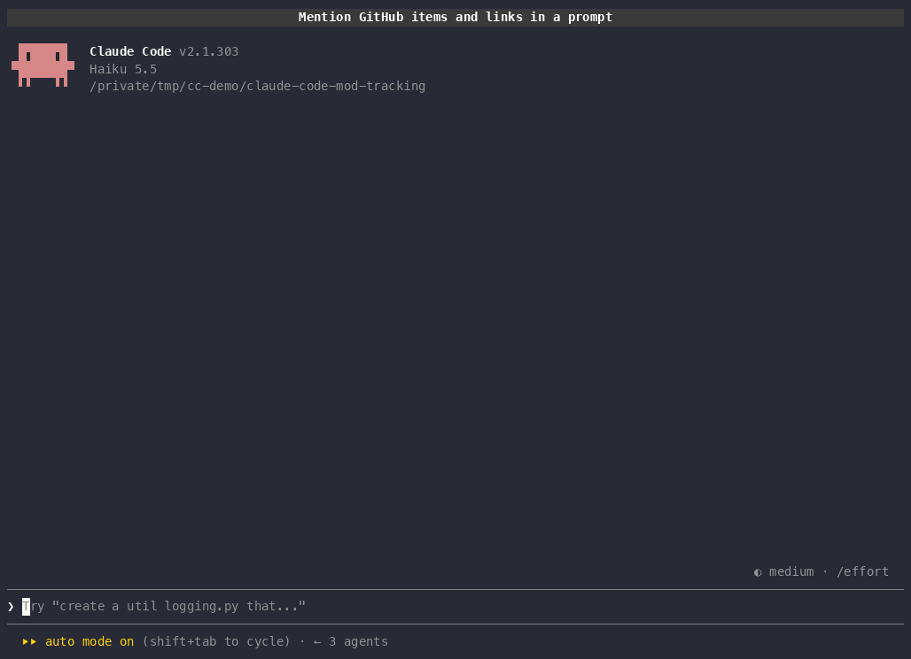

<h1 align="center">claude-code-mod-tracking</h1>

```text
  __  __  ___  ___    _____ ___    _   ___ _  _____ _  _  ___
 |  \/  |/ _ \|   \  |_   _| _ \  /_\ / __| |/ /_ _| \| |/ __|
 | |\/| | (_) | |) |   | | |   / / _ \ (__| ' < | || .` | (_ |
 |_|  |_|\___/|___/    |_| |_|_\/_/ \_\___|_|\_\___|_|\_|\___|

   #42 ──▶  PROJ-7 ──▶  https://…   ──▶  [ tracking  GitHub 4 (1 ✗) ]
```

<p align="center">
  <strong>Claude Code mods that keep track of the work around your session.</strong><br>
  Issues, PRs, Jira items, links, worktrees and agents — in one live pane.
</p>

<p align="center">
  <a href="https://github.com/martin-macak/claude-code-mod-tracking/actions/workflows/test.yml"></a>
  <a href="https://github.com/martin-macak/claude-code-mod-tracking/actions/workflows/lint.yml"></a>
  <a href="https://github.com/martin-macak/claude-code-mod-tracking/actions/workflows/release.yml"></a>
  <a href="https://github.com/martin-macak/claude-code-mod-tracking/releases/latest"></a>
  <br>
  <a href="#requirements"></a>
  <a href="LICENSE"></a>
  <a href="https://github.com/martin-macak/claude-code-mod-tracking/commits/main"></a>
  <a href="https://github.com/martin-macak/claude-code-mod-tracking/issues"></a>
  <a href="https://www.conventionalcommits.org/en/v1.0.0/"></a>
  <a href="#report-a-bug-or-ask-for-a-feature"></a>
</p>

<p align="center">
  <a href="#features">Features</a> ·
  <a href="#installation">Installation</a> ·
  <a href="#usage">Usage</a> ·
  <a href="#report-a-bug-or-ask-for-a-feature">Report a bug</a> ·
  <a href="#development">Development</a> ·
  <a href="plugins/artifact-tracking/README.md">Full docs</a>
</p>

---

This repo holds Claude Code mods (function-hooks plugins) and the research behind them.

The first mod is [`artifact-tracking`](plugins/artifact-tracking/README.md). A session mentions GitHub issues and PRs, Jira work items and web links. The mod finds them, fetches their live state and shows them in a `/track` pane and in a band above the prompt. You stop losing the PR from an hour ago in the scrollback.

> [!NOTE]
> Mods are in early access. The API changes between Claude Code releases. This repo needs Claude Code 2.1.295 or newer.

## Demo



You mention a PR, an issue and a docs link in a normal prompt. The mod finds them, and the band above the prompt counts them at once. A second prompt adds a PR with failing checks, and the band shows `(1 ✗)`. `/track` opens a pane with the live title, state and checks of each item from `gh`, and a section for web links. Press `r` to refresh every item and `Esc` to close the pane.

The GIF comes from a Gherkin scenario, [`e2e/features/tracking.feature`](e2e/features/tracking.feature), that `make demo` records. The same scenario runs as a test under `make e2e`.

## Features

- **Zero-effort capture.** Finds GitHub issue and PR URLs, `owner/repo#N`, bare `#N`, Jira URLs and web links in your prompts and in Claude's replies, also from subagents. Tool output gives explicit GitHub and Jira URLs only.
- **Live state.** Shows title, open, closed or merged, failing checks, Jira status and the Epic tree. Data comes from `gh` (one GraphQL call for each host) and `acli`.
- **Always in view.** A one-line band above the prompt counts the items: `tracking  Jira 6 · GitHub 4 (1 ✗) · Links 2  /track`.
- **Interactive pane.** `/track` opens a pane with one section for each source. Press `r` to refresh, `x` to hide an auto row, `Esc` to close.
- **Auto tracking.** Tracks the worktrees, agents and pull requests of the session with no mention, also stacked PRs and the refs in a PR body.
- **Survives restarts.** Keeps the items across `/clear`, `--resume` and `--continue`.
- **Fails soft.** Without `gh` or `acli`, the items stay in the list and the section says why. A circuit breaker pauses a failing tool for 5 minutes.
- **Private by design.** The mod stores only the extracted fields, never raw CLI output.

## Installation

### Requirements

- [Claude Code](https://docs.claude.com/en/docs/claude-code/overview) 2.1.295 or newer, with mods.
- Optional: [`gh`](https://cli.github.com/) 2.102 or newer, logged in. It gives the live state of GitHub items.
- Optional: [`acli`](https://developer.atlassian.com/cloud/acli/) 1.3.19 or newer, logged in. It gives the live state of Jira items.

### From the marketplace (recommended)

In a Claude Code session:

```text
/plugin install artifact-tracking --marketplace martin-macak/claude-code-mod-tracking
```

Answer `y` to add the marketplace `mod-tracking`, then pick a scope. From a shell:

```bash
claude plugin install artifact-tracking --marketplace martin-macak/claude-code-mod-tracking
```

Get a new release:

```bash
claude plugin update artifact-tracking@mod-tracking
```

### From a release zip

Each [GitHub release](https://github.com/martin-macak/claude-code-mod-tracking/releases) attaches `artifact-tracking-<version>.zip`, a `SHA256SUMS` file and a build provenance attestation. Load a zip for one session:

```bash
claude --plugin-url https://github.com/martin-macak/claude-code-mod-tracking/releases/download/artifact-tracking--v<version>/artifact-tracking-<version>.zip
```

### From source

```bash
git clone https://github.com/martin-macak/claude-code-mod-tracking.git
cd claude-code-mod-tracking
claude --plugin-dir plugins/artifact-tracking   # one session
make install                                    # every session, as a symlink
```

## Usage

Work as usual. Mention issues, PRs, Jira keys and links in your prompts. The band fills by itself.

| Command | Action |
| --- | --- |
| `/track` | Opens the pane and refreshes the items that are due. |
| `/track refresh` | Refreshes every item and waits. Use it in `claude -p`. |
| `/track clear` | Removes all items of this session. |

The [mod README](plugins/artifact-tracking/README.md) lists every captured pattern, the auto-tracking rules, persistence and the known limits.

## Report a bug or ask for a feature

This project is young, and your feedback shapes it. A short report helps a lot. Did something break? Is a pattern missing? Do you want a new column or a new mod? Tell us.

- 🐛 [**Report a bug**](https://github.com/martin-macak/claude-code-mod-tracking/issues/new?template=bug_report.yml): state the symptom. Add your Claude Code version and the steps to reproduce.
- 💡 [**Ask for a feature**](https://github.com/martin-macak/claude-code-mod-tracking/issues/new?template=feature_request.yml): state the problem first, then your idea.
- 🧰 [**Propose a task**](https://github.com/martin-macak/claude-code-mod-tracking/issues/new?template=task.yml): tooling, CI, docs or refactoring.

Search the [open issues](https://github.com/martin-macak/claude-code-mod-tracking/issues) first, and add a 👍 to an issue that you also need. Pull requests are welcome too. See [Contributing](#contributing).

## Development

Requirements: `claude` 2.1.295 or newer, `mise` with `node@24`, and `pre-commit`. `gh` and `acli` are optional.

```bash
make init      # check the tools
make hooks     # install the git hooks (once per clone)
make test      # validate, type-check and test the mod
make install   # load the mod in every session
make e2e       # run the Gherkin scenarios against a real claude (local only)
make demo      # record docs/assets/demo.gif from the @demo scenario
```

`make e2e` and `make demo` also need `tmux`, `asciinema`, `agg` and `gifsicle` (`brew install tmux asciinema agg gifsicle`). They use the Claude login and trust store of the calling shell (`CLAUDE_CONFIG_DIR`, else `~/.claude`), and they run real model turns. To refresh the GIF, follow the [`demo-scenario`](.agents/skills/demo-scenario/SKILL.md) skill.

Run `make help` for every target.

### Layout

| Path | Content |
| --- | --- |
| [`plugins/`](plugins/) | The mods. One folder per mod. |
| [`e2e/`](e2e/) | Gherkin scenarios that drive a real `claude` in tmux, the demo recorder and their tests. |
| [`docs/knowledge-base/`](docs/knowledge-base/AGENTS.md) | Research notes, one folder per problem. Start with `claude-code-mods/`. |
| [`docs/superpowers/specs/`](docs/superpowers/specs/) | Design specs. |
| [`AGENTS.md`](AGENTS.md) | Rules for agents and contributors: lint, branches, commits, PRs, issues. |
| [`Makefile`](Makefile) | Build, test, lint and install targets. |

### Lint

`make lint` runs all hooks in [`.pre-commit-config.yaml`](.pre-commit-config.yaml) on all files.

| Hook | Checks |
| --- | --- |
| `pre-commit-hooks` | Whitespace, end of file, line endings, YAML, JSON, merge markers, symlinks, large files, private keys, no commit to `main`. |
| `markdownlint-cli2` | Markdown. Config: [`.markdownlint-cli2.jsonc`](.markdownlint-cli2.jsonc). |
| `biome-check` | Format, lint and import order of `plugins/` and `e2e/`. Config: [`biome.json`](biome.json). |
| `shellcheck` | Shell scripts. |
| `actionlint` | GitHub Actions workflows. |
| `typecheck` | `tsc` on the mod and on `e2e/` (`make typecheck`). |
| `conventional-pre-commit`, `commit-subject-case` | Commit messages. See [`AGENTS.md`](AGENTS.md#commits). |

### CI/CD

| Workflow | Runs |
| --- | --- |
| [`test`](.github/workflows/test.yml) | `make test` and `make e2e-unit` on every PR and push to `main`. |
| [`lint`](.github/workflows/lint.yml) | The pre-commit hooks, the PR title check and the branch name check. |
| [`release`](.github/workflows/release.yml) | On a tag `<plugin>--v<version>`: validates, tests, builds the zip and publishes the GitHub release. |
| [`claude`](.github/workflows/claude.yml), [`claude-code-review`](.github/workflows/claude-code-review.yml) | Claude answers `@claude` mentions and reviews pull requests. |

Release steps: [`plugins/artifact-tracking/README.md`](plugins/artifact-tracking/README.md#release).

## Contributing

Read [`AGENTS.md`](AGENTS.md) first. In short: branch `<type>/<summary>`, Conventional Commits with a sentence-case subject, one PR per change with `Closes #N`, squash merge. Run `make lint` and `make test` before you push.

## License

[MIT](LICENSE) © Martin Macak
