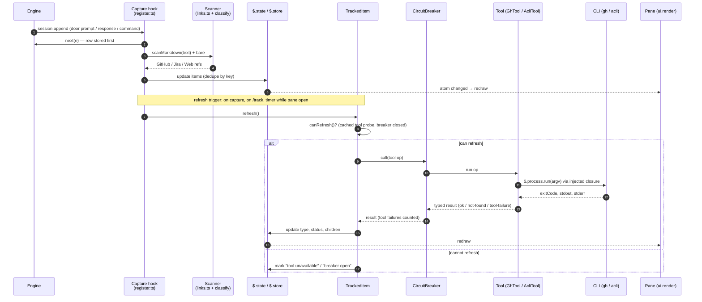

# Artifact tracking — knowledge base

Research for a Claude Code mod that tracks the artifacts a session mentions and shows them in a pane:

- GitHub issues and PRs: explicit URLs and bare `#N`, from the person or from Claude.
- Jira work items: explicit Jira URLs only.
- Web links: every other URL.

The mod can enrich each item with a CLI: `gh` for GitHub (type, state, checks) and `acli` for Jira (type, status, subtasks). A `TrackedItem` class has `refresh()` and `canRefresh()`. `canRefresh()` is false when the tool is not on PATH. A circuit breaker stops calls to a tool that fails too often. A `Tool` class wraps each CLI.

| | |
| --- | --- |
| Claude Code | **2.1.295** (all checks), cross-checked on **2.1.296** |
| `gh` | **2.102.0** (2026-09-30) |
| `acli` | **1.3.19-stable** (1.3.39-stable exists; not installed) |
| Captured | 2026-10-10 |
| Status | Research done, reviewed. Decisions open: see [open-questions §4](open-questions.md#4-decisions-for-the-user). |
| Authority for the mod API | [`../claude-code-mods/sources/claude-code-2.1.295/types/claude-code.d.ts`](../claude-code-mods/sources/claude-code-2.1.295/types/claude-code.d.ts) |

## Prerequisites

Read the [mods KB](../claude-code-mods/AGENTS.md) and its [gotchas](../claude-code-mods/gotchas.md) first. Then read the [link-capture KB](../claude-code-link-capture/README.md). This slug does not repeat them.

## Map

| Page | Contents |
| --- | --- |
| [mod-api-notes.md](mod-api-notes.md) | `$.process.run` and missing tools, stubs in tests, `session.append` doors and origins, `$.session.repo()`, timers, the pane tree table, commands, state and restore, the `$` injection rule |
| [github.md](github.md) | `gh` calls: issue vs PR, fields, checks, batching and cost, auth and errors, repo resolution, URL forms, GHE |
| [jira.md](jira.md) | `acli` calls: view, search, fields, subtasks and the Epic tree, errors, breaker rules, sites and versions |
| [reference-patterns.md](reference-patterns.md) | Which text becomes an item: GitHub URLs, bare `#N` rules and false positives, Jira URLs, reuse of the link-capture scanner |
| [open-questions.md](open-questions.md) | Source conflicts, review log, unobserved points, **decisions for the user** |
| [`sources/`](sources/) | `gh-2.102.0/`, `acli-1.3.19/`, `acli-docs-2026-10-10/` (verbatim, redacted), `live-observations-2026-10-10/` (probe mod and recorded runs), `live-smoke-2026-10-10/` (the finished mod, run live) |

## The flow in one picture

## Key findings

1. **Missing tools.** `$.process.run` rejects when the binary is not on PATH. Probe `<tool> --version` once, cache it, and make `canRefresh()` read the cache ([mod-api-notes §1](mod-api-notes.md#1-processrun)). *observed*
2. **`$` cannot enter a class.** Pass a closure `(argv, init) => $.process.run(argv, init)` to plain classes. `validate` accepts that. So `TrackedItem`, `Tool` and `CircuitBreaker` are pure TypeScript and unit-testable with a fake runner ([mod-api-notes §9](mod-api-notes.md#9-gotchas-that-bite-this-design)). *observed*
3. **GitHub in one batch.** GraphQL `issueOrPullRequest` gives type, state and check rollup. 50 items cost 1 rate point, about 1.3 s. The batch exits 1 when some numbers do not exist, but stdout still holds the rest ([github.md §5](github.md#5-batching-and-cost)). *observed*
4. **`gh pr checks --json` exits 0 on failure.** Read `bucket` ([github.md §4](github.md#4-checks)). *observed*
5. **Jira Epics need `search`.** `view` on an Epic returns no subtasks. `search` cannot return `parent` ([jira.md §4](jira.md#4-subtasks-and-the-tree)). *observed*
6. **acli errors are ambiguous.** Exit is always 1. On `view`, "not logged in" and "network down" share one message. Check `auth status` first; validate keys before calls ([jira.md §6](jira.md#6-what-the-circuit-breaker-should-count)). *observed*
7. **acli has no site flag.** Refresh only items on the authenticated site ([jira.md §7](jira.md#7-sites-auth-and-versions)). *primary*
8. **Bare `#N`.** The scanner masks code and URLs. A new look-behind pass on its masked text handles bare `#N`. Prose like "rank #1" stays a false positive ([reference-patterns §3](reference-patterns.md#3-bare-n)). *inference*, regex checked
9. **Origins.** A `claude -p` prompt arrives as `unclassified`, not `sdk` ([open-questions C1](open-questions.md#1-source-conflicts)). *observed*
10. **State.** `/clear` resets `$.state` and keeps timers. A hot reload keeps `$.state` and drops timers. Restore with the link-capture pattern ([mod-api-notes §8](mod-api-notes.md#8-state-store-and-restore)). *observed*

## Viability

Viable with caveats. Every piece the spec asks for has a tested API path. The caveats change the design, not the goal: Jira multi-site is track-only, the circuit breaker must classify failures, Epic trees need a second call, and bare `#N` in prose gives some false positives. See [open-questions §4](open-questions.md#4-decisions-for-the-user) for the choices.

## Safety of this research

All `gh` and `acli` calls were read-only. No GitHub or Jira object was created, changed, commented on or moved. No login, logout, profile switch, install or upgrade ran. Saved outputs are redacted (account, owner, site, emails, summaries, one spam title with personal data).
