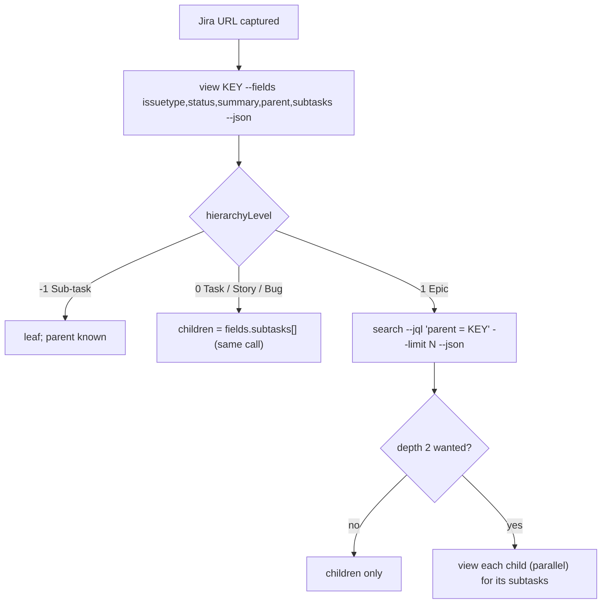

# Jira: `acli` for work items and subtasks

How the tracking mod reads type, status and subtasks of a Jira work item with the Atlassian CLI. Pinned to **acli 1.3.19-stable**. It was checked live on 2026-10-10 against one Jira Cloud site with OAuth and one profile. All commands were read-only. No login, logout, switch or upgrade ran.

Evidence: [`sources/acli-1.3.19/`](sources/acli-1.3.19/README.md) (live, redacted, synthetic keys) and [`sources/acli-docs-2026-10-10/`](sources/acli-docs-2026-10-10/README.md) (public docs). Tags: *primary* (acli `--help`), *observed*, *public-docs*, *inference*.

The snapshot `.txt` files hold `exit=`, then stdout, then stderr. Keys are synthetic: `PROJ-200` is a Task with sub-tasks `PROJ-201..205`; `PROJ-300` is an Epic with children `PROJ-301..304` and `OTHER-5`.

## 1. Summary

| Need | Call | Cost |
| --- | --- | --- |
| Is acli there? | `acli --version` | 0.42 to 0.6 s. Prints an "outdated" notice to stdout. |
| Is it logged in? | `acli jira auth status` (no `--json`) | 0.46 s |
| One item + its sub-tasks | `acli jira workitem view KEY --fields issuetype,status,summary,parent,subtasks --json` | about 1.0 s |
| Children of an Epic | `acli jira workitem search --jql "parent = KEY" --fields issuetype,status,summary --limit 100 --json` | about 1.3 s |

## 2. Commands and flags

| Fact | Evidence | Tag |
| --- | --- | --- |
| `view KEY --json` prints **one object**. `search --json` prints an **array**. Both are the raw Jira REST v3 issue shape (`self` holds `/rest/api/3/issue`). `key` is top level. | [20](sources/acli-1.3.19/20-view-default.json), [30](sources/acli-1.3.19/30-search-default-limit3.json) | *observed* |
| Top-level keys: `changelog`, `editmeta`, `expand`, `fields`, `fieldsToInclude`, `id`, `key`, `names`, `operations`, `properties`, `renderedFields`, `schema`, `self`, `transitions`, `versionedRepresentations`. Most are null. | [20](sources/acli-1.3.19/20-view-default.json) | *observed* |
| `view` default fields: `key`, `issuetype`, `summary`, `status`, `assignee`, `description`. `--fields` takes a list, `*all`, `*navigable`, `-field`. | [help/jira-workitem-view.txt](sources/acli-1.3.19/help/jira-workitem-view.txt) | *primary* |
| `search` default fields: `issuetype,key,assignee,priority,status,summary`. Flags `--limit`, `--paginate`, `--count`, `--csv`, `--json`. | [help/jira-workitem-search.txt](sources/acli-1.3.19/help/jira-workitem-search.txt) | *primary* |
| `search --fields` takes only an allowlist. Rejected: `parent`, `subtasks`, `issuelinks`, `project`, `created`, `updated`, `*all`, `customfield_*` and others. Error: `fields 'parent, subtasks' are not allowed`, exit 1. Accepted: `key`, `issuetype`, `status`, `summary`, `assignee`, `priority`, `reporter`, `description`, `creator`, `labels`. The list is not complete. | [15](sources/acli-1.3.19/15-search-field-not-allowed.txt) | *observed* |
| `--fields key` alone returns `null` (view) or an array of `null` (search). Always ask for one real field. | [24](sources/acli-1.3.19/24-view-fields-key-only--quirk-null.json), [34](sources/acli-1.3.19/34-search-fields-key-only--quirk-null-elements.json) | *observed* |
| Without `--limit`, `search` returns **30** items. `--limit 200` gave 200. `--limit 2 --paginate` gave 2. `--paginate` alone took about 60 s for 2710 items. No page token is exposed. | [36](sources/acli-1.3.19/36-search-no-limit-default-page-size.txt), [35](sources/acli-1.3.19/35-search-limit-2-paginate-flag.json), [40](sources/acli-1.3.19/40-timing.txt) | *observed* |
| `--count` prints `✓ Number of work items in the search: N`. Not JSON. | [17](sources/acli-1.3.19/17-search-count.txt) | *observed* |
| With `--json` and stdout sent to `/dev/null`, acli exits 1: `failed to output command result in JSON format`. A pipe or a file works. (The file shows `exit=0` for the wrapper and `child-exit=1` for acli.) | [18](sources/acli-1.3.19/18-view-devnull-stdout-quirk.txt) | *observed* |
| `description` is Atlassian Document Format (`{ type: 'doc', content: [...] }`), not plain text. | [20](sources/acli-1.3.19/20-view-default.json) | *observed* |
| Plain output has ANSI colour even when piped. Use `--json` only. | researcher note | *observed* |
| The JSON shape is not documented as stable. | [docs README](sources/acli-docs-2026-10-10/README.md) | *public-docs* |

`$.process.run` reads stdout through a pipe, so the `/dev/null` quirk does not bite the mod. It bites test scripts that throw stdout away. *inference*

## 3. Fields the mod reads

| Path | Meaning |
| --- | --- |
| `key` | `PROJ-200` |
| `fields.summary` | title |
| `fields.issuetype.name` | `Task`, `Story`, `Bug`, `Spike`, `Epic`, `Sub-task`, … |
| `fields.issuetype.subtask` | `true` for a sub-task |
| `fields.issuetype.hierarchyLevel` | `-1` sub-task, `0` Task/Story/Bug/Spike, `1` Epic |
| `fields.status.name` | e.g. `In Progress` |
| `fields.status.statusCategory.key` | `new`, `indeterminate`, `done`: a stable colour key across workflows |
| `fields.subtasks[]` | `{ id, key, self, fields: { issuetype, priority, status, summary } }` |
| `fields.parent` | Only on a sub-task (and on a child of an Epic, *inference*): `{ id, key, self, fields: { summary, status, issuetype, priority } }` |

Evidence: [21](sources/acli-1.3.19/21-view-fields-issuetype-status-summary-parent-subtasks--task-with-5-subtasks.json), [22](sources/acli-1.3.19/22-view-fields-parent-subtasks--subtask.json), [23](sources/acli-1.3.19/23-view-fields-parent-subtasks--epic.json), [31](sources/acli-1.3.19/31-search-children-of-epic--parent-eq.json). *observed*

**Review correction.** On a Task and on an Epic the `parent` key is **absent**, not `null`, although `--fields` asked for it. Treat a missing key as "no parent". *observed*

Use `statusCategory.key` for colour and sorting. Show `status.name` as text. *inference*

## 4. Subtasks and the tree

| Item | `view` gives | Children come from | Evidence |
| --- | --- | --- | --- |
| Task, Story, Bug | `subtasks[]` with type, status, summary, priority | the same `view` call | [21](sources/acli-1.3.19/21-view-fields-issuetype-status-summary-parent-subtasks--task-with-5-subtasks.json) *observed* |
| Sub-task | `subtasks: []`, `parent` set | none (a sub-task cannot have sub-tasks in Jira Cloud) | [22](sources/acli-1.3.19/22-view-fields-parent-subtasks--subtask.json) *observed*; rule *inference* |
| Epic | `subtasks: []` **even with children** | `search --jql "parent = EPIC"` | [23](sources/acli-1.3.19/23-view-fields-parent-subtasks--epic.json), [31](sources/acli-1.3.19/31-search-children-of-epic--parent-eq.json) *observed* |

Facts on `search`:

- `parent = EPIC` returned children from more than one project (`PROJ-301..304`, `OTHER-5`). *observed*
- `parent in (A,B,C)` runs. But `search` cannot return `parent`. So a mixed result cannot be split back by parent. The saved sample [33](sources/acli-1.3.19/33-search-children-batch--parent-in.json) holds children of one parent only. *observed*; consequence *inference* (review correction C3 in [open-questions](open-questions.md#1-source-conflicts)).
- Levels above Epic were not seen ([open N9](open-questions.md#3-not-yet-observed)).

"Recursive" in the spec therefore means at most: Epic → children (one `search`) → each child's sub-tasks (one `view` per child). Calls run in parallel through `$.process.run` ([mod-api-notes §1](mod-api-notes.md#1-processrun)). The depth is a user decision (D17).

Always pass `--limit`. Compare with `--count` if the tree must say "N more". The default page of 30 cuts large Epics with no warning. *observed* (default 30), *inference* (advice)

## 5. Errors and exit codes

Every failure exits **1** with empty stdout and the message on stderr. A valid JQL with no hits prints `[]` and exits 0 ([16](sources/acli-1.3.19/16-search-empty-result.txt)). *observed*

| Case | Command | stderr | Evidence |
| --- | --- | --- | --- |
| Logged in | `auth status` | stdout `✓ Authenticated`, `Site:`, `Email:`, `Authentication Type: oauth_global`. Exit 0. | [02](sources/acli-1.3.19/02-auth-status.txt) |
| Not logged in | `auth status` | `unauthorized: use 'acli jira auth login' to authenticate` | [03](sources/acli-1.3.19/03-auth-status-unauthenticated.txt) |
| Not logged in | `search` | `unauthorized: use 'acli [product] auth login' to authenticate` | [05](sources/acli-1.3.19/05-search-unauthenticated.txt) |
| Not logged in | `view` | `failed to fetch work item details` (no "unauthorized") | [04](sources/acli-1.3.19/04-view-unauthenticated.txt) |
| Network down | `view` | `failed to fetch work item details` | [06](sources/acli-1.3.19/06-view-network-failure.txt) |
| Network down | `search` | `failed to parse JQL` (exactly) | [07](sources/acli-1.3.19/07-search-network-failure.txt) |
| Network down | `auth status` | `failed to retrieve authenticated status` | [08](sources/acli-1.3.19/08-auth-status-network-failure.txt) |
| Unknown key, malformed key, unknown project | `view` | `Issue does not exist or you do not have permission to see it.` | [09](sources/acli-1.3.19/09-view-unknown-key.txt), [10](sources/acli-1.3.19/10-view-malformed-key.txt) |
| No key | `view` | `argument [key] is required` | [11](sources/acli-1.3.19/11-view-no-key.txt) |
| A URL as key | `view` | `failed to fetch work item details` | [12](sources/acli-1.3.19/12-view-url-as-key.txt) |
| Bad JQL | `search` | `failed to parse JQL query: error in jql query: …` | [13](sources/acli-1.3.19/13-search-bad-jql.txt) |
| JQL on an unknown key | `search` | `failed to parse JQL query: issue does not exist or you do not have permission to see it.` | [14](sources/acli-1.3.19/14-search-unknown-key-jql.txt) |

The unauthenticated state was simulated with `HOME=<empty dir>`. Network failure was simulated with `HTTPS_PROXY=http://127.0.0.1:9`; acli honours it and fails in 0.15 s. *observed*

**Real collision:** on `view`, "not logged in", "network down" and "URL as key" all print `failed to fetch work item details`. On `search`, the texts differ (review correction C2): network is `failed to parse JQL` exactly, bad JQL adds `query: …`. *observed*

Not seen: a real permission-denied item (*inference*: same text as unknown key, since Jira hides forbidden items), and the "site admin must authorize this app" error that 1.3.15 added ([changelog](sources/acli-docs-2026-10-10/changelog-full-page.txt), *public-docs*).

## 6. What the circuit breaker should count

*Inference* from §5:

1. Validate the key with `^[A-Z][A-Z0-9_]+-\d+$` before any call. Never pass a URL. This removes the "URL as key" case.
2. Before the first refresh (and after a breaker opens), run `auth status`. Exit 0 → logged in. `unauthorized` → `canRefresh()` false with reason "not logged in". `failed to retrieve authenticated status` → network; count it.
3. After that, `failed to fetch work item details` on `view` counts as a tool failure (network or lost login).
4. `Issue does not exist or you do not have permission` is a **per-item** state (`not-found`). It does not count.
5. `$.process.run` rejection (missing binary, timeout) counts.

## 7. Sites, auth and versions

| Fact | Evidence | Tag |
| --- | --- | --- |
| `acli jira` is "Jira Cloud commands." | [help/jira.txt](sources/acli-1.3.19/help/jira.txt) | *primary* |
| `view` and `search` have **no site flag**. The only selector is `acli jira auth switch --site/--email`, which changes the active profile. | [help/jira-workitem-view.txt](sources/acli-1.3.19/help/jira-workitem-view.txt), [help/jira-auth-switch.txt](sources/acli-1.3.19/help/jira-auth-switch.txt) | *primary* |
| The active profile lives in `~/.config/acli/jira_config.yaml` (`current_profile`, `profiles[{ site, cloud_id, account_id, display_name, email, auth_type }]`). `ACLI_CONFIG_DIR` overrides the dir (found in the binary). | [41](sources/acli-1.3.19/41-config-layout.txt) | *observed* |
| Only one profile exists on this machine. Multi-site was not tested. | [41](sources/acli-1.3.19/41-config-layout.txt) | *observed* |
| Installed 1.3.19-stable. It says 1.3.39-stable exists. The public changelog ends at 1.3.15 (2026-03-25), which added OAuth scopes and asks site admins to re-authorize. Nothing covers 1.3.16 to 1.3.39. | [01](sources/acli-1.3.19/01-version.txt), [changelog](sources/acli-docs-2026-10-10/changelog-full-page.txt) | *observed*, *public-docs* |
| The view and search doc pages say "Last updated Oct 3, 2024" and match the 1.3.19 help. | [docs README](sources/acli-docs-2026-10-10/README.md) | *public-docs* |

Consequences (*inference*):

- Read the site from `auth status` (`Site: <site>.atlassian.net`) once. Refresh only items whose URL host equals it. Other hosts are track-only (decisions D13, D14).
- Never call `auth switch` from the mod. It changes state for every terminal.
- Record `acli --version` and show it in the pane footer. Parse defensively: unknown fields are fine, missing fields mean "unknown".

## 8. Privacy

acli output holds assignee emails, account ids, avatar URLs and summaries. Extract only `key`, `summary`, `issuetype.name`, `issuetype.hierarchyLevel`, `status.name`, `status.statusCategory.key` and child keys. Never store raw output. The saved snapshots are redacted (`<site>`, `<email>`, `<jira-host>`, `
`, synthetic keys). *observed*
