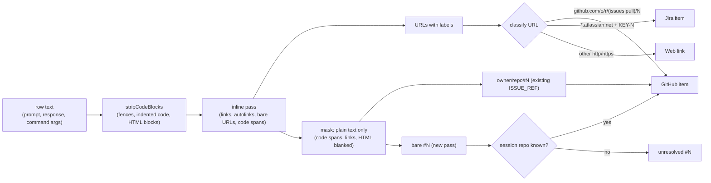

# Reference patterns: what text becomes a tracked item

Rules to find GitHub issues and PRs, Jira work items and web links in the text of a row. It reuses the link-capture scanner. Tags: *observed*, *primary*, *inference*. Most rules here are *inference* until the mod's own tests pin them.

## 1. Pipeline



The scanner is [`links.ts`](../claude-code-link-capture/example/link-capture/hooks/links.ts) in the link-capture KB. It has 32 tests and follows what the reply renderer draws ([link-capture §2](../claude-code-link-capture/README.md#2-what-the-person-sees-as-a-link)). *observed*

## 2. Explicit GitHub URLs

Pattern (*inference*, built from the forms `gh` accepts in [url-forms.txt](sources/gh-2.102.0/url-forms.txt)):

```ts
const GH_URL = /^https?:\/\/(?:www\.)?github\.com\/([A-Za-z0-9-]+)\/([A-Za-z0-9._-]+)\/(issues|pull)\/(\d+)(?:[\/?#].*)?$/i
```

| Input | Result |
| --- | --- |
| `https://github.com/cli/cli/pull/14640` | GitHub `cli/cli#14640` |
| `…/pull/14640/files`, `…/pull/14640/checks`, `…/pull/14640/commits/<sha>` | same item |
| `…/issues/14622#issuecomment-6050024537`, `…/issues/14622/` | `cli/cli#14622` |
| `…/issues/14640` where 14640 is a PR | same item (*inference*: GitHub redirects; not observed). The type comes from `gh`, never from the path ([github.md §2](github.md#2-issue-or-pr-in-one-call)). |
| `https://github.com/cli/cli`, `…/commit/<sha>`, `…/blob/…`, `…/actions/runs/…` | web link (decision D18) |
| `https://<ghe-host>/o/r/pull/7` | GitHub item on host `<ghe-host>` if the mod supports GHE (D15), else web link |

Item key: `github:<host>/<owner>/<repo>#<n>`, all lower case except the number. Keep the first URL seen as the link. *inference*

## 3. Bare `#N`

The spec asks for bare `#N` from the person or Claude. The scanner has **no** bare `#N` rule today. It has `owner/repo#N` (`ISSUE_REF`), which runs on the masked plain text ([links.ts:174](../claude-code-link-capture/example/link-capture/hooks/links.ts#L174), [links.ts:423](../claude-code-link-capture/example/link-capture/hooks/links.ts#L423)). *observed*

Proposed rule, run on the same `mask` text (*inference*):

```ts
const BARE_REF = /(?<![\w/&#])#(\d{1,7})\b/g
```

The look-behind works in a hooks module ([probe-globals.txt](sources/live-observations-2026-10-10/outputs/probe-globals.txt), `"lookbehind":"12"` for `(?<![\w/])#(\d+)\b`). *observed*

The review ran this regex in Node over every row below. The results match the table. The scanner masking (code, URLs) is from `links.ts`, not from that run.

| Text | Match? | Why |
| --- | --- | --- |
| `fixes #12` | yes, `12` | |
| `#12` at line start | yes | `#12` with no space is not a Markdown heading |
| `# 1 Intro`, `## 12 things` | no | a space follows `#` |
| `#fff`, `#1a2b3c` | no | `\b` fails inside `1a…`; `fff` has no digit |
| `#123`, `#123456` as a CSS colour in prose | **yes** (false positive) | All digits. In code it is masked. Outside code `gh` returns "not found" or a wrong item. |
| `` `#12` ``, a fenced or indented block | no | masked by the scanner |
| `https://x.org/page#12`, `[t](url#12)` | no | URLs and link targets are masked |
| `file.ts#12`, `src/a.ts#L12` | no | look-behind rejects `\w`; `#L12` has a letter |
| `owner/repo#12` | no (bare); yes for `ISSUE_REF` | look-behind rejects `\w`; `ISSUE_REF` takes it with its own repo |
| `&#123;` (HTML entity) | no | look-behind rejects `&` |
| `##12`, `C#12` | no | look-behind rejects `#`, `\w` |
| `rank #1`, `step #3`, `priority #1` | **yes** (false positive) | prose. The number often exists in the repo, so `gh` does not drop it. |
| `issue #12 in owner/repo` | yes, but against the **session** repo | the rule does not read prose. Write `owner/repo#12` to be exact. |
| `#12345678` | no | more than 7 digits |
| `PR #12-#15` | `12` and `15` | ranges are not expanded |

Where `#N` comes from: only `prompt` and `response` rows (and user `command` rows), never `tool-result` (decision D1). `git log` and test output are full of `#N`. *inference*

The prose false positives (`rank #1`) are the main risk. Fallback rule (decision D2 option b): accept bare `#N` only near a keyword (`issue`, `PR`, `pull`, `fix`, `fixes`, `close`, `closes`, `resolve`, `see`) or as the first token of a list item. *inference*

### Which repo a bare `#N` belongs to

1. `$.session.repo()` → `remote` → `parseRemote` → `{ host, owner, repo }` ([mod-api-notes §4](mod-api-notes.md#4-sessionrepo)). *observed*
2. If null: decision D5 (unresolved, then `gh repo view --json nameWithOwner` once).
3. The scanner's `issueHost` option should get the same `host`. *inference*
4. Forks: `origin` may be a fork. `gh` resolves the default repo with its own rules. When enrichment works, use the canonical `url` from `gh` as the item link. *inference*

## 4. Jira URLs

Only explicit URLs count (the spec). Bare `ABC-123` in text is not tracked. *inference* from the spec.

| URL form | Key from | Tag |
| --- | --- | --- |
| `https://<site>.atlassian.net/browse/ABC-123` | path | *inference* (Jira convention; `new URL()` parses it in a hooks module, [probe-globals.txt](sources/live-observations-2026-10-10/outputs/probe-globals.txt) `urlOk`) |
| `…/jira/software/projects/ABC/boards/7?selectedIssue=ABC-123` (also `/jira/core/…`, `/jira/servicedesk/…`, `/jira/software/c/projects/…`) | `selectedIssue` query | *inference*, not tested ([open N18](open-questions.md#3-not-yet-observed)) |
| `…/issues/?jql=…`, `…/issues/?filter=…` | none: a search, not an item | *inference* |
| `https://jira.example.com/browse/ABC-123` (not `*.atlassian.net`) | path; track-only (D14) | *inference* |

Key rule: `^[A-Z][A-Z0-9_]+-\d+$` on the extracted part. Item key: `jira:<host>/<KEY>`. Link: `https://<host>/browse/<KEY>`. *inference*

## 5. Reuse the link-capture scanner

What the scanner already gives (*observed*, [link-capture §6](../claude-code-link-capture/README.md#6-the-reference-mod)):

- `scanMarkdown(text, { issueHost })` → `{ url, label?, via, kind }[]`. `via` is `inline`, `autolink`, `bare`, `issue-ref`, `reference`, `image`, `mailto`.
- Code fences, indented code, HTML blocks and code spans are cut. URLs and link targets are blanked in a `mask` string before `ISSUE_REF` runs.
- `textOfContent(content)` reads both content shapes of a row.
- `normalizeUrl` and `mergeLinks` (dedupe and a cap).

What to add (*inference*):

1. A `BARE_REF` pass at the same place as `ISSUE_REF` ([links.ts:423-433](../claude-code-link-capture/example/link-capture/hooks/links.ts#L423)). Emit `{ via: 'bare-ref', number }` with no URL. The classifier resolves the repo.
2. A classifier `classify(found, repo) → GitHubRef | JiraRef | WebRef | null`. Keep it a pure function with its own tests.
3. The label of a `[label](url)` link is the web link name (decision D6). A bare URL has no label; show host + path.
4. `ISSUE_REF` builds `/issues/N` for every `owner/repo#N`. Keep the `owner/repo` and number; drop the guessed path.

Copy or share: a hooks module imports only its own files ([gotcha 2](../claude-code-mods/gotchas.md)). Copy `links.ts` and `links.test.ts` into the mod, with a header line that names the source and the date. Decision D12.

## 6. Dedupe and the `source` field

- One item per key (§2, §4; web links by `normalizeUrl`). *inference*
- Keep `firstSeen`, `lastSeen`, a mention count and `source`: `prompt`, `response`, `tool`. *inference*
- Skip rows with `origin.kind === 'engine'` on door `command`. They hold the mod's own `/track` output and would feed back ([mod-api-notes §3](mod-api-notes.md#3-sessionappend-doors-origins-the-persons-own-text)). *observed* (row shape), *inference* (rule)
