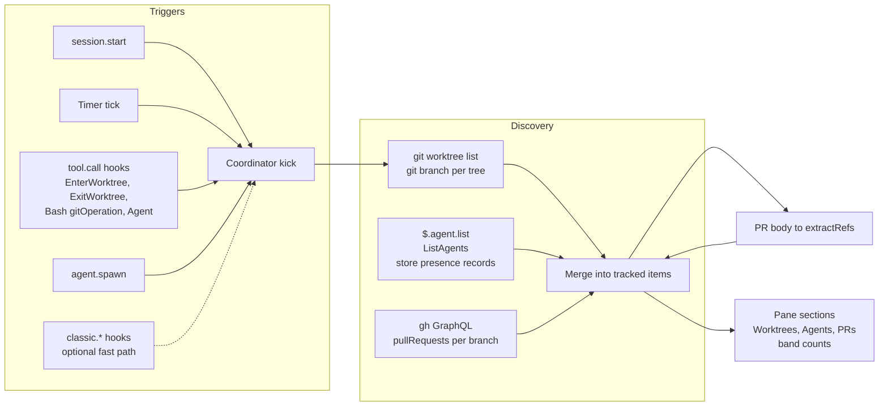

# Auto tracking — knowledge base

Research for an **auto tracking** feature in the [artifact-tracking mod](../claude-code-artifact-tracking/README.md). Today the mod tracks only what a session mentions. Auto tracking adds items that are relevant to the repository or branch, without a mention:

- **Worktrees**: every git worktree made on top of the master session's branch.
- **Agents**: the master session, its subagents, and sessions in those worktrees.
- **PRs**: every PR on a tracked branch, plus the references inside each PR body.

It starts with the session, checks the state on a timer, and reacts to events such as "PR opened" or "worktree created".

| | |
| --- | --- |
| Claude Code | **2.1.296** installed (`claude --version`). Type file and docs pinned at **2.1.295**. Probes ran on the 2.1.295 binary and on 2.1.296. |
| git | **2.56.0** |
| `gh` | **2.102.0** (2026-09-30) |
| Captured | 2026-10-10 |
| Status | Research done. Reviewed against primary sources on 2026-10-10 (six corrections: [open-questions R11 to R16](open-questions.md#2-review-log-synthesis-stage-2026-10-10)). Not yet reviewed by the user. Decisions open: see [open-questions §4](open-questions.md#4-decisions-for-the-user) and the gaps in [§5](open-questions.md#5-requirement-gaps-found-in-review). |
| Authority for the mod API | [`../claude-code-mods/sources/claude-code-2.1.295/types/claude-code.d.ts`](../claude-code-mods/sources/claude-code-2.1.295/types/claude-code.d.ts) |

## Prerequisites

Read the [mods KB](../claude-code-mods/AGENTS.md) and its [gotchas](../claude-code-mods/gotchas.md). Then read [artifact-tracking `mod-api-notes.md`](../claude-code-artifact-tracking/mod-api-notes.md) and the [spec](../../superpowers/specs/2026-10-10-artifact-tracking-design.md). This slug does not repeat them.

## The requirement

The user's request, in short. The full text sits in [feasibility.md](feasibility.md#the-requirement-items).

- Auto tracking tracks items relevant to this repository or branch.
- It starts with the session and checks the state periodically.
- Events trigger it too (PR opened, worktree created). Research whether event hooks are possible at all.
- **Worktrees** section: all worktrees created on top of the parent branch. The parent is the `pwd` of the master session.
- **Agents** section: the master session and the child agent sessions, each with branch and worktree.
- **PRs**: check all PRs on any tracked branch. Parse each PR summary with the current recognition matchers. Add the references to the tracked items.

## Map

| Page | Contents |
| --- | --- |
| [feasibility.md](feasibility.md) | The matrix: every requirement item, a verdict, the mechanism, the caveat, the evidence |
| [triggers-and-polling.md](triggers-and-polling.md) | Which events exist and fire, the managed bypass of `classic.*`, timers, the always-on tick, a trigger design |
| [worktrees.md](worktrees.md) | `git worktree list --porcelain`, how Claude makes worktrees, the missing parent pointer, parent resolution |
| [agents-and-sessions.md](agents-and-sessions.md) | `$.agent.list`, `agent.spawn`, worktree and branch per agent, other sessions, `$.store` presence |
| [pull-requests.md](pull-requests.md) | The "PR opened" signal, polling many branches for 1 rate point, PR body parsing |
| [open-questions.md](open-questions.md) | Source conflicts, unverified points with recipes, **decisions for the user** |
| [`sources/`](sources/README.md) | `git-2.56.0/`, `gh-2.102.0/`, `claude-code-2.1.296/`, `live-probe-2026-10-10/` |

## The shape of the feature

## Key findings

1. **Event hooks exist, but not everywhere.** Engine events (`session.start`, `tool.call`, `agent.spawn`) always reach the mod. `classic.*` events (`WorktreeCreate`, `SubagentStart`, `PostToolUse`) fire but a managed machine bypasses the user tier. Build on engine events and polling. [observed] ([triggers §2](triggers-and-polling.md#2-the-managed-bypass-of-classic-hooks))
2. **A PR creation is a structured signal.** The Bash `tool.call` result carries `gitOperation.pr = {number, url, action: "created"}`. [observed] ([pull-requests §1](pull-requests.md#1-the-pr-opened-signal))
3. **No event fires for `git worktree add`.** Poll `git worktree list --porcelain`. It costs about 9 ms. Kick the poll from `tool.call` events. [observed] ([worktrees §5](worktrees.md#5-detecting-creation-and-removal))
4. **Git has no parent pointer for a worktree.** Claude makes its worktrees from `origin/main`, not from the session branch. Parent links need Claude's own metadata. A git heuristic gives about 70% exact matches. [observed] ([worktrees §3](worktrees.md#3-git-records-no-parent))
5. **`$.agent.list()` has no cwd or branch.** A worktree agent's path and branch derive from its id: `.claude/worktrees/agent-<id>`, branch `worktree-agent-<id>`. Workflow agents are not in the list. [observed] ([agents §1](agents-and-sessions.md#1-subagents-of-this-session))
6. **Other sessions are visible through `$.store`.** A shared store showed a live peer's key within one 1 s tick (review run). Only sessions with the same `CLAUDE_CONFIG_DIR` share it. `ListAgents` names peers of every repository but gives no cwd or branch. `claude agents --json` gives cwd. [observed] ([agents §3](agents-and-sessions.md#3-other-sessions-on-the-machine))
7. **PR discovery is cheap.** One GraphQL query with an alias per branch costs 1 rate point. A REST poll with an `ETag` costs 0 on a 304. [observed] ([pull-requests §2](pull-requests.md#2-polling-pull-requests-of-tracked-branches))
8. **A PR body needs a cleaning pass.** `<!-- see #12 -->` in a PR template gives a false `#12` ref. Strip HTML comments first, or use `closingIssuesReferences`. [observed] ([pull-requests §3](pull-requests.md#3-parsing-the-pr-summary))
9. **The tick must start with the session.** Today it starts only when the pane opens (spec D7). Start it in `session.start`. This changes a spec decision. [primary source] ([triggers §4](triggers-and-polling.md#4-the-always-on-tick-and-spec-d7))
10. **The pane needs a refactor, not a rewrite.** Closed unions, a fixed five-cell row and a Jira-only tree builder block the new sections. [primary source] ([feasibility §risks](feasibility.md#risks-for-the-design-stage))

## Viability

Viable with caveats. Of 22 requirement items, 11 are feasible as written, 9 are partial, and 2 are heuristic. None is infeasible. The caveats change the design, not the goal: events are a speed-up, not the foundation; parent links come from Claude metadata, not from git; and peer sessions need a presence protocol in `$.store`. See [feasibility.md](feasibility.md).

## Safety of this research

All `gh` calls were read-only. No GitHub object was created or changed. Worktree experiments ran in a throwaway repo. The probe mod wrote only to a scratch folder. `.key` files with peer tokens were never read. Saved outputs hold no tokens or emails. Other sessions' names and paths are redacted. The 23 KB raw REST payload (`gh-rest-pulls-head-filter.http`) was **not** saved, because it holds the full response headers and an account-bound payload. The 304 result is saved instead.
