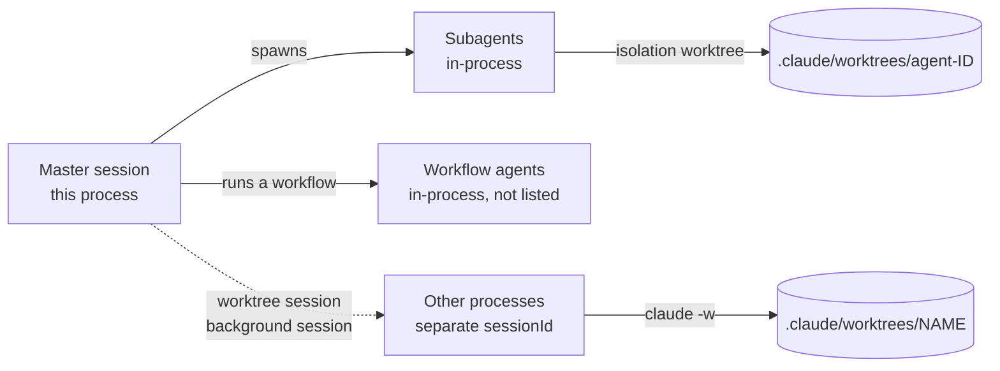
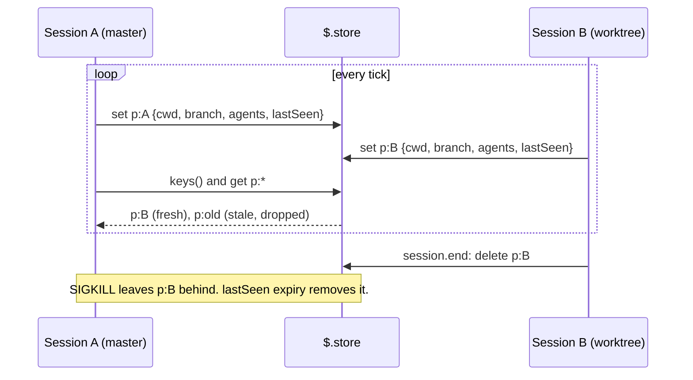

# Agents and sessions

What a mod can learn about the master session, its subagents, workflow agents and sessions in other processes. The index is [README.md](README.md).

Tags: `[primary source]` d.ts or CLI help. `[public docs]` saved docs. `[observed]` a saved run. `[inference]` reasoning. `d.ts:N` links to [claude-code.d.ts](../claude-code-mods/sources/claude-code-2.1.295/types/claude-code.d.ts).

The requested section:

```text
Agents

- master session            branch-name     worktree
  - child agent session     branch-name     worktree
  - child agent session     branch-name     worktree
```

Four kinds of agent exist. Each has a different source. [feasibility F13 to F17](feasibility.md#the-matrix).



## 1. Subagents of this session

`$.agent.list()` returns the session's agents so far, "subagents and teammates: the ones the model spawned and the ones plugins did alike" ([d.ts:3180](../claude-code-mods/sources/claude-code-2.1.295/types/claude-code.d.ts#L3180)). [primary source]

Observed row: `{id, description, type, status, name}`. [observed] ([events-run1](sources/live-probe-2026-10-10/events-run1.jsonl))

- Status went `running`, then `idle`. `ListAgents` showed the same agent as `completed`. The two APIs use different words.
- The type adds `teammateId?`, `parentId?` and `spawnedBy?` ([d.ts:125](../claude-code-mods/sources/claude-code-2.1.295/types/claude-code.d.ts#L125)). [primary source]
- **There is no cwd, branch or worktree field.** [observed + primary source]
- One entry lasts "until the engine drops its task": for a teammate as it ends or seconds after, for a subagent later. A finished agent disappears from the list. [primary source]

`agent.spawn` is an engine event, so the managed bypass does not touch it. [observed] It fired with `{tool_use_id, prompt, description, subagentType, background, fork, name, parentModel, permissionMode}`. `next(e)` returned `{model, agentId}`. The input type also has `parentAgentId?`, `isTeammate?`, `workflow?: {runId, agentIndex}` and `cwd?` ([d.ts:264](../claude-code-mods/sources/claude-code-2.1.295/types/claude-code.d.ts#L264)). [primary source]

**`agent.spawn` has no `isolation` field.** `AgentSpawnInput` spans d.ts:264 to 400 and does not declare it. The `isolation?: 'worktree' | 'remote'` at d.ts:528 belongs to `AgentSpec`, the input of `$.agent.register` (d.ts:446 to 529). The observed `agent.spawn` payload had no such key either. [primary source + observed] To learn that an agent is isolated, read the `Agent` tool input in a `tool.call` hook: `isolation?: "worktree" | "remote"` ([d.ts:16006](../claude-code-mods/sources/claude-code-2.1.295/types/claude-code.d.ts#L16006)). Join it to the `agentId` through `tool_use_id`. [primary source + inference] (Corrected in review, see [open-questions R11](open-questions.md#2-review-log-synthesis-stage-2026-10-10).)

`cwd` was undefined for an `isolation: "worktree"` agent. Undefined means "the parent's" ([d.ts:387](../claude-code-mods/sources/claude-code-2.1.295/types/claude-code.d.ts#L387)).

The `agentId` of `agent.spawn`, of the loop's events and of `$.agent.list()` is one id ([d.ts:125](../claude-code-mods/sources/claude-code-2.1.295/types/claude-code.d.ts#L125)). [primary source]

### Worktree and branch of a subagent

| Case | Worktree | Branch | Source |
| --- | --- | --- | --- |
| `isolation: "worktree"` | `<repo>/.claude/worktrees/agent-<agentId>` | `worktree-agent-<agentId>` | `[observed]` The agent ran `pwd` and `git branch --show-current` there. Join with the `git worktree list` poll for the real path. |
| No isolation | The parent's cwd | The parent's branch | `[primary source]` `agent.spawn.cwd` undefined means the parent's. |
| Agent changed directory itself | Unknown to the mod | Unknown | `PostToolUse.cwd` with `agent_id` should give it ([d.ts:826](../claude-code-mods/sources/claude-code-2.1.295/types/claude-code.d.ts#L826)), but a managed machine bypasses it. `[inference]` |

The `Agent` tool result has `worktreePath` and `worktreeBranch` only in its `status: "completed"` shape. The `status: "async_launched"` shape of a background agent has `agentId` but no worktree fields ([d.ts:16866](../claude-code-mods/sources/claude-code-2.1.295/types/claude-code.d.ts#L16866) to 16880). [primary source] For a background agent, use the `agent-<agentId>` convention and the porcelain poll.

`tool.call` events carry `agentId` for tools run inside a subagent. A Bash call logged `agentId=a94bdd45b56e2c631` and showed the agent's worktree in its `pwd` output. [observed] ([events-run1](sources/live-probe-2026-10-10/events-run1.jsonl)) So the mod can learn an agent's real cwd by reading `pwd`-like output only when the agent runs such a command. Do not rely on it. [inference]

### The master session row

- Session id: `$.session.id()`.
- Directory: `$.session.cwd()`. The project root: `$.session.root()`. The root "follows `/cd`, a host's directory change or a worktree move" ([d.ts:2773](../claude-code-mods/sources/claude-code-2.1.295/types/claude-code.d.ts#L2773)). [primary source]
- Branch: `git branch --show-current` with that cwd.
- Worktree: the porcelain record whose path equals the cwd, or contains it.
- A Claude worktree session shows the worktree as its cwd. [observed]

## 2. Workflow agents

- A workflow's agents are not in `$.agent.list()` ([d.ts:3180](../claude-code-mods/sources/claude-code-2.1.295/types/claude-code.d.ts#L3180), [d.ts:194](../claude-code-mods/sources/claude-code-2.1.295/types/claude-code.d.ts#L194)). [primary source]
- `agent.spawn` fires for workflow `agent()` calls too. Only a deny applies there. It is the only mod event that sees them. Its input has `workflow: {runId, agentIndex}`. [primary source] ([d.ts:4091](../claude-code-mods/sources/claude-code-2.1.295/types/claude-code.d.ts#L4091)) No workflow was run in the probe. [N4](open-questions.md#3-not-yet-observed)
- `tool.call` carries `agentId` for tools inside a workflow agent. [inference from d.ts:194] This lets a mod see their Bash calls, including `gh pr create`.
- On disk, workflow agents write `subagents/workflows/wf_<id>/agent-<id>.*` and a `journal.jsonl` with keys `type, agentId, key, label, phase`. Their `meta.json` has `agentType: "workflow-subagent"` and `workflowPhase`. A workflow agent with a worktree adds `worktreePath` and `spawnedWithWorktree`. [observed] ([claude-session-registry-and-transcript-structure.txt](sources/claude-code-2.1.296/claude-session-registry-and-transcript-structure.txt), items 4, 6, 7)
- Worktree names: `.claude/worktrees/wf_<wfid>-<n>`. [observed]

## 3. Other sessions on the machine

A session in another terminal, a background session, or a session in a worktree is a **separate process**. `$.agent.list()` and every `classic.*` event see only this session. [inference from the API]

Sources, from the best to the worst:

| Source | Gives | Limits | Evidence |
| --- | --- | --- | --- |
| `$.store` presence records | Whatever each session writes: session id, cwd, branch, worktree, agents, `lastSeen` | Needs the mod in every session. `get` then `set` is not atomic. Stale keys. | `[observed]` [events-run2](sources/live-probe-2026-10-10/events-run2.jsonl) |
| `ListAgents` tool | Peer sessions: `name`, `ref`, `type`, `status`. Also this session's subagents. | No session id, cwd or branch. Not filtered by repository. | `[observed]` [events-run1](sources/live-probe-2026-10-10/events-run1.jsonl) (subagents), [review run](sources/live-probe-2026-10-10-review/concurrent-A-ev-2aceba68.jsonl) (peers) |
| `claude agents --json [--all] [--cwd <path>]` | `id, kind, cwd, name, sessionId, startedAt, state or status, pid` for interactive and background sessions | No parent, no branch. `--all` adds completed background sessions (6 against 4 in the probe). 0.13 s, no TTY. | `[observed]` [claude-agents-help.txt](sources/claude-code-2.1.296/claude-agents-help.txt), [registry](sources/claude-code-2.1.296/claude-session-registry-and-transcript-structure.txt) |
| `~/.claude-personal/sessions/<pid>.json` | `pid, sessionId, cwd, startedAt, procStart, version, kind, entrypoint, name, status, ...` | Internal. Exists only while the process lives. Next to it, `<pid>.<hash>.key` files hold secrets. Never read them. | `[observed]` same registry file |
| `~/.claude-personal/jobs/<id>/state.json` | Background sessions only: `cwd, sessionId, bgIsolation, children, interactiveLineage, resumeSessionId, fan, state` | Internal. No parent session id seen. `children` was null. | `[observed]` same registry file |

### `ListAgents` in detail

- It is a built-in tool: input at [d.ts:16329](../claude-code-mods/sources/claude-code-2.1.295/types/claude-code.d.ts#L16329), result `{listing, sections[{kind, total, rows[{name, ref, id, type, status}]}], notes}` at [d.ts:20651](../claude-code-mods/sources/claude-code-2.1.295/types/claude-code.d.ts#L20651). [primary source]
- `$.tool.call({tool: 'ListAgents'})` works from a mod timer and needs no prompt, even in the default permission mode. [observed]
- With two concurrent sessions, each saw the other as `{kind: "sessions", rows: [{name: "repob-63", ref: "283b75", type: "interactive", status: "busy"}]}`. `status` was `null` on the first call. [observed] ([session A](sources/live-probe-2026-10-10-review/concurrent-A-ev-2aceba68.jsonl), [session B](sources/live-probe-2026-10-10-review/concurrent-B-ev-837491f5.jsonl)) The first research run had no saved log for this. `events-run2` shows only "No reachable agents".
- The two sessions ran in **different repositories**. `ListAgents` does not filter by repository or branch. A mod must filter peers by other means. [observed]
- A listed B 3 ms before B's own `session.start` hook ran. So `ListAgents` likely sees peers whose mod has not loaded, or that do not run it. [observed + inference]
- Scope: the session registry lives under the Claude Code configuration directory. Sessions that run with another `CLAUDE_CONFIG_DIR` are probably not listed. Not tested. [inference]
- The `ref` is not a prefix of the session id (`ref 70e0a6` against a session id starting `65baa560`). The header line "This session is repo-a7 [70e0a6]" gives a session its own label and ref. A session can publish `{sessionId, label, ref}` to the store to join the two. [observed + inference]
- Messaging: `$.session.send({to: {sessionId}})` and `session.receive` ([d.ts:11506](../claude-code-mods/sources/claude-code-2.1.295/types/claude-code.d.ts#L11506), [d.ts:11339](../claude-code-mods/sources/claude-code-2.1.295/types/claude-code.d.ts#L11339)) deliver prompts to a peer's model. This wakes models. Not recommended for v1. [inference]

### `$.store` presence protocol

Facts:

- `$.store` is shared by every session on the machine that runs the mod ([interface.md](../claude-code-mods/sources/code-claude-com-2026-10-09/mods/interface.md)). [public docs]
- More exactly, the store is "a JSON file of the plugin's own under the user's Claude Code configuration directory" ([d.ts:3348](../claude-code-mods/sources/claude-code-2.1.295/types/claude-code.d.ts#L3348)). [primary source] The probe's store file was `<CLAUDE_CONFIG_DIR>/plugins/store/<plugin>-<hash>.json`. [observed] So sessions with **different `CLAUDE_CONFIG_DIR` values do not share it**. A person who runs several config dirs (for example `~/.claude` and `~/.claude-personal`) gets one presence group per dir. [inference]
- Review run: session B wrote its first key at `at=1791650746503`. Session A listed it at `1791650747513`, on its next 1 s tick. [observed] ([session A](sources/live-probe-2026-10-10-review/concurrent-A-ev-2aceba68.jsonl))
- A second process wrote its first key at t0. The first process saw it in `store.keys()` and `get` about 350 ms later, on its next 1 s poll. Reads are live, not cached. [observed, researcher's report; the saved first-run logs do not show it, the review run does] ([events-run1](sources/live-probe-2026-10-10/events-run1.jsonl), [events-run2](sources/live-probe-2026-10-10/events-run2.jsonl)) The exact 353 ms figure is the researcher's reading. The saved logs show the keys, not that delta.
- Keys of finished runs persist (`p:4afff1c3`, `p:8ad34bcc` were still there). [observed] Entries need a `lastSeen` and an expiry.
- `get` then `set` is not atomic. Use one key per session, as `register.tsx` does with `s:<id>`. [primary source]
- The store is 4 MiB of JSON for the whole plugin ([d.ts:3351](../claude-code-mods/sources/claude-code-2.1.295/types/claude-code.d.ts#L3351)). The session mirror already uses it (20 sessions). [primary source]
- `session.end` fires on "exit, /clear, resume, logout, signal, a `-p` run done" and carries `e.reason` ([d.ts:4417](../claude-code-mods/sources/claude-code-2.1.295/types/claude-code.d.ts#L4417)). [primary source] A SIGKILL or a crash cannot run it, so expiry must cover a dead process. [inference] ([events.md](../claude-code-mods/reference/events.md))
- A `/clear` also fires `session.end` and gives a new session id. A presence key `p:<sessionId>` must move to the new id, or the peer list shows the old id as stale. [inference]
- A mod cannot read another process's `$.state`. [inference]

Proposed record:

```text
p:<sessionId> = { sessionId, label, ref, cwd, root, branch, worktree,
                  agents: [{id, name, type, status, worktree, branch}],
                  lastSeen }
```

Write it on the tick and in `session.end` (a short shared budget, [d.ts:4427](../claude-code-mods/sources/claude-code-2.1.295/types/claude-code.d.ts#L4427)). Every session reads all `p:*` keys and drops entries older than about three ticks. [inference]



## 4. Linking processes

There is **no supported field** that links two separate processes as parent and child. [observed] Approximations:

1. `cwd` of the peer is inside a tracked worktree. Weak but cheap. [inference]
2. The worktree lock reason `claude session <name> (pid N start <procStart>)` joins to `sessions/<pid>.json` (same format, so pid reuse is detectable). [observed]
3. The `worktree-state` transcript line of the peer holds `originalCwd` and `originalBranch`. Its `sessionId` is the peer's. [observed]
4. A peer that runs the mod can write its parent session id to the store, if the master passes it down (for example through the worktree name or a prompt). [inference]

A background session is a separate process with its own `sessionId`. It is not an in-process subagent. [observed]

## 5. Transcript and on-disk layout

For subagents of the same session, the child-to-parent link is the folder path plus the shared `sessionId`. [observed] ([claude-session-registry-and-transcript-structure.txt](sources/claude-code-2.1.296/claude-session-registry-and-transcript-structure.txt))

- In-process agents write `projects/<slug>/<parentSessionId>/subagents/agent-<agentId>.jsonl` plus `.meta.json`. The slug replaces `/` and `.` with `-`.
- In an agent transcript, `sessionId` equals the parent's, `isSidechain` is true, `agentId` is set, and the first line has `parentUuid: null`.
- `meta.json` always has `agentType, description, model, requestShape, requestNonInteractive, spawnDepth`. Agent-tool agents add `toolUseId`. Worktree agents add `spawnedWithWorktree, worktreePath, worktreeBranch`.
- The parent transcript's Agent tool result holds `toolUseResult.agentId, outputFile, isAsync, status`.
- Nested agents are expected at `spawnDepth` greater than 1. None was observed.
- Transcripts outlive worktrees. Always check liveness against `git worktree list`.
- Reading transcripts risks conversation content. Read only metadata keys. These files are internals and may change.

A mod that records `agent.spawn` and `tool.call` events itself needs none of this for its own session. The disk layout is a fallback for restore after a reload. [inference]

## 6. Recommended resolution order

1. Master session: the mod's own session (cwd, root, id from `$`, branch from git).
2. Own subagents: `$.agent.list()` plus `agent.spawn` records. Worktree from the `agent-<id>` convention, checked against the porcelain list.
3. Workflow agents: `agent.spawn` records (`workflow` field) plus `tool.call.agentId`.
4. Other sessions: store presence records first. Then `claude agents --json`, filtered by `cwd` against the tracked worktree set.
5. Parent branch for a `-w` session: the `worktree-state` line (or the mod's own record from `tool.call EnterWorktree`).

Verdict: feasible for subagents of the same session and for worktree-bound sessions. Coarse for unrelated sessions in the same repo. The open points are [N3, N4, N5](open-questions.md#3-not-yet-observed).

## 7. Teammates

`AgentInfo.teammateId` and `agent.spawn.isTeammate` exist. "A teammate in a terminal pane of its own runs no loop here: its id is its address" ([d.ts:125](../claude-code-mods/sources/claude-code-2.1.295/types/claude-code.d.ts#L125)). Such a teammate is a separate process. It needs the store route. [primary source + inference]
