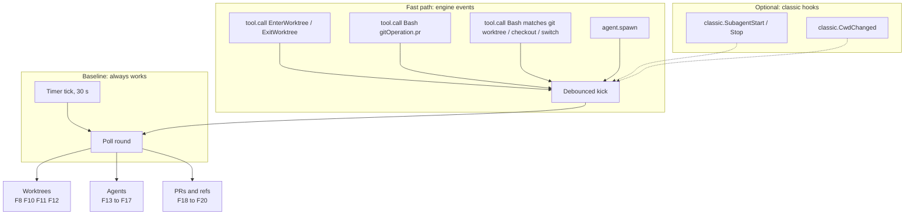

# Feasibility matrix

One row per item of the requirement. The index is [README.md](README.md).

## Verdicts

| Verdict | Meaning |
| --- | --- |
| **Feasible** | A tested API path does it as written. |
| **Partial** | It works for some sources or cases. The caveat names the gap. |
| **Heuristic** | It works only with a guess. The guess can be wrong. |
| **Not feasible** | No path. (No item has this verdict.) |

Tags: `[primary source]` d.ts or CLI help. `[public docs]` the saved docs. `[observed]` a run saved under [`sources/`](sources/README.md). `[inference]` reasoning.

The d.ts is [`claude-code.d.ts`](../claude-code-mods/sources/claude-code-2.1.295/types/claude-code.d.ts) in the mods KB. `d.ts:N` links to line N.

## The requirement items

| # | Requirement item (short) | Verdict |
| --- | --- | --- |
| F1 | Auto tracking starts with the session | Feasible |
| F2 | It checks the current state periodically | Feasible |
| F3 | Trigger on "PR opened" in this session | Feasible |
| F4 | Trigger on "PR opened" outside this session | Partial |
| F5 | Trigger on "worktree created" by Claude | Partial |
| F6 | Trigger on "worktree created" by plain git | Partial |
| F7 | Trigger on a branch change | Partial |
| F8 | Worktrees section: list all worktrees | Feasible |
| F9 | Parent anchor: the `pwd` of the master session | Feasible |
| F10 | Worktrees section: nesting (child worktree of a child) | Heuristic |
| F11 | Worktrees section: branch name per worktree | Feasible |
| F12 | Worktrees: removal and "gone" worktrees | Feasible |
| F13 | Agents section: master session row with branch and worktree | Feasible |
| F14 | Agents section: child agents of this session | Partial |
| F15 | Agents section: workflow agents | Partial |
| F16 | Agents section: sessions in other processes | Partial |
| F17 | Agents section: exact parent-child link between processes | Heuristic |
| F18 | PRs: check all PRs of any tracked branch | Feasible |
| F19 | PRs: read the PR summary and parse it with the matchers | Feasible |
| F20 | PRs: add the parsed references to the tracked items | Partial |
| F21 | New pane sections: Worktrees, Agents, PRs | Feasible |
| F22 | "Event-based hooks must be researched if they are even possible" | Partial |

Totals: 11 feasible, 9 partial, 2 heuristic, 0 not feasible.

## The matrix

| # | Verdict | Mechanism | Caveat | Evidence |
| --- | --- | --- | --- | --- |
| F1 | Feasible | A `session.start` hook starts the poller with `$.clock.every`. The hook runs once per process, before the first prompt, awaited. It re-fires after a reload. It never fires on `/clear`. | The existing tick starts only when the pane opens (`openPane`). It must start from `session.start`. That changes spec D7. A `claude -p` run ends before a timer fires. | `[primary source]` [d.ts:4325](../claude-code-mods/sources/claude-code-2.1.295/types/claude-code.d.ts#L4325); `[observed]` [timers](../claude-code-artifact-tracking/mod-api-notes.md#5-background-refresh-and-timers); [triggers §1, §4](triggers-and-polling.md) |
| F2 | Feasible | `$.clock.every(30000, ...)` plus the coordinator's `running` guard. The timer survives `/clear`. A reload drops it, and `session.start` re-arms it. | Callbacks overlap if a run is slow. A `/clear` resets `$.state`, so each tick must call `ensureSession`. | `[observed]` [mod-api-notes §5](../claude-code-artifact-tracking/mod-api-notes.md#5-background-refresh-and-timers); [triggers §3](triggers-and-polling.md#3-timer-behaviour) |
| F3 | Feasible | A `tool.call` hook for `Bash` reads `result.gitOperation.pr` after `await next(e)`. For `gh pr create` it gave `{number: 7, url, action: "created"}`. | Matched by a regex on the command. A chained or `--dry-run` command may miss. The branch is not in the field. Take it from `gitOperation.push.branch` or `gh pr view`. | `[primary source]` [d.ts:20390](../claude-code-mods/sources/claude-code-2.1.295/types/claude-code.d.ts#L20390); `[observed]` [tool result](sources/live-probe-2026-10-10/gh-pr-create-tool-result.jsonl); [pull-requests §1](pull-requests.md#1-the-pr-opened-signal) |
| F4 | Partial | Only the poll sees a PR opened in a browser or another terminal. Use one aliased GraphQL query per tick. | Latency is the tick time (30 s). GitHub offers no push to a local CLI. | `[observed]` [GraphQL cost](sources/gh-2.102.0/gh-graphql-multi-branch-cost.json); [pull-requests §2](pull-requests.md#2-polling-pull-requests-of-tracked-branches) |
| F5 | Partial | Hook `tool.call` for `EnterWorktree`, `ExitWorktree` and `Agent` (`isolation: "worktree"`). The `EnterWorktree` result has `worktreePath` and `worktreeBranch`. `agent.spawn` is an engine event. | `classic.WorktreeCreate` fires but a managed machine bypasses it. A hook that returns `worktreePath` replaces Claude's creation. Do not hook it to observe, until N1 passes. | `[observed]` [events-run1](sources/live-probe-2026-10-10/events-run1.jsonl), [bypass extract](sources/live-probe-2026-10-10/debug-managed-bypass-extract.txt); `[primary source]` [d.ts:1346](../claude-code-mods/sources/claude-code-2.1.295/types/claude-code.d.ts#L1346); [triggers §2](triggers-and-polling.md#2-the-managed-bypass-of-classic-hooks) |
| F6 | Partial | No event exists. A Bash `git worktree add` raised nothing worktree-related. Poll `git worktree list --porcelain`. Kick the poll from `tool.call` for Bash commands that match `git worktree`, `checkout` or `switch`. | Latency is the tick time for a worktree made outside the session. A watcher (`$.process.spawn` of a file watcher) could close the gap. It is untested (N6). | `[observed]` [events-run1](sources/live-probe-2026-10-10/events-run1.jsonl), [fs.watch](sources/git-2.56.0/fswatch-worktree-add-observed.txt); [worktrees §5](worktrees.md#5-detecting-creation-and-removal) |
| F7 | Partial | No branch event exists. Run `git branch --show-current` with `cwd` set to each tracked worktree, on each tick. Kick from Bash `tool.call` matches. | `$.session.repo()` returns no branch. `gitOperation.commit.branch` and `push.branch` cover only branches Claude touched. | `[primary source]` [d.ts:11463](../claude-code-mods/sources/claude-code-2.1.295/types/claude-code.d.ts#L11463); [worktrees §6](worktrees.md#6-branch-per-worktree) |
| F8 | Feasible | `git worktree list --porcelain`: one record per worktree with path, `HEAD`, `branch` or `detached`, `locked`, `prunable`. 8.8 ms on 14 worktrees. | The first record is the main tree. Nothing else marks it. | `[observed]` [sample](sources/git-2.56.0/git-worktree-list-porcelain-sample.txt), [costs](sources/git-2.56.0/git-command-costs.txt); [worktrees §1](worktrees.md#1-the-porcelain-format) |
| F9 | Feasible | The master session's `$.session.cwd()` is the anchor. `$.session.root()` follows `/cd` and worktree moves. The branch comes from `git branch --show-current` run in that cwd. | There is no `$.project` noun. After `EnterWorktree` the cwd moves into the worktree. Decide which cwd is "master" (D2). | `[primary source]` [d.ts:2773](../claude-code-mods/sources/claude-code-2.1.295/types/claude-code.d.ts#L2773); `[observed]` [events-run1](sources/live-probe-2026-10-10/events-run1.jsonl) |
| F10 | Heuristic | Claude-made worktrees: use Claude metadata (`worktree-state` transcript line, subagent `meta.json`, the `agent-<id>` name). Manual worktrees: a git guess from branch reflogs and merge-base. | Claude worktrees start from `origin/main`, not from the session branch, so ancestry cannot show the parent. The git guess is about 70% exact and ambiguous for siblings. | `[observed]` [probes](sources/claude-code-2.1.296/claude-worktree-creation-probes.txt), [heuristics](sources/git-2.56.0/git-worktree-heuristics-experiment.txt), [prototype](sources/git-2.56.0/git-parent-inference-prototype-output.txt); [worktrees §3, §4](worktrees.md#3-git-records-no-parent) |
| F11 | Feasible | The `branch refs/heads/<name>` line of the porcelain record. | A detached HEAD has no branch. A Claude name `a/b` becomes branch `worktree-a+b`. | `[observed]` [sample](sources/git-2.56.0/git-worktree-list-porcelain-sample.txt), [probes](sources/claude-code-2.1.296/claude-worktree-creation-probes.txt) |
| F12 | Feasible | The poll shows a missing worktree. A directory deleted by hand stays in the list with a `prunable` line. An `agent-*` worktree vanishes when the agent ends clean. | A short-lived worktree can appear and vanish between two polls. A stale lock with a dead pid means the owner exited. | `[observed]` [sample](sources/git-2.56.0/git-worktree-list-porcelain-sample.txt), [probes](sources/claude-code-2.1.296/claude-worktree-creation-probes.txt) |
| F13 | Feasible | Row from `$.session.id()`, `$.session.cwd()`, `git branch --show-current`, and the worktree path from the porcelain list. | After `EnterWorktree` the session cwd is the worktree. | `[observed]` [events-run1](sources/live-probe-2026-10-10/events-run1.jsonl) |
| F14 | Partial | `$.agent.list()` gives `id`, `description`, `type`, `status`, `name`, plus `parentId`, `spawnedBy`, `teammateId` in the type. `agent.spawn` adds `cwd` (undefined means the parent's). The `isolation` flag comes from the `Agent` tool input in `tool.call` ([d.ts:16006](../claude-code-mods/sources/claude-code-2.1.295/types/claude-code.d.ts#L16006)), not from `agent.spawn`. For a worktree agent the path and branch derive from the id. | `AgentInfo` has no cwd, branch or worktree. `agent.spawn.cwd` was undefined for an isolated agent. An agent that shares the parent's cwd has the parent's worktree. | `[primary source]` [d.ts:125](../claude-code-mods/sources/claude-code-2.1.295/types/claude-code.d.ts#L125); `[observed]` [events-run1](sources/live-probe-2026-10-10/events-run1.jsonl); [agents §1](agents-and-sessions.md#1-subagents-of-this-session) |
| F15 | Partial | `agent.spawn` fires for workflow `agent()` calls (input `workflow: {runId, agentIndex}`). `tool.call` carries `agentId` for tools run inside any agent. | A workflow's agents are not in `$.agent.list()`. `SubagentStart` for workflow agents is unverified. No workflow was run in the probe. | `[primary source]` [d.ts:194](../claude-code-mods/sources/claude-code-2.1.295/types/claude-code.d.ts#L194), [d.ts:3180](../claude-code-mods/sources/claude-code-2.1.295/types/claude-code.d.ts#L3180); [agents §2](agents-and-sessions.md#2-workflow-agents) |
| F16 | Partial | Each session writes a presence record `p:<sessionId>` to `$.store`, and reads the others. Seen within one 1 s tick across two live processes ([review run](sources/live-probe-2026-10-10-review/concurrent-A-ev-2aceba68.jsonl)). `ListAgents` names peers. `claude agents --json` (via `$.process.run`) gives `cwd` and `sessionId` of peers. | `ListAgents` rows have no cwd, branch or session id. Stale keys need a `lastSeen` expiry. `get` then `set` is not atomic. A peer must run the mod. The store and the session registry are per `CLAUDE_CONFIG_DIR`. `ListAgents` lists peers of every repository. | `[observed]` [events-run2](sources/live-probe-2026-10-10/events-run2.jsonl), [claude agents](sources/claude-code-2.1.296/claude-session-registry-and-transcript-structure.txt); [agents §3](agents-and-sessions.md#3-other-sessions-on-the-machine) |
| F17 | Heuristic | Join a peer to a parent by `cwd` inside a tracked worktree, by the worktree lock reason (`claude session <name> (pid N start ...)`), and by the `worktree-state` line. | No supported field links two processes as parent and child. `sessions/*.json` and `jobs/*/state.json` are internals. | `[observed]` [probes](sources/claude-code-2.1.296/claude-worktree-creation-probes.txt), [registry](sources/claude-code-2.1.296/claude-session-registry-and-transcript-structure.txt); [agents §4](agents-and-sessions.md#4-linking-processes) |
| F18 | Feasible | One GraphQL query with an alias `pullRequests(headRefName: ...)` per tracked branch. Cost: 1 point, about 0.5 s. A REST poll with `If-None-Match` costs 0 on a 304. | `gh pr list --head` takes a bare branch name only. Same-named branches in forks can collide. Stacked PRs (`baseRefName`) were not tested live. | `[observed]` [multi-branch](sources/gh-2.102.0/gh-graphql-multi-branch-cost.json), [304](sources/gh-2.102.0/gh-rest-conditional-304.txt), [head sample](sources/gh-2.102.0/gh-pr-list-head-branch-sample.json) |
| F19 | Feasible | `body` from the same query. Feed it to `extractRefs(text, {mode: 'full', defaultRepo, githubHosts})`. `closingIssuesReferences` gives closing issues directly. | An HTML comment such as `<!-- see #12 -->` gives a false ref. Strip comments first. `Closes #7` loses its "closes" relation in the scanner. Spec D1 defines no mode for a PR body. | `[observed]` [PR 4 body](sources/gh-2.102.0/gh-pr-4-body-sample.md), [closing refs](sources/gh-2.102.0/gh-graphql-base-filter-and-closing-issues.json); [pull-requests §3](pull-requests.md#3-parsing-the-pr-summary) |
| F20 | Partial | A new upsert path adds the discovered refs with a provenance field (`via` the PR key). | `mergeResults` never inserts. `mergeRefs` bumps `seenCount` on each sighting, so a 30 s poll would inflate it. `enforceCap` evicts by `lastSeen`. Items need removal when their PR is untracked. | `[primary source]` `plugins/artifact-tracking/hooks/model/registry.ts:134-220`; [pull-requests §4](pull-requests.md#4-adding-the-references-to-the-tracked-items) |
| F21 | Feasible | New `PaneSection` builders. Tree indent uses `paddingLeft={row.depth*2}`. Fixed-width `Box` cells give the columns. The band shows counts. | Closed unions, a fixed five-cell row, a Jira-only tree builder. Width: use `e.props.bodyColumns` (62 docked at 140 columns). A pane the mod opens by itself is placed only at 144 columns or wider. | `[observed]` [pane layout](../claude-code-artifact-tracking/mod-api-notes.md#6-the-pane); `[primary source]` `plugins/artifact-tracking/hooks/ui/view.ts:226-285` |
| F22 | Partial | Yes for engine events: `session.start`, `tool.call`, `agent.spawn`, `turn.complete`. `classic.*` events fire but are bypassed on a managed machine. No branch event. No event for `git worktree add`. | Treat events as a speed-up. Polling stays the baseline. | `[observed]` [bypass extract](sources/live-probe-2026-10-10/debug-managed-bypass-extract.txt); [triggers §1](triggers-and-polling.md#1-event-inventory) |

## How the pieces fit

## Risks for the design stage

These come from the codebase analysis of `plugins/artifact-tracking/`. Paths are relative to that folder. Severity is the analyst's rating. [primary source]

| # | Risk | Where | Severity | Direction |
| --- | --- | --- | --- | --- |
| R1 | Closed unions: `Category`, `Source`, `ItemRecord`, `Tools`, `HydratedItem`, `Reason`, `SECTIONS`. Each new kind touches all. | `types/index.d.ts:23,25,91`; `hooks/contracts.ts:114,128`; `hooks/refresh/coordinator.ts:23`; `hooks/ui/view.ts:226` | High | Consider a registry of kinds instead of switches. |
| R2 | The coordinator knows only `gh` and `acli`, and skips web by name. | `hooks/refresh/coordinator.ts:131-149` | High | Make selection data-driven: each kind names its tool. |
| R3 | `mergeResults` never inserts. | `hooks/model/registry.ts:199-220` | High | Add a discovery upsert with provenance. |
| R4 | `mergeRefs` bumps `seenCount` on each sighting. | `hooks/model/registry.ts:183-188` | Medium | Do not route polls through it. |
| R5 | `enforceCap` evicts by `lastSeen`. | `hooks/model/registry.ts:134-145` | Medium | Decide an eviction policy for discovered items (D8). |
| R6 | `mergeResults` writes only `STATUS_FIELDS`. | `hooks/model/registry.ts:193-197` | Medium | Add `headRefName` and `baseRefName` to `GitHubFields` and the list. |
| R7 | Pane rows have five fixed cells. Tree rows exist only for Jira. | `hooks/ui/pane.tsx:20-54`; `hooks/ui/view.ts:17-31,75-83,106-131` | Medium | Generalise `PaneRow`. Add a `parentId` tree builder. |
| R8 | The tick is tied to the open pane (spec D7). | `hooks/register.tsx:349-361,490-499` | Medium | Start the tick in `session.start` (D1). |
| R9 | `register.tsx` has 545 lines of mixed concerns. It is the only file that may touch `$`. | `hooks/register.tsx` | Medium | Add discovery as injected-closure modules. |
| R10 | `validate` reads the literal `PluginState` shape. | `types/index.d.ts:120-127` | Low | Declare each new atom there. |
| R11 | Stored `s:<id>` records change shape. | `hooks/register.tsx:241-248,297-318` | Medium | Make new fields optional. |
| R12 | Kit stubs match the current query and argv shapes. | `tests/register.test.tsx:166-199` | Medium | Extend `world()`. Keep the refresh query shape stable. |
| R13 | HTML comments in a PR body give false refs. | `hooks/scan/refs.ts:168-174` | Medium | Strip `<!-- -->` first, or use `closingIssuesReferences`. |
| R14 | `classic.WorktreeCreate`, `WorktreeRemove`, `CwdChanged` behave unverified outside a managed machine. | [events.md](../claude-code-mods/reference/events.md) | Medium | Poll first. Probe later (N1, N2). |
| R15 | A `worktreePath` result from a `classic.WorktreeCreate` hook replaces creation. | [d.ts:1346](../claude-code-mods/sources/claude-code-2.1.295/types/claude-code.d.ts#L1346) | Low if observer-only | Return `next(e)` unchanged, or do not hook it. |
| R16 | Cross-session sharing through `$.store` is non-atomic and shares 4 MiB with the session mirror. | [d.ts:3351](../claude-code-mods/sources/claude-code-2.1.295/types/claude-code.d.ts#L3351) | High (feasibility) | One key per session. `lastSeen` expiry. |
| R17 | One `sessionRepo` per session. A worktree of another repo breaks bare `#N`. | `hooks/register.tsx:44-46,139-182` | Medium | Worktrees of one repo share the remote, so it is fine for v1. |
| R18 | Discovery and refresh share the `gh` circuit breaker. | `hooks/tools/tool.ts:82-111` | Low | Accept it, or give discovery its own `Tool`. |

What needs no refactor: `TrackedItem`, `Tool` and `CircuitBreaker` are generic. `GhTool.exec`, `record` and `parseJson` carry over to a discovery query. The capture hooks and the `/clear` carry-over need no change. `extractRefs` is reusable as is, apart from R13.
