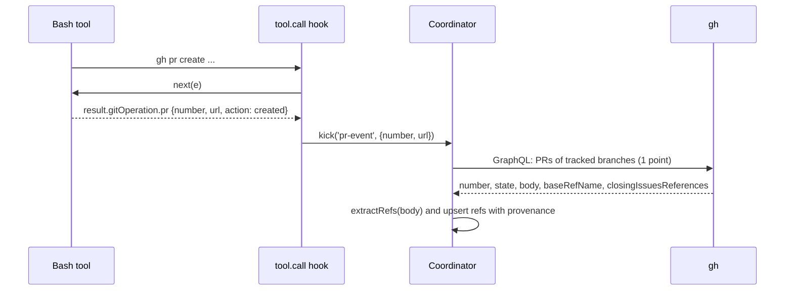

# Pull requests

How a mod learns about a PR on a tracked branch, how it polls many branches cheaply, and how it reads the PR summary. The index is [README.md](README.md). The `gh` basics are in the [artifact-tracking `github.md`](../claude-code-artifact-tracking/github.md). This page covers only what auto tracking adds.

Tags: `[primary source]` d.ts or CLI help. `[observed]` a saved run. `[inference]` reasoning. `d.ts:N` links to [claude-code.d.ts](../claude-code-mods/sources/claude-code-2.1.295/types/claude-code.d.ts). All `gh` calls were read-only and ran against this repository (`martin-macak/claude-code-mod-tracking`).

[feasibility F3, F4, F18 to F20](feasibility.md#the-matrix).

## 1. The PR-opened signal

Hook `tool.call` with `{tool: 'Bash'}`. After `const ran = await next(e)`, read `ran.result.gitOperation`.

Shape ([d.ts:20390](../claude-code-mods/sources/claude-code-2.1.295/types/claude-code.d.ts#L20390)): [primary source]

- `commit?: {sha, kind: committed | amended | cherry-picked, branch?}`
- `push?: {branch}`
- `branch?: {ref, action: merged | rebased}`
- `pr?: {number, url?, action: created | edited | merged | commented | closed | reopened | ready | draft | auto-merge-enabled | auto-merge-disabled}`

Observed: a Bash call `gh pr create --title t --body y` (a shim printed `https://github.com/octo/demo/pull/7`) returned

```json
{"stdout":"https://github.com/octo/demo/pull/7","gitOperation":{"pr":{"number":7,"url":"https://github.com/octo/demo/pull/7","action":"created"}}}
```

Saved: [gh-pr-create-tool-result.jsonl](sources/live-probe-2026-10-10/gh-pr-create-tool-result.jsonl). Reproduction: [repro/](sources/live-probe-2026-10-10/repro/gh-shim.sh). [observed]

Points:

- The binary builds `gitOperation` in a helper that runs regexes on the command and then reads the PR URL from stdout. `gh pr create` is matched by `/^gh\s+pr\s+create$/`. A heavily chained command or a `--dry-run` may not match. [observed, minified strings] [inference] Test `gh pr create --fill && gh pr view` and `git push && gh pr create` (N7).
- `tool.call` events from a subagent carry `e.agentId`. A PR opened inside a worktree agent is seen. [observed]
- The branch of the PR is not in `gitOperation.pr`. Take it from `gitOperation.push.branch` of the preceding push, or call `gh pr view <n> --json headRefName`.
- The existing mod already catches the URL through the `tool-result` door in `urls-only` mode and adds the PR. The gain here is the structured number and the action. [primary source] (`hooks/register.tsx:415-423`)
- `classic.PostToolUse {tool_name, tool_input, tool_response}` ([d.ts:7865](../claude-code-mods/sources/claude-code-2.1.295/types/claude-code.d.ts#L7865)) offers the same data. A managed machine bypasses it. [observed]
- A PR opened outside the session (browser, another terminal) shows only through the poll. GitHub offers no push to a local CLI. [inference]



## 2. Polling pull requests of tracked branches

The tracked branch set comes from the [worktrees poll](worktrees.md#6-branch-per-worktree): the master session's branch plus the branch of each tracked worktree.

| Recipe | Cost [observed] | Notes |
| --- | --- | --- |
| `gh pr list --head <branch> --state all --json number,url,title,state,body,headRefName,baseRefName,isDraft` | 1 GraphQL point, about 0.5 s | [Sample](sources/gh-2.102.0/gh-pr-list-head-branch-sample.json). `--head owner:branch` returns `[]` (unsupported). It matches the branch name only. Same-named branches in forks can collide. |
| **One GraphQL query, an alias `pullRequests(headRefName: "...", states: [OPEN, MERGED, CLOSED])` per branch** | `rateLimit.cost` = 1 for 3 branches, about 0.5 s | [Result](sources/gh-2.102.0/gh-graphql-multi-branch-cost.json). Best for many branches. **Recommended.** |
| One GraphQL query for all PRs with body, newest first, `first: 100` | cost 1 | Simple for small repos. Filter locally by `headRefName` or `baseRefName`. [Result](sources/gh-2.102.0/gh-graphql-base-filter-and-closing-issues.json). |
| `gh pr list --search "head:<b>"` | Works. Counts against GraphQL, not the REST search limit. | [Result](sources/gh-2.102.0/gh-pr-list-search-head.json). Not needed. |
| REST `GET /repos/{o}/{r}/pulls?state=all&head=<owner>:<branch>` with `If-None-Match: <ETag>` | A 200 costs 1 core point. A **304 costs 0.** | [Headers](sources/gh-2.102.0/gh-rest-conditional-304.txt). A poll that sends the `ETag` is free when nothing changed. The REST payload is large (23 KB for 1 PR). |
| Stacked PRs: `gh pr list --base <tracked-branch>` or `pullRequests(baseRefName: ...)` | cost 1 | `--base main` returned 3. The repo has no stacked PRs, so a live result for a non-main base was not seen. |

The query shape used in the probe (3 aliases, one per branch):

```graphql
query($owner:String!,$name:String!){
  rateLimit{cost remaining resetAt}
  repository(owner:$owner,name:$name){
    b1: pullRequests(headRefName:"<branch-1>", first:10, states:[OPEN,MERGED,CLOSED]){
      nodes{number state isDraft baseRefName headRefName url title body}}
    b2: pullRequests(headRefName:"<branch-2>", first:10, states:[OPEN,MERGED,CLOSED]){
      nodes{number state isDraft baseRefName headRefName url title}}
  }
}
```

Fit with the existing code: `GhTool.refreshChunk` already calls `gh api graphql --hostname <host> -f query=...`, then `parseJson`, `record('ok')` and per-alias `apply` (`hooks/tools/gh-tool.ts:128-147`). Add a sibling method next to `buildQuery` (`gh-tool.ts:46-72`), for example `discoverPrs(host, repo, branches)`. Reuse `exec`, the breaker classification and `CHUNK` (`gh-tool.ts:10`). The refresh query does not request `body` today (`gh-tool.ts:64-66`). Request it only for discovery. [primary source] (codebase analysis)

Rate budget: GraphQL and core are each 5 000 per hour, a point budget shared with other sessions on the same token. At cost 1 and a 30 s poll, discovery uses 120 points per hour. `gh api rate_limit` itself is free. [observed + inference]

Test coupling: the kit's fake GraphQL answers only the exact `aN: repository(owner:"..", name:"..") { issueOrPullRequest(number: N)` shape (`tests/register.test.tsx:173`). A new query needs a new branch in the stub. [primary source]

### Fields worth requesting

`gh pr list --json` offers `body`, `closingIssuesReferences`, `headRefName`, `baseRefName`, `headRepositoryOwner`, `isCrossRepository`, `reviewDecision`, `mergeStateStatus`, `statusCheckRollup`, and more. Full list: [gh-pr-list-json-fields.txt](sources/gh-2.102.0/gh-pr-list-json-fields.txt). [observed]

## 3. Parsing the PR summary

The requirement: "checks PR summary and parses it for references (parses using current recognition matchers) and adds them to tracked items."

Entry point: `extractRefs(text, {mode, defaultRepo, githubHosts})` in `hooks/scan/refs.ts:251-264`. It is pure and linear. Input is capped at 200 000 characters (`hooks/scan/links.ts:28`). [primary source]

Rules:

- Use `mode: 'full'`. Set `defaultRepo` to **the PR's repo**, not the session repo. [inference]
- Spec D1 defines scan modes only for prompt, response and tool rows. A PR body has no defined mode. This is a decision: [D5](open-questions.md#4-decisions-for-the-user).
- A real body has Markdown sections ("Summary", "Linked issue", "Test plan"). Sample: [gh-pr-4-body-sample.md](sources/gh-2.102.0/gh-pr-4-body-sample.md). The matcher must cope with code spans, headings, and task lists.

### Gotcha: HTML comments

The researcher ran `extractRefs` on a body that contains `<!-- see #12 -->`. It returned `#12` as a `github` ref. [observed]

- `maskForBare` blanks `<[^<>\s]*>` only (`hooks/scan/refs.ts:168-174`). A comment with spaces is not masked. [primary source]
- PR templates are full of such comments. The repo's template is `.github/pull_request_template.md`.
- The same probe showed that `#99` inside a code fence is masked, `` is not tracked, `cli/cli#14640` and Jira URLs parse. `Closes #7` yields a bare ref of type `unknown`, so the "closes" relation is lost. [observed]
- Fixes: strip `<!-- ... -->` before scanning (R13), or use `closingIssuesReferences` for closing issues. The field exists in `gh pr list --json`. [observed] For PRs #2 and #3 it returned `issues/1`. PR #4 has none ([result](sources/gh-2.102.0/gh-graphql-base-filter-and-closing-issues.json)). The same file is a GraphQL result, so the field exists in GraphQL too.

Best split: take closing issues from `closingIssuesReferences` (exact, with the "closes" relation). Take every other reference (Jira keys, URLs, mentions) from `extractRefs` on the cleaned body. [inference]

## 4. Adding the references to the tracked items

The existing merge code does not fit polling. [primary source] (codebase analysis)

| Problem | Where | Effect | Direction |
| --- | --- | --- | --- |
| `mergeResults` maps over the existing list and never inserts. | `hooks/model/registry.ts:199-220` | A discovered item cannot enter through it. | Add a discovery upsert. |
| `mergeRefs` bumps `seenCount` and `lastSeen` on every repeat. | `hooks/model/registry.ts:183-188` | A 30 s body poll would inflate counts and defeat eviction order. | Do not route polls through it. Use a separate merge. |
| `enforceCap` evicts the smallest `lastSeen` first. The cap is 500. | `hooks/model/registry.ts:134-145` | Discovered items have no sighting. They age out before mentioned items. | Decide a policy (D8). |
| A discovered PR and a mentioned PR share one key `gh:host/o/r#N`. | `hooks/model/registry.ts:32-37` | They merge by key. This is good. | Keep it. |
| An item from a PR body has no record of its source PR. | — | It cannot be removed when the PR is untracked. | Add a provenance field such as `via: <PR key>` and a `Source` value (`auto`, `pr-body`). |
| `mergeResults` writes only `STATUS_FIELDS`. | `hooks/model/registry.ts:193-197` | `headRefName`, `baseRefName` are not stored. | Add them to `GitHubFields` and the list. |

A discovered PR can stay `Category = github`. A worktree and an agent need new categories. [primary source]

## 5. Open points

- Stacked PRs (`baseRefName` not `main`): query works, no live data. [N8](open-questions.md#3-not-yet-observed)
- Real `gh pr create` regex coverage: [N7](open-questions.md#3-not-yet-observed).
- GitHub Enterprise: the artifact-tracking KB recommends option (b) for D15: refresh a GHE host only after `gh auth status --hostname <host>` exits 0 ([open-questions D15](../claude-code-artifact-tracking/open-questions.md#4-decisions-for-the-user)). Discovery should follow the same rule. [inference]
- A PR from a fork has a head branch name that may collide with a local branch. Use `headRepositoryOwner` and `isCrossRepository` to check. [inference]
