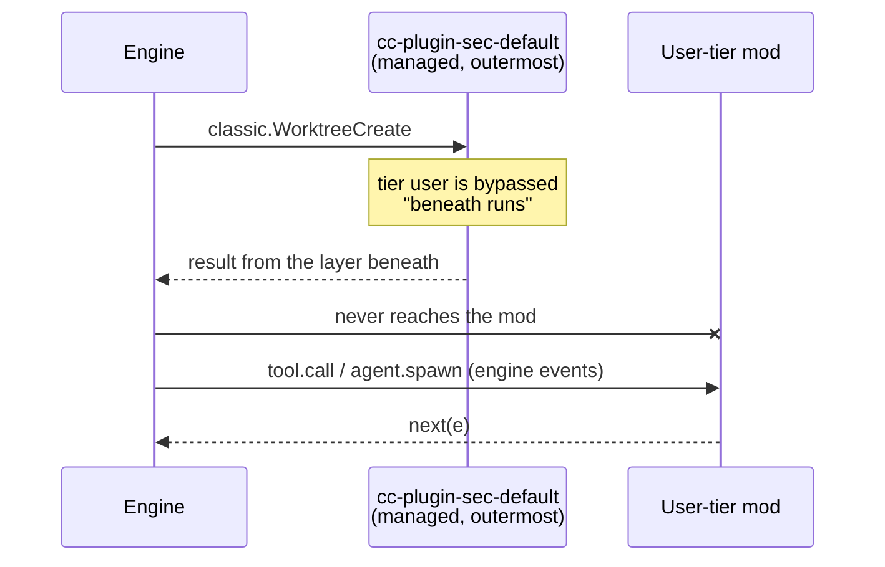
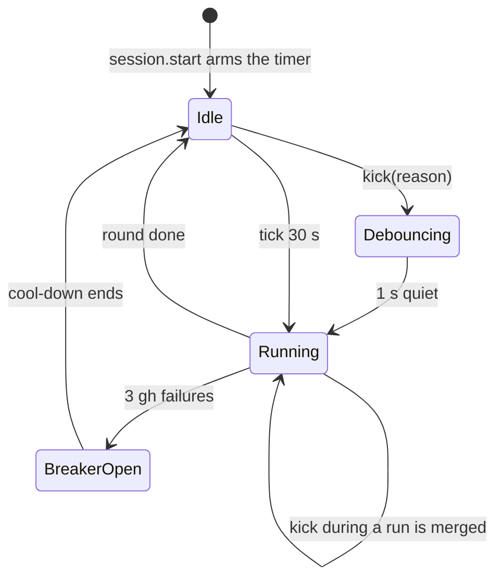

# Triggers and polling

Which events exist, which ones fire, and how a timer carries the baseline. The index is [README.md](README.md). The user's question: "Event-based hooks must be researched if they are even possible."

Short answer: **partly**. Engine events reach the mod. Classic events fire but a managed machine bypasses them. No event exists for a branch change or for a plain `git worktree add`. Polling is the baseline. Events only make it faster.

Tags: `[primary source]` d.ts or CLI. `[public docs]` saved docs. `[observed]` a saved run. `[inference]` reasoning. `d.ts:N` links to [claude-code.d.ts](../claude-code-mods/sources/claude-code-2.1.295/types/claude-code.d.ts).

## 1. Event inventory

"Engine" events always reach a mod. "Classic" events mirror the settings hooks. The [mods events reference](../claude-code-mods/reference/events.md) lists all of them. This table keeps only the events that matter for auto tracking.

| Event | Kind | Gives | Fires? | Use for | Evidence |
| --- | --- | --- | --- | --- | --- |
| `session.start` | engine | `{cwd}` | Once per process per loaded plugin, before the first prompt, awaited. Again after enable, worker respawn, reload. Never on `/clear`. | Start the poller. | `[primary source]` [d.ts:4325](../claude-code-mods/sources/claude-code-2.1.295/types/claude-code.d.ts#L4325) |
| `session.end` | engine | `e.reason` | On exit, `/clear`, resume, logout, signal, `-p` done. Runs under a short shared budget. Cannot run on SIGKILL or a crash `[inference]`. | Final `lastSeen` write. | `[primary source]` [d.ts:4427](../claude-code-mods/sources/claude-code-2.1.295/types/claude-code.d.ts#L4427) |
| `tool.call` (`EnterWorktree`) | engine | Input `{name?}` or `{path?}`. Result `{worktreePath, worktreeBranch, message}`. | Yes. | Worktree created by Claude. | `[observed]` [events-run1](sources/live-probe-2026-10-10/events-run1.jsonl); `[primary source]` [d.ts:20567](../claude-code-mods/sources/claude-code-2.1.295/types/claude-code.d.ts#L20567) |
| `tool.call` (`ExitWorktree`) | engine | Input `{action, discard_changes?}`. Result adds `originalCwd`, `restoredCwd`. | Yes. | Worktree removed or kept. | `[observed]` [events-run1](sources/live-probe-2026-10-10/events-run1.jsonl); `[primary source]` [d.ts:20587](../claude-code-mods/sources/claude-code-2.1.295/types/claude-code.d.ts#L20587) |
| `tool.call` (`Bash`) | engine | Result `gitOperation.{commit,push,branch,pr}`. `agentId` when run inside a subagent. | Yes. | PR opened, push, merge. | `[observed]` [tool result](sources/live-probe-2026-10-10/gh-pr-create-tool-result.jsonl); `[primary source]` [d.ts:20390](../claude-code-mods/sources/claude-code-2.1.295/types/claude-code.d.ts#L20390) |
| `agent.spawn` | engine | `{prompt, description, subagentType, background, name, cwd?, parentAgentId?, isTeammate?, workflow?}`. No `isolation` field: read it from the `Agent` tool input ([d.ts:16006](../claude-code-mods/sources/claude-code-2.1.295/types/claude-code.d.ts#L16006)). `next(e)` gives `{model, agentId}`. | Yes. Also for workflow agents (only deny applies there). | A new agent. | `[observed]` [events-run1](sources/live-probe-2026-10-10/events-run1.jsonl); `[primary source]` [d.ts:264](../claude-code-mods/sources/claude-code-2.1.295/types/claude-code.d.ts#L264), [d.ts:4091](../claude-code-mods/sources/claude-code-2.1.295/types/claude-code.d.ts#L4091) |
| `turn.complete` | engine | `agentId?` | Yes. | Agent activity. | `[primary source]` [d.ts:13307](../claude-code-mods/sources/claude-code-2.1.295/types/claude-code.d.ts#L13307) |
| `classic.WorktreeCreate` | classic | `{name}`. Result `{worktreePath?}`. | The engine raises it for `EnterWorktree` and for `Agent` with `isolation: "worktree"`. **Bypassed on a managed machine.** | Not recommended (see §2 and N1). | `[observed]` [bypass extract](sources/live-probe-2026-10-10/debug-managed-bypass-extract.txt); `[primary source]` [d.ts:14683](../claude-code-mods/sources/claude-code-2.1.295/types/claude-code.d.ts#L14683) |
| `classic.WorktreeRemove` | classic | `{worktree_path}` | Docs: only for a worktree that a `WorktreeCreate` hook made. Not verified live. | None for now. | `[public docs]` [hooks.md](../claude-code-mods/sources/code-claude-com-2026-10-09/hooks/hooks.md); `[primary source]` [d.ts:14688](../claude-code-mods/sources/claude-code-2.1.295/types/claude-code.d.ts#L14688) |
| `classic.SubagentStart` / `SubagentStop` | classic | `{agent_id, agent_type}`; stop adds `last_assistant_message` | Fire. Bypassed on a managed machine. Unverified for workflow agents. | Optional fast path. | `[observed]` [bypass extract](sources/live-probe-2026-10-10/debug-managed-bypass-extract.txt); `[primary source]` [d.ts:12238](../claude-code-mods/sources/claude-code-2.1.295/types/claude-code.d.ts#L12238) |
| `classic.CwdChanged` | classic | `{old_cwd, new_cwd}` | Not seen in the probe. | Optional fast path. | `[primary source]` [d.ts:3625](../claude-code-mods/sources/claude-code-2.1.295/types/claude-code.d.ts#L3625) |
| `classic.PostToolUse` | classic | `{tool_name, tool_input, tool_response, cwd, agent_id}` | Fires. Bypassed on a managed machine. | An agent's cwd (if not bypassed). | `[observed]` [bypass extract](sources/live-probe-2026-10-10/debug-managed-bypass-extract.txt); `[primary source]` [d.ts:826](../claude-code-mods/sources/claude-code-2.1.295/types/claude-code.d.ts#L826) |
| `classic.FileChanged` | classic | `{file_path, event: change, add, unlink}` | Not tested. A `SessionStart` result can set `watchPaths`. | A file watcher without a process (N6). | `[primary source]` [d.ts:4811](../claude-code-mods/sources/claude-code-2.1.295/types/claude-code.d.ts#L4811), [d.ts:1309](../claude-code-mods/sources/claude-code-2.1.295/types/claude-code.d.ts#L1309) |

No event exists for:

- a branch change (`checkout`, `switch`). [primary source] The d.ts has none.
- `git worktree add` run in plain Bash. [observed] The Bash `tool.call` fired and nothing worktree-related followed.
- a PR opened elsewhere. GitHub does not push to a local CLI.

There is no `$.project` noun in the d.ts. [primary source] Use `$.session.cwd()` and `$.session.root()`.

## 2. The managed bypass of classic hooks

On the research machine, **`classic.*` hooks of a user-tier mod did not reach the mod.** [observed]

The debug log shows the cause. Quoted from the [extract](sources/live-probe-2026-10-10/debug-managed-bypass-extract.txt):

- `MDM settings found: env, attribution, permissions, otelHeadersHelper, PayloadUUID`
- `cc-plugin-sec-default@builtin seated outermost: this machine has managed settings`
- `wtprobe: classic.WorktreeCreate bypassed by cc-plugin-sec-default (tier user); beneath runs`

The same line appears for `PostToolUse`, `SubagentStart` and `SubagentStop`. Engine events (`tool.call`, `agent.spawn`, `session.*`, `$.agent.list`) were not bypassed. [observed]

The same finding appears in the artifact-tracking KB as [N19](../claude-code-artifact-tracking/open-questions.md#3-not-yet-observed): a managed plugin sits outermost on this machine.

Consequences:

- Do not build the feature on `classic.*`. A person with managed settings gets nothing from it. [inference]
- Use classic hooks only as an optional speed-up. Poll as well.
- The engine raised `classic.WorktreeCreate` for `EnterWorktree` and for an isolated `Agent` call even though no settings hook existed. [observed] This agrees with the docs line "fires wherever the engine runs the classic hook, whether or not a settings hook exists" ([events.md](../claude-code-mods/reference/events.md)).

### Why a `WorktreeCreate` observer is risky

Two sources disagree. See [open-questions C1](open-questions.md#1-source-conflicts).

- The docs say a configured hook **replaces** git. If it returns no path, creation fails. [public docs] [hooks.md](../claude-code-mods/sources/code-claude-com-2026-10-09/hooks/hooks.md)
- The d.ts says "Left unset, the session creates its git worktree as it would unhooked." [primary source] [d.ts:1346](../claude-code-mods/sources/claude-code-2.1.295/types/claude-code.d.ts#L1346)
- The binary's minified helper `CTn()` throws "hook succeeded but returned no worktree path" only when some hook ran and none gave a path. [observed] (strings of the binary, not saved). So a module that returns `next(e)` should fall back to git. [inference]

Review evidence [observed] ([debug extract](sources/live-probe-2026-10-10-review/debug-extract-seq2.txt), lines 296 to 302 and 349 to 354): the managed `cc-plugin-sec-default` module itself hooks `classic.WorktreeCreate`. It settled with `next()` included and no `worktreePath`. Git then created the worktree for `EnterWorktree` and for the isolated agent. So the engine side holds: a module hook that calls `next(e)` and sets no path does not break creation.

Still open: the managed module is a built-in "native link". A user-tier module was bypassed, so its own return was never consulted. The risk "worktree creation fails for every Claude worktree" is now unlikely, but not proven for a user-tier module. Do not ship the hook before N1 passes on a machine without managed settings. The gain is small anyway: on a managed machine the hook never runs.

## 3. Timer behaviour

All rows below are from the artifact-tracking KB ([mod-api-notes §5](../claude-code-artifact-tracking/mod-api-notes.md#5-background-refresh-and-timers)). [observed]

| Case | Result |
| --- | --- |
| `/clear` | Timers keep running. Module variables survive. `$.state` resets. The session id changes. `session.start` does not fire again. |
| Hot reload | `register` and `session.start` run again. Old timers are gone, so there is no double beat. `$.state` stays. Module variables reset. |
| Long callback | A 45 s callback worked. |
| `every(1000)` with a 2.5 s callback | Callbacks overlap. Add a busy guard. |
| Throwing callback | Logged. The timer keeps going. |
| `$.process.run` and `$.state.update` in a callback | Both work. |

Also seen in this research: `$` captured in a hook still works from a timer later. `$.store`, `$.fs`, `$.agent.list()` and `$.tool.call` all worked from timers. [observed] ([probe](sources/live-probe-2026-10-10/register.ts), [events-run2](sources/live-probe-2026-10-10/events-run2.jsonl))

A `claude -p` run ends with the command or the turn. A timer has no time to fire. The probes used a `sleep` tool call to keep the process alive. [inference]

`$.state` and `$.store`:

| | `$.state` | `$.store` |
| --- | --- | --- |
| Lifetime | Session. Kept on reload. Reset by `/clear`, `/resume`, `/branch`. | Across sessions and reloads. |
| Scope | Per session. | Per plugin, per machine, shared by every session. |
| Redraw | Automatic for readers. | None. |
| Limit | — | 4 MiB of JSON. |

The `$.store` sharing is stated in the public docs ([interface.md](../claude-code-mods/sources/code-claude-com-2026-10-09/mods/interface.md)) and the types do not say it. The two-process probe showed it. [observed]

## 4. The always-on tick and spec D7

The spec decision D7 says the tick runs only while the pane is open. The code does the same: `openPane` calls `startTick`, and the tick is cancelled when the pane closes (`hooks/register.tsx:349-361,490-499`). [primary source]

Auto tracking needs the opposite: "starts with the session and periodically checks current state".

What changes:

- Start the tick in `session.start` (the existing hook at `hooks/register.tsx:426-450` already re-arms after a reload).
- The tick must also start after a reload when the pane is closed. Today it re-arms only if the pane is open.
- The band becomes the only visible consumer while the pane is closed. A one-line summary such as "2 worktrees, 3 agents, 1 PR" fits there.
- The tick must detect `/clear` by comparing the session id, as `register.tsx` does with `knownId`. `classic.SessionStart` is the official `/clear` hook but a managed machine bypasses it.

Do not auto-open the pane from the tick. A pane the mod opens by itself is placed only at 144 columns or wider (110 once the person opened that id). [public docs] [ui.md](../claude-code-mods/reference/ui.md)

This is a decision for the user: [D1](open-questions.md#4-decisions-for-the-user).

## 5. A trigger design

Rules:

1. One coordinator. All triggers call `kick(reason)`. The existing coordinator already debounces 1 s, serialises runs and merges requests that arrive during a run (`hooks/refresh/coordinator.ts:51-110`). [primary source] Add reasons such as `worktree`, `agent`, `pr-event`.
2. A poll round does three jobs in order: worktrees (git), agents (`$.agent.list`, store), PRs (gh, for the branches the first job found).
3. Kick sources:
   - `tool.call` for `EnterWorktree` and `ExitWorktree`.
   - `tool.call` for `Bash` when `gitOperation` is present, or when the command matches `/git\s+(worktree|checkout|switch|branch)/` or `gh pr`.
   - `agent.spawn`.
   - Optional: `classic.SubagentStop`, `classic.CwdChanged`.
4. A hook must call `next(e)` first, then kick. An observe-only hook needs `.catch(($, e, next) => next(e))`. [primary source] (`validate` warns otherwise.)
5. A discovery call needs its own due clock. The per-item `isDue` rule does not fit a discovery query. [primary source] (codebase analysis)
6. A render hook cannot write `$.state`. Write from a timer, a command or a `session.append` hook. [primary source] [gotcha 24](../claude-code-mods/gotchas.md), [d.ts:3416](../claude-code-mods/sources/claude-code-2.1.295/types/claude-code.d.ts#L3416)

### Cost per round

| Call | Cost [observed] |
| --- | --- |
| `git worktree list --porcelain` | 8.8 ms (14 worktrees) |
| `git for-each-ref refs/heads` | 7.0 ms |
| `git status --porcelain=v2 --branch` | 7.0 ms |
| `git merge-base`, `rev-list --count`, `reflog show` | about 7 ms each |
| GraphQL, N aliased branches | 1 rate point, 0.5 to 1.5 s |
| REST with `If-None-Match`, 304 | 0 points |

Source: [git-command-costs.txt](sources/git-2.56.0/git-command-costs.txt), [gh-graphql-multi-branch-cost.json](sources/gh-2.102.0/gh-graphql-multi-branch-cost.json). The git cost is process spawn. A full refresh for dozens of worktrees stays under 100 ms. At a 30 s tick, a GraphQL round uses 120 of the 5 000 hourly points. [inference]

A hook has 10 s of its own code. `$` calls do not count against it. [primary source] [d.ts:5109](../claude-code-mods/sources/claude-code-2.1.295/types/claude-code.d.ts#L5109), [limits-and-diagnostics](../claude-code-mods/reference/limits-and-diagnostics.md)

## 6. Optional: a long-lived watcher

`fs.watch` (non-recursive) on `.git/worktrees` fired `rename <name>` about 50 ms after `git worktree add`. The same happened on `.git/refs/heads` and `.git/logs/refs/heads`. Branch names with `/` need nested watchers. [observed] [fswatch-worktree-add-observed.txt](sources/git-2.56.0/fswatch-worktree-add-observed.txt)

A mod has no `$.fs.watch`. [primary source] (grep of the d.ts) Two routes exist. Neither was tested:

- `$.process.spawn` runs a child for the session's life and streams its output ([d.ts:3516](../claude-code-mods/sources/claude-code-2.1.295/types/claude-code.d.ts#L3516)). A small watcher script could print one line per change. [inference]
- `classic.FileChanged` with `watchPaths` from a `SessionStart` result. It is a classic event, so a managed machine may bypass it. [inference]

Git hooks (`post-checkout`, `reference-transaction`) also fire for a new worktree. [observed] [git-hooks-on-worktree-add-remove.txt](sources/git-2.56.0/git-hooks-on-worktree-add-remove.txt) They live in the shared git dir and this repo already uses `pre-commit` hooks. Do not use them. [inference]

See [N6](open-questions.md#3-not-yet-observed).
