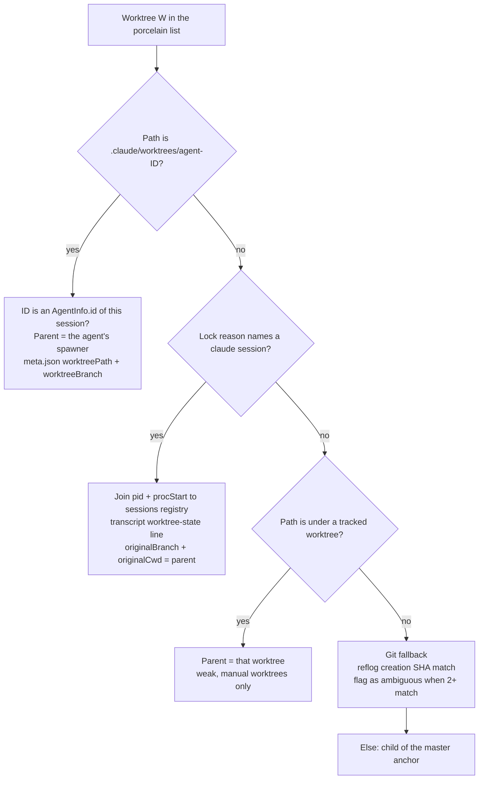
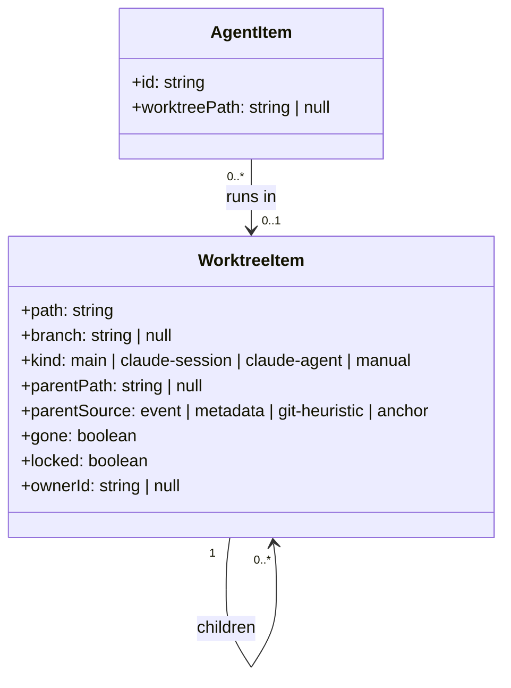

# Worktrees

How a mod finds git worktrees, how Claude Code makes them, and why a parent link needs more than git. The index is [README.md](README.md). Events are in [triggers-and-polling.md](triggers-and-polling.md).

Tags: `[primary source]` d.ts or CLI help. `[public docs]` saved docs. `[observed]` a saved run. `[inference]` reasoning. `d.ts:N` links to [claude-code.d.ts](../claude-code-mods/sources/claude-code-2.1.295/types/claude-code.d.ts).

The requested section:

```text
Worktrees

- this-worktree             branch-name
  - child worktree          branch-name
```

"Parent" means the `pwd` of the master session. [feasibility F8 to F12](feasibility.md#the-matrix).

## 1. The porcelain format

Command: `git worktree list --porcelain`. Sample: [git-worktree-list-porcelain-sample.txt](sources/git-2.56.0/git-worktree-list-porcelain-sample.txt). [observed]

- Records are separated by a blank line.
- A record starts with `worktree <abs path>`. Then `HEAD <sha>`. Then `branch refs/heads/<name>` or the word `detached`.
- Optional lines: `locked [reason]`, `prunable <reason>`, `bare`.
- The first record is always the main working tree. Nothing marks it. Use position, or `git rev-parse --git-common-dir`.
- A worktree whose directory was deleted by hand stays in the list with `prunable gitdir file points to non-existent location`. Show it as "gone" or skip it.
- The short form (`git worktree list`) shows `locked` and `prunable` but not the reason text. Use the porcelain form.
- The list is flat. Git has no nesting. A worktree made from inside another worktree appears at the same level. [observed]

Cost: 8.8 ms on 14 worktrees, 5.8 ms in this repo with one worktree. [observed] ([git-command-costs.txt](sources/git-2.56.0/git-command-costs.txt))

## 2. How Claude Code makes worktrees

Probes: [claude-worktree-creation-probes.txt](sources/claude-code-2.1.296/claude-worktree-creation-probes.txt). [observed]

| Mechanism | Directory | Branch | Start point | Lock | Marker |
| --- | --- | --- | --- | --- | --- |
| `claude -w <name>` and `EnterWorktree` | `.claude/worktrees/<name>` | `worktree-<name>`. A `/` in the name becomes `+`. | `origin/main` when a remote exists and the fetch works. With no remote, or when `fetch of origin/main failed`, the local `HEAD` ([review debug extract](sources/live-probe-2026-10-10-review/debug-extract-seq2.txt), line 301). | `locked claude session <name> (pid N start <procStart>)` | `.git/worktrees/<id>/CLAUDE_BASE` holds the base SHA |
| `Agent` tool with `isolation: "worktree"` | `.claude/worktrees/agent-<agentId>` | `worktree-agent-<agentId>` | `origin/main` (reflog says `Created from origin/main`) | Not locked | `CLAUDE_BASE` present |
| Workflow agents | `.claude/worktrees/wf_<wfid>-<n>` | `worktree-wf_<wfid>-<n>` | Same family. [inference] | Unknown | Unknown |

Details:

- The `<agentId>` in the directory name is the full agent id. It equals `AgentInfo.id` from `$.agent.list()` and `agentId` in the subagent `meta.json`. [observed] ([events-run1](sources/live-probe-2026-10-10/events-run1.jsonl))
- Workflow agent paths and branches show in transcripts, but the worktrees were gone from disk. The row for them is an inference. [observed + inference]
- `agent-*` worktrees were removed automatically when the agent ended clean. A poll can miss a short-lived one. [observed]
- The lock reason joins to the session registry. In a probe, pid 19262 and `procStart` matched `sessions/19262.json`. The same format makes pid reuse detectable. A stale lock with a dead pid means the owner exited. [observed]
- `EnterWorktree {name: "probe-wt"}` returned `worktreePath=<repo>/.claude/worktrees/probe-wt` and `worktreeBranch=worktree-probe-wt`. `$.session.cwd()` then pointed into the worktree. `ExitWorktree {action: "remove"}` returned `restoredCwd` and the directory was gone. [observed] ([events-run1](sources/live-probe-2026-10-10/events-run1.jsonl))
- `EnterWorktree` input is `{name?}` or `{path?}` ([d.ts:16300](../claude-code-mods/sources/claude-code-2.1.295/types/claude-code.d.ts#L16300)). Result: `{worktreePath, worktreeBranch?, message}` ([d.ts:20567](../claude-code-mods/sources/claude-code-2.1.295/types/claude-code.d.ts#L20567)). `ExitWorktree` takes `{action: 'keep' | 'remove', discard_changes?}` ([d.ts:16315](../claude-code-mods/sources/claude-code-2.1.295/types/claude-code.d.ts#L16315)) and adds `originalCwd`, `restoredCwd` to its result ([d.ts:20587](../claude-code-mods/sources/claude-code-2.1.295/types/claude-code.d.ts#L20587)). [primary source]

**Location.** Every Claude worktree lands under the **main working tree's** `.claude/worktrees/`. In the review run the session first entered `probe-wt`, then spawned an isolated agent. The agent's worktree was `<repo>/.claude/worktrees/agent-<id>`, not a folder inside `probe-wt`. [observed] ([debug extract](sources/live-probe-2026-10-10-review/debug-extract-seq2.txt), line 354) So the path never shows a Claude parent-child link.

**Removal.** `ExitWorktree {action: "remove"}` removes the directory and deletes the branch `worktree-<name>`. A clean agent worktree is removed when the agent ends. [observed] (same extract, lines 482 to 542) A row for such a worktree loses its branch too, so a PR lookup for it after removal finds nothing new.

**Consequence.** A Claude worktree does not descend from the master session's branch when a remote exists. Ancestry cannot say "created on top of the parent branch". [inference from the table]

## 3. Git records no parent

Git stores no "created from" link for a worktree. The researcher tried every git-only signal on a scratch repo of 11 branches nested three levels deep (`feat/parent`, then `worktree-agent-aaa`, then `worktree-child-ccc`, then `grandchild-ddd`). Setup: [git-worktree-experiment-setup.sh](sources/git-2.56.0/git-worktree-experiment-setup.sh). Results: [git-worktree-heuristics-experiment.txt](sources/git-2.56.0/git-worktree-heuristics-experiment.txt), [git-parent-inference-prototype-output.txt](sources/git-2.56.0/git-parent-inference-prototype-output.txt). [observed]

| Heuristic | Result | Verdict |
| --- | --- | --- |
| `merge-base --is-ancestor <parent-tip> <branch>` | False for any child once the parent has moved on. | False negatives. |
| `merge-base --is-ancestor <branch> <parent>` | True for `feat/unrelated`, which is just `main`. | False positives. |
| `merge-base(P, X)` with `rev-list --count <trunk>..<mb>` greater than 0 | Works for `wf-bbb`, `worktree-agent-aaa`, `worktree-child-ccc`, `grandchild-ddd`. Gives 0 for the unrelated and sibling-of-main branches. | Good for "descends from P". Fails when P is the trunk, and for a zero-commit child at P's tip. Cannot give the direct parent. |
| Upstream config `branch.<n>.merge` | Empty for every branch made from a local start point. | Useless. `autoSetupMerge` tracks only remote start points. |
| Branch reflog `branch: Created from <X>` | Gives `<X>` only if the start point was named: `feat/parent`, `main`, `origin/main`. | Exact when present. |
| Same reflog with a defaulted start point | Says `Created from HEAD`. Common for `git worktree add -b x path` and for any worktree made inside another worktree. | The name is lost. The creation SHA is the first entry's new-sha. |
| Match the creation SHA against other branches' reflogs ([prototype](sources/git-2.56.0/git-parent-inference-prototype.sh)) | Resolved `child-ccc` to `agent-aaa` and `grandchild-ddd` to `child-ccc`. Ambiguous for `wf-bbb` (matched `feat/parent` and `agent-aaa`). Ambiguous for the root branch itself. | About 70% exact. Needs tie-breaks. |
| Tie-breaks: birth time of `.git/worktrees/<id>`, path layout (`.claude/worktrees/*`) | Described. Not implemented or measured. | Untested. |

Useful commands:

- `git reflog show --format='%H %gs' <branch> | tail -1`
- `git for-each-ref --format='%(refname:short) %(objectname) %(upstream:short)' refs/heads` (one call for all branches)
- `git for-each-ref --format='%(refname:short) %(worktreepath)' refs/heads` (branch to worktree path)

Verdict: pure git cannot recover parent-to-child links reliably. Use it as a fallback with an ambiguity flag.

## 4. Where parentage comes from

Order of trust. Take the first source that answers.



- **`worktree-state` transcript line** for `claude -w` and `EnterWorktree`. It holds `originalCwd`, `preEnterOriginalCwd`, `worktreePath`, `worktreeName`, `worktreeBranch`, `originalBranch`, `originalHeadCommit`, `sessionId`. `originalBranch` and `originalCwd` are the authoritative parent branch and master `pwd`. A `worktreeSession: null` line follows on exit. [observed] ([claude-session-registry-and-transcript-structure.txt](sources/claude-code-2.1.296/claude-session-registry-and-transcript-structure.txt), item 10)
- **Subagent `meta.json`** for `isolation: "worktree"` agents: `spawnedWithWorktree`, `worktreePath`, `worktreeBranch`, `toolUseId`. [observed] (same file, items 4 to 6)
- **The mod's own events.** `tool.call` for `EnterWorktree` gives `worktreePath` and `worktreeBranch` at the moment of creation, with the session's cwd just before it (the parent). `agent.spawn` gives the spawner as `parentAgentId` ([d.ts:264](../claude-code-mods/sources/claude-code-2.1.295/types/claude-code.d.ts#L264)). A mod can record the parent link then, so it needs no transcript read. [inference]
- Transcripts and `sessions/*.json` are Claude Code internals. They are not in the d.ts or the public docs, and their format may change. Read only metadata keys. Cap the scan to the tracked session's folders: a full `find` over `projects/` took more than 120 s. [observed]

How to read "created on top of parent branch": three readings exist. The decision is [D2](open-questions.md#4-decisions-for-the-user).

1. Every linked worktree of the repo is a child of the master anchor. Simple. Always works.
2. Claude's own record of who made it (events and metadata). Exact for Claude worktrees. Unknown for manual ones.
3. Branch ancestry. Wrong for Claude worktrees, because they start from `origin/main`.

## 5. Detecting creation and removal

| Signal | Covers | Verdict |
| --- | --- | --- |
| `tool.call` for `EnterWorktree` / `ExitWorktree` | Worktrees the model enters or leaves | Works. Engine event. [observed] |
| `tool.call` for `Agent` with `isolation: "worktree"`, and `agent.spawn` | Agent worktrees | Works. Path and branch derive from the agent id. [observed] |
| `classic.WorktreeCreate` / `WorktreeRemove` | Claude-made worktrees | Fires. Bypassed on a managed machine. Risky to hook (N1, N2). [observed] |
| `tool.call` for `Bash` matching `git worktree` | Worktrees made by the model's shell | Hint only. The command text is the only clue. [observed] |
| Poll `git worktree list --porcelain` | All worktrees, any origin | The baseline. [observed] |
| `fs.watch` on `.git/worktrees` | All worktrees, any origin, about 50 ms | Needs a watcher process (N6). [observed + inference] |
| Git `post-checkout` hook | All worktrees | Invasive. Do not use. [observed] |

A plain `git worktree add -q -b feat/bashwt ../wt-bash` in Bash raised no worktree event. The `tool.call` for Bash still logged. [observed] ([events-run1](sources/live-probe-2026-10-10/events-run1.jsonl))

Design: poll the porcelain list on every round. Kick a round from the signals marked "Works".

## 6. Branch per worktree

- The porcelain record has the branch. One `git worktree list --porcelain` call answers for all worktrees.
- For a live check of one tree: `git branch --show-current` with `cwd` set to the tree. `ProcessRunInit.cwd` is allowed ([d.ts:3498](../claude-code-mods/sources/claude-code-2.1.295/types/claude-code.d.ts#L3498)). [primary source]
- `$.session.repo()` returns `{root, remote, internal, name}` only. No branch ([d.ts:11463](../claude-code-mods/sources/claude-code-2.1.295/types/claude-code.d.ts#L11463)). Its `root` is the main working tree's root, also for a worktree. [primary source]
- The existing mod caches `repo()` once per session id (`hooks/register.tsx:139-142`). A cwd change inside one session does not refresh it. [primary source]
- `gitBranch` in a **sidechain transcript line is unreliable**. In one worktree agent it alternated between the parent's branch and the agent's own. In a fresh probe it stayed on the parent's branch while `cwd` was the worktree. Use `meta.json` `worktreeBranch` or `git -C <cwd> branch --show-current`. [observed] ([claude-session-registry-and-transcript-structure.txt](sources/claude-code-2.1.296/claude-session-registry-and-transcript-structure.txt))
- Claude names map `chore/rules-and-linters` to branch `worktree-chore+rules-and-linters`. [observed]

## 7. Data model for the section

A row needs: path, branch, kind (`main`, `claude-session`, `claude-agent`, `manual`), parent path or null, flags (`locked`, `gone`, `detached`, `ambiguous`), and the owner (session id or agent id) when known.



New record kinds touch every closed union listed in [feasibility R1](feasibility.md#risks-for-the-design-stage). A worktree is not a reference. `recordFromRef` does not apply. [primary source]
