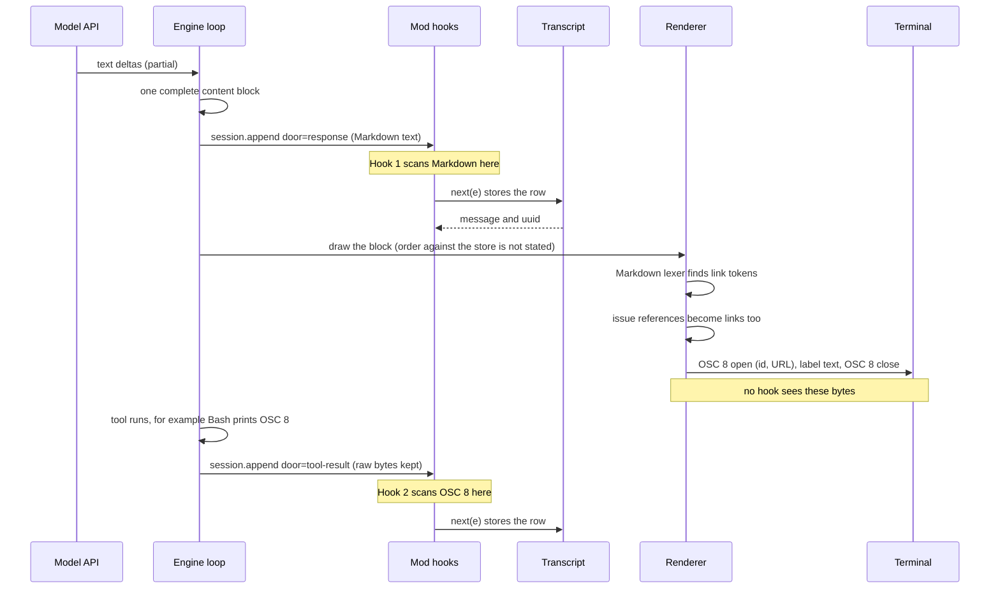

# Capture every link Claude shows

A mod cannot see the bytes Claude Code writes to the terminal. It can read the Markdown Claude writes and the raw output of tools. This page shows how to capture links from both, and how to keep the capture reliable.

- **Version pin:** Claude Code 2.1.295, checked on 2026-10-10. The mod API is early access and changes between releases.
- **Prerequisite:** the mods KB, [`../claude-code-mods/`](../claude-code-mods/AGENTS.md). Read its [overview](../claude-code-mods/concepts/overview.md) and [gotchas](../claude-code-mods/gotchas.md) first. This page does not repeat mod basics.
- **Evidence labels:** *primary* means the types file or `reference.md`. *Observed* means a run of the 2.1.295 binary, kept in [`sources/live-observations-2026-10-10/`](sources/live-observations-2026-10-10/README.md). *Binary* means text read from the executable (the code is not copied). *Inference* is a guess.

## Contents

1. [Where a link lives at each stage](#1-where-a-link-lives-at-each-stage)
2. [What the person sees as a link](#2-what-the-person-sees-as-a-link)
3. [Capture points](#3-capture-points)
4. [Recommended design and reliability checklist](#4-recommended-design-and-reliability-checklist)
5. [Raw OSC 8 in tool output](#5-raw-osc-8-in-tool-output)
6. [The reference mod](#6-the-reference-mod)
7. [Limits and open points](#7-limits-and-open-points)
8. [Terminal support](#8-terminal-support)
9. [See also](#9-see-also)

## 1. Where a link lives at each stage

Claude writes Markdown. The renderer turns it into `Link` spans, and the `Link` span is an OSC 8 sequence on the terminal ([d.ts:5635](../claude-code-mods/sources/claude-code-2.1.295/types/claude-code.d.ts#L5635), [d.ts:9567](../claude-code-mods/sources/claude-code-2.1.295/types/claude-code.d.ts#L9567)). OSC 8 exists only at the last step. No mod event sees it.



| Stage | What exists | A mod can read it at | Evidence |
| --- | --- | --- | --- |
| Model stream | Partial text deltas | `turn.step` chunks (partial, never use for links) | [d.ts:13474](../claude-code-mods/sources/claude-code-2.1.295/types/claude-code.d.ts#L13474) |
| Engine, per block | One complete text block per row | `session.append` with `door: 'response'` | primary, observed ([rows](sources/live-observations-2026-10-10/rows/tool-osc8-first-run.json)) |
| Transcript | Rows, as the chain answered them | `session.append` result, `$.session.messages()` | [reference.md:137](../claude-code-mods/sources/claude-code-2.1.295/reference.md#L137), [d.ts:11134](../claude-code-mods/sources/claude-code-2.1.295/types/claude-code.d.ts#L11134) |
| Renderer | Link tokens, `file://` mapping, issue links | `ui.render` `AssistantMessage` (text only, not the tokens) | [d.ts:9854](../claude-code-mods/sources/claude-code-2.1.295/types/claude-code.d.ts#L9854) |
| Terminal bytes | OSC 8 spans | nothing | [d.ts:5635](../claude-code-mods/sources/claude-code-2.1.295/types/claude-code.d.ts#L5635) |
| Tool output | Raw bytes, OSC 8 included | `session.append` with `door: 'tool-result'` | observed |

*Inference:* the engine may draw a row before or after it stores it. The types say the screen "may show the row just before its rewrite" ([d.ts:4359](../claude-code-mods/sources/claude-code-2.1.295/types/claude-code.d.ts#L4359)). No capture design may depend on the order.

## 2. What the person sees as a link

The reply renderer is `marked` with GFM rules (*binary*), plus rules of its own. The scanner in the reference mod follows what the renderer drew. Each row below was checked in a real terminal session with `FORCE_HYPERLINK=1` (*observed*, corpora [c1-c5](sources/live-observations-2026-10-10/corpora/), results in [ground-truth](sources/live-observations-2026-10-10/ground-truth/)).

| Written | Drawn as a link? | Target sent to the terminal | Corpus |
| --- | --- | --- | --- |
| `[t](url "title")`, nested `()` and `[]`, `<url with space>` | Yes | The destination as written. The title shows as plain text after the link. | c2 a, b, p |
| `[t](/etc/hosts)`, `[t](/a/../b)` | Yes | `file:///etc/hosts`, `file:///b`. A path that starts with one `/` becomes a `file://` URL. | c3 s11, p1-p7 |
| `[t](//host/x)` | No, plain text | | c3 s2 |
| `[t](ftp://..)`, `ssh://`, `tel:`, `data:`, `javascript:`, `docs/a.md`, `#frag`, `?q=1` | Yes | As written. The renderer does not filter schemes in replies. | c3 s1-s16 |
| `[t](url)` where `url` has a space and no `<>` | No. The URL part draws as a bare link. | | c3 n5 |
| `<https://x>`, `<ftp://x>`, `<foo:bar>` | Yes | As written | c2 i |
| `<mailto:a@b>`, `<a@b>`, `[t](mailto:a@b)` | No, plain text | | c2 i, c1 |
| `https://x`, `http://x`, `ftp://x` (lower case) | Yes | Trailing `. , ! ; )` and `* _ ~` are cut, as GFM does | c2 c, d, l |
| `www.x.org` | Yes | `http://www.x.org` | c1, c2 l |
| `HTTPS://X`, `x.org/path`, `a@b.com` | No | | c2 l |
| `[t][id]`, `[id]`, `[t][]` with `[id]: url` | **No.** The renderer drops definitions. The URL on the definition line draws as a bare link. | | c1 |
| `` | No. Draws `alt (url)` as text. | | c2 h |
| `[](url)` | Yes, the outer link only | | c3 CASE-5 |
| Inside `` `code` ``, ```` ``a `b` c`` ````, fenced blocks, indented blocks | No | | c2 e, f, o |
| Inside inline HTML (`<a href="url">`) or an HTML block (`<div>` until a blank line) | No | | c2 j, c4 4 |
| A URL that follows a backslash escape (`\[x](url)`, `\<url>`) | Yes, as a bare link. The escape does not protect it. | | c2 g |
| Tables, lists, quotes, headings | Yes | | c2 m, n |
| `owner/repo#12` in plain text | Yes | `https://github.com/owner/repo/issues/12`. Any `word/word#n` matches, `src/a.ts#12` too. | c4 2 |
| A destination with a raw ESC or BEL byte | No, plain text | | c5 |
| Raw OSC 8 bytes in a reply | No. The ESC and BEL bytes are removed and the rest shows as text. | | c5 |

More facts:

- **Issue links need a hyperlink terminal.** The `owner/repo#12` rule builds the host from the git remote and defaults to `github.com`. GitLab uses `/-/issues/`. Some hosts get no link (*binary*; only the default host was observed).
- **Spans are not always closed.** The renderer sends a new OSC 8 open for the next link with no close in between. A wrapped link uses one `id` for all its pieces ([c3](sources/live-observations-2026-10-10/ground-truth/c3.tsv); the spec allows both, [spec L87](sources/osc8-spec-2026-10-10/hyperlinks-in-terminal-emulators.md#L87)).
- **The reference.md:125 rule is for plugin-drawn `Markdown` only.** There "a link outside `https:`/`http:`/`file:` draws as text" ([reference.md:125](../claude-code-mods/sources/claude-code-2.1.295/reference.md#L125), [d.ts:5710](../claude-code-mods/sources/claude-code-2.1.295/types/claude-code.d.ts#L5710)). In a reply, no scheme filter ran (*observed*; the component takes an optional `linkSchemes` prop that replies do not set, *binary*).
- **Very long text.** *Inference from the binary:* a reply over 1000 lines, or with a line over 100 000 characters, takes a path that marks every link as plain text. Not observed. See [open-questions](open-questions.md).
- **Changelog notes:** raw hyperlink bytes in a reply were fixed in 2.1.295 ([changelog:54](../claude-code-mods/sources/code-claude-com-2026-10-09/changelog-2.1.280-2.1.295.md#L54)). A link address shown as text is no longer hidden by a style a reply left on ([changelog:35](../claude-code-mods/sources/code-claude-com-2026-10-09/changelog-2.1.280-2.1.295.md#L35)).

## 3. Capture points

| Capture point | Covers | Misses | Use for |
| --- | --- | --- | --- |
| `session.append` `door: 'response'` | Every assistant text block of the main loop and of subagents (`agentId`). Complete text, one row per block, in order. | Rows from a load (`--resume`, teleport). Text the engine hides when it draws (a `<context>` block). Links the renderer makes by itself (issue refs): your scanner must repeat that rule. | **The main capture.** |
| `session.append` `door: 'tool-result'` | Tool output as the model reads it. Raw OSC 8 bytes stay in it. | Plain URLs, unless you scan for them. A tool's structured record (`toolUseResult`) is not on the row. | OSC 8 capture. |
| `session.append` `door: 'prompt'`, origin `task-notification` | The final text of a background subagent, inside `<result>`. | Everything else on `prompt` is the person's own text. | Optional. The text repeats the subagent's `response` rows. |
| `session.append` `door: 'compaction'` | The compaction summary (reference.md names it as a row). | | Skip. It repeats links you already have. *Inference:* the summary text was not observed. |
| `session.append` `notice`, `command`, `delivery`, `tool-message`, `hook-context` | Engine notices, command output, peer messages, tool side rows | Not Claude's Markdown. Not observed. | Skip, or add a door when you have a need. |
| `turn.complete` | `answer`: the last visible text of the turn ([d.ts:13276](../claude-code-mods/sources/claude-code-2.1.295/types/claude-code.d.ts#L13276)). | Every text block before a tool call. | A cross-check only. |
| `ui.render` `AssistantMessage` | One block of text as the transcript will draw it, hidden parts removed. `isSummary` marks a summary of text, not the text ([d.ts:9854](../claude-code-mods/sources/claude-code-2.1.295/types/claude-code.d.ts#L9854)). | A render hook cannot write `$.state` ([gotcha 24](../claude-code-mods/gotchas.md)). It may run again on a redraw (*inference*). | Checking what is drawn. Not a capture point (*inference*). |
| `Markdown` `onLinkPress` | A plain click on a link in a `Markdown` element **your mod draws**, in the fullscreen terminal only. A ctrl- or alt-click still opens the link ([d.ts:5725](../claude-code-mods/sources/claude-code-2.1.295/types/claude-code.d.ts#L5725), [reference.md:125](../claude-code-mods/sources/claude-code-2.1.295/reference.md#L125)). | Clicks on the engine's own reply drawing. *Inference:* a hook could replace `AssistantMessage` with its own `Markdown`; not tried. | Click counts, never capture. |
| `turn.step` | Streaming chunks of one model request | Partial text. A link can be cut in the middle. | Do not use. |
| `$.session.messages()` | The newest 4096 messages: `{ role, text, toolUses[].text }` ([d.ts:2740](../claude-code-mods/sources/claude-code-2.1.295/types/claude-code.d.ts#L2740), [d.ts:11134](../claude-code-mods/sources/claude-code-2.1.295/types/claude-code.d.ts#L11134)) | Anything older. Progress rows. | Backfill after a load. |

Which rows carry assistant-written text besides `response`:

| Row | Text | Evidence |
| --- | --- | --- |
| `prompt` with origin `task-notification` | A background subagent's final text in `<result>…</result>`. | observed ([rows](sources/live-observations-2026-10-10/rows/subagent-background.json)) |
| `tool-result` of an `Agent` call | In the run observed, the call returned only a launch notice ("Async agent launched"). A foreground agent may return its report here. *Inference.* | observed, inference |
| `response` with `agentId` | A subagent's own text blocks. | observed |
| `compaction` | The summary. | [reference.md:137](../claude-code-mods/sources/claude-code-2.1.295/reference.md#L137) |
| `delivery` | A peer's message folded into a running turn. | [reference.md:137](../claude-code-mods/sources/claude-code-2.1.295/reference.md#L137), not observed |

## 4. Recommended design and reliability checklist

**Design.** Two `session.append` hooks (`door: 'response'` scans Markdown, `door: 'tool-result'` scans OSC 8). They are observe-only. A pure scanner file does the parsing. The list lives in `$.state` and is copied to `$.store` later. `session.start` and a session-id check restore it after a load or `/clear`. `/links` prints it.

| # | Rule | Why | Source |
| --- | --- | --- | --- |
| 1 | Hook `session.append` on the `response` door. Do not use `turn.step` or a render hook. | The row holds a complete block, once. `turn.step` gives deltas. A render hook runs many times and cannot write state. | [d.ts:4359](../claude-code-mods/sources/claude-code-2.1.295/types/claude-code.d.ts#L4359), [gotcha 24](../claude-code-mods/gotchas.md), observed: a 15-character delta stream arrived as one row |
| 2 | Observe only. Call `next(e)` first, scan what it returns, return that result unchanged. | A hook that answers a different row fails and is skipped. A row the engine appends is never refused. The row is stored before your code can fail. | [reference.md:141](../claude-code-mods/sources/claude-code-2.1.295/reference.md#L141), [d.ts:10673](../claude-code-mods/sources/claude-code-2.1.295/types/claude-code.d.ts#L10673) |
| 3 | Wrap the scan and the state write in `try/catch`. Add `.catch(($, e, next) => next(e))`. | A parser bug must not change the row. `validate` lists the hook as a gate ("gating hook with .catch"). | [dispatch-and-guards](../claude-code-mods/concepts/dispatch-and-guards.md), [d.ts:3936](../claude-code-mods/sources/claude-code-2.1.295/types/claude-code.d.ts#L3936) |
| 4 | Keep the hook short. Appends of one conversation store in order, and the next request waits for them. | A slow hook delays the model. The budget is 10 s and `$` calls do not count, but the wait is real. Observed: the hook settled in 3.3 ms (with `next()`) for a row with three candidate links. | [reference.md:143](../claude-code-mods/sources/claude-code-2.1.295/reference.md#L143), [d.ts:5100](../claude-code-mods/sources/claude-code-2.1.295/types/claude-code.d.ts#L5100), [gotcha 16](../claude-code-mods/gotchas.md) |
| 5 | Defer slow work with `$.clock.after`. | The callback runs later, outside the dispatch. The mod copies the list to `$.store` 1.5 s after the last capture, once per burst. Timers are lost on a reload, so the next capture schedules again. | [d.ts:12626](../claude-code-mods/sources/claude-code-2.1.295/types/claude-code.d.ts#L12626), [d.ts:7133](../claude-code-mods/sources/claude-code-2.1.295/types/claude-code.d.ts#L7133) |
| 6 | Put the scanner in its own file and give it no `$`. | `validate` refuses `$` passed to an imported function. A pure file is easy to test and to measure. | [validate-test-debug](../claude-code-mods/workflow/validate-test-debug.md) |
| 7 | Bound the work: cap the text (200 000 characters), the destination (2048), and use sticky regexes at an index, never `slice`. | A hostile or huge block must not stall appends. A test runs five hostile inputs. A manual run of fifteen showed at most 100 ms for 200 000 characters. | [links.ts](example/link-capture/hooks/links.ts) |
| 8 | Follow the renderer, not CommonMark. Test with its real output. | Reference links, schemes, `file://` mapping, issue refs and HTML blocks all differ from the spec. | section 2; `python3 sources/live-observations-2026-10-10/diff-scanner.py c2` |
| 9 | Dedupe by normalized URL and kind. Count repeats. Keep the first `uuid` and `agentId`. | The same link comes from the model, a subagent's rows, a task notification and a resume. | observed |
| 10 | Scan only `response` (Markdown) and `tool-result` (OSC 8). | The person's prompt, attachments and compaction text are not links Claude showed. | [reference.md:137](../claude-code-mods/sources/claude-code-2.1.295/reference.md#L137) |
| 11 | Never read OSC 8 from a `response` row. | The row keeps raw ESC bytes as the model wrote them, but the renderer removes them. The person sees no link. | observed (c5, [rows](sources/live-observations-2026-10-10/rows/)) |
| 12 | Backfill from `$.session.messages()` in `session.start`. | A load is not an append. Observed: after `--continue`, `session.start` already sees the old messages, and no append fires for them. | [reference.md:137](../claude-code-mods/sources/claude-code-2.1.295/reference.md#L137), [rows](sources/live-observations-2026-10-10/rows/tool-osc8-continue-run.json) |
| 13 | Detect `/clear`, `/resume`, `/branch` by a change of `$.session.id()`. Do not rely on `classic.SessionStart`. | These commands reset `$.state` and give a new id. The documented `classic.SessionStart` hook was bypassed by the built-in `sec-default` on this machine, so it never ran. | [gotcha 11](../claude-code-mods/gotchas.md), [docs: interface](../claude-code-mods/sources/code-claude-com-2026-10-09/mods/interface.md#L812), [debug log](sources/live-observations-2026-10-10/logs/debug-classic-sessionstart.txt) |
| 14 | Keep the working list in `$.state` and a mirror in `$.store`. Never write an empty list over a stored one. | `$.state` is versioned, survives a hot reload, and `update` is safe against two writers. `$.store` survives `/clear` and a new process. `$.fs.write` replaces the whole file, so a JSONL log would be read, appended and rewritten each time. | [d.ts:3244](../claude-code-mods/sources/claude-code-2.1.295/types/claude-code.d.ts#L3244), [state-and-storage](../claude-code-mods/concepts/state-and-storage.md) |
| 15 | Cap what you keep: 500 links in `$.state`, 20 sessions in `$.store`. | The store holds 4 MiB of JSON in all, shared by every session of the plugin. | [d.ts:3364](../claude-code-mods/sources/claude-code-2.1.295/types/claude-code.d.ts#L3364) |
| 16 | Register one hook per matcher. Use `{ door }` matchers. | A second hook without a matcher on one event fails the load. | [gotcha 5](../claude-code-mods/gotchas.md) |
| 17 | Re-run the renderer comparison after each Claude Code update. | The renderer is not a public contract. | section 6 |

**Why not a vendored parser.** A hooks module may `import` a vendored ES module by relative path. *Observed:* `marked` 15.0.12 (72 KB, one file) validated and ran inside `claude plugin test`. A bare `import 'marked'` fails (`a hooks module imports its own files by relative path and "claude-code", nothing else`). `import()` fails (`a dynamic import()`). A vendored `marked` with `def(){return}` would match many cases. The reference mod uses a small hand-written scanner (about 500 lines with comments) instead, for these reasons: the engine's renderer adds its own rules on top of `marked` (the `file://` mapping, issue links, control characters, windowing), the engine's `marked` version and patches are unknown, and 72 KB of third-party code would run in the hot path of every row. *Inference:* the choice is close. If you see the scanner drift from the renderer, vendoring `marked` is the fallback.

## 5. Raw OSC 8 in tool output

Tool output reaches the transcript as a `tool-result` row. A Bash result with OSC 8 kept every byte (*observed*, [rows](sources/live-observations-2026-10-10/rows/tool-osc8-first-run.json)): `content` was a plain string, with BEL-terminated and `ESC \`-terminated sequences, an `id=` parameter and CSI styling. The tool's last newline was removed. A tool may also return `content` as a list of text blocks (the `Agent` launch result did), so read both shapes.

| Case | Rule in `scanOsc8` | Spec |
| --- | --- | --- |
| Terminator | BEL (`\x07`) or `ESC \`. 8-bit C1 forms are not read. | [L77-79](sources/osc8-spec-2026-10-10/hyperlinks-in-terminal-emulators.md#L77) |
| Parameters | Split on `:`. Read `id=`. Other keys are ignored. | [L73](sources/osc8-spec-2026-10-10/hyperlinks-in-terminal-emulators.md#L73) |
| Open and close | A non-empty URI opens. An empty URI closes. | [L61-66](sources/osc8-spec-2026-10-10/hyperlinks-in-terminal-emulators.md#L61) |
| No close before the next open | The new open ends the span before it. The renderer itself does this. | [L87](sources/osc8-spec-2026-10-10/hyperlinks-in-terminal-emulators.md#L87) |
| Same `id` and same URI | One link. Labels are joined. This is a link wrapped over lines. | [L109](sources/osc8-spec-2026-10-10/hyperlinks-in-terminal-emulators.md#L109) |
| No `id` | Each span is its own link. The URL is deduped later. | [L119](sources/osc8-spec-2026-10-10/hyperlinks-in-terminal-emulators.md#L119) |
| Other escapes in the label | CSI (colors), other OSC, DCS, APC, PM and SOS strings, and charset selects are removed from the label. | |
| Open span at the end | Closed at the end of the text. | |
| Plain URLs in the same output | Not captured. Only OSC 8 is. | |

```ts
// hooks/links.ts, scanOsc8 (the matching loop)
for (const m of text.matchAll(OSC8)) {
  if (cur) cur.label += visible(text.slice(pos, m.index))
  pos = m.index! + m[0].length
  if (cur) { spans.push(cur); cur = null }          // a new open, or a close, ends the span
  const uri = m[2]!
  if (uri !== '') cur = { url: uri, id: paramId(m[1]!), label: '' }
}
```

*Inference:* a tool that prints OSC 8 only when it writes to a terminal (`ls --hyperlink=auto`) prints plain text here, because a tool's stdout is a pipe. The task brief named `ls --hyperlink`; it was not tried. BSD `ls` on macOS has no such flag.

## 6. The reference mod

Folder: [`example/link-capture/`](example/link-capture/). It was written for this page and checked against the 2.1.295 binary. It is not loaded by Claude Code from here. To try it: `claude --plugin-dir docs/knowledge-base/claude-code-link-capture/example/link-capture`. The engine then lays `.claude-plugin/types/` beside the mod (with its own `.gitignore`).

```text
example/
├── tsconfig.json                 per the d.ts header; includes the KB's types file and the mod
└── link-capture/
    ├── .claude-plugin/plugin.json
    ├── hooks/
    │   ├── hooks.json            { "modules": ["./register.ts"] }
    │   ├── register.ts           hooks, state, store, /links
    │   └── links.ts              pure scanner: scanMarkdown, scanOsc8, textOfContent, mergeLinks
    ├── types/index.d.ts          PluginState contract and the Captured type
    └── tests/
        ├── links.test.ts         32 scanner tests
        └── register.test.ts      16 hook tests
```

The two capture hooks (`hooks/register.ts`):

```ts
on('session.append', { door: 'response' }, async ($, e, next) => {
  const stored = await next(e)                       // the row is stored first
  try {
    await ensure($)                                  // /clear, /resume, /branch: new session id
    if (stored.message) {
      const found = scanMarkdown(textOfContent(stored.message.content))
      await record($, found, { door: e.door, uuid: e.uuid, agentId: e.agentId })
    }
  } catch {
    // A scanner or state fault must not touch the row.
  }
  return stored                                      // unchanged
}).catch(($, e, next) => next(e))

on('session.append', { door: 'tool-result' }, async ($, e, next) => {
  const stored = await next(e)
  try {
    await ensure($)
    if (stored.message) {
      const found = scanOsc8(textOfContent(stored.message.content))
      await record($, found, { door: e.door, uuid: e.uuid, agentId: e.agentId })
    }
  } catch {}
  return stored
}).catch(($, e, next) => next(e))
```

Merge, then copy to the store later (`hooks/register.ts`):

```ts
async function record($: EngineInterface, found: Found[], src: Source): Promise<void> {
  if (found.length === 0) return
  let lost = 0
  await update($, links, (list) => {                 // compare-and-set on $.state
    const r = mergeLinks(list ?? [], found, src, CAP)
    lost = r.dropped
    return r.list
  })
  if (lost > 0) await update($, dropped, (n) => (n ?? 0) + lost)
  schedule($)
}

function schedule($: EngineInterface): void {        // one write per burst
  if (flushing) return
  flushing = true
  $.clock.after(FLUSH_MS, async () => {
    flushing = false
    try { await flush($) } catch {}
  })
}
```

Restore after a load or `/clear` (`hooks/register.ts`):

```ts
async function ensure($: EngineInterface): Promise<void> {
  const id = await $.session.id()
  if (knownId === id) return
  const hadId = knownId !== undefined
  knownId = id
  if (hadId) await restore($, 'clear')               // a new id: /clear, /resume or /branch
}

on('session.start', async ($, e, next) => {
  await $.command.register({ name: 'links', description: 'List the links Claude showed this session', argumentHint: '[all] [count]' })
  try { knownId = await $.session.id(); await restore($, 'startup') } catch {}
  return next(e)
})
```

The Markdown scanner (`hooks/links.ts`) cuts code and HTML blocks, then walks the text once. It handles: inline links (nested brackets and parentheses, angle destinations, titles, text after the closing parenthesis), autolinks, bare URLs with the GFM trim, reference links (recorded as `non-clickable`), images, `owner/repo#12`, the `file://` mapping and control characters. Each result is `{ url, label?, via, kind }`. `kind` is `link` when the renderer draws a clickable span and `non-clickable` when it draws text. The scanner does **not** drop other schemes, because the renderer does not. The list keeps a `web` flag (http, https, file), and `/links` hides the rest until you type `/links all`.

A test raises a row the way the engine does (`tests/register.test.ts`):

```ts
test('response row: links are listed by /links, and the row is stored as made', async ($, on) => {
  world(on)                                          // stubs: store, clock, session.id, ...
  const row = response('See [docs](https://docs.example/a "T"), https://bare.example/b. Not `https://code.example/c`.')
  const stored = await $.session.append(row)         // door: 'response', origin: model, uuid, message
  expect(stored.message?.content).toEqual(row.message.content)
  const out = await run($)                           // /links
  expect(out.text).toContain('2 links')
  expect(out.text).not.toContain('code.example')
})
```

Commands run from the repo path (`docs/knowledge-base/claude-code-link-capture/example`) with the 2.1.295 binary at `~/.local/share/claude/versions/2.1.295`. `claude` on PATH was already 2.1.296 on the day. The result is the same on both:

| Command | Result |
| --- | --- |
| `~/.local/share/claude/versions/2.1.295 plugin validate link-capture` | `✔ Validation passed`. Hooks: `session.append{door=response}`, `session.append{door=tool-result}`, `session.start`, `command.run{command=links}`. State: `link-capture.links`, `link-capture.dropped`. |
| `mise exec node@25.5.0 -- npx -y -p typescript tsc -p .` (TypeScript 7.0.2) | exit 0, no output |
| `~/.local/share/claude/versions/2.1.295 plugin test link-capture` | `48 pass`, `0 fail`, `Ran 48 tests across 2 files.` |

`git status --short` shows no generated file under `example/` after these commands. `validate`, `test` and `tsc` lay no `.claude-plugin/types/`. Only a real session load does.

**Checks against the live renderer** (the numbers behind rule 8 and the section 2 table):

| Check | Result |
| --- | --- |
| `diff-scanner.py c1 … c5` | c1 13/13, c2 44/44, c4 18/18, c5 1/1 links the same. c3 36/36 with one difference: `[u](<https://e.com/<>)` (a destination with a second `<`). |
| REPL, `hi`, `/links`, `/clear`, `/links` | 3 links, then the same 3 links after `/clear` ([log](sources/live-observations-2026-10-10/logs/repl-links-after-clear.txt)). |
| `-p` run, then `-p "/links" --continue` | The 2nd run lists 5 links of the 1st from the transcript: 2 inline, 2 OSC 8 (from a Bash result, one BEL and one `ESC \` terminated), 1 bare. |

## 7. Limits and open points

| Limit | Effect |
| --- | --- |
| The scanner is a model of the renderer, not the renderer. | One known difference (c3 u6). Block rules for lists and HTML are approximate: no HTML block type 7, no list-in-quote depth. |
| `classic.SessionStart` did not run for a user mod here. | `/clear` restore uses the session-id check. A machine without `sec-default` may differ. |
| Only the terminal surface was checked. | Desktop, VS Code and mobile draw links their own way ([d.ts:5635](../claude-code-mods/sources/claude-code-2.1.295/types/claude-code.d.ts#L5635)). |
| The test kit raises rows the test makes up. | It does not show the real row mix, the real renderer, or a real transcript load. A test cannot read `$.state` directly (the test `$` has no `state` noun) and cannot reset it mid-test. Read it through the mod's own command. |
| Compaction and `delivery` rows were not observed. | The mod does not scan them. |
| A hook cannot see what the person scrolls past, clicks or copies. | Capture is "Claude wrote this link", not "the person saw it". |

The full list is in [open-questions.md](open-questions.md).

## 8. Terminal support

The renderer emits OSC 8 only where it thinks the terminal supports it (`FORCE_HYPERLINK=1` forces it). A terminal without OSC 8 ignores the sequence and shows the label alone. Capture does not depend on the terminal: the mod reads the text before any drawing. Researched 2026-10-10. "Alhadis" means the value comes only from the community list [Alhadis/OSC8-Adoption](https://github.com/Alhadis/OSC8-Adoption/).

| Terminal | OSC 8 | Since | Open a link | Source |
| --- | --- | --- | --- | --- |
| iTerm2 | Yes | 3.1 (Alhadis) | Cmd+click | [iTerm2 escape codes](https://iterm2.com/documentation-escape-codes.html) |
| kitty | Yes | 0.19 (Alhadis) | Ctrl+Shift+click in the docs example | [kitty open actions](https://sw.kovidgoyal.net/kitty/open_actions/) |
| WezTerm | Yes | 2018 (Alhadis) | Click; configurable | [WezTerm hyperlinks](https://wezterm.org/recipes/hyperlinks.html) |
| Ghostty | Yes | PR #1928, 2024-07 | Ctrl or Cmd, underline on hover | [ghostty#1928](https://github.com/ghostty-org/ghostty/pull/1928) |
| Alacritty | Yes | 0.11.0 | unknown | [CHANGELOG](https://raw.githubusercontent.com/alacritty/alacritty/master/CHANGELOG.md) |
| Windows Terminal | Yes | 1.4 | Ctrl+click | [Preview 1.4 blog](https://devblogs.microsoft.com/commandline/windows-terminal-preview-1-4-release/) |
| VTE / GNOME Terminal | Yes | VTE 0.50 (Alhadis); avoid 0.50.0 | unknown | [spec](sources/osc8-spec-2026-10-10/hyperlinks-in-terminal-emulators.md) |
| Konsole | Yes, may be off by default | 2020 (Alhadis) | unknown | [KDE bug 379294](https://bugs.kde.org/show_bug.cgi?id=379294) |
| foot | Yes | 1.7.0 (Alhadis) | unknown | [foot CHANGELOG](https://codeberg.org/dnkl/foot/raw/branch/master/CHANGELOG.md) |
| Warp | Yes | unknown | Cmd+click (macOS), Ctrl+click | [Warp files and links](https://docs.warp.dev/terminal/more-features/files-and-links/) |
| VS Code terminal (xterm.js) | Yes | xterm.js 5.0.0, VS Code 1.72 | dashed underline, hover shows URL | [xterm.js 5.0.0](https://github.com/xtermjs/xterm.js/releases/tag/5.0.0) |
| tmux | Pass-through | 3.4 | outer terminal decides | [tmux CHANGES](https://raw.githubusercontent.com/tmux/tmux/3.8/CHANGES) |
| xterm (Dickey) | No | n/a | n/a | [ctlseqs](https://invisible-island.net/xterm/ctlseqs/ctlseqs.html): no OSC 8 |
| Apple Terminal, GNU screen, JetBrains | unknown | | | no primary source found |

tmux needs the `hyperlinks` terminal feature, for example `set -ga terminal-features "*:hyperlinks"` (Alhadis; the tmux man page names the feature but gives no example line).

No standard way exists to ask a terminal whether it supports OSC 8 ([spec](sources/osc8-spec-2026-10-10/hyperlinks-in-terminal-emulators.md)). Tools guess from the environment. The npm package [`supports-hyperlinks`](https://github.com/jamestalmage/supports-hyperlinks) checks `FORCE_HYPERLINK`, `WT_SESSION`, `TERM_PROGRAM` + `TERM_PROGRAM_VERSION` (iTerm.app 3.1+, WezTerm, vscode 1.72+, ghostty), `VTE_VERSION` (0.50+, not 0.50.0) and `TERM=alacritty`. It returns false for kitty, foot, Konsole, tmux and Warp. *Inference:* Claude Code uses a similar check; `FORCE_HYPERLINK=1` turned links on in the live run ([live observations](sources/live-observations-2026-10-10/README.md)).

## 9. See also

- [`open-questions.md`](open-questions.md): unknowns and source conflicts.
- [`sources/live-observations-2026-10-10/`](sources/live-observations-2026-10-10/README.md): scripts and recorded runs.
- [`sources/osc8-spec-2026-10-10/`](sources/osc8-spec-2026-10-10/hyperlinks-in-terminal-emulators.md): the OSC 8 specification.
- Mods KB: [events, `session.append`](../claude-code-mods/reference/events.md#6-sessionappend-in-depth), [dispatch and guards](../claude-code-mods/concepts/dispatch-and-guards.md), [state and storage](../claude-code-mods/concepts/state-and-storage.md), [UI: Markdown links](../claude-code-mods/reference/ui.md), [testing kit](../claude-code-mods/reference/testing-kit.md), [gotchas](../claude-code-mods/gotchas.md).
