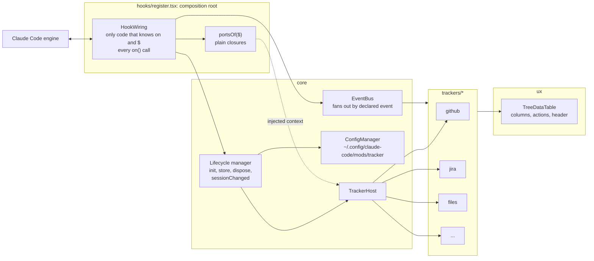

# Mod architecture — knowledge base

Research for [issue #55](https://github.com/martin-macak/claude-code-mod-tracking/issues/55): "Harden the tracking mod architecture: trackers, config, tree table". The goal is to restructure [`plugins/artifact-tracking`](../claude-code-artifact-tracking/README.md) so that a new tracker is a new folder, not an edit across the codebase. The topics are a tree-table UI component, a config manager, a tracker plugin contract, one lifecycle manager and delivery as stacked pull requests.

This slug is research. It presents evidence and options and marks each recommendation. It is not the design spec. The spec goes to `docs/superpowers/specs/`. The user decides the open choices ([open-questions §2](open-questions.md#2-decisions-for-the-design-spec)).

| | |
| --- | --- |
| Claude Code | **2.1.302** (installed). Authority: [`claude-code.d.ts`](../claude-code-mods/sources/claude-code-2.1.302/types/claude-code.d.ts), 22,255 lines. Older pages in the mods KB cite the 2.1.295 snapshot. |
| Mod under study | `plugins/artifact-tracking` at commit [d391552](https://github.com/martin-macak/claude-code-mod-tracking/commit/d391552bfb5ebe18febc24b81f8dd914e1127a47): 50 files, 9,888 lines, `register.tsx` with 1,705 lines |
| Tools | `gh` 2.102.0, `git` 2.56.0, `gh stack` v0.1.0, `tsc` 7.0.2 (`npx`), tmux 3.8, macOS (Darwin 25.6.0) |
| Captured | 2026-10-17 |
| Status | Research done, then probed. The user decided most open choices on 2026-10-17 and 2026-10-18 ([open-questions §2](open-questions.md#2-decisions-for-the-design-spec)). D7, D8 and D10 were settled on 2026-10-18. Open: D6, the test override of D3, the minimum Claude Code version of D13 and the unknowns of [§1](open-questions.md#1-unknowns). |
| Evidence | Throwaway spike mods run with `claude plugin validate`, `claude plugin test`, `tsc` and real interactive sessions in tmux. Source and small captures are in [`sources/spikes-2026-10-17/`](../claude-code-mods/sources/spikes-2026-10-17/README.md) of the mods KB ([open-questions §4](open-questions.md#4-evidence-storage)). A trial of GitHub stacked PRs ran on a throwaway private repo ([stacked-prs §3.1](stacked-prs.md#31-the-trial)). |

## Prerequisites

Read the [mods KB](../claude-code-mods/AGENTS.md) and its [gotchas](../claude-code-mods/gotchas.md). Then read the [artifact-tracking KB](../claude-code-artifact-tracking/AGENTS.md). This slug does not repeat them. The mods KB pages [lifecycle](../claude-code-mods/concepts/lifecycle.md), [ports-and-injection](../claude-code-mods/concepts/ports-and-injection.md), [fs-and-config](../claude-code-mods/reference/fs-and-config.md) and [changes-2.1.302](../claude-code-mods/reference/changes-2.1.302.md) hold the general engine facts that this slug applies.

## Map

| Page | Contents |
| --- | --- |
| [AGENTS.md](AGENTS.md) | Rules for this slug, the grade vocabulary, probe safety |
| [current-architecture.md](current-architecture.md) | The as-is map: buckets, 23 `on()` sites (28 hooks at run time), state keys, module variables, eight trackers in two tiers, closed unions, SOLID violations, the lifecycle today, what the tests pin |
| [tree-table.md](tree-table.md) | Prior art, engine facts about keys, focus, colors, width and size limits, options for U1 to U7, an API sketch |
| [config-manager.md](config-manager.md) | `$.fs` live behavior, torn reads, kit behavior, prior art, options for path, format, cache, write and migration, candidate config keys |
| [tracker-plugins.md](tracker-plugins.md) | Rules for `on`, `$` and state refs across files, prior art, options for the tracker contract, state and tiers |
| [lifecycle-manager.md](lifecycle-manager.md) | `session.end`, `/clear`, hot reload and the 1.5 s bound, options for phases and the split of the manager |
| [stacked-prs.md](stacked-prs.md) | GitHub stacked PRs, how they fit this repo's rules, a candidate layering |
| [open-questions.md](open-questions.md) | 32 unknowns (6 answered, 4 partly), 17 decisions for the spec (10 decided, 2 partly, 4 open, 1 done as a KB task), 15 older KB claims this slug contradicts |

## Key findings

Grades: `verified-live` (interactive session), `verified-kit` (validate, kit, tsc, headless), `types-only`, `public-docs`, `observed`, `inference`. See [AGENTS.md](AGENTS.md#grades).

| # | Finding | Grade | Page |
| --- | --- | --- | --- |
| 1 | **Tab and Shift+Tab walk every Button, row by row, and the pane scrolls to keep the ring in view. Up and Down only scroll while the tree overflows.** They move the ring only when the whole tree fits. | `verified-live` | [tree-table §3.2](tree-table.md#32-keyboard) |
| 2 | A `Client` region gets the keyboard only after a mouse click. | `verified-live` | [tree-table §3.2](tree-table.md#32-keyboard) |
| 3 | A pane hotkey fires wherever its Button is: off screen, in the footer, in a hidden box. No letter or digit is reserved. Other printable keys leave the pane. | `verified-live` | [tree-table §3.2](tree-table.md#32-keyboard) |
| 4 | A `ui.focus` hook may write state. A render hook may not. Write after `next(e)`. **Live: the highlight follows Tab on the first frame, the ring stays on the same `Button`, and a hotkey acts on the selected row without moving the ring.** Make the selection sticky: write it only for row keys. | `verified-kit`, `verified-live` | [tree-table §3.3](tree-table.md#33-selection-state) |
| 5 | **A Pane tree has hard budgets.** 20,000 nodes and 32 levels refuse the tree. Past 100,000 characters of text, the tree is not refused, but later rows lose their Buttons: from row 248 with real Box keys. The engine logs the cut (`types-only`, [reference.md 302:155](../claude-code-mods/sources/claude-code-2.1.302/reference.md#L155)). The mod and the kit see no error. Windowing or a row cap is required. **Live, both limits behave as in the kit.** 600 rows with short keys and 40 to 80 character titles draw whole. A refused tree is blank and keyboard-dead. A Tab costs about 58 ms at 300 rows and 221 ms at 1300. | `verified-kit`, `verified-live` | [tree-table §3.6](tree-table.md#36-size-limits-of-a-pane-tree) |
| 6 | Alignment (`justifyContent`), clipping (`wrap`) and fills (`backgroundColor`) work. A colon in a color string blanks the whole pane. Under tmux every color is quantized to 256. | `verified-live` | [tree-table §3.1](tree-table.md#31-elements-and-layout), [§3.4](tree-table.md#34-colors) |
| 7 | The renderer measures cell width with Bun. The mod must ship its own `cellWidth`. A 65-line port matched the live renderer on 24 of 24 strings. | `verified-live` | [tree-table §3.5](tree-table.md#35-cell-width) |
| 8 | `$.fs` reads and writes under `~/.config` with no prompt (interactive, manual and auto mode). | `verified-live` | [config-manager §3](config-manager.md#3-what-the-engine-allows) |
| 9 | `$.fs.write` overwrites in place. A large file can tear on read. A small file stayed clean. There is no rename, lock or watch, so the cache key is `mtimeMs` plus `size`. | `verified-live` | [config-manager §3](config-manager.md#3-what-the-engine-allows) |
| 10 | In the kit an unstubbed `$.fs` call is refused and never touches the disk. | `verified-kit` | [config-manager §3](config-manager.md#3-what-the-engine-allows) |
| 11 | **`on` may go to an imported plain named function. The registry must be a static chain, never an array, loop or method.** A second matcherless `on()` for one event anywhere in the import tree refuses the module. Two `ui.render` hooks with one matcher from two files compose one tree (the first is outermost). `register` may be `async`, but it has no `$`, so only `options` can gate registration. **A bus works** (one matcherless `on('tool.call')` with a `Map`, and `on('session.append', { door })`): the engine already skips a hook beneath its own call, so a bus needs no re-entry counter for engine events, and a row a tracker appends inside the fan-out hook is invisible to every tracker on it. A `ui.render` hook that calls `$.ui.invalidate` is run again, so never invalidate in a render. | `verified-kit` | [tracker-plugins §2.1](tracker-plugins.md#21-passing-on-to-another-file) |
| 12 | `$` may go to an imported `function` declaration on 2.1.300 and later. A ports object of closures works. State refs must be literal and in the same file as their use. One `StateFamily` key avoids a contract edit per tracker. | `verified-kit` | [tracker-plugins §2.2](tracker-plugins.md#22-passing--and-building-ports), [§2.3](tracker-plugins.md#23-state-refs-and-the-contract) |
| 13 | Code may live in sibling folders of `hooks/` inside the plugin root. An import that leaves the root is refused. **An edit in such a folder reloads the mod like an edit to `hooks/register.tsx`** (0.5 to 0.65 s), if the import graph reaches it. A file nothing imports does not. | `verified-kit`, `verified-live` | [tracker-plugins §2.4](tracker-plugins.md#24-where-the-code-may-live) |
| 14 | **`session.end` on `/clear` sees the old session id and the old `$.state`.** A `$.store.set` and a `$.fs.write` finish in 0 to 6 ms inside the 1.5 s bound. No `session.start` fires after `/clear`. A `classic.SessionStart` function hook never fired for a `--plugin-dir` mod. | `verified-live` | [lifecycle-manager §3.1](lifecycle-manager.md#31-start-clear-and-end) |
| 15 | The first `session.append` of the new session carries the new id and a reset `$.state`, 9 to 15 ms after `session.end` (`/clear`: 12 to 15 ms in the first pass, 11 ms in the second; `/branch`: 9 ms). Not after `/resume`: no row comes at once (finding 18). | `verified-live` | [lifecycle-manager §3.1](lifecycle-manager.md#31-start-clear-and-end) |
| 16 | **On a hot reload the old module hears nothing and its timers die.** The new copy gets `register` and `session.start` 0.5 to 0.7 s after the save. A pane survives. A debounced flush is lost. | `verified-live` | [lifecycle-manager §3.1](lifecycle-manager.md#31-start-clear-and-end) |
| 17 | GitHub stacked PRs are generally available since 2026-10-06. `gh stack` is installed. A trial on a throwaway repo merged full stacks and single layers with linear history. Plain `gh pr merge` fails. The agent gate does not see `gh stack`. Every generated PR body needs an edit. The strict policy blocks the stack when `main` moves. | `public-docs`, `observed` | [stacked-prs §3.1](stacked-prs.md#31-the-trial) |
| 18 | **`/resume` and `/branch` end the session like `/clear`,** with `reason: 'resume'` for both. `$.state` is empty afterwards and a resumed session's old state is not restored. The module copy, variables and timers survive. After `/resume` no `session.append` came for 4.8 s, so detect a new session by an id compare. | `verified-live` | [lifecycle-manager §3.1](lifecycle-manager.md#31-start-clear-and-end) |
| 19 | A `StateFamily` member with a computed `id` works live. Its values reset on `/clear`, `/resume` and `/branch`. | `verified-live` | [tracker-plugins §2.3](tracker-plugins.md#23-state-refs-and-the-contract) |
| 20 | The cell-width helper's `/v` regexes need `target: es2024` (`TS1501` at `es2023`). | `verified-kit` | [tree-table §3.5](tree-table.md#35-cell-width) |

## Issue #55 definition of done

| Item | What the research says | Page |
| --- | --- | --- |
| TreeDataTable: every tree row is expandable | Possible. Expansion costs nodes, so collapse by default. | [tree-table §5.4](tree-table.md#54-expansion-u1) |
| TreeDataTable: a header row | Possible. Not sticky in a pane. | [tree-table §5.5](tree-table.md#55-columns-header-and-sizing-u2-u3) |
| TreeDataTable: fixed or content size, alignment | Possible with `Box width`, `justifyContent` and an own `cellWidth`. | [tree-table §5.5](tree-table.md#55-columns-header-and-sizing-u2-u3) |
| TreeDataTable: foreground and background colors | Possible. Whitelist the tokens. | [tree-table §5.6](tree-table.md#56-colors-u4) |
| TreeDataTable: keyboard row movement | Tab walks rows. Arrows scroll. | [tree-table §5.1](tree-table.md#51-row-navigation-u5) |
| TreeDataTable: a caller registers any key | Bounded to one `a-z` or `0-9` per Button. | [tree-table §5.3](tree-table.md#53-key-registry-u6) |
| Every tree in the pane uses it | One model can feed the pane, the `/track` text and the band. | [tree-table §5.8](tree-table.md#58-one-model-three-renderers-u7) |
| Config in `~/.config/claude-code/mods/tracker`, a config manager | `$.fs` works. Defend reads against tearing. | [config-manager](config-manager.md) |
| A Tracker interface with `init` and `store`, config injected | Decided (D9): the core owns every `on()` and fans out through a bus. A static chain also works for matcher hooks. | [tracker-plugins §5.1](tracker-plugins.md#51-who-writes-the-on-calls) |
| Four folders | Sibling folders of `hooks/` are allowed inside the plugin root. | [tracker-plugins §5.9](tracker-plugins.md#59-folder-layout) |
| One lifecycle manager | `session.end` plus an id compare replace polling (`/resume` raises no row at once). Reload loses pending work. `/clear`, `/resume` and `/branch` keep the module copy and timers. | [lifecycle-manager](lifecycle-manager.md) |
| A new tracker needs no edit outside its folder and one registration line | True only with the static chain and the `StateFamily` key. A typed atom edits the contract file. | [tracker-plugins §5](tracker-plugins.md#5-options-and-trade-offs) |
| Stacked PRs, `make verify` on each | Possible. Trial passed. Four repo rules need care, and each PR body needs an edit. | [stacked-prs](stacked-prs.md) |

## One picture of the decided shape

The picture shows decision D9: `register.tsx` is the only file with `on` and `$`, and an event bus fans events out to trackers. The split inside `core` is a recommendation (`inference`), not a decision.

## How claims are sourced

- Pages cite the 2.1.302 snapshot by file and line.
- Precedence: types file, then bundled `reference.md`, then public docs, then inference.
- A verified claim carries the output that matters. Spike names link to their folder in the [snapshot](../claude-code-mods/sources/spikes-2026-10-17/README.md), which has one row per spike.
- Text marked `inference` is not stated by any source.
- The spikes ran on 2026-10-17 on macOS with Claude Code 2.1.302. Behavior on another release or platform is not shown.
