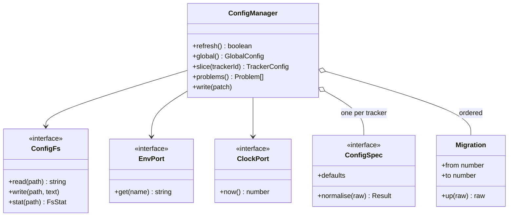
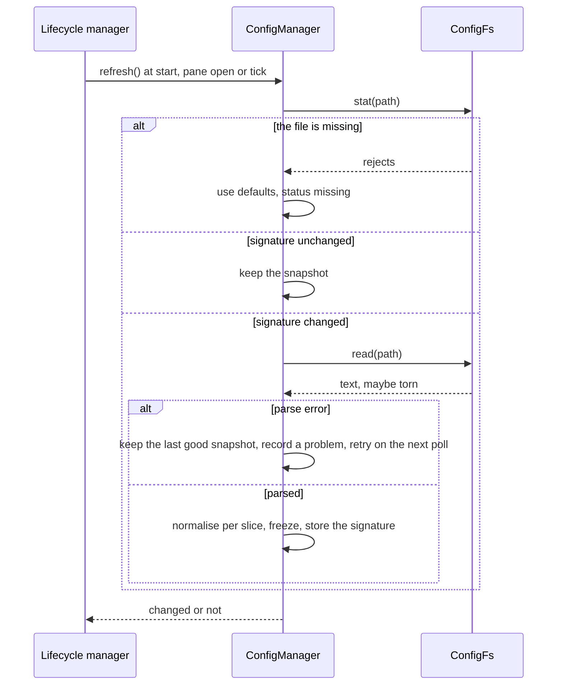
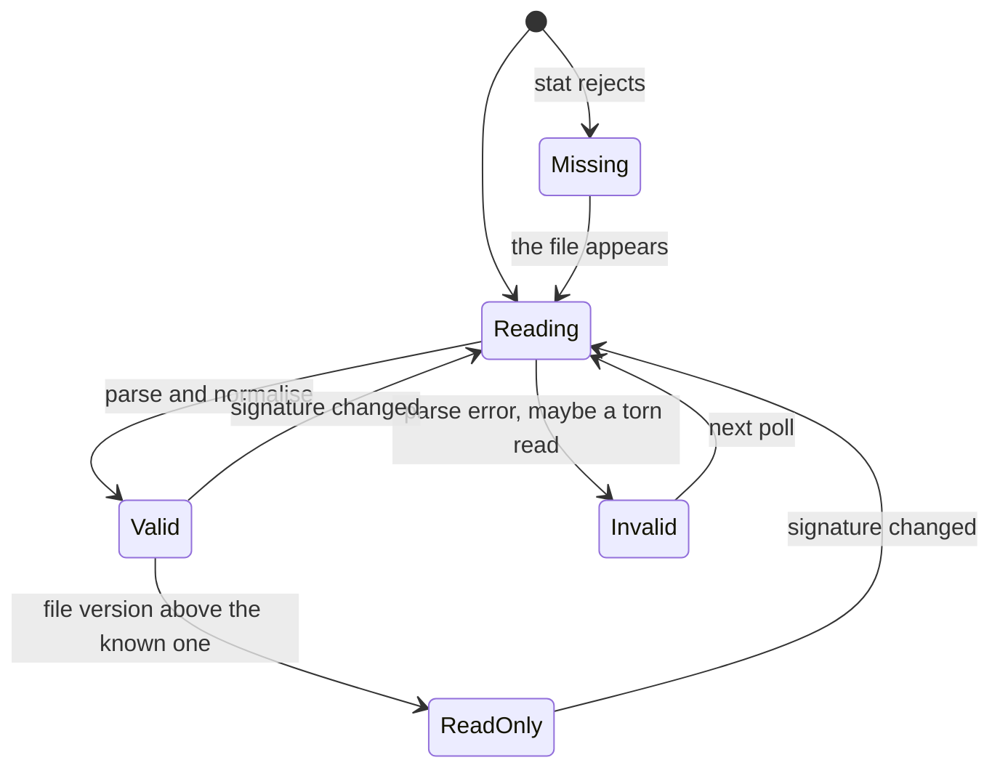

# Config manager

Research for the second part of [issue #55](https://github.com/martin-macak/claude-code-mod-tracking/issues/55): a config manager class owns `~/.config/claude-code/mods/tracker`. It reads, writes and caches the config. The index is [README.md](README.md). Grades: [AGENTS.md](AGENTS.md#grades). `d.ts:N` links to the 2.1.302 snapshot.

The page gives the engine facts, prior art, constraints and options. Recommendations are marked. The design spec decides.

Short answer:

- `$.fs` can read and write under `~/.config` without a prompt (`verified-live`, interactive, manual and auto permission mode, no managed settings on the test machine).
- `$.fs.write` overwrites in place. A reader can see mixed or truncated content for a large file. A small file stayed clean in every external read (`verified-live`).
- The engine has no rename, delete, lock or watch. A write is last-writer-wins. The cache key can only be `mtimeMs` plus `size` from `$.fs.stat`.
- In the kit, an unstubbed `$.fs` call is refused and never touches the disk (`verified-kit`). A port with an in-memory fake is the simplest test seam.
- The mod has no config today. All tuning is hard-coded ([§6](#6-candidate-config-keys)).

## 1. What the issue asks

- Config lives in `~/.config/claude-code/mods/tracker`.
- A config manager class reads, writes and caches the config.
- Each tracker gets the config manager injected and "can read global config values".
- The mod stays usable when the file is missing or wrong.

## 2. The mod today

There is no config file. The only runtime reads are `$.env` `HOME` and `CLAUDE_CONFIG_DIR`, `$.settings.read().autoMemoryDirectory` (`H/register.tsx:743-751`) and an env probe in `H/repos/tracker.ts:108`. All tuning is the `LIMITS` constant (`H/contracts.ts:164-197`, 30 values) and scattered constants. See [current-architecture §12](current-architecture.md#12-hard-coded-values).

## 3. What the engine allows

The mods KB has the general `$.fs` reference: [fs-and-config](../claude-code-mods/reference/fs-and-config.md). This section keeps the facts that decide the config manager.

| Fact | Grade | Evidence |
| --- | --- | --- |
| `$.fs` has `read`, `write`, `list`, `exists`, `stat`, `ancestors`. It has no `rename`, `delete`, `lock` or `watch`. | `types-only` | [d.ts:3306-3430](../claude-code-mods/sources/claude-code-2.1.302/types/claude-code.d.ts#L3306-L3430) |
| An absolute path is used as given. A relative path is under the session's working directory. Where a path may go is an `fs.*` hook's to say. A read or write over 4 MiB rejects. | `types-only` | [d.ts:3299-3304](../claude-code-mods/sources/claude-code-2.1.302/types/claude-code.d.ts#L3299-L3304) |
| `~` is not documented as expanded. Build the path from `$.env.get('HOME')`. | `types-only` | [d.ts:3299-3304](../claude-code-mods/sources/claude-code-2.1.302/types/claude-code.d.ts#L3299-L3304), [d.ts:3671-3690](../claude-code-mods/sources/claude-code-2.1.302/types/claude-code.d.ts#L3671-L3690) |
| `$.fs.write` creates the file and its directories as needed. It takes no mode argument. | `types-only` | [d.ts:3326-3332](../claude-code-mods/sources/claude-code-2.1.302/types/claude-code.d.ts#L3326-L3332) |
| `$.env.get('HOME')` and `$.env.get('XDG_CONFIG_HOME')` inside closures built by one top-level function (`portsOf($)`) pass `validate`: `calls: $.env.get (via portsOf)`, `env reads: HOME, XDG_CONFIG_HOME`. | `verified-kit` | Spike [`kbw-env`](../claude-code-mods/sources/spikes-2026-10-17/kbw-env/) (validate only, nothing run). |
| `$.env.get(name)` needs a string literal. `claude plugin validate` lists the names. | `types-only` | [d.ts:3671-3690](../claude-code-mods/sources/claude-code-2.1.302/types/claude-code.d.ts#L3671-L3690) |
| `$.fs.write` is a dispatch that hooks above the plugin can deny or rewrite (`fs.write` arguments are `{path, text}`). A plugin that calls it must also list the call in its `uses`. | `types-only` | [d.ts:7205-7239](../claude-code-mods/sources/claude-code-2.1.302/types/claude-code.d.ts#L7205-L7239), [d.ts:7887-7898](../claude-code-mods/sources/claude-code-2.1.302/types/claude-code.d.ts#L7887-L7898) |
| **Live: read, write, exists, stat, list and a nested-directory write on `$HOME/.config/claude-code/mods/tracker-spike/` all succeeded.** No permission prompt, no deny, no hot-reload question. Manual mode and auto mode both worked, on a directory that did not exist before. `$.fs.write` created the missing parents `~/.config/claude-code` and `mods`. | `verified-live` | Claude Code 2.1.302 in tmux. Screen after `/spike-fs`: `write(file): ok (2 ms)`, `read-back equals written: true`, `stat(file): ok {"kind":"file","size":22,...}`. `ls -laR` showed `config.json` (23 B) and `sub/deeper/x.txt`. No `/Library/Application Support/ClaudeCode/` on this machine. The same module also wrote a file outside the session cwd with no prompt. |
| Not covered by that run: a `claude -p` run, a managed-settings machine, `~` in a path. | open | [Q3](open-questions.md#1-unknowns) |
| **`$.fs.write` overwrites in place.** The inode stayed the same across 21 or more writes. There is no temp file and no rename. | `verified-live` | `stat -f %i config.json` gave `178708504` before and after 11 more writes. A reader over a 1 MiB file saw one inode. |
| **A reader can see torn content.** `$.fs.read` in a hot loop during 1 MiB overwrites saw mixed old and new text in 72 to 79 percent of reads. With shrink and grow writes (1 MiB and 4 KiB) it saw a length that matched neither size in 81 percent of reads. | `verified-live` | `/spike-race 4000`: 2,744 reads, 2,156 `fullMixed`, 0 `empty`, 0 `partial`. Shrink mode: 1,586 reads, 1,284 `partial`. |
| An external reader that reads in 64 KiB chunks saw 2.3 percent mixed reads, with lengths in multiples of 64 KiB. An external reader that uses one `read(2)` saw no mixed read on same-size overwrites (0 of 93,325). | `verified-live` | `reader.py`, `reader2.py`, `reader3.py`. |
| **No reader ever saw an empty file** (0 of about 350,000 external reads). Small files stayed clean: 0 mixed reads in about 200,000 external reads of 4 KiB content. | `verified-live` | `reader3.py`. |
| `$.fs.stat().mtimeMs` is a float with sub-millisecond resolution. Ten back-to-back writes gave ten distinct values about 0.3 ms apart. Tested on APFS only. | `verified-live` | `mtimeMs` after 10 writes: `…937.808, …938.1072, …938.3752 … …940.2693`. `stat -f '%Fm'` gave nanoseconds for the same file. |
| `$.fs.stat` rejects when the path is missing. `$.fs.list` returns directory entries with `size 0` and `mtimeMs 0`. `stat` on a directory returns real values. | `types-only`, `verified-live` | [d.ts:3404](../claude-code-mods/sources/claude-code-2.1.302/types/claude-code.d.ts#L3404). Live run. |
| Throughput: about 1,400 to 1,500 one-MiB `$.fs.write` calls per second in a loop. | `verified-live` | `writes=5938` in 4 s with a concurrent reader. |
| In the kit, an unstubbed `$.fs.read`, `write` or `exists` is refused with `no implementation for fs.<op>`. It never reaches the real disk: a file that exists is not read and a write creates nothing. | `verified-kit` | `claude plugin test`: `UNSTUBBED read -> ERR read: no implementation for fs.read` for a path that exists with content `REAL-DISK-CONTENT`. `ls out-test` gave `No such file or directory`. |
| A stub `on('fs.read' \| 'fs.write' \| 'fs.exists', ...)` must return `{ value }` or `{ deny }`. A bare value (`on('fs.exists', () => true)`) fails the test: `returned something that is not a result object`. | `verified-kit` | Event arguments [d.ts:7205-7230](../claude-code-mods/sources/claude-code-2.1.302/types/claude-code.d.ts#L7205-L7230), results [d.ts:7433-7437](../claude-code-mods/sources/claude-code-2.1.302/types/claude-code.d.ts#L7433-L7437). |
| The `Engine` type has no `fs` noun, so a test body cannot call `$.fs`. Drive `fs` through the mod (a command or a hook). `$.fs.read` in a test body: `undefined is not an object`. `tsc`: `TS2339`. | `verified-kit` | Spike [`kit-fs`](../claude-code-mods/sources/spikes-2026-10-17/kit-fs/). |
| The kit `mock` has `clock`, `store`, `env`, `session`. It has no `mock.fs`. | `types-only` | [d.ts:16147-16200](../claude-code-mods/sources/claude-code-2.1.302/types/claude-code.d.ts#L16147-L16200) |
| `$.store` lives under `CLAUDE_CONFIG_DIR` and is one JSON file per plugin and per provenance (`~/.claude/plugins/store/<name>_<provenance>-<hash>.json`, mode 0600). A `--plugin-dir` run and an installed copy do not share it. A file under `~/.config` is shared. | `verified-live` | `artifact-tracking_inline-…`, `_skills-dir-…` and `_mod-tracking-…` are separate files. |
| `PluginOptions` is flat: `string`, `number`, `boolean` or `string[]`. The person edits it with `/config`. A change reloads the plugin. Options are fixed per activation. | `types-only` | [d.ts:7822](../claude-code-mods/sources/claude-code-2.1.302/types/claude-code.d.ts#L7822), [d.ts:9706-9713](../claude-code-mods/sources/claude-code-2.1.302/types/claude-code.d.ts#L9706-L9713), [d.ts:7811-7821](../claude-code-mods/sources/claude-code-2.1.302/types/claude-code.d.ts#L7811-L7821) |
| A conditional install on an option passes `validate` and the kit: `if (options.withB === true) installB(on)`. The kit toggles it with `test(name, { options }, body)`. | `verified-kit` | Spike [`g01u`](../claude-code-mods/sources/spikes-2026-10-17/g01u-conditional-and-trycatch/). |

Consequence for load order (`inference`): `register(on, options)` runs before any `$.fs` call can finish. The file cannot decide which hooks are registered. Only `options` can. A tracker switched off in the file must register its hooks and then return early. Whether `register` may be async is open ([Q6](open-questions.md#1-unknowns)).

## 4. Prior art

All entries are `public-docs`, read on 2026-10-17 from documentation and source, not run.

| Tool | Location | Read | Write | Invalid file | Migration |
| --- | --- | --- | --- | --- | --- |
| XDG Base Directory spec 0.8 | `$XDG_CONFIG_HOME`, else `$HOME/.config`. Treat an empty or relative value as unset. Create directories with mode 0700. | n/a | n/a | n/a | n/a |
| `gh` / `go-gh` | `GH_CONFIG_DIR`, else `$XDG_CONFIG_HOME/gh`, else `$HOME/.config/gh` (also on macOS) | Cached once per process (`once.Do`). A missing file is ignored. | Only files whose in-memory map is marked modified. `O_TRUNC`, mode 0600. Not atomic. | `InvalidConfigFileError` with the path. | A `Migration` has `PreVersion`, `PostVersion` and `Do`. The first one introduces the `version` key. |
| `conf` | `env-paths`, for example `~/Library/Preferences/<name>-nodejs` | Optional cache, cleared on write and on file change. | Atomic (temp file and rename, `atomically`). | `clearInvalidConfig` defaults to false: it throws. | Semver keys. Never moves backwards. Rolled back on failure. Skipped for a file that does not exist yet. The README says: "I cannot provide support for this feature. It has some known bugs." |
| `configstore` | `$XDG_CONFIG_HOME`, else `~/.config`, then `configstore/<id>.json` | `JSON.parse` of the file on every access. No cache. | Atomic. Directory mode 0700, file mode 0600. | `clearInvalidConfig` defaults to **true**: it overwrites an invalid file with an empty string. | none |
| `cosmiconfig` | search places and loaders | Cache per instance, cleared on demand. No `mtime` check. | no write path | no schema | none |

What to copy:

- The directory rule from the XDG spec and from `gh`.
- `gh`'s "write only what changed" and its path-bearing invalid-file error.
- A version key and ordered migrations (`gh`).
- Defaults copied at start and a schema check on read (`conf`).

What not to copy: `configstore`'s default of clearing an invalid file. It destroys a hand-edited file. And `conf`'s migration code, whose author disowns it.

## 5. Options and trade-offs

### 5.1 Where the directory is

| Option | Effect |
| --- | --- |
| A fixed `$HOME/.config/claude-code/mods/tracker` | The path in the issue. Simple. Ignores `XDG_CONFIG_HOME`. |
| XDG rule: an optional override variable, then `XDG_CONFIG_HOME` if non-empty and absolute, else `$HOME/.config`, then `claude-code/mods/tracker` | Follows the spec and `gh`. The override helps e2e and kit isolation (as `GH_CONFIG_DIR` does). Needs two or three literal `$.env.get` calls. |

The file is shared by every Claude Code profile that runs the mod. `$.store` is not: it follows `CLAUDE_CONFIG_DIR`. This machine has three profile folders (`~/.claude`, `~/.claude-personal`, `~/.claude-private`). Whether one config should serve all of them is a decision ([D3](open-questions.md#2-decisions-for-the-design-spec)).

**Decided (D3, 2026-10-17):** one global file at `$XDG_CONFIG_HOME` (else `$HOME/.config`)`/claude-code/mods/tracker/config.json`. An override variable for tests was not stated.

**Recommendation (inference):** the XDG rule with an override variable. If `HOME` is unset, run on defaults and never write. Windows is out of scope for the first version ([Q12](open-questions.md#1-unknowns)).

### 5.2 Format and validation

The static reader of `claude plugin validate` allows only relative plugin files and the bare `claude-code` import (`types-only`, mods KB `workflow/validate-test-debug.md`). A YAML or TOML parser, or `ajv`, cannot be imported. It would have to be vendored as a plugin file.

| Option | Effect |
| --- | --- |
| JSON, parsed with `JSON.parse` after a BOM strip | No dependency. No comments. A rewrite by the mod loses nothing, because JSON has none. |
| JSONC (JSON with comments) | Needs a vendored stripper. Comments are lost on any rewrite. |
| YAML or TOML | Needs a vendored parser. Larger code. |

For validation, a hand-written normaliser per tracker slice: `{ defaults, normalise(raw) -> { value, warnings } }`. Per-field fallback to the default. Warnings are collected. Unknown keys are kept. The result is frozen. Every number gets a min and a max, so a typo cannot set `tickMs` to 1 and hammer `gh`.

**Decided (D5, 2026-10-17):** JSON, hand-edited, with toggles and limits.

**Recommendation (inference):** JSON and the hand-written normaliser. Keep argv and command lines out of the file (`inference`). The mod runs processes from argv arrays, and a file edited by a tool should not be able to change them.

### 5.3 Cache and invalidation

The only signal is `$.fs.stat`. There is no watch. The signature is `mtimeMs + ':' + size`. Compare for equality, not "greater than". Two edits inside one timestamp tick are rare on APFS, and the size adds a second check. Other file systems were not tested ([Q11](open-questions.md#1-unknowns)).

When to check: at `session.start`, when the pane opens, and on the existing 30 s tick (`$.clock.every`). A hot reload loses module variables, so the first load after a reload always re-reads. `stat` rejects when the file is missing; map that to the "missing" state.

### 5.4 Write policy

There is no atomic replace and no lock, so two sessions on one file are last-writer-wins. The KB records the same race for `$.store` ([state-and-storage](../claude-code-mods/concepts/state-and-storage.md): "get then set is not atomic").

| Policy | Effect |
| --- | --- |
| The file is user-owned. The manager writes only on a migration or an explicit command. | No race in normal use. A person edits the file with an editor. |
| The manager writes whenever a setting changes (a settings UI) | Needs the full read, merge, write cycle and the tear defense below. |

If the manager writes:

1. Serialize with a stable key order. Compare with the last text read or written. Skip the write if equal (`gh` and `conf` do this).
2. Re-stat just before the write. If the signature moved since our read, read again, apply the minimal patch, then write. This narrows the race. It does not close it.
3. Keep the file small. No tear showed in 200,000 external reads of 4 KiB content. Large files tear in the same process.
4. Keep secrets out of it. `$.fs.write` takes no mode, and the directory is created with the process umask. The file mode is not visible through `FsStat` ([Q11](open-questions.md#1-unknowns)).

**Recommendation (inference):** the user-owned file. The mod writes only on a migration, and it writes a `.bak` copy first.

### 5.5 Reading under tearing

A reader may see a torn file. **Recommendation (inference):** treat a parse failure as transient:

1. Parse the whole text.
2. On a parse error, keep the last good snapshot and retry on the next poll or after a short delay (once or twice).
3. Show the problem only if it persists.
4. Never clear or overwrite an invalid file. At most, save one copy `config.json.invalid-<ts>`. The engine has no delete, so do it once per distinct content.

### 5.6 Migration

**Recommendation (inference):** these migration rules. They follow `gh` and `conf` ([§4](#4-prior-art)).

- An integer `version` key.
- Ordered, pure migrations `{ from, to, up(raw) }`, in the style of `gh`'s `PreVersion` and `PostVersion`.
- A missing file is not migrated and not created: the manager runs on defaults.
- A file whose version is above the known one is read-only.
- Before a migration write, write the old text to `config.json.v<from>.bak`.

### 5.7 First run

| Option | Effect |
| --- | --- |
| Run on defaults and create nothing (`gh`, `conf`) | No write at install time. The person has no template to edit. |
| Write a default file on first run | A template exists. The mod writes a file the person did not ask for. |

**Decided (D4, 2026-10-17):** the mod writes the defaults once. The file is then hand-edited.

### 5.8 Per-tracker slices and global values

**Recommendation (inference):** each tracker gets a frozen, normalised slice, `config.slice(trackerId)`. Each tracker can also read the global section, `config.global`. The manager hands out views and never the raw object (ISP).

### 5.9 Hybrid with `PluginOptions`

`userConfig` is the engine-native config. It has a `/config` picker and reloads the plugin on change. It is flat only. Only `options` can decide which hooks `register` installs (see the load-order note in [§3](#3-what-the-engine-allows)).

| Option | Effect |
| --- | --- |
| File only | One source of truth. Hooks of a disabled tracker still register and return early. |
| File plus `userConfig` for the enabled flags | The enabled flag can skip the hook registration. Two places to look. |

### 5.10 Port and tests

The manager takes a port, not `$`. `ConfigFs = { read, write, stat }` plus an env port and a clock port. One same-file top-level function builds the closures from `$`. A ports object of 14 closures built that way passed `validate`, `tsc` and the kit, and its closures kept working in timers and in a later dispatch (`verified-kit`, see [lifecycle-manager §3](lifecycle-manager.md#3-what-the-engine-allows)).

| Test seam | Effect |
| --- | --- |
| An in-memory fake of `ConfigFs` | Pure unit tests, no kit. Covers ENOENT, EACCES, torn reads and signature changes. |
| A Map-backed `fs.read`, `fs.write`, `fs.exists` stub block in `world()` with deny switches | Wiring tests through `$`. `world.ts` stubs only `fs.stat` today (`tests/fixtures/world.ts:240`). |

Both work (`verified-kit`). **Recommendation (inference):** the fake for the manager's own tests, and the stub block for the wiring tests.

## 6. Candidate config keys

The inventory found these hard-coded values. They are candidates, not a decision. Values are today's defaults.

| Slice | Keys (today's value) |
| --- | --- |
| `global` | `tracker.enabled` per tracker; `refresh.tickMs` (30 s), `refresh.staleMs` (5 min), `refresh.pendingStaleMs` (60 s), `refresh.captureDebounceMs` (1 s), `refresh.flushMs` (1.5 s); `tools.timeoutMs` (30 s), `tools.probeTimeoutMs` (10 s), `tools.breaker.threshold` (3), `tools.breaker.openMs` (5 min); `store.keepSessions` (20), `store.maxItems` (500), `store.maxDismissed` (500), `store.maxPinned` (100) |
| `github` | `chunkSize` (50), `extraHosts` (found at run time today), `shortRefKeywords` (`github`, `bug`, `issue`, `issues`, `enhancement`, `chore`), `closingRefsPerPr` (10), `headPrsPerBranch` (5), `basePrsPerBranch` (10), `maxBodyRefs` (50), `maxAutoItems` (100; moved here from `auto` in L5b) |
| `jira` | `concurrency` (3), `epicChildLimit` (50), `fields`, `cloudDomains` (`.atlassian.net`) |
| `web` | `schemes` (`http`, `https`, `file`), `maxUrlLength` (2048), host allow and deny lists |
| `artifact` | accepted hosts (`claude.ai`, `www.claude.ai`) |
| `files` | `extensions` (`.md`), `ignore` globs, `maxMentionsPerRow` (20) |
| `repos` | `maxRepos` (50), `maxRepoAgents` (8), `maxRepoQueue` (32), `noisePaths`, `editGitSubcommands`, `toolPathFields`, `gitTimeoutMs` (5 s) |
| `processes` | `probeKinds` (docker, tmux, screen, ps), `probeIntervalMs`, `discoveryTimeoutMs` (10 s), `cap` (none today), `nameLength` (80) |
| `auto` | `debounceMs` (750), `workflowIdleMs` (1 h), `maxBranches` (12), `maxProofs` (100), `maxAgents` (200), `agentWorktreePath` convention, `outputs` (worktrees, agents, PRs) |
| `ui` | pane id and title, columns and widths, hotkeys, colors, glyphs, section order |

## 7. Diagrams

The shape below is `inference`. It is a sketch, not a contract.

## 8. Gotchas

- `XDG_CONFIG_HOME` must be ignored when it is empty or relative (spec sections 2 and 3).
- Do not copy `configstore`'s `clearInvalidConfig = true`.
- A cache keyed on `mtimeMs` alone can miss two edits in one tick. Add `size`.
- `conf`'s migrations are disowned by their author, and they do not run for a file that does not exist yet.
- A library such as `ajv` or a YAML parser cannot be imported. Vendor it or write the check by hand.
- `$.fs.write` is a hookable dispatch. A managed `plugin.register` policy that lists `uses.calls` may deny it. On such a machine, fall back to `$.store` plus `userConfig` (`inference`).
- `fs.write` ran fine here because the test machine has no managed settings. A managed machine is untested.
- The kit refuses an unstubbed `$.fs`. A wiring test needs the stub block or the fake port.
- In 2.1.302 a bare-value `fs.*` stub fails with `returned something that is not a result object`. The [testing-kit page](../claude-code-mods/reference/testing-kit.md) in the mods KB keeps both texts: the 2.1.295 wording `returned neither { value } nor { deny }` and the 2.1.302 wording. See [open-questions C4](open-questions.md#3-older-kb-claims-this-slug-contradicts).
