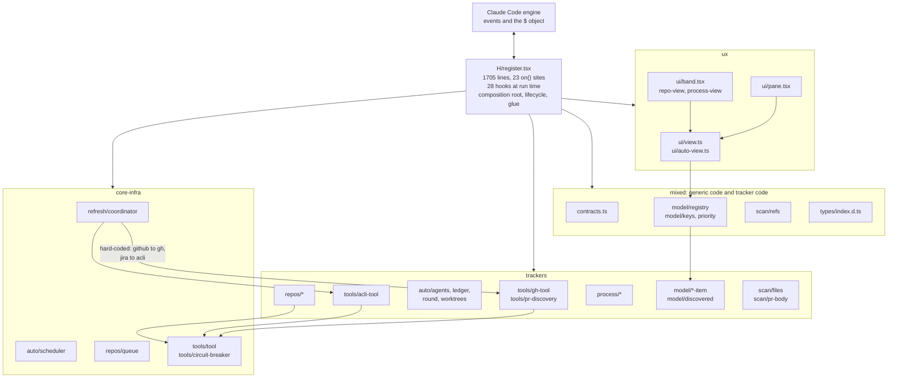
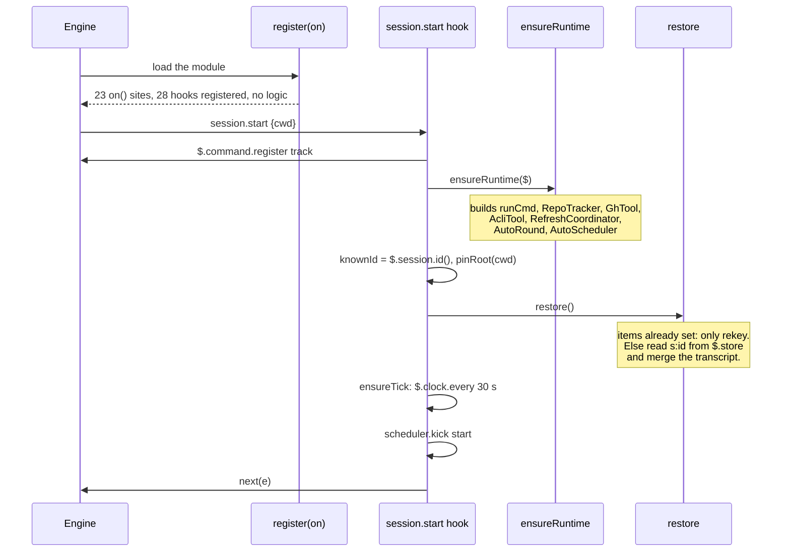
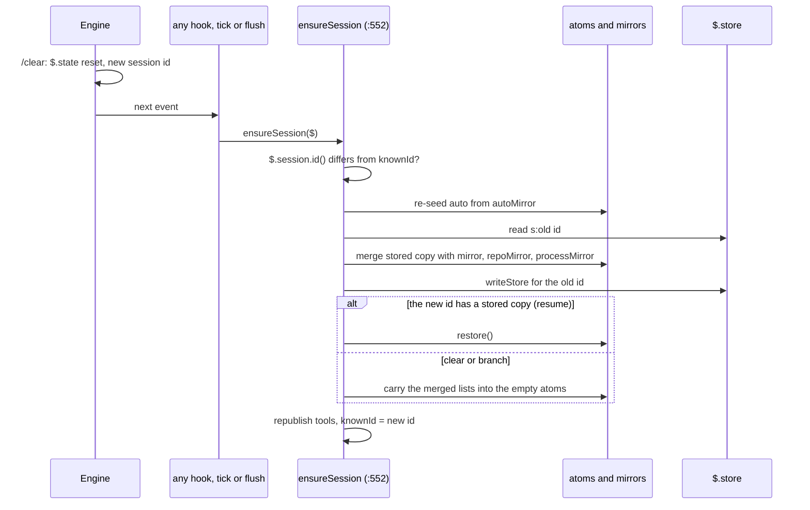

# Current architecture

The as-is map of `plugins/artifact-tracking/` at commit [d391552](https://github.com/martin-macak/claude-code-mod-tracking/commit/d391552bfb5ebe18febc24b81f8dd914e1127a47). The index is [README.md](README.md). Grades: [AGENTS.md](AGENTS.md#grades). Every fact here comes from reading the code at that commit (`observed`) unless a row says otherwise.

Paths are relative to `plugins/artifact-tracking/`. `H/` means `hooks/`. Line numbers drift with every commit. Re-check them before you edit.

## 1. Summary

- `H/register.tsx` has 1,705 lines. It is the composition root, the lifecycle owner and the only file that touches `$`.
- It holds 23 `on()` call sites. They register 28 hooks at run time, because the loop at `H/register.tsx:1644` registers six (`observed`: counted from the code). `claude plugin validate` on Claude Code 2.1.302 prints 23 hook entries and shows the loop once, as `tool.call{tool=?}` (`verified-kit`). `Pane` plus `requestId` is one `ui.render` entry.
- It holds 6 `$.state` atoms, 4 mirrors of state and about 25 module variables.
- Eight trackers run in two tiers behind closed unions. A new tracker edits sites in 11 files ([§7](#7-closed-unions-and-switches)).
- One renderer, `H/ui/pane.tsx`, draws every section. It has no header row, no alignment and no background color.
- No config file exists. All tuning sits in the `LIMITS` constant (`H/contracts.ts:164-197`) and in scattered constants.
- No object owns the lifecycle. The runtime is built lazily from about 15 call sites. A `/clear` is found by polling. There is no `session.end` hook and no dispose.

## 2. Buckets

The inventory sorts the 50 files under `hooks/` and `types/` (9,888 lines) into six buckets.

| Bucket | Files | Lines | What is in it |
| --- | --- | --- | --- |
| `trackers` | 25 | 3,759 | Code that belongs to one tracker: `auto/{agents,events,ledger,round,worktrees}`, `repos/{hints,identity,paths,rows,tracker}`, `process/{parse,probe}`, `model/*-item`, `model/discovered`, `scan/{artifact-url,files,pr-body}`, `tools/{gh-tool,acli-tool,pr-discovery}`, `capture/artifact-tool` |
| `mixed` | 9 | 4,261 | Generic code and tracker code in one file: `register.tsx`, `contracts.ts`, `model/{keys,priority,registry}`, `scan/refs`, `ui/{view,auto-view}`, `types/index.d.ts` |
| `pure-logic` | 5 | 953 | Shared pure helpers: `json`, `auto/dismiss`, `auto/porcelain`, `process/shell`, `scan/links` |
| `core-infra` | 6 | 508 | Generic machinery: `hooks.json`, `auto/scheduler`, `refresh/coordinator`, `repos/queue`, `tools/tool`, `tools/circuit-breaker` |
| `ux` | 4 | 323 | Drawing: `ui/pane.tsx`, `ui/band.tsx`, `ui/process-view`, `ui/repo-view` |
| `core-interfaces` | 1 | 84 | `model/tracked-item.ts`: abstract `TrackedItem` and `StaticItem` |

Nine files hold 43 percent of the lines and mix concerns. `H/register.tsx` alone holds 17 percent.

The arrows show the dependencies that matter. `register.tsx` reaches every box. The coordinator names its two tools. The view code reads the registry.

## 3. Entry and hooks

`H/hooks.json` is `{ "modules": ["./register.tsx"] }`. The engine calls `register(on)` at `H/register.tsx:1286`. That function only registers hooks. It runs no logic. At import time the file builds six atom refs (`:108-120`), `repoQueue` (`:165`) and `processBreaker` (`:134`).

Matcherless events are `session.start`, `agent.spawn` and `turn.complete`. All other hooks carry a matcher.

| Line | Event and matcher | What the hook does | Feeds |
| --- | --- | --- | --- |
| 1288 | `session.append` `{door:'prompt'}` | After `next`: task notices go to process state. Person text goes to `capture(..., 'full', 'prompt')`. | github, jira, web, artifact, file, processes |
| 1307 | `session.append` `{door:'command'}` | Composer slash command text to `capture`. Skips own `/track` output. | same |
| 1320 | `session.append` `{door:'response'}` | Response text (also subagent text) to `capture`. | same |
| 1331 | `session.append` `{door:'tool-result'}` | `capture(..., 'urls-only', 'tool')`: explicit GitHub and Jira URLs only. | github, jira |
| 1342 | `tool.call` `{tool:'Artifact'}` | After `next`: `applyArtifactCall` tracks a published page or marks a deleted one. | artifact |
| 1354 | `session.start` | The init path. Registers `/track`, builds the runtime, pins the root, restores, arms the tick, kicks the auto scheduler. | all |
| 1381 | `command.run` `{command:'track'}` | An if-chain: empty, `refresh`, `clear`, `prio <ref> <level>`. | all |
| 1446 | `ui.focus` `{requestId:'track'}` | Sets the module variable `focusedRow`. | ux |
| 1454 | `ui.close` `{id:'track'}` | Clears `focusedRow`, sets `ui.paneOpen=false`. | ux |
| 1464 | `ui.render` `{component:'Pane', requestId:'track'}` | Reads three atoms, composes sections, draws, wires five actions. | ux |
| 1508 | `ui.render` `{component:'AbovePrompt'}` | Wraps the engine band with the count line. | ux |
| 1522 | `tool.call` `{tool:'Write'}` | Markdown file sighting, then `touch`. | file, auto |
| 1528 | `tool.call` `{tool:'Edit'}` | Markdown file sighting. Duplicate of the loop at `:1644`. | file |
| 1534 | `tool.call` `{tool:'Read'}` | A "viewed" counter on a tracked file. Duplicate of the loop. | file |
| 1542 | `tool.call` `{tool:'EnterWorktree'}` | `recordEnter`, `touch`, kick auto. | auto |
| 1556 | `tool.call` `{tool:'ExitWorktree'}` | `touch`, kick auto. | auto |
| 1568 | `tool.call` `{tool:'Agent'}` | `recordAgentResult` when there is a worktree path. | auto |
| 1582 | `tool.call` `{tool:'Bash'}` | One hook feeds three trackers: processes, auto (git facts) and repos (path hints). | processes, auto, repos |
| 1612 | `tool.call` `{tool:'Monitor'}` | Adds a monitor process row. | processes |
| 1629 | `tool.call` `{tool:'TaskStop'}` | Marks a process killed. | processes |
| 1644-1664 | `tool.call` loop over `PATH_TOOLS` (Read, Edit, Write, NotebookEdit, Grep, Glob) | Six registrations. Path hints to the repo queue. The `tool as 'Read'` cast hides that the typings omit `Grep` and `Glob`. | repos |
| 1668 | `agent.spawn` | Reads the master cwd, then `recordSpawn`, queues the spawn cwd. | auto, repos |
| 1689 | `turn.complete` | Re-arms the tick, `recordTurnEnd`, kick auto. | auto |

Three more engine touch points are calls, not hooks: `$.command.register` (`:1356`), `$.ui.open` (`:1237`, the only call site) and `$.ui.focus` (`:1278`).

Read, Edit and Write each have two hooks with the same matcher. The engine allows that and runs both, nested in registration order (`verified-kit`, [tracker-plugins §2](tracker-plugins.md#2-what-the-engine-allows)).

No `$.tool.register`, `session.end`, `classic.SessionStart`, `engine.*` or `plugin.*` hook exists in the mod.

Every hook follows one shape. It runs `await next(e)` first, or reads pre-state such as the cwd. Then it runs `try { arm($); ...tracker work... } catch {}` and returns the original result. Every hook ends in `.catch(($, e, next) => next(e))`. A tracker failure never reaches the session. The cost is about 60 empty catch blocks, so a failed step is silent.

## 4. State

| Key | Type | Writer | Reader and note |
| --- | --- | --- | --- |
| `$.state` `items` | `ItemRecord[]` | `setItems` (`H/register.tsx:319`), the only writer. 14 call sites. | Atom at `:108`. Mirrored to `$.store`. |
| `$.state` `repos` | `RepoRecord[]` | `setRepos` (`:331`) | Atom at `:109`. Mirrored. |
| `$.state` `processes` | `ProcessRecord[]` | `setProcesses` (`:347`) | Atom at `:110`. Mirrored. No cap, no dismiss. |
| `$.state` `tools` | `{gh, acli}` `ToolStatus` | `publishTools` (`:315`), compares first | Feeds the view context. Not stored. |
| `$.state` `ui` | `{folded: string[], paneOpen: boolean}` | `openPane`, the `ui.close` hook, the fold action | `paneOpen` is written and never read. |
| `$.state` `auto` | `AutoState` (root, worktrees, agents, dismissed, snapshot) | `setAuto` (`:359`), 12 call sites | Never written to `$.store`. Stripped on restore. Module copy `autoMirror`. Holds the dismiss list for all trackers. |
| `processUi` | declared in `types/index.d.ts:341` | none | No atom exists. The real value is the module variable `processUiState` (`:135`). The pane does not redraw when it changes. |
| `$.store` `s:<sessionId>` | `{items, repos, processes}` | `writeStore` (`:1054`) | Debounced 1.5 s. At most 20 sessions (`LIMITS.keepSessions`). Tests freeze this shape. |
| `$.store` `index` | `string[]`, newest first | `writeStore` (`:1062`) | `restore` does not gate on it (`:1162`). |

`claude plugin validate` on 2.1.302 prints `declares state: artifact-tracking.items, repos, processes, processUi, tools, ui, auto` and lists six keys under reads and writes. `processUi` is declared and never touched (`verified-kit`).

A new persisted slice edits seven places: `SessionSlices` (`:1045`), `StoredCopy`, `writeStore` (`:1051`), `ensureSession` (`:563-591`), `restore` (`:1182-1187`), `flush` (`:1035`) and `clearAll` (`:1244-1254`).

## 5. Module variables

All of these are lost on a hot reload ([§9](#9-lifecycle-today)). Lines are in `H/register.tsx`.

| Group | Variables |
| --- | --- |
| Runtime singletons, built by `ensureRuntime` | `gh` `:130`, `acli` `:131`, `coordinator` `:132`, `runCmd` `:133`, `scheduler` `:153`, `round` `:154`, `repoTracker` `:163` |
| Shared mutable objects | `processBreaker` `:134`, `repoQueue` `:165` |
| Session identity | `knownId` `:141`, `sessionRepo` `:137`, `repoTask` `:138`, `githubHosts` `:139`, `repoGen` `:167` |
| Timers and watchdogs | `tick` `:142`, `flushTimer` `:143`, `flushArmedAt` `:145`, `lastBeatAt` `:156`, `lastRoundAt` `:160` |
| Mirrors of state, kept because `$.state` is already empty after a `/clear` | `mirror` `:150`, `repoMirror` `:151`, `processMirror` `:152`, `autoMirror` `:158`, `flushed` `:162` |
| UI selection | `focusedRow` `:169`, `focusRows` `:171`, `processUiState` `:135` |
| Memo | `fileEnvTask` `:732` |

The immutable constants are `PRIO_WORDS` (`:125`), `PERSON` (`:127`) and `NOT_PERSON` (`:1072`). No file outside `register.tsx` holds mutable module state.

## 6. The eight trackers

The eight trackers sit in two tiers. They do not share one shape.

**Tier 1, item trackers.** They share one record base (`ItemRecordBase`, `types/index.d.ts:92-107`), one union (`ItemRecord`, `:132`), one atom (`items`), one writer, one key scheme (`H/model/keys.ts:13`), one capture funnel and one refresh coordinator. Static items (web, artifact, file) differ from refreshable ones (github, jira) only by three no-op methods (`H/model/tracked-item.ts:74-86`).

**Tier 2, non-item trackers.** Each has its own record type, atom, setter, merge module, view builder and refresh mechanism.

| Tier | Tracker | Captures from | Enriches with | State | Section |
| --- | --- | --- | --- | --- | --- |
| 1 | github (issues and PRs named in text) | four `session.append` doors, resume backfill | `gh`: one GraphQL call per host and 50 aliases, stale after 5 min | `items`, `GitHubRecord`, key `gh:<host>/<owner>/<repo>#<n>` | GitHub (auto-sourced PRs go to "Pull requests") |
| 1 | jira (work items, child tree) | the same doors, URLs only, filtered to the active `acli` site | `acli`: `workitem view`, epic child search, at most 3 calls at once | `items`, `JiraRecord`, key `jira:<site>/<KEY>` | Jira work items: the only real tree |
| 1 | web links | any other `http(s)` link, `full` mode only | none (static) | `items`, key `web:<url>` | Web links |
| 1 | claude artifacts | `tool.call` `Artifact` hook, `claude.ai` URLs | none (static) | `items`, key `art:<uuid>`, sticky `deleted` | Artifacts |
| 1 | markdown files | `Write`, `Edit`, `Read` hooks, `.md` mentions | `$.fs.stat` per sighting | `items`, `FileRecord` with counters, key `file:<path>` | Files |
| 2 | repositories touched outside the session repo | six path tools, the Bash hook, `agent.spawn` | `git`: four commands, own breaker, serial queue | `repos` atom, `RepoRecord` | Repos |
| 2 | processes (background tasks, docker, tmux, screen, pids) | Bash, Monitor, TaskStop hooks, task notices | `docker`, `tmux`, `screen`, `ps` every 30 s, own breaker | `processes` atom, `ProcessRecord` | Processes |
| 2 | auto (worktrees, agents, discovered PRs) | `session.start`, `EnterWorktree`, `ExitWorktree`, `Agent`, Bash, `agent.spawn`, `turn.complete` | `git worktree list`, `$.agent.list`, one GraphQL call for PRs | `auto` atom, never stored | Worktrees, Agents, Pull requests |

The PR lane straddles two trackers. `H/auto/round.ts:259-287` finds PRs and writes `GitHubRecord`s with source `auto` into the `items` atom. `buildPane` removes them from the GitHub section (`H/ui/view.ts:475`). `prsSection` draws them (`H/ui/auto-view.ts:179`). One record type serves two trackers.

### The common pipeline

All eight trackers run the same seven steps:

1. An engine event or a tick starts the work.
2. Pure code parses the input into a record (`scan/`, `process/parse`, `repos/hints`, `auto/events`).
3. A merge returns the input list when nothing changed, so no write follows (the "A22" rule).
4. An optional enrichment calls a CLI behind a `Runner`, a timeout and a circuit breaker.
5. The result goes to a `$.state` atom and, debounced, to `$.store`.
6. A pure view builder makes `PaneSection` and `PaneRow` values.
7. `renderSections` draws them. The band counts and the `/track` text come from the same sections.

### Shared machinery that knows the trackers by name

- **Refresh.** `RefreshCoordinator` knows two tools: `github` to `tools.gh`, `jira` to `tools.acli` (`H/refresh/coordinator.ts:79-80, 133-150`). The same skeleton (running, queued, waiters, `idle()`, overdue-timer replacement) exists four times: coordinator, `AutoScheduler`, the `AutoRound` PR lane and `RepoQueue`.
- **Tick.** One 30 s `$.clock.every` (`ensureTick`, `:481`). `beat` (`:501`) hard-wires six calls. A tracker cannot add its own tick.
- **Circuit breaker.** One class, four instances: `gh`, `acli`, `processBreaker` and `RepoTracker.breaker`. A manual `/track refresh` resets three of them, not the repo breaker.
- **Dismiss.** The ids live in `auto.dismissed` (cap 500). Many choke points apply them: `trackRefs`, `addFiles`, `setRepos`, `applyDiscovery`, `trackWorktrees`, `trackAgents`, `restore`, `ensureSession` and the coordinator save. Processes cannot be dismissed.
- **Priority.** Only item records and Jira nodes carry a priority (`H/model/priority.ts`). The `top` level comes only from two rules.
- **Couplings.** `RepoTracker` reads `auto.root` and `sessionRepo` through getters (`:180-189`). The file tracker reads `auto.root` and the agent spawn cwd (`:766-771`). `touch()` (`:398`) is called from seven sites. The Bash hook fans out to three trackers. `AutoRound` writes into the `items` atom and kicks the coordinator.
- **Time.** `Date.now` is injected into the tools, the coordinator, the scheduler, the round and `RepoTracker`. `$.clock.now/after/every` drives timers and watchdogs. Tests mock only `$.clock`.

## 7. Closed unions and switches

Adding a tracker edits these sites. This is the open-closed violation in one list.

| File | Sites |
| --- | --- |
| `types/index.d.ts` | `Category` `:23`, `Source` `:28`, `ItemRecord` `:132`, `ToolName` `:196`, `PluginState` literal `:335-346` |
| `H/contracts.ts` | `Ref` `:79`, `Tools{gh,acli}` `:139`, `HydratedItem` `:153-158` |
| `H/model/keys.ts` | `keyOf` switch `:13-25` |
| `H/model/registry.ts` | `recordFromRef` `:115`, `cloneRecord` `:130-135`, `fold` and `mergeRefs` branches `:204-252`, `STATUS_FIELDS` `:318`, `mergeResults` `:336-344`, `hydrate` `:468` |
| `H/model/priority.ts` | `ItemClass` `:95`, `classOf` `:110` |
| `H/scan/refs.ts` | `classify` and `urlsOnly` `:195-309`, `uniqueKey` `:281` |
| `H/ui/view.ts` | `SECTIONS` `:444-450`, `buildPane` if-chain `:480-484`, `bandParts` `:542`, `noteFor` `:462`, `SectionId`, `Layout`, `CellName` `:59-61`, `cellsFor` `:155-219` |
| `H/ui/pane.tsx` | `CellBox` switch `:49-137` |
| `H/ui/auto-view.ts` | `withRepos`, `composePane`, `composeBand` `:230-267` |
| `H/refresh/coordinator.ts`, `H/register.tsx` | tool by name `:79-80, :133-150`; tools atom, `publishTools`, `settleProbes` and `ensureRuntime` `:111-117, :190-195, :309-316, :1230-1234` |
| `H/register.tsx` | new `on()` blocks `:1286-1705`; the capture path special-cases Jira (`:657`) and GitHub (`:656, :691, :708`) |

## 8. SOLID violations

| Principle | Where | Problem |
| --- | --- | --- |
| SRP | `H/register.tsx:1-1705` | One file owns lifecycle, composition root, atoms, mirrors, store, session-id handling, transcript backfill, repo resolution (`:601-639`), Jira site filter (`:282-303`), Markdown sighting (`:727-843`), process probing (`:894-1001`), the `/track` command, pane actions and 23 `on()` sites (28 hooks at run time). Every tracker change edits it. |
| SRP, DRY | `:319-352`, `:150-152` | `setItems`, `setRepos` and `setProcesses` repeat one write, check and mirror pattern. Each slice is copied into six more places ([§4](#4-state)). |
| SRP | `H/contracts.ts:1-312`, `H/ui/view.ts:1-572`, `H/model/registry.ts:1-481` | Each mixes generic mechanics with tracker code. |
| OCP | [§7](#7-closed-unions-and-switches) | Record, ref, key and hydrate are closed unions with switches in about 12 sites. No tracker registry exists. |
| OCP | `H/ui/view.ts:444-484`, `H/ui/pane.tsx:49-137`, `H/ui/auto-view.ts:230-267` | A new section needs a new `Layout`, `CellName` handling, a `SECTIONS` row and composer edits. Rendering switches on cell names with fixed widths instead of column descriptors. |
| OCP | `H/refresh/coordinator.ts:79-80, :133-150` | The refresh engine knows two tools by name. A third CLI tool edits five files. |
| OCP | `H/register.tsx:1286-1705` | Each tracker adds `on()` blocks to `register`. Trackers do not contribute hooks. |
| OCP | `H/contracts.ts:228-235`, `H/register.tsx:533-534, :1389-1441` | Row ids use `wt:`, `ag:` and `rp:` prefixes. `dismissOne` and the `/track` if-chain branch on them. |
| OCP, SRP | `H/contracts.ts:164-197` | One `LIMITS` bag serves every tracker. No config class exists. `readFileEnv` reads env and settings ad hoc (`H/register.tsx:743-751`). |
| LSP | `H/model/tracked-item.ts:76-84` | `StaticItem` implements `Refreshable` with no-ops. The coordinator ignores polymorphism and filters by category. `Refreshable.refresh()` runs only in tests. |
| ISP | `H/register.tsx` (45 functions take `$`), `H/auto/round.ts:34-65` | The whole engine object goes everywhere. `RoundDeps` has 13 members and names `GitHubDiscoveryApi`. |
| DIP | `H/register.tsx:176-267` | `ensureRuntime` news up six collaborators and keeps them in module singletons. No injection point exists. Two instances per process are impossible. |
| DIP | `H/auto/scheduler.ts:6`, `H/repos/tracker.ts:6`, `H/repos/identity.ts:1`, `H/model/keys.ts:7`, `H/model/priority.ts`, `H/ui/view.ts:22-23`, `H/scan/links.ts` | Cross-feature concrete imports: the `Timer` type from the coordinator, `CircuitBreaker` from `tools/`, `normPath` from `auto/porcelain`, `extractRefs` inside `priority`, `scan/*` inside `view`. |
| DIP, state | `H/register.tsx:135, :899, :995` vs `types/index.d.ts:341` | `processUi` is declared and has no atom. |
| SRP, lifecycle | `H/register.tsx:552-593, :481-498, :1354-1379` | Init is lazy from about 15 sites. A `/clear` is found by polling from seven entry points. There is no `session.end` hook and no dispose. |
| DRY, DIP | `H/auto/round.ts` vs `H/tools/tool.ts:114-120`; `H/ui/view.ts:237` vs `H/scan/refs.ts`; `H/process/shell.ts` vs `H/scan/files.ts` | Duplicate helpers (`firstLine`, `hostPath`, `resolvePath`) and two clocks. |

## 9. Lifecycle today

No object owns the lifecycle. The pieces are `ensureRuntime` (`:176`), the `session.start` hook (`:1354`), `ensureSession` (`:552`), `restore` (`:1152`), `flush` and `writeStore` (`:1010-1064`), `clearAll` (`:1242`), the `ui.close` hook (`:1454`) and `command.run` (`:1381`).

### Start

Each step of the hook has its own empty catch. `ensureRuntime` is also called by `arm()` (the first line of almost every hook), `command.run`, `dismissOne`, `beat`, `agent.spawn`, `turn.complete` and the refresh action. Its guard is `gh && acli && coordinator && scheduler && round`. On a miss it rebuilds all five.

The closures keep the `$` of the first dispatch for later timers. The comment at `:175` says `$` only appears in calls. The code does not prove that this is safe in every case (`inference`).

### Tick and persistence

`ensureTick` arms `$.clock.every(30 s)` and acts as a watchdog: it re-arms when the last beat is older than two periods, because one refused period ends the interval for good. `beat` (`:501`) runs `ensureRuntime`, `ensureSession`, `ensureRepo`, `scheduler.kick('tick')`, `coordinator.kick('tick')` and `probeProcesses`.

Every item, repo and process write goes `setX` then `update($, atom)`, then the module mirror (only if the session id is unchanged), then `schedule` (`:1010`). That arms one debounced `$.clock.after` timer of 1.5 s. `flush` (`:1033`) then writes `s:<id>` and `index` to `$.store`, deduped by JSON.

### A `/clear`, `/resume` or `/branch`

The engine resets `$.state`, raises no `session.start` and the mod has no hook for it. Detection is polling.

The three list mirrors exist only because `$.state` is already empty when the mod learns of the change. Seven entry points call `ensureSession`: capture, `applyItems`, `applyArtifactCall`, `captureFileTouch`, `command.run`, `beat` and `flush`.

### Hot reload

`register` runs again. All module variables are lost. `$.state` and `$.store` stay. `session.start` fires again, so `ensureRuntime` rebuilds the tools, the coordinator, the round and the scheduler. The new copy probes `gh` and `acli` again. `pinRoot` keeps the old root. `restore` returns early. `ensureTick` re-arms.

| Lost on reload | Effect |
| --- | --- |
| `processBreaker` state, `processUiState`, `focusedRow` | Reset to defaults. |
| The mirrors | A `/clear` before the first write after the reload carries only the stored copy, up to 1.5 s old. A likely gap, not verified. |
| `flushed`, `repoGen`, `fileEnvTask`, `repoTask`, `sessionRepo` | Rebuilt. |
| The debounce timer | A pending flush is lost ([lifecycle-manager §3](lifecycle-manager.md#3-what-the-engine-allows)). |

### End of session

There is no handler. There is no flush on exit, no timer cancel and no dispose of `GhTool`, `AcliTool` or `RepoTracker`. The timers die with the module. Only `/track prio` flushes at once (`:1435`, for `claude -p`). A write inside the 1.5 s debounce can be lost at exit.

### `/track clear`

`clearAll` (`:1242`) dismisses all auto ids, resets `flushed`, bumps `repoGen` (this cancels in-flight repo jobs), empties three atoms and deletes `s:<id>` and its `index` entry.

## 10. The UI today

The UI inventory sits in [tree-table §2](tree-table.md#2-the-pane-today). In short:

- One drawer, `renderSections` (`H/ui/pane.tsx:209-221`), draws all ten section ids. A third renderer, `textOf` (`H/ui/view.ts:559-572`), makes the `/track` command text. A fourth, `renderBand`, makes the one-line band. All read the same `PaneSection[]`.
- `PaneRow` has fixed slots: `id, depth, key, href, title, type, status, tone, extra, extraTone, foldable, folded, dim, dismissId, typeWrap, mark, prio` (`H/ui/view.ts:30-54`). Every tracker maps its fields into them, for example repos: name to `key`, branch to `title`, agents to `type`.
- Columns are a switch per layout (`cellsFor`, `:155-219`) with literal widths and a wide or narrow variant at 70 columns.
- Only Jira nodes, the worktree root and the master agent fold.
- Keys: the engine focus ring over `Button`s, plus hotkeys `r`, `1`, `2`, `3`, `0` on footer buttons.

## 11. What the tests pin

`make test` runs `claude plugin validate`, `tsc -p .` and `claude plugin test` (`Makefile:97-108`). The suite has about 817 `test()` calls in three layers. A refactor must keep these contracts green or change the tests with it.

| Contract | Detail |
| --- | --- |
| Entry | `hooks/hooks.json` lists `./register.tsx` and the file exports `register`. `plugin.json` has `types: ./types/index.d.ts`. `tsconfig.json` includes `hooks/**`, `types/**`, `tests/**` and the 2.1.295 `claude-code.d.ts`. A new top-level folder edits `tsconfig.json`. |
| Unit tests | About 33 files import `../hooks/<path>` directly. Moving a file edits about 36 test files. Symbol names and signatures are the contract. |
| Wiring tests | `register.test.tsx` (2,271 lines, 136 tests), `auto-wiring.test.tsx` (24) and `artifact-wiring.test.tsx` (23) drive the mod through `$`. They share `tests/fixtures/world.ts`. No test imports `register.tsx` by path. |
| `/clear` | The tests simulate it by flipping the stub `current.id`, not by firing `session.end`. Tests such as "the tick notices /clear" (`register.test.tsx:1038`) need polling to stay. |
| Command | Name `track`, argument hint `[refresh\|clear\|prio <ref> <level>]`, many assertions on text such as `No tracked items yet.` |
| Pane | Component `Pane`, request id `track`, pane id `track`, band component `AbovePrompt`. Element keys `fold-<id>`, `dismiss-<id>`, `refresh`, `prio-0..3`, `cell-<name>-<id>`, `mark:<i>:<level>:<id>`. Footer hotkeys exactly `0 1 2 3 r`. Widths per layout at 62 and 100 columns. |
| State and store | Six keys declared in `PluginState`. `$.store` keys `s:<id>` and `index`. Tests count writes per atom and check "no write when nothing changed". |
| Timers | Everything goes through `$.clock`. Tests assert 1,000 ms capture debounce, 1,500 ms flush, 30 s tick and 750 ms auto window. |
| Process boundary | Tests assert exact `process.run` argv sequences and counts. |
| Not covered | Hot reload and session end. A config manager needs `fs.read`, `fs.write` and `fs.exists` stubs in `world.ts`. Only `fs.stat` is stubbed today (`world.ts:240`). |

## 12. Hard-coded values

`LIMITS` (`H/contracts.ts:164-197`) holds 30 constants for every tracker: caps, intervals, timeouts and the auto-tracking budgets. More constants sit outside it: timeouts and sizes in the tools and scanners, vocabulary lists (short-ref keywords, Jira `Epic`, file extensions, ignore lists), probe command lines, GraphQL fragments, and every pane width, glyph and hotkey. The candidate config keys are in [config-manager §6](config-manager.md#6-candidate-config-keys).
