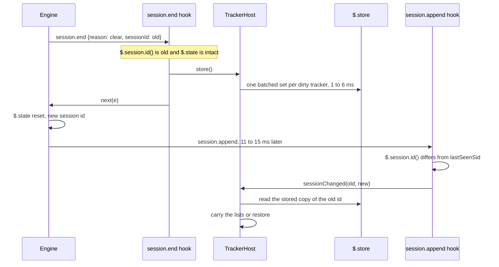
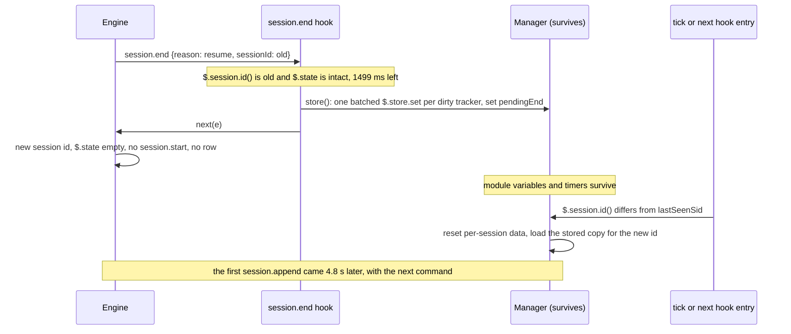
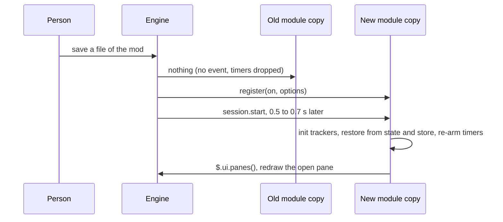
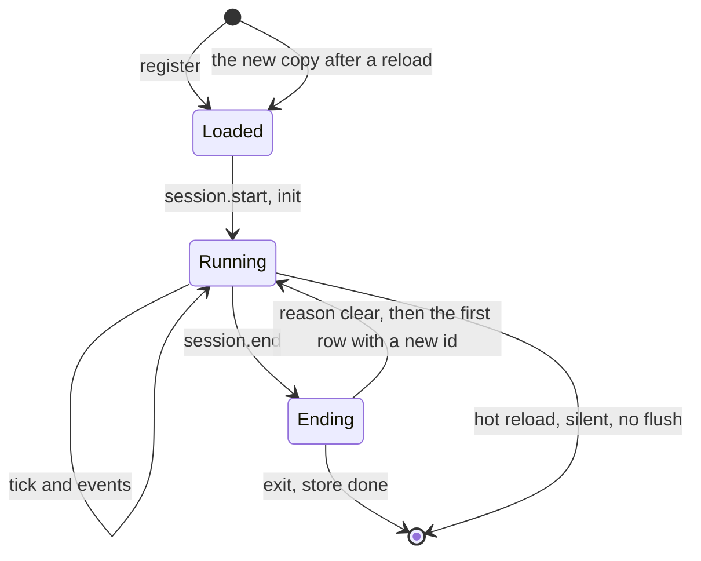

# Lifecycle manager

Research for the fifth part of [issue #55](https://github.com/martin-macak/claude-code-mod-tracking/issues/55): one lifecycle manager hooks into Claude Code, manages config, initializes trackers and injects their context. The index is [README.md](README.md). Grades: [AGENTS.md](AGENTS.md#grades). `d.ts:N` links to the 2.1.302 snapshot.

The page gives the engine facts, prior art, constraints and options. Recommendations are marked. The design spec decides.

Short answer:

- `session.end` with reason `clear` runs before the reset. `$.session.id()` and `$.state` still hold the leaving session's values. A `$.store.set` and a `$.fs.write` finish in 0 to 6 ms, inside the 1.5 s bound (`verified-live`).
- No `session.start` fires after `/clear`. A `classic.SessionStart` function hook never fired for a `--plugin-dir` mod here. The first `session.append` of the new session carries the new id and a reset `$.state` (`verified-live`).
- On a hot reload nothing reaches the old module. Pending timers die. The new copy gets `register` and `session.start` again, about 0.5 to 0.7 s after the save (`verified-live`). A debounced flush is lost.
- `/resume` and `/branch` look like `/clear`: `session.end` first (both give `reason: 'resume'`), then a new id and an empty `$.state`, with no `session.start`. The module copy, its variables and its timers survive. After `/resume` the first `session.append` came 4.8 s later, not at once (`verified-live`).
- An edit to a file in `core/` or `trackers/` reloads the mod like an edit to `hooks/register.tsx`, if the import graph reaches it (`verified-live`).
- The lifecycle manager must be the only matcherless registrant of `session.start`, `session.end`, `turn.complete` and `agent.spawn` (`verified-kit`, [tracker-plugins §2.1](tracker-plugins.md#21-passing-on-to-another-file)).
- A user-tier `prompt.compose` hook does not run where the built-in guard loads (managed settings, or a Team or Enterprise sign-in per the docs). The model then never reads a mod's prompt section (`verified-live`, [§5.7](#57-context-injection)).

## 1. What the issue asks

- "One lifecycle manager hooks into Claude Code, manages config, initializes trackers and injects context."
- Each tracker has `init` and `store` phases.
- "One clean lifecycle."

## 2. The lifecycle today

See [current-architecture §9](current-architecture.md#9-lifecycle-today). In short: no object owns it. Init is lazy from about 15 sites. A `/clear` is found by polling `$.session.id()` from seven entry points. Four mirrors of state exist because `$.state` is already empty by then. No `session.end` hook, no flush on exit, no dispose.

## 3. What the engine allows

The mods KB has the general account: [lifecycle](../claude-code-mods/concepts/lifecycle.md). This section keeps the facts that decide the lifecycle manager.

### 3.1 Start, `/clear` and end

| Fact | Grade | Evidence |
| --- | --- | --- |
| `session.start` fires once per module load, and again after a hot reload. It does not fire for `/clear`. | `types-only`, `verified-live` | [d.ts:11481-11483](../claude-code-mods/sources/claude-code-2.1.302/types/claude-code.d.ts#L11481-L11483). The catch-all ring after `/clear` shows `prompt.change, command.run, ... session.end, ui.status, session.usage, session.append`. No `session.start`. |
| `session.end` reasons: `clear`, `resume`, `logout`, `prompt_input_exit` (`/exit`, `ctrl+c`, `ctrl+d`), `other` (`-p` finished, SIGINT, SIGTERM, SIGHUP). The reason list has no `/branch`. In a live session `/branch` gives `resume` (next rows). | `types-only`, `verified-live` | [d.ts:4950](../claude-code-mods/sources/claude-code-2.1.302/types/claude-code.d.ts#L4950), [d.ts:11495-11505](../claude-code-mods/sources/claude-code-2.1.302/types/claude-code.d.ts#L11495-L11505) |
| **In a `session.end` hook with reason `clear`, `$.session.id()` equals `e.sessionId` (the leaving id), and `$.state` still holds the old value.** This is true before and after `next(e)`. | `verified-live` | `eSessionId == sidInHook == 244d5c08-…`, marker `{value:'mark-mvc84ffl',version:1}`; after `next`, `sidAfterNext` unchanged. |
| In that hook `$.store.set` took 1 to 2 ms and `$.fs.write` 0 to 1 ms. With a 300,891-byte payload `$.store.set` took 5 to 6 ms and `$.fs.write` 1 ms. The hook still had 1,485 ms left. `/exit` (reason `prompt_input_exit`) gave the same pattern. | `verified-live` | `ms {stateAndSid:5, storeSet:1, fsWrite:0, storeGet:0}`, `budgetRemainingAfterProbes 1493`. Big: `budgetRemainingAfterProbes 1485`. |
| One short wall-clock bound (1.5 s by default) covers every hook of the chain, its `$` waits and core. `next.budget` reads it. At the bound `next.signal` aborts, and a `$` call in flight aborts with it. | `types-only`, `verified-live` | [d.ts:11473-11475](../claude-code-mods/sources/claude-code-2.1.302/types/claude-code.d.ts#L11473-L11475), [d.ts:6742-6747](../claude-code-mods/sources/claude-code-2.1.302/types/claude-code.d.ts#L6742-L6747). Live: `next.budget.ms` was 1500 and `remainingMs` counted down. |
| After `/clear` the first `session.append` of the new session arrives 12 to 15 ms after `session.end` in the first pass. The second pass measured 11 ms (see the next rows for `/branch` and `/resume`). It carries the **new** `$.session.id()`, and `$.state` is already reset. In the runs the door was `command` and the role `user`; the origin differed between runs. | `verified-live` | `marker {version:0}` at the first row; `/spike-info` after `/clear`: `sid=a7b1a2b9-… marker=""`. |
| **`/resume` and `/branch` end the old session the same way, with `reason: 'resume'`.** There is no `branch` reason, so the reason cannot tell the two apart (`e.resume.id` is the leaving id in both). In the hook `$.session.id()` equals `e.sessionId`, and the `$.state` atom and family values are intact, with 1494 to 1499 ms of the 1500 ms budget left. Then the engine switches the id and resets `$.state`. `/branch` exists in 2.1.302. | `verified-live` | `/clear`: `session.end {reason:'clear', eSessionId:A, sid:A, marker:'A-mark', github:2, jira:2, remaining:1494}`. `/resume`: `{reason:'resume', eSessionId:B, sid:B, marker:'B-mark', github:2, jira:2, resume:{id:B}, remaining:1499}`. `/branch`: `{reason:'resume', eSessionId:A, sid:A, marker:'A2-mark', github:1, jira:1, remaining:1499}`. `/help`: `/branch  Create a branch of the current conversation at this point`. Spike [`lifecycle-mod`](../claude-code-mods/sources/spikes-2026-10-17/lifecycle-mod/), log [`lifecycle-log.txt`](../claude-code-mods/sources/spikes-2026-10-17/live2-lifecycle/lifecycle-log.txt). [d.ts:11481-11488](../claude-code-mods/sources/claude-code-2.1.302/types/claude-code.d.ts#L11481-L11488), [d.ts:4950](../claude-code-mods/sources/claude-code-2.1.302/types/claude-code.d.ts#L4950). |
| **The first `session.append` of the new session comes at once after `/clear` and `/branch`, and not after `/resume`.** `/clear`: 11 ms after `session.end`, door `command`, new id, state reset (`marker: ''`, family `null`). `/branch`: 9 ms, origin `engine`. `/resume`: no row at resume time. The first came 4.8 s later, with the next command, carrying the resumed session's id. `$.state` is **not** restored after `/resume`: the old state of the resumed session is gone. | `verified-live` | `/clear` first append at +11 ms (1792273033066 to …077): `{pendingEnd:true, door:'command', origin:{kind:'unclassified'}, sid:B, marker:'', github:null, jira:null}`. `/resume`: `end` at …065352, first append at 1792273070185: `{sid:A, marker:'', github:null, jira:null, origin:{kind:'engine'}}`. `/spike-info` after the resume: `sid=27d1b087 marker=""`. `/branch`: +9 ms (1792273095691 to …700). |
| **Module copy, module variables and timers survive all three.** No `session.start` fires. The `$.session.id()` that a `$.clock.every` callback reads is the **current** id, not the id at arming time. | `verified-live` | `cmdCount` 101 to 102 at `/clear`, 102 to 103 at `/resume`, 103 to 104 at `/branch`, with the same generation `gmvcwfmy7ggrs`. Tick file `tick-gmvcwfmy7ggrs.json` after each: `tickN` 26 (`sid=B`), 35 (`sid=A`), 46 (`sid=2e1f868c`). `session.start` files for that generation: 1 (start-up only). |
| The `/resume` picker does not list the current session. A session made only of mod slash-command rows was listed and could be resumed (a 6.1 KB transcript). | `verified-live` | `cap/13-resume-picker.txt` in the snapshot. |
| **A `classic.SessionStart` or `classic.SessionEnd` function hook in a `--plugin-dir` mod never ran** at startup, at `/clear` or at `/exit` in this environment. Shell settings hooks for the same events did run. `claude plugin validate` warns about this gate. The cause is unknown. | `verified-live` | [`sh-hook.txt`](../claude-code-mods/sources/spikes-2026-10-17/live-life/out/sh-hook.txt) showed start, end, start, end. No `out/*classic.SessionStart*` file. |
| A hot reload of the plugin cancels its pending waits with the old environment. | `types-only` | [d.ts:3506-3507](../claude-code-mods/sources/claude-code-2.1.302/types/claude-code.d.ts#L3506-L3507) |
| Nothing reaches the old module copy after a hot reload save: not `session.end`, not `ui.close` (any origin), not `plugin.register`, not any other event (checked with an `on('*')` catch-all that writes a ring file per event). A pending 25 s `$.clock.after` timer, 10 s into its wait, never fired. | `verified-live` | Four reloads. The last old-copy ring entry was 9 s before the edit. No `*timer-fired*` file from any copy. |
| The new copy gets `register()` again and `session.start` 458, 704 and 725 ms after the save, with the same session id. `session.start` carries `{cwd, surface:'terminal', isInteractive:true}`. | `verified-live` | `session.start` at `1792231185753` after the edit at `…185028`. |
| A pane opened by the old copy survives. The new copy redraws it. No `ui.close` fires. | `verified-live` | The pane showed `gen=gmvc869f6em07 ver=v2` after the reload. |
| A save with identical text reloads nothing. | `types-only`, `verified-live` | [reference.md:73](../claude-code-mods/sources/claude-code-2.1.302/reference.md#L73). `cp` of the same file over the mod: the generation stayed the same. |
| A plain file save under `--plugin-dir` triggers the reload. No model turn, no hot-reload question. | `verified-live` | Dim transcript line `life-spike: reloaded (8 hooks: ...)`. |
| **Which saves reload follows the import graph.** `core/x.ts`, a transitive import, and `trackers/a.ts` reload the mod like `hooks/register.tsx`. `core/unused.ts`, imported by nobody, does not. On each reload the module variables start over and the old copy's timer stops. | `verified-live` | See [tracker-plugins §2.4](tracker-plugins.md#24-where-the-code-may-live) for the numbers (+498 to +647 ms). Answers [Q5](open-questions.md#1-unknowns). |

### 3.2 Reading state inside a dispatch

| Fact | Grade | Evidence |
| --- | --- | --- |
| Every `get` of one dispatch reads one moment, whatever is written meanwhile. | `types-only` | [d.ts:3472](../claude-code-mods/sources/claude-code-2.1.302/types/claude-code.d.ts#L3472) |
| A `command.run` hook read `{"version":0}` for 1 s although a `session.start` timer's `update` had resolved. A bump armed inside the hook then read back its own write. | `verified-kit` (headless real engine) | `t1_get_after_sessionStartTimer: {version:0}`; `t2_get_after_cmdArmedTimer: {value:2, version:2}`. |
| Whether the view refreshes after the dispatch's own write or after a write by a timer armed inside it is not separable in the data. | open | [Q8](open-questions.md#1-unknowns) |

So: read state at the start of a dispatch, or re-enter through a new event or timer. Do not poll `$.state` inside one long hook. A store phase that reads `$.state` runs in its own dispatch.

### 3.3 Ports and `$`

The ports results are in [tracker-plugins §2.2](tracker-plugins.md#22-passing--and-building-ports). They bear on the lifecycle in three ways:

- A ports object built once per load (the existing `ensureRuntime` pattern) works from timers and later dispatches (`verified-kit`).
- Hook-scoped values (an agent id, a subagent's cwd) must come from the event, not from a long-lived port ([d.ts:2828](../claude-code-mods/sources/claude-code-2.1.302/types/claude-code.d.ts#L2828)).
- Module variables reset on a reload. The ports and the manager are rebuilt by `register` and `session.start`.

### 3.4 What the kit can drive

| Fact | Grade | Evidence |
| --- | --- | --- |
| `$.session.end({reason, sessionId, resume})` runs the mod's `session.end` hook once. All five reasons reach it. It needs a bottom stub `on('session.end', (_$, e) => ({ sessionId: e.sessionId }))` when the hook calls `next(e)`. | `verified-kit` | `REASONS seen by hook -> ["prompt_input_exit","resume","logout","other","clear"]`. Without the stub: `no implementation for session.end`. |
| In the hook, `$.session.id()` is the leaving stub id and `$.state` still holds the leaving value. A write inside succeeds. | `verified-kit` | `idInside "sess-1"`, `writeInside "ok"`. |
| The kit changes neither afterwards: `$.state` is not reset and `$.session.id()` is not flipped. A full `/clear` driver is `session.end(clear)`, then a flip of the stub id over id-keyed state stubs, then `$.classic.SessionStart({ source: 'clear' })`. | `verified-kit` | `AFTER end, same stub id peek -> {"n":99,"id":"sess-1"}`; `AFTER clear driver peek -> {"n":0,"id":"sess-2"}`. |
| The kit sets `next.budget.ms` to 10000, not 1500. It cannot test the bound. | `verified-kit` | `'budgetMs':10000`. |
| The current wiring tests simulate `/clear` by flipping the stub id in `world.ts` and fire no event. | `observed` | [current-architecture §11](current-architecture.md#11-what-the-tests-pin). |

### 3.5 Other changes in 2.1.302 that touch the lifecycle

| Change | Effect on the manager | Grade | Evidence |
| --- | --- | --- | --- |
| `turn.start` fires for a subagent's or teammate's run, with `agentId?` | A manager that hooks `turn.start` must filter on `agentId`. The mod hooks only `turn.complete` today. | `types-only` | [d.ts:4553-4560](../claude-code-mods/sources/claude-code-2.1.302/types/claude-code.d.ts#L4553-L4560), [d.ts:14045-14069](../claude-code-mods/sources/claude-code-2.1.302/types/claude-code.d.ts#L14045-L14069) |
| `agent.spawn` gains `resume` (`{ agentId }`) for a resumed subagent or a teammate brought back from disk | The agent tracker sees `agent.spawn` for resumed agents. It must dedupe by `agentId` and not treat `resume` as a new agent. | `types-only` | [d.ts:387-395](../claude-code-mods/sources/claude-code-2.1.302/types/claude-code.d.ts#L387-L395) |
| `HookFailure.kind` loses `re-entry` and `cause: 'lent'`. The behaviour stays: a hook is not run beneath its own call, so an engine event that a tracker raises through the hook's `$` does not reach that hook again. The "third identical open call waits behind the second" rule covers plugin-declared nouns only. | The bus needs no re-entry counter for engine events. A row that a tracker appends inside the fan-out hook is invisible to every tracker on that hook ([tracker-plugins §2.1](tracker-plugins.md#21-passing-on-to-another-file)). Keep the `.catch((_$, e, next) => next(e))` pattern. | `types-only` (the rule), `verified-kit` (the skip) | [d.ts:5273-5278](../claude-code-mods/sources/claude-code-2.1.302/types/claude-code.d.ts#L5273-L5278), [d.ts:4843-4844](../claude-code-mods/sources/claude-code-2.1.302/types/claude-code.d.ts#L4843-L4844), [d.ts:7801-7807](../claude-code-mods/sources/claude-code-2.1.302/types/claude-code.d.ts#L7801-L7807). [reference.md:168](../claude-code-mods/sources/claude-code-2.1.302/reference.md#L168) still says "the re-entry rule": right about the behaviour, old in its name. |

## 4. Prior art

All entries are `public-docs` unless noted, read on 2026-10-17.

| Source | Idea | Use here |
| --- | --- | --- |
| Composition root (Mark Seemann) | One place, as close to the entry point as possible, where modules are composed. One per process. | `register(on, options)` in `register.tsx` wires and does no business logic. |
| Hexagonal architecture (Alistair Cockburn) | A port is a "purposeful conversation". Driving adapters call the core. Driven adapters sit behind ports. | Hook handlers are driving adapters. `$.process`, `$.fs`, `$.store`, `$.state` are driven adapters behind ports the core owns. |
| Single Responsibility (Robert Martin) | "Gather together the things that change for the same reasons." | Split the manager along reasons to change ([§5.6](#56-split-the-manager)). |
| VS Code, Backstage, Theia | `activate` / `deactivate`; `registerInit` and a shutdown hook; fixed lifecycle phases. | A fixed phase set per tracker. Backstage documents a shutdown hook only. |
| ESLint, Rollup | One dispatcher fans events out to many plugin handlers by kind. | An in-process bus behind the single matcherless hooks. |

## 5. Options and trade-offs

### 5.1 Phases and triggers

| Trigger | Engine signal | Phases that run | Grade |
| --- | --- | --- | --- |
| Process start, enable, worker respawn | `register`, then `session.start` | `init` for every tracker, restore, arm timers | `types-only` |
| Hot reload | none to the old copy; `register` and `session.start` to the new copy | `init` again. It must be idempotent. Nothing is flushed. | `verified-live` |
| `/clear` | `session.end` (`clear`), then no `session.start`, then a `session.append` with a new id | `store` for the old session. `sessionChanged` on the first new row. | `verified-live` |
| `/resume` | `session.end` (`resume`), then no `session.start`. A new id and an empty `$.state`. **No row at once** (the first came 4.8 s later). | `store` at `session.end`. The new session is found by an id compare (`sid !== lastSeenSid`) at the tick and at hook entry. Restore the stored copy for the new id. | `verified-live` |
| `/branch` | `session.end` (`resume`, the same reason), then no `session.start`. A new id, an empty `$.state`, a row 9 ms later. | The same as `/resume`. The reason cannot tell the two apart. | `verified-live` |
| Exit (`/exit`, `ctrl+c`) | `session.end` (`prompt_input_exit`) | `store`, `dispose` | `verified-live` |
| `-p` finish, signals | `session.end` (`other`) | `store` | `types-only` |
| Tick | `$.clock.every` | each tracker's periodic work | `verified-live` |

### 5.2 How to learn about a `/clear`

| Option | Effect |
| --- | --- |
| **A: keep polling** `$.session.id()` at every entry point (today) | No new engine dependency. The wiring tests stay as they are. The mirrors stay. The logic stays scattered. |
| **B: `session.end` for the store phase, the first `session.append` of the new session for `sessionChanged`** | The leaving session's state is intact at `session.end`, so the mirrors are not needed for the flush. No polling. Needs new tests. Covered live for `clear`, `resume` (also `/resume` and `/branch`) and `prompt_input_exit` ([§3.1](#31-start-clear-and-end)). Not covered live: `logout` and `other`. After `/resume` no row comes at once, so B alone fires late. |
| **C: B, plus one cheap id compare** on the tick and at command entry as a safety net | Covers `/branch`, a missed `session.end` and a reload between the end and the first row. The mod keeps one small id compare. |

**Decided (D10, 2026-10-18):** the behavior is the user's. `/clear` carries the data over. `/resume` and `/branch` load stored data for the new id, else start empty. The mechanism is C, a spec call: the user approved the spec with it ([spec §5.6](../../superpowers/specs/2026-10-18-arch-hardening-design.md#56-lifecycle), [§10](../../superpowers/specs/2026-10-18-arch-hardening-design.md#10-calls-i-made) call 17).

**Recommendation (inference), before the decision:** C. The new-session trigger is `sid !== lastSeenSid`, not the door or the origin of the first row. A hook that writes `$.state` at that first row was not tried ([Q8](open-questions.md#1-unknowns)).

The `/resume` and `/branch` probes **confirm C and show it is needed** (`verified-live`, §3.1). After `/resume` no row comes at once, so "the first `session.append`" would trigger late (4.8 s here). Run the id compare at the tick and at every command or hook entry too. A `pendingEnd` flag set in `session.end` covers "a new session follows". Do not branch on `e.reason` to tell `/resume` from `/branch`: both give `resume`, and in both `$.state` is empty afterwards. A resumed or branched session must reload tracker data from `$.store` keyed by the new id (or carry it over from the leaving session). Never expect `$.state` there. The decision is recorded above ([D10](open-questions.md#2-decisions-for-the-design-spec)).

### 5.3 The mirrors

The mirrors exist because `$.state` is already empty when the mod learns of the change. With option B or C the store phase runs while `$.state` is intact (`verified-live`). The data that must reach the new session on a `/clear` is the old session's stored copy. The mirrors then have no job.

The live evidence now covers `clear`, `resume` and `prompt_input_exit` (and `/branch`, which gives `resume`). Mirrors still have no job for the flush. They are needed only to carry data across to the new id. Do not drop them on kit evidence alone. A `/clear` driver in `world.ts` that fires `session.end` first (`verified-kit`) tests the new path.

### 5.4 Store policy

**Recommendation (inference):** these rules. The reasons rest on the evidence in §3.

| Rule | Reason |
| --- | --- |
| Write through, or debounce only to coalesce | A hot reload drops the pending timer. Nothing can flush at reload (`verified-live`). A debounce window of 1.5 s can be lost. |
| Also flush at `session.end` | State and id are intact there. |
| One batched `$.store.set` per dirty tracker at `session.end` | The whole chain shares 1.5 s. A 300 KB write took 6 ms. Batch anyway. |
| Check `next.budget.remainingMs` and skip clean trackers | Other mods' hooks run in the same bound. |
| Write first, then call `next(e)` | The `next` call and core also use the bound. State is intact on both sides (`verified-live`), so order is a matter of budget. |

### 5.5 Hot reload

**Recommendation (inference):** these rules for a reload. The facts behind them are in §3.1.

- `init` is idempotent. The new copy rebuilds the ports, the config manager and the tracker handles.
- Durable state lives in `$.state` or `$.store`. Module variables and the bus are rebuilt.
- A tracker's pending `$.clock` work is lost. Re-arm in `init`.
- A pane opened by the old copy survives and is redrawn. Reattach with `$.ui.panes()`. Do not reopen it.
- A reload between a `/clear` and the first stored write loses the mirror. With option C the stored copy plus the id compare cover it.
- Watching follows the import graph. An edit to `core/`, `ux/` or `trackers/<id>/` reloads the mod, and a new tracker folder does nothing until a file of the graph imports it (`verified-live`, §3.1).
- A `/clear`, `/resume` or `/branch` is **not** a reload. The bus, the ports and the timers survive it. Reset per-session data in the manager when the id changes. Do not wait for a reload.

### 5.6 Split the manager

A 1,705-line file split into one 1,000-line class is no gain. Split along reasons to change (SRP). The split below is `inference`.

| Collaborator | Responsibility | Knows `$`? |
| --- | --- | --- |
| `HookWiring` (in `register.tsx`) | The only code that knows `on` and `$`. Builds the ports. Registers the matcherless hooks. | yes |
| `ConfigManager` | Reads, caches and serves the config ([config-manager](config-manager.md)). | no |
| `TrackerHost` | `init`, `store`, `dispose`, ordering, error isolation per tracker. | no |
| `EventBus` | `Map<EventKind, Handler[]>` filled from each handle's declared events. Fan-out kinds: first, sequential, parallel. | no |
| `SessionTracker` | Session id, `sessionChanged`, `lastSeenSid`. | no |
| `Scheduler` | One tick. A tracker adds periodic work through a port instead of editing `beat`. Includes the 2x-period watchdog. | no |
| `ContextInjector` | Builds the context a tracker receives (ports, config slice, session context) and the `/track` text. | no |

Rules: each collaborator is under about 150 lines, depends on interfaces only, and tests with fake ports in the kit. Every hook keeps today's shape: `await next(e)` first, then the work in a `try/catch`, then `.catch(($, e, next) => next(e))`.

### 5.7 Context injection

"Injects context" can mean more than one thing. **Decided (D16, 2026-10-17):** both of the following.

**A DI context for trackers.** Three parts:

1. **Ports.** Only the closures a tracker declares in `needs`.
2. **Config.** The frozen slice for the tracker and the global section.
3. **Session context.** Shared read-only values such as the session root and the session repo. Today `repos` reads them through getters over other trackers' state.

**An opt-in prompt section per tracker.** A tracker may add a section to the system prompt through `prompt.compose`. The core owns the one `on('prompt.compose')` hook (D9). The hook asks each opted-in tracker for its section. The first four rows are `types-only`. The rows after them come from the L7 live run (2026-10-19).

| Fact | Grade | Evidence |
| --- | --- | --- |
| The event fires when the engine renders a system prompt. `next(e)` resolves `{ sections }`, each `{ id, text, scope }`, in the order sent. A hook can append, replace, reorder or drop sections. | `types-only` | [d.ts:4286-4293](../claude-code-mods/sources/claude-code-2.1.302/types/claude-code.d.ts#L4286-L4293), [d.ts:8607-8616](../claude-code-mods/sources/claude-code-2.1.302/types/claude-code.d.ts#L8607-L8616); shape in [overview.md:189](../claude-code-mods/concepts/overview.md) |
| A plugin's own section id is `<plugin>:<name>`. An id is never empty and is unique in one list. | `types-only` | [d.ts:8637-8644](../claude-code-mods/sources/claude-code-2.1.302/types/claude-code.d.ts#L8637-L8644) |
| A section added at the end of what `next(e)` answered is `session`. In one list every `shared` section comes before every `session` one, and a list with a `shared` section after a `session` one skips the hook. A tracker section is per-session text, so it is `session`. | `types-only`, `inference` (the choice of `session`) | [d.ts:4290-4291](../claude-code-mods/sources/claude-code-2.1.302/types/claude-code.d.ts#L4290-L4291), [d.ts:8651-8654](../claude-code-mods/sources/claude-code-2.1.302/types/claude-code.d.ts#L8651-L8654) |
| A call `$.prompt.compose()` returns the sections for given facts. It runs through every other plugin's hook and writes nothing the session holds. | `types-only` | [d.ts:3071-3081](../claude-code-mods/sources/claude-code-2.1.302/types/claude-code.d.ts#L3071-L3081) |
| Where the built-in guard `cc-plugin-sec-default` loads, the engine skips a user-tier mod's `prompt.compose` hook. The model never reads the section. The docs say the guard protects the system prompt, and that it loads on a machine with managed settings or for a Team or Enterprise sign-in. The test machine has managed settings. | `verified-live` (tmux, 5 requests), `verified-kit` (`claude -p`, four sessions of 6 requests), `public-docs` (when the guard loads) | The log holds `cc-plugin-sec-default@builtin seated outermost: this machine has managed settings`, then one `artifact-tracking: prompt.compose bypassed by cc-plugin-sec-default (tier user); beneath runs` per request. The mod's own rebuild ran: `prompt: section rebuilt, 1 lines, 134 chars` after the first turn and `prompt: section rebuilt, 2 lines, 164 chars` after the fourth (`turn.complete` is not bypassed). Asked "Quote the line of your system prompt that starts with web: or answer NONE.", Haiku 5.5 answered `NONE` in the tmux session and in all four `-p` arms, with `trackers.web.prompt.enabled` true or false alike. The tmux band showed `tracking Links 2`, so tracking worked. Docs: [admin.md:58-64](../claude-code-mods/sources/code-claude-com-2026-10-09/mods/admin.md#L58-L64). Same mechanism as [auto-tracking R5](../claude-code-auto-tracking/open-questions.md) for `classic.*` hooks. `session.append` is bypassed the same way. |
| Q1: the engine dispatches `prompt.compose` once per request, not once per session. The snapshot flag does not change the count. | `verified-kit` | In each of the four arms (snapshot on and off) the log holds 6 `prompt.compose bypassed` lines for 6 requests. The tmux session holds 5 for 5. Not shown: whether the engine uses the answer of a later dispatch while the snapshot is on, because the user-tier hook was skipped. |
| `--system-prompt-snapshot <on\|off>` is a flag of 2.1.303. `on` is the default. `on` renders the prompt at the first request of a conversation, records it, and sends the record on every later request and resume until a compaction, "even when a later launch passes different text". `off` renders it fresh every request. The help adds "No effect where system-prompt recording is not yet enabled". | `observed` (`claude --help`) | The flag text is the help text of Claude Code 2.1.303. |
| Q2, proxy: with the snapshot on, a changed system prompt text does not reach the model on a resume. With it off, it does. The proxy is the engine's own `--append-system-prompt`, because the mod's hook was skipped. | `verified-kit` (headless `claude -p`, real API, Haiku 5.5) | One conversation, four launches. Each asks "What is your codeword?" with `--append-system-prompt "... Your codeword is X."`. On: launched with ALPHA, ALPHA, BRAVO, BRAVO, the answers are `ALPHA`, `ALPHA`, `ALPHA`, `ALPHA`. Off: the answers are `ALPHA`, `ALPHA`, `BRAVO`, `BRAVO`. In-process with the snapshot on, a changed section is still untested: Q2 stays `unresolved` for the section itself. |
| Q3, proxy: with the snapshot off, a changed text at the end of the system prompt rewrites the cache after the shared prefix. | `verified-kit` (same runs) | Launch 3, the first with the new text: `create` 13,713, `read` 11,210. Launch 4, same text again: `create` 778, `read` 24,898. The 11,210 read tokens look like the shared prefix (`inference`): launch 1 of this run and turn 1 of arm C read 11,210 and 11,211 when little was cached. A resume costs cache too: launch 2, same text, `create` 10,492, `read` 14,391. So one change costs about as much as one resume (about 13,700 tokens here), and the proxy does not isolate the two. With the snapshot on, launch 3 shows `create` 65: nothing changed. |
| Q4: a stable section costs no cache. | `verified-kit` | In all four arms, turns 3 to 6 show `create` 37 to 99 and `read` 24,983 to 25,533. Section on (B, C) and section off (A, D) look the same, because the section never reached the model. The section is 134 characters with one link and 164 with two (about 34 and 41 tokens). Turn 2 shows `create` about 6,300 to 6,500 in every arm, the off arms included: it is not the section. Turn 1 reads 11,211 to 18,799 because an earlier arm had cached the prefix. |

Run: Claude Code 2.1.303, model Haiku 5.5 (`haiku`), mod loaded with `--plugin-dir` and `--setting-sources project`, an empty git repository as the working directory, one config file per arm. A first run from the repository root loaded a second copy, the project-scope `-dev` link of `make install-local`. Both copies were bypassed, and the run was dropped. Arms: A (section off, snapshot on), B (on, on), C (on, off), D (off, off). The `-p` arms send six `stream-json` messages 12 s apart: link `CANARY-A`, two plain turns, link `CANARY-B`, one plain turn, the question above.

Tokens per turn, `create / read`. Turn 1 is not comparable (cache from earlier arms).

| Turn | A: off, snap on | B: on, snap on | C: on, snap off | D: off, snap off |
| --- | --- | --- | --- | --- |
| 1 | 0 / 18,799 | 0 / 18,799 | 7,588 / 11,211 | 4,101 / 14,400 |
| 2 | 6,323 / 18,799 | 6,325 / 18,799 | 6,486 / 18,799 | 6,482 / 18,501 |
| 3 | 37 / 25,122 | 84 / 25,124 | 91 / 25,285 | 68 / 24,983 |
| 4 | 99 / 25,159 | 58 / 25,208 | 58 / 25,376 | 58 / 25,051 |
| 5 | 37 / 25,258 | 82 / 25,266 | 99 / 25,434 | 37 / 25,109 |
| 6 | 55 / 25,295 | 55 / 25,348 | 55 / 25,533 | 55 / 25,146 |

**What this settles for the mod (inference).** On a machine where the guard loads, `trackers.<id>.prompt.enabled` has no effect on the model. Whether the section reaches the model on a machine without the guard, and what a change costs there, is `unresolved` ([open-questions Q33](open-questions.md)). The mod cannot see the bypass: its rebuild and its log line run as usual.

The tracker contract needs one optional member for the second kind: a function from the DI context to `{ id, text } | undefined`. The core wraps it into a `session` section and drops it when the tracker is off in the config. The member is `inference`.

## 6. Diagrams

The shapes below are `inference`. They are sketches, not contracts.

The next diagram shows `/resume` (`verified-live`). Compare it with `/clear`: no row follows `session.end`, so only an id compare finds the new session.

## 7. Test impact

- The wiring tests drive the mod with `$.session.start` (83 uses in `register.test.tsx`) and flip the stub id for `/clear`. Option A keeps them. Options B and C need a `clearSession($, world, nextId)` helper: `session.end(clear)`, then the id flip, then optionally `$.classic.SessionStart({source:'clear'})`. The kit does not emulate the 1.5 s bound or the real reset.
- Tests today assert polling behavior such as "/clear while a flush is pending" (`register.test.tsx:1011-1030`) and "the tick notices /clear" (`:1038`).
- Hot reload and session end have no kit coverage. New lifecycle code needs new tests and a live smoke run.
- A `/resume` driver must not expect a `session.append` at resume time, and must not expect `$.state` to come back. The kit changes neither on its own.
- The ports and managers take fake ports. They need no `$`.

## 8. Gotchas

- Do not use `session.start` or `classic.SessionStart` to detect a `/clear`. The first does not fire. The second never reached a `--plugin-dir` mod here. The 2.1.295 text of the mods KB [gotchas #11](../claude-code-mods/gotchas.md) named `classic.SessionStart` for restore. It now carries this finding ([open-questions C3](open-questions.md#3-older-kb-claims-this-slug-contradicts)).
- Nothing flushes on a hot reload. A debounce window is lost.
- In `session.end` the whole chain shares 1.5 s, `$` waits included. Batch the writes.
- A hook that sleeps and re-reads `$.state` does not see another dispatch's writes.
- A hot reload resets module variables. A pane survives.
- After `/resume` the engine appends no row at once. A "first row of the new session" trigger fires late (4.8 s here). After `/clear` and `/branch` the row comes 9 to 11 ms after `session.end`.
- `/branch` ends the old session with `reason: 'resume'`. `/resume` and `/branch` cannot be told apart from `session.end` alone.
- `$.state` is empty after `/clear`, `/resume` and `/branch`. `/resume` does not restore the resumed session's old values. A resumed session needs its data from `$.store`.
- A `$.clock.every` callback keeps a `$` whose `$.session.id()` reports the current id, not the id at arming time.
- A hot reload resets the module variables (`cmdCount` 104 to 1) and kills the old timer at once. A file that nothing imports does not reload the mod.
- The tick count stalled during a 1050 s gap between the baseline and the `/clear` (the machine probably slept). Timer tick counts across that gap are not comparable. It did not affect the lifecycle results.
- A live probe that drives `claude` from tmux has its own pitfalls (inherited session variables, permission mode, typeahead). They are in [validate-test-debug](../claude-code-mods/workflow/validate-test-debug.md#interactive-driven-from-tmux).
