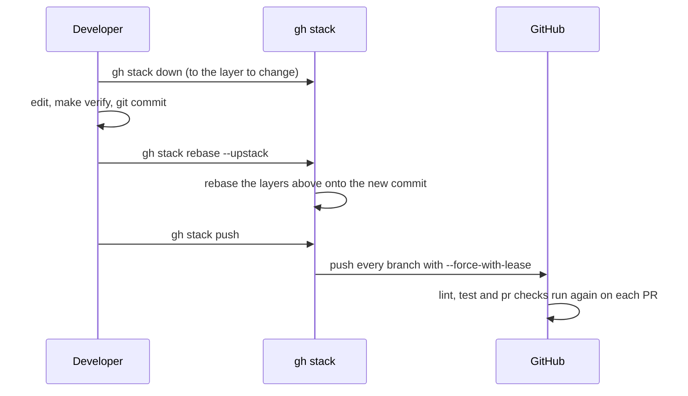
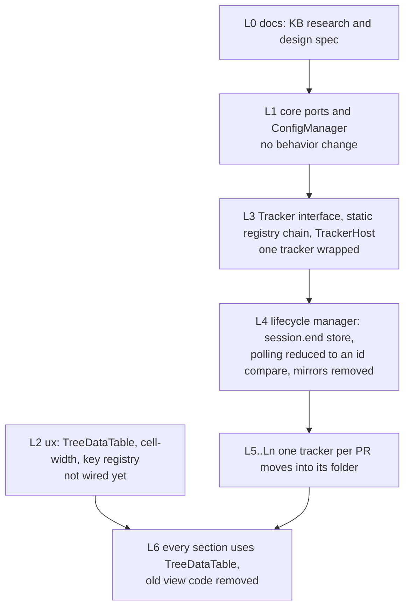

# Stacked pull requests

Research for the delivery part of [issue #55](https://github.com/martin-macak/claude-code-mod-tracking/issues/55): "GitHub stacked PRs, one per part. Each PR in the stack passes `make verify` on its own." The index is [README.md](README.md). Grades: [AGENTS.md](AGENTS.md#grades).

The page gives what GitHub offers, how it meets this repo's rules and which options exist. Recommendations are marked. The design spec decides.

Short answer:

- GitHub has a native stacked-PR feature. It reached general availability on 2026-10-06 (`public-docs`). An official CLI extension, `gh stack`, is installed on this machine (`observed`).
- Required reviews, status checks and code owners are judged against the base of the stack. Squash merging gives one squashed commit per PR (`public-docs`).
- A trial on a throwaway private repo (2026-10-17, `observed`) ran three stacks of two layers each and seven PRs. A full-stack squash merge works. History stays linear. Plain `gh pr merge` does not work. The strict up-to-date policy blocks the whole stack when `main` moves. See [§3.1](#31-the-trial). Sections 1 and 2 are still documented, not run.
- A second trial (2026-10-19, `observed`) tested closing keywords on a three-layer stack. `Closes #N` works on every layer, `Refs` is inert, and a parent does not close by itself. See [§3.2](#32-the-closing-keyword-trial).
- Three repo rules need care: the branch-name regex, the PR title and body checks on every layer, and the strict up-to-date policy. The agent gate matched only `git push` at the time of the trial. It covers `gh stack` since [#58](https://github.com/martin-macak/claude-code-mod-tracking/pull/58).

## 1. What GitHub offers

All entries are `public-docs`, read on 2026-10-17. They are not run, except where a line says the trial of [§3.1](#31-the-trial) ran them.

### 1.1 Status and timeline

| Date | Event |
| --- | --- |
| 2026-07-30 | Public preview ([changelog](https://github.blog/changelog/2026-07-30-stacked-pull-requests-are-now-in-public-preview/)) |
| 2026-10-01 | The async merge API is generally available ([changelog](https://github.blog/changelog/2026-10-01-github-async-merge-api-generally-available/)). It is "the only merge API that supports stacked pull requests". |
| 2026-10-06 | Stacked pull requests are generally available on all github.com plans. GitHub Enterprise Server follows in an upcoming release ([changelog](https://github.blog/changelog/2026-10-06-stacked-pull-requests-generally-available/)). |

The roadmap issue [github/roadmap#1218](https://github.com/github/roadmap/issues/1218) still carries a "Public Preview" label. It is stale after GA.

### 1.2 The model

- A stack is a single linear chain of PRs in one repository. Cross-fork stacks are not supported.
- Each PR targets the branch below it. The bottom PR targets the base (here `main`).
- You create and manage a stack in the web UI, on mobile, through the API, or with the `gh stack` CLI extension. GitHub Desktop does not support it.
- REST has endpoints to list, read, create, extend and dissolve a stack. GraphQL is read-only for stacks. The `pull_request` webhook has a `stack` object and a `stacked` action.
- A stack cannot be merged with the legacy synchronous merge endpoints or mutations. It needs the async merge API or `gh stack merge`.

Sources: [About stacked PRs](https://docs.github.com/en/pull-requests/get-started/about-stacked-prs), [reference](https://docs.github.com/en/pull-requests/reference/stacked-pull-requests), [APIs and webhooks](https://docs.github.com/en/pull-requests/reference/stacked-pull-requests-apis-and-webhooks).

### 1.3 The CLI

`gh stack` is the extension [github/gh-stack](https://github.com/github/gh-stack). Install it with `gh extension install github/gh-stack`. GitHub's README names `gh` 2.0 or later and `git` 2.36 or later. One blog post names `gh` 2.90 and `git` 2.20. Use GitHub's numbers.

On this machine (`observed`, 2026-10-17):

```text
$ gh --version | head -1
gh version 2.102.0 (2026-09-30)
$ git --version
git version 2.56.0
$ gh extension list | grep stack
gh stack    github/gh-stack    v0.1.0
```

`gh stack --help` lists: `init`, `add`, `submit`, `push`, `sync`, `rebase`, `modify`, `merge`, `link`, `unstack`, `view`, `checkout`, `up`, `down`, `top`, `bottom`, `trunk`, `switch`, `alias`, `feedback`.

### 1.4 Create, update, rebase and merge

| Step | Command or action | Notes |
| --- | --- | --- |
| Start | `gh stack init [--base]` | Targets the default branch. |
| Add a layer | commit, then `gh stack add <branch>` | `add -m` names the branch by date and slug (`03-24-add_login`). |
| Open the PRs | `gh stack submit [--auto --open]` | Pushes every branch and creates or updates the PRs. |
| Change a lower layer | `gh stack down`, commit, `gh stack rebase --upstack`, `gh stack push` | `push` uses `--force-with-lease`. |
| Sync | `gh stack sync [--prune]` | |
| Server-side rebase | "Rebase stack" in the UI | A cascading rebase. Approvals stay, even with dismiss-stale-approvals. The reference page says the rebase signs commits. The managing page says it does not. |
| Merge | Merge a PR in the UI, or `gh stack merge [--merge-method merge\|squash\|rebase]` | A merge lands that PR and every unmerged PR below it, as one atomic operation. A mid-stack PR cannot merge alone. |
| After a lower PR merges | automatic | The next PR is rebased and retargeted to the stack base. A deleted base branch retargets the stack. |
| Undo | `gh stack unstack` | Merged and queued PRs stay in the stack. |
| Adopt existing PRs | `gh stack link` | |
| Restructure | `gh stack modify` | A TUI. Needs a clean tree, linear history and no queued PR. |

The trial of [§3.1](#31-the-trial) ran the rows "Change a lower layer", "Merge" (a full stack and the bottom layer alone) and "After a lower PR merges", and confirmed them (`observed`).



### 1.5 Rules, checks and merge methods

- "Every pull request in a stack is evaluated against rules for the base of the stack": reviews, status checks, code owners, code scanning. All PRs below a PR must also meet them.
- Bypass works only on the bottom PR. `gh stack` does not support bypassing merge requirements.
- Merge commit method: one merge commit per PR. Squash method: "one squashed commit per PR, so merging n PRs creates n commits".
- Workflows on `pull_request` that target `main` run for every PR in the stack. The event carries `github.event.pull_request.stack`.
- A merge queue takes the whole stack as one merge group. An ejected PR removes every PR above it. The group may exceed its size limit by 50 percent. With a queue, `gh stack merge` leaves the method to the queue, and PRs may land in separate groups.
- Auto-merge: the merging page says it is not supported for stacks. The GA changelog says it is rolling out. The two disagree.
- The rollout tutorial says existing rulesets and CI apply. It is silent on the strict up-to-date policy, squash against merge, merge queues and auto-merge.

Sources: [merging](https://docs.github.com/en/pull-requests/how-tos/merge-and-close-pull-requests/merging-stacked-pull-requests), [managing](https://docs.github.com/en/pull-requests/how-tos/create-pull-requests/managing-stacked-pull-requests), [CLI reference](https://docs.github.com/en/pull-requests/reference/stacked-prs-cli-commands), [roll out](https://docs.github.com/en/pull-requests/tutorials/roll-out-stacked-prs).

### 1.6 Known problems

- [gh-stack discussion #212](https://github.com/github/gh-stack/discussions/212): stuck squash merges with dismiss-stale-approvals, "require up to date" and a merge queue. A maintainer confirmed an approval-evaluation bug on 2026-07-22. On 2026-10-15 a user reported that full-stack merges now work and partial merges still drop approvals.
- [community discussion 209892](https://github.com/orgs/community/discussions/209892): no official answer on whether required checks run once per stack or once per PR in a merge queue.
- GitHub's own pages disagree on auto-merge and on commit signing ([§1.4](#14-create-update-rebase-and-merge), [§1.5](#15-rules-checks-and-merge-methods)). Trust the dated changelog over a docs page, and re-check the live docs.

## 2. This repo's rules

All rows are `observed`: read from the repo and from `gh api` on 2026-10-17.

| Rule | Where | Value |
| --- | --- | --- |
| Ruleset `main` on the default branch | `gh api repos/martin-macak/claude-code-mod-tracking/rulesets/24853643` | Active. No bypass actors. Rules: `deletion`, `non_fast_forward`, `required_linear_history`, `pull_request`, `required_status_checks`. No `merge_queue` rule. |
| Pull request rule | same | `required_approving_review_count: 0`, `required_review_thread_resolution: true`, `dismiss_stale_reviews_on_push: false`, merge methods `merge`, `squash`, `rebase` |
| Required checks | same | `pre-commit`, `pr-body`, `pr-conventions`, `test`, with `strict_required_status_checks_policy: true` |
| Repo merge settings | `gh api repos/martin-macak/claude-code-mod-tracking` | `allow_squash_merge: true`, `allow_merge_commit: false`, `allow_rebase_merge: true`, `allow_auto_merge: true`, `delete_branch_on_merge: true`, `squash_merge_commit_title: PR_TITLE` |
| Triggers | `.github/workflows/lint.yml`, `test.yml` | `on: pull_request:` with no branch filter, plus `push` on `main` and `workflow_dispatch` |
| Triggers | `.github/workflows/pr.yml` | `pull_request` types `opened, edited, synchronize, reopened`, no branch filter |
| PR body check | `scripts/ci/check-pr-body.sh` | An issue reference (`Closes`, `Fixes`, `Resolves` or `Refs #N`), or `None` for a `trivial`, `chore` or `ci` title. A `## Requirements` section with at least one item, every item ticked. No unticked checkbox anywhere. |
| PR title check | `.github/workflows/pr.yml` | `amannn/action-semantic-pull-request` with the type list and `subjectPattern: ^[A-Z].*[^.]$` |
| Branch name check | `.github/workflows/pr.yml:68` | `^(feat\|fix\|docs\|style\|refactor\|perf\|test\|build\|trivial\|ci\|chore\|revert\|copilot)/[a-z0-9][a-z0-9._-]*$\|^add-claude-github-actions-[0-9]+$` The last alternative admits Claude installer branches. |
| Agent gate | `scripts/hooks/verify-gate.sh` | Matches `git … push` and `gh stack push\|submit\|sync\|merge\|link` at a command position. Runs `make verify` in the repo the push targets (`git -C <dir>`, a `cd <dir>` in the same command), else in the session repo. A heredoc body, or a quoted string with a newline, is text, not a command, when a command that only reads text owns it (`cat`, `git commit`). Rules: the header of the script. |
| Pre-push hook | `.pre-commit-config.yaml`, `scripts/hooks/pre-push.sh` | `make test && make e2e-unit` |
| Repo rules | `AGENTS.md` ("Before you commit or push", "Pull requests") | Linear history. Fewest commits. `--force-with-lease`, never `--force`. No temporary files in the final tree. Self-contained documents. `make verify` before every push. |

## 3. How the two fit

Grades: `public-docs`, `observed` and `inference`. An `observed` row was seen in the trial of [§3.1](#31-the-trial). All commands ran in a non-interactive shell, so none is `verified-live` (that grade means an interactive Claude session).

| Repo rule | Interaction with a stack | Grade | Action |
| --- | --- | --- | --- |
| Linear history, no merge commits | A stack is a linear chain. The squash method keeps `main` linear. | `public-docs` | Use squash. |
| Squash merge, title is the commit subject | n PRs give n squashed commits on `main`. Each commit subject is its PR title, followed by the PR number in parentheses, as `(#N)`. With `squash_merge_commit_message: PR_BODY` (as in the real repo) the PR body, including the gh-stack HTML footer, lands in the commit message. | `public-docs`, `observed` | Every layer needs a valid Conventional Commit title (`feat(scope): Subject`). Strip the footer with `gh pr edit --body` before merge, or accept HTML in `main` history. |
| `pr-conventions`: branch regex | `gh stack add -m` names a branch like `03-24-add_login`. It fails the regex. | `public-docs`, `observed` | Always pass an explicit name: `gh stack add feat/<summary>`. |
| `pr-body` on every PR | Each layer is its own PR and needs its own body: an issue link, a ticked Requirements list, no open checkbox. `gh stack submit --auto --open` writes the **branch's commit subject verbatim as the title** (a Conventional Commit subject stays valid) and, as the body, the commit body, a rule, then an HTML footer `<sub>Stack created with GitHub Stacks CLI • Give Feedback</sub>`. A commit with no body gives a body that is the footer only. The text has no `## Requirements` section, so `pr-body` fails every layer until the body is edited. | `observed` | Edit every body after `submit` with `gh pr edit --body`. Start each layer's commit body with the issue line (`Refs #55`) so the generated text is closer to valid. Whether a later `submit` or `push` overwrites an edited body is untested ([Q31](open-questions.md#1-unknowns)). Only one-commit layers were tried. |
| `Closes #55` | After a lower PR merges, GitHub retargets the next PR to `main` by itself (`automatic_base_change_succeeded`), force-pushes a server-side rebase of its head, and re-runs its checks. A `Closes` line registers on every layer, also on a PR whose base is another layer, and closes its issue when that PR merges. A bottom layer that merges alone closes its issue. The rest of the stack, merged in one step, closes all the other issues. GitHub does not close a parent issue when its last sub-issue closes. `Refs` stays inert. See [§3.2](#32-the-closing-keyword-trial). | `observed` (retarget, 2026-10-17), `observed` (closing keywords, 2026-10-19) | Give each layer its own sub-issue and link the layers as [AGENTS.md](../../../AGENTS.md#planning-and-delivery), "Stack layers" says. The top layer also closes the parent with its own `Closes` line. |
| Required checks on every layer | The four contexts are judged against the stack base. `lint.yml`, `test.yml` and `pr.yml` have no branch filter, so they run for every layer. In the trial a `pull_request` workflow with no branch filter ran for the PR whose base was not `main`, and both PRs reached `mergeStateStatus: CLEAN`. | `public-docs`, `observed` | Keep the triggers as they are. A `branches: [main]` filter on `pull_request` would skip upper layers. PR numbers will skip: each stack takes one number from the shared PR and issue sequence. |
| `strict_required_status_checks_policy: true` | The docs are silent on strict mode. Reports describe stuck squash merges with strict checks, dismiss-stale-approvals and merge queues. Partial merges still dropped approvals on 2026-10-15. In the trial: when `main` moved ahead of an open stack, the bottom PR showed `BEHIND` and `gh stack merge --yes --squash` failed atomically with `Required status check "check" is expected.` That text does not say "behind". Nothing merged. `gh stack rebase`, `gh stack push`, a full CI rerun on every layer, then `gh stack merge` merged both. A full-stack merge with a current base needed no extra step. | `public-docs`, `observed` | Every time `main` moves, each open stack needs rebase, push and a CI rerun of all required checks on all layers. Plan the layer count against CI cost. Write "`Required status check is expected` means the stack is behind `main`: rebase and push" into the runbook and the `pr-shepherd` skill. This repo sets `dismiss_stale_reviews_on_push: false` and needs 0 approvals, which avoids the approval bug. The server-side "Rebase stack" action was not tried ([Q31](open-questions.md#1-unknowns)). |
| `make verify` before every push | `gh stack push`, `submit`, `sync` and `merge` did not match the agent gate regex in the trial (fixed in [#58](https://github.com/martin-macak/claude-code-mod-tracking/pull/58)). **Observed:** the gate denied a command that contained `git push origin main` (`make verify` was red in the real worktree), but `gh stack submit`, `push`, `merge`, `rebase` and `unstack` all ran with no gate output. The gate also gave a false positive: a read-only `git config --get` of the hooks-path setting was denied with `Do not bypass the git hooks`. The gate was keyed to the session repo, not the push target (fixed in [#244](https://github.com/martin-macak/claude-code-mod-tracking/issues/244): it now checks the repo the push targets). The git `pre-push` hook does run, because `gh stack` pushes through real `git push` subprocesses: `submit` pushed each branch alone (2 hook runs for 2 branches), and `gh stack push` sent one `git push` with both refspecs (1 hook run, both refs on stdin). The hook runs in the checked-out layer's working tree, so a hook that runs tests tests only that layer (*inference*: the repo's `scripts/hooks/pre-push.sh` was not run). | `observed`, `inference` | Done: the gate covers `gh stack push`, `submit`, `sync`, `merge` and `link` ([#58](https://github.com/martin-macak/claude-code-mod-tracking/pull/58)) and checks the repo the push targets ([#244](https://github.com/martin-macak/claude-code-mod-tracking/issues/244)). The rules are in the header of `scripts/hooks/verify-gate.sh`. "Each PR passes `make verify` on its own" needs an explicit loop (`gh stack bottom`, `gh stack up`, `make verify` per layer) before `gh stack push`. |
| `--force-with-lease`, never `--force` | `gh stack push` uses `--force-with-lease`. The leases are explicit per branch: `--force-with-lease=<ref>:` (empty expect: the branch must not exist) on the first submit, and `--force-with-lease=<ref>:<old-sha>` on updates. | `public-docs`, `observed` | Matches the rule. A second clone or a stale local ref makes `gh stack push` reject. |
| Self-contained documents | Each layer is judged alone. A document in layer 1 must not link to a file that layer 3 adds. | `inference` | Put the KB and the spec in the first layer, and let them link only to files that exist there. |
| Minimum commits | Each layer may hold several commits. The squash merge keeps one per PR. | `public-docs` | Squash locally to the fewest logical commits per layer. |
| Merge method | The ruleset allows `merge`, `squash` and `rebase`. The repo setting disables merge commits. Merge is off in practice. **Plain `gh pr merge --squash` fails on a stacked PR**, bottom or top: `GraphQL: This pull request is part of a stack and must be merged using the asynchronous merge REST API`. `PUT /pulls/N/merge` returns HTTP 403 (`Merging stacked PRs via this endpoint is not supported`). | `observed` | Use `gh stack merge --yes --squash` (`--yes` is needed without a TTY) or the UI. Anything that calls `gh pr merge` (scripts, the `pr-shepherd` skill) must switch for stacked PRs. `gh stack unstack` takes a PR out of the stack, after which a plain merge works. |
| Auto-merge | The repo allows it. The docs disagree about stacks. | `public-docs` | Do not rely on it. |
| Merge queue | None here. Queue behavior does not apply. | `observed` | Revisit only if a queue is added. |
| `delete_branch_on_merge` | A merged layer's branch is deleted. GitHub retargets the stack. In the trial both head branches were deleted, and `gh stack sync --prune` then fast-forwarded `main` and pruned the merged branches. | `public-docs`, `observed` | Run `gh stack sync --prune` locally. `sync` after the server-side force-push of a partial merge was not tested ([Q31](open-questions.md#1-unknowns)). |

### 3.1 The trial

The trial ran on 2026-10-17 on a private throwaway repository, `martin-macak/gh-stack-trial-20261017`, with `gh` 2.102.0 and `gh stack` v0.1.0. Every result below is `observed`: real commands, real GitHub behavior, in a non-interactive shell. `observed` here is not `verified-live` and not `verified-kit`: nothing ran inside an interactive Claude session or the plugin kit ([grades](AGENTS.md#grades)). The real repository got read-only `gh api` GET calls only.

How close the trial is to the real repo:

- The ruleset copies the real one: `deletion`, `non_fast_forward`, `required_linear_history`, `pull_request` (merge, squash, rebase), strict `required_status_checks`, no bypass actors.
- Different from the real repo: one required check named `check` (the real repo has `pre-commit`, `pr-body`, `pr-conventions`, `test`); no reviews or thread resolution; no merge queue; no dismiss-stale-approvals; commit signing not examined; one commit per layer. Merge commits were disabled, and squash was set to `PR_TITLE` and `PR_BODY`, only after the first stack.
- Result: three stacks and seven merged PRs (#1, #2, #4, #5, #7, #8, #10). Stack numbers share the PR and issue number sequence (stacks #3, #6, #9).

| Question | Answer | Evidence |
| --- | --- | --- |
| What title and body does `gh stack submit --auto --open` write? ([Q14](open-questions.md#1-unknowns) f) | Title: the branch's commit subject, verbatim. Body: the commit body, a rule, then an HTML footer. A commit with no body gives a body that is the footer only. No `## Requirements` section. Only one-commit layers were tried. | `gh stack submit --auto --open`: `Created PR #1 for feat/layer-one`, `Created PR #2 for feat/layer-two`, `Stack created on GitHub with 2 PRs (stack #3)`. `gh pr view 1 --json title,body`: title `feat(trial): Add layer one`; body `Refs #1`, a blank line, `---`, then `<sub>Stack created with <a href="https://github.com/github/gh-stack">GitHub Stacks CLI</a> • <a href="https://gh.io/stacks-feedback">Give Feedback 💬</a></sub>`. PR #5 (commit with no body): the body is the footer only. |
| Does a 2-layer stack get two PRs, each targeting the one below, with the required check on both? | Yes. PR 1 targets `main`. PR 2 targets `feat/layer-one`. The `pull_request` workflow ran for both, and both reached `CLEAN` with the strict policy on. The server shows a stack object (stack #3, positions 1 and 2, size 2, base `main`). Explicit branch names were kept. | `gh pr view 1` base `main`; `gh pr view 2` base `feat/layer-one`. `gh pr checks` for both: `check pass 4s` and `check pass 3s`. Actions runs `39069194754` (base `main`) and `39069195100` (base `feat/layer-one`), event `pull_request`, success. `gh api repos/…/pulls/2 --jq .stack`: `{"base":{"ref":"main"},"id":2267039,"number":3,"position":2,"size":2}`. |
| Does the git `pre-push` hook fire for `gh stack submit` and `push`? Does `push` use `--force-with-lease`? | Yes to both. `submit` pushed each branch in its own `git push` (2 hook runs for 2 branches). `gh stack push` sent one `git push` with both refspecs (1 hook run, both refs on stdin). Leases are explicit per branch. | `GIT_TRACE` (submit): `git push origin --force-with-lease=refs/heads/feat/layer-one: refs/heads/feat/layer-one:refs/heads/feat/layer-one`, then the same for `feat/layer-two`, each followed by `run_command: .git/hooks/pre-push origin https://github.com/…`. `GIT_TRACE` (push): `git push origin --force-with-lease=refs/heads/feat/layer-one:709b015c… --force-with-lease=refs/heads/feat/layer-two:449dbc63… refs/heads/feat/layer-one:refs/heads/feat/layer-one refs/heads/feat/layer-two:refs/heads/feat/layer-two`. `gh stack sync --help`: `Pushes all branches atomically (using --force-with-lease --atomic)` (help text only; the sync push was not traced). |
| Does the agent gate (`scripts/hooks/verify-gate.sh`) see `gh stack` commands? | **No.** It denied a command that contained `git push origin main`, because `make verify` was red in the real worktree (untracked KB files), although the push targeted the throwaway repo. Minutes later `gh stack submit`, `push`, `merge`, `rebase` and `unstack` ran with no gate output. It also denied a read-only `git config --get` of the hooks-path setting. To avoid the denied `git push`, the trial's first commits went in through the contents API, not through a change to the gate. | `PreToolUse:Bash hook error: make verify failed. … verify failed: the hooks skip untracked files. git add them or ignore them: docs/knowledge-base/claude-code-mod-architecture/AGENTS.md …`. And `PreToolUse:Bash hook error: Do not bypass the git hooks (--no-verify, SKIP=, core.hooksPath). Fix the cause.` for the read-only command. |
| Change a lower layer: `gh stack down`, commit, `gh stack rebase --upstack`, `gh stack push`. Does the upper PR update? | Yes. Both layers were rebased locally and both PRs were updated. PR 2's head went `449dbc6` to `543609f`, GitHub logged `head_ref_force_pushed`, PR 2's commit list shows only its own commit, and the check ran again on both heads. A `gh pr view` right after the push showed the old head for a few seconds. | `gh stack down`: `Checked out feat/layer-one, 1 branch down`. `gh stack rebase --upstack`: `Rebased feat/layer-one onto main`, `Rebased feat/layer-two onto feat/layer-one`. `gh stack push`: `Pushing 2 branches to origin...`, `Pushed 2 branches`. Runs `39070391941` (layer-one) and `39070392266`, `39070392422` (layer-two, two runs at one head, cause not isolated); all success. |
| Full-stack squash merge: what lands on `main`? ([Q14](open-questions.md#1-unknowns) a) | One atomic call merged both PRs. `main` got exactly 2 new commits, one per PR, each with a single parent, so history is linear. Both PRs show `MERGED` and both head branches were deleted. Strict checks blocked nothing, because both heads were green and `main` had not moved. The upper PR was not retargeted: its base stayed `feat/layer-one` and the timeline has no base-change event. Merged PRs stay in the stack object. | `gh stack merge --yes --squash`: `Merging #1, #2 into main via squash...`, `Merged #1, #2 into main (c3967e7)`. `git log --graph origin/main`: `* c3967e7 feat(trial): Add layer two (#2)`, `* 0ef8abb feat(trial): Add layer one (#1)`, no merge commits. Timeline PR 2: `merged`, `closed`, `head_ref_deleted`. `gh stack sync --prune`: `Fast-forwarded main to c3967e7`, `Pruned feat/layer-one (merged)`, `Pruned feat/layer-two (merged)`. |
| Merge only the bottom layer: is the next PR retargeted and rebased, and do checks gate it? | Yes, automatically. GitHub retargeted PR #5 to `main` (`automatic_base_change_succeeded`), force-pushed a server-side rebase of its head (`16d34f2` to `e7a20eb`) and re-ran the check. PR #5 showed `BLOCKED` while the check ran, then `CLEAN`. Local branches then need `gh stack sync` (not tested after this force-push). | `gh stack merge 4 --yes --squash`: `Merged #4 into main (3b6c0cb)`. PR 5 timeline: `automatic_base_change_succeeded` 21:38:41Z, `head_ref_force_pushed` 21:38:45Z. Run `39071819547` on `e7a20eb` success. |
| What happens when `main` moves ahead of an open stack, with the strict policy on? | It blocks the whole stack merge, with a misleading message. The fix: `gh stack rebase`, `gh stack push`, wait for the check on every layer, then `gh stack merge`. Direct writes to `main` are also rejected by the ruleset. | A direct write to `main` was rejected too: `Changes must be made through a pull request`. After an unrelated PR (#10) landed, PR 7 and PR 8 showed `BEHIND`. `gh stack merge --yes --squash`: `✗ merge failed: Required status check "check" is expected.` and `Stack merges are atomic, so nothing was merged.` (rc 4). `gh stack rebase`: `Trunk main fast-forwarded to 0b877b3`, `Rebased feat/layer-five onto main`, `Rebased feat/layer-six onto feat/layer-five`. After the push and green checks: `Merged #7, #8 into main (d7e2a12)`; `main`: `d7e2a12`, `2099423`, `0b877b3`, one parent each. |
| Does plain `gh pr merge --squash` work on a stacked PR? ([Q14](open-questions.md#1-unknowns) c) | No. It fails for the bottom PR and for the last open PR, even after that PR was retargeted to `main`. The legacy REST merge returns HTTP 403. Only `gh stack merge` works. After `gh stack unstack 6` removed PR #5 from the stack, `gh pr merge 5 --squash` succeeded. `unstack` printed a misleading warning (`queued for merge or have auto-merge enabled`); the real reason was an already merged PR. The open PR was removed anyway. | `gh pr merge 4 --squash`: `GraphQL: This pull request is part of a stack and must be merged using the asynchronous merge REST API. … (mergePullRequest)`. `gh api -X PUT repos/…/pulls/4/merge`: `Merging stacked PRs via this endpoint is not supported. Use the asynchronous merge endpoint instead.` (HTTP 403). After `unstack`, `gh pr merge 5 --squash` returned 0 with commit `7142eb8 feat(trial): Add layer four (#5)`, one parent. |
| What do the squash commit messages on `main` look like under this repo's settings (`PR_TITLE`, `PR_BODY`)? | The gh-stack HTML footer lands in the commit message. Stack 1 merged under the new repo's default squash settings, so it does not model the real repo. Stacks 2 and 3 ran after the trial repo was set to `PR_TITLE` and `PR_BODY`, as in the real repo. | Commit `3b6c0cb` (PR #4): `feat(trial): Add layer three (#4)`, then `Refs #1`, `---`, `<sub>Stack created with <a href="https://github.com/github/gh-stack">GitHub Stacks CLI</a> • …</sub>`, wrapped over lines. Commit `0ef8abb` (stack 1, default settings): `* feat(trial): Add layer one`, `Refs #1`, `* feat(trial): Extend layer one`. |
| Was the trial repo deleted? | **No.** The `gh` token lacks the `delete_repo` scope (scopes: `gist`, `read:org`, `repo`, `workflow`). `gh repo delete --yes` returned HTTP 403. `gh auth refresh` is interactive and changes the user's auth, so it was not run. The repository is private and needs **manual deletion**: <https://github.com/martin-macak/gh-stack-trial-20261017> (Settings, Danger Zone, Delete this repository; or run `gh auth refresh -h github.com -s delete_repo`, then `gh repo delete martin-macak/gh-stack-trial-20261017 --yes`). State: 10 commits on `main`, 7 merged PRs, ruleset id `25318638`, no branch but `main`. Tracked as [Q32](open-questions.md#1-unknowns). | `gh repo delete martin-macak/gh-stack-trial-20261017 --yes`: `HTTP 403: Must have admin rights to Repository.` and `This API operation needs the "delete_repo" scope.` (twice). |

What the trial settles for the plan:

- **Landing layers one at a time works** and needs no manual retarget or rebase. After each merge, wait for the next layer's CI to run again on the rebased head before you merge it.
- **Each upstack push runs CI again on every layer above,** so the CI cost is layers times checks. Poll until the head and the check settle before a script reads the PR state, because `gh pr view` can show the old head, and `mergeStateStatus` can read `UNKNOWN` or `BLOCKED` for a few seconds.
- **n layers give n squash commits** on `main`, titled `<PR title> (#N)`. That fits the linear-history and squash rules.

Fidelity limits are in the list above. Not tested: reviews and thread resolution, a merge queue, dismiss-stale-approvals, auto-merge, and the real four-check ruleset ([Q31](open-questions.md#1-unknowns)).

### 3.2 The closing-keyword trial

A second trial ran on 2026-10-19 on the throwaway repository `martin-macak/gh-stack-close-trial-20261019`, with a native stack of three layers and a parent issue. It answered [Q31](open-questions.md#1-unknowns) (b). Every result is `observed` (real GitHub behavior, non-interactive shell), not `verified-live`.

| Question | Answer | Grade |
| --- | --- | --- |
| Does `Closes #N` register on every layer, also when the PR base is not the default branch? | Yes. Each layer PR registered its closing reference, also a PR whose base was another layer. | `observed` |
| Does a bottom layer that merges alone close its issue? | Yes. | `observed` |
| What happens when the rest of the stack merges in one step? | All the other layer issues closed, also the one linked from the PR whose base stayed `feat/l1`. | `observed` |
| Does the parent issue close when all its sub-issues close? | No. GitHub has no auto-close of a parent. The parent closed only through its own `Closes #1` in the top PR. | `observed` |
| Does `Refs #N` do anything? | No. It stays inert. | `observed` |

What it settles: a layer PR closes its own sub-issue and refs the parent. The top layer also closes the parent. The rule lives in [AGENTS.md](../../../AGENTS.md#planning-and-delivery), "Stack layers". The older plan, `Refs #55` on every layer and `Closes #55` on the top layer only, is replaced.

## 4. Options

| Option | For | Against |
| --- | --- | --- |
| **A: native `gh stack`** | One command set. Atomic merge of a stack. Server-side rebase. The feature the issue names. The trial merged full stacks and single layers, with linear history. | Days old at GA. A known approval bug. The agent gate did not see it in the trial (fixed in [#58](https://github.com/martin-macak/claude-code-mod-tracking/pull/58)). Every generated body needs an edit (no Requirements section). Plain `gh pr merge` fails. Branch names need care. The strict policy makes each moved `main` cost a rebase and a full CI rerun per layer. |
| **B: manual chained PRs** (each PR's base is the previous branch; retarget by hand after a merge) | Works with plain `git` and `gh pr create --base`. The gate sees `git push`. | No atomic merge. Manual retarget and rebase. A PR on a non-`main` base is outside the ruleset, so the required checks do not gate it (`inference`: the ruleset targets the default branch). |
| **C: serial small PRs** rebased onto `main` (current practice) | The simplest. Every PR is independent. | One review cycle at a time. A later part waits for an earlier merge. |

**Decided (D14, 2026-10-17):** A, native `gh stack`, after a trial on a throwaway private repo. The trial ran ([§3.1](#31-the-trial)). It showed no merge problem. It showed four things to do first: extend the agent gate, edit every PR body, switch every `gh pr merge` to `gh stack merge`, and plan for a rebase and CI rerun when `main` moves.

**Recommendation (inference), before the decision:** try A on a throwaway repo with a copy of the ruleset before the first real layer. Extend the agent gate first. If the trial shows a merge problem, fall back to C.

## 5. A candidate layering for issue #55 (recommendation)

The issue names five parts: TreeDataTable, config, Tracker interface, layout, lifecycle. They depend on each other. The layering below is `inference`. The spec decides the real order.



| Layer | Branch name (example) | Verify note |
| --- | --- | --- |
| L0 | `docs/mod-architecture-kb` | Docs only. Markdown lint. Links only to files in the layer. |
| L1 | `refactor/core-ports-config` | Needs `fs.read`, `fs.write`, `fs.exists` stubs in `tests/fixtures/world.ts`. |
| L2 | `feat/tree-data-table` | Pure unit tests plus kit mounts. A live check of keys and colors is separate (`make e2e`, not in CI). |
| L3 | `refactor/tracker-interface` | `tsconfig.json` gets the new folders. About 36 test files change if files move. |
| L4 | `refactor/lifecycle-manager` | Tests need a `clearSession` helper. Hot reload and end have no kit coverage. |
| L5..Ln | `refactor/tracker-github`, … | One tracker each. Each layer closes its own sub-issue. Only the top layer also closes #55 ([AGENTS.md](../../../AGENTS.md#planning-and-delivery), "Stack layers"). |
| L6 | `feat/pane-tree-table` | Pane behavior changes. Update the `README` demo with the `demo-scenario` skill. |

## 6. Gotchas

- `gh stack add -m` auto-names the branch (date and slug) and fails the branch regex. Name every branch: `gh stack add feat/<summary>`, then commit.
- The agent gate once matched only `git … push`. `gh stack push`, `submit`, `sync` and `merge` passed it unseen (`observed`). It also keyed on the session repo, not the push target, and it denied a read-only read of the hooks-path git setting. The gate now covers `gh stack` and checks the repo the push targets ([#244](https://github.com/martin-macak/claude-code-mod-tracking/issues/244)). The header of `scripts/hooks/verify-gate.sh` has the rules.
- Merging a stack needs the async merge API or `gh stack merge`. Plain `gh pr merge --squash` and `PUT /pulls/N/merge` fail on a stacked PR (`observed`). Do not script `gh api …/merge` for stack PRs. `gh stack unstack` takes one PR out so that a plain merge works.
- The error `Required status check "check" is expected.` on `gh stack merge` means the stack is behind `main`, not that a check is missing. Run `gh stack rebase`, `gh stack push`, wait for CI on every layer, merge again.
- Run `gh stack submit --auto --open` and `gh stack merge --yes --squash` in a non-TTY shell. Without `--open`, `--auto` creates draft PRs, and `gh stack merge` accepts only open, non-draft PRs. `--yes` is needed without a TTY.
- Stack numbers share the PR and issue number sequence (stacks #3, #6, #9). A bare number given to `gh stack merge` is read as a stack number first, then as a PR number. `gh pr view 3` on a stack number fails with `Could not resolve to a PullRequest`.
- Hangs seen in a non-TTY shell, cause not isolated: `gh stack view` hung once after the merge but worked with `</dev/null`; two 300 s timeouts happened around `gh pr checks --watch` and a `gh stack push`. Poll `gh pr view --json statusCheckRollup` and redirect stdin from `/dev/null`.
- `gh pr view` right after a push can show the old head for a few seconds, and `mergeStateStatus` can be `UNKNOWN` or `BLOCKED` while checks run. Poll until the head and the check settle.
- The `gh stack unstack` warning (`queued for merge or have auto-merge enabled`) is misleading when merged PRs remain in the stack. The open PR was still removed.
- On this machine `~/.gitconfig` rewrites `https://github.com/` to `ssh://git@github.com/` and the ssh agent holds no identity, so clone and push hung or failed. The trial isolated itself with `GIT_CONFIG_GLOBAL=<file>` that held the user and the `gh` credential helper and no rewrite. An agent that pushes stacks from this machine hits the same wall.
- The squash commit on `main` carries the PR body, so the gh-stack HTML footer lands in `main` history unless you edit the body first.
- Squash gives one commit per PR, titled by the PR. Every layer needs a valid title and body.
- GitHub's pages disagree on auto-merge and on commit signing. Re-check them before you rely on either.
- Partial merges were reported to drop approvals as of 2026-10-15. This repo needs no approvals, but test the merge before you trust it.
- A cross-layer link in a document breaks the self-contained rule for the lower layer.
