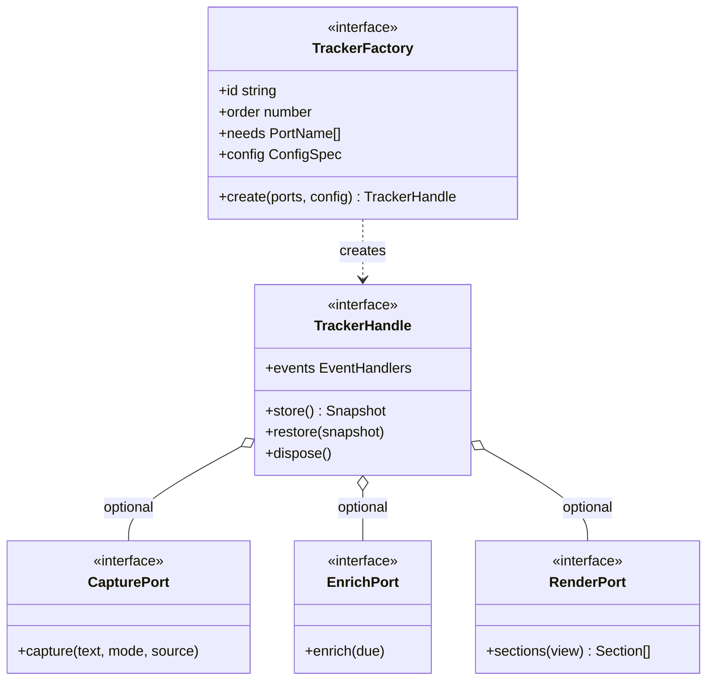
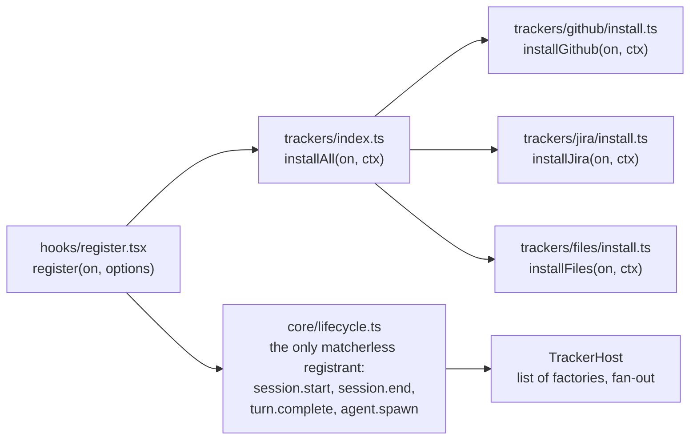
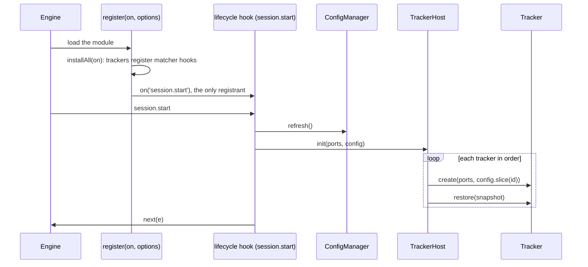

# Tracker plugins

Research for the third part of [issue #55](https://github.com/martin-macak/claude-code-mod-tracking/issues/55): a Tracker interface. A tracker is a pluggable unit of work. It hooks into Claude Code through the core, gets the config manager injected, and has `init` and `store` phases. The index is [README.md](README.md). Grades: [AGENTS.md](AGENTS.md#grades). `d.ts:N` links to the 2.1.302 snapshot.

The page gives the engine rules, prior art, constraints and options. Recommendations are marked. The design spec decides.

Short answer:

- A tracker file can register its own hooks. `on` may go to an imported plain named function. The registry must be a static chain of named calls, never an array, loop or method (`verified-kit`).
- Only one hook per event may have no matcher, across the whole import tree. The lifecycle manager must be the only matcherless registrant and fan out. Trackers may own matcher hooks (`verified-kit`).
- A state ref and its use must sit in one file. A new typed atom still edits the one contract file. One `StateFamily` key keyed by tracker id avoids that edit (`verified-kit`).
- The code may live in sibling folders of `hooks/` inside the plugin root (`verified-kit`). An edit in any such folder reloads the mod, if a file of the import graph imports it (`verified-live`).
- A bus works: one matcherless `on('tool.call')` with a `Map` of handlers, and `on('session.append', { door })` with a door set (`verified-kit`). The engine already skips a hook beneath its own call, so a bus needs no re-entry counter for engine events (`verified-kit`).
- Two `ui.render` hooks with one matcher compose one tree. The first registered is outermost (`verified-kit`).
- The user chose the bus for the decided design ([D9](open-questions.md#2-decisions-for-the-design-spec)). §5.1 keeps the options.

## 1. What the issue asks

- A Tracker interface exists. GitHub, Jira and the other current trackers implement it.
- Each tracker gets the config manager injected, has `init` and `store` phases, and can read global config values.
- UX components, core interfaces, trackers and core infrastructure each live in one folder.
- "A new tracker needs no edit outside its own folder and one registration line (open-closed)."

## 2. What the engine allows

The mods KB has the general rules: [ports-and-injection](../claude-code-mods/concepts/ports-and-injection.md) and [validate-test-debug](../claude-code-mods/workflow/validate-test-debug.md). This section keeps the facts that decide the tracker contract.

The answers come from small throwaway mods run with `claude plugin validate`, `claude plugin test` and `tsc 7.0.2` on Claude Code 2.1.302. A headless `claude -p` run against a fake API loaded the real engine for the `on`, ports and sibling-folder cases (`verified-kit`, not live).

### 2.1 Passing `on` to another file

| Fact | Grade | Evidence |
| --- | --- | --- |
| `validate` follows `on` into an imported file when `on` goes to a plain named function: a `function` declaration or a const-bound arrow, declared in the file or imported from the plugin. Chains of such calls work. Every hook registered there appears in the `hooks:` line, all attributed to the entry file. The hooks fire in the kit and in a headless real-engine run. | `verified-kit` | `hooks: tool.call{tool=Bash}, tool.call{tool=Read}, turn.complete` for a chain `register -> installAll(on) -> installA(on)`. Kit: `(pass) two trackers registered through a chain both fire`. Headless: `"trackerA":"hook-in-imported-file-ran"`. |
| The scan really reads imported files. | `verified-kit` | A misspelled event only in the imported file gives `"tool.calls" is not an event`. A computed name gives `the event name passed to on() is not a string literal`. |
| **Rejected:** `new TrackerB(on)`, `new TrackerC().attach(on)`, `trackerH.install(on)`, `this.on(...)`, `obj.method(on)`, `for (const install of INSTALLERS) install(on)`, `INSTALLERS.forEach(install => install(on))`. | `verified-kit` | `"on" is passed to something other than a function named at the top of this file or imported from one of the module's own files`. The loop: `the callee "install" is not a function declared at the top of this file ... nor imported`. |
| Extra arguments beside `on` are fine, for example a shared context object. `try { installA(on) } catch {}` and `if (options.withB === true) installB(on)` pass. `hooks:` lists the hooks whatever the condition. | `verified-kit` | Spikes [`g01k`](../claude-code-mods/sources/spikes-2026-10-17/g01k-dollar-in-tracker-file/) and [`g01u`](../claude-code-mods/sources/spikes-2026-10-17/g01u-conditional-and-trycatch/). |
| **A second `on('x', hook)` without a matcher for the same event, anywhere in the import tree, refuses the whole module** at `validate` and at load. `try/catch` cannot rescue it, because the module is refused before any hook runs. | `verified-kit` | `trackers/b.ts ... on("turn.complete") is registered twice without a matcher; the first is at .../trackers/a.ts:2`. Kit: `HooksError: ... hooks module did not load`. |
| The same matcher twice is legal. Both hooks run, nested in registration order. A matcherless hook and a matcher hook for one event can coexist. | `verified-kit` | `hooks: tool.call{tool=Bash}, tool.call{tool=Bash}`. Kit output `Bash -> {"bSaw":"Bash","aSaw":"Bash"}`. |
| `validate` prints a computed matcher as `tool.call{tool=?}` and still passes. | `verified-kit` | Spike [`g13p`](../claude-code-mods/sources/spikes-2026-10-17/g13p-family-two-trackers-unknown/). The real mod already has one (the `PATH_TOOLS` loop). |
| The `hooks:` and `calls:` lines show every tracker's hooks under the entry file. They do not show which tracker owns a hook. | `verified-kit` | `calls: $.session.id` for a call made in an imported file. |
| `PluginRegisterUses` is the host's own source scan. A managed `plugin.register` policy therefore sees tracker hooks too. | `types-only`, `inference` | [d.ts:7884-7925](../claude-code-mods/sources/claude-code-2.1.302/types/claude-code.d.ts#L7884-L7925) |
| `register` return is dropped. A returned promise is awaited. Options are fixed per activation. | `types-only` | [d.ts:9706-9713](../claude-code-mods/sources/claude-code-2.1.302/types/claude-code.d.ts#L9706-L9713) |
| `register` may be `async`, and `on()` after an `await` still registers. `$` does not exist in `register`, so the body cannot read a file with `$.fs` before it chooses installers. Only `options` can gate registration. | `verified-kit` (kit and `validate`), `types-only` (the real engine awaits) | Spike `kbw-async`: `hooks: tool.call{tool=Bash}`; kit `(pass) a hook registered after an await fires`. Answers [Q6](open-questions.md#1-unknowns). Spike [`kbw-async`](../claude-code-mods/sources/spikes-2026-10-17/kbw-async/). |
| Two `ui.render` hooks with the same matcher, installed from two files by a static chain, compose one tree. The hook registered first is **outermost**. Its `await next(e)` resolves to the second hook's whole tree, a plain object `{ type, props, children }`, which it can embed. The second never sees the first's tree: its `next(e)` resolves to the tree beneath it (the engine's own). A props rewrite by the outer hook (`next({ ...e, props })`) flows down. A hook that answers without `next` shadows the one beneath. An unmatched `requestId` draws only the engine's tree. Swapping the install order swaps the nesting. The root of the drawn tree carries `part = { plugin }`. | `verified-kit` | Spikes [`kbw-compose`](../claude-code-mods/sources/spikes-2026-10-17/kbw-compose/), [`r07-compose`](../claude-code-mods/sources/spikes-2026-10-17/r07-compose/) and [`r07s-compose`](../claude-code-mods/sources/spikes-2026-10-17/r07s-compose/): `hooks: ui.render{component=Pane, requestId=p}, ui.render{component=Pane, requestId=p}`. Tree: `Box > [Text "A-head", Box > [Text "B-body"], Text "A-foot"]`. Kit: B read `e.props.title === 'rewritten-by-A'`. Answers [Q15](open-questions.md#1-unknowns). |
| The d.ts says a plugin's registrations "nest in order, first outermost; a repeat throws". The kit throws only for a repeat without a matcher. An identical matcher twice is legal, and the real mod does it for `Read`, `Edit` and `Write` (`H/register.tsx:1522-1534` and the loop at `:1644`). | `types-only`, `verified-kit` | [d.ts:6911](../claude-code-mods/sources/claude-code-2.1.302/types/claude-code.d.ts#L6911). Real mod: `claude plugin validate` on 2.1.302 passes and prints 23 hook entries. The loop at `:1644` shows once, as `tool.call{tool=?}`. It registers six hooks, so the run-time count is 28 (`observed`: counted from the code, not printed by `validate`). |

The next rows are for a bus: core owns every `on()`, trackers declare events as data.

| Fact | Grade | Evidence |
| --- | --- | --- |
| A matcherless `on('tool.call')` that looks `e.tool` up in a `Map` of handlers, plus `on('session.append', { door: DOORS })` with `DOORS` a same-file `as const` array, passes `validate` with a clean line. The kit fires every `Map` handler and only the matched doors. | `verified-kit` | [`r06a-bus`](../claude-code-mods/sources/spikes-2026-10-17/r06a-bus/): `hooks: tool.call, session.append{door=tool-result\|tool-message}`, `calls: $.store.set (via portsOf)`. Kit store: `fired:Read`, `fired:Bash`, `fired:Grep`, `fired:Edit`, `door:tool-message`, `door:tool-result`. No `fired:Glob` and no `door:response`, `door:prompt`, `door:note`. |
| If `DOORS` is imported, spread, or computed from tracker declarations, `validate` prints `session.append{door=?}` and an advisory, and still passes. The kit runs the hook for the doors the set holds. A headless real-engine run confirmed a `Map` built from imported tracker declarations fans out to both trackers, and a computed door set includes `note`. | `verified-kit` | [`r06b-bus-imported`](../claude-code-mods/sources/spikes-2026-10-17/r06b-bus-imported/), [`r06c-bus-computed`](../claude-code-mods/sources/spikes-2026-10-17/r06c-bus-computed/), [`r06d-bus-live`](../claude-code-mods/sources/spikes-2026-10-17/r06d-bus-live/). Advisory: `holds a session.append hook to a door its source does not spell: whether it runs where an organization manages Claude Code cannot be told from the source`. Matcher type: `MatcherValue<V> = MatcherOne<V> \| readonly MatcherOne<Across>[]` ([d.ts:5993](../claude-code-mods/sources/claude-code-2.1.302/types/claude-code.d.ts#L5993)). Whether a `door=?` hook runs under managed settings is open ([Q27](open-questions.md#1-unknowns)). |
| `$` cannot be stored or assigned. `captured = $` fails `validate`. The bus builds ports per dispatch with a same-file `function portsOf($)`. `validate` then prints `calls: $.clock.after (via portsOf)`. | `verified-kit` | `$ itself is assigned (bound, passed, spread, returned or read)`. [`kbv-v6`](../claude-code-mods/sources/spikes-2026-10-17/kbv-v6/). |
| **The engine skips a hook beneath its own call.** A hook that appended a row (`session.append`) or called `$.tool.call` once per run ran once, through its own `$`, through ports built from another hook's `$`, and from a `$.clock.after(0)` timer it armed, with and without `.catch`. A cycle across two events is cut at `invS=1 invT=1`. The kit and a headless real-engine run gave byte-identical logs. | `verified-kit` | [`r01-append`](../claude-code-mods/sources/spikes-2026-10-17/r01-append/), [`r02-reentry`](../claude-code-mods/sources/spikes-2026-10-17/r02-reentry/), [`r02c-reentry`](../claude-code-mods/sources/spikes-2026-10-17/r02c-reentry/), [`r02s-reentry`](../claude-code-mods/sources/spikes-2026-10-17/r02s-reentry/), [`r03-toolcall`](../claude-code-mods/sources/spikes-2026-10-17/r03-toolcall/), [`r04-cycle`](../claude-code-mods/sources/spikes-2026-10-17/r04-cycle/). `/probe direct:same:before:3` gave `invA=1 invB=0`. The d.ts states the rule: [d.ts:4843-4844](../claude-code-mods/sources/claude-code-2.1.302/types/claude-code.d.ts#L4843-L4844), [d.ts:3099-3100](../claude-code-mods/sources/claude-code-2.1.302/types/claude-code.d.ts#L3099-L3100). Details: [dispatch-and-guards](../claude-code-mods/concepts/dispatch-and-guards.md#a-hook-is-not-run-beneath-its-own-call). |
| **One fan-out hook is one frame.** A row that a tracker appends inside the bus dispatch of event X is invisible to every tracker on X, not only to its author. A tracker timer armed in a handler inherits the skip. A **peer** hook with a matcher (for example `session.append{door=note}`) does see it: `invA=2 invB=2`. The skip is per hook along the call chain. | `verified-kit` | [`r02-reentry`](../claude-code-mods/sources/spikes-2026-10-17/r02-reentry/) `/probe peer:uniq:before:3`: `A#1 … B#1 door=note … B#2 … A#2 … invA=2 invB=2`. A's row raised under `B#1` is not seen by A. B's second row is seen by `A#2`. |
| A second matcherless `on()` for one event is refused. A peer hook next to a matcherless bus hook therefore needs a matcher such as `{ door: 'note' }`. An in-process emit from one tracker to another is plain JavaScript the engine cannot see, so it needs its own depth cap. | `verified-kit`, `inference` | Earlier row for the refusal. The cap is `inference`: not tested. |
| A `ui.render` hook that calls `$.ui.invalidate` **is** run again (N+1 draws for a cap of N), because `$.ui.invalidate` is not an `EventCalls` member. Never invalidate from a render. | `verified-kit` | [`r05-render`](../claude-code-mods/sources/spikes-2026-10-17/r05-render/): cap 0, 3, 20 gave 1, 4, 21 draws. [d.ts:2381-2393](../claude-code-mods/sources/claude-code-2.1.302/types/claude-code.d.ts#L2381-L2393). Kit only: the live pace is untested ([Q28](open-questions.md#1-unknowns)). |
| The "third identical open call waits behind the second" rule covers nouns a plugin declares on `$`, not `tool`, `session` or `ui`. A bus on engine events does not meet it. | `types-only` | [d.ts:7801-7807](../claude-code-mods/sources/claude-code-2.1.302/types/claude-code.d.ts#L7801-L7807). Not tested. |
| An observe-only bus hook with no `.catch` is listed by `validate` as `gating hook without .catch`. Add `.catch((_$, e, next) => next(e))`. The `.catch` did not change the self-call skip. What a `.catch` does when its hook is skipped is not shown. | `verified-kit` | [`r02c-reentry`](../claude-code-mods/sources/spikes-2026-10-17/r02c-reentry/): `gating hook with .catch: session.append`. [Q24](open-questions.md#1-unknowns). |

The only matcherless events the mod uses today are `session.start`, `agent.spawn`, `turn.start` and `turn.complete`. All other hooks carry a matcher ([current-architecture §3](current-architecture.md#3-entry-and-hooks)).

### 2.2 Passing `$` and building ports

| Fact | Grade | Evidence |
| --- | --- | --- |
| On 2.1.300, 2.1.301 and 2.1.302, `$` may go to an imported function only if it is a `function` declaration. An imported arrow const fails. Methods and constructors fail (`new Thing($)`, `svc.m($)`). A same-file arrow const passes. | `verified-kit` | Imported arrow: `$ is passed to "nowOf", a name bound to a function expression, outside the hook's own file`. Re-run of the ten KB variants `v1`..`v10` from the artifact-tracking KB: `v1, v2, v8, v10` pass; `v3, v4, v5, v6, v7, v9` still fail. |
| A ports object of 14 closures over six nouns (`state, store, fs, clock, run, session`), built by one top-level function and passed to `new Manager(portsOf($))` of an imported class, passes `validate`, `tsc` and the kit. `validate` prints `calls: $.clock.every (via portsOf)`. | `verified-kit` | Spike [`g02-ports-object`](../claude-code-mods/sources/spikes-2026-10-17/g02-ports-object/): `Validation passed`. |
| The closures keep working from `$.clock.every`, `$.clock.after` and a later `command.run` dispatch with a different `$`. An interval survived the later dispatch. Building the ports once per load and rebuilding them per hook both work. | `verified-kit` | Kit: `ports object: closures keep working in timers and later dispatches`. Headless real engine: `"bumpOk":5,"ticks":5,"afterFired":1`. |
| A generic state port (`read($, atomParam)`) fails `validate`. State ports must be per-atom closures. | `verified-kit` | `the state library's read takes a source the scan can read: a reference whose plugin ...`. |
| `$` is built once per load. A `$` call outside its hook acts at session scope: "keep the value read inside the hook if you need the hook's (a subagent's own)". Whether a port cached from a subagent hook misreads the cwd is not tested. | `types-only` | [d.ts:4002](../claude-code-mods/sources/claude-code-2.1.302/types/claude-code.d.ts#L4002), [d.ts:2828](../claude-code-mods/sources/claude-code-2.1.302/types/claude-code.d.ts#L2828). The kit has no agent context ([Q4](open-questions.md#1-unknowns)). |
| Within one dispatch every `get` reads one moment. A hook that waits and re-reads does not see another dispatch's writes. | `types-only`, `verified-kit` (headless real engine) | [d.ts:3472](../claude-code-mods/sources/claude-code-2.1.302/types/claude-code.d.ts#L3472). A `command.run` hook kept `{"version":0}` for 1 s after a `session.start` timer's `update` resolved. |

### 2.3 State refs and the contract

| Fact | Grade | Evidence |
| --- | --- | --- |
| A state ref and the call that uses it must sit in one file. These fail `validate`: an atom or ref const imported from a tracker file, a ref-builder function `slot(id)`, an atom created in a class, an imported base object spread, a generic `read($, atomParam)`. | `verified-kit` | `$.state.get takes a reference whose plugin and key are string literals ... (written there or ...`. |
| These work: the atom and its use in the same tracker file. A `StateFamily` member whose `id` comes from the tracker object (an inline literal `{ plugin, key: 'slots', id: tracker.id } as const`). A `function` declaration in the tracker file that takes `$` and uses its file-local atom, called from another file as `bumpA($)`. | `verified-kit` | `state reads: g13.slots`. Kit: `two family members, one key, separate values`. The arrow-const form of the same accessor fails. |
| `PluginState` lives in the one file that `plugin.json` `types` names. The field is a string, not an array. A second `.d.ts` is ignored. | `verified-kit` | `g13.zzz is not declared: the manifest's types contract must name it`. An array gives `Invalid input: expected string, received array`. |
| The contract exports types only and imports nothing. `export {}` fails. | `verified-kit` | `a contract exports types and nothing else`. |
| The plugin `name` must equal the plugin key in `PluginState`. | `verified-kit` | `$.state.set refers to g13.a, which g13 owns: only a value's owner writes it`. |
| One `StateFamily` key in the contract and a computed `id` per tracker needs no further contract edit. `validate` lists the key once, not the ids. A computed `id` is allowed. A computed `key` or `plugin` is not. | `verified-kit` | `declares state: g13.slots`. Doc: [d.ts:12593](../claude-code-mods/sources/claude-code-2.1.302/types/claude-code.d.ts#L12593), [d.ts:12633](../claude-code-mods/sources/claude-code-2.1.302/types/claude-code.d.ts#L12633). Spike [`g13p`](../claude-code-mods/sources/spikes-2026-10-17/g13p-family-two-trackers-unknown/). The live run is in the next row. |
| **Live:** a command wrote and read `StateFamily` members whose `id` came from tracker objects (`{ id: 'github' }`, `{ id: 'jira' }`) and from a bare string. The members hold separate values. A value written in one command is read back by another command in the same session. `validate` lists the key once (`lifecycle-mod.slots`) and never the ids. The form that passes is an inline literal at the call site, `{ plugin, key: 'slots', id: tracker.id } as const`, in the file that makes the call. It worked from an imported `function bump($, tracker)` declaration in `trackers/a.ts` and from `register.tsx`. A ref-builder `slot(tracker)` passed to `$.state.get` fails `validate`. | `verified-live` | `/spike-fam zed`: `github: bump->2 get={"n":2} \| jira: bump->2 get={"n":2} \| zed: get={"n":10}`. `validate`: `types ./types/index.d.ts declares state: lifecycle-mod.marker, lifecycle-mod.slots`, `state reads: lifecycle-mod.marker, lifecycle-mod.slots`, `✔ Validation passed`; `tsc -p` exit 0. The builder: `$.state.get takes a reference whose plugin and key are string literals ({ plugin: "p", key: "k… [+241 chars]` (spike [`g13c2`](../claude-code-mods/sources/spikes-2026-10-17/g13c2-family-direct-state-get/) says the same). Spike [`lifecycle-mod`](../claude-code-mods/sources/spikes-2026-10-17/lifecycle-mod/). Answers [Q9](open-questions.md#1-unknowns). |
| **The family values reset on `/clear`, `/resume` and `/branch`,** like all of `$.state`: the members read back `undefined` and the counters restarted at 1, although `session.end` had seen both at 2. Tracker data that must outlive a session change has to go through the store phase (`$.store`, keyed by session id) at `session.end`. | `verified-live` | `/spike-fam` after `/clear`: `github: bump->1 get={"n":1} \| jira: bump->1`. Same reset at the first row after `/resume` and `/branch` (`github:null, jira:null`). [lifecycle-manager §3.1](lifecycle-manager.md#31-start-clear-and-end). |
| The real mod declares `items, repos, processes, processUi, tools, ui, auto`. `processUi` is declared and never used. | `verified-kit` | `claude plugin validate plugins/artifact-tracking`. |

### 2.4 Where the code may live

| Fact | Grade | Evidence |
| --- | --- | --- |
| `register.tsx` may import runtime code from a sibling folder of `hooks/` inside the plugin root (for example `../core/x.ts`), including a file that receives `on` and registers hooks. | `verified-kit` | `./register.ts hooks: tool.call{tool=Bash}, tool.call{tool=Read}`. Kit: `register.ts imports ../core/*.ts (outside hooks/)`. Headless real engine loaded it. |
| An import that leaves the plugin root is refused by `validate` and by the loader. | `verified-kit` | `cannot import "../../shared/x" (from hooks/register.ts): it is outside the plugin's folder`. |
| `hooks/hooks.json` names `./register.tsx`, so the entry file stays under `hooks/`. | `observed` | `hooks.json`: `{ "modules": ["./register.tsx"] }`. |
| `make dist` zips the whole plugin folder with no whitelist, so new folders ship. | `observed` | `Makefile:160`: `git archive --format=zip --prefix=... HEAD:plugins/artifact-tracking`. |
| `tsconfig.json` includes only `hooks/**`, `types/**` and `tests/**`, and the 2.1.295 `claude-code.d.ts`. Each new top-level folder needs an `include` entry. | `observed` | `plugins/artifact-tracking/tsconfig.json`. |
| **An edit in such a folder reloads the mod, exactly like an edit to `hooks/register.tsx`.** The transcript shows the dim line `⏺ lifecycle-mod: reloaded (4 hooks: session.start, session.end, session.append, command.run)`. The new copy gets `register` and `session.start` 0.5 to 0.65 s after the save. The same holds for a transitive import (`core/deep/y.ts`, imported only by `core/x.ts`) and for an imported sibling file (`trackers/a.ts`). A file that nothing imports (`core/unused.ts`) does not reload the mod. A save with identical text does not. On every reload the module variables start over (`cmdCount` 104 to 1), the old copy's `$.clock.every` timer stops, and the session id stays. | `verified-live` | `core/x.ts` `x1` to `x2` at 1792273119388: new `session.start` file at +552 ms, generation `gmvcwfmy7ggrs` to `gmvcx521pkbd6`; `/spike-info` before `gen=gmvcwfmy7ggrs core=x1+y1 reg=r1 cmdCount=104`, after `gen=gmvcx521pkbd6 core=x2+y1 reg=r1 cmdCount=1 ticks=2`. `core/deep/y.ts` +542 ms. `trackers/a.ts` +498 ms. `core/unused.ts`: 3 `session.start` files before and after 4 s. `register.tsx` `r1` to `r2` +647 ms. Identical `cp`: `session.start files 5 -> 5`. Old tick file `tick-gmvcwfmy7ggrs.json` stopped at `tickN=50`, before the edit. [d.ts:3506-3507](../claude-code-mods/sources/claude-code-2.1.302/types/claude-code.d.ts#L3506-L3507). Spike [`lifecycle-mod`](../claude-code-mods/sources/spikes-2026-10-17/lifecycle-mod/). Answers [Q5](open-questions.md#1-unknowns). |
| Hot reload watches the import graph. A new tracker folder reloads nothing until `register.tsx`, or a file it imports, imports it. After any reload the manager must rebuild its ports and the bus, and re-arm its timers in `init`. The session id and `$.state` stay. | `inference` | From the row above. Whether a new file that an edited file starts to import is read at once is open ([Q25](open-questions.md#1-unknowns)). |
| Cross-file `$` helpers need Claude Code 2.1.300 or later. `plugin.json` declares no minimum version. 2.1.297 to 2.1.299 are not installed, so the release that changed the rule is unknown. | `verified-kit`, open | [Q7](open-questions.md#1-unknowns) |

**Partly decided (D13, 2026-10-17):** the CI pin and the types move to 2.1.302, and the plugin id stays `artifact-tracking`. The issue does not state a minimum Claude Code version, so "2.1.300 or later" is still the research finding, not a decision ([D13](open-questions.md#2-decisions-for-the-design-spec)).

### 2.5 Phases and the clock

The engine gives no `dispose` callback on a hot reload, and a reload drops pending timers. `session.end` shares one short bound. See [lifecycle-manager §3](lifecycle-manager.md#3-what-the-engine-allows) for the live evidence.

## 3. The trackers today and what each needs

The tracker list and tiers are in [current-architecture §6](current-architecture.md#6-the-eight-trackers). The needs below decide the contract.

| Tracker | Hook events it needs | Enrichment | Own state | Needs at init |
| --- | --- | --- | --- | --- |
| github | the shared capture funnel (four `session.append` doors) | `gh` | records in `items` | runner, clock, `gh` probe, session repo, extra hosts, dismiss list |
| jira | the same funnel | `acli` | records in `items`, fold state in `ui` | runner, clock, `acli` probe, active site (lazy) |
| web | the same funnel, `full` mode only | none | records in `items` | session id, dismiss list |
| artifact | funnel, `tool.call` `Artifact` | none | records in `items` | session id |
| file | funnel, `tool.call` `Write`, `Edit`, `Read` | `$.fs.stat` | records in `items` | `HOME`, config dir, memory dir, session cwd, auto root, agent spawn cwd |
| repos | `tool.call` for six path tools and `Bash`, `agent.spawn` | `git` | `repos` atom | runner, clock, auto root and session repo (from two other trackers), serial queue |
| processes | `tool.call` `Bash`, `Monitor`, `TaskStop`, task-notice door, `agent.spawn` (workflow agent ids), `turn.complete` | `docker`, `tmux`, `screen`, `ps` | `processes` atom | runner, own breaker |
| auto | `session.start`, `EnterWorktree`, `ExitWorktree`, `Agent`, `Bash`, `agent.spawn`, `turn.complete` | `git`, `$.agent.list`, `gh` GraphQL | `auto` atom, never stored | first cwd, seven dependencies |

Three observations:

1. **The five item trackers share one capture funnel.** `extractRefs` scans text once and classifies each link into one of four kinds. Which tracker owns a URL depends on the order inside `classify` (`H/scan/refs.ts:185`). Five separate `session.append` hooks would scan the same text five times and could claim the same URL.
2. **Hook sharing.** The `Bash` hook feeds three trackers. `touch()` feeds `auto` from seven sites. A tracker that owns its hooks gives each of those its own hook with the same matcher. The engine allows that.
3. **Cross-tracker reads.** `repos` reads `auto.root` and `sessionRepo`. `file` reads `auto.root`. The dismiss list for all trackers lives in the `auto` atom.

## 4. Prior art

All entries are `public-docs`, read on 2026-10-17, not run.

| System | Pattern | What it shows | What the engine prunes |
| --- | --- | --- | --- |
| VS Code extensions | `activate(context)` and `deactivate()`. Static contribution points in `package.json`. Activation events (`onCommand`, `onStartupFinished`) make activation lazy. `context.subscriptions` collects disposables. | A tracker can declare the events it needs as data, so the host can skip a tracker that is off. Async dispose is not awaited. | No manifest scan. No dispose on reload. |
| Backstage backend | `createBackendPlugin({ pluginId, register(env) { env.registerInit({ deps, async init(deps) {} }) } })`, installed with `backend.add(plugin)`. Extension points. "Plugins must never communicate with each other directly through code." | A tracker names its dependencies (`deps`), so the root builds only those ports. One explicit list names every plugin. Trackers talk through injected services, not through each other. | No DI container. |
| Rollup and Vite | Hook kinds `first`, `sequential`, `parallel`. `order: 'pre' \| 'post'`. A plugin is a factory function. | Fan-out words for the event bus: first (command routing), sequential (ordered mutation), parallel (capture). | The set of events is fixed by the engine. |
| ESLint | A rule is `{ meta, create(context) }`. `create` returns visitor methods keyed by node type. `context` is a narrow capability port (`report`, `options`, `sourceCode`). | One dispatcher calls many plugin handlers during one pass. A handle that returns declared handlers is data the host can wire. | none |
| Eclipse Theia | Contribution points are interfaces. A `ContainerModule` binds implementations. Phases: `initialize`, `configure`, `onStart`, `onWillStop`, `onStop`. | A fixed set of lifecycle phases per contribution. | No DI container. |

What to copy: one explicit composition root that names every tracker (ESLint config, `backend.add`, Theia `ContainerModule`); declared dependencies; declared events; fan-out words. Do not copy self-registration (VS Code `package.json`, Theia multi-binding, Backstage modules). All three need a manifest the host scans or a DI container. The validate reader allows neither dynamic import nor a bare import.

## 5. Options and trade-offs

### 5.1 Who writes the `on(...)` calls

| | A: bus | B: static chain | C: hybrid |
| --- | --- | --- | --- |
| Who writes literal `on()` | The lifecycle manager writes all of them. A tracker declares its events as data and receives them through an in-process bus. | Each tracker file has `installX(on, ctx)` with its own `on()` calls. | Trackers write matcher hooks (`tool.call{tool}`, `session.append{door}`, `command.run{command}`). The manager writes the matcherless ones and fans out. |
| A new tracker on an existing event with a matcher | One list entry. | One new line in `installAll(on)`. | One new line in `installAll(on)`. |
| A new tracker on a matcherless event | One list entry. | Refused at load if another module has it. | One list entry; the manager fans out. |
| A new engine event | The manager's wiring edits once. | The tracker file edits. | A matcher event: the tracker file. A matcherless one: the manager. |
| Registry shape | An array of factories is fine, because trackers never receive `on`. | A static chain of named calls. An array or loop fails `validate`. | Both: a static chain for installs and a list for fan-out. |
| `validate` readability | `hooks:` shows only the manager's hooks. It is accurate. | `hooks:` shows all hooks under the entry file. Ownership is invisible. | Mixed. |
| Test | Trackers are testable as pure handles with fake ports. | Install functions are testable only through the kit. | Mixed. |
| Failure mode | A bug in the bus affects all trackers. | A duplicate matcherless registration refuses the whole module. | The duplicate risk is limited to matcherless events, which only the manager owns. |

**Decided (D9, 2026-10-17):** A, the bus. The decision: the core owns every `on()` and every `$`; `register.tsx` is the only file with `on` and `$`, builds ports with a same-file `portsOf($)` and fans events out to trackers through an event bus; a tracker is pure data and functions (events declared as data, `init` and `store` phases, injected context). The facts that make A work are in §2.1 (the `Map` bus, the door set, the self-call skip, `ui.render` composition). With A the registry may be an array of factories, because trackers never receive `on`.

**Recommendation (inference), before the decision:** C. The manager owns the three matcherless events the mod uses and `session.end`. Trackers own their matcher hooks through a static chain `installAll(on, ctx)` with one line per tracker. This is the only design in which a new tracker is "a folder and one registration line" and still owns its hooks. If a design needs the hook set to depend on the config file, A is easier (see [config-manager §3](config-manager.md#3-what-the-engine-allows)).

### 5.2 The registration line

| Option | Effect |
| --- | --- |
| A static chain: `installAll(on) { installA(on); installB(on) }` in an imported file | Passes `validate`. One line per tracker. Order is explicit. |
| An array of installers and a loop | Fails `validate`. |
| A tracker that registers itself on import | Impossible: no dynamic import, and a side-effect import cannot reach `on`. |

**Recommendation (inference):** the static chain. It is the only form in the table that passes `validate`.

### 5.3 The contract shape

| Option | Effect |
| --- | --- |
| One fat interface with every method | Forces no-ops. This is today's LSP problem: `StaticItem` implements `Refreshable` with no-ops, and the coordinator filters by category instead (`H/model/tracked-item.ts:76-84`). |
| A small core plus optional capability ports (ISP) | A tracker exposes only what it has: `capture`, `enrich`, `persist`, `render`. The core asks `'enrich' in handle`. A tracker names the ports it needs, so `validate`'s `uses.calls` stays honest. |

**Recommendation (inference):** the capability ports. Ports are plain functions, never `$`.

**Update (issue [#133](https://github.com/martin-macak/claude-code-mod-tracking/issues/133), P1b of [#69](https://github.com/martin-macak/claude-code-mod-tracking/issues/69)):** the contract has one more optional capability. The first design of #69 said "Trackers need no new method". That held for items: the capture funnel stamps their claims with the turn. The rows of a slot tracker (processes, repos, auto) are no claims, so the tracker must learn the turn and say what it stamped. P1b adds the three parts below, and each is optional for a tracker (the core asks `hasTurns(tracker)`, as it asks `isTraceable`):

- `TrackerContext.turn`: the turn of the event the handler runs for, as `{ ord, note(sightings) }`. The core sets it for a row, a tool call and an agent spawn that a turn of the main loop owns. A tick, a command, a start and a replay have none.
- `Traceable.turnsOf(data, rowId)`: the first and the last turn that stamped a row. The view puts it on the pane row.
- A tracker that does neither works as before (tested in `tests/slot-turns.test.ts`).

**Update (issue [#201](https://github.com/martin-macak/claude-code-mod-tracking/issues/201)):** the questions tracker is the fourth tracker with `turnsOf`. `turnsOf` alone lists nothing in `/track turn n`: the command reads the ledger only (`TurnLedger.text`), and the ledger fills only through `ctx.turn.note`. So the tracker stamps the call (`QuestionCall.turn`), hands the stamp to the pane with `turnsOf`, and notes the call in the ledger after the write (`trackers/questions/turns.ts`). The words of an entry come from `turnLabels` (`hooks/pane-text.ts`), which reads the `name` cell of the row. For a section with `text: 'title'` it reads the `name` cell only and skips the child rows, because the model reads the reply of `/track turn` and the other cells of a Q&A row hold the header and the typed answer. A tracker whose rows hold private words keeps them out of the `name` cell and sets `text: 'title'` (`verified-kit`, `tests/questions-turns.test.ts`).

**Update (issue [#203](https://github.com/martin-macak/claude-code-mod-tracking/issues/203)):** a tracker may note a row that the pane draws from other rows, and `turnsOf` may answer for it. The auto tracker notes the workflow run `ag:wf:<runId>` at each spawn of an agent of the run, in place of one entry per agent (`spawnSightings` and `runVisit`, `trackers/auto/turns.ts`). The run has no record to stamp: `turnsOf` answers for its row id with the span of the stamps of its agents. The entry cannot wait for the fold of the run into one row, because only an event of a turn has a turn port (`ctx.turn`), and a spawn knows neither the size nor the end of its run. So the entry exists for every run, and the pane may draw no row for it (a run that still runs, a run of one agent). Then `turnLabels` finds no words and the line reads `workflow ag:wf:<runId>`, and the band key `9` passes over the entry. The pane draws the row once the run folds, and the same entry reads as that row (`tests/slot-turns-trackers.test.ts`).

**Update (issue [#205](https://github.com/martin-macak/claude-code-mod-tracking/issues/205)):** the auto tracker stamps its worktree proofs too (`WorktreeProof.firstTurn` and `lastTurn`), and `turnsOf` answers for `wt:<path>` rows. Three tool-call handlers stamp and note a worktree through one helper (`nameWorktree`, `trackers/auto/index.ts`): `EnterWorktree`, a completed `Agent` result with a `worktreePath`, and `ExitWorktree` (a known proof only). A round (`git worktree list`) has no `ctx.turn`, so it never stamps. A worktree that only a round found has no stamp until a call names it, and the visit then counts it as not held, so the turn lists it `new` (`worktreeSightings`, `trackers/auto/turns.ts`). This differs from an agent that no turn stamped, which reads `seen again` (#203). The stamp rule is `stampedTurn`, the helper of the repo and process rows. A refused `ExitWorktree` has a string result (inferred from the types, not run live), so `fromExitResult` gives no path and nothing is stamped (`tests/slot-turns-trackers.test.ts`).

**Update (issue [#71](https://github.com/martin-macak/claude-code-mod-tracking/issues/71)):** four more optional pieces, all small, each with a test of its own:

- `TrackerContext.ui.copy(text)`: the text goes to the clipboard of the surface that the press came from. The footer Button passes the surface of its press event, the pane hands it to `runAction`, and the host binds it into the context, so a tracker never names a surface. `ctx.ui` also has `toast`.
- `CommandSpec.text(ctx, args)`: a declared sub-command that answers with its own text, with no pane and no list. The router checks the config file first, because the text may hang on a toggle.
- `SectionSpec.text` (`'rows'` by default, `'title'`): the `/track` text keeps the rows of a private section out. `GroupSpec.text` carries it by list, and a view marks the rows `quiet` (`TreeRow.quiet`), because the groups of a view mix sections. A tracker never sets `quiet`.
- Every tracker key runs after the config file was checked, so a key reads a toggle that was edited since the last tick.

The turn travels on the bus call (`EventBus.emit(kind, ev, via, only, turn)`), not on the event: an event is what the engine said, and the turn is what the ledger decided. The spike that fixed this is in [reference/events.md](../claude-code-mods/reference/events.md#notes-on-the-engine-events).

### 5.4 Phases

The issue names `init` and `store`. The engine adds limits.

| Phase | Meaning | Engine limit |
| --- | --- | --- |
| `init(ports, config)` | Build the tracker handle with only the ports it declares and its config slice. Idempotent: a hot reload runs `register` and `session.start` again. | `session.start` fires again after a reload (`verified-live`). Module variables are lost. |
| `start` | Arm timers through the clock port. May merge with `init`. | A reload drops pending timers (`verified-live`). |
| `store` | Return a snapshot of dirty state. Called debounced during the session and once at `session.end`. | `session.end` shares one 1.5 s bound. State and `$.session.id()` are intact there (`verified-live`). Nothing reaches the old module on a reload. |
| `restore(snapshot)` | Rebuild from `$.store` after a reload, a `/resume` or a `/branch`. `$.state` is empty after the last two, and a resumed session's old state is not restored (`verified-live`). | `/resume` raises no row at once, so detect the new session by an id compare (`sid !== lastSeenSid`). |
| `dispose` | Best effort, synchronous, at `session.end` only. | No callback on a reload. |

Durable state must sit in `$.state` or `$.store`, not in module variables ([lifecycle-manager §3](lifecycle-manager.md#3-what-the-engine-allows)).

### 5.5 State per tracker

| Option | Effect |
| --- | --- |
| Typed atoms in the tracker file, one contract line each | Typed. `validate` lists each key. Every new tracker edits `types/index.d.ts`, which is outside its folder. This breaks the open-closed goal. |
| One `StateFamily` key (for example `trackers`), `id: tracker.id` | No contract edit for a new tracker. The slice is `unknown` or `Json` with a guard in the tracker. `validate` lists one key. Computed ids were verified in the kit only. |
| Keep the seven typed atoms for current trackers and add the family key for new ones | The migration is gradual. Two models live side by side. |

**Decided in the spec (D7, 2026-10-18):** the family key for every tracker. The user approved the spec with it. It was not a separate question ([spec §5.8](../../superpowers/specs/2026-10-18-arch-hardening-design.md#58-tracker-contract), [§10](../../superpowers/specs/2026-10-18-arch-hardening-design.md#10-calls-i-made) call 16).

**Recommendation (inference), before the decision:** the family key for every tracker. The computed `id` is now checked live ([Q9](open-questions.md#1-unknowns), §2.3). The state helper must keep the inline-literal form in the file that makes the call: a `function` declaration that takes `$` in the tracker file is fine, a shared `slot(id)` builder is not. The family values reset on `/clear`, `/resume` and `/branch` like all of `$.state`, so data that must outlive a session change goes through the store phase (`$.store`, keyed by session id) at `session.end`. Old `$.store` data is dropped in the decided design (no migration, user, 2026-10-17).

The refs must sit in the tracker file. The manager and the bus cannot touch a tracker's atom through an imported const. Cross-file access goes through the tracker's own `function` declarations that take `$`, or through closures the tracker builds in its own hooks.

### 5.6 Tier 1 and tier 2

| Option | Effect |
| --- | --- |
| **Two extension points:** a shared `ItemStore` service with an `ItemKind` plugin per item tracker (key, record codec, merge, refresh, row builder). Tier-2 trackers own their slices. | Smaller change. Cross-kind policy stays central: the `maxItems` cap evicts by `lastSeen` across kinds (issue #57: the cap drops by `ItemKind.capRank` first, then `lastSeen`; `capOf` adds a cap per kind), and priority rules link a PR's `closes` to issue records. One capture funnel runs once and asks each kind to claim a URL (Rollup `first`). |
| **One extension point:** everything is a Tracker with its own slice. The `items` atom becomes a view-level aggregate. | The cleanest isolation. Cross-kind policies (cap, priority, dismiss, PR-straddle) need new shared services. A larger change. |
| **Strangler:** wrap each tracker behind the Tracker interface one by one and keep the tiers | The smallest first step. The tiers remain until the last PR. |

**Decided (D8, 2026-10-18):** the first option. The user answered "Shared store in core": github, jira, web, artifact and file items share one `ItemStore` in core, with an `ItemKind` plugin per item tracker. Repos, processes and auto own their slices ([spec §3](../../superpowers/specs/2026-10-18-arch-hardening-design.md#3-decisions), [§5.9](../../superpowers/specs/2026-10-18-arch-hardening-design.md#59-item-store-item-kinds-and-capture)).

**Recommendation (inference), before the decision:** the first option, delivered as a strangler.

### 5.7 Cross-tracker couplings

Three couplings need a decision: `repos` and `file` read `auto.root`; `repos` reads the session repo from the github tracker; the dismiss list lives in the `auto` atom. Options: shared core services (a `SessionContext` port with `root()` and `repo()`, a `DismissList` service), or events on the bus. **Recommendation (inference):** shared ports. A tracker must never import another tracker (Backstage's rule).

### 5.8 Config injection

**Recommendation (inference):** `create(ports, config.slice(id))` gives the tracker its frozen slice. The tracker can also read the `global` section. The tracker never sees the file path or the raw object ([config-manager §5.8](config-manager.md#58-per-tracker-slices-and-global-values)). A switch that decides whether a tracker's hooks register must come from `options`, because `register` runs before any `$.fs` call can finish.

### 5.9 Folder layout

**Decided (D15, 2026-10-17):** `core/{interfaces,infra,lib}`, `ux/` and `trackers/<id>/`, beside `hooks/`. Fallback: the same tree under `hooks/`. The edit-and-reload loop works for the first layout ([§2.4](#24-where-the-code-may-live)).

The issue asks for four places: UX components, core interfaces, trackers, core infrastructure. The sibling-folder result allows them inside the plugin root. The entry file stays `hooks/register.tsx`.

| Today's bucket | Candidate place |
| --- | --- |
| `ux` and the tree renderer | `ux/` |
| `core-interfaces` and the generic parts of `contracts.ts` | `core/interfaces/` |
| `core-infra`, `pure-logic` helpers shared by all | `core/infra/` |
| `trackers` | `trackers/<id>/`, one folder per tracker, with its `install.ts` |
| the `mixed` files | split across the four places |

Moving a file edits about 36 test files, because the unit tests import `../hooks/<path>` directly ([current-architecture §11](current-architecture.md#11-what-the-tests-pin)). Wiring tests drive the mod through `$` and do not care. `tsconfig.json` needs an `include` entry per new folder. Point it at the 2.1.302 `claude-code.d.ts` when the pin moves.

## 6. Diagrams

The shapes below are `inference`. They are sketches, not contracts.

## 7. Gotchas

- `on` goes only to a plain named function. Use a static chain. An array, loop, `forEach`, method or constructor fails.
- Two matcherless `on('x')` for one event anywhere in the import tree refuse the whole module. `try/catch` cannot save it.
- `validate` attributes every hook and every `$` call to the entry file. Name hooks and trackers clearly in code. Use the file and line in a duplicate-registration error to find the owner.
- Under a bus, `register.tsx` is the only file with `on` and `$`. `captured = $` is refused. Build the ports with a same-file `portsOf($)` per dispatch.
- A row that a tracker appends inside the fan-out hook is invisible to every tracker on that hook. The engine skips a hook beneath its own call. A peer hook needs a matcher.
- `$` goes to an imported `function` declaration on 2.1.300 and later. An imported arrow const, a method or a constructor fails. The mods KB says any import fails ([open-questions §3](open-questions.md#3-older-kb-claims-this-slug-contradicts)).
- A state ref must be literal and in the same file as the call that uses it. A generic `read($, atom)` fails.
- `PluginState` lives in the single file that `plugin.json` `types` names. The plugin `name` must equal the plugin key in it.
- A `validate` error is cut by the validator itself (`[+101 chars]`), even with `--json`. Read the quoted source line and reproduce a variant in a tiny mod.
- The kit runs the same scan. A rule violation shows as `HooksError: <plugin>: hooks module did not load: ...` and fails every test in the file. Run `claude plugin validate` first.
- An import that leaves the plugin folder is refused. Keep all shared code inside `plugins/artifact-tracking`.
