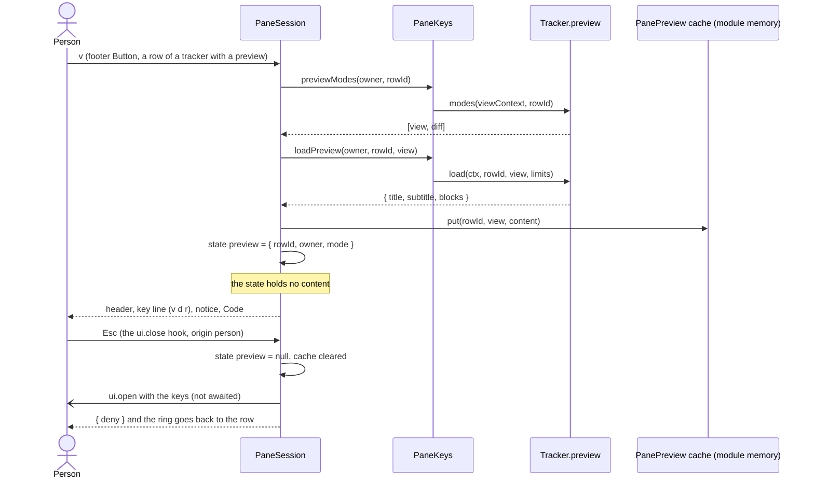
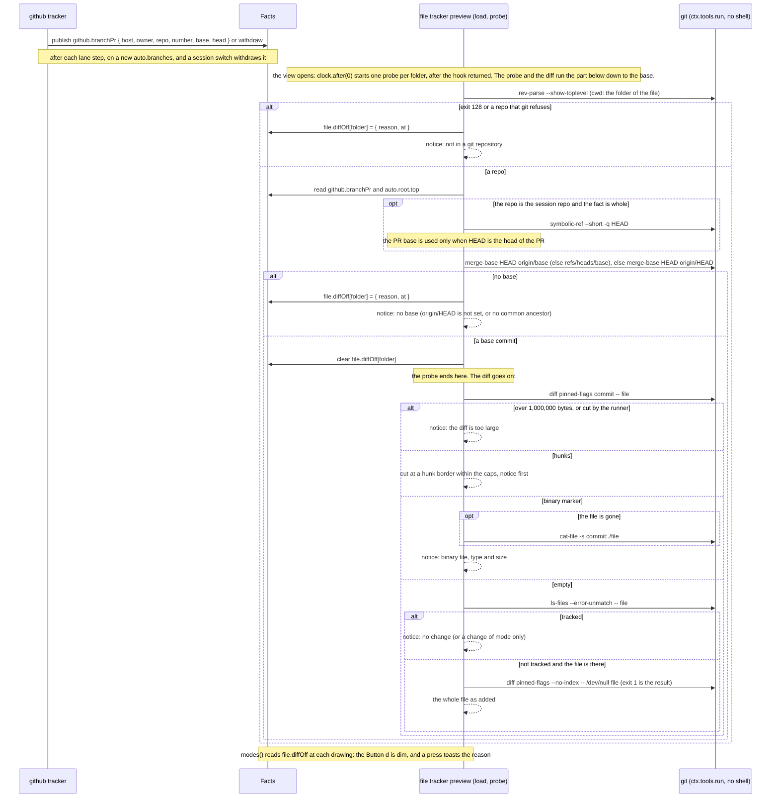
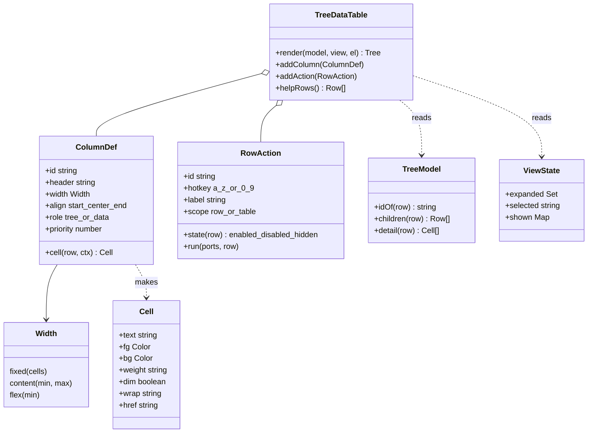
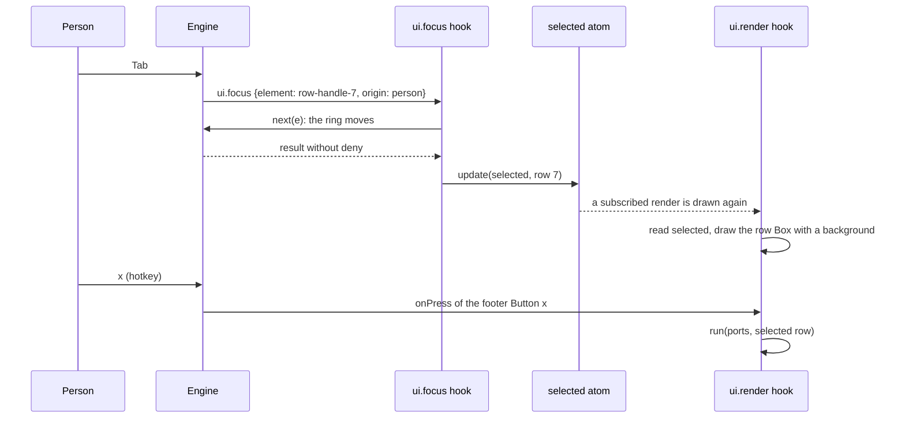

# TreeDataTable

Research for the first part of [issue #55](https://github.com/martin-macak/claude-code-mod-tracking/issues/55): one UX component that draws every tree in the pane and owns its interactions. The index is [README.md](README.md). Grades: [AGENTS.md](AGENTS.md#grades). `d.ts:N` links to the 2.1.302 snapshot.

The page gives prior art, what the engine allows, constraints and options. Recommendations are marked. The design spec decides.

Short answer:

- **Keys.** Tab and Shift+Tab walk the rows through the engine focus ring (`verified-live`). Up and Down only scroll while the tree is taller than the pane. A hotkey is one lowercase letter or digit. No other key reaches a pane.
- **One table.** Since [issue #63](https://github.com/martin-macak/claude-code-mod-tracking/issues/63) (L1) the pane draws one header row for every group of rows, over columns that every tracker shares ([§5.5a](#55a-one-table-with-shared-columns-issue-63-l1)).
- **Window.** A pane cannot pin a header or a footer, but the mod can keep the tree as tall as the body: it draws the rows that fit and every other row as a bare focus stop, and a `ui.focus` hook that selects the row moves the window (`verified-live`, [§3.2](#32-keyboard), issue #109). A docked pane also pins the footer to the last row of its body (`verified-live`, the same rows). The focus ring sits on a position among the Buttons, not on a key, so every row must keep its stop in the same order.
- **Selection.** A `ui.focus` hook may write a `selected` atom. A render hook may not (`verified-kit`). Live, the highlight follows Tab on the first frame and the ring stays on the same `Button` (`verified-live`). Make the selection sticky: write `selected` only for row keys.
- **Hotkeys.** A hotkey acts on the selected row and does not move the ring (`verified-live`). Read the selection from state at press time.
- **Size.** A pane tree has hard budgets. Past about 250 rows with real `Box` keys, or about 470 rows with 200-character titles, the page loses its Buttons without a refusal (`verified-live`, same rows as the kit). The engine logs the cut once, but the mod cannot read the log. A row cap is required. A refused tree is blank and keyboard-dead.
- **Cost.** One Tab costs one engine repaint and one full-tree hook render: about 58 ms to a settled screen at 300 rows, 221 ms at 1300 (`verified-live`).
- **Layout.** Alignment, colors and clipping all work with `Box` and `Text`. Cell width needs a measure function that the mod ships itself (`verified-live`).

## 1. What the issue asks

The definition of done lists six items for the component, plus one rule.

| # | Requirement | Short name |
| --- | --- | --- |
| 1 | Every tree row is expandable | U1 |
| 2 | A header row shows column headers | U2 |
| 3 | A column has a fixed size or sizes to its content, and aligns left, right or center | U3 |
| 4 | A cell has a foreground and a background color | U4 |
| 5 | The user moves between rows with the keyboard | U5 |
| 6 | A caller registers any key on a row to run an action (for example `x`) | U6 |
| 7 | Every tree in the pane uses TreeDataTable | U7 |

The issue also says: "New UX is a goal: the pane may look and behave differently after this work."

## 2. The pane today

The renderers and their code are in [current-architecture §10](current-architecture.md#10-the-ui-today). The status of each requirement, from the code at commit d391552:

| Req | Status | Evidence |
| --- | --- | --- |
| U1 expandable rows | partial | Only Jira items and nodes, the worktree root and the master agent fold (`H/ui/view.ts:287, :327`, `H/ui/auto-view.ts:57, :122`). Every other row is `foldable: false`. `PaneRow` has no children or detail field. The builders drop folded children, not the renderer. The toggle is a plain `+`/`-` Button (`H/ui/pane.tsx:74-79`). State is the `ui.folded` atom. |
| U2 header row | missing | No header row. A section has a title and a note only (`H/ui/pane.tsx:164-168`). `Cell` has no label (`H/ui/view.ts:63`). |
| U3 sizing and alignment | partial | Fixed: a numeric width per layout, with a wide and a narrow variant at 70 columns (`H/ui/view.ts:142, :155-219`). Fill: a cell without width grows. Content sizing: missing, every width is a literal. Alignment: missing, every cell is left-aligned. Truncation per cell exists. |
| U4 colors | partial | Foreground only, from a closed set `ok, warn, bad, dim, plain` mapped to `green, yellow, red, dimColor` (`H/ui/pane.tsx:30-37`). Only `status` and `extra` take a tone. No `backgroundColor` anywhere in `hooks/ui/`. Raw color names, not theme keys. |
| U5 keyboard rows | partial | Only through the focus ring over Buttons. A row is reachable if it holds a Button: priority mark, fold or `x`. Process rows hold none. Selection is the non-reactive module variable `focusedRow`. |
| U6 key registry | partial | A hard-coded footer: `r` and `1 2 3 0` (`H/ui/pane.tsx:23-28, :190`). `PaneActions` is a fixed type with five methods. The `x` Button has no hotkey. |
| U7 one component | partial | One drawer serves all ten sections, but it is bound to `PaneRow`, `Cell` and `CellName`. A closed eight-case switch draws the cells. Two other renderers (`textOf`, the band) read the same model. Interaction logic is split across `view.ts`, `pane.tsx` and `register.tsx:1446-1500`. |

Each row holds up to three Buttons today: the priority mark, the fold toggle and `x`. A Tab walk therefore visits up to three stops per row.

## 3. What the engine allows

### 3.1 Elements and layout

| Fact | Grade | Evidence |
| --- | --- | --- |
| The terminal element table is `Box, Text, Button, Input, Select, Link, Code, Markdown, Client, Raster, Image`. No Table, Tree, Grid or List element exists on any surface. | `types-only` | [d.ts:3897-3918](../claude-code-mods/sources/claude-code-2.1.302/types/claude-code.d.ts#L3897-L3918), [d.ts:3891-3972](../claude-code-mods/sources/claude-code-2.1.302/types/claude-code.d.ts#L3891-L3972) |
| `Box` has `width`, `height`, `minWidth`, `minHeight`, `flexGrow`, `flexShrink`, `alignItems`, `justifyContent`, `gap`, `columnGap`, `backgroundColor`, `overflow`, `display`. It has no `maxWidth` and no `flexBasis`. | `types-only` | [d.ts:928-1023](../claude-code-mods/sources/claude-code-2.1.302/types/claude-code.d.ts#L928-L1023) |
| `Text` has no width and no align. Width must sit on a `Box`. | `types-only` | [d.ts:13154-13220](../claude-code-mods/sources/claude-code-2.1.302/types/claude-code.d.ts#L13154-L13220) |
| `gap`, `margin*` and `padding*` take `Space` (`number` or `xs..xl`). A number means cells on every surface. A step name differs per surface. | `types-only` | [d.ts:12508](../claude-code-mods/sources/claude-code-2.1.302/types/claude-code.d.ts#L12508), [d.ts:990-1020](../claude-code-mods/sources/claude-code-2.1.302/types/claude-code.d.ts#L990-L1020) |
| A `Button` child is a string or a `Text`. Any other element, including `Box`, is refused. A whole-row Button cannot hold fixed-width Box cells. | `types-only` | [d.ts:1105-1107](../claude-code-mods/sources/claude-code-2.1.302/types/claude-code.d.ts#L1105-L1107) |
| A `Button` `hotkey` is one digit or one lowercase letter. Two clashing hotkeys: the later one wins. | `types-only` | [d.ts:1112-1121](../claude-code-mods/sources/claude-code-2.1.302/types/claude-code.d.ts#L1112-L1121) |
| `Button.action` binds only an existing engine keybinding action. | `types-only` | [d.ts:1130](../claude-code-mods/sources/claude-code-2.1.302/types/claude-code.d.ts#L1130) |
| `Pane` render props include `bodyColumns` (95 docked at 120 columns, 96 inline at 100) and `scroll` (`SiteScroll`). A taller tree scrolls as a whole. | `types-only`, `verified-live` | [d.ts:10732-10777](../claude-code-mods/sources/claude-code-2.1.302/types/claude-code.d.ts#L10732-L10777), [d.ts:12336-12349](../claude-code-mods/sources/claude-code-2.1.302/types/claude-code.d.ts#L12336-L12349) |
| `justifyContent` `flex-start`, `center` and `flex-end` on a fixed-width `Box` place the `Text` child at offset 0, 5 and 10 of 12. The result is the same in dock and inline placement. | `verified-live` | Capture of a row of three `Box width=12` cells: plain text `ab` at columns 0, 18, 36. |
| `Text wrap="truncate-end"` clips inside a fixed-width `Box` and draws `ABCDEFG…` in 8 cells. Without `wrap` the text wraps and the row grows to four lines. | `verified-live` | Same capture. |
| `Box backgroundColor` fills the whole fixed width and the whole row height. `Text backgroundColor` paints only its own characters. A row `Box` with a background paints its children as one band, including mixed-width children. | `verified-live` | `ESC[48;2;0;0;255mbox10` followed by five padded blue cells; `ESC[48;2;0;0;255mbghex` paints 5 cells. |
| `bold underline` on `Text` draws SGR `1;4`. `inverse` draws SGR `7`. | `verified-live` | Same captures. |

### 3.2 Keyboard

The mod cannot bind Tab or the arrows. No pane-level key event exists and there is no raw-key subscription in a hooks module. Only a `Client` surface module has `onKey`.

| Fact | Grade | Evidence |
| --- | --- | --- |
| **Tab walks every Button in document order. Shift+Tab walks back.** The window scrolls one row at a time to keep the ring in view, in dock and in inline placement. | `verified-live` | 40-row grid, docked, tmux 120x37: Tab to `Go 30` shows rows 1-30. Tab to `Go 31` shows rows 2-31. Tab to `Go 40` shows rows 11-40. Inline (100 columns, body 10 rows) follows the ring the same way. |
| **Up and Down scroll the window while the tree overflows.** The ring stays where it was. They move the ring only when the whole tree fits, in ring order, not in spatial order. Left and Right do nothing. | `verified-live` | With the ring on the close mark, Down logged `S:by1 off1`, `off2`, `off3` and Up logged `S:by-1 off2`. The ring did not move. A 36-Button, 3-row tree: Down, Down, Down moved the ring to `k-c`, `k-d`, `k-e`. |
| The ring also stops on a `display:'none'` Button (nothing inverted, a dead stop) and on the engine's close mark `✕`. The first Tab after open lands on a hidden Button if one exists. | `verified-live` | First Tab logged `F:hidden-z/person` with nothing inverted. |
| Enter presses a ring Button even when it has scrolled out of view. | `verified-live` | Ring on `Go 05`, End key moves the window to rows 12-40, Enter logs `P:row-05`. |
| The engine's own keep-in-view scroll raises no `ui.scroll` and no re-render. `e.props.scroll.offset` in a render hook can be stale until the next render. | `verified-live` | After 44 Tabs the log held only `F:` lines. The next render logged `off18`. |
| `autoFocus` works on a `Button`, also for a row that is off screen (the pane opens already scrolled). | `verified-live` | `autoFocus` on row 35: the pane opens with rows 7-35 visible. |
| **`autoFocus` on the first row `Button` puts the ring there at open, so the first Tab goes to the second row.** Without `autoFocus` the ring starts on nothing, the first Tab lands on the first row `Button` (not on the close mark), and the first Shift+Tab goes to the close mark. The ring order is the rows, the footer `Button`s, then the close mark. | `verified-live` | `/tbl 300 0 auto sticky`, before any Tab: `row=#0 ring='>' highlight_bg=['68']`, header `sel=r0`. `events.log`: `F el=r0 origin=plugin`, then the first Tab `F el=r1 origin=person`. Without `auto`: `F el=r0 origin=person`, first Shift+Tab `F el=-`. `Button.autoFocus`: [d.ts:1165-1174](../claude-code-mods/sources/claude-code-2.1.302/types/claude-code.d.ts#L1165-L1174). Spike [`tbl`](../claude-code-mods/sources/spikes-2026-10-17/tbl/). |
| **The pane header and footer are not sticky.** A status line in either is out of view while the window is scrolled between them. A hotkey `Button` in the footer still fires. The mod keeps them in view with a window over its rows, and a docked pane pins the footer to the last row of its body (the rows after this table, issue #109). | `verified-live` | The `last action` status sat in the header `Text` and in the footer. `events.log` lines `A …` were the reliable signal. |
| **A hotkey press does not move the ring.** `x` and `y` fire from whichever `Button` holds the ring, also the close mark or a footer `Button`. | `verified-live` | `events.log`: `P el=fx`, `A last action: x on row 4`, `R … sel=r4`, no `F` line. With the ring on a footer `Button`: `P el=fy`, `A last action: y on row 0`. |
| **A `Client` region gets the keyboard only after a mouse click.** Tab skips it. `$.ui.focus` on its key is denied (`no element of its own is drawn under that key`). `ClientProps` has no `autoFocus`. After a click it receives every key and Esc gives the focus back. | `verified-live` | [d.ts:1532-1600](../claude-code-mods/sources/claude-code-2.1.302/types/claude-code.d.ts#L1532-L1600), [d.ts:1626-1628](../claude-code-mods/sources/claude-code-2.1.302/types/claude-code.d.ts#L1626-L1628). A synthetic SGR click (`\x1b[<0;30;6M`) focused it; letters, arrows, Tab and Enter then reached `surface.onKey`. |
| **A pane hotkey fires wherever its Button is**: scrolled out below or above the window, in the footer, or inside a `display:'none'` Box. Pane hotkeys are gated by pane focus only. The band rule (a bare digit arms only Buttons wholly in view) does not apply to a pane. | `verified-live` | `q` (row 35, below), `z` (hidden Box), `w` (visible) and `f` (footer, below) all logged `P:<key>`. Band rule: [d.ts:10692](../claude-code-mods/sources/claude-code-2.1.302/types/claude-code.d.ts#L10692). |
| **No letter or digit is reserved.** All 36 hotkeys `a-z` and `0-9` fired on a focused plugin pane. Shift folds to lowercase. | `verified-live` | `keys.py` sent each character with `tmux send-keys -l`. All 36 logged `P:k-<char>`. The composer stayed empty. |
| Other printable keys leave the pane. The character goes to the composer and the pane loses focus. `!` opens shell mode. `?` opens the shortcut overlay and keeps the pane focused (the body shrinks from 30 to 24 rows). `/` drops focus. | `verified-live` | Header flipped to `foc=0`. |
| The engine binds Tab, Shift+Tab, Up, Down, Enter, Esc, PageUp, PageDown, Home, End and the `ctrl+x` chords on a focused pane. `ctrl+x Tab` toggles pane focus. | `verified-live`, `public-docs` | Home gave `S:by-48 off0`; End gave `S:by48`. Public docs: [interface.md:532-545](../claude-code-mods/sources/code-claude-com-2026-10-09/mods/interface.md#L532-L545). |
| A resize that switches dock to inline (120 to 100 columns) dropped pane focus. | `verified-live` | Render log `foc1` then `foc0`. |
| **A render hook that reads `e.props.isFocused` runs again when the pane gains or loses the keys.** The next frame already has the new value. | `verified-live` | [Issue #108](https://github.com/martin-macak/claude-code-mod-tracking/issues/108). Claude Code 2.1.304, tmux 120x37 docked, three web links, the mod loaded from the branch. The row the hook draws as selected had a `48;5;68` background and the ring (SGR 7) on its `▸`. The key `j` went to the prompt: the next frame had no `48;5;68`, a dim `>` and the hint line `Keys go to the prompt.` above the tree. ctrl+x Tab: `48;5;68` and the ring were back and the hint was gone. A resize from 120 to 100 columns also dropped the keys and drew the hint. Confirms the `foc=1` then `foc0` rows above. |
| **A click on a blank part of the pane gives it the keys. A click on a `Button` only presses it.** | `verified-live` | Same run, keys in the prompt, synthetic SGR clicks (`tmux send-keys -l` of `ESC[<0;30;7M` then `ESC[<0;30;7m`). Click on the `▸` of a row: the row opened and was selected, the hint stayed and the highlight stayed dim. Click at column 60 on a blank row of the body: the hint was gone, the `48;5;68` highlight was back and the ring sat on the selected row. |
| **`autoFocus` on the handle of the selected row puts the ring there when the keys come back.** A redraw does not take the ring from a footer `Button`. | `verified-live` | Same run. Three rows, the third selected, `j`, then ctrl+x Tab: the ring was on the `▸` of `three.example/c` and Up went to `two.example/b`. The same after a second `/track` on the open pane with the second row selected: Down went to the third row, not to the first. With the ring on the footer `x: dismiss` (three Tabs), `r` redrew the pane and the ring stayed on `x: dismiss`. [Issue #108](https://github.com/martin-macak/claude-code-mod-tracking/issues/108) asked for this fix in `ux/tree-data-table/table.ts`. |

**Windowed rows (issue #109).** The mod keeps the tree as tall as the body (`scroll.bodyRows` less the footer and the gap above it) and draws only the rows that fit. The rows below record the live spike that decided how a person reaches the other rows. The spike was a scratch mod with one section of 12 or 36 rows, run on Claude Code 2.1.304 in tmux at 100x40 (inline, body of 11 rows). Its `ui.focus` hook called `next(e)` and wrote `selected` for a row key. Its render derived the window from `selected` and a remembered first row. The remembered row is kept in memory by the mod: a render hook may not write state.

| Fact | Grade | Evidence |
| --- | --- | --- |
| **A tree that fits the body never scrolls.** The title, the header, the rows and the footer stay in one frame, whatever the number of rows behind the window. `scroll.offset` stays 0. | `verified-live` | 12 rows, body 11: `│ Web links 12 links`, `│         Ref Label`, 7 rows, a blank row, `│ r: r: refresh  h: h: help  Esc close`. Every render line of the run ends in `off=0`. |
| **PageUp, PageDown, Home, End and the wheel still raise `ui.scroll` when the tree fits.** `by` is `bodyRows` for a page key and `contentRows` for Home and End. When the tree fits the two are equal, so a hook cannot tell End from PageDown. | `verified-live` | `S by=11 off=0 body=11 content=11 origin=person` (PageDown), `S by=-11 …` (PageUp), `S by=11 …` (End), `S by=-11 …` (Home). |
| **The ring sits on a position among the Buttons, not on a key.** When a redraw changes the order of the Buttons, the ring keeps its position and lands on another Button. This is the engine fact behind the README limit "Focus after a background change". | `verified-live` (the position), `inference` (the exact landing) | A variant drew one hidden row above and one below the window, each a row Button in a `Box` with no height. Tab walked `r6`, `r7` (the window moved), `r8` (it moved again), then `F el=fr`: the hidden row `r9` was in the drawing and the walk skipped it. After the `r7` step SGR 7 sat on the `▸` of `#7`. After the `r8` step no row had SGR 7. The first move added a stop at the end of the list. The second removed one at the start and added one at the end. So the ring stayed at its position and sat on `r9` (inference from the missing SGR 7 and the next Tab). |
| **A `Button` in a `Box` with `height: 0`, `overflow: 'hidden'` and `flexShrink: 0` takes the ring** (Tab, Shift+Tab, Up, Down) and raises `ui.focus` with its key. It draws nothing, and the engine does not scroll to it. | `verified-live` | `F el=r7 origin=person next=0ms deny=- wrote=r7`, then a render with `off=0`. The `Box` needs `flexShrink: 0`, as the first probe of [issue #63](https://github.com/martin-macak/claude-code-mod-tracking/issues/63#issuecomment-6295033639) found. |
| **Every row outside the window as one such stop keeps the order, so the keyboard walks all rows.** Tab, Shift+Tab, Up and Down move the ring onto the next stop. The `ui.focus` hook writes `selected`, the next render moves the window onto that row, and the ring stays on it. No `$.ui.focus` call and no redirect is needed. | `verified-live` | 12 rows, body 11, 14 Tabs: `F el=r1` to `F el=r11`, then `fr`, `fh` and `el=-` (the close mark). The window followed to rows 5 to 11. Shift+Tab back: `fh fr r11 r10 r9 r8 r7 r6 r5 r4 r3 r2 r1`. Down, Down, Up, Up from `r1`: `r2 r3 r2 r1`. From `r7` to `r11` SGR 7 and the 48;5;68 background sat on the same row. |
| **The ring order is every row stop, the footer Buttons, then the close mark.** Tab goes on from the close mark to the first stop. Down skips the close mark. | `verified-live` | `F el=fh`, `F el=-`, `F el=r1` with Tab. `F el=fr`, `F el=fh`, `F el=r1` with Down. |
| **A `ui.scroll` hook that does not call `next` can move the selection and the ring itself.** It writes `selected` and calls `$.ui.focus({ requestId, key })` for the new row, inside the hook. The call returns `{}` and raises `ui.focus` with origin `plugin`. | `verified-live` | 36 rows. PageDown: `S moved selection 0 -> 11 nested-focus=ok`, `F el=r11 origin=plugin`, the window showed rows 5 to 11. PageDown: `11 -> 22`, rows 16 to 22. PageUp: `22 -> 11`, rows 11 to 17. |
| `next({ ...e, element })` in a `ui.focus` hook to land the ring on another stop, and an edge `Button` ("N more below") answered by a nested `$.ui.focus` from the `ui.focus` hook, were not needed and were not run. | `types-only` | [d.ts:4154-4164](../claude-code-mods/sources/claude-code-2.1.302/types/claude-code.d.ts#L4154-L4164) says `next({ ...e, element })` lands the ring on another element the plugin drew. A stop that is not drawn yet cannot take it. |
| **A docked body has a fixed height, and the footer can sit on its last row.** The root `Box` takes `minHeight: bodyRows`. The footer sits in a `Box` with `flexGrow: 1`, `flexShrink: 0` and `justifyContent: 'flex-end'`, which replaces the footer as the last child of the root, so the root gets no new child and no gap row. The title and the rows stay at the top. | `verified-live` | Claude Code 2.1.304, tmux 120x37, 3 links, the mod loaded with `--plugin-dir`. The close mark is on row 1 of the pane column, the footer on row 32 (1 + 31 body rows), and one blank row that the engine keeps is below it. The same with the keys in the prompt (hint on row 2, footer on row 32) and in the help view (footer on row 32). With 36 links the frame is the one before the pin: 26 rows, `▼ 10 more below`, the footer on row 32. |
| **An inline frame is as tall as its tree.** A `minHeight` there would stretch every inline pane, so the mod pins the footer only where `Pane.placement` is `dock`. | `verified-live`, `types-only` | Inline 100x40, 3 links: the frame has 7 body rows (title, header, 3 rows, a blank row, the footer), not 11. [d.ts:10761-10765](../claude-code-mods/sources/claude-code-2.1.302/types/claude-code.d.ts#L10761-L10765): "Inline the frame fits the tree." |
| **The hint line of a pane with no keys is part of the body.** The window leaves the rows of the hint (one, or two in a body narrower than 50 cells) to the line. | `verified-live` | Inline 100x40, 12 links, then `j`: the hint, the title, the header, 5 rows, `▼ 7 more below`, a blank row and the footer are the 11 rows of the body. Without the fix the tree took 12 and the footer left the view. |
| **Tab onto an "N more" row keeps the ring there after the redraw.** The `autoFocus` of [issue #108](https://github.com/martin-macak/claude-code-mod-tracking/issues/108) on the selected row does not pull it away. | `verified-live` | `global.ui.sectionRows` 8, 30 links, inline 100x40. 7 Tabs: the `>` on `site8` and the row `22 more` in view. The 8th Tab: SGR 7 on `22 more`, the window unchanged. |
| **Without a new request, the ring stays on its position after Enter on an "N more" row, and that position is a row stop above the window.** The next Tab selects the row after it and the window moves onto that row, so one row is skipped. | `verified-live` (the screen), `inference` (the cause) | Same run, before the mod asked for the ring again: Enter on `22 more`: 8 rows more, the window on rows 12 to 16 and `14 more`, no SGR 7 in the frame. The old position of the ring is now a hidden row. One Tab: the ring and the `>` on `site10`. The ring keeps its position, as the position fact above says. |
| **After Enter on an "N more" row, a `ui.focus` request for the selected row puts the ring on that row.** The mod clears its "N more" mark and asks for the ring on the selected row, as after `x`. The window follows the selected row, and the next Tab moves one row. | `verified-live` | The e2e scenario "Enter on an N more row of a windowed pane puts the ring back on the selected row" (Claude Code 2.1.304, tmux 120 columns, so docked, `global.ui.sectionRows` 30, 40 links): 29 Tabs select `a30`, the 30th puts the ring on `10 more`, Enter shows the rest. With the change the ring is on the `▸` of `a30` (SGR 7), the `>` stays on `a30`, and the window ends in `▼ 10 more below`. Without the change the same step timed out: no SGR 7 in the frame. |
| **`h` and `x` on the last row take Buttons away, and the engine keeps the ring at its position and tells the mod nothing.** `h` takes the rows away, so every footer Button moves up by the number of rows, and the ring lands on the Button that holds its old position. A ring on `c: resolve` is past the last Button of the help view and lands on none. The mod must ask for the ring after the frame that holds the new state (`$.ui.focus` lands on the frame the engine holds, and the next frame shifts it again), and after one pause of the engine clock that follows that frame. Any draw after the write is not enough: the draw that the dismissal caused still held the row. | `verified-live`, `verified-kit`, `inference` (why the pause is needed; the wake beating an engine timer that is only late; the slack of 250 ms on a larger pane and a loaded machine) | Claude Code 2.1.306, tmux 100x40 (inline) and 120x36 (docked), model haiku, the mod loaded from the branch with `--plugin-dir`, the e2e fake `gh` with one conflicted PR row ([issue #140](https://github.com/martin-macak/claude-code-mod-tracking/issues/140)). **Without the change**, one row: Tab ×8 puts the ring on `c: resolve`, `h` leaves no reverse video in the frame, one more Tab gives `r: refresh` (the first Button). Tab ×1, `h`: the ring is on `h: back`. Tab ×2 (`h: help`), `h`: `x: dismiss`. Tab ×3 (`x: dismiss`), `h`: `1: high`. **With a request sent at once after the write**: `c: resolve`, `h`: `x: dismiss`, one off, because the request landed on the old frame. **With the request after the frame that has `help` set** (no other wait; three runs of the same steps agreed): `c: resolve`, `h`: `h: back`, one Tab: `x: dismiss`. The second `h`: the `▸` of the PR row. `h: help` and `x: dismiss` keep their Button through both views. **`x` on the only row**: with the request after any draw that began after the arming it landed one off (`h: help`); after the frame that no longer holds the row it is `r: refresh` for a ring on the row and on `c: resolve`, and a ring on `x: dismiss` stays. The frame need not be empty: rows that were hidden behind an "N more" can take the place of the last drawn row, and the selection is cleared all the same (`inference`, kit test only). **A request in the same turn as that frame is too early too, and so is one after any wait that gives the engine no turn of its loop** ([issue #156](https://github.com/martin-macak/claude-code-mod-tracking/issues/156); Claude Code 2.1.306, tmux 120x36 and 100x40, model haiku, the e2e fake `gh` with one conflicted PR, the mod loaded from the branch with `--plugin-dir`, a private tmux socket, other sessions running on the same machine). The probe chose the Button from the frame alone and varied only what comes between the frame and the request. `PaneSession.draw` releases the waiting press before it returns the drawing, so the press runs on in a microtask, before the engine has the drawing. **Scenario `x` on the last row** (the ring must end on `r: refresh`; a failure is `h: help`, one Button off, in every case): no wait, 50 microtask turns, one atom read (0 ms): failed (one run each). `$.ui.panes()` and `$.session.id()` (host calls that answered in 0 to 1 ms): failed in 3 of 3 runs. `$.clock.now()`: 1 of 3 runs passed, the run that had 2 ms between the frame and the request. A busy wait of 5 ms and of 20 ms, which gives no turn to any loop: failed in 3 of 3 runs, so time alone is not enough. A `setTimeout` of 0 to 3 ms: 7 of 9 runs passed. A `setTimeout` of 5 and of 50 ms: passed. The engine's own timer (`$.clock.after` of 0, 1 and 10 ms, the runs of `x` and of `h` together): passed in 14 of 14 runs, and a timer of 0 ms fired 4 to 8 ms after the frame. **Scenario `h`** (the ring must end on `h: back`; a failure is `x: dismiss`): no wait failed at 120x36 and at 100x40 (one run each), and a timer of 0 ms on the engine clock passed at both. **Shipped (`Refocus.pause`, `RING_PAUSE_MS`):** the request waits for the frame and then for one timer of 10 ms on `$.clock.after`, and `Frame` carries the footer Button keys and the row handles, so `keep` reads nothing in between. A second frame with other footer or view line keys, other row handles or an "N more" Button that appeared or went (the ring sits on a position, so such a Button shifts the Buttons after it) during the pause becomes the latest frame and starts the timer again from it, and the request names a Button of the latest frame; the restarts end 1 s after the first frame (`inference`, kit test only: a second frame inside the pause is not measured live). Only a frame that never comes (the bound of 1 s) makes it read the state, as it did before, and it then asks at once with no pause. A closing ends the pause, as it ends the frame wait. With that, scenario `x` at 120x36 and 100x40 and scenario `h` at both sizes passed in 12 of 12 runs of the probe rig, and in the e2e suite. **Cause (`inference`):** the engine takes the returned drawing in a turn of its own loop, and a request before that turn names a Button of the old frame. A read of an atom answers in the same turn, so reads were never a pause. The turn takes about 1 to 4 ms: the two `setTimeout` runs that failed waited 1 ms and 3 ms, the runs that passed waited 1 to 52 ms, and every timer run with a measured wait of 4 ms or more passed (13 of 13); the busy waits of 5 ms and 20 ms gave the engine no turn and failed. So a timer is a pause, and a margin above 4 ms makes it safe. One row only: a larger pane (30 rows) and a loaded machine are not measured, and `RING_PAUSE_MS` is a margin above 4 to 8 ms, not a proven bound. Whether the engine timer wins by its place in the queue or only by its 4 to 8 ms is not settled. The e2e scenarios "h moves the ring from a tracker key to h: back, and the second h gives it back to the selected row" and "x on the last row puts the ring on r: refresh" (without the fix, the second one: no reverse video, timed out). **Refused timer ([issue #193](https://github.com/martin-macak/claude-code-mod-tracking/issues/193), 2026-10-27).** A hook of another plugin can deny `clock.after`. The timer never fires, the caller gets a handle and no sign (`Timer` has `cancel` only), and a press with no later drawing waited until the pane closed. Each engine timer of `awaitFrame` and `pause` now has a wake behind it: `Ports.clock.wake`, a `setTimeout` of the mod's own runtime, `WAKE_SLACK_MS` (250 ms) later. No hook can refuse it. The first of the two ends the wait and cancels the other (`afterOrWake` in `pane-refocus.ts`). With no drawing the pause ends 260 ms after its arming and the ring request follows; the frame bound ends 1250 ms after it and the state read follows. The slack is long on purpose. The wake also wins against an engine timer that is only late, and the ring request may then name a Button of a frame the engine has not taken yet, so the ring can land one Button off, the failure above (`inference`: no run measured a late engine timer, and the one idle headless probe gave 23 ms for a timer of 10 ms). A refused press pays the slack in time and no more. When the wake wins it writes one line to the debug log, `pane ring pause: the engine timer of 10 ms did not fire in 260 ms (late or refused); the wake ended the wait` (`pane frame bound` and 1000 ms for the frame wait). The line says only that the engine timer did not fire in time: the mod cannot tell a late timer from a refused one, so a count of the lines counts both. **`verified-kit`:** headless `claude -p` on a fake API (Claude Code 2.1.311, two scratch plugins, a caller and a refuser, five runs of which the fifth is clean, [evidence comment](https://github.com/martin-macak/claude-code-mod-tracking/issues/193#issuecomment-6437544639)): `clock.after(1500)` denied by the other plugin returned a handle at once and never fired in 4.6 s; the control `after(1400)` fired at 1414 ms and `after(10)` at 23 ms; `setTimeout(60)` fired at 62 ms and `setTimeout(1060)` at 1061 ms, after the hook had returned and with the refusal in force; a `$.fs.write` from inside such a callback worked. A denied `$.clock.sleep(1500)` rejects (at 13 ms) and an un-awaited `sleep(300)` resolves at 314 ms: not used. The press path with a refused timer and no drawing is kit-tested on `fakePorts` (`pane-session.test.ts`, the tests of issue #193; the fake wake is never refused). The real port (`portsOf` in `register.tsx`) is pinned by one kit test (`pane.test.tsx`): it refuses the pause timer of `h` and waits for the line of the wake, which a `wake` made of `$.clock.after` would never write (`verified-kit`). **`verified-live`:** the e2e scenarios "h moves the ring to h: back although another plugin refuses the timer of the ring pause" and "x on the last row puts the ring on r: refresh although another plugin refuses the timer of the ring pause" (Claude Code 2.1.311, tmux 120x36, model haiku, the e2e fake `gh` with one conflicted PR, a second plugin that denies `clock.after` of 10 ms and passes the rest, a log that proves the refusal). **Without the wake** both failed on the ring (no reverse video in the frame, 20 s timeout) after the refuser had refused a timer. **With the wake** both passed, together with the existing scenarios `h` (120x36 and 100x40) and `x` on the last row, run again on the head. Both scenarios also read the debug log of the session (`claude --debug-file`, the step `the debug log shows`). With the slack of 250 ms the log holds `[artifact-tracking] $.ui.log (to debug): pane ring pause: the engine timer of 10 ms did not fire in 260 ms (late or refused); the wake ended the wait`. Only the wake writes that line, so the wake ended the wait and no stray drawing did (`verified-live`), and the ring request followed it, 260 ms after the arming at the earliest. The flag adds a banner of two or three lines at the top of the screen. The ring was right after a wait of 260 ms in this pane only (one row, 120x36). A larger pane and a loaded machine are not measured (`inference`). The scenarios `h` (120x36 and 100x40) and `x` on the last row with no refuser, run with the same debug log, wrote no line of the wake in 3 of 3 runs (`verified-live`): the engine timer ended the pause every time. The frame-bound wake stays `verified-kit`: a live pane always draws, so a refusal does not reach that path live. Whether a `setTimeout` of the old environment dies at a hot reload or a worker loss is not measured (`inference`: if it lives on, it resumes one press of the old copy at most 260 ms or 1250 ms later, and `request` catches a failed `ui.focus`). Other `clock.after` users (the flush, the item refresh, the tracker host) have the same refusal and are not presses: [issue #271](https://github.com/martin-macak/claude-code-mod-tracking/issues/271). |
| **A body under 7 rows cannot hold the window.** The window shows at least one unit, so the title, the header, one row, the two hints, the gap and the footer need 7 rows. In a body of 6 the tree is one line taller than the body, so the engine scrolls the title or the footer out of view. The mod still answers the wheel and the page keys (the selection moves, not the scroll of the engine), and Tab walks every row because every row keeps its stop. | `verified-kit` (the count), `inference` (the engine scroll) | `table-window.test.ts` "the floor of the window": at 7 rows the drawing takes 7 lines, at 6 rows it takes 7 lines. That the engine then scrolls follows from the evidence of [issue #109](https://github.com/martin-macak/claude-code-mod-tracking/issues/109) for a tree taller than the body. |

**Built (issue #109; the choices below are `inference` from the rows above, the owner decided only to window the rows):** the pane windows its rows by the selected row, with the stops above. The hints ("N more above", "N more below") are dim text, not Buttons: a Button that appears and disappears with the window would change the order of the Buttons, and the ring would sit on another Button (the position fact above). PageUp, PageDown and the wheel move the selection by a page less one row, or by the rows of the tick, through the `ui.scroll` hook. Home and End do the same as a page key. On a docked pane the footer also sits on the last row of the body when the rows are fewer than the body holds (the owner's wish in [issue #63](https://github.com/martin-macak/claude-code-mod-tracking/issues/63)); an inline pane is as tall as its tree, so there it stays under the last row. A hint line above the tree (no keys, [issue #108](https://github.com/martin-macak/claude-code-mod-tracking/issues/108)) takes its rows off the body that the table gets. After Enter on an "N more" row the pane asks for the ring on the selected row. A section with no row at the top of the list (a title and a note) is not a row, so no hint counts it and Tab cannot reach it: the window starts at the top again whenever the selected row still shows.

**Live, the real pane on this change** (`verified-live`; Claude Code 2.1.304, tmux, model haiku, the mod loaded with `--plugin-dir`, an empty config folder, web links from one prompt). Inline 100x40, 12 links, at open:

```text
╭────────────────────────────────────────────────────────────────────────────────────────────────✕─╮
│ Web links 12 links                                                                               │
│     Label                   URL                                                                  │
│ >   ▸ site1.example/page1   site1.example/page1                                                  │
│     ▸ site2.example/page2   site2.example/page2                                                  │
│     ▸ site3.example/page3   site3.example/page3                                                  │
│     ▸ site4.example/page4   site4.example/page4                                                  │
│     ▸ site5.example/page5   site5.example/page5                                                  │
│     ▸ site6.example/page6   site6.example/page6                                                  │
│   ▼ 6 more below                                                                                 │
│                                                                                                  │
│ r: refresh  h: help  x: dismiss  1: high  2: normal  3: low  0: auto  Tab ↑↓ move  Esc close     │
╰──────────────────────────────────────────────────────────────────────────────────────────────────╯
```

After 11 Tabs the ring and the `>` sit on the last row, the window shows rows 7 to 12 and `▲ 6 more above`, and the footer is in view. The 12th Tab moves the ring onto `r: refresh`. Docked 120x37 with 36 links, at open: the title, the header, 26 rows, `▼ 10 more below`, a blank row and the footer. After 30 Tabs the `>` and the ring are on `site31.example/page31`, with `▲ 6 more above` and `▼ 5 more below`. A resize to 120x25 shrank the window to 13 rows and kept the selected row in view. An open row with a long link wrapped its detail lines over 6 rows: the window gave up rows for them and the footer stayed in view. `x` on a row selected the next row and the ring followed it. PageDown and PageUp moved the selection by 4 rows in a window of 5. At 100x40 the help view still shows `Pane keys` first and the footer last, in one frame.

### 3.3 Selection state

| Fact | Grade | Evidence |
| --- | --- | --- |
| A `ui.focus` hook may call `update($, selected, ...)`. A Pane render that reads the atom shows the new highlight on the next draw, with no `redraw()` call. | `verified-kit` | Spike [`kit-focus`](../claude-code-mods/sources/spikes-2026-10-17/kit-focus/): row `row-b` got `backgroundColor: 'blue'` and a `>` marker after `$.ui.focus(...)`. A move to `row-c` moved it. An engine stop (no element) cleared it. |
| A `ui.render` hook that writes state is refused with a clear message. | `verified-kit` | `state.set: denied: it was made while ui.render is being dispatched`. Doc: [d.ts:3488-3489](../claude-code-mods/sources/claude-code-2.1.302/types/claude-code.d.ts#L3488-L3489). |
| The `ui.focus` hook runs before the ring moves. If the hook writes state before `next(e)` and core then denies the move, or the kit bottom throws, the selection stays written. Fix: call `next(e)` first and write only when `r.deny === undefined`. | `verified-kit` | Variant test: `deny` left the selection unwritten. A write before `next` left `row-b` blue after `no implementation for ui.focus`. |
| A `get` made while a render hook draws subscribes that instance. A later `set` draws it again. | `types-only` | [d.ts:3463-3464](../claude-code-mods/sources/claude-code-2.1.302/types/claude-code.d.ts#L3463-L3464) |
| `ui.focus` can redirect: `next({ ...e, element })` lands the ring on another of the plugin's elements. Not run. | `types-only` | [d.ts:4154-4164](../claude-code-mods/sources/claude-code-2.1.302/types/claude-code.d.ts#L4154-L4164) |
| **Live: the highlight follows Tab, and the ring stays on the same `Button` after the redraw.** The highlight shows on the first frame after the redraw. One Tab raises exactly one `ui.focus` event. The hook runs `next(e)` first, then writes `selected` when there is no deny. The write triggers one hook render. No second `ui.focus` follows that render, which is the evidence the ring did not jump. | `verified-live` | `events.log` after Tab 5: `F el=r4 origin=person next=0ms upd=18ms deny=- wrote=r4`, then `R rows=300 … sel=r4 foc=1`; no `F` line follows. Colored capture read with `an.py`: line 8 `row=#4 ring='>' highlight_bg=['68']` (the ring is SGR 7, the `Box` background 48;5;68). Same for Tab 1 (`#0`) and after Enter (`#5`). Over 20 Tabs at 300 rows: 21 person focus events and 23 renders (1.10 renders per focus event, one toggle included). `next(e)` mean 0.3 ms, max 1 ms. Under tmux `blue` paints 48;5;68. [d.ts:4154-4164](../claude-code-mods/sources/claude-code-2.1.302/types/claude-code.d.ts#L4154-L4164). Answers the first half of [Q1](open-questions.md#1-unknowns). |
| **A hotkey acts on the selected row.** The `onPress` closure reads the `selected` atom at press time. | `verified-live` | `events.log`: `A last action: x on row 4`. |
| **The literal hook loses the selection on a stop that is not a row.** Writing `e.element ?? null` writes `null` on the close mark (it has no `element`: [d.ts:14570](../claude-code-mods/sources/claude-code-2.1.302/types/claude-code.d.ts#L14570)) and writes the footer key (`fd`) on a footer `Button`. Neither matches a row, so the highlight vanishes and a hotkey reports `x on no row`. | `verified-live` | Shift+Tab from `r0`: `F el=- origin=person … wrote=null`, header `sel=null`, only the close mark ✕ inverted, then `last action: x on no row (selected=null)`. Shift+Tab again: `F el=fd … wrote=fd`, header `sel=fd`, `x on no row (selected=fd)`. |
| **A sticky variant keeps the selection.** Write `selected` only when `e.element` matches the row-key pattern (`/^r\d+$/`). The highlight then stays on the last row, and `x` and `y` act on it while the ring sits on the footer or the close mark. This is a design choice (`inference`) and the only mode in which the footer hotkeys always have a target. | `verified-live` | `/tbl 300 0 sticky`: `F el=- … wrote=-`, `F el=fd … wrote=-`; header stays `sel=r0`, highlight stays on `#0`; then `A last action: x on row 0` and `y on row 0`. |
| **Enter toggles detail rows and keeps the ring.** The label goes from `>` to `v` under the same key. No `ui.focus` follows. The next Tab goes to the next row `Button` (`r5`), skipping the detail rows because they hold no `Button`. Two one-line detail rows cost 5 nodes, 2 strings and 70 characters. | `verified-live` | `events.log`: `P el=r4`, `T toggle r4`, `R rows=300 nodes=3318 str=1205 chars=21603 … sel=r4`; the render before showed `nodes=3313 str=1203 chars=21533`. `an.py`: `row=#4 ring='v' highlight_bg=['68']`. Next Tab: `F el=r5`. |
| **Live, L6 pane: the selection follows the row id, the ring stays at its key, and a hotkey acts on the selection.** (1) `autoFocus` on the first row `Button` raises a `ui.focus` at open, so the mod writes `selected` and draws the `>` gutter on the first row before any key. (2) A background change that inserts a row above the ring moves the ring onto another row, because the handle `r<n>` is the position. `selected` is a row id, so the `>` gutter stays on the old row. (3) `x`, `1`, `2`, `3` and `0` act on `selected`, not on the ring. After `x` or a digit key the mod focuses the handle of the next row, so the ring is on the selection again. (4) `r` (a data refresh) leaves the ring where it was. (5) After the chord ctrl+x Tab gives the pane the keys again, no `Button` has the ring. The first Tab then lands on the first row and writes `selected`. The README limit "Focus after a background change" is this row. No `j` and `k` fallback was added (spec section 12). | `verified-live` | Read the ring from `tmux capture-pane -e` (SGR 7 on the focused `Button` text); `capture-pane -p` shows only the gutter. Three web links, Claude Code 2.1.303, docked. **Open:** `│>   ▸ one.example/a …` with the ring on its `▸` before any key. **Tab:** `│>   ▸ two.example/b …`, ring on its `▸`. **ctrl+x Tab:** no ring. A prompt adds a Jira row while the pane has no keys, then ctrl+x Tab: `│    ▸ ISS-1  ISS-1 … track-only` above `Web links 3 links`, `│>   ▸ two.example/b …` (selection by id), no ring. **`x`:** `Web links 2 links`, `│    ▸ one.example/a …`, `│>   ▸ three.example/c …`, ring on `three.example/c`. **Tab:** ring on the footer `r: refresh`, `>` still on `three.example/c`. **Insert above the ring** (Tab ×3 put the ring on `three.example/c`, key `r2`; the next reply of the model ended with a Jira URL, which became row `r2`): ring on `│    ▸ ISS-3  ISS-3 … track-only`, gutter `│> ▲ ▸ three.example/c …` (now `r3`). `x` removed `three.example/c`, not `ISS-3`; then `│>   ▸ one.example/a …` held the ring and the gutter; Tab moved both to `│>   ▸ acme.atlassian.net/brow… …`. **`1` on a row:** `│> ▲ ▸ three.example/c …` moved to the top of the section and kept the ring and the gutter; `r` kept the ring on `one.example/a`. |
| **Live, L6 pane inline and after `/track clear`.** (1) At 100 columns the pane seats inline: a full-width box under the transcript, with the close mark top right. It draws the same header rows, `>` gutter, footer and keys as docked, and Tab, Shift+Tab, `h` and `x` work the same. (2) Inline at 40 rows the pane body holds 11 lines. The help view with its footer took 13 rows in its full form, so run 641b6f2 saw it open scrolled to keep the focused footer `Button` `h: back` in view, with its first two lines (`Pane keys`, `r  refresh`) above the view. PageUp showed them and scrolled the footer away: a taller tree scrolls as a whole. Fixed in [PR #96](https://github.com/martin-macak/claude-code-mod-tracking/pull/96) (issue #92): the pane reads the body height from `scroll.bodyRows` and draws the help view in a compact form (no gap, several keys to a line: two in that PR, three since [PR #97](https://github.com/martin-macak/claude-code-mod-tracking/pull/97)) when the full form, the gap and the footer need more rows than the body has. At 100x40 inline `Pane keys` is the first line and the footer `h: back` is the last, in one frame (the fixed run below). Docked at 120 columns the help view shows whole and is unchanged. (3) After `/track clear` with a row selected, no `>` gutter, ring or background is left. A new row draws unselected while the prompt has the keys. After ctrl+x Tab the ring and the `>` land on the first row (`autoFocus`). (4) `selected` outlived `/track clear`: the same URL tracked again came back with the `>` gutter and the background, and `autoFocus` stayed off. Fixed after this run: `/track clear` now sets `selected` to `null` and empties `expanded` (kit "pane: /track clear forgets the selection and the open rows; a row tracked again starts plain"). The fix was not run live again. | `verified-live` | Claude Code 2.1.303, tmux 100x40 and 120x40, web links, head 641b6f2. Inline: `╭──…──────✕─╮`, `│ >   ▸ example.com/alpha example.com/alpha`, footer `│ r: refresh  h: help  x: dismiss  1: high  2: normal  3: low  0: auto  Esc close`. Help, inline: the first line shown is `│   h  help`; docked, it starts with `Pane keys`. After `/track clear`: `│ No tracked items yet.`, and `an.py` finds no SGR 7 and no `48;5;68`. The same URL tracked again, no key pressed: `│ >   ▸ example.org/zeta` on `48;5;68`. `x` on the last row put the ring on the footer `h: help` (the ring sits on a position). **Help, inline, after [PR #96](https://github.com/martin-macak/claude-code-mod-tracking/pull/96)** (`verified-live`; Claude Code 2.1.304, tmux 100x40, model haiku, the mod loaded from the branch with `--plugin-dir`, a temporary config dir; frame of the pane): `│ Pane keys`, `│   r  refresh  h  help`, `│ Row keys (act on the selected row)`, `│   x  dismiss  1  high`, `│   2  normal   3  low`, `│   0  auto`, `│ Config file:`, `│ /var/folders/…/cc-tracker-config-…/config.json` (the path wrapped onto its own row), `│ r: refresh  h: back  x: dismiss  1: high  2: normal  3: low  0: auto  Esc close`. The compact view takes 9 rows in a body of 11. Docked at 120x40 the same run showed the full view: one key to a line, a gap, then the footer. That run had no `Version:` line. Two later changes add rows to the help view: issue #65 a `Version:` line, and issue #50 the row keys of the GitHub tracker (a group title and a line of keys). For the same path and a started mod, two keys to a line then took 12 rows with the footer in a body of 11, so `Pane keys` scrolled out of view again (kit test `tests/pane.test.tsx`, the live path; found in the rebase of PR #97). The compact form now puts three keys to a line: 10 rows for the view and 11 with the footer, which fills the body exactly. The full view takes 17 rows with the gap and the footer (kit tests `tests/help.test.ts`, `tests/pane.test.tsx`). **Help, inline, after [PR #97](https://github.com/martin-macak/claude-code-mod-tracking/pull/97)** (`verified-live`; Claude Code 2.1.304, tmux 100x40, model haiku, the mod loaded from the branch with `--plugin-dir`, a temporary config dir, two web links; frame of the pane, 11 rows between the borders): `│ Pane keys`, `│   r  refresh  h  help`, `│ Row keys (act on the selected row)`, `│   x  dismiss  1  high     2  normal`, `│   3  low      0  auto`, `│ github`, `│   c  resolve  f  files`, `│ Config file:`, `│ /var/folders/…/cc-tracker-config-…/config.json` (the path wrapped onto its own row), `│ Version: 0.1.0`, `│ r: refresh  h: back  x: dismiss  1: high  2: normal  3: low  0: auto  Esc close`. `Pane keys` is the first line and the footer the last, in one frame, with no scroll: a view that fills the body exactly shows whole. **Help, inline, with 3 config problems, after issue #105** (`verified-live`; Claude Code 2.1.306, tmux 100x40, model haiku, the mod loaded from the branch with `--plugin-dir`, a temporary config dir with a path of 86 cells and 3 problems; frame of the pane, 11 rows between the borders): `│ Pane keys (Tab, Shift+Tab, Up, Down move between rows)`, `│   r  refresh  h  help`, `│ Row keys (act on the selected row)`, `│   x  dismiss  1  high     2  normal   3  low      0  auto`, `│ github`, `│   c  resolve  f  files`, `│ Config file:`, `│ /var/folders/…/cc-tracker-config-…/config.json` (the path wrapped onto its own row), `│ Version: 0.1.0`, `│ 3 problems: /track help`, `│ r: refresh  h: back  x: dismiss  1: high  2: normal  3: low  0: auto  Tab ↑↓ move  Esc close`. Three keys to a line and the count line took 12 rows with the footer, so the compact form took the row keys on one line (five to a line, the most the body needs). `/track help` in the same session printed the three problems under `Problems`. Answers part of [Q29](open-questions.md#1-unknowns). The review of that PR found the state the frame did not cover: with a GitHub row selected, the help footer kept the dim `c: resolve  f: files` of that row and wrapped to a second row at 96 cells, so `Pane keys` scrolled out again. The help footer now has the core keys only, as with no row selected (kit test `tests/pane-session.test.ts`). |

### 3.4 Colors

| Fact | Grade | Evidence |
| --- | --- | --- |
| Accepted and painted: `#rrggbb`, `#rgb`, `rgb(r,g,b)`, `ansi256(n)`, the basic names (`red green blue yellow cyan magenta white black gray redBright`) and all theme keys. Names and theme keys resolve to the theme palette, not to SGR 30-37. | `verified-live` | Truecolor session: `red` gave `38;2;229;72;77`, `#ff0000` gave `38;2;255;0;0`, `ansi256(208)` gave `38;5;208`. |
| Accepted but drawn with no color, and no error: `orange`, `bogus`, `Red`, `brightRed`, `hsl(...)`, `ansi256(300)`. | `verified-live` | SGR `39` / `49`. |
| **A string with a colon (`ansi:red`) makes the engine refuse the whole Pane tree.** The pane draws blank. | `verified-live` | Transcript line: `hooks: ui.render (Pane) refused: Text prop "color" must be a color (a theme key, a name, or hex); the engine drew its own`. |
| Under tmux (`TMUX` set) Claude Code quantizes every color to the 256-color palette, even with `terminal-features RGB` and `COLORTERM=truecolor`. Run with `env -u TMUX` to get `38;2;r;g;b`. `e2e/` runs `claude` inside tmux, so ANSI assertions there see `38;5;N`. | `verified-live` | `#ff0000` gave `38;5;196` in tmux and `38;2;255;0;0` outside. |
| `Text` gains `weight`, `size`, `mono`, `tabular`, `dir` in 2.1.302. `bold` is deprecated and read as `semibold`. The terminal draws `semibold` and `bold` as bold. It ignores `size`, `mono` and `tabular`. For `dir` the d.ts says only that a terminal that reorders text itself draws the `Text` as without `dir`. Claude Code's terminal is not named (`inference`: no effect). | `types-only` | [d.ts:13164-13220](../claude-code-mods/sources/claude-code-2.1.302/types/claude-code.d.ts#L13164-L13220), [d.ts:13186](../claude-code-mods/sources/claude-code-2.1.302/types/claude-code.d.ts#L13186), [d.ts:13205](../claude-code-mods/sources/claude-code-2.1.302/types/claude-code.d.ts#L13205) |

### 3.5 Cell width

| Fact | Grade | Evidence |
| --- | --- | --- |
| No measure API exists in the d.ts. The only hit for `measure` is `session.measure`. | `types-only` | A grep of the snapshot for `stringWidth`, `wcwidth` and `measure`. |
| The renderer measures with `Bun.stringWidth(s, { ambiguousIsNarrow: true })` and writes cells with `Bun.ant.CellSegmenter`. East Asian Wide and Fullwidth are 2. Ambiguous is 1. Emoji clusters (RGI, VS16, ZWJ, flag, keycap, skin tone) are 2. Controls, joiners and combining marks are 0. Any other cluster sums its code points. A tab expands to 8-column stops. | `verified-live` | 16 live rows on a `Box width=8` with `wrap="truncate-end"`: `★▲▽●✓✗a…` (Ambiguous is 1), `日本語…` (wide is 2), `😀😀😀…`, `a       b` (a tab took 9 cells). The binary embeds Bun 1.4.4. |
| A hooks module has no `Bun`, `process` or `Buffer`. `Intl.Segmenter` and the Unicode property escapes (including `/\p{RGI_Emoji}/v`) exist. | `verified-kit` | Test child printed `typeof Bun` as `undefined`. |
| A 65-line `cellWidth` (`Intl.Segmenter`, three Unicode-property regexes, a 126-range Wide table) matched the live renderer on 24 of 24 strings, run inside a real `ui.render` hook. | `verified-live` | Probe: `Box width = cellWidth(text) + 3` for 24 strings. Every row showed the whole text, three spaces, then a pipe character. |
| **The helper's `/v` regexes need `target: es2024`.** At `target: es2023`, `tsc` 7.0.2 stops with `TS1501` on the two `/…/v` literals (`ZERO` and `RGI_EMOJI`). The plugin's own `tsconfig.json` has `target: es2023` today, so it must move to `es2024` when `cellWidth` lands (`lib` can stay `es2023`). The alternative keeps `es2023`: build the regexes with `new RegExp(src, 'v')`, which `tsc` accepts at `es2023`. Whether the engine's loader accepts the constructor form at run time was not run (`inference`: it is the same flag). | `verified-kit` | Spike [`width-spike`](../claude-code-mods/sources/spikes-2026-10-17/width-spike/), `npx -y -p typescript@7.0.2 tsc -p`, `module: esnext`, `moduleResolution: bundler`, `strict`, `lib: ["es2023"]`. `target: es2023`: `cell-width.ts(43,137): error TS1501: This regular expression flag is only available when targeting 'es2024' or later.` and `cell-width.ts(44,36): error TS1501: …`, exit 1. `target: es2024`: no output, exit 0. A file with `new RegExp('[\\p{Default_Ignorable_Code_Point}\\p{Control}]', 'v')` at `es2023`: no output, exit 0. Ties to [D13](open-questions.md#2-decisions-for-the-design-spec). |
| The helper differs from `Bun.stringWidth` on 5,519 of 1,112,064 single code points (4,861 are unassigned code points: Unicode version drift). On 100,000 realistic mixed strings it differed 0 times. It missed 2 of 31 curated sequences (decomposed Hangul L+V, L+V+T). On 20,000 malformed strings it differed 141 times. | `verified-kit` | Compared against npm `bun@1.4.3`, not the embedded 1.4.4. |
| Terminals disagree about emoji clusters. A ZWJ farmer emoji is 2, 4, 5 or 6 cells depending on the terminal. | `public-docs` | Mitchell Hashimoto, "Grapheme Clusters and Terminal Emulators". |

**Three width rules.** Width code in the wild follows one of three rules. They agree on ASCII and plain CJK. They differ on emoji clusters and on marks that join. All three rows are `public-docs`. The library names come from the research for this slug. A check with `gh api` on 2026-10-17 (`observed`) found `unicode-segmentation` and `unicode-width` in ratatui's `Cargo.toml`, `Intl.Segmenter` and `get-east-asian-width` in `string-width`'s `index.js`, `cell_len` in Rich's `cells.py`, and the `StringWidthWc` doc comment in `charmbracelet/x/ansi`. None of the three was run here except the renderer's own rule, which is rule 2 (`verified-live`, above).

| # | Rule | How it measures | Used by | ZWJ family emoji |
| --- | --- | --- | --- | --- |
| 1 | Per code point (`wcwidth`) | Sum of per-code-point widths. Wide and Fullwidth are 2. Combining marks and ZWJ are 0. No clusters. | Rich `cell_len`. Go `ansi.StringWidthWc` in `charmbracelet/x/ansi` ("treats the text as a sequence of wide characters and runes"). | 6 to 8, because each pictograph counts 2 |
| 2 | Cluster, then East Asian Width | Split into [UAX #29](https://www.unicode.org/reports/tr29/) grapheme clusters. Take the width from [UAX #11](https://www.unicode.org/reports/tr11/) (Wide and Fullwidth 2, Ambiguous narrow). An emoji cluster is 2. | `string-width`, Ink `widest-line`, `Bun.stringWidth`, ratatui (`unicode-segmentation` plus `unicode-width`) | 2 |
| 3 | The terminal clusters | The terminal groups clusters itself when DEC private mode 2027 is on (`CSI ? 2027 h`). An application asks with `DECRQM`. | Terminals that implement mode 2027, per the [Contour terminal Unicode core spec](https://github.com/contour-terminal/terminal-unicode-core) | 2, as the terminal decides |

- UAX #11 section 5 says an Ambiguous character "should be treated as narrow" when context cannot be established. The renderer's `ambiguousIsNarrow: true` follows that.
- **Why the renderer follows rule 2.** Its Bun measures per cluster (`verified-live`). A mod that measures by rule 1 (or by `String.length`) misaligns every row that holds an emoji cluster.
- **What it means for a mod.** Match rule 2 in `cellWidth`. Do not trust the terminal to follow it: a terminal that follows rule 1 or has mode 2027 off draws an emoji cluster in another width than the renderer counted. The mod cannot detect that. Keep emoji out of fixed-width cells.
- Rule 2 is not one implementation. Bun differs from `string-width@8` on Indic clusters, Thai SARA AM and halfwidth voiced marks. The live renderer summed the code points of those clusters, so the "first visible scalar" shortcut came out one cell short on 3 of 24 rows.

### 3.6 Size limits of a pane tree

The d.ts names the bounds (20,000 nodes, 32 levels, 100,000 characters serialized) in the `ClientElements` doc as "every tree's bounds" ([d.ts:1439-1440](../claude-code-mods/sources/claude-code-2.1.302/types/claude-code.d.ts#L1439-L1440)). The wording is general. The kit confirms 20,000 nodes and 32 levels for an ordinary `Pane` tree (`verified-kit`). It shows no serialized-size bound there: a 685 KB tree drew. The 100,000 that bites a `Pane` is the drawn-text budget. Why the serialized bound does not show for a `Pane` is `inference`.

| Limit | Behavior | Grade |
| --- | --- | --- |
| Nodes plus string children: 20,000 | Over it, the tree is refused. The engine draws its own. Message: `ui.render (Pane) refused: more than 20000 nodes; the engine drew its own`. | `verified-kit` |
| Depth: 32 | Over it: `deeper than 32`. | `verified-kit` |
| Text: the first 100,000 characters count | **Past it the tree is not refused.** Later rows draw empty (`… N more characters, not drawn`) and their Buttons and Links vanish. The kit and the mod see no error. The engine logs `<plugin>: ui.render (<Component>): <n> characters of text are drawn up to the first <m>`: the debug log always, the transcript while a plugin folder hot-reloads ([reference.md 302:155](../claude-code-mods/sources/claude-code-2.1.302/reference.md#L155)). | `verified-kit` (rows lose Buttons), `types-only` (the log line) |

What counts toward the 100,000: a `Box` key, a `Button` label, a `Link` href plus label, and visible text. A `Button` key and a `Text` key do not count.

Measured on the kit, with 17-character titles:

| Tree shape | Result |
| --- | --- |
| 500 flat rows with header and detail row | 11,020 of 20,000 counted values. Passes. 685 KB of JSON. |
| Rows per tree before the node refusal | flat with detail 908, flat without 1,051, real `/track` shape with detail 666, without 740 |
| First row that loses its Buttons, real row shape, short Box keys | row 686 without detail rows, row 522 with them |
| First row that loses its Buttons, real Box key format `cell-<name>-gh:github.com/acme/web#N` | row 248 without detail rows, row 223 with them |

A real `/track` row costs 21 nodes and 6 strings. A detail row adds 3. The current pane would lose Buttons past roughly 250 items.

**Live results** (`verified-live`, tmux 120 by 40 docked, spike [`tbl`](../claude-code-mods/sources/spikes-2026-10-17/tbl/), answers [Q2](open-questions.md#1-unknowns)). A row has five cells, one focus `Button` and short or no `Box` keys. That shape costs 11 nodes and 4 string children per row, 15.03 counted per row.

| Question | Answer | Evidence |
| --- | --- | --- |
| Do the limits apply to 600 rows with 40 to 80 character titles? | Neither is reached. 9,029 of 20,000 counted and 43,254 of 100,000 characters (about 72 per row). The pane draws whole: the ring reaches `r599` and the footer `Button`s exist. The engine logs nothing. | Kit: `PROBE tbl-r600-t0 DRAWN nodes=6623 strings=2406 nodes+strings=9029 chars=43254 buttons=603 rowButtons=600 lastRowButton=r599`. Live header of `/tbl 600 0 sticky`: `rows=600 tl=0 nodes=6613 str=2403 chars=43152 btn=600` (the kit counts 10 more nodes for its wrapper). Shift+Tab walks the close mark, `fd`, `fy`, `fx`, `r599`. |
| Does the 20,000-node refusal behave live as in the kit? | Yes. The count is nodes plus string children. 1300 rows (19,516 counted) draw. 1400 rows (21,016 counted) are refused: the pane body is blank apart from the engine's close mark, and Tab reaches only that mark. The mod's render hook completes without error and cannot see the refusal. The engine reports it in the transcript and the debug log, twice (the open render and the Tab render). | Kit: `tbl-r1300-t0 DRAWN … nodes+strings=19529`, `tbl-r1400-t0 REFUSED … ui.render (Pane) refused: more than 20000 nodes; the engine drew its own`. Live: `/tbl 1400 0 sticky` header `nodes=15413 str=5603`, `R … build=54ms`; `screen-1400.txt` has an empty body with only ✕. Transcript: `⏺ hooks: ui.render (Pane) refused: more than 20000 nodes; the engine drew its own`. Debug log: `[WARN] ui.render (Pane): a hook returned a tree that does not validate (more than 20000 nodes); drawing the engine's own`. [reference.md 302:155](../claude-code-mods/sources/claude-code-2.1.302/reference.md#L155). |
| Do rows past the 100,000-character cut lose their `Button`s, as in the kit? | Yes. 600 rows with 200-character titles: `Button`s survive to `r469` (kit `r469`). 600 rows with natural titles and the legacy long `Box` keys (`row-gh:github.com/acme/web#N`, `cell-<name>-…`): to `r354` (kit `r354`). Rows past the cut get no `Button`s and cannot be reached by keyboard. The footer `Button`s `fx`, `fy` and `fd`, and with them the hotkeys, disappear too, because the footer sits after the rows. The engine ends the drawing at the cut with `… N more characters, not drawn`. | `t200`: kit `lastRowButton=r469 CUT`; live Shift+Tab from the close mark gave `F el=-`, then `F el=r469`, and no `fd`, `fy` or `fx` stop. End shows `#469 for tenant`, then `… 189 more characters, not drawn`. Long keys: kit `chars=25527 buttons=355 lastRowButton=r354 CUT`; live End shows `#354`, then `… 58 more characters, not drawn`. The visible text was only 43k, so `Box` keys count. |
| What does the text count include, and what does the engine log? | `Text` strings, `Button` labels and `Box` keys. 127,920 = 127,201 body text + 600 `Button` labels (`>`) + 119 header and footer text. The spike's own `chars=` header counted body `Text` only and understated the total. The log line is once per load and component. | Debug log: `[WARN] hooks: ui.render (Pane): 127920 characters of text are drawn up to the first 100000`, with a `$.ui.log` copy. Transcript: `⏺ hooks: ui.render (Pane): 127920 characters of text are drawn up to the first 100000`. The prefix is `hooks:`, not the plugin name. After the second overflow (the long-key run) the debug log still held one cut `[WARN]`, from the `t200` run. |

So a mod cannot rely on the engine's log line, even in development: it fires once. A cap of about 300 rows in total is far inside both budgets (4,529 counted and 21,635 characters at 300 rows). The budgets bite only above about 1,330 rows (nodes) or 1,390 rows (text) with this row shape. They bite earlier with long titles, long `Box` keys, several `Button`s per row or open detail rows. The row cap and the guard must still exist as a safety net.

## 4. Prior art

All entries are `public-docs` read on 2026-10-17, not run. The sources are the Textual, ratatui, `tui-treelistview`, Bubbles, Ink, `ink-table` and AG Grid documentation.

| Component | Column | Cell style | Expansion | Cursor | Keys |
| --- | --- | --- | --- | --- | --- |
| Textual `DataTable` | label, width (`None` fits content, grow-only), key | Rich `Text` per cell, CSS component classes | none (a separate `Tree` widget has `expand`, `collapse`, `toggle_node`) | `cursor_type` cell, row, column, none | class-level `BINDINGS` of `Binding(key, action, description, show, key_display, priority, id)`, `check_action` (True, False, None = shown, hidden, dimmed), `set_keymap` by `id`, a Footer generated from active bindings |
| ratatui `Table` | `Constraint` enum with a solver (`Min`, `Max`, `Length`, `Percentage`, `Ratio`, `Fill`) | `Style` on table, row, cell; row, column and cell highlight styles | none | app-owned `TableState` | none; the app matches `KeyCode` |
| `tui-treelistview` 0.2.2 | `ColumnDef::tree` (exactly one tree column) and `ColumnDef::data`; `ColumnWidth{min, ideal, max}`, `fixed`, `flexible` | per-column renderer | `TreeModel` trait and one flat `TreeProjection` shared by navigation and rendering | selection in the projection | `TreeAction`, `TreeIntent`, optional `keymap` feature |
| Bubbles `table` | `Column{Title, Width}`; `Width <= 0` hides; cut with `…` | `Styles{Header, Cell, Selected}` | none | `cursor` | `KeyMap` of `key.Binding(WithKeys, WithHelp, WithDisabled)`; `help.KeyMap` gives `ShortHelp` and `FullHelp` |
| Ink and `ink-table` | `max(header, cells) + 2*padding`, measured with `.length` (wrong for wide characters) | replaceable `header`, `cell`, `skeleton` components | none | none | `useInput`, `useFocus`, `useFocusManager`; no registry |
| AG Grid | `ColDef` with `width`, `minWidth`, `maxWidth`, `flex`; `defaultColDef`; a separate `autoGroupColumnDef` for the tree column | `cellStyle` as object or function | `getDataPath`, `groupDefaultExpanded`, `isGroupOpenByDefault`, `setRowNodeExpanded` | `rowSelection` | callbacks (`suppressKeyboardEvent`, `navigateToNextCell`); no registry |

What to copy:

- A column is a small declarative record: id, header, width spec, optional cell formatter. Style, cursor style and key bindings stay separate from it.
- Exactly one tree column, with min, ideal and max width (`tui-treelistview`).
- Key bindings as data with tri-state enablement and an id for override (Textual), and a help footer generated from the active set (Bubbles).
- `defaultColDef` for shared column defaults, and `cellStyle` as an object or a function (AG Grid).
- Expansion and cursor live in app-owned state, apart from the model (ratatui, `tui-treelistview`).

What the engine prunes: a hotkey is one character, no arrow keys reach a pane, and a `Button` cannot hold `Box` cells. All grades in this table are `public-docs` for the library facts and `inference` for the "copy" choices.

## 5. Options and trade-offs

### 5.1 Row navigation (U5)

| Option | How it works | For | Against |
| --- | --- | --- | --- |
| **N1: one focus Button per row** | Each row has one small Button, the row handle. Tab and Shift+Tab walk the rows. Enter presses the handle. | Built on verified behavior (`verified-live`). Visible in the kit as `findAll Button`. The engine scrolls to keep the ring in view. | Arrow keys do not walk rows on a tall table (they scroll). The behavior flips when rows are added and the tree fits. Each extra Button per row adds a Tab stop. A `display:'none'` Button is a dead stop. |
| **N2: hotkey cursor** | Footer or hidden Buttons with hotkeys (for example `j` and `k`) move a `selected` atom. Row actions are other hotkeys that act on `selected`. | No dependence on the ring. Works on a tall table. All parts are verified: a hotkey fires wherever its Button is (`verified-live`), no letter is reserved (`verified-live`), `onPress` may write state ([d.ts:3488-3489](../claude-code-mods/sources/claude-code-2.1.302/types/claude-code.d.ts#L3488-L3489)). | The combination was not run (`inference`). Two cursors exist (ring and `selected`) unless the handler also moves the ring. The hotkey letters come from a pool of 36. Hints must be visible. |
| **N2b: hotkeys that move the ring** | As N2, but `j` and `k` call `$.ui.focus({requestId, key})` to move the ring to the next or previous row handle. The `ui.focus` hook then writes `selected`. | One cursor: the ring. Selection follows it. | `$.ui.focus` works only while the pane holds the keys, and only for a Button, Input or Select the plugin drew ([d.ts:2576-2591](../claude-code-mods/sources/claude-code-2.1.302/types/claude-code.d.ts#L2576-L2591), [d.ts:14515-14532](../claude-code-mods/sources/claude-code-2.1.302/types/claude-code.d.ts#L14515-L14532)). The mod already uses it in a best-effort way (`H/register.tsx:1278`). Not run with a taller-than-pane tree (`inference`). |
| **N3: `Client` region with `onKey`** | A `Client` surface module reads every key and posts it to the hooks module. | Any key, including arrows. | Needs a mouse click for focus (`verified-live`). Esc never arrives. No `$` inside. Terminal and desktop only. Not a keyboard-first design. |

**Decided (D2, 2026-10-17):** N1, a Tab ring with one focus `Button` per row. A `ui.focus` hook writes a `selected` atom and the highlight follows it. Enter toggles expand. N2b (`j` and `k`) is not part of the decision. The live run shows that N1 works as drawn ([§3.3](#33-selection-state)).

**Recommendation (inference), before the decision:** N1 as the base, with N2b as an optional addition. The ring is the cursor. A `ui.focus` hook copies the ring position to `selected` after `next(e)`. Do not promise Up and Down row navigation. Reject N3 for keyboard use. Offer it, if ever, as a mouse-driven extra.

Also: set `autoFocus` on the first or the selected row handle, so the first Tab does not land on a dead stop. Live, `autoFocus` on the first row `Button` gives the ring and the selection at open, so the footer hotkeys have a target at once. The first Tab then goes to the second row ([§3.2](#32-keyboard)). The selection write comes from the `origin: plugin` focus event, so the same `ui.focus` hook handles it.

### 5.1a Click, focus and arrows (issue #108)

[Issue #108](https://github.com/martin-macak/claude-code-mod-tracking/issues/108) reports that Up, Down and a click do not select a row in some states. The owner decision of 2026-10-20 fixed four things and asked for two spikes. Spec decision D2 stays as it is.

**Shipped.**

- A press on a row (a click on its `▸`, or Enter) selects the row and asks for the ring on it, as `x` and the digits do. Live, a click on the `▸` of a row moved the highlight and the ring to that row and opened it (`verified-live`, [§3.2](#32-keyboard)).
- The highlight follows `Pane.isFocused`. With no keys the row has no background and a dim `>`, and one dim line above the tree says that the keys go to the prompt and that ctrl+x Tab gives them back (`verified-live`, [§3.2](#32-keyboard)). The help view gets no such line: it fills the body of a short inline pane to the row.
- The footer ends with `Tab ↑↓ move` before `Esc close`, where the hint adds no row. The core footer is 79 cells and 92 with the hint, so with the core keys alone the hint shows in a body of 92 cells or more and stays one line in a body of 95 or 96 cells. In a body of 79 to 91 cells it would cost a row, so it is left out, and the compact help view is not forced. The keys of a tracker (for example `o: open`) widen the footer and raise these widths, so the rule reads the keys that are drawn, not a fixed number. The first title of the help view names Tab, Shift+Tab, Up and Down at every width. It adds no row, so the compact help view still fits the 11-row body at 100x40 (`verified-live`: `Pane keys (...)` first, the footer last, one frame).
- `autoFocus` goes on the handle of the selected row when a drawn row is selected, else on the first row ([§3.2](#32-keyboard)).

**Spike, option 3: one `Button` per row.** Not shipped.

| Question | Answer | Grade | Evidence |
| --- | --- | --- | --- |
| Does the engine take a `Button` whose children are `Text`? | Yes, on the terminal and the desktop surface. | `verified-kit` | A scratch copy of the mod drew each row as `Button key=r<n>` with one padded `Text` per cell. `ui.mount` on both surfaces gave one such `Button` per row, with the row text as its shown text. |
| Can a cell keep its `Link`? | No. The hook throws and the pane falls back to its one-line notice. | `verified-kit` | `JSX element <Button key="r0"> holds strings and Text, not <Link>`, also with the `Link` inside a `Text`. A URL cell would turn into plain text. |
| Does a click anywhere on the row press it? | Yes. A click on the URL cell, on the gutter and on the blank cells at the end of the row pressed the row. | `verified-live` | Claude Code 2.1.304, tmux 120x37, three links. Click on the URL cell of the second row: `▾`, the `link:` detail line and the highlight. Click on the gutter of the first row: the same. |
| How does the row look? | The ring inverts the whole row, so it is the highlight while the pane has the keys. A first draft padded one cell too many: the row wrapped and every row took two lines. Pad the last cell to its width and no more. | `verified-live` | In `tmux capture-pane -e` the text with SGR 7 on was the whole line `>   ▾ two.example/b   two.example/b`. |
| What does it cost? | Cell `Link`s go. Per-cell `Box` colors become `Text` colors. Spec rule G19 (every cell is `Box width` plus `Text`) changes. Select and toggle stay tied: a click on a row always toggles it too. | `inference` | The rows above. |

**Recommendation (inference):** do not ship option 3 now. Option 2 already makes a click on the arrow select. Option 3 is the only way a click on the text selects, and it costs the cell links and the G19 cell rule. Ship it only if the owner wants a click on the text to select.

**Spike, option 5: a `ui.scroll` hook that turns an arrow into a row move.** Not shipped. It would reverse D2 and the spec non-goal "arrow-key row navigation".

| Question | Answer | Grade | Evidence |
| --- | --- | --- | --- |
| Does the hook see an arrow, and can it tell it from a wheel tick and a page key? | Yes. An arrow has `origin.kind 'person'` and no `pointer`. A wheel tick has a `pointer`. A page key has `by` equal to `±bodyRows`. Keys that arrive together are summed in `by`. | `verified-live` | Debug log of a 44-row tree in a 31-row body: `by=1`, then `by=2` for three quick Downs, `by=-31 body=31` for PageUp. A test for `by` of 1 or -1 missed the summed press. A test for a `by` smaller than `bodyRows` in size caught every arrow. |
| Can the hook move the ring? | Yes. It answers `{}` with no `next` and calls `$.ui.focus({ requestId, key })` with the handle of the next row. The `ui.focus` hook then writes `selected`. | `verified-live` | Same run, 40 links. 34 Down presses from the top put the highlight and the ring on `w35.example/p35`. |
| Does the window follow a ring that `$.ui.focus` moved? | Yes, as it does for Tab. | `verified-live` | After those 34 presses the view held `w5` to `w35` and the ring was on its last row, with no scroll call from the hook. |
| What happens at the ends? | The hook clamps. At the last row Down leaves the ring where it is. The footer `Button`s are out of reach of the arrows: Tab reaches them. PageUp and PageDown still scroll the window and leave the ring. | `verified-live` | Eight more Downs left `w40.example/p40` selected. PageUp showed the top of the list with `w40` selected and out of view. |
| What does it cost? | One engine call, a state write and a redraw per press. A heuristic for the arrow (a `by` smaller than `bodyRows` in size) that fails when `bodyRows` is tiny. It reverses D2. | `inference` | The rows above. |

**Recommendation (inference):** the owner decides. The windowing of [issue #109](https://github.com/martin-macak/claude-code-mod-tracking/issues/109) makes the tree fit the body, so the engine's own arrows walk the ring, and then option 5 has nothing to do. Ship option 5 only if that windowing does not land. The spike also answers the part of [Q21](open-questions.md#1-unknowns) about `$.ui.focus` on a taller-than-pane tree: it moved the ring and the window followed. The `j` and `k` hotkeys were not run.

### 5.1b A click gives the pane the keys (issues #115, #129 and #130)

[Issue #115](https://github.com/martin-macak/claude-code-mod-tracking/issues/115) found that a click on the `▸` of a row, with the keys in the prompt, selected the row and left the keys in the prompt. Up and Down then walked the prompt history. The cause and the fix, with grades:

| Question | Answer | Grade | Evidence |
| --- | --- | --- | --- |
| Why does a press leave the keys in the prompt? | A press on a `Button` runs its `onPress` and moves no focus. The mod then asked for the ring with `$.ui.focus`, and the engine refuses that for a pane that has no keys. | `verified-live` | Claude Code 2.1.304, tmux 120x40, a temporary toast on the answer of the port after a click on `two.example` with the prompt holding the keys: `{"deny":"that site does not hold th…"}` (the toast cut the text). [d.ts:2576-2591](../claude-code-mods/sources/claude-code-2.1.302/types/claude-code.d.ts#L2576-L2591) says the same: "A site not holding the keys ... is `{ deny }`". |
| What gives a pane the keys? | `$.ui.open` with `focus: true` on the pane that is open. It is a request: the surface grants it only while the prompt has the keys over an empty composer. | `verified-live`, `types-only` | [d.ts:7566-7573](../claude-code-mods/sources/claude-code-2.1.302/types/claude-code.d.ts#L7566-L7573). Live: the call answered `isPlaced: true`, the hint `Keys go to the prompt.` went and the ring was in the pane. 8 clicks in a row on varied rows (open and closed, selected and not) each ended with the clicked row selected, the ring on its arrow, no hint, and Down moved the selection to the next row with no `History` in the prompt box. |
| What does the engine do when the composer holds text? | It refuses the keys. The pane stays without them, the selection is written, the hint stays, the text stays. `ui.focus` is refused too. No error shows. | `verified-live` | `abc` in the prompt box, a click on the arrow of `three.example`: the row was selected and toggled, `Keys go to the prompt.` stayed, `❯ abc` stayed, no ring. Up then showed `History 10/10` (the keys are still in the prompt). |
| Does the press need to know that the pane has no keys? | Yes, or it would call `ui.open` on every press. The pane reads `Pane.isFocused` in each drawing, and a focus change draws it again (section 3.2), so the drawing of the pressed Button is current. Only a drawing that says `false` makes a press ask. A session can be drawn on several surfaces, each with its own value, so the Buttons of a drawing carry that drawing's value (`inference`, from a review of the PR) and the last drawing of another surface does not decide. | `verified-live` | With the keys in the pane, a click raised no `ui.open` (the debug log held the same number of `ui.open` lines before and after the click) and moved the selection and the ring. |
| Is the order of the writes important? | The order of the press is not enough. Write `selected`, ask for the keys, ask for the ring: still the old row can end up selected. When the pane gets the keys, the engine puts the ring on the `autoFocus` handle of the frame it holds. That frame can be older than the press: the ring lands on the old row and the `ui.focus` hook of that landing (origin `plugin`) writes that row into `selected`. The hook can run before, during or after the ring request of the press. The engine skips the plugin's own hook for that request as a re-entry (`skipped: re-entry`) while the first hook still runs. A write of `selected` after the request (the first fix) covers the first two orders and not the third. So the hook takes the origin: `PaneSession.focused` ignores a landing of origin `plugin` that no refocus asked for while a drawn row is selected, and the person's Tab, arrows and click (origin `person`) still select. | `verified-live` | (1) Debug log of a first try with no write after the request (`one` is the old row, `two` the pressed row): `toggle two lastFocused=false`, `wrote selected=two, opening`, `open -> true`, `draw focused=false selected=one` (stale), `hook ui.focus in el=r0 origin plugin`, `focused() el=r0 -> id=one`, `draw focused=true selected=two`, `hook ui.focus skipped: re-entry (the plugin's own code raised it)`, `port ui.focus r1 -> {}`, `draw focused=true selected=one`. The screen: `>` on `one.example/a`, ring on `two.example/b`. (2) The third order, with the write after the request (Claude Code 2.1.305, tmux 120x40, the e2e harness with one click per step and the keys in the prompt before each): 1 of 112 clicks ended with the ring on the clicked row and `>` on the old row. The click on `three.example` changed its arrow from `▾` to `▸` in 185 ms, the hint went, and `>` stayed on `two.example/b`, the row the Down before it had selected, for the 20 s of the check. The other 111 clicks ended with the clicked row selected, and every arrow changed within 233 ms (median 108 ms). The click helper of the harness, which clicks again when the row is not selected, failed 2 of 8 sessions of 20 clicks on the same event. (3) With the origin rule: 6 sessions of 60 clicks, 360 clicks on varied rows, and 6 clicks in the empty prompt box. No click left the old row selected, every arrow changed within 210 ms (median 95 ms), and each Down moved the selection to the next row. |

**Shipped (#115):** `Refocus.to(p, m, id, press)` in `hooks/pane-refocus.ts`. `PaneSession` builds a `Press` for each Button press from the drawing of the pressed Button: `keys` is true when that drawing said `isFocused` is `false`. The press runs detached, so `press.still()` tells the ask whether the pane closed since the press began: `ui.open` would open a pane the person just closed (`inference`, from a review of the PR), so a press that began before a closing asks for no keys. The `ui.focus` hook passes `e.origin.kind` to `PaneSession.focused(p, element, origin)`, which holds the rule of the table above. The kit pins the order, the refusal, the failed call, the closing, the three orders of the landing (finished, started, later than the return of the request) and the origin rule (`tests/pane-session.test.ts`), and the wiring of the port (`tests/pane.test.tsx`). The kit cannot give a pane the keys, so "Down then moves the selection" is pinned by the e2e scenarios in `e2e/features/pane.feature` and by the live run above.

**Shipped (#129):** the footer keys (`r`, `h`, `x`, the digits and the keys of a tracker) and the `N more` row ask for the keys too. They are Buttons, so a click on them moves no focus either. Grade `verified-live`: the e2e scenarios `A click on a footer key gives the pane the keys when they are in the prompt` (`r`, then `x`), `A click on an N more row gives the pane the keys when they are in the prompt` and `A click on r: refresh with the keys in the prompt gives the pane the keys and still refreshes` (`e2e/features/pane.feature`, Claude Code 2.1.306, tmux 120x40, SGR mouse bytes). On `main` all three fail at the click step: the key ran (an `N more` click showed the two rows), and `Keys go to the prompt.` stayed on the screen. With the change, two runs of the three scenarios passed (55 steps each). `Refocus.askKeys(p, press)` is public. `PaneSession` asks before the work of a footer press, not after: `x` and the digits end in a ring request, which the engine refuses while the prompt has the keys, and `r` may run long. A press asks once: `pressed` hands `Refocus.to` a press that asks no more. A dim footer key does no work, but it is a Button too: a click on it calls `actions.keys`, and the press asks for the keys alone. Every call of `Refocus` takes a `Press`, so a caller written later cannot leave the closing check out. `N more` asks after it writes `shown`, as a row press asks after its writes. With a row selected, `Refocus.to` asks for the keys and then for the ring on that row (issue #109 puts the ring back onto the selected row), so the press asks once. A click that comes at once after the chord that took the keys away can be lost (`verified-live`: a trace of the draws and the handler calls showed no call of the handler in the 10 s that followed). So the step of the e2e harness waits 300 ms before it clicks, as the live click runs of #115 did, and clicks again only while the hint still shows.

**Shipped (#130):** a press that began before `PaneSession.closed()` does nothing after it. The `Press` is taken when the person presses, before the press waits in the work chain. `Refocus.to` checks it at the start, in the write of `selected` (an atom `update` reads, applies its function and writes, and a retry applies the function again to the value that the closing wrote, so the function returns the old value after a closing: `unlessClosed`) and before the ring request, which would set `pending` after `closed()` cleared it. The toggle write of `expanded` and the `h` write of `help` use `unlessClosed` too. The refocus of a scroll (`PaneSession.scrolled`, the wheel and the page keys of issue #109) takes a press as well: it reads `selected` first, and the pane may close in that read. A key that waited in the chain through a closing and a reopening returns at once, because it reads `selected` and by then that is a row of the next pane. The kit pins each check (`tests/pane-session.test.ts`): a call held open, the pane closed, the call let go. A call that ran before the closing cannot be taken back (`ui.open`, `dismiss`, `setPriority`).

### 5.2 Where the selection lives

| Option | Effect |
| --- | --- |
| A `selected` atom written by the `ui.focus` hook after `next(e)` | The highlight is reactive and survives a re-render (`verified-kit`). A hot reload keeps it, because `$.state` survives a reload (`types-only`, [d.ts:3460-3461](../claude-code-mods/sources/claude-code-2.1.302/types/claude-code.d.ts#L3460-L3461)). |
| A module variable (today's `focusedRow`) | No redraw on change, so no highlight. Lost on reload. |
| Written only from `onPress` | The selection changes on activation, not on Tab. |

**Recommendation (inference):** the atom. It replaces `focusedRow` and `focusRows` (`H/register.tsx:169, :171`). Make the write **sticky**: write `selected` only for a ui.focus event whose `element` is a row key. A footer or close-mark stop leaves it alone ([§3.3](#33-selection-state), `verified-live`). The row-key scheme (short, matchable) then doubles as the selection filter. Stable row-handle keys (`row-<id>`) are possible only if the ring survives a re-sort; today's `mark:<i>:<level>:<id>` keys embed position because the ring must land on a new key after a re-sort (`H/ui/view.ts:510-516`). The ring survives the redraw that a `selected` write causes (`verified-live`). A re-sort is not run ([Q1](open-questions.md#1-unknowns)).

### 5.3 Key registry (U6)

The engine bounds "any key". A pane can bind only one lowercase letter or digit per Button, plus an existing engine action through `Button.action`. Enter, Space, the arrows, punctuation and `ctrl` chords are not available. Typing one of the punctuation keys leaves the pane. The issue's example `x` fits.

Registry rules that follow from the evidence:

1. A key is exactly one of `a-z` or `0-9`. Fold uppercase to lowercase.
2. A key is unique per pane. The engine lets the later Button win without a warning (`verified-live`), so the registry must throw at build time.
3. No letter is reserved (`verified-live`). The registry needs no deny list.
4. A row-scoped action acts on the selected row through one footer Button. A hotkey is unique per pane, so it cannot sit on every row. The action reads the selected row from state **at press time**, not from a closure captured at draw (`verified-live`: a hotkey press does not move the ring). The footer is not sticky in a pane, so a status line there is hidden while the window scrolls. Mirror feedback elsewhere.
5. Each action has a state: enabled, disabled or hidden (Textual `check_action`, Bubbles `WithDisabled`).
6. A visible help row is derived from the active actions. Prefer it to a `display:'none'` Box, whose Button is still a dead Tab stop.
7. An action takes ports or callbacks, never `$`. `$` may go only to same-file `function` declarations ([tracker-plugins §2](tracker-plugins.md#2-what-the-engine-allows)).

**Decided (D1, 2026-10-17):** one pane-wide registry of `a-z` and `0-9`. A tracker registers a key and an action on the selected row. A duplicate fails at build. The keys show in a footer, one footer `Button` per key.

### 5.4 Expansion (U1)

- **Every row expandable.** A leaf expands into a detail line (long title, extra fields). The row handle Button toggles it on Enter, so one Button serves navigation and expansion. State: the `ui.folded` atom of row ids, inverted to `expanded` so that the default is collapsed.
- **Only rows with children or detail expand.** Cheaper in nodes. It does not meet U1 literally.

Expansion costs nodes. A detail row adds 3 counted values. The default must be collapsed or the budget in [§3.6](#36-size-limits-of-a-pane-tree) breaks first.

**Recommendation (inference):** every row expandable, collapsed by default, with the toggle on the row handle. Enter toggles an `expanded` atom and does not disturb the ring (`verified-live`, [§3.3](#33-selection-state)). Leaf detail rows can be plain `Text` with no `Button`, and Tab skips them. The budget guard must count open rows (about 5 nodes and 70 characters per two one-line details). Decided (D2): every row is expandable, and a leaf expands into tracker-defined detail rows.

### 5.5 Columns, header and sizing (U2, U3)

A column spec: `{ id, header, width, align, role?, priority, cell(row) }`. Width is one of `fixed(n)`, `content(min, max)` or `flex(min)`. Exactly one column has `role: 'tree'` and carries the indent and the fold glyph.

A solver, in order (`inference`, assembled from verified parts):

1. Flatten the visible rows once.
2. Per column, take `max(cellWidth(header), cellWidth(cell))` over the visible rows. The tree column adds `depth * indent + 2` for the fold glyph.
3. Clamp to `[min, max]`. `Box` has no `maxWidth`, so the clamp is the mod's job.
4. If the sum exceeds `e.props.bodyColumns`, drop columns by priority (this replaces the `isWide` gate at 70 columns), then shrink content columns toward their minimum.
5. The flex column takes the rest with `flexGrow` and `minWidth`.
6. Draw every cell as `<Box width={n}><Text wrap="truncate-end">`. The renderer stays the final clipper, so a mis-measure costs one ellipsis, not a broken row.

Rules:

- Align a numeric column with `justifyContent="flex-end"` inside the fixed `Box` (`verified-live`).
- Normalize cell text first: replace tabs, newlines, control characters and ANSI with spaces. `cellWidth` counts none of them, and the renderer expands a tab to 8-column stops.
- Keep emoji and VS16 glyphs out of aligned cells. Terminals disagree about them.
- Keep a grow-only width memo per column between refreshes, so folding does not make the other columns jump. Reset it on an explicit refresh (`inference`, from Textual's grow-only content width).
- The header is a normal first row with the same widths, drawn `weight="bold"` or `underline`. A tree column header spans the whole first column without indent.
- Use the shipped glyph set (`★ ▲ ▽ ● ✓ ✗ … · ↳ →`). All are 1 cell in the renderer. Add no Ambiguous-width glyph.

**The header is not sticky.** The pane scrolls as a whole ([d.ts:10760-10767](../claude-code-mods/sources/claude-code-2.1.302/types/claude-code.d.ts#L10760-L10767)), so a header row scrolls away. Options:

| Option | Trade-off |
| --- | --- |
| Accept a non-sticky header. Draw one header row per section. | Cheapest. A section already has a title line. |
| Window the rows and keep the header outside the window | Needs `e.props.scroll`, whose offset is stale between renders ([§5.7](#57-budget-guard-and-windowing)). |
| Move the table into a `Client` region | Sticky header possible, but a click is needed for focus. |

**Recommendation (inference):** a non-sticky header row per section in the first version. **Decided (D11, 2026-10-17):** one non-sticky header row per section. Live, the footer is not sticky either ([§3.2](#32-keyboard)): a status line in the header or the footer is hidden while the window sits between them.

**Replaced by issue #63, L1 (2026-10-21):** the pane has one header row for the whole table, not one per section ([§5.5a](#55a-one-table-with-shared-columns-issue-63-l1)). D11 stands for the rest: the header is not sticky, and the window keeps it in view.

### 5.5a One table with shared columns (issue #63, L1)

The sections of the trackers have no columns of their own any more. Every row writes the same columns, and one solver sizes them over the rows of every group. `SectionSpec` lost `columns`. A tracker writes cells by `ColumnId` and badges in `TreeRow.extras` (`inference` for the design, `verified-kit` and `verified-live` for the layout below).

| Column | Width | Priority | Header | Holds |
| --- | --- | --- | --- | --- |
| `control` | `fixed(2)` | | none | The level marker (`★ ▲ ▽`). |
| `name` | `content(6, 24)`, tree | | `Name` | The key of the row, with the indent and the fold glyph. |
| `description` | `flex(10)` | | `Description` | The title, the URL, the branch or the path. |
| `type` | `content(max 20)` | 2 | `Type` | The kind: branch of a PR, issue type, origin. |
| `status` | `content(max 14)` | | `Status` | The state word, with its color token. |
| `extras` | `content(max 14)` | 1 | none | Badges: the cells of `TreeRow.extras`, one `Text` each, a space between. |

- **Drop order.** A pane too narrow for the columns drops the highest priority number first: `type`, then `extras`. Control, name, description and status stay. At 96 body cells all six show. At 49 and at 40 the type and the extras are gone (`verified-kit`, `tests/shared-columns.test.ts`).
- **Caps (review of the L1 PR).** The design study planned 12 cells for the type and 10 for the status. That cut a Jira status (`In Progress` read `In Progre…`) and a PR branch, an agent worktree and a repo's agents that the sections showed whole. The sections cut a Jira status at 14, a PR branch at 26, an agent worktree and a repo's agents at 20 and a process kind at 18. The shared caps are 20 and 14, so only a PR branch of 21 to 26 cells reads shorter than before (cut in the middle). With a full row (name 19, type 15, status 11, extras 14) all six columns show from 78 body cells, the type drops under 78 and the extras under 62 (`verified-kit`, `tests/shared-columns.test.ts`).
- **Badges.** A badge is a `Cell` with no Button, so it takes no Tab stop. A badge that fits is drawn whole. The first one that does not fit is cut to the room left (two cells at least), and the rest are left out. Enter on a row lists each badge that the column cut, one detail line each, with no label: the column has no header word and its id is not for the person (`verified-kit`, `tests/table.test.ts`). A PR row has the merge chip, the checks and the hint, in that order.
- **One solution.** The width memo is keyed by `table/column`, and the solver reads the rows of every group, drawn or not. A window that moves over the rows never changes a width, and the cells of two groups stand under one header.
- **Group title.** One line: the title (bold), the number of rows of the group, `(n failed)` in the error color when some rows of the group have the status token `failed` ([L2, below](#status-tokens-and-facets-issue-63-l2); the band of the section counts on its own terms), then the note. The count is `SectionSpec.count` when the section sets it, else its top-level rows. Worktrees and Agents hang every row under one root row (the root worktree, the master agent), so they set the rows they hold: `Worktrees 4`, `Agents 5` in the pane world (`verified-kit`, `tests/tracker-sections.test.ts`). The caps of the table still count top-level rows. The `/track` text prints `title  note` as before and no count (`verified-kit`, `tests/list-text-golden.test.ts`, byte for byte).
- **Window budget.** The table header is one line that no group owns. The budget is the body less the footer, the gap above it and that line. A group that shows a row costs its title line, not a title and a header, so a body of 11 rows keeps one more row for each group after the first than before (`verified-kit`, `tests/table-window.test.ts`). The floor does not change: header, group title, one row, two hints, the gap and the footer need 7 rows.
- **Caps.** The rows opened with "N more" are keyed by the id of the group, `<view>:<group>` (`list:prs` in the by-list view). `RowRef.group` and `DrawnRow.group` hold that id. It is no tracker section id: L3 code that reads it must not treat `status:failed` as a section. **Done in L3** ([the L3 section](#views-and-keys-issue-63-l3)): no code reads `group` as a section id (`observed`: no `.group` reader outside the table), and every id of a view is `<view>:<key>` (`verified-kit`, `tests/view-groups.test.ts`, "every group id…").
- **L3 task: the help titles. Done in L3.** `helpOf` titles a tracker by the groups that hold its rows. In L1 the drawn groups are the by-list groups, so the titles are the section titles. L3 adds views, and the drawn groups of the status view would title the GitHub keys "Failed, Active". `PaneSession.draw` and `helpTextOf` now pass `listGroups(sections)` to `helpOf`, whatever the view (`verified-kit`, `tests/pane-session.test.ts`, "help titles a tracker by its sections, whatever the view draws…": the drawn help and the printed help are the same in the status, tracker, reason and flat views).

Live check, Claude Code 2.1.306, tmux, the mod loaded from the branch with `--plugin-dir`, model haiku, the e2e fake gh, a PR in conflict, a worktree made by Claude and a background `sleep` (`verified-live`). The frames below were taken before the review raised the caps of the type to 20 and of the status to 14 (they show a type cap of 12). What the caps change in them, `verified-kit` and not repeated live: the docked frame stays as it is (the type and the extras are gone). In the inline frames the Type column is 15 cells wide, `feat/fake-frame` and `background task` read whole in place of `feat/f…frame` and `background …`, and the Description column is 3 cells narrower. Frames of the pane:

**Docked, 120x37** (the pane is 49 cells wide: the type and the extras columns are gone; the body is 31 rows, the footer sits on its last rows):

```text
│                                                   ✕
│     Name                       Description   Status
│Worktrees 1 git · 1 live · checked 18s ago
│>    ▾ claude-code-mod-tracking feat/f…-frame
│       ▸ demo-wt                worktr…emo-wt
│
│Pull requests 1 gh · refreshed 47s ago
│     ▸ #7                       Draw the fak… open
│
│Processes 1 1 tracked
│     ▸ bg                       sleep 900     running
│  … 20 blank rows …
│r: refresh  h: help  x: dismiss  1: high  2: normal
│3: low  0: auto  Tab ↑↓ move  Esc close
│
```

**Inline, 100x40** (the body is 11 rows: the header, the title of the first group with its rows and the next group, a hint, the gap and the footer; the process row is the "1 more below"):

```text
╭────────────────────────────────────────────────────────────────────────────────────────────────✕─╮
│      Name                       Description                  Type         Status                 │
│ Worktrees 1 git · 1 live · checked 18s ago                                                       │
│ >    ▾ claude-code-mod-tracking feat/fake-frame                                                  │
│        ▸ demo-wt                worktree-demo-wt                                                 │
│                                                                                                  │
│ Pull requests 1 gh · refreshed 47s ago                                                           │
│      ▸ #7                       Draw the fake PR             feat/f…frame open    ✗ conflicts ✓… │
│   ▼ 1 more below                                                                                 │
│                                                                                                  │
│ r: refresh  h: help  x: dismiss  1: high  2: normal  3: low  0: auto  Tab ↑↓ move  Esc close     │
╰──────────────────────────────────────────────────────────────────────────────────────────────────╯
```

**Inline, 100x40, after three Tabs** (the window follows the selected row: the header and the footer stay, the groups above scroll out):

```text
╭────────────────────────────────────────────────────────────────────────────────────────────────✕─╮
│      Name                       Description                  Type         Status                 │
│ Pull requests 1 gh · refreshed 51s ago                                                           │
│   ▲ 2 more above                                                                                 │
│      ▸ #7                       Draw the fake PR             feat/f…frame open    ✗ conflicts ✓… │
│                                                                                                  │
│ Processes 1 1 tracked                                                                            │
│ >    ▸ bg                       sleep 900                    background … running                │
│                                                                                                  │
│ r: refresh  h: help  x: dismiss  1: high  2: normal  3: low  0: auto  Tab ↑↓ move  Esc close     │
╰──────────────────────────────────────────────────────────────────────────────────────────────────╯
```

The extras column cuts `✗ conflicts ✓ checks` of a conflicted PR at 14 cells, so only the chip and the start of the checks show. The detail lines of the row hold both. In the docked pane (49 cells) the type goes first and the extras go too when a long name takes the room, so the chip and the checks are not on the row there (`verified-kit`, `tests/one-table.test.ts`). The band still counts the conflict. Whether 14 cells is enough, whether the notes keep their counts and whether the selected-row line shows the badges of a docked pane is [Q35](open-questions.md#1-unknowns).

#### Status tokens and facets (issue #63, L2)

Every top-level row carries `TreeRow.facets`: the data that a view groups, sorts and filters by, so no view reads the text of a cell. L3 builds the views on it. This layer only fills the facets and draws the status cell from them (`inference` for the design, `verified-kit` for the code, `verified-live` for the frame below).

| Facet | Holds | Set by |
| --- | --- | --- |
| `status` | `{ label, token }`: the word of the status cell, and one of `failed`, `waiting`, `active`, `done`, `gone`, `none`. | Every tracker. |
| `level` | The `Effective` level of `ViewContext.levelOf`. Absent on the rows of the slot trackers (processes, agents, worktrees, repos): they have no level and sort as `normal`. | Item trackers, through `itemRow`. |
| `firstSeen` | Epoch ms of the first sighting: the `firstSeen` of an item or a repo or a process, the `spawnedAt` of an agent, the `provenAt` of a worktree. Absent for the root worktree, the master agent and the rows of an item. | Every tracker. |
| `kind` | One word for the kind of thing: `pr`, `issue`, the Jira issue type, the process kind, the agent kind. Absent for the rest. Files get a kind with issue #57. | github, jira, processes, auto. |

The token comes from the state of the thing, per tracker (`verified-kit`, `tests/status-tokens.test.ts`; one test case per state):

| Tracker | State | Token |
| --- | --- | --- |
| github (PR, issue) | open, with checks `failure` or a merge conflict (the lane values current) | `failed` |
| | open, with checks `pending` | `waiting` |
| | open, any other; a draft says `draft` and takes the token of an open item | `active` |
| | merged, closed | `done` |
| | `not found`; no state yet | `failed`; `none` |
| jira | `statusCategory` new, indeterminate, done | `waiting`, `active`, `done` |
| | no category (no `acli`, not refreshed), `track-only` | `none` |
| | `not found` | `failed` |
| processes | running, up | `active` |
| | failed, killed, exited, unhealthy (the red set of the band) | `failed` |
| | completed; unknown | `done`; `gone` |
| agents | running, waiting, ended, failed; a folded run | `active`, `waiting`, `done`, `failed`; `failed` when an agent of it failed, else `done` |
| worktrees | live (no word), removed | `active`, `gone` |
| artifact | deleted, any other | `gone`, `none` |
| repos | edit, read | `active`, `none` |
| web, file | all | `none` |

- **Color.** `core/lib/status.ts` maps the token to a color token: `failed` error, `waiting` warning, `active` success, `done` and `gone` inactive, `none` no color. `statusCell` draws the status cell from it, so no tracker picks a color for a status. A tone (`toned`) is left for the badges of the extras column.
- **Group count.** The `(n failed)` of a group title counts the failures at every depth, read from the token `failed` (`countFailed`). A failure counts once: a folded workflow run is `failed` because an agent of it failed, so the run row counts the failed agents below it and not itself (`2 agents · 1 failed` is `(1 failed)`, where counting the run row too gave 2). A failed row with a failed row below it counts once. The band keeps its own counts: a conflicted PR with passing checks is `(1 failed)` in the group and `1 conflict` in the band. A failed agent counts in the group and not in the band (`verified-kit`, `tests/status-tokens.test.ts`, "a folded workflow run counts its failed agents…").
- **L3 task: trees in the status view. Done in L3.** Worktrees and Agents hang every row under one root row, so a failed sub-agent or a removed worktree moves with the token of its root. In the views other than by list, L3 lifts the children of these root rows to the top level (`TreeRow.lift`, [the L3 section](#views-and-keys-issue-63-l3)). A failed sub-agent lands in the `failed` group, a removed worktree in the `gone` group, and the folded run row stays one unit (`verified-kit`, `tests/tracker-sections.test.ts`, "by status a failed sub-agent lands in the failed group…", on the real auto sections; `tests/view-groups.test.ts` for the rule on its own).
- **Cells that changed meaning (G9).** Under the shared header, the Name cell of a process row held the short kind word (`bg`, `docker`) and its Description held the name, and the Name cell of a file row was empty. A process row now has its name in Name (a path under the session root from `./`, cut in the middle), its kind in Type and an empty Description. A file row has its name in Name (cut in the middle, so the extension stays) and its folder below the session root in Description (empty at the root). An agent row has a status cell from its state.
- **Not decided by the study, decided by the owner.** The owner answered [Q36](open-questions.md#1-unknowns) on 2026-10-21 ([comment](https://github.com/martin-macak/claude-code-mod-tracking/issues/63#issuecomment-6321134636)). A draft PR takes the token of an open item (so it draws green, not dim). `not found` (GitHub, Jira) is `failed` and counts in `(n failed)`: a wrong reference needs the person. The repo mode is `edit` for `active` (green, as on `main`) and `read` for `none` (plain): the study gave both `none`, and the owner changed it (`verified-kit`, `tests/status-tokens.test.ts`, `tests/tracker-sections.test.ts`). A process row keeps its kind in Type, so the 49-cell docked pane, which drops Type, shows the name only. The PM calls: a `track-only` Jira row is `none`, an agent row has a status cell, and a file row shows the folder in Description.

Live check, Claude Code 2.1.306, tmux, the mod loaded from the branch with `--plugin-dir`, model haiku, the fake gh of the e2e harness (PR #7 in conflict, PR #8 stacked and clean, PR #9 merged), a worktree made by Claude (`EnterWorktree`), a file written by Claude and two background commands (`sleep 900`, and one that exits 3). Docked, 120x37 (`verified-live`). The frame comes from `tmux capture-pane -e`, with each color escape written as `{name:text}`: `red` is the error color, `green` success, `grey` inactive or dim.

```text
                                                   {grey:✕}
     Name                       Description   Status
Worktrees 2 {grey:git · 1 live · checked 6s ago}
>    ▾ claude-code-mod-tracking feat/f…ailing
       ▸ demo-wt                worktr…emo-wt

Pull requests 3 {red:(1 failed)} {grey:gh · refreshed 35s ago}
     ▸ #7                       Fix the fake… {red:open}
     ▸ #8                       Stack on the… {green:open}
     ▸ {grey:#9}                       {grey:Old merged w…} {grey:merged}

Files 1 {grey:1 files}
     ▸ live-note.md             .claud…t/docs

Processes 2 {red:(1 failed)} {grey:2 tracked}
     ▸ sleep 900                              {green:running}
     ▸ bash -c 'sleep 1; exit …               {red:failed}
  … blank rows …
r: refresh  h: help  x: dismiss  1: high  2: normal
3: low  0: auto  Tab ↑↓ move  Esc close
```

The failing PR (#7, open and in conflict) and the failed process say their word in red, the clean stacked PR (#8) and the running process in green, and the merged PR (#9) in grey. The title lines say `(1 failed)` for the two groups that hold a failed row. The live worktree and the file have no word. The footer keys keep the colors they had, so the frame shows them plain. The kit tests cover the states that the fake gh cannot give (pending checks, Jira, agents).

#### Views and keys (issue #63, L3)

The pane draws its rows in one of five views, and three keys (`g`, `a`, `t`) work on the whole pane. This layer adds no data: it groups, sorts and filters the facets of L2 (`inference` for the design, `verified-kit` for the code, `verified-live` for the live checks below). The owner decided the scope on 2026-10-21 ([comment](https://github.com/martin-macak/claude-code-mod-tracking/issues/63#issuecomment-6310467337)): the default view is by list, `g` cycles by list, by status and flat, by tracker and by reason are reachable with `/track view <name>` and the config, the pinned group is the rows at `top` or at the `high` that the person set, and the view line of an inline pane under 18 rows sits above the footer.

| Piece | Where | Rule |
| --- | --- | --- |
| `viewGroups(sections, view, { touchedOnly })` | `core/lib/grouping.ts` (pure) | Turns the sections into the groups of a view, and counts the rows `touchedOnly` hid. |
| `ViewId` | `core/interfaces/view.ts` | `list`, `tracker`, `status`, `reason`, `flat`. |
| `TreeRow.lift` | `core/interfaces/view.ts` | The rows below a row that says `lift` are rows of their own. Set by the auto tracker on the root worktree and on every agent row. |
| `SectionSpec.text`, `GroupSpec.text` | `core/interfaces/view.ts` | `title` keeps the rows of a section out of the `/track` text (the questions of [issue #71](https://github.com/martin-macak/claude-code-mod-tracking/issues/71): the model reads every `/track` reply). By list, the group carries it (`listGroups`) and the text prints its title line. |
| `TreeRow.quiet` | `core/interfaces/view.ts` | Set by a view, never by a tracker (a contract test in `scripts/contracts/tracker-contracts.test.mjs` checks it): `viewGroups` marks the whole tree of each row of a section with `text: 'title'`, because a view mixes the rows of several sections and a `lift` makes a child a row of its own. `groupsText` prints nothing for a quiet row, and no title for a group of quiet rows only. The pane ignores it. `/track turn n` still lists such a row, by its `name` cell only (`turnLabels`, issue #201). |
| `CommandSpec.text` | `core/interfaces/tracker.ts` | A sub-command that answers with its own text, with no pane and no list (`/track qa`). The router checks the config file first. |
| `TrackerContext.ui.copy` | `core/interfaces/tracker.ts`, `core/infra/pane-keys.ts` | A text to the clipboard of the surface that the press came from: the footer Button passes `e.surface`, the pane hands it to `runAction`, and the host binds it, so a tracker calls `ctx.ui.copy(text)` and knows no surface. |
| Atoms `view`, `filters`, `hidden` | `types/index.d.ts`, `hooks/register.tsx` | Session scope. `view` is `null` until the person chooses, and then the pane reads `global.ui.view`: `/clear` resets the atoms, so it resets the view with no seeding at the start. |
| `global.ui.view`, `global.ui.views` | `core/lib/global-config.ts`, `core/lib/normalise.ts` (`enums`) | Default `list`; default cycle `list`, `status`, `flat`. A name that is no view is left out with a problem line, and a list with no name left reads as the default. |
| Keys `g`, `a`, `t` | `core/infra/keys.ts` | Core pane keys with `bar: 'view'`: the footer leaves them out, the view line draws them, the help view lists them and draws them as dim Buttons in its footer (issue #200). |
| `viewLineRows`, `viewLineBox` | `ux/tree-data-table/viewline.ts` | One line above the footer, in the Box of the footer, so the gap above is one and the pin of a docked pane carries both. |

- **Groups.** By list: one group for each section, in the order of the pane, with its note, and the rows in the order that the tracker gave them (`verified-kit`, `tests/view-groups.test.ts`). By tracker: one group for each `owner`, titled by the sections it has rows in. By status: the token of the row, failed first. By reason: `ReasonSet.strongest` in the order of `REASON_ORDER`, then `Context` for a row with no reason. Flat: one group `All`. A group with no row is left out, except a section of the by-list view, which keeps its title, its note and its empty text.
- **Sort.** Outside the by-list view a group sorts by `byLevel`, then `firstSeen`, then id. A row with no `firstSeen` comes first: the root worktree and the master agent are context. Items captured in one sentence can share a `firstSeen`, so the id decides and the order can differ from the by-list order.
- **Pinned.** A row at `top`, or at `high` with no `auto` flag, is in the group `Pinned` of every view and in no other. A section of the by-list view that gives rows to it loses their count (and, for a section that sets its own `count`, the rows of the whole tree). `1` moves a row into the group and `2`, `3` and `0` move it out. A `high` that a rule gave (an issue closed by a high PR, rule R8) is no pin. Only a top-level row is pinned: a tree stays whole in every view, so a Jira sub-task that the person set to `high` stays below its parent, first among its siblings (`verified-kit`, `tests/view-groups.test.ts`).
- **Trees.** A Jira sub-task stays below its parent in every view. A tree with a failed row below it is in the `failed` group (`tokenOf` reads `countFailed`, so the title counts the failure once). The auto tracker is the exception, by `lift`: outside the by-list view each worktree and each agent is a row of its own, and a folded run is one unit because its row says no `lift` (`verified-kit`, `tests/tracker-sections.test.ts`, on the real auto sections: the failed agent `ag:lint` is in `status:failed` and the master and the agent above a nested one are `status:active`). The by-list view does not lift: the same rows, as the same objects, as before.
- **Touched only.** `t` drops a top-level row whose strongest reason is `discovered` or `mentioned`, and a row of a `lift` row too (the by-list view draws it below its root, the others at the top). A row with no reasons stays. A pinned row is never hidden: the pin wins over the filter, so a `★` PR that the lane found stays in `Pinned` and is not counted as hidden (owner decision of 2026-10-22, Q37; `verified-kit`, `tests/view-groups.test.ts`). A `high` that a rule gave is no pin, so `t` still hides such a find. The view line says `touched only · N hidden`. `/track show-all` and the `a` key write the same atom through the same function (`flipShowAll`).
- **Ended rows on the view line.** The TTL and the row cap of the auto and processes trackers hide rows, and each section says how many in `SectionSpec.hiddenRows`, as data. Its note says it too (`(2 hidden)`), but only the by-list view draws the notes. So `paneModel` sums `hiddenRows` into `ended`, and `viewSummary` prints `2 ended hidden` in every view but by list, while `a` is off. The by-list view draws the notes, which say `(2 hidden)`, so its line leaves the count out (owner decision of 2026-10-22, Q37). With `a` on the sections hide nothing, and the line says `showing all`. The by-list `/track` reply still has no `View:` line, so its text is as it was (`verified-kit`, `tests/hide-ended.test.ts`, `tests/fold-and-cap.test.ts`, `tests/pane-session.test.ts`, `tests/view-groups.test.ts`).
- **Text.** `/track` prints the list of the active view. Its first line is `View: status · touched only · 3 hidden` when the view is not by list or the filter is on, and the by-list reply has no such line (`verified-kit`, `tests/view-state.test.ts`). The title line of a group with no note ends at the title, with no trailing space. A section with `text: 'title'` prints its title line (`Questions  2 calls · /track qa prints them`) as a group by list, and once at the end in every other view, where its rows are quiet and print nothing (`verified-kit`, `tests/questions-tracker.test.ts`, `tests/text.test.ts`). The golden of the by-list text moved in one place: the Pinned group first (`tests/list-text-golden.test.ts`).
- **The view line and the window.** `windowOf` takes the rows of the line off the budget with the footer, the gap and the header, so the tree is never taller than the body (`verified-kit`, `tests/view-line.test.ts`, `tests/table-window.test.ts`). The line is the view text, clipped to the width, and one Button for each of its keys (`g`, `a`, `t`, and `m` since issue #138, `p` since issue #199, `e` since issue #276); the Buttons wrap whole like the footer's. The list view needed 58 cells for one row with four keys: `View: list` (10), `g: view` (7), `a: show all` (11), `t: touched only` (15), `m: mark` (7) and four gaps of 2 (49 cells before `m`). With `p: clean plan` (13) and `t: touched` (10) it needed 68 cells, and 79 with a count of marked rows. With `e: quick view` (13) it needs 83 cells, and 94 with a count of marked rows. At 82 and 49 cells the line takes two rows, at 40 three, at 24 four (`verified-kit`, `tests/view-line.test.ts`). The six keys take 61 cells and the six gaps 12, so the words keep one row up to 23 cells at 96: `View: list` and `View: list · 3 marked` do. The words of the `t` filter (`View: list · touched only`, 25 cells), of the ended rows of another view (`View: status · 2 ended hidden`, 29) and the question of a bulk dismiss (35 cells, 108 with the keys) take a second row at 96 cells and the window shows one tree row less (the five keys left them 38 cells; issue #276, `tests/view-line.test.ts`). An inline pane at 100x40 has a body of 11 rows: with one row for the line it shows 5 rows of a long group where it showed 6, and 4 when the pane has no keys and draws the hint line. The window floor is 8 rows now (7 before).
- **The keys.** `g` writes `view` with `nextView(resolveView(cur, ui.view), ui.views)`: the next view of the list, and the first when the view is not in the list. `a` and `t` flip their atoms. Each press then asks for the ring on the selected row again (`redrawn`): the rows keep their ids and get new handles, and the ring keeps its place among the Buttons (study S2). A row that the new drawing lacks gives the selection to `shownSelection` of the last drawing (the next row, else the one before). A press that began before a closing writes nothing and asks for nothing (`unlessClosed`, `Refocus.to`) (`verified-kit`, `tests/pane-session.test.ts`).
- **The help view.** It lists `g`, `a`, `t`, `p` and `e` with the pane keys (seven keys since issue #276, six with `p` of issue #199; `t` reads `touched` since #199, it read `touched only`) and has no view line. `m` is a row key (scope `row`, `bar: 'view'`), so the help view lists it first in the row keys. The compact form of the 11-row inline body still fits. Before issue #200, with a 1-row footer, five keys to a line put the pane keys on one line and the six row keys on two (a node run of the compact form measured 10 rows beside a 1-row footer at 96x11, in the [delta study of issue #138](https://github.com/martin-macak/claude-code-mod-tracking/issues/138#issuecomment-6412217583)). Since issue #200 the footer takes two rows, and the test "with every key of the mod…" pins eight keys to a line (six before `v` of the preview, issue #57, and seven before `d` of its diff mode, issue #254), with the eight row keys on one line (`verified-kit`, `tests/help.test.ts`). The world of the scenario "With 3 config problems the inline help view shows the pane keys, the count and the footer together" (issue #105: three problems, the config path on two rows, the keys of GitHub and of the questions) needs 11 rows with that form, one over the body, and the first run of the e2e feature failed on it. Two rules won the row back. First, a group takes columns as wide as its own widest key once the form asks for more keys to a line than the widest key of the view holds (`columnsOf` in `ux/tree-data-table/help.ts`): the row keys (`m  mark`, `x  dismiss`) hold eight to a line (six before `v` of the preview, issue #57, and seven before `d` of its diff mode, issue #254) where the widest pane key holds fewer (`p  clean plan`, since issue #199, holds six from 90 cells of body and fewer below; `t  touched only`, the widest before, held five at 96). A group that these columns would split, and whose keys fit one row at their own widths, takes that one row (issue #276): the seven pane keys take 85 cells, so they fit one line of 96 cells where seven columns of 13 cells (`p  clean plan`, `e  quick view`) would not (six do). Before issue #265 that was the whole fix of the world: six keys to a line, each tracker group on one row of its own. A form that asks for no more keys than the widest key holds draws as before. Second, the groups of the trackers share rows (`sharedRows` in `ux/tree-data-table/help.ts`, issue #265). A started mod has a fourth group (the keys of the questions tracker), and the 11-row body has no row for it: when no form with every group on rows of its own fits, a group of a tracker takes one row with its title, and neighbouring groups of trackers that fit side by side share that row, four cells apart (`github  c  resolve  f  files    questions  y  copy`). After issue #265, with a 1-row footer, the world of issue #105 fitted with five keys to a line: the pane keys took one line, the row keys two, and the two tracker groups one row together. Since issue #200 the footer takes two rows, and the same test, "the compact form still fits the 11-row inline body with m…", pins eight keys to a line: the pane keys on one line of 85 cells (issue #276), the row keys on one line and the two tracker groups on one row (`verified-kit`, `tests/help.test.ts`). The eight row keys on one line are what a footer of two rows needs (`verified-kit`, `tests/help.test.ts`, "with a footer of two rows the compact form puts the eight row keys on one line…"). A group of the core never shares a row. `compactRows` and `renderHelp` read `sharedRows` with the same width, `CompactForm.merge`, so a drawn row is a counted row, also for a form made by hand (`verified-kit`, `tests/help.test.ts`, "compactRows counts the shared form as it is drawn at every width…" and "…when merge is not the width of the body"). A `merge` wider than the body counts as the body, so a shared row never draws wider than the body and wraps (`verified-kit`, `tests/help.test.ts`, "a merge wider than the body counts the shared rows as the width of the body…"). The fallback of `compactForm`, for a body too short for any form, takes the form with the fewest rows, shared or not. Before issue #265 it read the forms with every group on rows of its own only. For the started mod with an 86-cell path and 3 problems, in a body of 9 or 10 rows at 96 cells, that took 12 rows where a shared form took 9, the footer apart (13 and 10 rows with a 1-row footer). With the footer of two rows that issue #200 draws, four groups, a path of 86 cells and 3 problems fit the 11 rows (`verified-kit`, `tests/help.test.ts`, "with a footer of two rows, four groups…"; a node run on a scratch copy counted 11 of 11 where the form of before took 14, in the [study of issue #200](https://github.com/martin-macak/claude-code-mod-tracking/issues/200#issuecomment-6435976625)). The form carries the body width it was made for (`CompactForm.columns`): `compactRows` and `renderHelp` read it from the form, so the rows that a form counts are the rows that it draws. The title of the row keys says `Row keys (act on the selected or marked rows)`, because `x` and the digits follow the marks. The help view has no view line, so before issue #200 its letters `g`, `a`, `t` and `m` (and `p`, from issue #199 on, and `e`, from issue #276 on) had no Button and a press typed the letter into the prompt, as every non-key letter does. Since issue #200 its footer draws them as dim Buttons after `0` (`footerKeys` in `core/infra/keys.ts`, the rule reads `bar: 'view'`, not a list of letters). A dim Button does nothing and asks for the keys, as `x` and the digits do, so the keyboard stays in the pane (`verified-kit`, `tests/table.test.ts`, "the help view draws g, a, t, p, m and e as dim footer Buttons…"; `verified-live`, Claude Code 2.1.311 under tmux, the scenario `@help-view-keys` in `e2e/features/pane.feature`: in the help view the presses of `g`, `a`, `t`, `p`, `m` and `e` left the pane with the keyboard, at 120x36 and at 100x40, because the next `h` closed the help view. Without the change the same scenario fails: the help footer has no `m: mark`). The footer then takes two rows at 96 cells (77 to 151 cells with the 13 Buttons of issues #199 and #276), one row from 152 cells, three rows at 51 to 76 cells and four rows at 40 to 50 cells, so a docked help view of 49 cells has a footer of four rows (three with the 12 Buttons of issue #199: 68 to 136 cells for two rows, one row from 137, three rows at 48 to 67, four rows at 35 to 47) (`ux/tree-data-table/footer.ts`, measured with `footerRows`; `verified-kit`, `tests/help.test.ts`, "the help footer takes 1 row from 152 cells…"). A ring on one of the six when `h` opens the help view stays on that Button, and the second `h` leaves it on the same Button on the view line (`verified-kit`, `tests/pane-session.test.ts`, "h opens the help view while the ring sits on g, a, t, p, m or e…"; `verified-live`, the same scenario: the ring stayed on `g: view` after the first `h` and after the second). The `@inline-help` scenario, with four groups of keys, a config path of 90 cells and 3 problems, fits the 11-row body of 100x40 with the 2-row footer (`verified-live`).

  Issue #199 added `p  clean plan` as the sixth pane key and shortened `t` to `touched` (owner decision Q5 of the design study). The widest pane key is now `p  clean plan` (13 cells + 2 of gap), so six keys hold a line of 96 cells: the pane keys take one line and the six row keys one (eight since `v` of the preview, issue #57, and `d` of its diff mode, issue #254: the row keys hold eight to a line, so they still take one). The world of issue #105 (a started mod, 3 problems, an 86 to 90 cell path, the keys of GitHub and of the questions) takes 10 rows beside a footer of 1 row and 11 beside the footer of 2 rows that issue #200 draws. With `t` still at `touched only` it takes 11 and 12 (a node run of `compactForm` on the code of the PR, 96x11; the design study counted 14 for the 1-row footer, before the shared rows of issue #265). So the relabel is what keeps the world of #105 inside the 11 rows with the footer of #200 (`verified-kit`, `tests/help.test.ts`, "the compact form still fits the 11-row inline body with m…" and "with a footer of two rows the compact form puts the eight row keys on one line…"; `verified-live`, `e2e/features/pane.feature`, `@inline-help`, 2026-10-27, Claude Code 2.1.311). The view line gains a Button: `View: list` with the five keys needs 68 cells for one row (it needed 58) and 79 with a count of marked rows (69). With the five keys of that time, the words of a filtered view (`View: list · touched only · 3 hidden`) kept one row at 96 cells, and they would take two with `t` at `touched only`. The longest words took two rows at 96 cells even then: the touched filter with marked rows (`View: list · touched only · 3 hidden · 1 marked`) and the touched filter with `showing all`. The inline window then shows one tree row less in those states, and nothing overflows, because `windowOf` counts the line (`verified-kit`, `tests/view-line.test.ts`).

  Issue #276 added `e  quick view` as the seventh pane key and the sixth key of the view line, after `p` of issue #199 landed. Seven columns of 13 cells (`p  clean plan`, `e  quick view`) do not fit a line of 96 cells (six do), so `columnsOf` draws the pane keys on one row of 85 cells at their own widths, and the world of issue #105 keeps its 11 of 11 rows (a mutant of `columnsOf` without the rule took 12 of 11: `verified-kit`, `tests/help.test.ts`, "with a footer of two rows, four groups…"). The compact form then asks for eight keys to a line, as `main` does for the eight row keys of issues #57 and #254. A body beyond the 11 rows pays one row for the seventh pane key where three keys to a line are all it holds: a body of 16 rows names none of 12 problems and counts all 12, where `main` names 1 (and named 2 before `v` of the preview), and it takes 17 rows to name the first (`tests/table.test.ts`). The sixth key on the view line takes back what issue #199 gave: the words keep one row up to 23 cells at 96, so the words of the touched filter (25 cells) and of the ended rows of another view (29) take a second row there, and the inline window shows one tree row less in those states (`verified-kit`, `tests/view-line.test.ts`). The plan footer holds the same 13 Buttons.
- **Live check** (`verified-live`). Claude Code 2.1.306, tmux, `claude --plugin-dir plugins/artifact-tracking`, model haiku, the e2e world (`e2e/features/pane.feature`, "g moves the pane from by list to by status…"), a docked pane at 120 columns. Three links in one prompt, `Tab` to the second row, then `g`. The title of the by-list group (`Web links 3 3 links`) became `No status 3`, the view line says `View: status`, the second link stays selected (`>`), and the view line holds the three keys while the footer keeps its own. The links are in the order one, three, two: they share a `firstSeen`, so the id decides (the by-list view had one, two, three). Frame of the pane after `g`:

  ```text
  │                                         ✕
  │     Name              Description
  │No status 3
  │     ▸ one.example/a   one.example/a
  │     ▸ three.example/c three.example/c
  │>    ▸ two.example/b   two.example/b
  │ … blank rows …
  │View: status  g: view  a: show all  t: touched only
  │r: refresh  h: help  x: dismiss  1: high  2: normal
  │3: low  0: auto  Tab ↑↓ move  Esc close
  ```

  The label of `t` read `touched only` when this screen was recorded; issue #199 shortened it to `touched`, and `p: clean plan` joined the line.

  The ring step `the focus ring is on "▸"` proves little: every row Button draws `▸`, so it passes with the ring on any row. The kit test proves the request (`tests/pane-session.test.ts`, "g takes the next view…": `ui.focused` is `r2`). The live proof is the `Up` step. By status the order is one, three, two and the ring is on two, so `Up` selects `three.example`. The engine keeps the ring's place among the Buttons, so a ring that was left at the old place (the second Button, now three) would go to `one.example`. A run with the ring request taken out of `PaneSession.redrawn` (a temporary edit) failed at that step: the selected row was `one.example` after `Up` (`verified-live`, Claude Code 2.1.307). The whole suite without `@artifacts` (30 scenarios, 493 steps) passed on the final code, among them the priority scenario with the `Pinned` group, the docked footer pin and the windowed pane.
- **Not in this layer.** Marks (`m`) are P3, part 1 of [issue #138](https://github.com/martin-macak/claude-code-mod-tracking/issues/138) (below). The adaptive status area is part 2 (below). The health notes of the sections (`gh`, `acli`, git) are the note of the by-list group: the other views have no note, so they show none. The count of the rows that the TTL hides is the exception: it is data (`hiddenRows`), and the view line of every view but by list says it (the by-list view has the note). The rows opened with `N more` keep their count when the person leaves a view and comes back (the study planned a reset on a switch: nothing needs it, the id has the view in it).

#### Marks and bulk actions (issue #138, part 1)

`m` marks the selected row and `x` and the digits then act on the marked rows. The design is the delta study on [issue #138](https://github.com/martin-macak/claude-code-mod-tracking/issues/138); the owner decisions of 2026-10-26 fix the question (Q1), the lifetime (Q2) and the seam for a whole turn (Q5). Every claim below is `verified-kit` (the tests are named) or `inference`: no live run was made on Claude Code 2.1.310.

| Piece | Where | What it does |
| --- | --- | --- |
| Atom `marks` | `hooks/register.tsx`, `types/index.d.ts`, `StatePorts.marks` | The marked row ids. Session scope: the pane clears it when it closes and `/clear` resets it. No config key, no store key, no log entry. |
| `m` | `core/infra/keys.ts` | A core key of scope `row` on the view line (`bar: 'view'`): the footer keeps its rows at 96 cells. `route` gives `mark` on a row that takes `x` or a digit, and on a marked row. |
| `bulkTargets` | `core/infra/keys.ts` | What `x` or a digit does to the marked rows while marked rows are drawn, as a `Bulk` value: `{ to: 'dismiss', rowIds }` or `{ to: 'priority', rowIds, level }`, with the marked rows that allow the key. `undefined` with no marked row (the key acts on the selected row), no `rowIds` when none allows it (the key is dim). Marks win: the key never falls back to the unmarked selected row. One table, `ROW_KEYS`, holds each key that has a bulk form: which rows it takes, and what it does to the selected row (`route`) and to the marked rows (`bulkTargets`), so the two take the same rows. `PaneSession.bulk` switches on `to` and ends in `satisfies never`: a new member of `Bulk` fails `tsc` until it has a case, so a key cannot fall through into the dismiss (`verified-kit`: a scratch member compiled before the switch and failed after it). `x` carries the `confirm` flag of `PaneKey`: the pane does not end the question on that key, and `relabelDismiss` puts the count on it, by the flag and not by the id. |
| `footerKeys`, `viewKeys` | `core/infra/keys.ts`, `core/infra/pane-keys.ts` | `footerKeys` takes the marked rows and makes `x` and the digits live from `bulkTargets`. `viewKeys` makes `m` dim on a row that takes no bulk key, and needs the row and the item owners to say so. `viewButtonKeys` lists the Button keys of the view line and nothing else: the refocus compares them. |
| `setPriorities` | `core/infra/item-levels.ts`, `core/infra/lifecycle.ts` | The digits on many rows: one `rawUpdate`, one persistence touch and one rebuild of the prompt. `/track prio` keeps the single form. |
| The `*` | `ux/tree-data-table/rows.ts` | The control column is 2 cells and the level marker is 1 glyph, so a marked row draws `*` in the other cell. |
| The question | `hooks/pane-question.ts` | `BulkQuestion` holds the rows and the number of the first drawing that showed the question. `PaneSession` owns one, as it owns a `Refocus`. The words replace the view line text. Only an `x` from such a drawing, for the same rows, dismisses. |
| `writeMarks`, `clearMarks` | `hooks/pane-marks.ts` | The module that owns the atom. `writeMarks` is the write that a press makes, guarded against a closing, and the seam for marking a whole turn from the band press ([#232](https://github.com/martin-macak/claude-code-mod-tracking/issues/232)): that press sets the marks through it. `clearMarks` is the one write that no press guards: the closing of the pane makes every press stale, so it cannot use a press token. |

- **The question.** A bulk `x` asks the question (`BulkQuestion.ask`) and asks for a redraw. The first drawing that reads it notes its number (`PaneSession.drawing`, taken with no `await` between the read of the question and the drawing). A press carries the number of the drawing it came from, and `BulkQuestion.answer` says `ask`, `stale` or `confirm` (`verified-kit`, `tests/pane-question.test.ts`). Two presses of one `x` Button from one drawing, and two presses from two drawings that both came before the question, only ask (`verified-kit`, `tests/pane-session.test.ts`; a node run of two presses of one `x` Button in the study showed that every press reaches the chain). A double tap whose second press comes from a drawing that shows the question dismisses: the owner accepted that (Q1). Any other Button press, a page key, Home, End or the wheel (a move of the person: with a window over the rows the mod moves the selection, and with every row in view the engine scrolls, so `PaneSession.scrolled` ends the question before it leaves the move to the engine; a distance of 0 or no number is no move and leaves it; `verified-kit`, `tests/pane-session.test.ts`), a click on a row, a ring move of the person onto a row or an "N more" row, a drawing without the keys, a change of the marked rows and the close end the question. A ring move onto the `x` Button does not, so Tab to `x` and Enter answers it. A drawing without the keys withdraws the question session-wide: one session can be drawn on several surfaces, and whether a drawing of an unfocused surface may cancel the question of the focused one is not checked live.
- **The rows.** The marks that count are the marked rows of the last drawing (`marks` and the laid rows, `PaneSession.laid`): a row that a cap, a filter, a closed parent or the TTL leaves out counts nowhere and gets no action. The footer, the labels, the question and the press all read the rows from the one list that `laidRefs` makes (`ux/tree-data-table/layout.ts`, with `refOf` for the `RowRef` of a row), so the press acts on the rows that the label counted. The budget guard may halve the caps of the drawing it keeps (`tests/pane-session.test.ts`, "with the budget guard cutting the rows…"); the laid rows are those of the config caps, and a marked row that the guard cut still counts. A render writes nothing (E9), so only the next `m` prunes the marks of rows that no tracker holds (the next bullet says which rows those are).
- **What the prune keeps.** A mark ends when its row is gone from the tracker, never because a rule of the view hides the row. The write of `m` takes the set of held rows from `Views.inventory`: the sections of the live trackers read with `hidden.showAll` set. Every rule of time or of a cap reads that flag (`ViewContext.hidden`): the TTL of an ended agent, worktree or process row, the row cap of the processes, and the sweep of `/track clean --hide`. So a row that only the TTL, the cap or `--hide` hides keeps its mark, and `a` brings it back marked. A dismissed row, and a row that no tracker holds, are not in the set, so their marks go. `t`, the views (`g`) and the caps of the table act on the groups after the sections are read, so the set always holds their rows. A tracker that adds a rule of this kind must read `hidden.showAll`: a rule that does not would end the marks of the rows it hides. A first version read `paneData`, which has the rules applied, and a mark on a row hidden by its TTL went with the next `m` (the Codex review of the PR). `verified-kit`: `tests/mark-hidden-rows.test.ts` (the TTLs, the row cap, `--hide`, `t` and the five views) and `tests/pane-session.test.ts`, "the next mark write keeps the marks of rows that the trackers hold …".
- **The row budget.** `m` sits on the view line: at 96 cells it adds no footer row for an item, a question or a GitHub row (`tests/view-line.test.ts`). The view line takes two rows at 49 cells with `m` (it took one before). The count on the label of `x` (`dismiss 3`) adds a footer row at 40 cells on an item row: `m` asks for the ring on the selected row again, as the digits do. The study measured both in node runs ([part 2](https://github.com/martin-macak/claude-code-mod-tracking/issues/138#issuecomment-6412217583)).
- **After the action.** The marks clear, and the pane redraws. When the selected row was dismissed, the selection goes to the next row that stays (`survivorOf`; `neighbourOf`, the rule of the single `x`, is its case of one dismissed row), else the one before, and the ring follows. When no row is left, the `awaitFrame` path of `x` keeps the ring on the footer (issue #140).
- **Not live yet.** The second `x` that confirms, a held or double-tapped `x`, and the ring after a bulk dismiss on Claude Code 2.1.310 (study, section 7, checks 1 and 3).

#### The adaptive status area (issue #138, part 2)

With 18 body rows or more the pane draws a summary row above the table, and a selected-row line and a health line in the footer Box, around the view line. Below 18 rows the bottom is the view line and the footer, as before. The design is the delta study on [issue #138](https://github.com/martin-macak/claude-code-mod-tracking/issues/138); the owner decisions of 2026-10-26 fix the rule (Q3: the full form from 18 body rows, docked or inline) and the health line (Q4: the tools of the live trackers and the problem count). These are Q3 and Q4 of [the owner decisions on the delta study](https://github.com/martin-macak/claude-code-mod-tracking/issues/138#issuecomment-6412630538), not the Q3 and Q4 of [open-questions.md](open-questions.md). Every claim below is `verified-kit` (the tests are named), `verified-live` (the e2e scenarios are named, a real Claude Code 2.1.310 in tmux) or `inference`.

| Piece | Where | What it does |
| --- | --- | --- |
| `statusForm` | `ux/tree-data-table/status.ts` | `full` when the engine's `bodyRows` is 18 or more, else `compact` (also with no body height). It reads the body before the keys hint line takes its row, so the keys moving to the prompt and back never flip the form (`tests/pane-status-area.test.ts`). |
| The footer Box | `ux/tree-data-table/table.ts` | In the full form it holds the selected-row line, the view line, the health line and the keys, in that order. The dock pin wraps it as before, so the lines sit on the last rows of a docked body. The help view draws none (`tests/status-area.test.ts`). One rule decides it, `statusOf` in `status.ts`, and `statusRows` and `SUMMARY_ROWS` sit beside it: the drawing and the window budget read the same rule and the same counts, so they cannot drift apart (the failure of issue #109). |
| The window budget | `ux/tree-data-table/windowed.ts` | `statusRows` (the `Selected:` line, the lines of the quick view that `quickRows` allows, and the health line) comes off the budget beside the footer, the view line, the gap and the header. `bottomRows` (`status.ts`) is the footer, the view line and the gap: the window and the quick view both read it. A body of 17 rows with the lines draws what a body of 15 draws without (`tests/status-area.test.ts`). |
| The summary row | `ux/tree-data-table/status.ts` (`withSummary`), `core/infra/views.ts` (`bandSections`) | One row above the table, from `bandText` over the sections the drawing read, in band order. No second pass over the trackers: `bandData` would run every tracker's `sections` again on a render that runs up to 30 times a second. It comes off the room that the table gets, so the tree is as tall as the body (`tests/band.test.ts`, `tests/item-sections.test.ts`). With no count it is a dim `No counts yet`: the row stays, so the budget does not jump. |
| The lines | `ux/tree-data-table/status.ts` (`selectedLine`, `statusLineBox`), `core/lib/health.ts` | A dim label, then cells joined by a dim dot, each cut to the room that is left, so a line takes one row at every width (`tests/status-area.test.ts`, `tests/health.test.ts`). The first cell that does not fit is cut and the cells after it are left out. The tail of a line (`StatusLine.tail`) keeps its room: the cells before it are cut to leave it. The selected row line has the name, the status in its token color, the badges and the strongest reason; with no row, a dim `No row selected`. The health line has `toolState` of each tool of the live trackers (the words of `toolNote` and the warning color of a tool that needs the person, from one function), then the problems that the help view lists as its tail: a narrow pane cuts a tool note and never the count. |
| `liveTools` | `core/infra/pane-keys.ts`, `core/infra/pane-api.ts`, `hooks/pane-text.ts` | The tool ids of the trackers that run, in tracker order, a tool that two trackers declare once. A tracker that is off or failed is never probed, so its tool would say `checking…` for good (`tests/lifecycle-keys.test.ts`). `problemCount` is the count of the help view, the problems left out of the config's 50 included (`tests/health.test.ts`). |

- **The quick view** (issue #276, L1 of [#275](https://github.com/martin-macak/claude-code-mod-tracking/issues/275), below).
- **The row budget** (`tests/status-area.test.ts`, three groups of ten one-line rows, the selection on the 16th row, the node runs of the study reproduced; the `Selected:` line alone, no quick view): inline 96x11 compact leaves 4 data rows, 96x10 with the keys hint 3, 96x17 compact 8; full at 96x18 leaves 8, with the keys hint 7; docked 49x31 full 18 where compact leaves 20; docked 40x31 full 18; a docked body of 12 rows stays compact (the full form would leave 1 data row and a tree 13 rows tall). Every case counts the rows of the whole tree (`tests/fixtures/height.ts`) and finds the body, no more.
- **The summary row and the dock pin.** The table is drawn for the body less the summary row, so its root `minHeight` is `bodyRows - 1` and the summary wraps it: the sum is the body. A table drawn for the whole body would push the tree one row past it, the failure of issue #109.
- **Reads.** `PaneSession.draw` reads the `tools` atom only in the full form, and before it reads the question of a bulk dismiss: nothing may await between that read and the drawing. The time of the health line is the wall clock (`clock.wall()`, sync), as `readView` takes it for the section notes: a breaker stamps `openUntil` with the wall clock, and the engine clock (`clock.now()`) is for timers (`tests/pane-status-area.test.ts`, "reads the wall clock of the ports"). The draw writes nothing (`tests/pane-status-area.test.ts`, "writes nothing").
- **Live** (`verified-live`, Claude Code 2.1.310, `e2e/features/pane.feature`, 2026-10-26). Docked at 120x36: the summary row (`Links 3`), the selected-row line that follows Tab, the health line and the view line, with the footer keys last (scenario "A docked pane shows the summary, the selected row and the health beside the view line and the keys"). The config turns the github and jira trackers off there, so no tool of the host is on the line and it says `Health: no problems` on every machine. Inline at 100x60 the status area shows, and at 100x40 it does not; at both the view line, the footer keys (`r: refresh`) and the band line (`tracking Links 3`) stay on screen (scenario outline "The status area shows from 18 body rows and not below"). The short docked list keeps its footer keys on the last rows with the lines above them (scenario "A short list keeps the footer keys at the bottom of a docked pane").
- **Not live yet.** `bodyRows` 31 and `bodyColumns` 49 docked at 120x37 (the e2e runs at 120x36); the full form at 100x60 with the keys in the prompt; the exact count of 18 body rows at 100x60 (the scenario sees the form, not the number); a docked pane on a short terminal (study, section 7, checks 2, 4 and 5).

#### The plan view (issue #199)

`p` shows the plan of `/track clean` in the pane, in the place of the rows, and changes nothing. The design is the design study on [issue #199](https://github.com/martin-macak/claude-code-mod-tracking/issues/199) and the owner decisions of 2026-10-27 (key `p`, label `clean plan`, an in-pane view in the slot of the help view, the amended acceptance criteria, the relabel of `t`, two PRs). Every claim below is `verified-kit` (the tests are named), `verified-live` or `inference`.

| Piece | Where | What it does |
| --- | --- | --- |
| `p` | `core/infra/keys.ts` | A core pane key on the view line (`bar: 'view'`, label `clean plan`). `route` gives `{ to: 'clean' }` before the row check, so it needs no row (`tests/keys.test.ts`). A tracker cannot take the letter (`taken by core (clean)`). |
| `PlanLine`, `planLines` | `core/lib/clean-text.ts` | The plan as typed lines (issue #199, PR A). `/track clean` prints them joined; the pane draws the same list. A `more` line carries `count`, the steps it stands for, and a row after the first of a step or a problem with a newline carries `cont`, so a view cuts by steps with no parse of the words. Neither field is in the text. |
| `fitPlan`, `planRows`, `shapePlan`, `renderPlan` | `ux/tree-data-table/plan.ts` | The cut and the drawing. `planRows` counts rows as the engine wraps (`wrapRows`), a blank line as one row, the indent of a step as cells. `shapePlan` keeps the gap above the footer when the plan fits whole, and drops it for a cut plan, as the compact help form does. |
| `textView` | `ux/tree-data-table/shape.ts` | One predicate for the help view and the plan view: no rows, no view line, no status area (`statusOf`), one attempt for the budget guard. `TableView.plan` is the lines; the help view wins when both are set. |
| `planFooter` | `core/infra/keys.ts` | The footer of the plan view: a Button for every core key in registry order, `p` reads `back` and works, `r` works, every other key is dim. `v` and `d` (the keys with a preview `mode`, issue #57) have none: they need a row, as in the help footer. It reads the registry, not the help footer, so a change of the help footer (issue #200) cannot change it. |
| `Frame.view`, `ViewKind` | `hooks/pane-refocus.ts` | `Frame.help: boolean` became `Frame.view: 'rows' \| 'help' \| 'plan'` (and `'preview'` since issue #57, L2). `keep` lands the ring on `clean` (`p: back`) when the plan view opens, and `frameFromState` builds the plan frame for the bound. |
| `PaneSession.plan`, `planPressed` | `hooks/pane-session.ts` | The lines live in a field, not an atom, and `closed` drops them. The press reads the plan once, through `PaneHost.cleanPlan`; a draw never does. |
| `PaneHost.cleanPlan` | `hooks/pane-text.ts`, `core/infra/lifecycle.ts` | `LifecycleManager.cleanPlan` makes the entry, then answers no plan (`undefined`) when the item host did not start, as `/track` answers `not ready`. The press answers that with the toast `artifact-tracking: not ready.` (`NOT_READY`) and opens no view; `r` in the plan view keeps the old lines. The guard is in the callee, so no caller repeats it. |

- **The cut** (`verified-kit`, `tests/plan-view.test.ts`). A body that holds the lines gets every line, and their text is the reply of `/track clean`. Else the blank lines and the hints go. Else the title, every head, every problem and the first step of each kind stay, the steps of each kind follow in the order of the plan as far as the rows hold them, and each kind that is cut ends in `and N more: /track clean` (N counts the steps that the plan itself left out too). When the heads, the problems and the counts leave no room for the first steps, the first steps go from the last kind to the first, and the count line says `14 steps: /track clean`. It never drops the title, a head, a problem or a count line, so a body too short for that draws more than the rows and opens scrolled to the footer, as the compact help form does. Properties over every body height from 1 to 60 and the widths 96, 58, 49 and 40: the title and every head stay, no step is lost (a count line counts what a cut hides), the lines keep the order of the plan, and the drawing fits the body unless the floor is taller than it.
- **The room.** The plan footer holds 13 Buttons (`e: quick view` of issue #276 is a dim one) and `Esc close`, 146 cells, so it takes 2 rows at 96 and 80 cells, 3 at 58, 4 at 49 and 5 at 40 (with 12 Buttons: 131 cells, 3 rows at 49 and 4 at 40). An inline pane at 100x40 has a body of 11 rows: a plan gets 9 rows when it is cut, and 8 rows with the gap when it fits whole. A plan of 2 tasks takes 8 rows and fits whole. A plan of 2 tasks and 3 worktrees takes 15 rows (a worktree line wraps to 2 rows), and the cut gives the title, both heads, both tasks, the first worktree and `and 2 more: /track clean`, 8 rows. A plan of 12 tasks and 14 worktrees with one failed tracker gives the title, the tasks head, 2 tasks and `and 10 more`, the worktrees head with `14 steps`, `Problems:` and its line, 9 rows (`verified-kit`, `tests/plan-view.test.ts`).
- **Changes nothing** (`verified-kit`). `tests/pane-plan.test.ts` (over a fake host): `p` and `p` again write no atom (`stateSets` stays empty), no store key and no file, and call nothing of the host but one read of the plan (the host makes its entry in that call). `tests/clean-key.test.tsx` (through the real hooks and a running background task): zero `TaskStop`, no process run, no store write, no atom write, no entry in the audit log, and `hidden.before` as it was; and a drawing of the plan view does not read the plan again (a task that starts after the press is not in the view until the next `p`). `tests/clean-plan.test.ts` (PR A) proves that `cleanPlan` itself applies nothing.
- **The keys.** The plan view has no view line, so a key with no Button would send its letter to the prompt, which takes the keys from the pane (the failure that issue #200 fixed for the help view). Every core key but `v` and `d` is a Button in the plan footer (those two need a row, as in the help view), and a dim one only gives the pane the keys (`tests/pane-plan.test.ts`). `r` refreshes and reads the plan again. The help view and the plan view exclude each other: an `h` from an older drawing that reaches the pane while the plan is open shows the help view and drops the plan, and a `p` from an older drawing is ignored while the help view is open. A second `p` while the plan is being read is ignored, so a double tap does not turn the view it opens into a second read. The press holds that guard, not the pane: after a closing a press of the old pane does not block the next pane, and its end does not free the guard of a press of the next pane. An `h` that comes while the plan is read wins: the read drops its lines (it reads the help atom again before it writes them), and `h` again shows the rows. A second `h` before the read ends does not bring the opening back: the help atom is false again, but the `h` presses moved the generation, so the read finds it moved and opens no view. A press of `r` that outlives the view, or the pane, drops its lines too. So does a read that a close and a new `p`, or a newer `r` read, overtook: the session counts a generation (`planGen`) that every open, every drop and every `r` read moves, and a read writes only when its generation is the current one. The first read of `p` takes the generation before it starts and checks it last, after the read of the help atom (`tests/pane-plan.test.ts`).
- **The ring** (issue #140). `p` swaps the rows for another tree, so the press waits for the next drawing and the pause, then asks for the ring (`Refocus.keep`): on `p: back` when the view opens, back on the selected row when it closes, and where the person put it when that Button is in the next footer (`verified-kit`, `tests/pane-plan.test.ts`; the kit does not show the ring, only the requests).
- **Live** (`verified-live`, Claude Code 2.1.311, tmux, `e2e/features/pane.feature`, `@plan-view`, 2026-10-27). An inline pane at 100x40 over a fake GitHub PR. `p` opens the plan view: `Clean plan. Nothing changed.` and `Nothing to stop or remove.` show, the footer reads `p: back`, the row is gone from the pane and the ring is on `p: back`. `g` does nothing there and the keys stay with the pane. A second `p` brings back the row, the ring is on a row `▸` again, and the footer reads `p: clean plan`. The session has no tool, so the plan is the empty one.
- **Not live yet.** A plan with steps drawn in the engine (tasks and worktrees: the cut and the wrap of a long worktree line), a docked pane at 120x37 with a long plan, the paint of the blank lines of the plan (a Box of height 1), a task that still runs after the press (the kit proves it with a fake `TaskStop`), and a held or double-tapped `p`.

#### The quick view (issue #276, L1 of #275)

The quick view replaces the one-row `Selected:` line of the status area by a small box: the `Selected:` line, then the lines of the detail of the selected row that the row cannot show. The owner decisions of 2026-10-27 on [#275](https://github.com/martin-macak/claude-code-mod-tracking/issues/275) fix the rules (Q2: the full form shows it by default and `e` hides it, the compact form hides it and `e` shows it; Q2a: `e` sits on the view line; Q2b: one session flag for each form; Q3: at most 6 rows with 5 list rows in the full form, 3 rows with 2 in the compact form). Layer 1 changes nothing for Enter, the click or the detail lines under an open row; layers 2 and 3 do.

| Piece | Where | What it does |
| --- | --- | --- |
| `e` | `core/infra/keys.ts` | A core pane key with `bar: 'view'`, beside `g`, `a`, `t`, `p` and `m` (the last of the view line); it routes to `{ to: 'quick' }` with or without a row (`tests/keys.test.ts`). |
| The atom `quick` | `hooks/register.tsx`, `core/interfaces/ports.ts`, `types/index.d.ts` | `{ full: true, compact: false }`, a session atom like `view` and `filters`: `PaneSession.closed` does not clear it, `/clear` drops it, no file and no store key holds it (`tests/pane-session.test.ts`, `tests/pane.test.tsx`). `e` flips the flag of the form of the drawing the pressed Button came from (`actionsOf` carries `form` as it carries `drawing`), then redraws once and asks for the ring on the selected row, as `t` does (`flipQuick` in `core/lib/grouping.ts`). |
| The lines | `ux/tree-data-table/detail.ts` (`quickDetailOf`), `ux/tree-data-table/quick.ts` | One builder for the cut cells and the links (`cutLines`) serves `detailOf` (the lines under an open row, unchanged) and the quick view. The quick view leaves out the badge lines, shows the cut cells and the links of a row with children too, and ends with `children: N`. The cut cells and the links come first, then the `detail()` lines of a tracker, so a summary that the table cuts (the first question of a Questions call) is a line before the `asked:` and `call:` lines (A3 of #275; the lines under an open row keep the rule that a `detail()` wins). The name and the status have no line where the first line draws them whole in the body: `wholeCellsOf` asks `fitLine`, the one function that `statusLineBox` draws from, so a cell that the first line cuts or leaves out keeps its line (the table cut check then decides). A blank line of a `detail()` (a plan) is no line: its Box would take no row, yet it would count as one. `quickLines` takes the columns that `solvedOf` (`ux/tree-data-table/rows.ts`) solves for the laid groups, the same call as the drawing, so the cells it calls cut are the cells the table cut; `PaneSession.draw` lays the groups once for the marked rows and the quick view (`tests/quick-view.test.ts`). |
| The box | `ux/tree-data-table/status.ts` (`statusLineBox`, `fitLine`, `capLines`) | A line has an `indent` (`StatusLine.indent`) and a cell with `clip: 'middle'` is cut in the middle: the link line sets it on its own cell (`detail.ts`), and the lines under an open row ignore it. A link cell has no `href`, so the line is a Text. A cut list ends with the dim tail `+N more` on its last line (`capLines`), and the tail keeps its room. |
| The rule | `ux/tree-data-table/status.ts` (`statusOf`, `statusRows`, `quickRows`, `bottomRows`), `ux/tree-data-table/window.ts` (`listFloor`) | `statusOf(view)` is the lines of the footer Box and `statusRows(view)` their count; `table.ts` draws what `statusOf` returns and `windowed.ts` takes `statusRows` off its budget, so the two cannot drift apart. `quickRows` is the cap of the form (`QUICK_ROWS`, 6 and 3) or the room the body leaves, whichever is less, and at least the first line. The room is the body less `bottomRows` (the footer, the view line and the gap: the window reads the same count), the health line and `listFloor` of the list (`LIST_ROWS`, 5 and 2): the header, one title, the rows and a hint on each side, taken from `linesOf`, the cost the window pays. It does not depend on the selection, so the box holds still while the person moves between rows. An open selected row adds its detail lines to the floor: `TreeDataTable.render` lays the groups once (`withOpenLines` in `table.ts`), asks `openLinesOf` (`rows.ts`, the count `rowLines` makes) and sets `quick.open` on the view that the footer and the window both read. The window shows the selected unit whatever its height and cannot give those rows back, so without this a 9-row open plan took 3 more rows than the body at 96x18 (21 of 18, review of PR #284); with it the quick view is the first line and its tail, and the tree is as tall as it is with the `Selected:` line alone (`tests/status-area.test.ts`, "an open plan above ten rows…" and the invariant over every length of an open row). The floor counts one group: where the window shows the end of one group and the start of the next, a title and a gap take two rows more and the list keeps fewer (3 at 96x18). A hard floor (the most lines any run of the floor's rows takes, over every start) is not built: measured on a scratch copy, it takes two of the four quick-view rows at 96x18 in a pane with three groups of ten rows (one row with six groups of one row), and one of the two rows at 96x11 after `e` in any pane with two groups or more, where the compact quick view would then be the `Selected:` line alone with its `+N more` tail. That is against the owner decision Q2 of #275 (`e` shows a small quick view in the compact form) and the live check A10. The 49-cell bodies (49x30, 49x31) keep the 6 rows of the cap. So the reading of A4 is an open call for the owner (a comment on #275). |

- **The row counts** (`tests/status-area.test.ts`, three groups of ten rows, the selection in the middle, `verified-kit`, and the same numbers as the study of [#275](https://github.com/martin-macak/claude-code-mod-tracking/issues/275)): the list keeps 5 data rows at 96x18 (a quick view of 4 rows), 11 at 49x30 and 12 at 49x31 (6 rows), and 2 at 96x11 after `e` (2 rows; 3 data rows with the selection at the top). These are the counts with one group in view. At the first two rows of a later group the list keeps 3 rows at 96x18 (`tests/status-area.test.ts`, "the floor of the list is the room of one group…"). The keys hint line and a wrapped question each take a row of the body, and the quick view gives back its rows before the list does (same file, "the keys hint line and a wrapped question…"). At those four bodies (96x11, 96x18, 49x30 and 49x31) the tree is as tall as the body for every length of the quick view and every place of the selection, and the selected row always shows (`tests/status-area.test.ts`, `tests/table-window.test.ts`). A shorter compact body is a known limit (measured on a scratch copy, three groups of ten rows, 96 cells): the window shows one unit whatever its height and `quickRows` keeps the `Selected:` line, so with the quick view on after `e` the window needs a body of 9 rows (8 without it), and 10 when the keys hint line or the question of a bulk dismiss takes a row. In a body one row shorter the tree is one row taller than the same body without `e`. It is the same limit as the window floor of [#109](https://github.com/martin-macak/claude-code-mod-tracking/issues/109), and the `Selected:` line is the one row that the quick view cannot give back.
- **Reads and writes.** `PaneSession.draw` reads the atom `quick` with the other atoms, builds the lines once for the selected row (`detail()` of that row only, and only while the quick view shows) and writes nothing (`tests/pane-status-area.test.ts`, "calls detail() of the selected row only"). The help view and the plan view build none (`tests/pane-status-area.test.ts`, `tests/pane-plan.test.ts`), and neither does the preview of `v` (issue #57, L2), which takes the place of the table, the footer and the status area.
- **`e` over another view (`verified-kit`, `tests/pane-preview.test.ts`).** `Frame.view` is one of `rows`, `help`, `plan` and `preview`, and `e` works on `rows` only. The help view and the plan view draw `e` dim, so a live press of `e` there does nothing and the keyboard stays in the pane. The key line of the preview has no `e` (it holds `v`, `d` and `r`), so a live press of `e` in the preview goes to the prompt box and takes the keyboard from the pane, as every letter with no Button does (`inference`, from the README rule for a letter with no Button; this is how #57 shipped on `main`, this layer does not change it, and no test or live scenario drives it). A stale press of `e` from a list drawing from before `h`, `p` or `v` writes no flag (`PaneSession.pressed`: the preview takes every key through `PanePreview.key`, where `e` has no mode, and `case 'quick'` returns while the help atom is on or the plan lines stand), as `v` opens nothing over the help view and the plan view. Each test ends with a control: the press from a fresh list drawing flips the flag. `v` and Esc write no flag, so the list comes back with the quick view as it was. In L2 (#277) the preview and the quick view share one body (owner decision for #275), and this rule gives way to it.
- **The view line.** `e: quick view` is 13 cells: the line takes 83 cells with `View: list` (one row at 96, two at 49), 94 with `2 marked`. The six keys take 61 cells and the six gaps 12, so the words keep one row up to 23 cells at 96. The question of a bulk dismiss (35 cells, 108 with the six keys) no longer fits one row at 96 cells, so it takes two rows there and three at 49 and 40. The words of the `t` filter (`View: list · touched only`, 25 cells), of the ended rows of another view (`View: status · 2 ended hidden`, 29) and the `t` filter with a count of hidden rows (`View: list · touched only · 3 hidden`, 36 cells) take two rows at 96 cells too (the last two take three at 49) (`tests/view-line.test.ts`). With the five keys of `main` before `e` (`p` of #199 landed first) the words had 38 cells and kept one row. The window counts the second row. The owner kept the text of the question (check-in of 2026-10-27): a shorter copy would change the tests of `marks.test.ts` and `pane.test.tsx` and the live scenario of `pane.feature`.
- **The compact help (S3 of #275).** `e` is the seventh pane key, after `p` of #199. Seven columns of `p  clean plan` and `e  quick view` (13 cells) do not fit a line of 96 cells (six do), so the help form would have taken a second line for the pane keys, 12 of the 11 rows of the case of [#105](https://github.com/martin-macak/claude-code-mod-tracking/issues/105) with the footer of two rows that the dim view keys of #200 draw (a mutant of `columnsOf` without the rule gave 12 of 11). `columnsOf` in `ux/tree-data-table/help.ts` draws a group that its columns would split, and whose keys fit one row at their own widths (85 cells for the seven pane keys), on that one row, and the case of #105 takes 11 of 11 again at seven keys to a line (`tests/help.test.ts`, "the compact form still fits the 11-row inline body with m…" pins the sum). `e: quick view` is a sixth dim Button of the help footer, so the footer of 13 Buttons takes one row from 152 cells, not from 137, and a docked help view of 49 cells has a footer of four rows, three before. #199 (PR B) landed first and left no row of slack, so this PR re-measured and pinned its numbers in `tests/help.test.ts`, `tests/table.test.ts`, `tests/plan-view.test.ts` and the live `@inline-help` scenario.
- **Not live yet.** The ring after `e` on a pane that has the keys in the prompt; whether the list jumps when the quick view changes height on Tab (S2 of #275: the height holds still for rows with the same lines, and changes when the lines change).

#### The preview body (issue #57, L2)

`v` on a row whose tracker has a `preview` swaps the table for the preview of that row: a header, a key line, the notices, then the source. The design is the study on [issue #57](https://github.com/martin-macak/claude-code-mod-tracking/issues/57#issuecomment-6414682787) (R9 to R14), with the [owner decisions](https://github.com/martin-macak/claude-code-mod-tracking/issues/57#issuecomment-6418165847) (Q2 secret paths, Q3 the surface at 100x40, Q4 the keys). Layer 2 ships the core and the view mode of the file provider. The diff mode is layer 3 (issue [#254](https://github.com/martin-macak/claude-code-mod-tracking/issues/254)), described [below](#the-diff-mode-issue-254).



| Piece | Where | What it does |
| --- | --- | --- |
| The contract | `core/interfaces/preview.ts`, `Tracker.preview` | `modes(ctx, rowId)` is pure and runs at render: the modes of a row (`view`, `diff`, each on or off with a reason), or `undefined` for a row with no preview. `load(ctx, rowId, mode, limits)` runs at a press and gives `{ title, subtitle, blocks }`. A block is `code`, `diff`, `markdown` or `notice`. `PreviewState` is the session atom: a row id, its owner and a mode. |
| The keys | `core/infra/keys.ts` | Core takes `v` (id `preview`, label `preview`, a row key, `mode: 'view'`) and `d` (id `diff`, `bar: 'preview'`, `mode: 'diff'`), so no tracker can: a second provider never meets a key the registry turned off. `PaneKey.mode` is the one table of the modes: the key that picks a mode names it. `PreviewModeId` is an open string, so a mode that core adds (issue #275, `detail`) is one more entry of `CORE_KEYS`, with no other edit. `route` sends a key with a `mode` and no `bar` to the preview in that mode, and the press of a key on the key line reads its `mode`. `v` is in the footer for a row whose owner `addPreview` named (`PaneKeys.rebuild` does it for each live tracker with a `preview`). It is live when `modes()` of the provider has the row, and dim when it says `undefined`. `previewKeys` builds the key line: a Button for each mode of the row that a core key picks, in the order the provider lists them, then `r` relabelled `reload` (the core key `refresh`, so the tree holds one `r`). A mode that is off draws dim, and its press still reaches the pane, which says the reason in a toast. |
| The help view | `ux/tree-data-table/help.ts` | Lists `v` and `d` with the row keys. `d` (`bar: 'preview'`) has a Button on the key line of the preview only; a press of `d` in the list goes to the prompt, as any letter with no Button does. Layer 2 left it out, as no tracker had a diff mode yet; layer 3 lists it. |
| The service | `core/infra/pane-keys.ts` | `previewModes` and `loadPreview` find the tracker, build its view context or its tracker context and call it. `loadPreview` never rejects: a failed load, or a row with no preview, gives a notice (`core/lib/preview.ts`). The limits it passes are `PREVIEW_LIMITS` (10,000 lines, 70,000 characters). |
| The preview life | `hooks/pane-preview.ts` (`PanePreview`) | One class owns the cache, the counters, the open, the mode keys and the way back, as `BulkQuestion` and `WorkQueue` own theirs. The cache holds the last two contents, by row id and mode, in module memory. A hot reload empties it: the drawing finds no content, says `Loading…`, starts one load apart from the drawing and asks for another drawing when it ends (`loadMissing`). A render writes no state (E9). `leavings` goes up when the person leaves or the pane closes, and `tickets` goes up at each press that opens, switches or reloads. Only the newest ticket writes, so a slow read of an older press (a hung mount) never brings its view back over a newer one. The same holds for the load of a hot reload: when a press (`r`, a mode key) stored the content of the view while that load ran, the late load drops its own and keeps the newer content. |
| The body | `ux/tree-data-table/preview.ts` | Header (title bold, subtitle dim, cut in the middle to one row), key line, notices, then `Code` (`format: 'diff'` for a diff) or `Markdown`. Keys first, notices next, content last, so neither the budget cut nor the engine scroll takes a key or a notice. The guard reserves the header and the key line, tries the notices and the content, and falls back to the notices and one line. |
| The budget | `ux/tree-data-table/budget.ts` | `measure` counts `Code.source` and `Markdown.text`, as the engine does (study S7: a 120,000 character `Code` drew 100,000 and dropped the Buttons after it). |
| The control character rule | `ux/text/sanitize.ts` | One control character in a `Code` source or a `Markdown` text makes the engine refuse the whole tree (S6). Tab and newline stay, `\r\n` becomes `\n`, every other C0 control (a lone `\r` too), DEL and the C1 range become U+FFFD. Every other string of the body (the header, the notices, the path and the language of a block) goes through `sanitize` and then `normaliseCell`: a control character shows as U+FFFD too, and a tab or a newline in a line of words becomes a space. The provider caps the raw text and does not sanitize: a tracker cannot import `ux/`, and the draw is the one place that matters. |
| The press | `hooks/pane-session.ts`, `PanePreview.key` | While a preview shows, a press reads the state first: a key with a `mode` reads that mode, `r` the mode on show, and any other key does nothing (a press from the drawing before the preview). The read runs outside the chain of presses, so a slow read never holds `x` and the digits. The content is loaded before the state names the view, so the first drawing has it. The help view shows no `v`, so a press of `v` from a drawing before `h` opens nothing over it. The plan view shows no `v` either (`planFooter` leaves out the keys that pick a preview mode, as the footer of the help view does), so a press of `v` from a drawing before `p` opens nothing over it, and a read of the plan that ends after a `v` opened the preview writes no lines (`togglePlan` reads the preview atom as it reads the help atom). |
| Esc | `PaneSession.closeOrBack`, the `ui.close` hook of `hooks/register.tsx` | A close by the person (Esc, the close mark, `ctrl+x x`: the hook cannot tell them apart) while a preview shows clears the state and the cache, calls `ui.open` with the keys without awaiting it, answers `{ deny: 'back to the list' }` (the session gives the answer, so a test sees the shape that the hook returns), and asks for the ring on the selected row (`Refocus.keep`, as the help view does). This is no closing: the selection, the marks and the presses in flight stay. Only the work of the preview ends, so a slow read that finishes after Esc does not bring the preview back (`leavings`). A close by the plugin or the engine, Esc in the list, and a state write that fails answer nothing, so the pane closes. |

- **Why `{ deny }`.** The `{}` answer is refused by the engine (`reference/ui.md`, "Closing"). The order is the one the engine's own diff mod and the study probe P2 ran: start the open, then answer the deny.
- **The ring.** `Frame.view` (`'rows'`, `'help'`, `'plan'` or `'preview'`) names what the drawing shows, so the body is one view and a frame cannot say help and preview at once. `Refocus.keep` takes the same `view`, and `frameFromState` builds the frame of the preview from the state when no drawing came. `Refocus.keep` puts the ring on the first Button of its key line (`v: view`) when the preview opens, and sends it home to the row when Esc goes back, the same way as `h: back`.
- **The open Button of a turn strip.** A press while a preview shows goes to a row of the list, so `PaneSession.openTurn` calls `PanePreview.leave` first: the state and the cache clear, and the work that runs ends (a read of `r`, a `v` that still reads, a hot-reload read), so nothing comes back over the turn. Then it selects and rings the first row of the turn as before. `leave` opens no pane and sends no ring, and it runs with no preview on show too, because a `v` that still reads has not written the state yet (`tests/pane-preview.test.ts`, "the open Button of a turn strip …"). `verified-kit` (fake ports). Not run live: the ring after the press (`ui.focus` is sent with no frame wait, as for a press with no preview).
- **The footer at 100x40.** `r h x 1 2 3 0 v` and `Esc close` take 91 cells, so the footer stays on one row at 96 cells (`tests/pane-preview.test.ts`).
- **Tests.** `tests/keys.test.ts`, `tests/lifecycle-keys.test.ts`, `tests/budget.test.ts`, `tests/sanitize.test.ts`, `tests/preview-view.test.ts`, `tests/file-secret.test.ts`, `tests/file-preview.test.ts` and `tests/pane-preview.test.ts` (fake ports), and `tests/preview-wiring.test.tsx` (the real engine mounts the tree: `Code` and its props are accepted, a source with control characters does not blank the pane, a source over the caps keeps its notice and its keys). The kit has no `ui.close` at run time, so the Esc rule is tested through `PaneSession.closeOrBack`.
- **Live** (`verified-live`, Claude Code 2.1.311, `e2e/features/pane.feature:67`, 2026-10-27). `v` on the row of `/etc/hosts` reads the file through `head -c` on the tool port and shows `localhost`. The first Esc goes back to the list (`v: preview` is on the footer again and the row `hosts` is selected). The second Esc closes the pane.
- **Not live yet.** The ring after Esc (the scenario checks the selected row only), a docked pane of 120x37 (30 body rows), an inline pane at 100x40 (the kit test `tests/preview-wiring.test.tsx` mounts it on the real engine with 11 body rows), the highlighter colors, a hot reload with a preview open, and a Linux host.

#### The diff mode (issue #254)

`d` on the key line of a file preview shows the working tree of the file against a base commit. Layer 3 of [issue #57](https://github.com/martin-macak/claude-code-mod-tracking/issues/57) adds it with no change to the core contract: `modes()` of the file provider lists `diff` next to `view`, and `load()` runs `git` for that mode. The core already had the key (`d`, `bar: 'preview'`), the cache by row and mode, the press (`PanePreview.key`), and the dim Button and the toast of a mode that is off (`PreviewMode.enabled` and `reason`). The design is the study of R15, R16, R17 (diff part) and G13, G14. The README has the cases, the notices and the pinned git options ([Diff of a file](../../../plugins/artifact-tracking/README.md#diff-of-a-file)).



| Piece | Where | What it does |
| --- | --- | --- |
| The fact | `trackers/github/branch-pr.ts`, `rules.ts` (`isBranchPr`) | `github.branchPr` is the open PR of the session repo whose head is the branch of the master agent, with its base. The one test `isBranchPr` serves rule R7 (`top`) and the fact, so the two cannot disagree. The tracker publishes after each lane step (`applyItems`, from the list it has just written), on each `auto.branches` (a new branch of the master agent) and on a new `session.repo`, and `forgetRepo` withdraws it at a session switch. The fact is `undefined` when no PR matches. |
| The facts it reads | `trackers/file/facts.ts` | Spells the names and the shapes that the folder reads (`auto.root`, `github.branchPr`) and the fact it writes (`file.diffOff`): a tracker imports no other. `branchesOfFact` takes a whole fact only, and `rootOf` reads the root of the session. `tests/github-branch-pr.test.ts` fails when the two copies of the PR fact part. |
| The base | `trackers/file/diff-base.ts` | The refs to try for a PR base, `origin/<base>` and `refs/heads/<base>`, so a name is never an option. `isSafeRef` (`core/lib/git.ts`, one rule for the github and the file tracker) gates a name before it goes into an argument. |
| The run | `trackers/file/git-diff.ts` | `loadDiff` runs the git calls, in the folder of the file (the nearest folder that is there for a file that is gone). It decides the base, the tracked or untracked case and the notice of each failure. `DIFF_NOTICES` holds every notice, and the README check is built from it. A rejection of a run (git cannot start, a timeout) is one warning notice. The first part of it (`locate`: repo, PR, base) is shared with the probe (`probeLater`). |
| The words | `trackers/file/notice.ts` | A leaf module that `preview.ts` and `git-diff.ts` both import: the notice block, the first line of stderr, the size text and the type word of a row. |
| The text | `trackers/file/diff-text.ts` | Pure. `hunksOf` strips the preamble and joins the blocks of one path (a file that became a link has two), `isBinaryDiff` reads the binary marker, `changesOf` counts the added and removed lines, and `cutDiff` cuts at a hunk border within the caps of lines and characters. A hunk that must be cut inside gets a header that counts the lines it keeps, because the diff element does not parse a hunk that was cut with its old header. A line goes with its `\ No newline at end of file` marker, and a marker costs no line of the cap but its characters, so the source never passes the cap of characters. |
| The off switch | `trackers/file/diff-off.ts` | `file.diffOff` is `{ [folder]: { reason, at } }`, at most 64 folders. `markOff` writes it when git says that a folder has no repo or no base, `clearOff` takes a folder out when a base is found (and all of them on a git command of Claude, `GIT_REPO_CMD`, and at a session switch), and `offReason` gives the reason while the answer is younger than `OFF_TTL_MS` (60 s). |
| The provider | `trackers/file/preview.ts` | `modes()` has `view` and `diff`, and reads `file.diffOff` for the folder of the file: with a reason, `diff` is `enabled: false` and core draws the Button dim and toasts the reason at a press. `load()` of the view starts the probe (`probeLater`) and runs no git itself. The secret rule runs before any mode, so the diff of a secret file runs no git. |

- **Why a fact, and a probe.** A repository or a base can be proved only by running git, and `modes()` is pure and runs at each drawing. A session folder that is no repo (`auto.root.top` is `null`) can still hold repos below it, and a clone can lack `origin/HEAD`. So git is asked where it can run: by the diff, and by a probe that the view starts after its hook (`clock.after(0)`, as the type lookup does), and `modes()` reads what git said. A fact is no state atom, so nothing redraws the pane when it changes: the Button turns dim at the next drawing, and a press reads the fact at once and toasts the reason. A press before the probe ends still shows the reason, as a notice in the diff.
- **Why it holds 60 s.** The answer is a guess about a world that changes outside the session (a `git init` in a terminal, a `git fetch`). A short life and the clear on a git command of Claude bound the stale answer, and each visit of the view (`v`, or `r` while the view shows) asks again. The probe of one folder runs once at a time, so presses of `v` in a row ask once.
- **Why the fact is checked.** A branch switch or a merge leaves `github.branchPr` stale until the next lane step. The loader asks git for the branch of the repo (`symbolic-ref`) and uses the PR base only when it is the head of the PR, so a stale fact never gives a wrong base. A PR base that is not a plain branch name has no ref: the diff goes against `origin/HEAD` and a notice says why.
- **The git options.** `--no-ext-diff` and `--no-textconv` keep a repository from starting a program of its own to answer a read, as `-c core.fsmonitor=false` does for the file system monitor. `--literal-pathspecs` and `--` make a file name with glob characters or a leading dash one literal path. Every diff call has the same flags (`DIFF_FLAGS`), the one for an untracked file too. The engine's own diff mod pins the same flags ([the study](https://github.com/martin-macak/claude-code-mod-tracking/issues/57#issuecomment-6414685528), P4). The limit of 1,000,000 bytes counts bytes, not characters.
- **Tests.** `tests/file-diff-text.test.ts` (the text), `tests/file-diff.test.ts` (a fake git with the answers of the study, through the real manager: the pinned argv, the bases, every case, the dim `d` and its clear), `tests/github-branch-pr.test.ts` and the lane cases of `tests/pr-lane.test.ts` (the fact), `tests/lib-git.test.ts` (the name rule), and `tests/preview-diff-wiring.test.tsx` (the real engine mounts `Code` with the diff format, a cut diff with its recounted header, and a dim `d` for a folder with no repo). `scripts/contracts/file-docs.test.mjs` keeps the README and these pages in line with `DIFF_NOTICES`, the options, the limits and the facts.
- **Live** (`verified-live`, Claude Code 2.1.311, `e2e/features/pane.feature:90` and `:111`, 2026-10-27). In a clone of this repo, `d` on the row of `README.md` runs the real git through `ctx.tools.run` (`rev-parse`, `merge-base HEAD origin/HEAD`, `diff`, `ls-files`) and shows `No change against origin/HEAD @ <sha>`, and `v` goes back to the view. On the row of `/etc/hosts` (in no repository) the view runs the probe, and `d` says `Not in a git repository` and opens no diff, so the file stays on the screen.
- **Not live yet.** A changed file, an untracked file, a deleted file, a binary file and a cut diff against the real git of a live session (the kit runs them against a fake git with the answers of the study), a base from a PR that the lane found (`github.branchPr`, with a stacked PR), and a repo that comes or goes while a preview is open.

### 5.6 Colors (U4)

- Use theme keys for meaning (`success`, `warning`, `error`, `claude`, `inactive`, `subtle`). They follow the person's theme. The mod uses raw `green`, `yellow`, `red` today.
- Use raw hex only when an exact color matters. It quantizes under tmux.
- Put `backgroundColor` on the fixed-width cell `Box` to fill the cell. Use a row `Box` background or `inverse` for the selected row, not a `Text` background.
- Whitelist the color tokens in the component. A colon string kills the whole pane. A typo draws unstyled with no error.
- Use `weight`, not the deprecated `bold`.

### 5.7 Budget guard and windowing

Windowing or a row cap is required, not optional ([§3.6](#36-size-limits-of-a-pane-tree)).

| Option | Effect |
| --- | --- |
| Window the rows by `e.props.scroll` (`bodyRows`, `offset`) | The engine's keep-in-view scroll on Tab raises no `ui.scroll` and no render, so the offset is stale. A window computed from it can lag the ring. Risky (`inference`). |
| Cap rows per section and add a "N more" row that expands on press | State is explicit (an atom). No dependence on the scroll offset. |
| Fold by default | Shrinks the tree. Does not bound it. |
| Short Box keys, clipped titles in the data | The painter's `truncate-end` does not reduce the budget, so clip in the data. Short keys cut the count: a `Box` key counts, a `Button` key does not. |
| A guard in the component that counts nodes and characters before it returns the tree | Turns a cut the mod cannot see (the engine logs it, the mod cannot read the log) into a visible degrade. |

**Recommendation (inference):** the row cap with a "N more" row, short Box keys, clipped titles and the guard. Do not window by scroll offset. **Decided (D12, 2026-10-17):** a row cap per section with an "N more" row, short element keys and a budget guard.

**Windowing by selection (issue #109).** D12 rejected a window computed from `scroll.offset`. The pane windows its rows by the selected row instead. The row cap and the guard stay, and a window over the capped rows keeps the title, the header and the footer in view ([§3.2](#32-keyboard), windowed rows). It reads `scroll.bodyRows` and the selection, never `scroll.offset`.

What the live runs add (`verified-live`, [§3.6](#36-size-limits-of-a-pane-tree)):

- **The guard must run before the tree is returned.** A refused tree leaves the pane blank and keyboard-dead, and the mod gets no error. Count nodes **plus** string children, not nodes alone, and leave margin. Fall back to a smaller tree (the row cap) instead of relying on the engine.
- **Count everything the engine counts:** `Text` strings, `Button` labels and children, `Box` keys and `Link` hrefs. The spike's `chars=` header counted body `Text` only and understated the engine total.
- **Place the footer and the hotkey `Button`s before the rows,** or keep the rows far below the cut, so a text cut cannot remove the key registry (*inference*). The engine's log line fires once per load, so the mod cannot rely on it.
- **Cost.** Each selection write draws the whole tree again, so the cost is O(total rows). A Tab settles in about 29 ms at 100 rows, 58 ms at 300, 109 ms at 600 and 221 ms at 1300. There was no visible lag at 100 or 300 rows. Keep the pane under about 300 rows in total. At 100 rows per section (300 in total) a Tab settles in about 60 ms. A cap of 100 in total would settle in about 30 ms. Do not render every tracker's full list. The figures are in [mods ui: redraw cost](../claude-code-mods/reference/ui.md#redraw-cost).

### 5.8 One model, three renderers (U7)

The pane, the `/track` text and the band read the same sections today, and each lists the fields in its own order (`cellsFor` vs `textOf`; four band-part counters). If the component owns a column spec, the text and the band can derive from it. That removes the duplication list in the inventory: ten `PaneRow` literals with the same defaults, three hand-written fold implementations, four band counters.

## 6. API sketch (recommendation)

The shape below is `inference`. It is a sketch, not a contract.



The component takes the element table (`Box`, `Text`, `Button`, `Link`) and callbacks. It never takes `$`, as `H/ui/pane.tsx:1-2, :11` does today. `ViewState` is two atoms (`expanded`, `selected`) plus a `shown` count per section.

The key flow, with the ring as the cursor:



Costs to know: the hook ordering is "next first, write second" ([§3.3](#33-selection-state)), and a state write at the redraw rate re-draws every subscribed render.

## 7. Test strategy

| What | Where | Grade |
| --- | --- | --- |
| `cellWidth`, the column solver, the registry rules (duplicate hotkey, key charset) | Pure unit tests. Vectors generated by `Bun.stringWidth` (`ambiguousIsNarrow: true`) | `verified-kit` for the helper |
| The tree shape, the highlight after a `ui.focus`, a Buttons-per-row check (a cut row has none), the node and character guard | Kit: `ui.mount`, `await ui.drawn()`, `ui.press({key})`, `ui.findAll({type: 'Button'})`. The highlight proves the state write, and the kit does not show the ring request itself ([gotcha 69](../claude-code-mods/gotchas.md#testing)) | `verified-kit` |
| The focus ring, Tab and arrow behavior, hotkeys, scroll, paint, colors | Live run in tmux. The kit cannot drive them ([gotcha 69](../claude-code-mods/gotchas.md#testing)) | `verified-live` |

Gotchas for tests:

- `Mounted.drawn()` is async ([d.ts:16321](../claude-code-mods/sources/claude-code-2.1.302/types/claude-code.d.ts#L16321)). A test that forgets `await` sees JSON `{}` and asserts on nothing.
- The test body cannot call `$.fs`. The `Engine` type has no `fs` noun ([config-manager §3](config-manager.md#3-what-the-engine-allows)).
- A kit tree that draws a cut row still passes `claude plugin validate`. Validate never renders.
- `e2e/` runs inside tmux, so ANSI assertions see 256-color indices.

## 8. Gotchas

- Up and Down flip between "scroll" and "move the ring" as the tree grows past the pane height.
- The first Tab after open lands on a hidden Button if one exists. Set `autoFocus` or avoid `display:'none'` Buttons.
- A resize that flips dock to inline drops pane focus. Refocus with `ctrl+x Tab` only after you check `e.props.isFocused`.
- Existing label truncation cuts UTF-16 code units: `H/scan/refs.ts:114`, `H/scan/artifact-url.ts:30` and `H/process/parse.ts:9` use `.slice(0, N)`. A cut through a surrogate pair leaves a lone half, drawn as U+FFFD ([d.ts:7562](../claude-code-mods/sources/claude-code-2.1.302/types/claude-code.d.ts#L7562)). Sixty CJK characters are 120 cells. Truncate by grapheme or leave clipping to the renderer.
- A hotkey `onPress` must read the selected row from state at press time. A hotkey press does not move the ring.
- The literal `ui.focus` hook (`e.element ?? null`) loses the selection on the close mark and on a footer `Button`. Write only for row keys.
- A refused tree (over 20,000 nodes plus strings) leaves the pane blank and keyboard-dead, and the mod sees nothing. The text cut removes the footer `Button`s with the rows.
- The `cellWidth` helper's `/v` regexes need `target: es2024` (`TS1501` at `es2023`), or `new RegExp(src, 'v')`.
- A local binding named `next` inside any hook is refused as a shadow of the continuation. `atom({ plugin: CONST, key })` is refused. `$` cannot be assigned to a module variable. In the kit, mounting a Pane with a `ui.focus` hook needs the bottom stub `on('ui.focus', () => ({}))`.
- Do not copy `ink-table`'s `String(value).length` widths.
- Do not use `string-width`'s "first visible scalar" rule for non-emoji clusters. Claude Code's Bun sums the code points. Devanagari conjuncts, Thai SARA AM and halfwidth voiced marks came out one cell short live with that rule.
- `console`: the d.ts gives a `console` to a surface (`Client`) module and none to a hooks module ([d.ts:15449-15456](../claude-code-mods/sources/claude-code-2.1.302/types/claude-code.d.ts#L15449-L15456)). The kit child printed `typeof console` as `object`. Do not rely on either.
- `$.ui.resolve(e)` returns a union of surface tables. Narrow with `if (e.surface !== 'terminal') return next(e)` before you destructure `Client`.
