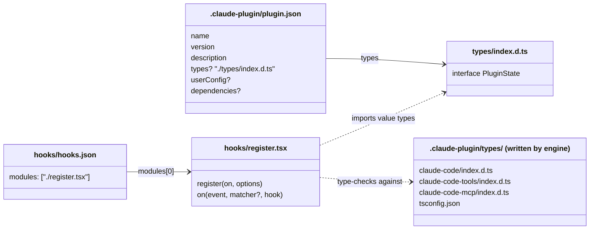

# Claude Code mods — knowledge base

A mod is a Claude Code plugin whose code is a **hooks module**: TypeScript or JavaScript that exports `register(on, options)` and hooks engine events with `($, e, next)`. A mod can guard and rewrite tool calls and prompts, draw panes and bands, add commands and tools, and keep state.

| | |
| --- | --- |
| Pinned version | Snapshot **2.1.295** plus a checked delta for **2.1.302**: [changes in 2.1.302](reference/changes-2.1.302.md). 2.1.302 is installed locally. |
| Captured | 2026-10-09 (2.1.295), 2026-10-17 (2.1.302) |
| Feature status | Early access. Added in 2.1.287 (2026-10-01). The API changes between releases. |
| Public docs | Yes: [code.claude.com/docs/en/plugins/mods](https://code.claude.com/docs/en/plugins/mods/overview). Their reference says "as of v2.1.290". |
| Authority | The newest snapshot, [`sources/claude-code-2.1.302/types/claude-code.d.ts`](sources/claude-code-2.1.302/types/claude-code.d.ts). The engine writes it. Older pages cite [`sources/claude-code-2.1.295/types/claude-code.d.ts`](sources/claude-code-2.1.295/types/claude-code.d.ts) and keep those anchors. Pages here are a map. |

## Start here

1. [concepts/overview](concepts/overview.md): what a mod is, one event through the chain, what a mod can do.
2. [gotchas](gotchas.md): 67 pitfalls with fixes (rows 1 to 34 pinned to 2.1.295, rows 35 and up added for 2.1.302).
3. [workflow/develop](workflow/develop.md): file layout, how to load and hot-reload a mod.
4. [examples](examples/README.md): bundled and real-world mods, and what each one shows.

## Map

| Area | Page | Contents |
| --- | --- | --- |
| Concepts | [overview](concepts/overview.md) | Mental model, runtime, mod vs classic hooks vs other plugin parts, surfaces, built-in mods, security |
| | [dispatch-and-guards](concepts/dispatch-and-guards.md) | `next` semantics, matchers, plugin order, gating, `.catch`, re-entry, budgets, streaming hooks |
| | [state-and-storage](concepts/state-and-storage.md) | Module variables vs `$.state` vs `$.store`, type contract, state references and the scan, state library |
| | [lifecycle](concepts/lifecycle.md) | `register`, `session.start`, hot reload, `/clear`, `session.end` and its 1.5 s bound, subagent turns, what survives what |
| | [ports-and-injection](concepts/ports-and-injection.md) | Passing `on`, `$` and state references into imported files and classes: what `validate` accepts, the ports pattern |
| | [turn-strip](concepts/turn-strip.md) | A line under each answer: the `turn.complete` text, the `TurnDuration` line and its Button, clicks, `claude -p`, with the probe logs of issue #69 (spikes S7 to S13) |
| | [questions-and-plans](concepts/questions-and-plans.md) | What a `tool.call` hook sees of an `AskUserQuestion` call (the questions, the answers, the notes, Esc) and of an `ExitPlanMode` call (the plan, the outcome, a rejection note), with the probe runs of issue #71 |
| | [glossary](concepts/glossary.md) | Terms, with sources |
| Reference | [events](reference/events.md) | 46 engine events, 62 API-call events, 33 `classic.*` events, telemetry, `session.append` |
| | [engine-interface](reference/engine-interface.md) | All 21 `$` nouns and their members, `claude-code` module exports |
| | [ui](reference/ui.md) | `ui.render`, 15 render sites, 12 elements × 4 surfaces, panes, bands, toasts, status, notify |
| | [testing-kit](reference/testing-kit.md) | `claude plugin test`, `claude-code/testing`, mounting UI, a verified example test |
| | [limits-and-diagnostics](reference/limits-and-diagnostics.md) | Budgets and size limits, log line formats, troubleshooting |
| | [fs-and-config](reference/fs-and-config.md) | `$.fs` scope, absolute paths, `HOME`, limits, live behaviour under `~/.config`, torn reads, the kit's stub pattern |
| | [changes-2.1.302](reference/changes-2.1.302.md) | What changed since 2.1.295 that matters to a mod author |
| Workflow | [develop](workflow/develop.md) | Layout, manifest, `userConfig`, tsconfig, load paths, hot-reload lifecycle |
| | [validate-test-debug](workflow/validate-test-debug.md) | `validate`, `tsc`, `test`, `--debug`, `-p` |
| | [share-and-admin](workflow/share-and-admin.md) | Marketplace, install, versions, managed settings, security |
| | [release](workflow/release.md) | `plugin tag`, version rules, zip artifact, this repo's tag-driven release pipeline |
| Other | [examples](examples/README.md) | 3 bundled examples, 7 GitHub mods |
| | [gotchas](gotchas.md) | Pitfalls |
| | [open-questions](open-questions.md) | Conflicts between sources, things not yet observed |
| | [sources](sources/README.md) | Snapshots, provenance, refresh procedure |
| | [spikes-2026-10-17](sources/spikes-2026-10-17/README.md) | Source and captures of the spike mods behind the graded claims, one row per spike |

## Mod anatomy

## How claims are sourced

- Pages cite the snapshot in `sources/` by file and line. Older pages cite 2.1.295. New claims cite 2.1.302. Do not re-pin old anchors.
- Precedence: types file > bundled `reference.md` / `SKILL.md` > public docs > GitHub samples > inference.
- Text marked *inference* is not stated by any source.
- Some examples were run on 2.1.295 (`validate`, `test`, `tsc`). The pages say which.
- Pages written for 2.1.302 grade a claim where it is not obvious: *verified-live* (seen in an interactive session), *verified-kit* (seen in `claude plugin validate`, `test` or `tsc`; a headless `claude -p` run against a fake API counts here, not as live), *types-only* (the d.ts or `reference.md` says it, nobody ran it), *inference*.

## Refresh for a new Claude Code version

See [sources/README](sources/README.md#refresh-procedure-bundled-skill-new-claude-code-version). In short: load the `plugin-authoring` skill, snapshot it into `sources/claude-code-<version>/`, `diff -r` against the old snapshot, then update the pages and their citations.
