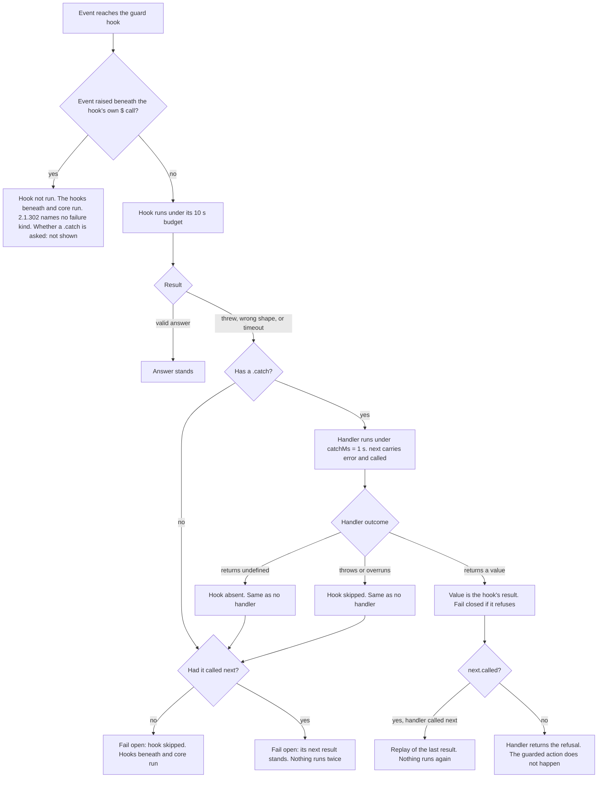

# Dispatch and guards

How an event moves through the chain. What `next` does. How matchers select hooks. What happens when a hook fails, and how to make a guard fail closed. Read [overview](overview.md) first.

Citations are to the 2.1.295 snapshot unless a line says **2.1.302**. The one rule that changed its words is the re-entry rule: see [A hook is not run beneath its own call](#a-hook-is-not-run-beneath-its-own-call).

## The chain

All hooks on one event form one chain. The first hook is outermost. It sees the event first and the result last. Each `next(e)` runs the hooks beneath again. Core (the engine's own behaviour) is last. Below core, `next` rejects. ([d.ts:6535](../sources/claude-code-2.1.295/types/claude-code.d.ts#L6535), [docs: events](../sources/code-claude-com-2026-10-09/mods/events.md#L289))

### What a hook can do

| Move | Code | Notes |
| --- | --- | --- |
| Observe | `return next(e)` | Work before `next` runs before everything beneath. |
| After-next | `const r = await next(e); ...; return r` | The hook sees the result. What it returns is what the caller gets. |
| Rewrite | `next({ ...e, text })` | Only fields the event allows. See "Pinned fields". |
| Rewrite result | `const r = await next(e); return { ...r, x }` | |
| Retry | call `next(e)` again | Each call runs the hooks beneath again. A hook may call it twice. |
| Answer | return a result, no `next` | Stops the chain. Beneath hooks and core do not run. |
| Refuse | return the event's refusal, no `next` | `{ deny }`, `{ drop }`, `{ refuse }`, `{ decision: 'deny' }`. See "Gating sites". |

Rules from the `Next` doc ([d.ts:6535](../sources/claude-code-2.1.295/types/claude-code.d.ts#L6535)):

- `next` is made once per dispatch per hook. It is frozen.
- `next()` with no argument rejects and names the hook.
- A hook that returns **nothing** fails. Return `next(e)` or an answer.
- `next.to(e, tier)` continues at a later tier and skips the tiers between. Only managed plugins (`prepend`, `append`) may use it. It never skips a tier with more authority. ([d.ts:6535](../sources/claude-code-2.1.295/types/claude-code.d.ts#L6535), [docs: reference](../sources/code-claude-com-2026-10-09/mods/reference.md#L41))
- `next.origin` is `{ plugin, tier }` of who raised the dispatch. The engine is `{ plugin: 'engine', tier: 'core' }`. A plugin cannot forge it. ([d.ts:7323](../sources/claude-code-2.1.295/types/claude-code.d.ts#L7323))
- `next.trace` lists what settled beneath on the latest `next()` call: index, plugin, tier, outcome, ms. ([d.ts:13218](../sources/claude-code-2.1.295/types/claude-code.d.ts#L13218))
- `next.event` is the event name. `next.is(pattern, e)` narrows `e`. `next.signal` and `next.budget`: see below.

### Pinned fields and refusals after `next`

- **Pinned fields.** Some fields of `e` are identity. Changing one fails the hook, and the hook is skipped. Example: `session.append` pins all of `message` except `content`. ([reference.md:139](../sources/claude-code-2.1.295/reference.md#L139)) `ui.close`'s `id` and `state.set`'s `plugin`, `key`, `id` are pinned too. ([d.ts:7355](../sources/claude-code-2.1.295/types/claude-code.d.ts#L7355), [d.ts:12060](../sources/claude-code-2.1.295/types/claude-code.d.ts#L12060))
- **Deny after `next` on `tool.call`.** It undoes nothing the tool did. The model reads `<tool> ran, and a plugin withheld its result: <text>`. Returning while `next` is pending aborts what runs beneath. ([d.ts:12701](../sources/claude-code-2.1.295/types/claude-code.d.ts#L12701), [d.ts:3955](../sources/claude-code-2.1.295/types/claude-code.d.ts#L3955))
- **Drop after `next` on `prompt.submit`.** The turn still runs. The hook fails. ([docs: events](../sources/code-claude-com-2026-10-09/mods/events.md#L228))
- **`tool.check` and `plugin.register`.** A refusal after `next` resolved still holds. `next(e)` there only reads a verdict and runs nothing. ([docs: events](../sources/code-claude-com-2026-10-09/mods/events.md#L339), [reference.md:79](../sources/claude-code-2.1.295/reference.md#L79))
- **`session.append`.** A row the engine appends is never refused. A hook that answers without `next` is skipped. Only a plugin's own `$.session.append` row may be refused with `{ deny }`. ([reference.md:141-145](../sources/claude-code-2.1.295/reference.md#L141))
- **Wrong shape.** An answer of the wrong shape fails the hook, same as a throw.

## Matchers

`on(event, matcher, hook)` runs the hook only when the matcher fits `e`. The matcher is a partial of `e`, to any depth. ([d.ts:5794-5801](../sources/claude-code-2.1.295/types/claude-code.d.ts#L5794))

| Matcher value | Match rule | Example |
| --- | --- | --- |
| Scalar (string, number, boolean, null) | `===` | `{ tool: 'Bash' }` |
| `RegExp` | Tests the value as a string | `{ tool: /^mcp__github__/ }` |
| Array | Any element matches | `{ tool: ['Edit', 'Write'] }` |
| Object | Partial of a nested object | `{ props: { origin: { kind: 'task-notification' } } }` |

More rules:

- Every key must match. Keys come from the event input type. A wrong key or value type is a compile error where `e` is typed. ([d.ts:5801](../sources/claude-code-2.1.295/types/claude-code.d.ts#L5801))
- For a field typed `unknown` (a tool's `input`), any matcher is accepted unchecked. `{ startsWith: 'p4' }` never matches a string. Use a RegExp. ([d.ts:5806](../sources/claude-code-2.1.295/types/claude-code.d.ts#L5806))
- Against an array-valued field, a matcher holds when some element matches. ([d.ts:5840](../sources/claude-code-2.1.295/types/claude-code.d.ts#L5840))
- With a matcher, `e` is narrowed to the variants the matcher keeps. A tool-name matcher narrows `e.tool` and the tool fields.
- **Patterns.** The event argument is a name, a glob (`'*'`, `'classic.*'`, `'tool.*'`), or a negation (`'!tool.describe'`). A glob hook sees the union of the selected events. Use `next.event` or `next.is(...)`. ([d.ts:7466](../sources/claude-code-2.1.295/types/claude-code.d.ts#L7466), [d.ts:5042](../sources/claude-code-2.1.295/types/claude-code.d.ts#L5042))
- `*` and negations do **not** select telemetry events. Hook them by name, or `telemetry.*`, with `{ to: 'collector' }`. ([d.ts:5042](../sources/claude-code-2.1.295/types/claude-code.d.ts#L5042), [reference.md:31](../sources/claude-code-2.1.295/reference.md#L31))
- **One registration per matcher.** A second `on('session.start', hook)` with no matcher makes the module fail to load. ([docs: events](../sources/code-claude-com-2026-10-09/mods/events.md#L92), [d.ts:6771](../sources/claude-code-2.1.295/types/claude-code.d.ts#L6771))
- Within one module, hooks run in the order `register` called `on`. First is outermost. ([d.ts:6771](../sources/claude-code-2.1.295/types/claude-code.d.ts#L6771))

## Ordering across plugins

The chain has five tiers, outermost first. Earlier is outer and has more authority. Same-event hooks nest in this order and no other way. ([d.ts:12600-12610](../sources/claude-code-2.1.295/types/claude-code.d.ts#L12600))

| Tier | Who sits there | How a plugin gets there |
| --- | --- | --- |
| `prepend` | Organisation's managed plugins, and `sec-default` where it loads | Listed in managed `prependPlugins`, or counts as the organisation's and is not in `appendPlugins` |
| `user` | Everything a person installs, `--plugin-dir`, mods Claude wrote in the session | Default |
| `append` | Organisation's managed plugins that go last | Managed `appendPlugins` |
| `builtin` | Plugins bundled in the binary (`diff`, `agents-md`, `telemetry`, ...) | Built in |
| `core` | The engine's own behaviour | Always last |

Sources: [docs: events](../sources/code-claude-com-2026-10-09/mods/events.md#L291), [docs: admin](../sources/code-claude-com-2026-10-09/mods/admin.md#L270), [d.ts:12600](../sources/claude-code-2.1.295/types/claude-code.d.ts#L12600).

Details:

- **Managed seat.** `prepend` and `append` are the managed seats. Only managed settings set them. A repository's settings never do. A plugin cannot name its own seat. ([docs: admin](../sources/code-claude-com-2026-10-09/mods/admin.md#L306), [d.ts:12600](../sources/claude-code-2.1.295/types/claude-code.d.ts#L12600))
- **Organisation policy plugin.** It sits in `prepend`. It sees every event before any user mod and every result after. It can rewrite, refuse, or skip the user tier with `next.to(e, 'append')`. It can judge other mods at `plugin.register` and hook any `$` call by name (`fs.write`). ([docs: admin](../sources/code-claude-com-2026-10-09/mods/admin.md#L308))
- A plugin counts as the organisation's only when managed `enabledPlugins` sets it, its marketplace is a directory by absolute path, and the marketplace lists it by relative path. Plugins copied into the cache (git, GitHub, npm, URL sources) count as user mods. ([docs: admin](../sources/code-claude-com-2026-10-09/mods/admin.md#L233))
- **Dependencies.** Among installed mods, a mod runs before the mods it lists under `dependencies`. ([docs: events](../sources/code-claude-com-2026-10-09/mods/events.md#L298))
- **Classic `PreToolUse`.** Managed settings hooks run above the first mod. A block there is final, and they run again on a rewritten call. Other settings hooks (user, project, plugin `hooks.json`) run as core, beneath the last mod. A mod that answers `tool.call` without `next` keeps them from running. ([docs: events](../sources/code-claude-com-2026-10-09/mods/events.md#L300), [d.ts:1251](../sources/claude-code-2.1.295/types/claude-code.d.ts#L1251))
- `tool.check` fires after the permission rules and those hooks decided. `next(e)` resolves to their verdict. ([docs: events](../sources/code-claude-com-2026-10-09/mods/events.md#L177))
- A plugin's tier shows at run time as `next.origin.tier` (for a dispatch it raised), and in `claude --debug` as `hooks module <id> loaded ... tier <tier>`. ([docs: admin](../sources/code-claude-com-2026-10-09/mods/admin.md#L297))

## Gating sites

A gating site is an event whose answer can refuse or replace what was asked. A hook that fails there is skipped, so the thing it guarded goes ahead. That is **fail open**. ([d.ts:3936](../sources/claude-code-2.1.295/types/claude-code.d.ts#L3936))

| Event | Refusal answer | Line |
| --- | --- | --- |
| `tool.call` | `{ deny }` (or `{ result }` to answer in place) | [d.ts:3955](../sources/claude-code-2.1.295/types/claude-code.d.ts#L3955) |
| `tool.check` | `{ decision: 'deny', reason? }` | [d.ts:3969](../sources/claude-code-2.1.295/types/claude-code.d.ts#L3969) |
| `agent.offer` | `{ isOffered: false }` | [d.ts:4077](../sources/claude-code-2.1.295/types/claude-code.d.ts#L4077) |
| `agent.spawn` | `{ deny }` | [d.ts:4091](../sources/claude-code-2.1.295/types/claude-code.d.ts#L4091) |
| `prompt.submit` | `{ drop }` | [d.ts:4103](../sources/claude-code-2.1.295/types/claude-code.d.ts#L4103) |
| `prompt.fill`, `prompt.suggest` | `{ isFilled: false }`, `{ isShown: false }` | [d.ts:4115](../sources/claude-code-2.1.295/types/claude-code.d.ts#L4115), [d.ts:4127](../sources/claude-code-2.1.295/types/claude-code.d.ts#L4127) |
| `prompt.mention` | `{ deny }` | [d.ts:4210](../sources/claude-code-2.1.295/types/claude-code.d.ts#L4210) |
| `command.run` | `{ text }` (answers in place of the command) | [d.ts:4239](../sources/claude-code-2.1.295/types/claude-code.d.ts#L4239) |
| `config.set` | `{ deny }` | [d.ts:4265](../sources/claude-code-2.1.295/types/claude-code.d.ts#L4265) |
| `session.receive`, `session.send`, `session.compact` | `{ consumed }`, `{ isDelivered: false, reason }`, `{ skip }` | [d.ts:4347](../sources/claude-code-2.1.295/types/claude-code.d.ts#L4347), [d.ts:4371](../sources/claude-code-2.1.295/types/claude-code.d.ts#L4371), [d.ts:4383](../sources/claude-code-2.1.295/types/claude-code.d.ts#L4383) |
| `plugin.register` | `{ refuse }` | [d.ts:4441](../sources/claude-code-2.1.295/types/claude-code.d.ts#L4441) |
| `ui.scroll`, `ui.focus` | `{ deny }` or no `next` | [d.ts:4052](../sources/claude-code-2.1.295/types/claude-code.d.ts#L4052), [d.ts:4064](../sources/claude-code-2.1.295/types/claude-code.d.ts#L4064) |
| `telemetry.log`, `telemetry.mark` | `{ deny }` (rejects the caller) | [d.ts:4289](../sources/claude-code-2.1.295/types/claude-code.d.ts#L4289) |
| A call on `$` as an event (`fs.write`, `model.complete`, ...) | `{ deny }` refuses. `{ value }` answers. | [d.ts:6836](../sources/claude-code-2.1.295/types/claude-code.d.ts#L6836) |
| `turn.step` | Answer without `next` sends no model request | [d.ts:4455](../sources/claude-code-2.1.295/types/claude-code.d.ts#L4455) |

The full per-event result list is in [reference/events](../reference/events.md).

### What `claude plugin validate` prints

Under the `hooks:` line, validate lists each hook at a gating site as `gating hook with .catch: <event>` or `gating hook without .catch: <event>`. The JSON report calls them `gatingHooks`. ([reference.md:66](../sources/claude-code-2.1.295/reference.md#L66), [docs: create](../sources/code-claude-com-2026-10-09/mods/create.md#L305))

- The line is a **fact, not a warning**. Whether the hook should fail open or closed is your decision.
- A `command.run` hook that answers its own command is reported as `answers its own command:` and is **not** in `gatingHooks`. That holds only when the matcher names commands the module registers on `$` by a literal name, and neither the hook nor its `.catch` reads `next`. A `command.run` hook with no matcher, on a command the module does not register, on a built-in command, or that reads `next`, is listed as a gate like any other. ([reference.md:66](../sources/claude-code-2.1.295/reference.md#L66))

## Hook failure and `.catch`

### Default: fail open

A hook fails when it throws, answers a wrong shape, or outruns its budget. Without a `.catch`: ([d.ts:3936-3941](../sources/claude-code-2.1.295/types/claude-code.d.ts#L3936), [docs: events](../sources/code-claude-com-2026-10-09/mods/events.md#L311))

| When it failed | What happens |
| --- | --- |
| Before it called `next` | The hook is skipped. The hooks beneath and core run in its place. |
| After `next` resolved | That result stands. Nothing runs twice. |

One dim line names the plugin, the event and the reason. In a hot-reloaded dev folder it is in the transcript. Elsewhere it goes to the debug log. ([reference.md:79](../sources/claude-code-2.1.295/reference.md#L79))

### The `.catch` handler

`on(...)` returns a `Registration` with one method, `.catch(handler)`. The handler has the hook's own shape, and `next` carries two extras. ([d.ts:9327](../sources/claude-code-2.1.295/types/claude-code.d.ts#L9327), [d.ts:1172](../sources/claude-code-2.1.295/types/claude-code.d.ts#L1172), [d.ts:1182](../sources/claude-code-2.1.295/types/claude-code.d.ts#L1182))

| Member | Meaning |
| --- | --- |
| `next.called` | `true` when the failed hook had called `next()` or `next.to()` at least once (settled or in flight). The handler runs after that call settled. |
| `next.error.kind` | `'throw'` (threw, wrong shape, or its worker ended), `'timeout'` (outran its budget). 2.1.295 also had `'re-entry'` (no fault, see below). **2.1.302:** the kind is gone ([d.ts 302:5269-5289](../sources/claude-code-2.1.302/types/claude-code.d.ts#L5269-L5289)). |
| `next.error.message` | What was thrown. For a timeout, what the last `next()` rejected with. May be absent. |
| `next.error.budget` | The handler's grace in ms. |
| `next.error.cause` | 2.1.295: `'lent'` on a `re-entry` raised beneath a noun's call. **2.1.302:** the member is gone. |

([d.ts:5136](../sources/claude-code-2.1.295/types/claude-code.d.ts#L5136), [d.ts:5152](../sources/claude-code-2.1.295/types/claude-code.d.ts#L5152))

`next` in a handler is **replay-safe**:

- If `next.called`: `next(e)` resolves to what the hook's last call settled to. Nothing beneath runs again. The argument is ignored.
- If not called: `next(e)` runs the hooks beneath once. A later call replays that.

The handler's return value:

- A value within the grace is the hook's result for the dispatch.
- `undefined` makes the hook absent (as if it had no handler).
- If the handler throws or overruns `catchMs`, the hook is skipped as if it had no handler.
- On a streaming event the handler is a generator.

Limits on `.catch`: a second `.catch` on one registration throws. So does a `.catch` after `register()` returned. `engine.create` takes none (its hook has no budget, and its failure is the load's). ([d.ts:9327](../sources/claude-code-2.1.295/types/claude-code.d.ts#L9327))

### The guard idiom

A guard judges **before** it calls `next`. The handler refuses where `next` was not called, and replays where it was.

```ts
on('tool.call', { tool: 'Bash' }, guard).catch(($, e, next) =>
  next.called ? next(e) : { deny: 'The guard failed, so this command did not run.' },
)
```

Per event, the refusal in the `else` arm changes ([d.ts:3955](../sources/claude-code-2.1.295/types/claude-code.d.ts#L3955), [docs: events](../sources/code-claude-com-2026-10-09/mods/events.md#L337)):

| Event | Handler |
| --- | --- |
| `tool.call`, `config.set`, `agent.spawn`, `prompt.mention` | `next.called ? next(e) : { deny: 'why' }` |
| `prompt.submit` | `next.called ? next(e) : { drop: 'why' }` |
| `command.run` | `next.called ? next(e) : { text: 'why' }` |
| `agent.offer` | `next.called ? next(e) : { isOffered: false }` |
| `tool.check` | `() => ({ decision: 'deny' })` (nothing has run, so no `called` test) |
| `plugin.register` | `next.called ? next(e) : { refuse: 'why' }` (a refusal after `next` still holds) |

Why the `called` test: if the guard already let the event through, refusing now would not undo the work. Replay returns what already happened.

### A hook is not run beneath its own call

A hook is not run under its own frame. If an event is raised **beneath a `$` call that the same hook made**, the engine does not run that hook again. In 2.1.295 this was the "re-entry rule", with a failure kind `'re-entry'`, a cause `'lent'` and a special `.catch` ask. **2.1.302 dropped those names, not the behaviour.**

What the 2.1.302 types say (*types-only*):

- "The engine raises its events through these same calls; a plugin's call runs the same chain with the calling hook alone skipped." ([d.ts 302:4843-4844](../sources/claude-code-2.1.302/types/claude-code.d.ts#L4843-L4844))
- `$.tool.call` "runs through every hook but the calling one (the plugin's others see it)". ([d.ts 302:3099-3100](../sources/claude-code-2.1.302/types/claude-code.d.ts#L3099-L3100))
- The calls the host serves, as events: "The calling hook alone is skipped, and `next.origin` names the caller." ([d.ts 302:6976](../sources/claude-code-2.1.302/types/claude-code.d.ts#L6976))
- `HookFailure.kind` is only `'throw' | 'timeout'`, and the `CatchHandler` doc no longer mentions a re-entry ask. ([d.ts 302:5269-5289](../sources/claude-code-2.1.302/types/claude-code.d.ts#L5269-L5289), [d.ts 302:1197-1206](../sources/claude-code-2.1.302/types/claude-code.d.ts#L1197-L1206))

What a run showed (*verified-kit*, 2.1.302; spikes `r01-append` to `r04-cycle` in [spikes-2026-10-17](../sources/spikes-2026-10-17/README.md#second-pass-re-entry-the-bus-and-composition); the kit and a headless `claude -p` run against a fake API gave byte-identical logs):

| Case | Result |
| --- | --- |
| An `on('session.append')` hook appends one row per run (cap 3) through its own `$` | The hook ran once (`invA=1`). It did not see its own row. |
| The same for `on('tool.call')` calling `$.tool.call` (Read) | `invA=1`. |
| The nested call goes through ports built from the `command.run` hook's `$`, or from the `session.start` hook's `$` | `invA=1`. The skip does not depend on which `$` the call used. |
| The nested call comes from a `$.clock.after(0)` timer that the hook armed, after the hook returned | `invA=1`. |
| With and without `.catch((_$, e, next) => next(e))`, same row text or unique, append before or after `next(e)` | `invA=1` in every variant. |
| A cycle: hook S (`session.append`) calls `$.tool.call`, hook T (`tool.call`) calls `$.session.append`, capped at 6 | `invS=1 invT=1` from either start. |
| A peer: a second hook B on `session.append{door=note}` that also appends per row it sees | `invA=2 invB=2`. The skip is per hook along the call chain. A's row raised under `B#1` is not seen by A, because `A#1` is the ancestor caller. B's second row is seen by `A#2`, because `A#1` only runs the chain. |

Exceptions and limits:

- **`ui.render` is run again.** A `ui.render` hook that calls `$.ui.invalidate('ui.render')` is run again for each call. With a cap of N invalidates it drew N+1 times (`p0` 1 draw, `p3` 4, `p20` 21) in the kit. The reason (*types-only*): `$.ui.invalidate` is not a member of `EventCalls`. It asks the engine to re-run the event, and "an invalidate is any plugin's whose matcher may select it", the caller's too ([d.ts 302:2381-2393](../sources/claude-code-2.1.302/types/claude-code.d.ts#L2381-L2393), [d.ts 302:4078-4079](../sources/claude-code-2.1.302/types/claude-code.d.ts#L4078-L4079)). The kit does not model the live pace (ten a second, thirty for a shown pane). Never call `$.ui.invalidate` from inside a render. Redraw by state: read an atom while drawing, and write it from a `ui.focus` or event hook.
- **Plugin-declared nouns follow another rule.** For a noun a plugin adds to `$` (an `engine.create` noun), a hook with no `.catch` can be run again beneath its call, and "the third identical open call waits behind the second" ([d.ts 302:7801-7807](../sources/claude-code-2.1.302/types/claude-code.d.ts#L7801-L7807)). *types-only.* Not tested. The `tool`, `session` and `ui` nouns are not covered by it.
- **A skip hides the row from every tracker on that hook.** One fan-out hook is one frame. A row that a tracker appends inside the dispatch of event X is invisible to every handler of that hook, not only to its author. A second `on()` with a matcher (the peer case) is the way to see it. A second matcherless `on()` for the same event is refused ([ports-and-injection](ports-and-injection.md#duplicates)). *inference* from the peer run.
- **What a `.catch` does when its hook is skipped is not shown.** The runs counted hook-body invocations only. In 2.1.295 the handler answered in the hook's place, with `$` calls rejecting. 2.1.302 says nothing about it. Treat it as unresolved ([architecture Q24](../../claude-code-mod-architecture/open-questions.md#1-unknowns)).
- **No in-process guard is needed for engine events.** The engine already cuts self-calls, calls from a timer the hook armed, and cycles across events. An in-process emit between trackers (plain JS the engine cannot see) still needs its own depth cap. *inference.*

The 2.1.295 text, kept for older mods (*types-only*, [d.ts:5136](../sources/claude-code-2.1.295/types/claude-code.d.ts#L5136), [reference.md:79](../sources/claude-code-2.1.295/reference.md#L79)):

- The skipped hook's `.catch` handler answered in its place. `next.error.kind === 're-entry'` and `next.called === false`. `next(e)` ran what is beneath on the event as it was raised. Any `$` call in the handler rejected.
- `cause: 'lent'` meant a noun that another plugin added to `$` fired the event.
- The plain guard `next.called ? next(e) : { deny }` refused every re-entry.
- The source added a timing rule: "ten seconds after the noun was called the hook itself is asked again, unless its own dispatch is still above". Its meaning was unclear ([open-questions #13](../open-questions.md)). It is gone in 2.1.302.
- It needed Claude Code 2.1.292 or later ([docs: reference](../sources/code-claude-com-2026-10-09/mods/reference.md#L42)).

[reference.md 302:168](../sources/claude-code-2.1.302/reference.md#L168) still says a queued record "is raised under the hook's frames, so that hook is not run on it (the re-entry rule)". The sentence is right about the behaviour. Only the name is old.

### Guard outcomes



## Budgets and `next.signal`

| Name | Value | Meaning | Source |
| --- | --- | --- | --- |
| `HookBudget.ms` | 10 000 ms | A hook's own time per dispatch. Past it the hook is absent: its `.catch` is asked, else `next(e)` runs on its behalf. | [d.ts:5100](../sources/claude-code-2.1.295/types/claude-code.d.ts#L5100) |
| `HookBudget.catchMs` | 1 000 ms | A `.catch` handler's grace, a fresh budget from its call. Past it the hook is absent as if it had no handler. | [d.ts:5100](../sources/claude-code-2.1.295/types/claude-code.d.ts#L5100) |
| `HookBudget.lingerMs` | 5 000 ms | How long a hook may keep running after `next.signal` aborted. Past it the hook is reported as lingering. The dispatch had already gone on. | [d.ts:5100](../sources/claude-code-2.1.295/types/claude-code.d.ts#L5100) |
| `NextBudget` | `{ ms, remainingMs }` | `next.budget`, read fresh on each access. `ms` is the whole allowance, `remainingMs` what is left, never below 0. Where nothing meters: `ms` 0 and `remainingMs` `Infinity`. In a handler it is the grace. | [d.ts:6621](../sources/claude-code-2.1.295/types/claude-code.d.ts#L6621) |
| `prompt.edit` hook | 50 ms | Public docs only. Not in the types. | [docs: reference](../sources/code-claude-com-2026-10-09/mods/reference.md#L278) |

What the clock counts:

- The clock **stops** while a `next(e)` call or a `$` call of the hook is in flight. A slow chain beneath, or a minute-long `$.model.complete`, costs nothing. Waiting on `$.ui.ask` is free. ([d.ts:5100](../sources/claude-code-2.1.295/types/claude-code.d.ts#L5100), [docs: events](../sources/code-claude-com-2026-10-09/mods/events.md#L175))
- `$.clock.sleep` **does** count. A hook that polls with it pays every sleep from one budget. ([d.ts:3447](../sources/claude-code-2.1.295/types/claude-code.d.ts#L3447))
- Time you spend awaiting your own promise counts.
- A held tool call (waiting on `$.ui.ask`) is safe. If the hook times out, it is skipped and the held command would run. A guard that waits needs a `.catch`. ([docs: events](../sources/code-claude-com-2026-10-09/mods/events.md#L175))
- Streaming hooks count only their own code, never a `yield` or a read from beneath. On `turn.step` it is the sum over the response. On `process.spawn` it is per piece. ([d.ts:5100](../sources/claude-code-2.1.295/types/claude-code.d.ts#L5100))
- `session.end`: the whole chain shares one short wall-clock bound. `next.budget` reads what is left. It never stops, `$` waits included. A later hook starts with what earlier hooks left. ([d.ts:6621](../sources/claude-code-2.1.295/types/claude-code.d.ts#L6621), [d.ts:4427](../sources/claude-code-2.1.295/types/claude-code.d.ts#L4427))

`next.signal` is an `AbortSignal`. It aborts when the dispatch is abandoned: the user interrupted, a hook above settled first, or this hook ran out of budget. Stop timers and requests on it: `await $.clock.sleep(500, { signal: next.signal })`. ([d.ts:6535](../sources/claude-code-2.1.295/types/claude-code.d.ts#L6535), [reference.md:154](../sources/claude-code-2.1.295/reference.md#L154))

Cheap guard pattern: `if (next.budget.remainingMs < 2_000) return next(e)`.

## Streaming hooks

Two events stream: `turn.step` (one model request) and `process.spawn` (a child's output, piece by piece). A hook on either is an **async generator**. A plain function is a type error, even if it returns `next(e)`. ([d.ts:12171](../sources/claude-code-2.1.295/types/claude-code.d.ts#L12171), [d.ts:12145](../sources/claude-code-2.1.295/types/claude-code.d.ts#L12145), [reference.md:28-31](../sources/claude-code-2.1.295/reference.md#L28))

| Form | Effect |
| --- | --- |
| `const r = yield* next(e); return r` | Forwards the stream and evaluates to the result. |
| `for await (const chunk of next(e)) yield { ...chunk }`, then `await stream.result` | Rewrites chunks one at a time. |
| Yield your own chunks, no `next` | Answers alone. On `turn.step`, no model request is sent. |
| Call `next(e)` twice | Opens two streams (two model requests, two children). |
| Fail mid-stream | The hook is left where it stood. The rest comes from beneath it. |

```ts
on('turn.step', async function* ($, e, next) {
  const result = yield* next(e)
  if (result.usage) $.ui.log('cache read ' + result.usage.cache_read_input_tokens)
  return result
})
```

([docs: events](../sources/code-claude-com-2026-10-09/mods/events.md#L242), [d.ts:12185](../sources/claude-code-2.1.295/types/claude-code.d.ts#L12185), [d.ts:5199](../sources/claude-code-2.1.295/types/claude-code.d.ts#L5199))

For the caller, `$.process.spawn({ argv })` is the stream. The loop's end is the child's. Leaving the loop, `return()`, `next.signal` aborting, or module unload kills the child. ([d.ts:3553](../sources/claude-code-2.1.295/types/claude-code.d.ts#L3553))

## Work that outlives a dispatch

A hook runs inside one dispatch, under its budget. `next.signal` aborts when the dispatch ends. Anything started for the dispatch must stop on it. ([reference.md:154-157](../sources/claude-code-2.1.295/reference.md#L154))

Work meant to live longer goes elsewhere:

- Start it from a `session.start` hook. It fires once per process per loaded plugin, before the first prompt. The first call is awaited, so a `$.tool.register` there is listed by turn one. ([d.ts:4334](../sources/claude-code-2.1.295/types/claude-code.d.ts#L4334))
- Keep it going with `$.clock.every(ms, fn)` and `$.clock.after(ms, fn)`. Timers run until `cancel()` or until the module reloads. `every` makes one `clock.every` dispatch per period. A refused period ends the interval. ([d.ts:3454](../sources/claude-code-2.1.295/types/claude-code.d.ts#L3454), [d.ts:3464](../sources/claude-code-2.1.295/types/claude-code.d.ts#L3464))
- Wake a quiet session with `$.prompt.submit`. It queues a prompt that starts its own turn once the session is idle. It never folds into a running turn. ([reference.md:162](../sources/claude-code-2.1.295/reference.md#L162))
- Show state without a turn: `$.ui.status`, `$.ui.toast`, `$.ui.log`.

### Reload and worker-loss semantics

| Situation | What happens |
| --- | --- |
| **Hot reload** (file saved, `/reload-plugins`, `userConfig` change) | `register` runs again in a fresh environment. Module variables and the old timers are gone. `session.start` fires again (changed modules only, or all if one hooks `engine.create` or `plugin.register`). `$.state` and `$.store` stay. |
| **Worker loss** (the engine replaces the plugin's copy, the plugin unchanged) | The hook runs again in the fresh copy. Timers and module variables are gone. |
| Calls made by the first run | `$.prompt.submit`, `$.command.run`, `$.agent.spawn` with the **same input** resolve to the first call's result. They are not made twice. This covers a call made while the hook is still running (awaited or not), a timer of its own that fires in that time included. |
| Calls made after the hook returned | A later timer or continuation: made **again**. So is a call another hook makes in answer to a call of the start hook's. |
| A subagent the engine interrupted because the copy that awaited it was lost | Started again. |
| Worker crashes three times | Claude Code unloads every mod that is not built in, yours too, until `/reload-plugins` or a new session. |

Sources: [reference.md:72-73](../sources/claude-code-2.1.295/reference.md#L72), [reference.md:162](../sources/claude-code-2.1.295/reference.md#L162), [SKILL.md:21](../sources/claude-code-2.1.295/SKILL.md#L21), [d.ts:4334](../sources/claude-code-2.1.295/types/claude-code.d.ts#L4334), [docs: admin](../sources/code-claude-com-2026-10-09/mods/admin.md#L362).

Design rule: make start-up work idempotent. Do not trust a module variable to survive. Put what must survive in `$.state` or `$.store`. See [state-and-storage](state-and-storage.md).

## See also

- [overview](overview.md): the mental model and the sequence diagram.
- [state-and-storage](state-and-storage.md): what survives a reload.
- [glossary](glossary.md): terms.
- [reference/events](../reference/events.md): every event, its input and its result.
- [reference/limits-and-diagnostics](../reference/limits-and-diagnostics.md): limits and debug lines.
- [gotchas](../gotchas.md): pitfalls.
