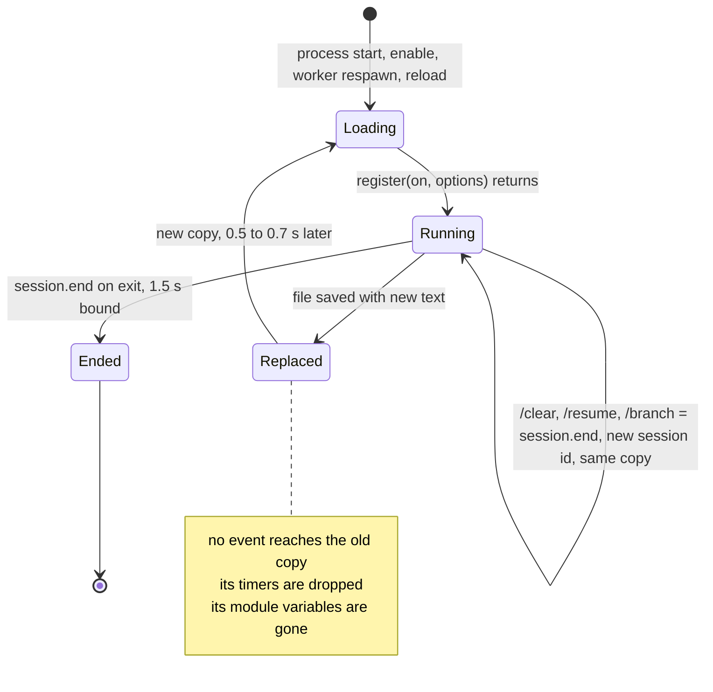
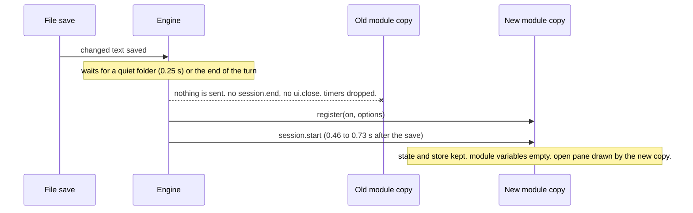
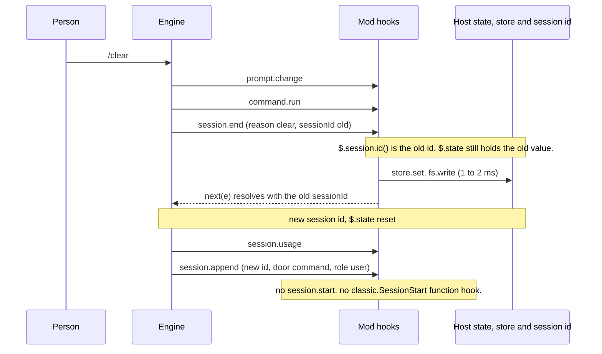

# Lifecycle of a mod

What happens, in order, from `register` to `session.end`. What a hot reload, a `/clear` and an exit do to your code, your timers and your values. Read [overview](overview.md) first.

Pinned to Claude Code **2.1.302** unless a line says otherwise. Links go to the [2.1.302 types](../sources/claude-code-2.1.302/types/claude-code.d.ts).

Grades on a claim:

- *verified-live*: seen in a real interactive session (tmux, `claude --plugin-dir`).
- *verified-kit*: seen in `claude plugin validate` or `claude plugin test`.
- *types-only*: the d.ts or `reference.md` says it. Nobody ran it.
- *inference*: no source says it.

The spikes behind the live grades are throwaway mods built for [issue #55](https://github.com/martin-macak/claude-code-mod-tracking/issues/55). Their source and captures are in [spikes-2026-10-17](../sources/spikes-2026-10-17/README.md) (`life-spike`, `lifecycle-mod` and the `live2-lifecycle` captures). Each claim quotes what it saw.

## The moments

| Moment | What runs | Where it is written |
| --- | --- | --- |
| Load | `register(on, options)` runs. It gets `on` and `options`. `$` does not exist yet. | [d.ts:9713](../sources/claude-code-2.1.302/types/claude-code.d.ts#L9713), [d.ts:4598](../sources/claude-code-2.1.302/types/claude-code.d.ts#L4598) |
| Admission | `plugin.register` judges a module that is about to join. The judges are the plugins admitted **before** it. | [d.ts:4540](../sources/claude-code-2.1.302/types/claude-code.d.ts#L4540) |
| Start | `session.start` runs once per process for each loaded plugin, then once per fresh load. | [d.ts:4436](../sources/claude-code-2.1.302/types/claude-code.d.ts#L4436) |
| Each turn | `turn.start`, then `turn.step`s, then `turn.complete`. A subagent's turn raises them too. | [d.ts:4554](../sources/claude-code-2.1.302/types/claude-code.d.ts#L4554), [d.ts:4572](../sources/claude-code-2.1.302/types/claude-code.d.ts#L4572) |
| Hot reload | The old copy stops. A new copy runs `register` and `session.start`. | [reference.md:73](../sources/claude-code-2.1.302/reference.md#L73) |
| `/clear` | `session.end` with `reason: 'clear'`. The process goes on under a new session id. No `session.start`. | [d.ts:11477](../sources/claude-code-2.1.302/types/claude-code.d.ts#L11477) |
| `/resume`, `/branch` | `session.end` with `reason: 'resume'` for both. The process goes on under another session id. No `session.start`. *verified-live.* | [d.ts:11481-11488](../sources/claude-code-2.1.302/types/claude-code.d.ts#L11481-L11488), [d.ts:11495-11505](../sources/claude-code-2.1.302/types/claude-code.d.ts#L11495-L11505) |
| Exit | `session.end` with `prompt_input_exit`, `resume`, `logout` or `other`. | [d.ts:11498](../sources/claude-code-2.1.302/types/claude-code.d.ts#L11498) |

## One module copy



## Start

- `session.start` fires once per process for each loaded plugin, before the first prompt. It fires again once per fresh load of a plugin. It never fires on `/clear`. ([d.ts:4436](../sources/claude-code-2.1.302/types/claude-code.d.ts#L4436), types-only)
- Only the first one is awaited. A later one runs its hooks alone: after an enable, a worker respawn or a reload. A reload runs the hooks of the changed modules only. All run if a module hooks `engine.create` or `plugin.register`. ([d.ts:4439](../sources/claude-code-2.1.302/types/claude-code.d.ts#L4439), types-only)
- Input: `{ cwd, surface, isInteractive }`. `surface` is `null` and `isInteractive` is `false` for a `-p` run or the SDK. ([d.ts:12159](../sources/claude-code-2.1.302/types/claude-code.d.ts#L12159), types-only)
- *verified-live:* after a reload the new copy's `session.start` input was `{ cwd, surface: 'terminal', isInteractive: true }`.
- `register` runs before `$` exists. Build nothing from `$` there. Do it in `session.start` or on first use. ([d.ts:4598](../sources/claude-code-2.1.302/types/claude-code.d.ts#L4598), types-only)
- `register` may return a promise, and the engine awaits it. ([d.ts:9708](../sources/claude-code-2.1.302/types/claude-code.d.ts#L9708), types-only) *verified-kit:* an `on(...)` call after an `await` registered and fired (spike `kbw-async`, [ports-and-injection](ports-and-injection.md#async-register-and-two-hooks-on-one-tree)). The real engine was not run.
- `plugin.register` hooks judge the modules admitted after them. A module does not hear its own admission. *verified-live:* a module that hooked `plugin.register` and `*` logged no `plugin.register` event in any of its copies.

## Hot reload

A save of the plugin folder replaces the module. [reference.md:73](../sources/claude-code-2.1.302/reference.md#L73) gives the timing. Saves by the model reload once, when the turn ends. Saves from elsewhere reload after the folder has been quiet (0.25 s for a lone save).



What the old copy sees **before** the reload: nothing. *verified-live,* four reloads of a spike under `claude --plugin-dir`. In some of them an `on('*')` catch-all wrote a file for every event:

- No `session.end`, no `ui.close`, no `plugin.register` reached the old copy after the save.
- With the catch-all on, no event of any kind reached it. In one run the last entry of the old copy's ring was a `ui.render`, 9 s before the save.
- A `$.clock.after` timer armed for 25 s, saved 10 s into its wait, never fired in any copy.

So a reload has **no teardown event**. You cannot flush on a reload. A debounced write that waits for a timer is lost. Write through, or flush in `session.end`.

### What triggers a reload

*verified-live,* Claude Code 2.1.302 in tmux, spike [`lifecycle-mod`](../sources/spikes-2026-10-17/lifecycle-mod/) (`register.tsx` imports `../core/x.ts` and `../trackers/a.ts`; `core/x.ts` imports `core/deep/y.ts`; `core/unused.ts` is imported by nothing). Watching follows the **import graph** of the module, not the folder:

| Edit | Reload? | Lag until the new `session.start` |
| --- | --- | --- |
| `hooks/register.tsx` (`REG` `r1` to `r2`) | Yes | 647 ms |
| `core/x.ts`, a sibling folder of `hooks/` (`x1` to `x2`) | Yes, exactly like `register.tsx` | 552 ms |
| `core/deep/y.ts`, imported only by `core/x.ts` (transitive) | Yes | 542 ms |
| `trackers/a.ts`, a sibling folder imported by `register.tsx` | Yes | 498 ms |
| `core/unused.ts`, imported by nobody | **No** (still 3 `session.start` files after 4 s) | n/a |
| A save with identical text (`cp` of the same content over `register.tsx`) | **No** | n/a |

- The transcript showed the dim line `lifecycle-mod: reloaded (4 hooks: session.start, session.end, session.append, command.run)` after the `core/x.ts` edit (`cap/19-edit-core-x.txt`).
- On every reload the module variables started over (`cmdCount` went 104 to 1) and the new copy had a new generation tag (`gmvcwfmy7ggrs` to `gmvcx521pkbd6`). The value read from `core/x.ts` changed with the edit.
- The old copy's `$.clock.every` timer stopped at once. Its last tick file (`tickN=50`) was written before the edit, and the new copy wrote its own. The session id stayed the same (`2e1f868c-…`). This matches the d.ts: a reload cancels pending waits with the old environment ([d.ts:3506-3507](../sources/claude-code-2.1.302/types/claude-code.d.ts#L3506-L3507)).
- A file that nothing imports does not reload the mod (`core/unused.ts`). So a new tracker folder reloads nothing until a file of the graph imports it (*inference* from `core/unused.ts`). Not tested: whether a **new** file that an edited file starts to import is read at once.

What the new copy sees:

- `register` runs again. `session.start` follows 0.46 to 0.73 s after the save (458, 704 and 725 ms in three reloads). The session id is the same. *verified-live*
- Module variables start over. `$.state` and `$.store` stay. ([d.ts:3460](../sources/claude-code-2.1.302/types/claude-code.d.ts#L3460), [d.ts:3506](../sources/claude-code-2.1.302/types/claude-code.d.ts#L3506), types-only for the survival)
- A pane the old copy opened stays open. The new copy draws it. No `ui.close` fires. *verified-live:* after each reload the pane header showed the new copy's generation tag, so the new copy drew the same pane. No `ui.close` fired. A missing `ui.close` alone would prove little: a pane dropped with the `unload` origin is gone before any hook hears of it ([d.ts:7528](../sources/claude-code-2.1.302/types/claude-code.d.ts#L7528), types-only). Here the pane was drawn after the reload, so it was not dropped. Reattach with `$.ui.panes()`. Do not open the pane again.
- A save that leaves a loaded file with the text it was loaded from reloads **nothing**. *verified-live:* `cp` of the same file over the mod kept the same module copy. ([reference.md:73](../sources/claude-code-2.1.302/reference.md#L73), new in 2.1.302) After a failed reload, any new save tries again.
- Reload runs `session.start` again, so init code must be idempotent. Bring module variables back from `$.state` or `$.store` there.

## `/clear`

*verified-live,* Claude Code 2.1.302 in tmux, `claude --plugin-dir`, a catch-all hook ring.



Inside the `session.end` hook with `reason: 'clear'`:

- `$.session.id()` returns the leaving id. It equals `e.sessionId`. This holds before and after `next(e)`.
- `$.state` holds the old value, before and after `next(e)`. A `$.state` write inside this hook was not tried live.
- `$.store.set` took 1 to 2 ms and `$.fs.write` 0 to 1 ms. With a 300 KB payload: `$.store.set` 5 to 6 ms, `$.fs.write` 1 ms.

After it:

- The first `session.append` of the new session arrives 11 to 15 ms after `session.end`. It carries the **new** id. `$.state` is already reset there (`{ version: 0 }`).
- The door and origin of that row differ between runs (`notice`/`engine` at startup, `command`/`user` after `/clear`). Do not trigger on them. Compare `await $.session.id()` with the id you hold.
- The module copy is the same, so module variables stay. *verified-live:* the generation tag did not change, and a module counter (`cmdCount`) went 101 to 102 across `/clear` (`live2-lifecycle/lifecycle-log.txt`). A `$.clock.every` timer kept running: its tick file went on after the `/clear`, and the `$.session.id()` that the callback read was the **new** id.
- `session.start` does not fire. ([d.ts:11483](../sources/claude-code-2.1.302/types/claude-code.d.ts#L11483), [reference.md:27](../sources/claude-code-2.1.302/reference.md#L27), types-only; also seen live)
- A `classic.SessionStart` or `classic.SessionEnd` **function hook** of a `--plugin-dir` mod never ran, at startup, on `/clear` or on `/exit`. Shell hooks from settings for the same events did run. *verified-live.* `claude plugin validate` prints the reason it can give:

  ```text
  ./register.tsx hooks on classic.SessionStart, classic.SessionEnd do not run in a plugin a person installs where an organization manages Claude Code: there, these events pass over the plugins you install, and only a plugin the organization lists in managed settings runs them
  ```

  *Inference:* the account on this machine takes settings from an organization, although no local managed-settings file exists. That would fit the gate. Nobody tested a machine without it. Do not build a restore on `classic.SessionStart`. This corrects the recipe in [state-and-storage](state-and-storage.md#state).

What to use for "init after `/clear`":

1. `session.end` with `reason: 'clear'` for the **store phase**. State and id are intact there.
2. A changed `await $.session.id()` for the **init phase**. Compare it with the id you hold (`sid !== lastSeenSid`) at the first `session.append`, at the tick and at the top of every hook (the `ensure($)` pattern in [mod-api-notes](../../claude-code-artifact-tracking/mod-api-notes.md#8-state-store-and-restore), section 8). The compare costs one `$.session.id()` per hook. Do not wait for "the first row": after `/resume` there is none for a while (next section).

Whether a `$.state` write works inside that first `session.append` hook was not tried.

## `/resume` and `/branch`

*verified-live,* Claude Code 2.1.302 in tmux, spike [`lifecycle-mod`](../sources/spikes-2026-10-17/lifecycle-mod/), one session that went through `/clear`, `/resume` and `/branch` in turn (`live2-lifecycle/lifecycle-log.txt`, `cap/*.txt`). The three transitions look alike. They differ in the reason, in the first row, and in what `$.state` holds.

| | `/clear` | `/resume` | `/branch` |
| --- | --- | --- | --- |
| `e.reason` in `session.end` | `clear` | `resume` | `resume` (no `branch` reason exists) |
| `$.session.id()` and `e.sessionId` in `session.end` | The leaving id, equal | The leaving id, equal | The leaving id, equal |
| `$.state` and `$.state` family members in `session.end` | Intact (marker `A-mark`, two family counters of 2) | Intact | Intact |
| Budget left in `session.end` | 1494 ms | 1499 ms | 1499 ms |
| First `session.append` of the new session | 11 ms after `session.end`. Door `command`, origin `unclassified`. New id. | **None at once.** The first one came 4.8 s later, with the next command, carrying the resumed session's id. | 9 ms after `session.end`. Origin `engine`. New id. |
| `$.state` in the new session | Empty (`marker: ''`, family members `null`) | **Empty.** The old state of the resumed session is not restored. | Empty |
| `session.start` | Not fired | Not fired | Not fired |
| Module copy, module variables, `$.clock.every` timer | Same copy. `cmdCount` 101 to 102. Timer runs on. | Same. 102 to 103. | Same. 103 to 104. |
| `$.session.id()` read by the timer callback | The new id | The new id | The new id |

- `session.end` runs first and sees the **leaving** session. Then the engine switches the id and resets `$.state`. Nothing in the module reloads.
- `/branch` exists in 2.1.302. The `/help` list says `/branch  Create a branch of the current conversation at this point`. The reply read `Branched conversation. You are now in the new branch (session 2e1f868c-…). Use /resume 27d1b087-… to return to the original`.
- `/resume` and `/branch` cannot be told apart from `session.end` alone: both give `reason: 'resume'`, and `e.resume.id` is the leaving id in both. Do not branch on the reason. Treat both as "a new session id, empty `$.state`".
- `/resume` of an earlier session does **not** bring back its `$.state`. A resumed or branched session must reload tracker data from `$.store` (keyed by the new id) or carry it over from the leaving session. Never expect `$.state` there.
- The `/resume` picker did not list the current session. A session made only of mod slash-command rows was listed and could be resumed, so no model turn is needed to make a resumable session. Its transcript was a 6.1 KB `.jsonl` in the project folder of the config directory.
- `/exit` gave `reason: 'prompt_input_exit'`, 1499 ms left, as before.
- The d.ts agrees: `clear` fires no `session.start`, and after a clear or a resume the process goes on under another id ([d.ts:11481-11488](../sources/claude-code-2.1.302/types/claude-code.d.ts#L11481-L11488), [d.ts:4950](../sources/claude-code-2.1.302/types/claude-code.d.ts#L4950)). The reason list has no `branch` ([d.ts:11495-11505](../sources/claude-code-2.1.302/types/claude-code.d.ts#L11495-L11505)).
- Not tested: a resume of a session from another process or older than the transcript cache; any signal that tells `/resume` from `/branch` (a later event, a field); a `$.state` write at the first row of a new session; a `session.end` hook that outruns the 1.5 s bound.

## Session end and the 1.5 s bound

- Fires on exit, `/clear`, resume, logout, signal, and when a `-p` run ends. ([d.ts:4527-4528](../sources/claude-code-2.1.302/types/claude-code.d.ts#L4527-L4528), types-only) `reason` is `prompt_input_exit`, `clear`, `resume`, `logout` or `other`. ([d.ts:11498](../sources/claude-code-2.1.302/types/claude-code.d.ts#L11498), types-only)
- One short wall-clock bound covers every hook, their `$` waits and core. It is 1.5 s by default. At the bound `next.signal` aborts, and a `$` call in flight aborts with it. Only a process a command let go of lives on. ([d.ts:11473](../sources/claude-code-2.1.302/types/claude-code.d.ts#L11473), types-only)
- `next(e)` runs the engine's end step and resolves `{ sessionId }`. A hook's own value changes nothing. ([d.ts:4531](../sources/claude-code-2.1.302/types/claude-code.d.ts#L4531), types-only)
- `next.budget` reads the bound. Its clock never stops, `$` waits included. A later hook starts with what the earlier ones left. ([d.ts:6766](../sources/claude-code-2.1.302/types/claude-code.d.ts#L6766), types-only)
- *verified-live:* at the start of the hook `next.budget` read `{ ms: 1500, remainingMs: 1499 }`. After the probes it read 1493. After a 300 KB `$.store.set` plus `$.fs.write` it read 1485. `reason: 'prompt_input_exit'` on `/exit` behaved the same.
- The kit differs. *verified-kit:* in `claude plugin test` a `session.end` hook read `next.budget.ms` as 10000. The kit does not enforce the 1.5 s bound, does not reset `$.state` and does not change `$.session.id()` on its own. It runs the hook once for each of the five reasons.
- Write first, then call `next(e)`. *Inference:* the end step runs in `next(e)`, and it shares the same clock.
- `reason: 'resume'` was tested live (`/resume` and `/branch`, 1499 ms left, see above). Not tested: a write that outruns the bound, `logout`, SIGTERM and ctrl+c reasons.

## Turns and agents

- `turn.start` also fires for a subagent's or teammate's run. `e.agentId` is set there and absent on the main loop. To follow the main loop alone, return `next(e)` first when `e.agentId !== undefined`. The hooks that an agent's spawn is nested in do not hear its start. ([d.ts:4554](../sources/claude-code-2.1.302/types/claude-code.d.ts#L4554), [d.ts:14045](../sources/claude-code-2.1.302/types/claude-code.d.ts#L14045), types-only; 2.1.295 raised no `turn.start` for a subagent)
- `turn.complete` is heard by every hook for an agent's end, the spawner's too. A hook that heard a turn's start hears its end after it. ([d.ts:4579](../sources/claude-code-2.1.302/types/claude-code.d.ts#L4579), types-only)
- `agent.spawn` gains `resume: { agentId }`. It is set when the run resumes a subagent or brings a teammate back from disk. A hook can only refuse it. A deny starts no run and leaves the agent parked. `next` settles with the `agentId`. ([d.ts:380](../sources/claude-code-2.1.302/types/claude-code.d.ts#L380), types-only)
- A tracker that keeps a row per spawned agent must key it by `agentId`. A resumed agent is not a new one. *Inference* from the three points above.

## What survives what

| | Hot reload | `/clear` | `/resume` | `/branch` | Exit, then a new process (`--resume`) |
| --- | --- | --- | --- | --- | --- |
| Module variable | Lost (*verified-live*) | **Kept**: same copy, counter 101 to 102 (*verified-live*) | **Kept** (*verified-live*) | **Kept** (*verified-live*) | Lost |
| Timer from `$.clock` | Dropped, the old copy's last tick is before the edit (*verified-live*) | **Kept**, runs on (*verified-live*) | **Kept** (*verified-live*) | **Kept** (*verified-live*) | Gone |
| `$.session.id()` read by a timer callback | Same id | The new id (*verified-live*) | The new id (*verified-live*) | The new id (*verified-live*) | New |
| `$.state` | Kept (types-only) | **Reset** by the first `session.append` of the new session (*verified-live*) | **Empty. The resumed session's old state is not restored** (*verified-live*) | **Empty** (*verified-live*) | Gone |
| `$.store` | Kept | Kept (types-only) | Kept (types-only) | Kept (types-only) | Kept |
| Files written with `$.fs` | Kept | Kept (types-only) | Kept (types-only) | Kept (types-only) | Kept |
| Open pane | Kept, redrawn by the new copy (*verified-live*) | Not tested | Not tested | Not tested | Gone |
| `session.start` | Fires again, 0.5 to 0.7 s later | Does not fire (*verified-live*) | Does not fire (*verified-live*) | Does not fire (*verified-live*) | Fires |

Sources: [d.ts:3460](../sources/claude-code-2.1.302/types/claude-code.d.ts#L3460), [d.ts:3434](../sources/claude-code-2.1.302/types/claude-code.d.ts#L3434), [d.ts:3506](../sources/claude-code-2.1.302/types/claude-code.d.ts#L3506), and the live runs above. A worker loss keeps `$.state` and loses variables and timers ([state-and-storage](state-and-storage.md#what-survives-what)).

## Design impact

- Keep one lifecycle manager. It is the only code that hooks `session.start`, `session.end`, `turn.complete` and `agent.spawn` without a matcher. A second matcherless hook for the same event in any file refuses the module ([ports-and-injection](ports-and-injection.md#passing-on)).
- Put the store phase in `session.end`. Batch the writes. Stay far under the bound.
- Treat a reload as a crash with a notice. Nothing flushes. Keep durable data in `$.state`, `$.store` or a file, and write through.
- Put the init phase in `session.start` for a load. For `/clear`, `/resume` and `/branch` compare the session id (`sid !== lastSeenSid`) at the first `session.append`, at the tick and at hook entry. `/resume` raises no row at once.
- The module copy, the bus and the timers **survive** `/clear`, `/resume` and `/branch`. A reload is the only thing that resets them. So reset per-session data in the manager when the id changes. Do not wait for a reload.
- `$.state` is empty after all three. Restore a resumed or branched session's data from `$.store`, not from `$.state`. A `session.end` flush on all three transitions and on exit is the store phase.
- A `StateFamily` member with a computed `id` is lost like every `$.state` value on these transitions. Tracker data that must outlive a session change goes through `$.store`.

## Not tested

- A **new** file that an edited file starts to import: is it read at once? (Edits to files already in the import graph reload the mod: see [What triggers a reload](#what-triggers-a-reload).)
- A `/resume` of a session from another process, or one older than the transcript cache.
- A signal that tells `/resume` from `/branch`. Both give `reason: 'resume'` and `e.resume.id` is the leaving id.
- The behaviour of a `$.store.set` or `$.fs.write` that is still running at the 1.5 s bound. Every probe used 1 to 6 ms of the budget.
- A `$.state` write inside the first `session.append` of a new session.
- An open pane across `/clear`, `/resume` and `/branch`.

## See also

- [state-and-storage](state-and-storage.md): the three places for a value, and the type contract.
- [dispatch-and-guards](dispatch-and-guards.md): `next`, budgets, `.catch`.
- [reference/events](../reference/events.md): the event list.
- [reference/changes-2.1.302](../reference/changes-2.1.302.md): what changed since 2.1.295.
- [workflow/develop](../workflow/develop.md#reload-semantics): reload timing in the dev loop.
