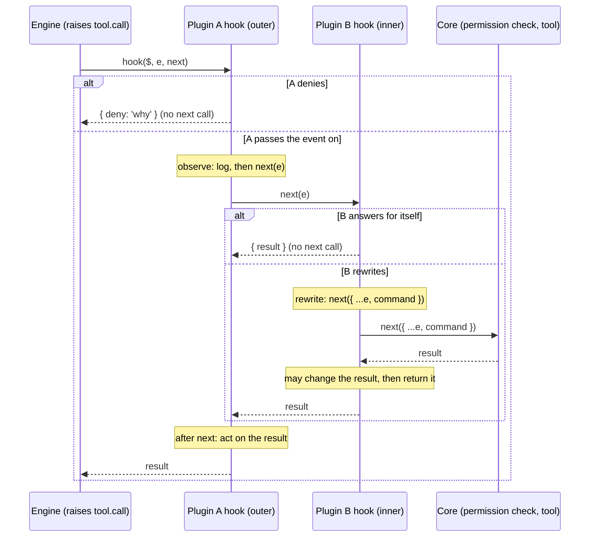

# Mods: the mental model

What a mod is, how one event travels through hooks, and what a mod can and cannot do. Read this first. Pinned to Claude Code 2.1.295.

## What a mod is

A mod is a plugin whose code is a **hooks module**. The module exports `register(on, options)`. Inside it, `on(event, matcher?, hook)` adds a hook. Claude Code calls a hook when the event happens. ([reference.md:11-24](../sources/claude-code-2.1.295/reference.md#L11), [d.ts:9301](../sources/claude-code-2.1.295/types/claude-code.d.ts#L9301), [d.ts:6771](../sources/claude-code-2.1.295/types/claude-code.d.ts#L6771))

Every hook has the shape `($, e, next)`:

| Argument | Meaning |
| --- | --- |
| `$` | The engine interface. Every call outside the module goes through it, written noun then method: `$.ui.toast(...)`, `$.fs.read(...)`. |
| `e` | The event input. Plain data, deeply frozen. `e.x = 1` throws. Change it with a copy: `next({ ...e, x })`. |
| `next` | The rest of the chain: the plugins beneath, then the engine's own behaviour. `next(e)` resolves to the event result. |

Sources: [d.ts:4824](../sources/claude-code-2.1.295/types/claude-code.d.ts#L4824) (`Frozen`), [d.ts:6535](../sources/claude-code-2.1.295/types/claude-code.d.ts#L6535) (`Next`), [docs: events](../sources/code-claude-com-2026-10-09/mods/events.md).

Three files make a mod. The module is the only code.

```text
my-mod/
├── .claude-plugin/plugin.json     { "name", "version", "description", "types"?, "userConfig"? }
├── hooks/hooks.json               { "modules": ["./register.tsx"] }   (one path)
└── hooks/register.tsx             export const register: Register = (on, options) => { ... }
```

A fourth file, `types/index.d.ts`, holds the type contract when the mod keeps `$.state`. See [state-and-storage](state-and-storage.md). Source: [SKILL.md:9-15](../sources/claude-code-2.1.295/SKILL.md#L9).

### Minimal module

```ts
import type { Register } from 'claude-code'

export const register: Register = on => {
  on('tool.call', { tool: 'Bash' }, async ($, e, next) => {
    if (/git push .*--force/.test(e.command)) return { deny: 'No force pushes here.' }
    return next(e)
  })
}
```

This is the pattern of [docs: events](../sources/code-claude-com-2026-10-09/mods/events.md#L106) and the shipped [tool-call.ts](../sources/claude-code-2.1.295/examples/tool-call.ts).

## The runtime

- The module runs in an **isolated environment**. It has no DOM and no Node. `eval`, `new Function` over a string and `WebAssembly` do not exist. ([d.ts:14738](../sources/claude-code-2.1.295/types/claude-code.d.ts#L14738))
- `$` reaches everything outside: files, processes, network, model, UI, session. ([reference.md:23-24](../sources/claude-code-2.1.295/reference.md#L23))
- JSX compiles against the global `h`. The engine adds the pragma. Do not declare `h` or `Fragment` and do not add a `@jsx` pragma. ([d.ts:14758](../sources/claude-code-2.1.295/types/claude-code.d.ts#L14758))
- Elements come from a per-surface table: `const { Box, Text, Button } = $.ui.resolve(e)`. There are no string tags and no element globals. ([d.ts:3802](../sources/claude-code-2.1.295/types/claude-code.d.ts#L3802))
- A module file and every file it imports use a code suffix (`.ts .tsx .jsx .js .mjs .cjs .mts .cts`). Files import each other with `import`. A module with `import()` does not load. ([reference.md:14](../sources/claude-code-2.1.295/reference.md#L14))
- Every call on `$` is itself an event. Another plugin can hook `fs.write`, `model.complete` and so on by name. `next.origin` names the caller. ([d.ts:6836](../sources/claude-code-2.1.295/types/claude-code.d.ts#L6836), [docs: admin](../sources/code-claude-com-2026-10-09/mods/admin.md#L312))

## One event through two plugins

Plugin A is outer (first in the chain). Plugin B is inner. Core is the engine's own behaviour. The diagram shows the four things a hook can do: observe, rewrite, answer, deny.



Rules the diagram shows ([events.md:15-71](../sources/code-claude-com-2026-10-09/mods/events.md#L15), [d.ts:6535](../sources/claude-code-2.1.295/types/claude-code.d.ts#L6535)):

| Move | Code | Effect |
| --- | --- | --- |
| Observe | `return next(e)` | Event passes unchanged. Add work before or after. |
| Act after | `const r = await next(e); ...; return r` | Hook sees the result. The model reads what the hook returns. |
| Rewrite | `next({ ...e, x })` | Plugins beneath and core see the copy. |
| Answer | return a result, no `next` | Chain stops. Plugins beneath and core do not run. |
| Deny | return `{ deny }` (shape differs per event) | A refusal answer. See [dispatch-and-guards](dispatch-and-guards.md). |

A hook that fails is skipped by default. A guard must opt in to fail closed with `.catch`. See [dispatch-and-guards](dispatch-and-guards.md).

## Mod, settings hook, other plugin parts

Claude Code calls both a mod's handler and a settings-file command a "hook". On these pages "hook" means the mod kind. The settings-file kind is a **classic** hook. ([docs: overview](../sources/code-claude-com-2026-10-09/mods/overview.md#L11))

| | Mod | Classic settings hook | Command hook in a plugin | Skill | Agent | MCP server |
| --- | --- | --- | --- | --- | --- | --- |
| Defined in | `hooks/hooks.json` `modules` + a TS/JS module | `hooks` in `settings.json` | `hooks/hooks.json` `hooks` key | `skills/*/SKILL.md` | `agents/*.md` | `.mcp.json` |
| Runs as | Function inside Claude Code | Shell command, HTTP, prompt or agent | Same as settings hook | Text Claude reads | A subagent type | External process |
| Can draw UI | Yes | No | No | No | No | No |
| Can rewrite events | Yes | Limited (allow, block, add context) | Limited | No | No | No |
| Hookable from a mod | n/a | Yes, as `classic.<Event>` | Yes, as `classic.<Event>` | Skill text via `skill.prompt` | Via `agent.offer`, `agent.spawn` | Claude's MCP tool calls arrive as `tool.call` with `tool` matching `/^mcp__/` |

Notes:

- `hooks.json` can hold both kinds. `modules` names the mod. The `hooks` key holds classic command hooks. ([docs: reference](../sources/code-claude-com-2026-10-09/mods/reference.md#L21))
- `claude plugin init` does **not** scaffold a mod. It scaffolds a plugin under `~/.claude/skills/<name>/` (`--with hooks` adds starter command hooks). A mod is written by hand, or by Claude through the bundled `plugin-authoring` skill. ([reference.md:9](../sources/claude-code-2.1.295/reference.md#L9), [cli-help.txt](../sources/claude-code-2.1.295/cli-help.txt#L88), [docs: plugins cli](../sources/code-claude-com-2026-10-09/plugins/cli-reference.md#L33))
- Classic events are hookable from a mod as `classic.Stop`, `classic.SessionEnd`, ... `e` is the JSON the settings hook gets on stdin. ([reference.md:27](../sources/claude-code-2.1.295/reference.md#L27), [d.ts:1251](../sources/claude-code-2.1.295/types/claude-code.d.ts#L1251))
- Chain position of classic `PreToolUse`: managed settings hooks run above every mod and a block there is final. Other settings hooks run beneath the last mod, as part of core. ([docs: events](../sources/code-claude-com-2026-10-09/mods/events.md#L300))
- A plugin can hold all of these. A mod can ship beside a skill and an MCP server. ([docs: overview](../sources/code-claude-com-2026-10-09/mods/overview.md#L221))

## Surfaces and where mods run

`e.surface` is one of `terminal`, `desktop`, `vscode`, `mobile` ([d.ts:10380](../sources/claude-code-2.1.295/types/claude-code.d.ts#L10380)). Each surface has its own element table ([d.ts:3802](../sources/claude-code-2.1.295/types/claude-code.d.ts#L3802)). Narrow on `e.surface` before you use a surface-only element (`Raster`, `Image`: terminal; `Client`: terminal and desktop; `Svg`: remote surfaces).

Hooks run wherever the plugin loads. Drawing is narrower. Source: [docs: overview, "Where mods run"](../sources/code-claude-com-2026-10-09/mods/overview.md#L189).

| Where | Hooks run | Mod UI drawn |
| --- | --- | --- |
| `claude` in a terminal (also an editor's integrated terminal, JetBrains plugin) | Yes | Yes |
| Desktop app, Code tab (not a WSL session) | Yes | Yes, minus terminal-only elements |
| Desktop app, WSL session | No (plugins unavailable) | No |
| VS Code extension chat panel | Yes | No |
| `claude -p`, Agent SDK | Yes | No |
| Remote Control (claude.ai, mobile) | Yes, in the session on your machine | In the terminal on your machine |
| Cloud session | Yes, for a plugin that reaches it | No |

Versions (public docs): mods are on by default. Terminal needs 2.1.287 or later. Desktop app needs 2.1.286 or later. ([docs: overview](../sources/code-claude-com-2026-10-09/mods/overview.md#L97)) The changelog announces mods in 2.1.287 ([changelog, 2.1.287](../sources/code-claude-com-2026-10-09/changelog-2.1.280-2.1.295.md#L630)). The public mods reference is written "as of v2.1.290".

A mod that draws should check `e.surface` and fall back to `$.ui.log` or a command text reply where nothing draws. *Inference from the table above*: `vscode` and `mobile` exist as typed surfaces, but the public table says nothing draws there. See [open-questions](../open-questions.md).

## Built-in mods

Some Claude Code features are mods. `/plugin` lists them under **Built-in**. You cannot update or uninstall them. Source: [docs: overview](../sources/code-claude-com-2026-10-09/mods/overview.md#L223).

| Name in `/plugin` | What it does | Public source |
| --- | --- | --- |
| `cc-plugin-agents-md` | Loads `AGENTS.md` as project instructions | `mods/agents-md` |
| `cc-plugin-diff` | Takes over `/diff` and draws its pane | `mods/diff` |
| `cc-plugin-plugin-authoring` | Ships the `plugin-authoring` skill. Skill only, no mod code | n/a |
| `cc-plugin-sec-default` | Guards what the organisation manages from user-installed mods. Cannot be turned off | `mods/sec-default` |
| `cc-plugin-telemetry` | Sends analytics records of Claude Code and the built-in mods | `mods/telemetry` |
| `cc-plugin-you-should-know` | Side agent that shows notes above the prompt. Off by default | n/a |

Sample mods outside the binary (playground repo): `token-weather`, `blast-radius`, `replay-theater`. See [examples/README](../examples/README.md).

## Security

A mod is code that runs with your permissions. It is **not sandboxed**. ([docs: overview](../sources/code-claude-com-2026-10-09/mods/overview.md#L64), [docs: admin](../sources/code-claude-com-2026-10-09/mods/admin.md#L9))

A loaded mod can:

- read and write files, start processes, make network requests;
- read environment variables and settings (secrets included);
- see every prompt and tool call, and rewrite them;
- submit a prompt as if you typed it, send messages to other sessions;
- approve a tool call before you are asked;
- call a model on your plan or key.

Limits:

- Sandboxing isolates the Bash commands Claude runs. A process a mod starts runs outside it. ([docs: overview](../sources/code-claude-com-2026-10-09/mods/overview.md#L79))
- A mod cannot redraw the permission dialog. It can add context with `$.ui.notice`. ([d.ts:9356](../sources/claude-code-2.1.295/types/claude-code.d.ts#L9356))
- Where `sec-default` loads, a user's mod cannot approve a call that a `deny` rule refuses, and a managed `PreToolUse` block is final. These rules cover Claude's tool calls only. A mod's own `$.fs` and `$.process` calls bypass them. ([docs: admin](../sources/code-claude-com-2026-10-09/mods/admin.md#L66))
- Before you install: `claude plugin validate ./mod` prints `hooks:` and `calls:` lines without running the code. Code that uses `$` in a way the scan cannot read does not load. ([docs: admin](../sources/code-claude-com-2026-10-09/mods/admin.md#L102))
- Off switches: disable the plugin in `/plugin`; `--safe-mode` for one session; `"disableAllHooks": true` for all sessions; `allowManagedModsOnly` (organisation). ([docs: overview](../sources/code-claude-com-2026-10-09/mods/overview.md#L95))

Admin controls are in [share-and-admin](../workflow/share-and-admin.md).

## What a mod can do

Adapted from "From the ask to the shape" in [SKILL.md:29-45](../sources/claude-code-2.1.295/SKILL.md#L29).

| The ask | Mechanism |
| --- | --- |
| A pane, panel, sidebar, live view | `$.ui.open({ id, title })`, drawn by a `ui.render` hook on `{ component: 'Pane', requestId: id }`. Resolves `{ isPlaced }`. |
| A band or row above the prompt | `ui.render` hook on `{ component: 'AbovePrompt' }`. Return a tree, or `next(e)` to show nothing. |
| Change a built-in row (spinner, tool row, dialog) | `ui.render` hook on that `component`. Return a tree, or `next({ ...e, props })`. |
| A status line entry | `$.ui.status(text)` from any hook. `undefined` clears it. |
| A toast | `$.ui.toast(text)` from any hook. |
| Block, rewrite or react to a tool call | `on('tool.call', { tool }, hook)`: return `{ deny }`, call `next({ ...e, ... })`, or `await next(e)` and act on the result. |
| Decide permission | `on('tool.check', ...)`: return `{ decision }`. |
| Change or react to a prompt | `on('prompt.submit', hook)`: `next({ ...e, text })`, or `{ drop }`. |
| Change the system prompt | `on('prompt.compose', hook)`: edit `next(e)`'s `{ sections }`. |
| Play a sound | `$.audio.play({ asset })`. The asset is a file of the mod. |
| A slash command | `$.command.register({ name, description })` in `session.start`, answered by a `command.run` hook returning `{ text }`. |
| Values a drawing reads | `atom`, `read`, `update` over `$.state`. Declared in the type contract. |
| A tool the model calls | `$.tool.register(spec)`, served by a `tool.call` hook on `mcp__<plugin>__<name>`. |
| A subagent type | `$.agent.register(spec)`. |
| Work on a timer | `$.clock.every`, `$.clock.after`. |
| Model calls, files, processes, network | `$.model`, `$.fs`, `$.process`, `$.http`. |
| Keep data across sessions | `$.store`. |

Event and noun detail: [reference/events](../reference/events.md), [reference/engine-interface](../reference/engine-interface.md), [reference/ui](../reference/ui.md).

## See also

- [dispatch-and-guards](dispatch-and-guards.md): `next` in depth, matchers, ordering, `.catch`, budgets.
- [state-and-storage](state-and-storage.md): module variables, `$.state`, `$.store`, the type contract.
- [glossary](glossary.md): terms.
- [gotchas](../gotchas.md): read before you write mod code.
- [workflow/develop](../workflow/develop.md), [workflow/validate-test-debug](../workflow/validate-test-debug.md).
