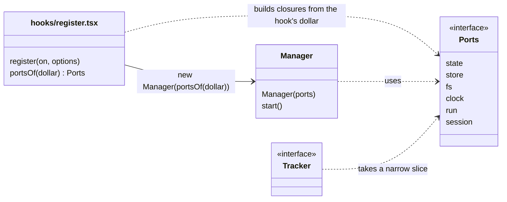

# Ports and injection

How to give code in other files and classes the power to hook events, call `$` and read state. What `claude plugin validate` accepts, what it refuses, and the pattern that works: build plain closures from `$` in one place and hand them on.

Pinned to Claude Code **2.1.302**. Links go to the [2.1.302 types](../sources/claude-code-2.1.302/types/claude-code.d.ts).

Grades on a claim:

- *verified-live*: seen in a real interactive session.
- *verified-kit*: seen in `claude plugin validate` or `claude plugin test`. "Also headless" means a `claude -p --plugin-dir` run with the real engine agreed.
- *types-only*: the d.ts or `reference.md` says it. Nobody ran it.
- *inference*: no source says it.

The spikes (`g01*`, `g02*`, `g13*`, `g19*`, `kbv-v*`, `r06*`, `r07*`) are throwaway mods built for [issue #55](https://github.com/martin-macak/claude-code-mod-tracking/issues/55). Their source is in [spikes-2026-10-17](../sources/spikes-2026-10-17/README.md), with one row per spike. Each claim quotes the output it saw.

## Why the reader decides

`validate` and the loader read the module **source** before any code runs. They list what the module hooks and calls. They refuse a module that spells `on`, `$`, `$.env` or a `$.state` reference in a way they cannot follow. ([d.ts:7887](../sources/claude-code-2.1.302/types/claude-code.d.ts#L7887), types-only) A managed `plugin.register` policy reads the same lists, so the rules are not only a lint. They decide whether the mod loads.

The reader follows relative imports of plugin files. It scans the whole import tree. *verified-kit:* a misspelled event that sits only in `trackers/d.ts` fails with `trackers/d.ts, compiled line 2 on("tool.calls", ...): "tool.calls" is not an event`.

Every hook and every `$` call is reported against `./register.ts`, whichever file registered it. The `hooks:` line does not tell you which tracker owns a hook. *verified-kit*

## Passing `on`

The rule: pass `on` only to a **plain named function**. That is a `function` declaration or a `const` bound to an arrow function. It may be in the same file or imported from a plugin file. *verified-kit,* 2.1.302.

| Spelling | Result |
| --- | --- |
| `installA(on)` where `installA` is exported from `./trackers/a` and calls `on('tool.call', { tool: 'Bash' }, …)` | Pass. `hooks: tool.call{tool=Bash}`. Fires in the kit and in a headless real-engine run. |
| `register` calls `installAll(on)`, which calls `installA(on)` and `installB(on)` | Pass. Chains work. `hooks: tool.call{tool=Bash}, tool.call{tool=Read}, turn.complete`. |
| `try { installA(on) } catch {}` and `if (options.withB === true) installB(on)` | Pass. `hooks:` lists B whatever the condition says. The kit's `test(name, { options }, body)` switches it. |
| `new TrackerB(on).attach()` | Fail: `"on" is used other than as a call or an argument to a function of the module's own (bound, spread or read)` |
| `new TrackerC().attach(on)` or `trackerH.install(on)` | Fail: `"on" is passed to something other than a function named at the top of this file or imported from one of the module's own files` |
| `for (const install of INSTALLERS) install(on)` | Fail: `the callee "install" is not a function declared at the top of this file (a function declaration, or a const bound to a function), nor imported fro…` |
| `INSTALLERS.forEach(install => install(on))` | Fail: `the value of install(on) is kept (assigned, passed, read, or returned from a nested function)` |
| `on(EVENT, …)` with a computed name | Fail: `the event name passed to on() is not a string literal` |

The registry must be a **static chain of named calls**. One line per tracker:

```ts
// hooks/register.ts
import type { Register } from 'claude-code'
import { installAll } from './trackers/index'

export const register: Register = (on) => {
  installAll(on)
}
```

```ts
// hooks/trackers/index.ts
import type { On } from 'claude-code'
import { installA } from './a'
import { installB } from './b'

export function installAll(on: On): void {
  installA(on)   // a new tracker adds one line here
  installB(on)
}
```

Consequence: a `Tracker` interface cannot hold `install(on)` as a method, and a manager cannot loop over a list of trackers to register them. The registry is code, not data. *Inference* from the failures above.

Extra arguments beside `on` are fine. One spike passed a shared object next to `on` ([`g01k`](../sources/spikes-2026-10-17/g01k-dollar-in-tracker-file/)).

### Duplicates

- Two `on('turn.complete', hook)` calls with **no matcher** anywhere in the import tree refuse the whole module. *verified-kit:*

  ```text
  trackers/b.ts, compiled line 2 `on("turn.complete", ($, e, next) => next(e));`: on("turn.complete") is registered twice without a matcher; the first is at …/hooks/trackers/a.ts:2
  ```

  The kit prints `HooksError: <plugin>: hooks module did not load: …` for it. A `try`/`catch` around the install cannot rescue it, because the module is refused before any hook runs.
- The same matcher twice is legal when the hooks are different functions. *verified-kit:* two identical `{ tool: 'Bash' }` hooks in two files gave `hooks: tool.call{tool=Bash}, tool.call{tool=Bash}`. Both ran, nested in registration order. One matcherless hook plus one `{ tool: 'Bash' }` hook is legal too.
- The d.ts says `a repeat throws` ([d.ts:6911](../sources/claude-code-2.1.302/types/claude-code.d.ts#L6911)). *Inference:* it means the same function registered twice. Nobody tested that.
- Registrations nest in order, first outermost. ([d.ts:6911](../sources/claude-code-2.1.302/types/claude-code.d.ts#L6911), types-only)

So the lifecycle manager is the **only** matcherless registrant of `session.start`, `session.end`, `turn.complete`, `agent.spawn` and every other event it fans out. Trackers register hooks with a matcher: `tool.call{tool}`, `session.append{door}`, `command.run{command}`, `ui.render{component, requestId}`. See [lifecycle](lifecycle.md#design-impact).

A computed matcher passes. `validate` prints it as `tool.call{tool=?}`.

## Passing the engine interface

`$` is the engine interface. The reader follows it into a function only when it can see the callee. The rule changed between 2.1.296 and 2.1.300. The release that changed it is unknown. 2.1.297 to 2.1.299 are not installed here.

| Spelling | 2.1.295, 2.1.296 | 2.1.300 to 2.1.302 |
| --- | --- | --- |
| `$` to a top-level function of the same file, `function` declaration (`runnerOf($)`, variant `v10`) | Pass | Pass |
| `$` to a top-level function of the same file, `const f = ($) => …` | Not tested | Pass. `calls: $.clock.now (via nowOf)` |
| `$` to an **imported** `function` declaration (`probe($)` from `./helper`) | Fail | **Pass.** `calls: $.process.run (via probe)` |
| `$` to an **imported** arrow `const` | Fail | Fail: `$ is passed to "nowOf", a name bound to a function expression, outside the hook's own file: past an import $ is followed only i…` |
| `new Thing($)`, `svc.m($)`, a method of a class in the same file | Fail | Fail: `$ itself is passed as an argument (bound, passed, spread, retur…` |
| A closure over `$`: `new GhTool(argv => $.process.run(argv))` | Pass | Pass |
| `held = $` (module variable) | Fail | Fail |
| `const p = $.process` or `const run = $.process.run` | Fail | Fail |

Evidence: *verified-kit.* The ten variants `v1` to `v10` in [mod-api-notes, section 9](../../claude-code-artifact-tracking/mod-api-notes.md#9-gotchas-that-bite-this-design) ([sources](../../claude-code-artifact-tracking/sources/live-observations-2026-10-10/validate-variants/)) failed or passed as recorded on 2.1.295 and 2.1.296. Re-run on 2.1.302, `v1`, `v2`, `v8` and `v10` pass and `v3`, `v4`, `v5`, `v6`, `v7` and `v9` fail with the recorded messages. Only `v2` (`probe($)` imported) changed. 2.1.300 and 2.1.301 gave the same result for `v2`.

The older rule, "an imported function fails", holds only to 2.1.296. A mod that passes `$` to an imported function needs 2.1.300 or later. A mod that injects closures needs nothing new. Prefer closures.

Write each cross-file helper as `export function f($: EngineInterface)`, never as an arrow `const`. *verified-kit*

## The ports object

Build plain closures from `$` in **one** same-file top-level function. Pass the closures on. The classes hold no `$`.

```ts
// hooks/register.ts
import type { EngineInterface, Register } from 'claude-code'
import { Manager } from './core/manager'
import type { Ports } from './core/ports'

function portsOf($: EngineInterface): Ports {
  return {
    store: { get: key => $.store.get(key), set: (key, value) => $.store.set(key, value) },
    fs: { read: path => $.fs.read(path), write: (path, text) => $.fs.write(path, text), exists: path => $.fs.exists(path) },
    clock: { now: () => $.clock.now(), after: (ms, fn) => $.clock.after(ms, fn), every: (ms, fn) => $.clock.every(ms, fn) },
    run: (argv, init) => $.process.run(argv, init),
    session: { id: () => $.session.id(), cwd: () => $.session.cwd() },
    // plus one state port per atom: see "State ports are per atom"
  }
}

let manager: Manager | undefined   // module variable: lost on reload, rebuilt in session.start

export const register: Register = on => {
  on('session.start', async ($, e, next) => {
    manager = new Manager(portsOf($))
    await manager.start()
    return next(e)
  })
}
```



What passed. *verified-kit,* 2.1.302, spike [`g02-ports-object`](../sources/spikes-2026-10-17/g02-ports-object/) (6 nouns, 14 closures):

- `validate` listed every call with `(via portsOf)`: `calls: $.clock.after (via portsOf), $.clock.every (via portsOf), … $.store.set (via portsOf)`. It ended `✔ Validation passed`. `tsc` passed against the 2.1.302 types.
- The kit tests passed: `ports object: closures keep working in timers and later dispatches` and `ports rebuilt per hook also work`. Closures built in `session.start` ran from `$.clock.every` at 500 ms and 1000 ms, from `$.clock.after`, and from a later `tool.call` dispatch. The interval survived that dispatch.
- *Also headless:* a `claude -p --plugin-dir` run with the real engine and a fake API. Ports built in `session.start` worked from `$.clock.every` (5 ticks), `$.clock.after` (1 fire), and a later `command.run` hook that has its own `$`. The `Manager` sat in a sibling folder `../core/`.
- `portsOf` may be an imported `function` declaration ([`g02b`](../sources/spikes-2026-10-17/g02b-ports-factory-in-import/), wrapped by a same-file `portsFor($)`). Object-literal method shorthand, `async` methods and a nested `function` inside `portsOf` pass too ([`g02c`](../sources/spikes-2026-10-17/g02c-method-shorthand-and-nested/)).
- Build the ports once per load and keep them in a module variable, or rebuild them in each hook. Both work. After a reload the module variable is empty, so rebuild in `session.start`.

### State ports are per atom

A generic port `{ read: a => read($, a), update: (a, f) => update($, a, f) }` fails. *verified-kit:* `the state library's read takes a source the scan can read: a reference whose plugin … [+331 chars]`. The scan must see a literal reference at each call. Declare the port for each atom in the file that owns the atom:

```ts
const items = atom({ plugin: 'artifact-tracking', key: 'items' } as const, [])
const itemsPort = { get: () => read($, items), update: (f: (v: Item[]) => Item[]) => update($, items, f) }
```

The rules for references are in [state-and-storage](state-and-storage.md#state-references-and-the-scan).

### `$` in a long-lived port, and agents

Every closure in a port uses the `$` of the hook that built it. `$` is built once per load. ([d.ts:4002](../sources/claude-code-2.1.302/types/claude-code.d.ts#L4002), types-only)

- Hook events from a subagent carry its `agentId`. `tool.call` does. `turn.start` does. ([d.ts:13296](../sources/claude-code-2.1.302/types/claude-code.d.ts#L13296), [d.ts:14060](../sources/claude-code-2.1.302/types/claude-code.d.ts#L14060), types-only)
- `$.session.cwd()` shows the limit. A timer that outlives its hook reads the session's directory. Keep the value you read inside the hook if you need the hook's (a subagent's own). ([d.ts:2828](../sources/claude-code-2.1.302/types/claude-code.d.ts#L2828), types-only)
- The kit has no agent context. Nobody ran a `$` call from a subagent hook through a cached port.
- *Inference:* build the ports from the first hook of the load. Pass `agentId` and the hook's `cwd` from the event into each tracker call. Do not store a hook-scoped value inside a port.

### One hook sees one moment of state

Within one dispatch every `$.state.get` reads one moment, whatever is written meanwhile. ([d.ts:3472](../sources/claude-code-2.1.302/types/claude-code.d.ts#L3472), types-only) *verified-kit,* headless real engine (`claude -p --plugin-dir`, fake API, not an interactive session): a `command.run` hook read `{ version: 0 }` for a second after a `session.start` timer's `update` had resolved. A bump armed inside the hook then raised the stored value to 2 and the hook read `{ value: 2, version: 2 }`. The split between "after its own write" and "after a write by a timer armed in another dispatch" was not separated, so that part is *inference*.

A manager that sleeps inside a hook and then re-reads state does not see other dispatches' writes. Read state at the start of a dispatch. To see later writes, re-enter through a new event or timer.

## Where the code may live

- A hooks module may import code from a sibling folder of `hooks/`, such as `../core/x.ts`. See [develop](../workflow/develop.md#sibling-folders-beside-hooks).
- A file that receives `on` may sit there too. *verified-kit,* also headless.
- A save of a file in such a folder reloads the mod, if a file of the import graph imports it (*verified-live*, [lifecycle: what triggers a reload](lifecycle.md#what-triggers-a-reload)).
- An import that leaves the plugin folder is refused.
- A bare package import is refused too. *verified-kit,* 2.1.302: `import { camelCase } from 'lodash'` gave `cannot import "lodash" (from hooks/register.ts): a hooks module imports its own files by relative path and "claude-code", nothing else`. Write the helper by hand or copy its source into the plugin folder.

## Async `register` and two hooks on one tree

- `register` may be `async`. *verified-kit,* 2.1.302: after `await Promise.resolve()` an `on('tool.call', { tool: 'Bash' }, …)` was listed by `validate` (`hooks: tool.call{tool=Bash}`) and fired in the kit. The d.ts says a returned promise is awaited ([d.ts:9706-9713](../sources/claude-code-2.1.302/types/claude-code.d.ts#L9706-L9713), types-only). The real engine was not run. `$` does not exist in `register`, so the body cannot read a file through `$.fs` before it picks installers. Only `options` can gate registration.
- Two `ui.render` hooks with the **same matcher** compose one tree. *verified-kit,* 2.1.302: `installA(on)` and `installB(on)` in two files both hooked `{ component: 'Pane', requestId: 'p' }`. The first registered is outermost. It got B's tree from `await next(e)` and wrapped it. `validate` printed `hooks: ui.render{component=Pane, requestId=p}, ui.render{component=Pane, requestId=p}`. The drawn tree was:

  ```text
  Box(a-root) > [ Text "A-head", Box(b-root) > [ Text "B-body" ], Text "A-foot" ]
  ```

  More detail (*verified-kit,* spikes `r07-compose` and `r07s-compose`, the kit with a bottom `ui.render` stub that draws `ENGINE-TREE`):

  - The first-registered hook is **outermost**. Its `await next(e)` resolves to the second hook's whole tree, a plain object `{ type, props, children }`, which it can embed. The second never sees the first's tree: its `next(e)` resolves to the tree beneath it (here the engine's).
  - A props rewrite by the outer hook, `next({ ...e, props })`, flows down. B read `e.props.title === 'rewritten-by-A'`.
  - A hook that answers **without** `next` shadows the one beneath it. B did not run and added nothing.
  - An unmatched `requestId` draws only the engine's tree.
  - Swapping the install order swaps which hook is outermost.
  - The root of the drawn tree carries `part = { plugin: '<this plugin>' }` ([d.ts 302:12816](../sources/claude-code-2.1.302/types/claude-code.d.ts#L12816)).
  - A tracker should not register its own `ui.render`. Under a core-owned pane the core builds the one tree from tracker data.

## A bus behind one hook

Core owns every `on()` and every `$`, and fans each event out to trackers inside one hook. This is the bus. Trackers are data and functions: they never get `on` or `$`. *verified-kit,* 2.1.302, spikes `r06a-bus` to `r06d-bus-live`.

| Form | `validate` | Result |
| --- | --- | --- |
| One matcherless `on('tool.call', …)` that looks `e.tool` up in a `Map` of handlers, and `on('session.append', { door: DOORS }, …)` with `const DOORS = ['tool-result', 'tool-message'] as const` in the same file | `hooks: tool.call, session.append{door=tool-result\|tool-message}`, `calls: $.store.set (via portsOf)`, `✔ Validation passed` | A clean line. In the kit every handler fired (`Read`, `Bash`, `Grep`, `Edit`; `Glob` has none and fired nothing) and only the two matched doors ran (`response`, `prompt` and `note` did not). |
| `DOORS` imported from `core/lib/doors.ts` | `session.append{door=?}` and an advisory: `holds a session.append hook to a door its source does not spell: whether it runs where an organization manages Claude Code cannot be told from the source`. Still `✔ Validation passed`. | The kit ran the hook for the doors the constant held. |
| `DOORS` computed from two trackers' declarations (`doorsOf([a, b])`, a `Set`) | The same `door=?` line and advisory | The kit ran the union, deduped (`response`, `tool-message`, `tool-result`). |
| The `Map` built from imported tracker declarations (`toolMap(TRACKERS)`), in a headless real-engine run with a fake API | `hooks: session.start, command.run{command=probe}, tool.call, session.append{door=?}` | The `Map` fanned `Read` out to both trackers. The computed door set included `note`. The matcher type accepts an array: `MatcherValue<V> = MatcherOne<V> \| readonly MatcherOne<Across>[]` ([d.ts 302:5993](../sources/claude-code-2.1.302/types/claude-code.d.ts#L5993)). |

- Spell `DOORS` as a same-file literal in `register.tsx` to keep the `validate` line clean and the managed-settings reading decidable. If the set must come from tracker declarations, accept the `door=?` advisory, or generate the literal into `register.tsx` at build time (*inference*). Whether a `door=?` hook runs where an organization's managed settings are in force is **not settled** (the validator says it cannot tell).
- Build the ports per dispatch with a same-file `portsOf($)` and keep `$` out of every other file. `captured = $` fails `validate` with `$ itself is assigned (bound, passed, spread, returned or read)`.
- Put `.catch((_$, e, next) => next(e))` on observe-only bus hooks. `validate` prints `gating hook without .catch: session.append` for a `session.append` hook that has none. The `.catch` did not change the self-call skip in the runs.
- **One fan-out hook is one frame.** A hook is not run beneath its own call ([dispatch-and-guards](dispatch-and-guards.md#a-hook-is-not-run-beneath-its-own-call)). So a row that a tracker appends inside the bus dispatch of event X is invisible to every tracker on X, not only to its author. A timer that a tracker arms inside a handler inherits the skip. If tracker B must see the rows that tracker A appends on the same event, B needs a second `on()` with a matcher (the peer case, `invA=2 invB=2`). A second matcherless `on()` for one event is refused, so the peer needs a matcher such as `{ door: 'note' }`.
- An in-process emit from one tracker to another is plain JavaScript the engine cannot see. It still needs its own depth cap (*inference*; not tested).
- A custom noun on `$` is not part of this design. The "third identical open call waits" rule of [d.ts 302:7801-7807](../sources/claude-code-2.1.302/types/claude-code.d.ts#L7801-L7807) covers such nouns only (*types-only*, not tested).

## Checklist

- `on` goes to named functions only. The registry is a static chain.
- One matcherless hook per event, owned by the lifecycle manager.
- `$` goes to closures built in `register.ts`, or to imported `function` declarations (2.1.300+).
- Each state reference is a literal in the file that uses it. Cross-file access goes through `export function f($)` or a per-atom port.
- Classes take ports. They never take `$` or `on`.
- A fan-out hook is one frame: a row a tracker appends in it is invisible to every tracker on that hook ([A bus behind one hook](#a-bus-behind-one-hook)).
- Run `claude plugin validate` after every change to a registry or a port. In the kit, a `HooksError: … hooks module did not load` is a scan error, not a test error.

## See also

- [lifecycle](lifecycle.md): which hook owns which moment.
- [state-and-storage](state-and-storage.md): the state library and the type contract.
- [workflow/validate-test-debug](../workflow/validate-test-debug.md#rules-the-static-reader-enforces): the full list of reader rules.
- [reference/changes-2.1.302](../reference/changes-2.1.302.md): the `$` rule change.
- [mod-api-notes](../../claude-code-artifact-tracking/mod-api-notes.md#9-gotchas-that-bite-this-design): the ten variants on 2.1.295.
