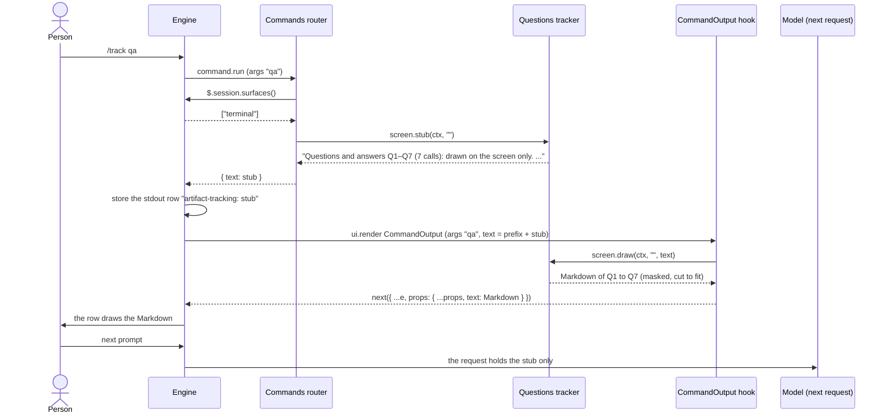

# Questions and plans as a hook sees them (issue #71)

Date: 2026-10-21. Engine: Claude Code 2.1.306 (the types snapshot is 2.1.302).

This page records what a `tool.call` hook sees of an `AskUserQuestion` call and of an `ExitPlanMode` call: before the dialog opens, and after the person answered. The spike of [issue #71](https://github.com/martin-macak/claude-code-mod-tracking/issues/71) first ran on 2.1.302 with a fake Messages API (the issue holds its summary). The runs below repeated it on 2.1.306 and added the plan dialog. The probe mod, the fake API, the keys and every capture are in [sources/spikes-2026-10-21](../sources/spikes-2026-10-21/README.md).

## Grades

| Tag | Meaning | KB grade |
| --- | --- | --- |
| `[observed]` | Seen in a capture of a run in a tmux session, with a fake API behind the engine (no model, no account) | *verified-live* (an interactive session). The fake API means the model was not real. |
| `[primary source]` | Stated by the types file | *types-only* |
| `[inference]` | Nobody ran it | *inference* |

## What the hook sees

One `tool.call` hook (`tool: 'AskUserQuestion'` or `'ExitPlanMode'`) calls `await next(e)` and then reads the answer. `e` is the whole input. The answer of `next(e)` has the shape `{ ref, result, text, isError?, isReadOnly? }` ([d.ts:13340](../sources/claude-code-2.1.302/types/claude-code.d.ts#L13340)), or `{ deny }` when a hook denied the call. `result` is the tool's own record: the output schema is at [d.ts:21094](../sources/claude-code-2.1.302/types/claude-code.d.ts#L21094) for `AskUserQuestion` and [d.ts:21370](../sources/claude-code-2.1.302/types/claude-code.d.ts#L21370) for `ExitPlanMode`. The `text` is what the model reads. It is not a contract: the two answered runs gave `The user answered: …` (R1) and `Your questions have been answered: …` (R3) for the same shape of record.

### AskUserQuestion

| Fact | Evidence | Tag |
| --- | --- | --- |
| Before the dialog, `e` holds `questions[]` (`question`, `header`, `multiSelect`, `options[]` with `label`, `description`, optional `preview`), `tool` and `tool_use_id`. | R1 `input` | `[observed]` |
| After the dialog, `result` is `{ questions, answers, annotations }`. `answers` maps the question text to a string. `annotations` maps the question text to `{ preview?, notes? }`, and is `{}` when there is none. | R1, R3 | `[observed]` |
| A pick is the label: `"Ship it?": "Yes"`. A text typed under "Other" is the text as typed. | R3 (pick), R1 (typed) | `[observed]` |
| A multi-select answer is one string. The labels are joined with a comma and a space, and a piece that holds a comma is wrapped in double quotes: `Lint, "Tests, all", "typed, with comma"`. The typed text is a piece like any other: only the options of the question tell a label from typed text. | R1 | `[observed]` |
| Notes with no option picked give the answer `(notes only)` and an annotation `{ notes }`. The question is not missing from `answers`. | R1 | `[observed]` |
| A question the person leaves blank is missing from `answers` (the 2.1.302 run of the issue). This run did not leave one blank. | issue #71, evidence | `[observed]` on 2.1.302 |
| The picked preview comes in `annotations[question].preview`. | issue #71, evidence. R1 had notes and no pick, so it shows none. | `[observed]` on 2.1.302 |
| Esc is `isError: true`. `result` is the string `Error: The user doesn't want to proceed with this tool use. …`, and `text` is the same without `Error:`. The turn ended: no further model request followed. | R2 | `[observed]` |
| `result` is typed `answers: {}`, `annotations: {}`: the output schema does not describe the keys. The `response`, `followUp` (a request for another round) and `afkTimeoutMs` (an away dialog) fields are in the schema. None was run. | [d.ts:21129-21138](../sources/claude-code-2.1.302/types/claude-code.d.ts#L21129-L21138) | `[primary source]` |
| The output schema has `kind` (`choice`, `text`, `number`) and `description` for a question. No run asked one. | [d.ts:21101-21103](../sources/claude-code-2.1.302/types/claude-code.d.ts#L21101-L21103) | `[primary source]` |
| A `$.ui.ask` of another plugin reaches the same hook with an id `toolu_plugin_…`. The event does not name the plugin. | [d.ts:2452](../sources/claude-code-2.1.302/types/claude-code.d.ts#L2452), issue #71 | `[primary source]` |

### ExitPlanMode

| Fact | Evidence | Tag |
| --- | --- | --- |
| The input `e` holds `plan` (the whole plan text) and `planFilePath` before the dialog, when the model wrote a plan file. The engine puts them in: the model sent `{}`. With no plan file, `e` has neither. | R5, R4 | `[observed]` |
| An approval is a result `{ plan, isAgent: false, filePath }` with no `isError`. `plan` is the text again, or `null` with no plan file. The `text` starts `User has approved your plan.` and repeats the plan under `## Approved Plan:`. With no plan file it reads `User has approved exiting plan mode.` | R5, R4 | `[observed]` |
| The way the person approved (auto mode, manual edits, the default mode) is not in the result. | R4, R5 | `[observed]` |
| A rejection with a note (`Tell Claude what to change`) is `isError: true`. `result` and `text` hold the engine's words and the note: `… To tell you how to proceed, the user said:\nUse fewer steps`. The note is in those strings only. | R6 | `[observed]` |
| Esc on the plan dialog is `isError: true` and the words `… STOP what you are doing and wait for the user to tell you how to proceed.` | R7 | `[observed]` |
| The input keeps the plan on a rejection too (`plan` and `planFilePath` are there before the dialog), so a hook has the plan whatever the outcome. | R6, R7 | `[observed]` |
| `awaitingLeaderApproval` and `requestId` are in the output schema for a teammate that sends its plan to a leader. No run asked one. | [d.ts:21380-21383](../sources/claude-code-2.1.302/types/claude-code.d.ts#L21380-L21383) | `[primary source]` |
| `planWasEdited` (an edit with `Ctrl+G` or on the web) is in the schema. Not run. | [d.ts:21378](../sources/claude-code-2.1.302/types/claude-code.d.ts#L21378) | `[primary source]` |

So a hook sees both the plan and the outcome. The outcome is `isError`. The plan is in the input. The note of a rejection is in the string `result` and in the `text`: the capture of the rejected plan (R6) shows both, so the text is not needed for it.

## After `--resume`

`$.session.messages()` returns each tool use as `{ tool_use_id, tool, input, result?, text?, isError? }` ([d.ts:13810](../sources/claude-code-2.1.302/types/claude-code.d.ts#L13810)). `input` is "the arguments the model gave it" and `result` is "what the transcript stored": the tool record on an answered call, the error text on a refused one. So the replay of an answered `AskUserQuestion` has the same structured answer, and the replay of an approved plan has the plan in `result.plan` and none in `input`. The replay of a rejected plan has the error text and no plan. A `$.ui.ask` of another plugin is not in the transcript (issue #71). The replay is `[primary source]` here: the mod's tests drive it with a fake transcript, no run read a real one.

The mod keeps its caps (100 calls, 256 KiB) across a resume, so the replay must tell a call that the caps dropped from a call that the mod never saw. The ids of the stored calls say it, but only while the stored copy holds a call of the transcript: the caps can leave only plugin calls or a subagent's calls, which the transcript of the main loop lacks, and then no id matches. A replay that took this for a cold load would add every dropped call after the newer ones, and the caps would then evict the newer ones. So a drop leaves the id of the newest dropped transcript call on the first call that stays (`watermark` in the record). It moves on as that call drops. The replay reads the transcript only after the later of two marks: the first stored call it finds, and the watermark. A stored copy with neither has seen no transcript call drop, so the replay adds all of them. A copy that came over `/clear` carries a watermark that the new transcript lacks, so it adds all of them too. Grade: *verified-kit*. The kit tests drive this with a fake transcript (`questions-tracker` "a resume whose stored copy holds only plugin calls…"). `[inference]`: no run resumed a real session past the caps.

## Not tested

- "Chat about this" (`followUp`, `response`) and the answer of an away dialog (`afkTimeoutMs`).
- A `text` or `number` question (`kind`). The mod keeps `placeholder`, `min`, `max`, `step`, `defaultValue` and `unit` of such a question as the output schema names them ([d.ts:21116](../sources/claude-code-2.1.302/types/claude-code.d.ts#L21116)) `[primary source]`. No run has shown them, and the shape of the answer to such a question is not seen either ([issue #208](https://github.com/martin-macak/claude-code-mod-tracking/issues/208)).
- A `$.ui.ask` of a real second plugin, and which field would name it.
- An edit of a plan with `Ctrl+G` (or on the web), and a teammate plan that awaits its leader. The mod reads an approved plan from `result.plan` first and from the input second, so an edited plan shows when the result carries it `[inference]`. In every capture the two are equal. The live check of an edit is [issue #208](https://github.com/martin-macak/claude-code-mod-tracking/issues/208).
- The copy of a call to the clipboard: the mod calls `ui.copy` ([d.ts:2593](../sources/claude-code-2.1.302/types/claude-code.d.ts#L2593)). The kit checks the call and the text. A live run (2.1.307) heard the event in a probe plugin that answered it without `next`, so the text of the key is proven and the clipboard stayed as it was `[observed]`. No run let the engine write the clipboard, because that would overwrite it (open question 49).
- Any version but 2.1.302 and 2.1.306.

## Keeping `/track qa` from the model

Issues [#196](https://github.com/martin-macak/claude-code-mod-tracking/issues/196) (the spike) and [#246](https://github.com/martin-macak/claude-code-mod-tracking/issues/246) (the build). The question: can a mod draw the Markdown of `/track qa` in the row, and keep it out of the next model request? The reply of a command is a transcript line, and the engine puts it in the next request as `<local-command-stdout>` ([turn-strip](turn-strip.md), S12). A `ui.render` hook on `CommandOutput` that rewrites `text` draws the rewrite and leaves the stored row alone. So the command answers a stub, and the hook draws the Markdown.

Verdict: **verified-live** on Claude Code 2.1.310 and again on 2.1.311, for the terminal (main screen and fullscreen), with a fake Messages API behind the engine (no model, no login). The real mod then ran the same way on **2.1.312** (the `e2e/features/questions.feature` scenarios "A question and my answer are listed by /track qa, word for word" and "/track qa --send gives the model the whole text"). **verified-kit** for `claude -p`. **types-only** for the desktop app, the mobile app and the VS Code host. The probes, the logs and the sources are in [spikes-2026-10-26](../sources/spikes-2026-10-26/README.md) (#196, 2.1.310) and [spikes-2026-10-27](../sources/spikes-2026-10-27/README.md) (#246, 2.1.311).

| Fact | Evidence | Tag |
| --- | --- | --- |
| The hook fires for a row of a plugin command. `requestId` is the uuid of the stored stdout row, `command` the registered name, `args` all that follows the name (`qa 3`), `text` is `<plugin>: <reply>`. | #196 S1 | `[observed]` 2.1.310 |
| A `text` rewrite draws in the row (main screen, fullscreen, the ctrl+o view) as Markdown. The stored rows hold the stub only. | #196 S2, #246 E6 | `[observed]` 2.1.310, 2.1.311 |
| The next request holds the stub and none of the rewrite. The fake API scanned every message of the request. A control command with no rewrite shows that the detector sees a command reply. | #196 S3, #246 E7, e2e step `no command reply to the fake model holds …` | `[observed]` 2.1.310, 2.1.311, 2.1.312 |
| The rewrite replaces the whole drawn text, the plugin prefix too (`<plugin>:`). A prop that the hook did not change must go on as received: `onScreen` exists in the fullscreen layout. | #196 S1, #246 E6 | `[observed]` |
| The reply is drawn as Markdown after the prefix on the same line. A title that starts the reply draws a literal `#` (`artifact-tracking: # Questions and answers`). One leading line break puts the prefix alone on its line, and the title is a heading. The same for `##`. | #246 S1, E2 to E5, and the e2e step `the screen does not show "# Questions and answers"` | `[observed]` 2.1.311, 2.1.312 |
| `claude -p` draws nothing: `$.session.surfaces()` is `[]`, `isInteractive` is `false`, and the reply is the only output (the stub, when the command answered one). The real mod under `claude -p --continue` prints the whole text of `/track qa`, `/track qa 1` and `/track qa --send`, with a call that the replay read back from the transcript. | #196 S5, #246 E1b, E8, E9, [headless-real-mod.log](../sources/spikes-2026-10-27/p246-probe/headless-real-mod.log) | `[observed]` *verified-kit* (2.1.310 to 2.1.312) |
| The row draws 100 000 characters at most, then `… N more characters, not drawn`, and the engine adds a notice row that no request holds. The mod keeps the newest whole calls under the limit and names the others. | #196 S7 | `[observed]` 2.1.310 |
| An empty reply (`text: ''`) keeps a row with the text `<plugin>:`. A reply of `{}` stores no row and raises no render. | #196 S8 | `[observed]` |
| A resumed session raises the hook for each restored row with the same `requestId`, `args` and stub, before the slot has loaded. A redraw (`$.ui.invalidate('ui.render')`) draws the row again. On the main screen with a transcript taller than the terminal, the scrollback keeps the stub of the first paint and a mixed copy. Fullscreen is clean. | #196 S6 | `[observed]` 2.1.310 |
| The guard `cc-plugin-sec-default` hooks neither `ui.render` nor `command.run`, so it does not stand in the way. Nothing tried to bypass it. | #196 S9, #246 E0 | `[observed]` on a machine with managed settings |
| The model already holds the Q&A of its own `AskUserQuestion` calls. The stub removes only the copy that `/track qa` adds. | #196 S10 | `[observed]` |
| In a kit test the hook's `$.session.surfaces()` rejects with `no implementation for session.surfaces` unless the test answers that event. The surface of `$.session.start` does not feed it. | #246 K0, K0b, K1 | `[observed]` *verified-kit* |
| A kit test sees what `next` received when it mounts a `CommandOutput` row with an `on('ui.render')` beneath the plugin. It cannot read a model request. | #246 K3 | `[observed]` *verified-kit* |
| The desktop and the mobile app raise `CommandOutput` and should draw the rewrite. The VS Code host attaches no surface, so `surfaces()` is empty there and the mod answers the whole text. | [d.ts:10446-10455](../sources/claude-code-2.1.302/types/claude-code.d.ts#L10446-L10455), [d.ts:10796-10798](../sources/claude-code-2.1.302/types/claude-code.d.ts#L10796-L10798) | `[primary source]` *types-only* |

What the mod does (issue #246):

- `CommandSpec.screen` (`stub`, `draw`) on `qa`. It counts only with `text`. The router answers the stub where `$.session.surfaces()` is not empty, or when the read fails, and the whole text where it is empty. `/track qa --send [n]` always answers the whole text (any case, before or after `n`). The usage line, `No questions asked in this session.` and `No call 9. Calls kept: …` stay plain.
- One hook on `{ component: 'CommandOutput' }` (`hooks/register.tsx`). It checks `e.props.command === 'track'` before any `await`, finds the stub by its own words anywhere in `text` (the engine puts one or more plugin names in front), and draws exactly the calls the stub names, with the mask and the limits of the config as they are at draw time. A row with no stub, an error, a failed read and a slot that holds no call of the range go to the engine's own row.
- `SwitchRunner.loadSession` asks one redraw after the stored copy and the replay are in, so a restored row draws again at once. The tick, every 30 s by default, is the only other redraw.
- The reply of `qaText` starts with a line break, for the whole list and for one call. `qaMarkdown` and `callMarkdown`, which the copy key `y` uses, do not.
- After `/track clear` the numbers start again from `Q1`. An old stub row then draws the stub (no call of its numbers is left), and later a call that has one of its numbers. The stub names numbers only (owner decision OQ4 of #196), so it cannot tell the two apart.

How the acceptance criteria of #196 are met: AC1 and AC2 by the rows above (the row draws the Markdown, and the stored row and the next request hold the stub), AC3 by this section, AC4 by the `claude -p` row, AC5 by the build of #246.

Not tested (see [open-questions](../open-questions.md), 50 to 53): the desktop and the mobile app, a machine without the guard, a real model and the VS Code host. The e2e harness has no headless step, so the `claude -p` run of the real mod was made once by hand (the log above) and the kit test with `surfaces: []` holds the rule.

## What the mod does with it

[`trackers/questions/`](../../../../plugins/artifact-tracking/trackers/questions/) reads `result.result` and never the text, except for the pieces of a multi-select answer. The words of a refusal, with the note of a rejected plan, are the string `result.result` (it keeps the engine's `Error:` mark). The text is the fallback for a transcript use that stored no `result`. See the README section [Questions and answers](../../../../plugins/artifact-tracking/README.md#questions-and-answers).
