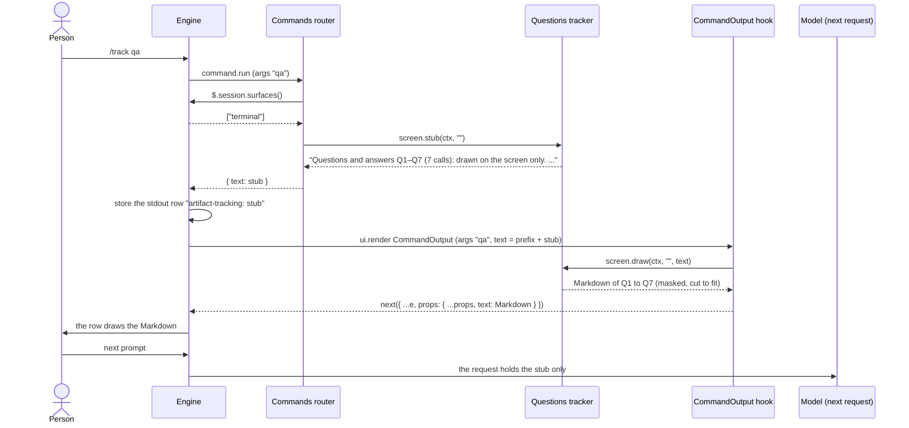

# Questions and plans as a hook sees them (issue #71)

Date: 2026-10-21 (the section "Keeping `/track qa` from the model": 2026-10-27; "The forms that ran live": 2026-11-01, Claude Code 2.1.316; "Through a permission-prompt host and Ctrl+G": 2026-11-05, Claude Code 2.1.318; the slider check in that section: the desktop app 4.16336.0, engine 2.1.317). Engines: Claude Code 2.1.306 (the types snapshot is 2.1.302); the section on `/track qa` ran on 2.1.310 to 2.1.312. Issues #71, #196, #246 and #312.

This page records what a `tool.call` hook sees of an `AskUserQuestion` call and of an `ExitPlanMode` call: before the dialog opens, and after the person answered. The spike of [issue #71](https://github.com/martin-macak/claude-code-mod-tracking/issues/71) first ran on 2.1.302 with a fake Messages API (the issue holds its summary). The runs below repeated it on 2.1.306 and added the plan dialog. The probe mod, the fake API, the keys and every capture are in [sources/spikes-2026-10-21](../sources/spikes-2026-10-21/README.md).

## Grades

| Tag | Meaning | KB grade |
| --- | --- | --- |
| `[observed]` | Seen in a capture of a run in a tmux session, with a fake API behind the engine (no model, no account) | *verified-live* (an interactive session). The fake API means the model was not real. |
| `[primary source]` | Stated by the types file | *types-only* |
| `[inference]` | Nobody ran it | *inference* |

## What the hook sees

One `tool.call` hook (`tool: 'AskUserQuestion'` or `'ExitPlanMode'`) calls `await next(e)` and then reads the answer. `e` is the whole input. The answer of `next(e)` has the shape `{ ref, result, text, isError?, isReadOnly? }` ([d.ts:13340](../sources/claude-code-2.1.302/types/claude-code.d.ts#L13340)), or `{ deny }` when a hook denied the call. `result` is the tool's own record: the output schema is at [d.ts:21094](../sources/claude-code-2.1.302/types/claude-code.d.ts#L21094) for `AskUserQuestion` and [d.ts:21370](../sources/claude-code-2.1.302/types/claude-code.d.ts#L21370) for `ExitPlanMode`. The `text` is what the model reads. It is not a contract: the two answered runs gave `The user answered: …` (R1) and `Your questions have been answered: …` (R3) for the same shape of record.

### AskUserQuestion

| Fact | Evidence | Tag |
| --- | --- | --- |
| Before the dialog, `e` holds `questions[]` (`question`, `header`, `multiSelect`, `options[]` with `label`, `description`, optional `preview`), `tool` and `tool_use_id`. | R1 `input` | `[observed]` |
| After the dialog, `result` is `{ questions, answers, annotations }`. `answers` maps the question text to a string. `annotations` maps the question text to `{ preview?, notes? }`, and is `{}` when there is none. | R1, R3 | `[observed]` |
| A pick is the label: `"Ship it?": "Yes"`. A text typed under "Other" is the text as typed. | R3 (pick), R1 (typed) | `[observed]` |
| A multi-select answer is one string. The pieces are joined with a comma and a space, and a piece that holds a comma or a quote is a JSON string (double quotes, a backslash before an inner quote or backslash): `Lint, "Tests, all", "say \"hi\", ok"`. The typed text is a piece like any other: only the options of the question tell a label from typed text. The first run (2.1.306) saw the comma only. See [the forms that ran live](#the-forms-that-ran-live-issue-208). | R1, #208 C2 to C5 | `[observed]` |
| Notes with no option picked give the answer `(notes only)` and an annotation `{ notes }`. The question is not missing from `answers`. | R1 | `[observed]` |
| A question the person leaves blank is missing from `answers` (the 2.1.302 run of the issue). This run did not leave one blank. | issue #71, evidence | `[observed]` on 2.1.302 |
| The picked preview comes in `annotations[question].preview`. | issue #71, evidence. R1 had notes and no pick, so it shows none. | `[observed]` on 2.1.302 |
| Esc is `isError: true`. `result` is the string `Error: The user doesn't want to proceed with this tool use. …`, and `text` is the same without `Error:`. The turn ended: no further model request followed. | R2 | `[observed]` |
| `result` is typed `answers: {}`, `annotations: {}`: the output schema does not describe the keys. The `response`, `followUp` (a request for another round) and `afkTimeoutMs` (an away dialog) fields are in the schema. None was run. | [d.ts:21129-21138](../sources/claude-code-2.1.302/types/claude-code.d.ts#L21129-L21138) | `[primary source]` |
| The output schema has `kind` (`choice`, `text`, `number`) and `description` for a question. No run asked one. | [d.ts:21101-21103](../sources/claude-code-2.1.302/types/claude-code.d.ts#L21101-L21103) | `[primary source]` |
| A `$.ui.ask` of another plugin reaches the same hook with an id `toolu_plugin_…`. The event does not name the plugin. | [d.ts:2452](../sources/claude-code-2.1.302/types/claude-code.d.ts#L2452), issue #71 | `[primary source]` |

### ExitPlanMode

| Fact | Evidence | Tag |
| --- | --- | --- |
| The input `e` holds `plan` (the whole plan text) and `planFilePath` before the dialog, when the model wrote a plan file. The engine puts them in: the model sent `{}`. With no plan file, `e` has neither. | R5, R4 | `[observed]` |
| An approval is a result `{ plan, isAgent: false, filePath }` with no `isError`. `plan` is the text again, or `null` with no plan file. The `text` starts `User has approved your plan.` and repeats the plan under `## Approved Plan:`. With no plan file it reads `User has approved exiting plan mode.` | R5, R4 | `[observed]` |
| The way the person approved (auto mode, manual edits, the default mode) is not in the result. | R4, R5 | `[observed]` |
| A rejection with a note (`Tell Claude what to change`) is `isError: true`. `result` and `text` hold the engine's words and the note: `… To tell you how to proceed, the user said:\nUse fewer steps`. The note is in those strings only. | R6 | `[observed]` |
| Esc on the plan dialog is `isError: true` and the words `… STOP what you are doing and wait for the user to tell you how to proceed.` | R7 | `[observed]` |
| The input keeps the plan on a rejection too (`plan` and `planFilePath` are there before the dialog), so a hook has the plan whatever the outcome. | R6, R7 | `[observed]` |
| `awaitingLeaderApproval` and `requestId` are in the output schema for a teammate that sends its plan to a leader. No run asked one. | [d.ts:21380-21383](../sources/claude-code-2.1.302/types/claude-code.d.ts#L21380-L21383) | `[primary source]` |
| An edit with `Ctrl+G` in the terminal: the input keeps the plan of the model, and the result has the edited `plan` and `planWasEdited: true`. The `text` says `## Approved Plan (edited by user):`. The mod shows the edited plan. An edit on the web was not run. | G in [spikes-2026-11-05-hosts](../sources/spikes-2026-11-05-hosts/README.md), [d.ts:21378](../sources/claude-code-2.1.302/types/claude-code.d.ts#L21378) | `[observed]` *verified-live* (2.1.318) |

So a hook sees both the plan and the outcome. The outcome is `isError`. The plan is in the input. The note of a rejection is in the string `result` and in the `text`: the capture of the rejected plan (R6) shows both, so the text is not needed for it.

## After `--resume`

`$.session.messages()` returns each tool use as `{ tool_use_id, tool, input, result?, text?, isError? }` ([d.ts:13810](../sources/claude-code-2.1.302/types/claude-code.d.ts#L13810)). `input` is "the arguments the model gave it" and `result` is "what the transcript stored": the tool record on an answered call, the error text on a refused one. So the replay of an answered `AskUserQuestion` has the same structured answer, and the replay of an approved plan has the plan in `result.plan` and none in `input`. The replay of a rejected plan has the error text and no plan. A `$.ui.ask` of another plugin is not in the transcript (issue #71). The replay is `[primary source]` here: the mod's tests drive it with a fake transcript, no run read a real one.

The mod keeps its caps (100 calls, 256 KiB) across a resume, so the replay must tell a call that the caps dropped from a call that the mod never saw. The ids of the stored calls say it, but only while the stored copy holds a call of the transcript: the caps can leave only plugin calls or a subagent's calls, which the transcript of the main loop lacks, and then no id matches. A replay that took this for a cold load would add every dropped call after the newer ones, and the caps would then evict the newer ones. So a drop leaves the id of the newest dropped transcript call on the first call that stays (`watermark` in the record). It moves on as that call drops. The replay reads the transcript only after the later of two marks: the first stored call it finds, and the watermark. A stored copy with neither has seen no transcript call drop, so the replay adds all of them. A copy that came over `/clear` carries a watermark that the new transcript lacks, so it adds all of them too. Grade: *verified-kit*. The kit tests drive this with a fake transcript (`questions-tracker` "a resume whose stored copy holds only plugin calls…"). `[inference]`: no run resumed a real session past the caps.

## The forms that ran live (issue #208)

Issue [#208](https://github.com/martin-macak/claude-code-mod-tracking/issues/208), 2026-11-01, Claude Code **2.1.316**, macOS, tmux, a fake Messages API (no model, no login). A probe plugin wrote `e` and the answer of `next(e)` of each call. The probes, the sequences, the keys and the captures are in [spikes-2026-11-01](../sources/spikes-2026-11-01/README.md). The kit tests that use the captured shapes are in `plugins/artifact-tracking/tests/questions-live-316.test.ts`.

| # | Fact | Evidence | Tag and grade |
| --- | --- | --- | --- |
| C1 | A `text` and a `number` question answer a plain string each in `answers` (`"acme-app"`, `"12"`), with `annotations: {}`. The result keeps `kind`, `placeholder`, `min`, `max`, `step`, `defaultValue` and `unit` as given, and `options: []`. `/track qa` shows the control line and `Other (typed): …` for both. | `AskUserQuestion-toolu_tn_1.json`, `track-qa-1-text-number.txt` | `[observed]` *verified-live* |
| C1a | A terminal session does not offer these kinds. The tool schema sent to the model has no `kind`, and `options` is required (2 to 4). A `kind: "text"` call with options is drawn as a plain choice question. The kinds exist only when the host turns on `extendedQuestionsEnabled`: the engine reads `CLAUDE_CODE_QUESTION_EXTENDED` for the entrypoints `sdk-ts`, `sdk-py`, `sdk-cli`, `local-agent`, `claude-desktop`, `claude-desktop-3p`, and for a remote session. The run forced it (`CLAUDE_CODE_ENTRYPOINT=sdk-cli CLAUDE_CODE_QUESTION_EXTENDED=1`). Then a text or number question takes no options (the engine refuses them: "A "text" question takes no options"), and the terminal draws both as a text box (`Type something.`), with no slider. The desktop run [S1](#through-a-permission-prompt-host-and-ctrlg-issue-312) fits this row only partly: this row lists `claude-desktop` as an entrypoint that reads the flag, and the model in S1 reported no `kind` in its schema, with the flag set through the settings `env`. S1 does not resolve this. | `ask-tool-schema-extended.json`, engine strings of 2.1.316 | `[observed]` *verified-live* with the gate forced. A stock terminal session never asks one. |
| C2 | A multi-select with the options `A` and `A, custom` and a typed piece: the dialog's review line and the answer are `A, "A, custom", typed piece`. The engine quotes the label that holds a comma. | `…toolu_comma_1.json` | `[observed]` *verified-live* |
| C3 | A typed piece `say "hi", ok` is `Lint, "say \"hi\", ok"` in `answers`: a JSON string, a backslash before each inner quote. | `…toolu_quote_1.json` | `[observed]` *verified-live* |
| C4 | A typed piece with a quote and no comma (`a "q" b`) is quoted too (`"a \"q\" b"`). A piece with a backslash only (`c\d`) is plain. A single-select typed answer is never quoted (`x, "y"`). | `…toolu_more_1.json` | `[observed]` *verified-live* |
| C5 | The engine's own reader of this string takes a piece that starts with `"` as a JSON string and any other piece as the text up to the next `,`. A plain piece with a quote is invalid there. So a label with a comma is always quoted, and the mod's old step that joined unquoted neighbours into a label (`joined` in `parse.ts`) is gone. | strings of the 2.1.316 binary (the reader of the answers) | `[observed]` in the binary, *inference* for the rule |
| C6 | Before the fix the mod ended a quoted piece at the first quote that a comma follows. The typed piece of C3 showed as two typed lines, `say "hi\` and `ok"`, in `/track qa`. | `track-qa-before-fix.txt` | `[observed]` *verified-live* |
| C7 | An away dialog (`CLAUDE_AFK_TIMEOUT_MS=8000`): `result` is `{ questions, answers: {}, annotations: {}, afkTimeoutMs: 8000 }`, the `text` says "No response after 8s …". The dialog counts down ("auto-continue in 5s · any key to stay"). The mod reads it as `partial` and `/track qa` says "The dialog answered itself after 8 s with nobody there." | `…toolu_afk_1.json` | `[observed]` *verified-live* |
| C8 | `Chat about this` in the terminal is an `isError` result, a string that starts `Error: The user doesn't want to proceed …` and then "The user wants to clarify these questions." with the questions listed. It has no `followUp` and no `response`. The mod reads it as `declined`. No run on 2.1.316 produced the two fields, so they stay *types-only* on that version. The terminal key never sets them. The 2.1.316 binary has a second path: the answer of a permission-prompt tool (`--permission-prompt-tool stdio`) may carry `response` (a string) and `followUp` (a boolean, only when every question has a string `kind`), and refuses only `afkTimeoutMs` (rule `host_field`) `[observed]` in the binary strings, not run. A host run on 2.1.318 set both: see [H-a and H-b](#through-a-permission-prompt-host-and-ctrlg-issue-312). | `…toolu_chat_1.json` | `[observed]` *verified-live* for the terminal |
| C9 | A `$.ui.ask` of a second plugin reaches the hook of a third plugin. `e` holds `questions` (options with `description: ""`), `tool` and `tool_use_id` `toolu_plugin_<32 hex>`. No field names the plugin. The caller's own hook does not see the call (the types say so). The answer is `{ "Which colour?": "Blue" }`. `/track qa` says "asked by a plugin". | `…toolu_plugin_8576….json`, `asker.log` | `[observed]` *verified-live* |

Two things differ from what the tracker assumed. The quote reader was wrong (C3, C6, fixed with a test on the captured string). The text and number forms are a host option, not a model option, so the tracker reads them correctly but a stock terminal session never makes one (C1a). The live-checks that need a person or another app (the desktop app, a permission-prompt host that sets `followUp`) were not run here; they are tracked in [#312](https://github.com/martin-macak/claude-code-mod-tracking/issues/312). The host and the `Ctrl+G` edit ran on 2.1.318, and the desktop app drew no slider: see [the next section](#through-a-permission-prompt-host-and-ctrlg-issue-312).

## Through a permission-prompt host and Ctrl+G (issue #312)

Issue [#312](https://github.com/martin-macak/claude-code-mod-tracking/issues/312), 2026-11-05, Claude Code **2.1.318**, macOS, a real model (haiku) and a login. The real mod ran from the repo with `--plugin-dir`, in an empty git repo. A probe plugin wrote `e` and the answer of `next(e)`. The host, the probe, the editor script and the captures are in [spikes-2026-11-05-hosts](../sources/spikes-2026-11-05-hosts/README.md). The kit tests that use the captured shapes are in `plugins/artifact-tracking/tests/questions-host-318.test.ts`.

The host is the spike's own node script, `host.mjs`. No real host was observed, so a row below shows what this script sent and what the engine did with it, not what a host sends. It runs `claude -p --input-format stream-json --output-format stream-json --verbose --permission-prompt-tool stdio`. The engine sends a `control_request` with `subtype: 'can_use_tool'`, `tool_name: 'AskUserQuestion'`, the `input` and `requires_user_interaction: true`. The host answers `{ type: 'control_response', response: { subtype: 'success', request_id, response: { behavior: 'allow', updatedInput } } }`, where `updatedInput` is the input plus the fields of the answer. A headless run is never *verified-live* in this KB, so the host rows are *verified-kit*. A permission-prompt host is headless by nature: no terminal form of these fields exists.

| # | Fact | Evidence | Tag and grade |
| --- | --- | --- | --- |
| H1 | As the spike's host sent it, no real host observed: with `answers`, `response` and `followUp: true`, the `tool_use_result` is `{ questions, answers: { "Which database should we use?": "Postgres" }, response: "Host response: …", followUp: true }` with no `isError`. The model reads: `The user asked for more questions before you proceed. So far they answered: "…"="Postgres". They also wrote: "…". Call AskUserQuestion again with follow-up questions …`. `/track qa` shows the pick, `_The person asked for another round._` and `> Response: …`. | `host-a.jsonl`, `track-qa-host-a.txt` | `[observed]` *verified-kit* |
| H2 | As the spike's host sent it, no real host observed: no `answers`, `annotations: { <question>: { unanswered: "replied_in_chat" } }`, a `response`, `followUp: true`. The result keeps them all, with `answers: {}`. The model reads `The user asked for more questions before answering. They also wrote: "…"`. This is not the shape that H7 documents: the script put no text in `answers`. The 2.1.302 types do not name `unanswered`. | `host-b.jsonl`, `AskUserQuestion-host-b-hook.json` | `[observed]` *verified-kit* |
| H3 | Before the fix the mod dropped `unanswered` and showed the question as `_Left blank._`. Now it keeps the reason on the question and shows `_Not answered here: the person replied in the chat._` (the row status `replied in chat`, the prompt line `DB: replied in chat`). The call stays `partial`. | `track-qa-host-b.txt`, `track-qa-host-b-after-fix.txt`, the kit test | `[observed]` *verified-kit* |
| H3a | The shape of H7, with the text in `answers` and the reason: the mod shows the reason and then the text (`> Text: …`). The text is no typed answer and no pick, the call stays `partial`, and the prompt line holds the reason only. An unknown value counts as absent. No run sent this shape: the kit test builds it from the words of H7. | `tests/questions-host-318.test.ts` | *verified-kit* |
| H4 | `followUp: true` on a question with no `kind` (the stock entrypoint of `claude -p`, no `CLAUDE_CODE_QUESTION_EXTENDED`) is not refused on this path: the result has `followUp: true` and the model reads the same follow-up text. The rule `follow_up` of the 2.1.316 strings (every question needs a string `kind`) did not apply here. | `host-c.jsonl`, `track-qa-host-c.txt` | `[observed]` *verified-kit* |
| H5 | `afkTimeoutMs: 5000` from the host is not refused on this path either: the result has it, and the model reads `No response after 5s — the user may be away from keyboard. … Before going idle the user had selected: "…"="Postgres".` The mod shows the pick and `_The dialog answered itself after 5 s with nobody there._`. The rule `host_field` of the 2.1.316 strings did not apply. | `host-d.jsonl`, `track-qa-host-d.txt` | `[observed]` *verified-kit* |
| H6 | The guard `cc-plugin-sec-default` skipped the `session.append` and `prompt.compose` hooks of the mod in these runs. The hooks it did not skip, `tool.call` and `command.run`, saw each call. | `guard-skips.txt` | `[observed]` *verified-kit*, on a machine with managed settings |
| H7 | The engine documents the field. The output schema says: "How the question went unanswered: 'skipped' (the user skipped it), 'replied_in_chat' (the user sent a chat message instead), or 'dismissed' (the user closed the card). The model does not see this field; put the text it should read in `answers`. Absent when the question was answered, and also when the answering client did not report it … Treat any other value as absent." The capability `ask_user_question_unanswered_v1` says that an answer may set the field, which the tool result echoes, and that a host sends it only to a session that advertises this. The stdio session of run H-b advertised it. | strings of the 2.1.318 binary, `init-capabilities-host-b.json` | `[observed]` in the binary, and in the `init` message of that run |
| H8 | "Chat about this" of a real host maps to `replied_in_chat`. The words "sent a chat message instead" suggest it. No host was seen to do it. | H7 | *inference* |
| G1 | `Ctrl+G` on the plan dialog in the terminal runs the editor with the plan file. The run set `EDITOR` and `VISUAL` to one script, so it does not show which variable the engine read. The dialog then showed the edited plan and `✔ Plan saved!`: seen on the screen, not captured. After `Yes, manually approve edits`, the input of the hook holds the plan of the model, and the result holds `{ plan: <edited>, isAgent: false, filePath, planWasEdited: true }`. `/track qa` shows the edited plan with the marker line. The mod does not show that the plan was edited. | `ExitPlanMode-ctrl-g.json`, `editor.log`, `track-qa-ctrl-g.txt` | `[observed]` *verified-live* |

S1, the sliders of a number question. Grade: **not run**, for the reason below. Host: Claude desktop app 4.16336.0, Code tab, local session, engine 2.1.317, `CLAUDE_CODE_ENTRYPOINT=claude-desktop`, `--permission-prompt-tool=stdio`.

- The check ran in two sessions, apart from the runs above. The repo holds no capture of them.
- In the first session, the model reported that its `AskUserQuestion` schema has no `kind` field and no range fields.
- In the second session, `CLAUDE_CODE_QUESTION_EXTENDED=1` was set through `env` in the `.claude/settings.json` of the project. The model reported the same.
- So neither session asked a number question, and no slider was drawn.

Limits of S1:

- It rests on the report of the model about its schema, not on a raw capture of the schema.
- The flag was absent from the starting environment of the process, so a settings `env` may apply too late for the gate `[inference]`.
- The flag was not set in the launch environment of the app itself.

S1 fits row C1a only partly. C1a lists `claude-desktop` as an entrypoint that reads the flag. S1 does not show why the schema had no `kind`, so this page leaves the difference open.

H4 and H5 differ from the reading of the 2.1.316 strings in C8. The validator with the rules `follow_up` and `host_field` is in the 2.1.318 binary too, but the answer of a `can_use_tool` request did not go through it. *Inference*: it guards another route (for example `request_user_dialog`, which a host must declare in `initialize.supportedDialogKinds`). The mod reads the fields the same way on every route.

## Not tested

- An edit of a plan on the web, and a teammate plan that awaits its leader. The edit with `Ctrl+G` in the terminal ran live on 2.1.318 (G1): the result carries the edited plan, and the mod shows it.
- The copy of a call to the clipboard: the mod calls `ui.copy` ([d.ts:2593](../sources/claude-code-2.1.302/types/claude-code.d.ts#L2593)). The kit checks the call and the text `verified-kit`. A live run (2.1.307) heard the event in a probe plugin that answered it without `next`, so the text of the key is proven and the clipboard stayed as it was `[observed]`. A second live run (2.1.316, 2026-11-01, no probe, clipboard guarded) saw the engine write the Markdown of the call to the tmux buffer and to the stdin of `pbcopy`, and the real clipboard did not change `[observed]` `verified-live` (open question 49). The scenario also compares the change counter of the macOS pasteboard before and after. In 2.1.316 the native addon never loads (its loader returns null), so macOS has no unguarded native route. Not run: a bare OSC 52 write, which cannot be told from `tmux load-buffer` in a tmux buffer.
- The sliders of a number question: the desktop app drew none, because no session asked a number question (S1, *not run*). Also not run: a real host that sets `followUp`, `response` or `unanswered`, the shape of H7 through the engine, a session with `CLAUDE_CODE_QUESTION_EXTENDED=1` in the launch environment of the app, a raw capture of the schema of the desktop app, the `request_user_dialog` route of a host, `unanswered: skipped` and `dismissed` (the mod words them like `replied_in_chat`; no run and no test, *inference*), and any version but 2.1.302, 2.1.306, 2.1.316 and 2.1.318. `followUp` and `response` ran through a stdio permission-prompt host on 2.1.318 (H1 to H5).

## Keeping `/track qa` from the model

Issues [#196](https://github.com/martin-macak/claude-code-mod-tracking/issues/196) (the spike) and [#246](https://github.com/martin-macak/claude-code-mod-tracking/issues/246) (the build). The question: can a mod draw the Markdown of `/track qa` in the row, and keep it out of the next model request? The reply of a command is a transcript line, and the engine puts it in the next request as `<local-command-stdout>` ([turn-strip](turn-strip.md), S12). A `ui.render` hook on `CommandOutput` that rewrites `text` draws the rewrite and leaves the stored row alone. So the command answers a stub, and the hook draws the Markdown.

Verdict: **verified-live** on Claude Code 2.1.310 and again on 2.1.311, for the terminal (main screen and fullscreen), with a fake Messages API behind the engine (no model, no login). The real mod then ran the same way on **2.1.312** (the `e2e/features/questions.feature` scenarios "A question and my answer are listed by /track qa, word for word" and "/track qa --send gives the model the whole text"). **verified-kit** for `claude -p`. **types-only** for the desktop app, the mobile app and the VS Code host. The probes, the logs and the sources are in [spikes-2026-10-26](../sources/spikes-2026-10-26/README.md) (#196, 2.1.310) and [spikes-2026-10-27](../sources/spikes-2026-10-27/README.md) (#246, 2.1.311).

| Fact | Evidence | Tag |
| --- | --- | --- |
| The hook fires for a row of a plugin command. `requestId` is the uuid of the stored stdout row, `command` the registered name, `args` all that follows the name (`qa 3`), `text` is `<plugin>: <reply>`. | #196 S1 | `[observed]` 2.1.310 |
| A `text` rewrite draws in the row (main screen, fullscreen, the ctrl+o view) as Markdown. The stored rows hold the stub only. | #196 S2, #246 E6 | `[observed]` 2.1.310, 2.1.311 |
| The next request holds the stub and none of the rewrite. The fake API scanned every message of the request. A control command with no rewrite shows that the detector sees a command reply. | #196 S3, #246 E7, e2e step `no command reply to the fake model holds …` | `[observed]` 2.1.310, 2.1.311, 2.1.312 |
| The rewrite replaces the whole drawn text, the plugin prefix too (`<plugin>:`). A prop that the hook did not change must go on as received: `onScreen` exists in the fullscreen layout. | #196 S1, #246 E6 | `[observed]` |
| The reply is drawn as Markdown after the prefix on the same line. A title that starts the reply draws a literal `#` (`artifact-tracking: # Questions and answers`). One leading line break puts the prefix alone on its line, and the title is a heading. The same for `##`. | #246 S1, E2 to E5, and the e2e step `the screen does not show "# Questions and answers"` | `[observed]` 2.1.311, 2.1.312 |
| `claude -p` draws nothing: `$.session.surfaces()` is `[]`, `isInteractive` is `false`, and the reply is the only output (the stub, when the command answered one). The real mod under `claude -p --continue` prints the whole text of `/track qa`, `/track qa 1` and `/track qa --send`, with a call that the replay read back from the transcript. | #196 S5, #246 E1b, E8, E9, [headless-real-mod.log](../sources/spikes-2026-10-27/p246-probe/headless-real-mod.log) | `[observed]` *verified-kit* (2.1.310 to 2.1.312) |
| The row draws 100 000 characters at most, then `… N more characters, not drawn`, and the engine adds a notice row that no request holds. The mod keeps the newest whole calls under the limit and names the others. | #196 S7 | `[observed]` 2.1.310 |
| An empty reply (`text: ''`) keeps a row with the text `<plugin>:`. A reply of `{}` stores no row and raises no render. | #196 S8 | `[observed]` |
| A resumed session raises the hook for each restored row with the same `requestId`, `args` and stub, before the slot has loaded. A redraw (`$.ui.invalidate('ui.render')`) draws the row again. On the main screen with a transcript taller than the terminal, the scrollback keeps the stub of the first paint and a mixed copy. Fullscreen is clean. | #196 S6 | `[observed]` 2.1.310 |
| The guard `cc-plugin-sec-default` hooks neither `ui.render` nor `command.run`, so it does not stand in the way. Nothing tried to bypass it. | #196 S9, #246 E0 | `[observed]` on a machine with managed settings |
| The model already holds the Q&A of its own `AskUserQuestion` calls. The stub removes only the copy that `/track qa` adds. | #196 S10 | `[observed]` |
| In a kit test the hook's `$.session.surfaces()` rejects with `no implementation for session.surfaces` unless the test answers that event. The surface of `$.session.start` does not feed it. | #246 K0, K0b, K1 | `[observed]` *verified-kit* |
| A kit test sees what `next` received when it mounts a `CommandOutput` row with an `on('ui.render')` beneath the plugin. It cannot read a model request. | #246 K3 | `[observed]` *verified-kit* |
| The desktop and the mobile app raise `CommandOutput` and should draw the rewrite. The 2.1.302 types said the VS Code host attaches no surface, so `surfaces()` would be empty there and the mod would answer the whole text. The 2.1.310 and 2.1.312 types drop that wording, and public docs say the VS Code panel and Remote Control draw no mod output, so that host may show only the stub. Nothing was tried there. | [d.ts:10446-10455](../sources/claude-code-2.1.302/types/claude-code.d.ts#L10446-L10455), [d.ts:10796-10798](../sources/claude-code-2.1.302/types/claude-code.d.ts#L10796-L10798), [open-questions](../open-questions.md), 1 | `[primary source]` *types-only* |

What the mod does (issue #246):

- `CommandSpec.screen` (`stub`, `draw`) on `qa`. It counts only with `text`. The router answers the stub where `$.session.surfaces()` is not empty (any surface name, not only `terminal`), or when the read fails, and the whole text where it is empty. `/track qa --send [n]` always answers the whole text (any case, before or after `n`). The usage line, `No questions asked in this session.` and `No call 9. Calls kept: …` stay plain.
- One hook on `{ component: 'CommandOutput', props: { command: 'track' } }` (`hooks/register.tsx`). It finds the stub at the start of `text`, after the plugin names that the engine puts in front, so a whole-text row that quotes the stub words stays with the engine, and draws exactly the calls the stub names, with the mask and the limits of the config as they are at draw time. A row with no stub, an error, a failed read and a slot that holds no call of the range go to the engine's own row.
- `SwitchRunner.loadSession` asks one redraw after the stored copy and the replay are in. The engine fires `session.end` only for an in-process `/resume`, and no hook sees the new id, so `SessionEnd` arms checks at 0.25 s, 1 s and 3 s after a `resume` end (`RESUME_CHECKS_MS`); the first that sees the id move carries the switch. The tick, every 30 s by default, is the other redraw. `/branch` renumbers from the main transcript only.
- The reply of `qaText` starts with a line break, for the whole list and for one call. `qaMarkdown` and `callMarkdown`, which the copy key `y` uses, do not.
- After `/track clear` the numbers start again from `Q1`. An old stub row then draws the stub (no call of its numbers is left), and later a call that has one of its numbers. The stub names numbers only (owner decision OQ4 of #196), so it cannot tell the two apart.

How the acceptance criteria of #196 are met: AC1 and AC2 by the rows above (the row draws the Markdown, and the stored row and the next request hold the stub), AC3 by this section, AC4 by the `claude -p` row, AC5 by the build of #246.

Not tested (see [open-questions](../open-questions.md), 50 to 54): the desktop and the mobile app, a machine without the guard, a real model, the VS Code host, and a resume of a real session with the real mod (the redraw after a resume was seen live with the probe mod on 2.1.310 only). The e2e harness has no headless step, so the `claude -p` run of the real mod was made once by hand (the log above) and the kit test with `surfaces: []` holds the rule.

## What the mod does with it

[`trackers/questions/`](../../../../plugins/artifact-tracking/trackers/questions/) reads `result.result` and never the text, except for the pieces of a multi-select answer. The words of a refusal, with the note of a rejected plan, are the string `result.result` (it keeps the engine's `Error:` mark). The text is the fallback for a transcript use that stored no `result`. See the README section [Questions and answers](../../../../plugins/artifact-tracking/README.md#questions-and-answers).
