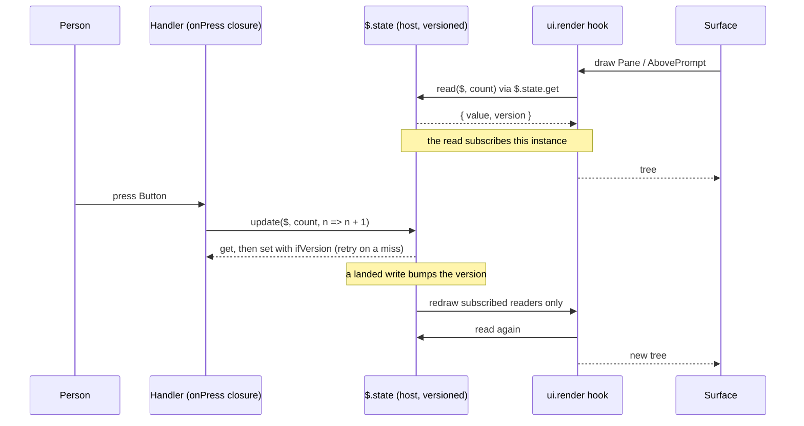

# State and storage

Where a mod keeps a value, how long it lives, and how a drawing reads it. Covers module variables, `$.state`, `$.store`, the type contract and the state library.

Most links below go to the 2.1.295 snapshot. The `$.fs`, `$.store` and `$.state` blocks are byte-identical in 2.1.302 (`diff` of 2.1.295 lines 3223-3426 against 2.1.302 lines 3306-3509): [d.ts 302:3306-3509](../sources/claude-code-2.1.302/types/claude-code.d.ts#L3306-L3509) (`fs` from 3306, `store` from 3434, `state` from 3467). Links labelled `d.ts 302:N` go to the 2.1.302 snapshot. Links labelled `d.ts:N` go to 2.1.295. A claim graded *verified-live* or *verified-kit* was checked on 2.1.302 with a throwaway spike mod ([spikes-2026-10-17](../sources/spikes-2026-10-17/README.md)). For `/clear`, reload and `session.end` see [lifecycle](lifecycle.md). For what `validate` accepts as a reference see [State references and the scan](#state-references-and-the-scan).

## Three places for a value

| Place | Lives until | Shared across sessions | Redraws readers | Use for |
| --- | --- | --- | --- | --- |
| Module variable (`let n = 0`) | The module reloads. Every saved file reloads it in development. | No | No (call `$.ui.invalidate`) | Values you can lose |
| `$.state` | The session ends, or the person runs `/clear`, `/resume`, `/branch`. **Survives a hot reload.** | No | **Yes**, automatic | Values a drawing reads |
| `$.store` | You delete it, or no session reads or writes the store for `cleanupPeriodDays` | Yes, per plugin, per machine | No | Settings, history, anything to find next time |

Sources: [docs: interface, "Keep state"](../sources/code-claude-com-2026-10-09/mods/interface.md#L724), [reference.md:118](../sources/claude-code-2.1.295/reference.md#L118), [SKILL.md:21](../sources/claude-code-2.1.295/SKILL.md#L21).

A reload runs `register` again. Module variables start over. `$.state` and `$.store` are the host's and stay. ([SKILL.md:21](../sources/claude-code-2.1.295/SKILL.md#L21))

## `$.state`

Named values the host holds for the session, each with a **version**. Plain JSON data. ([d.ts:3376](../sources/claude-code-2.1.295/types/claude-code.d.ts#L3376))

| Call | Result | Rules |
| --- | --- | --- |
| `$.state.get(ref)` | `{ value, version }`. A value never written is `undefined` at version 0. | All `get`s of one dispatch read one moment. Any plugin may read any value. A `get` made while a `ui.render` hook draws **subscribes** that instance. |
| `$.state.set(ref, value, { ifVersion? })` | `{ isSet, version }`. `isSet: false` only when `ifVersion` missed. | Refused while a `ui.render` hook draws. Refused for another plugin's value. `value` is JSON, never `undefined`. With `ifVersion` it is compare-and-set. The version rises by one per landed write. |

Sources: [d.ts:3376-3430](../sources/claude-code-2.1.295/types/claude-code.d.ts#L3376), [d.ts:12038](../sources/claude-code-2.1.295/types/claude-code.d.ts#L12038) (`StateRead`), [d.ts:12072](../sources/claude-code-2.1.295/types/claude-code.d.ts#L12072) (`StateSetOptions`).

Rules to keep:

- **Render hooks never write.** Write from a handler (`onPress`, `onSubmit`) or from a hook for another event. ([reference.md:118](../sources/claude-code-2.1.295/reference.md#L118), [docs: interface](../sources/code-claude-com-2026-10-09/mods/interface.md#L795))
- **One dispatch reads one moment.** Every `get` of one hook run sees the same snapshot, whatever is written meanwhile. ([d.ts 302:3472](../sources/claude-code-2.1.302/types/claude-code.d.ts#L3472)) *verified-kit,* headless real engine (`claude -p --plugin-dir`, fake API, not an interactive session): a `command.run` hook read `{ version: 0 }` for a second after a timer's `update` had resolved in another dispatch. A hook that sleeps and re-reads does not see other dispatches' writes. Read at the start. To see later writes, wait for a new event or timer.
- **Never write from a value the closure captured at draw time.** Use `update`. It reads, applies and writes with `ifVersion`, again on a miss. Two presses before the redraw both land. ([reference.md:118](../sources/claude-code-2.1.295/reference.md#L118))
- **Only the owner writes.** Another plugin changes a value by hooking `state.set` with a matcher on `plugin` and `key`, and passing `next` another `value`. `plugin`, `key` and `id` are pinned. ([reference.md:118](../sources/claude-code-2.1.295/reference.md#L118), [d.ts:12060](../sources/claude-code-2.1.295/types/claude-code.d.ts#L12060))

  ```ts
  on('state.set', { plugin: 'swarm', key: 'isOn' }, ($, e, next) => next({ ...e, value: false }))
  ```

- `state.get` and `state.set` are events like every `$` call. On the untyped form (no contract declares the value), a hook sees `e.previous` (what stood there), put on `e` ahead of every hook. ([d.ts:7113](../sources/claude-code-2.1.295/types/claude-code.d.ts#L7113), [d.ts:12104](../sources/claude-code-2.1.295/types/claude-code.d.ts#L12104))
- **Redraw is automatic and throttled.** A `set` draws exactly the readers again. Nobody calls `$.ui.invalidate`. Redraws are throttled to 10 a second, 30 in the terminal for the shown pane, expanded band and prompt hint. ([docs: reference, Limits](../sources/code-claude-com-2026-10-09/mods/reference.md#L290))
- **`/clear`, `/resume`, `/branch` reset every `$.state` value** to its default. `session.start` does not fire again. `classic.SessionStart` fires with `e.source` of `clear`, `resume` or `fork`. A mod that copies a stored value into `$.state` must copy it again there. The same hook also fires at startup and after compaction (compaction does not reset state), so filter on `source`. ([docs: interface](../sources/code-claude-com-2026-10-09/mods/interface.md#L812))

  ```ts
  on('classic.SessionStart', { source: ['clear', 'resume', 'fork'] }, async ($, e, next) => {
    await loadCount($)        // copy $.store -> $.state again
    return next(e)
  })
  ```

  **Live check, 2.1.302 (*verified-live*).** The recipe above did not work for a `--plugin-dir` mod on this machine. A `classic.SessionStart` or `classic.SessionEnd` **function hook** never ran, at startup, on `/clear` or on `/exit`. Shell hooks from settings for the same events ran. `claude plugin validate` warns that these events "pass over the plugins you install" where an organization manages Claude Code. What did work:

  - Inside `session.end` with `reason: 'clear'`, `$.session.id()` is still the old id and `$.state` still holds the old value. Store there.
  - The first `session.append` of the new session arrives 11 to 15 ms later. It carries the new id. `$.state` is already reset (`{ version: 0 }`). Restore there, or on the first use after a changed `await $.session.id()`.
  - Module variables survive `/clear`. The module is not reloaded.

  Details and the event order: [lifecycle](lifecycle.md#clear).

### The redraw loop



## The type contract

A mod that uses `$.state` declares each value in a **contract**: one `.d.ts` file. ([SKILL.md:15](../sources/claude-code-2.1.295/SKILL.md#L15), [docs: interface](../sources/code-claude-com-2026-10-09/mods/interface.md#L742))

1. Write `types/index.d.ts`. Merge into `PluginState` inside `declare module 'claude-code'`. The outer key is the plugin's **name**. Each entry under it is a value and its type. ([d.ts:7786](../sources/claude-code-2.1.295/types/claude-code.d.ts#L7786))
2. Name the file in `plugin.json`: `"types": "./types/index.d.ts"`.
3. The module imports its value types from it: `import type { Turn } from '../types'`.
4. `claude plugin validate` holds every `$.state` key the module names to the contract. A key that is not declared fails: `hello-tabs.count is not declared`. ([SKILL.md:15](../sources/claude-code-2.1.295/SKILL.md#L15), [docs: interface](../sources/code-claude-com-2026-10-09/mods/interface.md#L793))

Contracts from the shipped examples:

```ts
// examples/band-state.d.ts  ->  types/index.d.ts of the band mod
export type Turn = { seconds: number; tools: number }

declare module 'claude-code' {
  interface PluginState {
    'turn-band': { last: Turn | null; isHidden: boolean }
  }
}
```

```ts
// examples/pane-state.d.ts  ->  types/index.d.ts of the pane mod
export type ToolCall = { id: string; tool: string; isDone: boolean }

declare module 'claude-code' {
  interface PluginState {
    'tool-calls': { calls: ToolCall[] }
  }
}
```

Sources: [band-state.d.ts](../sources/claude-code-2.1.295/examples/band-state.d.ts), [pane-state.d.ts](../sources/claude-code-2.1.295/examples/pane-state.d.ts).

The same `"types"` field serves a second purpose. A plugin that **adds a noun to `$`** in `engine.create` ships that noun's types as a contract: a self-contained `.d.ts` that exports the noun's types at top level (names led by the noun's PascalCase name) and adds the noun to `EngineInterface`. A plugin that depends on it lists it under `dependencies`, and the engine lays the contract in beside it. `claude plugin validate` checks the contract. ([reference.md:66](../sources/claude-code-2.1.295/reference.md#L66))

## References

A reference names one value. Write it once as a constant. ([reference.md:118](../sources/claude-code-2.1.295/reference.md#L118), [d.ts:12054](../sources/claude-code-2.1.295/types/claude-code.d.ts#L12054))

```ts
const count = { plugin: 'counter', key: 'count' } as const
const { value = 0 } = await $.state.get(count)
```

- `plugin` and `key` must be **string literals in source**. `claude plugin validate` reads them and lists `state reads:` and `state writes:`. ([d.ts:3376](../sources/claude-code-2.1.295/types/claude-code.d.ts#L3376), [docs: create](../sources/code-claude-com-2026-10-09/mods/create.md#L305))
- Only a `StateFamily` member's `id` may be computed.
- Use the const for nothing but `$.state` calls, state library calls, and a spread that adds a family member's `id`.
- Hold an `atom` result in a `const`. A `let` fails validation with `takes a source the scan can read`. ([docs: interface](../sources/code-claude-com-2026-10-09/mods/interface.md#L793))

## State references and the scan

`claude plugin validate` and the loader read each `$.state` call and each state-library call by source. They want a reference whose `plugin` and `key` are string literals, **in the file that makes the call**. A module that breaks this does not load. ([d.ts 302:7887](../sources/claude-code-2.1.302/types/claude-code.d.ts#L7887), [d.ts 302:12633](../sources/claude-code-2.1.302/types/claude-code.d.ts#L12633), types-only) *verified-kit,* 2.1.302, the `g13*` spikes ([sources](../sources/spikes-2026-10-17/README.md#state-references-and-the-contract)).

| Spelling | Result |
| --- | --- |
| An atom declared and used (`read`, `update`) in the same file | Pass. `state reads: g13.a`, `state writes: g13.a`. |
| A reference with a computed `id` at the call: `atom({ plugin: 'g13', key: 'slots', id: tracker.id } as const, null)` | Pass. Only `id` of a `StateFamily` member may be computed. |
| A same-file base `const SLOTS = { plugin, key } as const`, spread as `{ ...SLOTS, id: tracker.id }` | Pass. |
| An atom created inside an install function, or a ref const with a computed `id` inside the hook | Pass. |
| An atom or a plain ref `const` **imported** from another file and used in `register.ts` | Fail: `the state library's update takes a source the scan can read: a reference whose plugin and key are string literals, or what ato… [+291 chars]`. For `$.state.get`: `$.state.get takes a reference whose plugin and key are string literals ({ plugin: "p", key: "k" }, written there or … [+259 chars]`. |
| A ref-builder `slot(id)`, imported or in the same file | Fail, same message. |
| An atom created in a class constructor or field | Fail, same message. |
| An imported base spread `{ ...SLOTS, id }` | Fail, same message. |
| A generic port `{ read: a => read($, a), update: (a, f) => update($, a, f) }` | Fail: `the state library's read takes a source the scan can read: …` |
| `export function bumpA($: EngineInterface)` in a tracker file, using a file-local atom, called from `register.ts` | Pass. `state writes: g13.a`. |
| The same helper as `export const bumpA = ($) => …` | Fail: `$ is passed to "bumpA", a name bound to a function expression, outside the hook's own file`. See [ports-and-injection](ports-and-injection.md#passing-the-engine-interface). |

So a tracker keeps its atoms and every `read` and `update` of them in its own file. Another file reaches them through an exported `function` declaration that takes `$`, or through a per-atom closure the tracker builds.

The contract:

- `validate` reads **one** file, the one `plugin.json` `types` names. The field is a string. `"types": ["./types/index.d.ts", "./x.d.ts"]` fails with `Invalid input: expected string, received array`. A key declared in a second `.d.ts` is not seen: `g13.zzz is not declared: the manifest's types contract must name it in interface PluginState`.
- The contract exports types and nothing else, and imports nothing. A trailing `export {}` fails: `` `export` at the top level is followed by `type` or `interface`: a contract exports types and nothing else ``.
- The plugin `name` in `plugin.json` must equal the outer key in `PluginState`. If not, `validate` says `$.state.set refers to g13.a, which g13 owns: only a value's owner writes it`.

Adding a key means editing the contract. The one edit-free route is a **family key**. Declare one `StateFamily` key and give each tracker its own `id`:

```ts
// types/index.d.ts
export type Slice = unknown   // keep the contract self-contained; narrow the type with a guard in the tracker

declare module 'claude-code' {
  interface PluginState {
    'my-plugin': { trackers: StateFamily<Slice> }
  }
}
```

*verified-kit:* two trackers with `id: 'github'` and `id: 'jira'` from one install function kept separate values (`github=1 | github=2`, `jira=1`). `validate` printed `declares state: g13.slots` once, not one name per id. The `hooks:` line printed a computed matcher as `tool.call{tool=?}`. ([d.ts 302:12593](../sources/claude-code-2.1.302/types/claude-code.d.ts#L12593), [d.ts 302:12638](../sources/claude-code-2.1.302/types/claude-code.d.ts#L12638))

*verified-live,* Claude Code 2.1.302, spike [`lifecycle-mod`](../sources/spikes-2026-10-17/lifecycle-mod/) (the earlier headless runs used literal ids only). A command wrote and read family members whose `id` came from tracker objects (`{ id: 'github' }`, `{ id: 'jira' }`) and from a bare string:

```text
/spike-fam zed
github: bump->2 get={"n":2} | jira: bump->2 get={"n":2} | zed: get={"n":10}
```

- The members hold separate values, and a value written in one command is read back by another command in the same session.
- `validate` lists the key once (`declares state: lifecycle-mod.marker, lifecycle-mod.slots`, `state writes` and `state reads` the same) and never the ids. `tsc` exited 0.
- The form that passes is an inline literal at the call site, `{ plugin, key: 'slots', id: tracker.id } as const`, in the file that makes the call. It worked from an imported `function bump($, tracker)` declaration in `trackers/a.ts` and from `register.tsx`.
- A ref-builder `slot(tracker)` passed to `$.state.get` fails `validate`: `$.state.get takes a reference whose plugin and key are string literals ({ plugin: "p", key: "k… [+241 chars]`. The validator cuts the message at about 200 characters, also with `--json`.
- **The values do not survive a session change.** After `/clear` the members read back `undefined` and the counters restarted at 1 (`github: bump->1`). Before the `/clear`, `session.end` had seen both at 2. `/resume` and `/branch` reset them the same way, like all `$.state` ([lifecycle](lifecycle.md#resume-and-branch)). Data that must outlive a session change goes through `$.store` at `session.end`.

Baseline: `claude plugin validate plugins/artifact-tracking` on 2.1.302 lists `declares state: artifact-tracking.items, repos, processes, processUi, tools, ui, auto`. Six of those seven keys appear under `state reads` and `state writes`. `processUi` is declared and never touched through `$.state`.

An `atom` is not a reference. `$.state.get(atom)` fails `tsc` with `Atom<string> is not assignable to StateRef` (TS2345). Pass the atom to `read` or `update`. Pass a plain `{ plugin, key } as const` to `$.state.get`. *verified-kit*

## The state library

Import from `claude-code`. These are pure and run in the plugin's environment. They call `$.state.get` and `$.state.set` for you. ([d.ts:14690-14735](../sources/claude-code-2.1.295/types/claude-code.d.ts#L14690))

| Export | Does | Notes |
| --- | --- | --- |
| `atom(ref, initial)` | Names a value with an initial. A `read` is never `undefined`. | Pure. Builds a frozen description. For a family, give the ref without `id`. `atom(ref, initial, { shape })` tags the value ([d.ts:688](../sources/claude-code-2.1.295/types/claude-code.d.ts#L688), [d.ts:720](../sources/claude-code-2.1.295/types/claude-code.d.ts#L720)). |
| `read($, source)` | Reads an atom, a derived value or a reference. | While a `ui.render` hook draws, it subscribes. |
| `update($, target, fn)` | Reads, applies `fn`, writes with `ifVersion`, retries on a miss. | Resolves what it wrote. Use it in handlers. |
| `derive(sources, fn)` | A value computed from atoms and references. | Cached by source versions. The cache is plugin-side and lost on reload. |
| `memberOf(family, e)` | A family's member for the instance being drawn, keyed by `e.requestId`. | Pairs with `StateFamily`. |

Types:

| Type | Meaning | Line |
| --- | --- | --- |
| `StateFamily<T>` | A key that holds one value of type `T` per `id` (one per drawn row). Its reference needs `id`. `interface PluginState { notes: { isOpen: StateFamily<boolean> } }` | [d.ts:12009](../sources/claude-code-2.1.295/types/claude-code.d.ts#L12009) |
| `Shaped<T>` | `{ shape, value }`. Declare a key as `Shaped<T>` when its atom names a shape. A reload whose code names another shape reads the value as absent. Bump the shape when the code's idea of the value changes. | [d.ts:11833](../sources/claude-code-2.1.295/types/claude-code.d.ts#L11833) |
| `StateRef`, `StateName`, `StateValue`, `StateRead`, `StateSetResult` | Reference, name, value and result types | [d.ts:12054](../sources/claude-code-2.1.295/types/claude-code.d.ts#L12054) |

```ts
import { atom, derive, memberOf, read, update } from 'claude-code'

const isOpen = atom({ plugin: 'notes', key: 'isOpen' } as const, false)  // family: ref has no id
// in a ui.render hook:
const open = await read($, memberOf(isOpen, e))   // keyed by e.requestId
```

## Worked examples

### Band: module variables plus `$.state`

[examples/band.tsx](../sources/claude-code-2.1.295/examples/band.tsx) keeps what the drawing needs in `$.state` and what it can lose in variables.

```tsx
import { atom, read, update } from 'claude-code'
import type { Register } from 'claude-code'
import type { Turn } from '../types'

const last = atom({ plugin: 'turn-band', key: 'last' } as const, null)
const isHidden = atom({ plugin: 'turn-band', key: 'isHidden' } as const, false)

export const register: Register = on => {
  let startedAt = 0      // module variables: lost on reload
  let tools = 0

  on('prompt.submit', async ($, e, next) => { startedAt = await $.clock.now(); tools = 0; return next(e) })
  on('tool.call', ($, e, next) => { tools += 1; return next(e) })
  on('turn.complete', async ($, e, next) => {
    const seconds = Math.round(((await $.clock.now()) - startedAt) / 1000)
    await update($, last, () => ({ seconds, tools }))        // write from another event
    return next(e)
  })
  on('ui.render', { component: 'AbovePrompt' }, async ($, e, next) => {
    const turn = await read($, last)                          // subscribes the band
    if (turn === null || (await read($, isHidden))) return next(e)
    const { Box, Button, Text } = $.ui.resolve(e)
    return <Box>
      <Text dimColor>Last turn: {turn.seconds}s, {turn.tools} tool calls </Text>
      <Button key="hide" label="Hide" onPress={() => update($, isHidden, () => true)} />
    </Box>
  })
}
```

(Excerpt, trimmed. The toast and `hasSurvey` check are in the file.)

What to notice:

- `last` and `isHidden` are declared in the contract above and read in the render hook.
- `onPress` writes with `update`, so the band redraws without `$.ui.invalidate`.
- `startedAt` and `tools` are plain variables. *Inference:* a reload in the middle of a turn resets `startedAt` to 0, so the next `seconds` would be huge. Keep such values in `$.state` if that matters.

### Pane: a list in `$.state`

[examples/pane.tsx](../sources/claude-code-2.1.295/examples/pane.tsx) keeps the whole list in `$.state`.

```tsx
const calls = atom({ plugin: 'tool-calls', key: 'calls' } as const, [])

on('tool.call', async ($, e, next) => {
  const call = { id: e.tool_use_id, tool: e.tool, isDone: false }
  await update($, calls, list => [...list, call].slice(-200))        // bound the list
  const ran = await next(e)
  await update($, calls, list => list.map(one => (one.id === call.id ? { ...one, isDone: true } : one)))
  return ran
})

on('ui.render', { component: 'Pane', requestId: PANE }, async ($, e) => {
  const list = await read($, calls)                                   // subscribes the pane
  ...
})
```

What to notice: both `update` calls run in the `tool.call` hook, not in the render hook. The list is capped at 200. The pane id (`requestId`) is the id given to `$.ui.open`.

## `$.store`: across sessions

A key-value store of the plugin's own, kept between sessions and hot reloads. ([d.ts:3350-3376](../sources/claude-code-2.1.295/types/claude-code.d.ts#L3350))

| Call | Behaviour |
| --- | --- |
| `$.store.get(key)` | The value, or `undefined` |
| `$.store.set(key, value)` | `value` must be JSON. `get` reads back `JSON.parse(JSON.stringify(value))`: a `Date` becomes an ISO string, `undefined` fields drop, `Map` and `Set` become `{}`. Rejects a function, a cycle, or a store over **4 MiB** of JSON text in all. |
| `$.store.delete(key)` | Removes the key |
| `$.store.keys()` | Every key, in insertion order |

- The file is JSON, in the user's Claude Code config directory ([d.ts:3350](../sources/claude-code-2.1.295/types/claude-code.d.ts#L3350)). Public docs name `~/.claude/plugins/store/` ([docs: interface](../sources/code-claude-com-2026-10-09/mods/interface.md#L732)). The dev-mods folder follows the config directory too (SKILL.md shows `~/.claude-personal/dev-mods/<session-id>`; the public docs show `~/.claude/dev-mods/<session-id>`).
- *verified-live,* one machine: the file name carries the plugin and its provenance, as `<name>_<provenance>-<hash>.json` (for example `life-spike_inline-cd72fb26cb19.json`, mode 0600). A `--plugin-dir` run (`inline`), a skills-folder copy and an installed copy of one plugin are **separate stores**. A dev run and an installed copy do not share data. A file under `~/.config` does: see [reference/fs-and-config](../reference/fs-and-config.md).
- **Every session on the machine shares one store.** `get` then `set` is not atomic. Two sessions can race and the second write wins. Give each item its own key, and read again right before you write. ([docs: interface](../sources/code-claude-com-2026-10-09/mods/interface.md#L842))
- `$.store.set` is an event too (`store.set`). ([d.ts:7095](../sources/claude-code-2.1.295/types/claude-code.d.ts#L7095))
- To keep a `$.state` value past the session, also write it to `$.store`. Save on every change. ([reference.md:118](../sources/claude-code-2.1.295/reference.md#L118), [docs: interface](../sources/code-claude-com-2026-10-09/mods/interface.md#L838))

## What survives what

| | Reload (`register` again) | Worker loss | `/clear` | `/resume`, `/branch` | New session |
| --- | --- | --- | --- | --- | --- |
| Module variable | Lost (*verified-live*) | Lost | **Kept**: same module copy, counter 101 to 102 (*verified-live*) | **Kept** (*verified-live*) | Lost |
| Timers (`$.clock`) | Dropped (*verified-live*) | Gone | **Kept**, runs on (*verified-live*) | **Kept** (*verified-live*) | Gone |
| `$.state` | **Kept** (*types-only*) | Kept (host holds it) | **Reset** by the first `session.append` of the new session. Intact inside `session.end` (*verified-live*) | **Empty after `/resume` and `/branch`**. The resumed session's old state is not restored (*verified-live*, [lifecycle](lifecycle.md#resume-and-branch)) | Gone |
| `$.store` | Kept | Kept | Kept (*types-only*) | Kept (*types-only*) | Kept |
| Open panes (`$.ui.panes()`) | Kept, drawn again by the new copy (*verified-live*) | n/a | Not tested | n/a | Gone |
| Files written with `$.fs` | Kept | Kept | Kept (*types-only*) | Kept (*types-only*) | Kept |

Sources: [reference.md:72](../sources/claude-code-2.1.295/reference.md#L72), [reference.md:162](../sources/claude-code-2.1.295/reference.md#L162), [d.ts:2527](../sources/claude-code-2.1.295/types/claude-code.d.ts#L2527), [docs: interface](../sources/code-claude-com-2026-10-09/mods/interface.md#L812), and the live runs in [lifecycle](lifecycle.md). Seen live on 2.1.302: the module variable, timer and `$.state` cells of the `/clear` and `/resume`, `/branch` columns, and the pane cell of the reload column. A cell with no grade comes from the cited text (*types-only*), and a `$.store` or `$.fs` cell after `/clear`, `/resume` or `/branch` was not read back in a run. The worker-loss column is *inference*.

## See also

- [overview](overview.md): the mental model.
- [lifecycle](lifecycle.md): start, reload, `/clear`, `session.end`, and what survives each.
- [ports-and-injection](ports-and-injection.md): hand `$` and `on` to other files; what `validate` accepts.
- [reference/fs-and-config](../reference/fs-and-config.md): `$.fs` and files under `~/.config`.
- [dispatch-and-guards](dispatch-and-guards.md): reload and worker-loss replay of calls.
- [glossary](glossary.md): terms.
- [reference/ui](../reference/ui.md): `ui.render`, panes, bands.
- [reference/testing-kit](../reference/testing-kit.md): `mock.store` and state tests.
- [examples/README](../examples/README.md).
