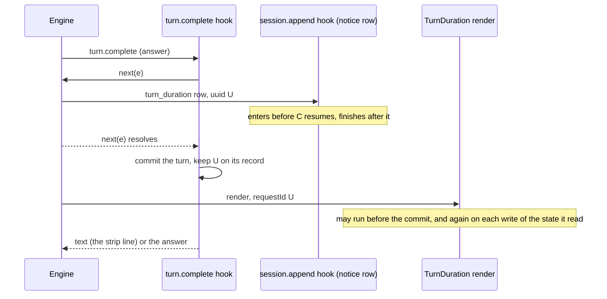

# The strip under an answer (issue #69, spikes S7 to S13)

Date: 2026-10-21. Engine: Claude Code 2.1.305 for the spike, 2.1.306 for the live checks of the PR that ships the strip.

This page records what a mod can show near the end of a turn, and what the engine does with it. The design study of [issue #69](https://github.com/martin-macak/claude-code-mod-tracking/issues/69) ran the spike (S7 to S13). The probe logs are not in this repo, so the lines below are copied from [part 2 of the study](https://github.com/martin-macak/claude-code-mod-tracking/issues/69#issuecomment-6303565557) with their `L<n>` numbers. The mod's own strip is in [`ux/strip.ts`](../../../../plugins/artifact-tracking/ux/strip.ts), [`core/lib/turn-strip.ts`](../../../../plugins/artifact-tracking/core/lib/turn-strip.ts) and [`hooks/register.tsx`](../../../../plugins/artifact-tracking/hooks/register.tsx). The user-facing key is `global.ui.turnStrip` in the [README](../../../../plugins/artifact-tracking/README.md#the-strip-under-an-answer).

## Grades

Each claim carries one of these. `[observed]`, `[primary source]` and `[inference]` are the tags of the study. The second row splits `[observed]` for one case that the KB rules do not name. The last column is the grade of the [KB rules](../README.md#how-claims-are-sourced).

| Tag | Meaning | KB grade |
| --- | --- | --- |
| `[observed]` | Seen in a log or on a screen of a run | *verified-live* for a run in a tmux session (runs C1 to C4 and the live checks below). *verified-kit* for a headless `claude -p` run against a fake API (runs A, B, D). |
| `[observed]`, headless with the real model | A `claude -p` run with no fake API (the 2.1.306 check) | Neither grade fits by the rule: not *verified-live* (headless), not the fake-API case of *verified-kit*. Stated as such. |
| `[primary source]` | Stated by the types file or by code in this repo | *types-only* when only the types say it |
| `[inference]` | Nobody ran it | *inference* |

The synthetic clicks are SGR mouse bytes sent with `tmux send-keys`, the method of the e2e suite (`e2e/support/tmux.ts`). They are not a real mouse. This is stated once here and holds for every click below.

## The spikes

| # | Question | Answer | Tag |
| --- | --- | --- | --- |
| S7 | Where does a `turn.complete` text go? | A notice row (type `system`, name `informational`, L33). It is drawn as one line under the duration line (L198, L199). Returning `next(e)` unchanged adds no row (L180, L181 against L191 to L193). | `[observed]` |
| S8 | Does the strip text reach the model? | No. None of the 6 main-conversation requests made after a strip row existed held it: L66, L67 (after L33), L68 to L70 (`--continue`, the stored transcript holds three strip rows), L225 (after L99). | `[observed]` |
| S9 | Can the `TurnDuration` line be matched to its turn? | Yes. `requestId` is the uuid of the `turn_duration` notice row (L96, L98). The row is appended inside the `next(e)` of `turn.complete` (L95 to L97). `props.durationMs` equals the turn's `durationMs` (L95, L98). An aborted turn has no such row (L118 to L134). | `[observed]` |
| S10 | Do clicks on a transcript Button reach the mod? | On the fullscreen layout, yes (L101, L151). On the main screen, no (L165 to L170 hold no press). With no layout variable, tmux came up fullscreen here (L148), while the types say "tmux by default" for the main screen ([d.ts 302:1797](../sources/claude-code-2.1.302/types/claude-code.d.ts#L1797)). Synthetic clicks. | `[observed]` |
| S11 | Can a band key open the pane with the keys? | Yes. Digit `7` alone in an empty prompt pressed the band Button. `$.ui.open({ focus: true })` gave `isPlaced: true` and a focused pane, docked and inline (L102 to L104, L167 to L170). | `[observed]` |
| S12 | Does a command reply reach the model? | Yes, as `<local-command-stdout>` in the next request (L59, L69). | `[observed]` |
| S13 | Does `-p` print the strip? | `text` and `json` output: no (L74, L76). `stream-json`: a `system` event, subtype `informational`, with the text (L80). | `[observed]` |

Surfaces other than the terminal: `TurnDuration` is "raised on the terminal surface only" and a remote surface "draws its own footer" ([d.ts 302:10557-10561](../sources/claude-code-2.1.302/types/claude-code.d.ts#L10557)). `[primary source]` Nobody ran `interactive` on the desktop or in the VS Code panel. `[inference]` The strip would not show there. Use `text`.

## The evidence, copied in

The probe logs are not in the repo, so these are the lines of the study, one block per spike, as the study printed them (part 2 of the study, the log numbers `L<n>` are the study's). Each line is `L<n> #<seq> <event>`: `#<seq>` is the probe's own counter, so it orders the events of one process exactly. Texts are cut by the probe, and `\\n` is a line break inside a cut text. Rows of the doors `delivery` and `attachment` show `[omitted]`.

### S7: the text of `turn.complete` is a notice row under the duration line

Run A (`claude -p`, L33), run D (L180 to L193: the hook returned `next(e)` unchanged, then a new text) and the screen of run C1 (L198, L199).

```text
L33 #47 append door=notice origin=engine name=informational uuid=4a61340c text="s69-probe+cc-plugin-agents-md: TL69-MARKER +2 new, 1 updated (turn 1cb"
L180 #16 turn.complete turnId=5f640104 reason="answer" isAborted=false durationMs=156 answer="NOSTRIP plain answer"
L181 #17 turn.complete.out text="NOSTRIP plain answer"
L191 #16 turn.complete turnId=32e204ab reason="answer" isAborted=false durationMs=200 answer="strip answer"
L192 #17 turn.complete.out text="strip answer"
L193 #18 append door=notice origin=engine name=informational uuid=e3e023c9 text="s69-probe+cc-plugin-agents-md: TL69-MARKER +2 new, 1 updated (turn 32e"
L198 ✻ Cogitated for 0s · done 12:18 AM
L199 ⏺ s69-probe+cc-plugin-agents-md: TL69-MARKER +2 new, 1 updated (turn 0bd87277)
```

### S8: the strip text reaches no model request

The fake API logs which probe markers each request body held. `TL69-MARKER` is the strip text, `CMD69-MARKER` is a command reply.

```text
L66 req role=main n=5 messages=13 markers=none
L67 req role=main n=6 messages=15 markers=none
L68 req role=main n=1 messages=18 markers=none
L69 req role=main n=2 messages=21 markers=CMD69-MARKER at=msg19/user: rgs></command-args>\n"},{"type":"text","text":"<local-command-stdout>s69-probe: CMD69-MARKER last main turn </
L70 req role=main n=3 messages=24 markers=CMD69-MARKER at=msg19/user: rgs></command-args>\n"},{"type":"text","text":"<local-command-stdout>s69-probe: CMD69-MARKER last main turn </
L225 req role=main n=4 messages=5 markers=none (run C1, request 4 of the session)
```

### S9: the `TurnDuration` line is matched to its turn by the uuid of the `turn_duration` row

Run C1 (L95 to L98) and run C2, an aborted turn, which has no `turn_duration` row (L118 to L134).

```text
L95 #21 turn.complete turnId=0bd87277 reason="answer" isAborted=false durationMs=300 answer="answer one https://example.com/c1"
L96 #22 append door=notice origin=engine name=turn_duration uuid=05c26614-94d4-4b09-86c3-8ea6738495b2 text=""
L97 #24 turn.complete.out text="answer one https://example.com/c1"
L98 #26 render.TurnDuration requestId=05c26614-94d4-4b09-86c3-8ea6738495b2 word=Cogitated durationMs=300 isFullscreen=true
L118 #3 session.start cwd=<SCRATCH>/s69-work
L119 #4 prompt.submit {"text":"turn abort me","origin":{"kind":"composer"}}
L120 #6 append door=prompt origin=composer uuid=4e5bbce4 text="turn abort me"
L121 #8 append door=queue origin=engine uuid=5ec271ef text="<task-notification>\\ns69-probe: its session.append hook was skipped. \"c"
L122 #9 turn.start turnId=d117df2f text="turn abort me"
L123 #10 append door=notice origin=engine name=informational uuid=ab7ad98d text="s69-probe: its session.append hook was skipped. \"cc-plugin-sec-default"
L124 #13 turn.start.out turnId=d117df2f
L125 #15 append door=delivery origin=unclassified name=queued_command uuid=723fe6b8 text=[omitted]
L126 #17 append door=queue origin=engine uuid=e6d36f9b text="<task-notification>\\ns69-probe: its session.append hook was skipped. \"c"
L127 #18 append door=response origin=model uuid=44d81ef4 text="[tool_use]"
L128 #21 tool.call tool=Bash id=tu_s1_main2
L129 #23 tool.call.out tool=Bash id=tu_s1_main2 isError=true
L130 #24 append door=tool-result origin=tool uuid=a7321857 text="[tool_result]"
L131 #26 append door=note origin=engine uuid=709276cc text="[Request interrupted by user for tool use]"
L132 #28 turn.complete turnId=d117df2f reason="aborted" isAborted=true durationMs=3085 answer=""
L133 #29 turn.complete.out text=""
L134 #30 append door=notice origin=engine name=informational uuid=e034be63 text="s69-probe+cc-plugin-agents-md: TL69-MARKER +2 new, 1 updated (turn d11"
```

### S10: a click on a transcript Button reaches the mod on the fullscreen layout only

Runs C1 and C3 (fullscreen, L101 and L148 to L151) and run C4 (main screen, L165 to L170: no `press.TurnDuration`).

```text
L101 #30 press.TurnDuration {"requestId":"05c26614-94d4-4b09-86c3-8ea6738495b2"}
L148 #26 render.TurnDuration requestId=589f4d1c-aa95-4acd-9d8a-5789bb05dc84 word=Cogitated durationMs=189 isFullscreen=true
L149 #27 append door=notice origin=engine name=informational uuid=7f218287 text="s69-probe+cc-plugin-agents-md: TL69-MARKER +2 new, 1 updated (turn c9d"
L150 #29 render.TurnDuration requestId=589f4d1c-aa95-4acd-9d8a-5789bb05dc84 word=Cogitated durationMs=189 isFullscreen=true
L151 #30 press.TurnDuration {"requestId":"589f4d1c-aa95-4acd-9d8a-5789bb05dc84"}
L165 #25 render.TurnDuration requestId=938b9acd-e35e-49a9-b6d3-320602d88f03 word=Crunched durationMs=194 isFullscreen=false
L166 #26 append door=notice origin=engine name=informational uuid=fa58c1a7 text="s69-probe+cc-plugin-agents-md: TL69-MARKER +2 new, 1 updated (turn 3d5"
L167 #28 press.band {}
L168 #29 band.open {"isPlaced":true}
L169 #30 render.Pane {"isFocused":false,"placement":"inline"}
L170 #31 render.Pane {"isFocused":true,"placement":"inline"}
```

### S11: a band key opens the pane with the keys

Run C1 (fullscreen, docked pane) and run C4 (main screen, inline pane).

```text
L102 #31 press.band {}
L103 #32 band.open {"isPlaced":true}
L104 #34 render.Pane {"isFocused":true,"placement":"dock"}
L167 #28 press.band {}
L168 #29 band.open {"isPlaced":true}
L169 #30 render.Pane {"isFocused":false,"placement":"inline"}
L170 #31 render.Pane {"isFocused":true,"placement":"inline"}
```

### S12: a command reply reaches the model

Run B2 (`claude -p --continue "/p69"`) and the fake API request that followed.

```text
L59 #7 append door=command origin=engine name=local_command uuid=df9f9508 text="<local-command-stdout>s69-probe: CMD69-MARKER last main turn </local-c"
L69 req role=main n=2 messages=21 markers=CMD69-MARKER at=msg19/user: rgs></command-args>\n"},{"type":"text","text":"<local-command-stdout>s69-probe: CMD69-MARKER last main turn </
```

### S13: `claude -p` prints the strip with `stream-json` only

Runs A, B1, B4 (L73 to L80). `text` and `json` output hold the answer alone.

```text
L73 $ s69-run.sh -p "probe turn one: track https://github.com/o/r/pull/5" --plugin-dir s69-probe --output-format json   (run A)
L74 {"result":"spare two","is_error":false,"num_turns":1,...}
L75 $ s69-run.sh -p --continue "second SECOND prompt" --plugin-dir s69-probe --output-format text                  (run B1)
L76 second answer
L77 $ s69-run.sh -p --continue "/p69" --plugin-dir s69-probe --output-format json                                    (run B2)
L78 {"result":"s69-probe: CMD69-MARKER last main turn ","num_turns":0,...}
L79 $ s69-run.sh -p --continue "fourth FOURTH prompt" --plugin-dir s69-probe --output-format stream-json --verbose   (run B4, informational events only)
L80 {"type":"system","subtype":"informational","content":"s69-probe+cc-plugin-agents-md: TL69-MARKER +2 new, 1 updated (turn 43e742ef)","level":"notice",...}
```

## What `turn.complete` may return

`TurnCompleteResult` is `{ text, usage? }`. "A text other than a main-loop answer's is shown beneath it." `[primary source]` ([d.ts 302:14009](../sources/claude-code-2.1.302/types/claude-code.d.ts#L14009)) The study saw the same: a hook that returned a text equal to the answer added no row, and a hook that returned another text added one (S7). The text is shown with the names of the plugins in front: the study's row reads `s69-probe+cc-plugin-agents-md: TL69-MARKER ...` (L33, L199) and the mod's own row reads `artifact-tracking+cc-plugin-agents-md: +2 new · /track turn 1`. The prefix is the engine's. The mod does not control it. `[observed]` Why `cc-plugin-agents-md` is named is not known: it hooks `turn.complete` too (L219). `[observed]`

The engine's own text is the answer: a hook that returned `next(e)` unchanged gave a text equal to the answer (L180, L181, L191, L192). `[observed]` So a text that differs from the answer, which `next(e)` resolves to inside the mod's hook, is the notice of a hook below it. The mod keeps such a text and puts its line after it, separated by a new line, and replaces a text that equals the answer. `[inference]` The kit pins the returned text. How the engine draws a two-line text was not run (open question 44).

## The order of one TUI turn

The order decides how a mod pairs the duration line with its turn. Runs C1 to C4 (2.1.305) showed it, and the live check on 2.1.306 showed it again with the hooks of the mod logged at each step.



The lines of the live check (2.1.306, debug lines of the mod in the debug file, since removed from the code; the clock is UTC):

```text
11:21:58.911 turn.complete hook entered         turn=3674fc6d
11:21:58.912 session.append hook entered        name=turn_duration uuid=4abd3444-c483-4813-a831-3f9c5e2f262f
11:21:58.912 turn.complete hook after next(e)   turn=3674fc6d
11:21:58.912 session.append hook after next(e)  name=turn_duration uuid=4abd3444-c483-4813-a831-3f9c5e2f262f
11:21:58.919 TurnDuration render                requestId=4abd3444-c483-4813-a831-3f9c5e2f262f fullscreen=true
11:21:58.923 turn.complete hook committed       reason=answer
```

What follows from it:

- The `session.append` hook of the row enters before the `turn.complete` hook resumes, and its code after `next(e)` finishes after it (a first run logged the row hook as settled 6 ms after `turn.complete`: "artifact-tracking@inline session.append settled in 17.4ms", later than "turn.complete settled in 12.2ms"). `[observed, verified-live]` A mod that keeps the row's uuid from its code after `next(e)` can lose the race against the commit. The mod notes the uuid in module memory before the first `await` of the row hook, and the `turn.complete` hook takes it and commits the turn and the uuid in one write. A kit test holds the row's `next(e)` open to pin this.
- The study's design wrote "the ledger saves the uuid of the next main `turn_duration` row after a commit". The row comes before the commit, so the uuid is kept by the commit. `[observed]`
- The first render of the duration line can come before the commit, so it finds no strip. A render re-runs "on a write of `$.state` it read while drawn" ([d.ts 302:4071-4079](../sources/claude-code-2.1.302/types/claude-code.d.ts#L4071)). `[primary source]` The commit is such a write, so the line is drawn again with the strip. `[observed, verified-live]`

## `interactive` on the screen

Fullscreen layout (`CLAUDE_CODE_NO_FLICKER=1`), one turn that tracked two links, then a synthetic click on the word `open`. `[observed, verified-live]`

```text
⏺ noted https://example.com/alpha and https://example.com/beta

✻ Baked for 1s · done 1:26 PM
+2 new open
```

After the click the pane opened docked at the right with the keys (its footer lists the pane keys), and the row `example.com/alpha`, the first entry of that turn, was selected (`>`):

```text
 ▝▝   ▝▝   /…/scratchpad/i69p2-work                                     │>   ▸ example.com/alpha example.com/alpha
                                                                        │    ▸ example.com/beta  example.com/beta
...
✻ Baked for 1s · done 1:26 PM                                           │
+2 new open                                                             │
...
tracking Links 2 turn 1 +2 new /track                               [-] │3: low  0: auto  Tab ↑↓ move  Esc close
```

Main screen (`CLAUDE_CODE_NO_FLICKER=0`): the line shows `+2 new` and no Button. `[observed, verified-live]` With the pane open, `ctrl+x Tab` went to the pane at once: the transcript Button of an earlier duration line did not stop the chord, and the hint "Keys go to the prompt." went away. `[observed, verified-live]` The band Button is a stop of that chord while the pane is closed (PR #136), and the strip Button is not: with the pane closed and two strips on screen, `ctrl+x Tab` put the focus ring on the band Button `9: open` (reverse video on that Button only), and a second `Tab` left it there. `[observed, verified-live]` So `ctrl+x Tab` does not stop at a transcript Button. `[observed, verified-live]` No other keyboard path was tried, so a keyboard path to it is an open question (see [open questions, 42](../open-questions.md#not-yet-observed-on-21306)).

After `claude --continue` the older duration lines drew their strips again, once the stored ledger had loaded (the mod kept the uuid of each `turn_duration` row in the stored copy, and the engine drew the lines with the same uuids). The first render ran with an empty ledger and drew none, and a later render, after the load, drew the strips. `[observed, verified-live]` One run, before the mod asked for a redraw, showed no strips 9 s after the start, so the mod now calls `$.ui.invalidate("ui.render")` when a stored ledger loads. A kit test pins the call. With the call in place, a run showed the strips 7 s after the start. `[observed, verified-live]` One run is no proof that the first run's gap is closed. `[inference]`

An aborted turn (Esc after a tool call began) has no duration line, and `interactive` returned the text line for it. `[observed, verified-live]`

```text
❯ Look at https://example.com/zeta then count from 1 to 600, one number per line, no other text.

⏺ Fetch(https://example.com/zeta)
  ⎿  Interrupted · What should Claude do instead?

⏺ artifact-tracking+cc-plugin-agents-md: +1 new · /track turn 2
```

`refusal` and `error` ends were not run. They have no duration line if they act like an abort. `[inference]` The mod treats them like an abort: the text line, and no strip on a duration line.

## The strip never reaches the model

After two turns that showed `artifact-tracking+cc-plugin-agents-md: +2 new · /track turn 1` and `... +1 new · 1 seen again · /track turn 2`, a third prompt asked the model to quote any earlier message that holds `/track turn`, or to answer `NONE`. The answer was `NONE`. `[observed, verified-live]` It agrees with S8.

## `claude -p` on 2.1.306

With `global.ui.turnStrip` set to `text`, one prompt that named two links. `[observed]` A headless run with the real model and no fake API: not *verified-live* (a headless run never is), and not the fake-API case of *verified-kit*.

```text
$ claude -p --output-format text ... "Reply with only this sentence: noted https://example.com/p1 and https://example.com/p2"
noted https://example.com/p1 and https://example.com/p2

$ claude -p --output-format json ...        (result and a check for the strip text in the whole object)
{"type":"result","subtype":"success","result":"noted https://example.com/p3 and https://example.com/p4","strip":false}

$ claude -p --output-format stream-json --verbose ...        (the informational events only)
{"type":"system","subtype":"informational","content":"artifact-tracking+cc-plugin-agents-md: +2 new · /track turn 1","level":"notice"}
```

## Notes on the managed plugin

On this machine the managed plugin `cc-plugin-sec-default` sits outermost. It reports that the `session.append` hook of the mod was skipped, once for the first prompt of a session and once for each `claude -p` process. The rows that matter here still reached the mod: the prompt row, the response row and the `turn_duration` notice (L96 and the live check). The row that the plugin bypasses is not named by the engine. `[observed]` Nothing tried to bypass or turn off the plugin.

## Not tested

The open engine questions are also rows 41 to 44 of [open-questions](../open-questions.md#not-yet-observed-on-21306).

- `refusal` and `error` turn ends (typed only).
- A real mouse (all clicks were synthetic SGR bytes in tmux).
- The strip on a narrow terminal.
- `interactive` on the desktop, the VS Code panel and mobile. `TurnDuration` is a terminal render.
- A machine without managed settings.
- Nested and workflow agents and teammates, and prompts queued while a turn runs.

## Related

- [events](../reference/events.md): the `turn.complete` row and the order of a main-loop turn.
- [ui](../reference/ui.md): render sites and Buttons.
- [lifecycle](lifecycle.md): hooks that finish after the hook above them resumed.
