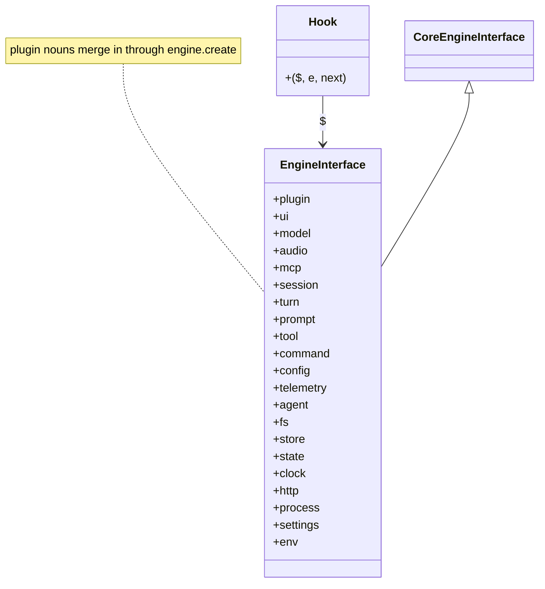

# Engine interface: `$`

Reference of `$`, the first argument of every hook, for Claude Code 2.1.295. One section per noun. Also covers what the `claude-code` module exports.

Authority: [claude-code.d.ts](../sources/claude-code-2.1.295/types/claude-code.d.ts). `CoreEngineInterface` is at [d.ts:2315-3611](../sources/claude-code-2.1.295/types/claude-code.d.ts#L2315). If this page and the file disagree, the file wins.

## Facts that hold for all nouns

- 21 nouns: `plugin`, `ui`, `model`, `audio`, `mcp`, `session`, `turn`, `prompt`, `tool`, `command`, `config`, `telemetry`, `agent`, `fs`, `store`, `state`, `clock`, `http`, `process`, `settings`, `env`. 80 callable members and 2 fields (`$.plugin.name`, `$.plugin.root`).
- `$` is frozen. It is core's interface plus every noun that a plugin's `engine.create` step added ([d.ts:4487](../sources/claude-code-2.1.295/types/claude-code.d.ts#L4487), [d.ts:4498](../sources/claude-code-2.1.295/types/claude-code.d.ts#L4498)). `EngineInterface` is empty in the file. Plugins add nouns by declaration merging.
- Write each call in full: `$.fs.read('notes.md')`. Do not destructure `$` ([docs: reference](../sources/code-claude-com-2026-10-09/mods/reference.md)).
- Every call is also an event. A hook above the caller sees it, can rewrite it, refuse it or answer it. See [events.md, section 2](events.md#2-api-calls-as-events-62) for the 62 API-call events and the `$` calls that run engine events.
- Calls return a `Promise`, except: the `$.plugin` fields; `$.ui.log`, `$.ui.toast`, `$.ui.status`, `$.ui.notice`, `$.ui.invalidate` (return `void`); `$.clock.after` and `$.clock.every` (return a `Timer`); and `$.process.spawn` (returns a stream).
- `$.tool.register` and `$.agent.register` reject until the session binds. Call them from `session.start`, and `await` them there before `next(e)`.
- A hook is not run beneath its own call. A `$` call that raises an event the same hook handles runs the chain with that hook alone skipped ([d.ts 302:4843-4844](../sources/claude-code-2.1.302/types/claude-code.d.ts#L4843-L4844), *types-only*; *verified-kit* for `session.append` and `tool.call`). 2.1.302 dropped the 2.1.295 words for it (`kind: 're-entry'`, `cause: 'lent'`) but not the behaviour. A `ui.render` hook that calls `$.ui.invalidate` is run again. See [dispatch-and-guards](../concepts/dispatch-and-guards.md#a-hook-is-not-run-beneath-its-own-call).
- Time spent awaiting a `$` call does not count against the hook budget. `$.clock.sleep` does count ([reference.md](../sources/claude-code-2.1.295/reference.md#L152)).
- Public docs list the same nouns ([docs: api](../sources/code-claude-com-2026-10-09/mods/api.md), [docs: reference](../sources/code-claude-com-2026-10-09/mods/reference.md#L172)). Differences are in the cross-check at the end.

## $.plugin

Two fields. They are not calls and raise no event.

| Member | Signature | Summary | d.ts |
|---|---|---|---|
| `name` | `string` (field) | From plugin.json; debug-log and `$.ui.log` lines carry it. | [d.ts:2323](../sources/claude-code-2.1.295/types/claude-code.d.ts#L2323) |
| `root` | `string` (field) | The plugin's directory (holds plugin.json), absolute. | [d.ts:2327](../sources/claude-code-2.1.295/types/claude-code.d.ts#L2327) |

## $.ui

Display and input. Drawing a tree is covered in [ui.md](ui.md). The calls below show state without starting a turn.

| Member | Signature | Summary | d.ts |
|---|---|---|---|
| `notice` | `(tool_use_id: string, text: string \| undefined) → void` | One line under the open dialog for `tool_use_id`; `undefined` removes it. Core removes it when the call resolves. Refused if the call is not open, or for another plugin's `$.tool.call` run. | [d.ts:2346](../sources/claude-code-2.1.295/types/claude-code.d.ts#L2346) |
| `invalidate` | `(event: InvalidatableEventName) → void` | Re-runs a cached event. `ui.render` redraws (ten a second at most; thirty in the terminal for its shown pane, expanded band and prompt hint). `prompt.section`, `prompt.context`, `prompt.attachment`, `tool/command/config.describe` drop the cached answer for the next turn. | [d.ts:2360](../sources/claude-code-2.1.295/types/claude-code.d.ts#L2360) |
| `blit` | `(args: UiBlitArgs) → Promise<UiBlitResult>` | Repaints a mounted `Raster` with new cells, or swaps a keyed `Image` source. No redraw. Up to 120 a second taken, some sixty shown. Resolves `{}` or `{ deny }`. | [d.ts:2381](../sources/claude-code-2.1.295/types/claude-code.d.ts#L2381) |
| `resolve` | `<E extends ResolveInput>(e: E) → Elements[E['surface']]` | Frozen element table (JSX tags) of the surface `e` draws on. A read, not a dispatch. | [d.ts:2397](../sources/claude-code-2.1.295/types/claude-code.d.ts#L2397) |
| `log` | `(text: string, options?: UiLogOptions) → void` | Appends a dim transcript line not sent to the model. `{ to: "debug" }` writes to the debug log only. Terminal draws the first 2000 characters; remote surfaces 10000. | [d.ts:2414](../sources/claude-code-2.1.295/types/claude-code.d.ts#L2414) |
| `ask` | `(question: string, options?: readonly string[] \| AskOptions) → Promise<string>` | Asks in the AskUserQuestion dialog. Resolves the chosen label, comma-joined for multi-select, or free text typed under "Other". Rejects when dismissed and in `-p` runs. Options: 2-4 labels, or `{ options, header, multiSelect }`. | [d.ts:2430](../sources/claude-code-2.1.295/types/claude-code.d.ts#L2430) |
| `toast` | `(text: string, options?: ToastOptions) → void` | Shows `text` for a few seconds (`timeoutMs`, default 4000) as a plugin toast. Click dismisses; pointer hover holds. Transcript and model untouched. Paused while a pane opened `holdToasts` is shown; past 50 waiting, the oldest leaves. | [d.ts:2447](../sources/claude-code-2.1.295/types/claude-code.d.ts#L2447) |
| `notify` | `(text: string, options?: NotifyOptions) → Promise<UiNotifyResult>` | Native notification through the person's `preferredNotifChannel`. Runs their `Notification` hooks first. Resolves `{ isSent: true, channel }` or `{ isSent: false, reason }` (`disabled`, `no-channel`, `no-surface`, `refused`). Rejects on a hook's `{ deny }` or a failed write. `title` defaults to the plugin name. | [d.ts:2465](../sources/claude-code-2.1.295/types/claude-code.d.ts#L2465) |
| `status` | `(text: string \| undefined) → void` | Pins the plugin's status line under the prompt until the next call. One per plugin. `undefined` clears it. Terminal draws 2000 characters; remote 10000. | [d.ts:2477](../sources/claude-code-2.1.295/types/claude-code.d.ts#L2477) |
| `open` | `(pane: PaneOpenArgs) → Promise<UiOpenResult>` | Opens (or retitles, if the id is open) a pane the plugin draws via `ui.render` for `Pane`. Resolves `{ isPlaced: true }` or `{ isPlaced: false, reason }`. Unasked, placed from 144 columns (110 once the person asked). Below that it waits undrawn. | [d.ts:2500](../sources/claude-code-2.1.295/types/claude-code.d.ts#L2500) |
| `close` | `(pane: PaneCloseArgs) → Promise<void>` | Closes an open pane. An unknown id is left alone. Raises `ui.close` with `origin` `plugin`, `person` or `unload`. Rejects on a hook's `{ deny }`. | [d.ts:2514](../sources/claude-code-2.1.295/types/claude-code.d.ts#L2514) |
| `panes` | `() → Promise<readonly UiPane[]>` | This plugin's open panes in open order, placed ones first, with id, title, shown, keyboard and placed state. The engine's record, so it survives a module reload. Other plugins' panes are not listed. | [d.ts:2527](../sources/claude-code-2.1.295/types/claude-code.d.ts#L2527) |
| `scroll` | `(args: UiScrollArgs) → Promise<UiScrollResult>` | Scrolls a render instance (`requestId`), an element (`key`) or a site edge into view. A site of this plugin moves under `ui.scroll`. Transcript rows move only while answering the person's own input. Resolves `{}` or `{ deny }`. | [d.ts:2542](../sources/claude-code-2.1.295/types/claude-code.d.ts#L2542) |
| `focus` | `(args: UiFocusArgs) → Promise<UiFocusResult>` | Moves the focus ring to an element the plugin drew in one of its sites (`requestId`, `key`), while that site holds the keys. Not holding the keys, or an element of another's, gives `{ deny }`. An undrawn element is awaited, bounded. | [d.ts:2558](../sources/claude-code-2.1.295/types/claude-code.d.ts#L2558) |
| `copy` | `(args: UiCopyArgs) → Promise<UiCopyResult>` | Puts `text` on a surface's clipboard. `surface` picks the target; default is the session's first. Resolves `{ isCopied: true }` or `{ isCopied: false, reason }`. A remote surface has no path yet. | [d.ts:2572](../sources/claude-code-2.1.295/types/claude-code.d.ts#L2572) |
| `selection` | `() → Promise<UiSelection \| undefined>` | What the person last selected with the mouse, as copy would take it, and the transcript row it lies in. `undefined` when nothing is selected or the surface shows none (fullscreen off, `-p`). | [d.ts:2586](../sources/claude-code-2.1.295/types/claude-code.d.ts#L2586) |

Notes:

- **Result arms.** `$.ui.copy` resolves `{ isCopied: true }` or `{ isCopied: false, reason }` with `reason` of `no-surface`, `no-clipboard` or `refused` ([d.ts:13720](../sources/claude-code-2.1.295/types/claude-code.d.ts#L13720)). `isCopied: true` is not proof: OSC 52 gives no feedback. A press hook passes `e.surface`. A remote surface has no path yet ([reference.md](../sources/claude-code-2.1.295/reference.md#L152)).
- `$.ui.notify` resolves `{ isSent: true, channel }` or `{ isSent: false, reason }` with `reason` of `disabled`, `no-channel`, `no-surface` or `refused` ([d.ts:14079](../sources/claude-code-2.1.295/types/claude-code.d.ts#L14079)). `channel` is `iterm2`, `iterm2_with_bell`, `kitty`, `ghostty` or `terminal_bell`. `terminal_bell` rings and shows no text. A hook's `{ deny }` rejects the call. `refused` means a hook answered `{ value }` without sending. The person's own `Notification` hooks run first.
- `$.ui.notify` is heard twice (by `ui.notify` hooks and `classic.Notification` hooks). Do not notify again from a timer on hearing one ([d.ts:7038](../sources/claude-code-2.1.295/types/claude-code.d.ts#L7038)).
- `$.ui.ask` is a `tool.call` of `AskUserQuestion` through every hook but the caller's. It rejects when dismissed and in `-p` runs. Keep the wait inside `$.ui.ask`: that wait does not count against the hook budget ([docs: events](../sources/code-claude-com-2026-10-09/mods/events.md)).
- `$.ui.toast`: past 50 waiting toasts, the oldest leaves. `$.ui.status`: one line per plugin.
- `$.ui.log` with `{ to: "debug" }` writes to the debug log only.
- `$.ui.invalidate(event)` takes an `InvalidatableEventName` ([d.ts:2360](../sources/claude-code-2.1.295/types/claude-code.d.ts#L2360)). It redraws `ui.render` and drops cached answers for `prompt.section`, `prompt.context`, `prompt.attachment`, `tool.describe`, `command.describe`, `config.describe`.
- Public docs omit `notify` in the `$.ui` method list.

## $.model

Model calls on the session's own client. They use the person's plan or API key ([docs: api](../sources/code-claude-com-2026-10-09/mods/api.md)).

| Member | Signature | Summary | d.ts |
|---|---|---|---|
| `complete` | `(request: ModelCompleteRequest, options?: ModelCompleteOptions) → Promise<ModelCompleteResult>` | One text completion through the session's API client. No tools, no history. Result `isAnswered`, `text`, `usage`, or `reason`: `api-error` (with `status`, `error`), `empty-reply`, `aborted`. Only a request the engine refuses rejects. `options.signal` aborts a running call. | [d.ts:2618](../sources/claude-code-2.1.295/types/claude-code.d.ts#L2618) |
| `fork` | `(request: ModelForkRequest) → Promise<ModelForkResult>` | One tool-less completion over the session's own transcript, served from the prompt cache. Always resolves. `reason`: `nothing-to-fork` (before the first response and after `/clear`), `api-error`, `empty-reply`, `aborted`. | [d.ts:2637](../sources/claude-code-2.1.295/types/claude-code.d.ts#L2637) |
| `classify` | `(text: string, labels: readonly string[], options?: ClassifyOptions) → Promise<string \| undefined>` | Picks one of `labels` (2 or more) for `text` with one `complete` call and a fixed classifier prompt. `undefined` when the answer names none. Rejects when the request fails or the reply has no text. Default model: the engine's small fast model (`options.model` overrides). | [d.ts:2656](../sources/claude-code-2.1.295/types/claude-code.d.ts#L2656) |

Notes ([reference.md](../sources/claude-code-2.1.295/reference.md#L152), `ModelCompleteRequest` [d.ts:6170](../sources/claude-code-2.1.295/types/claude-code.d.ts#L6170), `ModelTextBlock` [d.ts:6388](../sources/claude-code-2.1.295/types/claude-code.d.ts#L6388)):

- `complete({ model, prompt, system?, maxTokens?, timeoutMs?, effort? })` always resolves a `ModelCompleteResult`. It never rejects over what the provider did. Check `isAnswered` first.
- Arms: `isAnswered: true` with `text` and `usage`. Or `isAnswered: false` with `reason`: `api-error` (with HTTP `status` and `error` kind), `empty-reply`, `aborted` (`timeoutMs` elapsed, or the dispatch was abandoned). `usage` is on each arm.
- Only a request the engine refuses to send rejects (a blocked model, a bad `maxTokens`). `maxTokens` default is 1024.
- **Caching.** `prompt` and `system` take a string or a list of `{ text, cache? }` blocks. `cache: true` keeps the request up to and including that block in the prompt cache (five minutes).
  - Put the long fixed text first and mark its last block.
  - Read `usage.cache_creation_input_tokens` on the call that wrote it. Read `usage.cache_read_input_tokens` on calls that read it.
  - Both zero: the text is under the model's minimum, or caching is off. The mark is dropped and the text is still sent.
  - On Bedrock, Vertex, Foundry or behind a gateway, the cached text is found only while `prompt` opens the same way. Put the fixed text first in `prompt`. Do not mark it in `system`.
  - Marks are not counted. One more than the API takes returns `api-error` with status 400.
  - A `model.complete` hook gets `prompt` and `system` as joined strings, with the lists in `promptBlocks` and `systemBlocks` (`ModelCompleteInput`). A hook that appends keeps the marks. A hook that rewrites the opening sends unmarked text.
- `fork({ prompt })` asks one tool-less question over the session's own transcript. Same model and system prompt, so the API serves the prefix from its cache (`usage.cache_read_input_tokens`). It always resolves. Extra `reason`: `nothing-to-fork` (new session before its first turn, and again after `/clear`).
- `classify(text, labels, { model? })` runs one `complete` call with a fixed prompt. It returns a label or `undefined`. Default model is the engine's small fast model.

## $.audio

| Member | Signature | Summary | d.ts |
|---|---|---|---|
| `play` | `(clip: AudioClip, options?: PlayOptions) → Promise<void>` | Plays a clip now. Clips are not queued, so calls overlap. Clip is `{ asset }`, a URL, or base64 bytes with MIME type. `afplay` on macOS; Linux and Windows play nothing. Options: `shouldLoop`, `gain`, AbortSignal. Rejects naming the cause when it cannot play. | [d.ts:2677](../sources/claude-code-2.1.295/types/claude-code.d.ts#L2677) |
| `speak` | `(text: string, options?: SpeakOptions) → Promise<SpeakResult>` | Speaks plain text with the platform synthesizer (`say` on macOS). Utterances queue among themselves. Resolves when the utterance ends, with which synthesizer spoke. Rejects with the cause when there is no synthesizer, the voice is missing, or the utterance fails. `voice` takes the exact system voice name. | [d.ts:2691](../sources/claude-code-2.1.295/types/claude-code.d.ts#L2691) |

`afplay` on macOS plays clips. Linux and Windows play nothing. `speak` uses `say` on macOS.

## $.mcp

| Member | Signature | Summary | d.ts |
|---|---|---|---|
| `call` | `(server: string, tool: string, args?: Record<string, unknown>) → Promise<McpToolResult>` | Calls `tool` on one of the engine's connected MCP servers, with the engine's connection and credentials. No permission prompt. A `cached` server is dialed on first use. Positional form, not the `mcp__server__tool` name a `tool.call` hook sees. Result: MCP `content` and `isError`. | [d.ts:2718](../sources/claude-code-2.1.295/types/claude-code.d.ts#L2718) |
| `connect` | `(server: string) → Promise<McpConnectResult>` | Connects a server the plugin's own manifest lists. Already connected answers at once. Never rejects for a refusal; the result carries `reason` and `message`. | [d.ts:2732](../sources/claude-code-2.1.295/types/claude-code.d.ts#L2732) |

`$.mcp.call` uses the engine's connection and credentials. It raises **no permission prompt** and no `tool.call`. It takes `(server, tool, args)`, not the `mcp__server__tool` name. `connect` works only for servers the plugin's own manifest lists ([docs: reference](../sources/code-claude-com-2026-10-09/mods/reference.md#L172)).

## $.session

| Member | Signature | Summary | d.ts |
|---|---|---|---|
| `messages` | Overloaded `SessionMessagesCall` ([d.ts:11226](../sources/claude-code-2.1.295/types/claude-code.d.ts#L11226)): `() → Promise<SessionMessage[]>`; `(args: SessionMessagesMainApiArgs) → Promise<ApiMessage[]>`; `(args: SessionMessagesApiArgs) → Promise<SessionMessagesApiResult>`; `(args: SessionMessagesAgentArgs) → Promise<SessionMessagesResult>`; `(args: SessionMessagesArgs) → Promise<SessionMessagesValue>` | Transcript so far, one entry per user or assistant message (progress rows, `$.ui.log` lines and notices excluded). Newest 4096. `{ agentId }` reads one of this session's agents. `{ as: "api" }` returns `ApiMessage`. An unreadable `agentId` gives `{ deny }`. | [d.ts:2771](../sources/claude-code-2.1.295/types/claude-code.d.ts#L2771) |
| `cwd` | `() → Promise<string>` | The directory the session runs in, absolute. | [d.ts:2775](../sources/claude-code-2.1.295/types/claude-code.d.ts#L2775) |
| `root` | `() → Promise<string>` | The session's project root, absolute: where it started, or where `/cd`, a host directory change or a worktree move took it. A shell `cd` does not move it. | [d.ts:2783](../sources/claude-code-2.1.295/types/claude-code.d.ts#L2783) |
| `model` | `() → Promise<string>` | The main loop's model, as `/model` shows it. | [d.ts:2787](../sources/claude-code-2.1.295/types/claude-code.d.ts#L2787) |
| `turns` | `() → Promise<number>` | Count of prompts the user sent this session (user turns in the transcript). | [d.ts:2792](../sources/claude-code-2.1.295/types/claude-code.d.ts#L2792) |
| `id` | `() → Promise<string>` | The session id (the transcript file's name). | [d.ts:2796](../sources/claude-code-2.1.295/types/claude-code.d.ts#L2796) |
| `repo` | `() → Promise<SessionRepo \| null>` | The git repository the session runs in, read from the working copy each call. `null` outside a repository. | [d.ts:2804](../sources/claude-code-2.1.295/types/claude-code.d.ts#L2804) |
| `surfaces` | `() → Promise<readonly RenderSurface[]>` | Every surface the session draws on, each once: `terminal` first, then remote ones in attach order. Empty in a plain `-p` run. Never rejects. | [d.ts:2816](../sources/claude-code-2.1.295/types/claude-code.d.ts#L2816) |
| `surface` | `() → Promise<RenderSurface \| null>` | DEPRECATED. Use `surfaces()`. Returns the first of them, or `null` where nothing draws. | [d.ts:2824](../sources/claude-code-2.1.295/types/claude-code.d.ts#L2824) |
| `usage` | `(args?: SessionUsageArgs) → Promise<SessionUsage>` | Session start time, context-window fill, rate-limit windows and cost, as the status line has them. A plain call costs nothing. `breakdown: "full"` counts with the token-count API; `"summary"` estimates locally. | [d.ts:2846](../sources/claude-code-2.1.295/types/claude-code.d.ts#L2846) |
| `version` | `() → Promise<SessionVersion>` | Engine version, its release `base` (for example `2.1.280`, or `2.1.280-dev`; absent when not a release), and ISO `builtAt`. | [d.ts:2863](../sources/claude-code-2.1.295/types/claude-code.d.ts#L2863) |
| `compact` | `(input?: SessionCompactArgs) → Promise<SessionCompactResult>` (= EventCalls, [d.ts:4745](../sources/claude-code-2.1.295/types/claude-code.d.ts#L4745)) | Compacts the conversation between turns, as `/compact` does: event `session.compact`, `trigger` `plugin`. Resolves `{ skip }` when a hook vetoed it. Rejects while a turn runs. | [d.ts:2875](../sources/claude-code-2.1.295/types/claude-code.d.ts#L2875) |
| `send` | `(input: SessionSendArgs) → Promise<SessionSendResult>` (= EventCalls, [d.ts:4744](../sources/claude-code-2.1.295/types/claude-code.d.ts#L4744)) | Sends plain text to another agent or session (event `session.send`). `to` is a name, an agent id, a received `from` address, or `{ sessionId }` / `{ agentId }`. Resolves once queued. | [d.ts:2889](../sources/claude-code-2.1.295/types/claude-code.d.ts#L2889) |
| `append` | `(args: SessionAppendArgs) → Promise<SessionAppendResult>` | Appends a row to a conversation (event `session.append`). Only user-role rows of text blocks, or notices, in this release. `{ deny: reason }` when a plugin refuses; nothing stored. | [d.ts:2901](../sources/claude-code-2.1.295/types/claude-code.d.ts#L2901) |
| `authorize` | `() → Promise<SessionAuthorization>` | Host-held Anthropic credential, returned as an opaque handle and its kind. The secret never reaches the plugin. Spend the handle as `$.http.fetch(url, { auth: handle })`, first-party hosts only. `null` without a first-party credential. | [d.ts:2913](../sources/claude-code-2.1.295/types/claude-code.d.ts#L2913) |

Notes:

- `$.session.messages()` returns `SessionMessage` rows `{ role, text, toolUses }`, not API `content` blocks. Use `{ as: "api" }` for API messages ([reference.md](../sources/claude-code-2.1.295/reference.md#L58)).
- `$.session.append` really appends a row the model may read. See [events.md, session.append in depth](events.md#6-sessionappend-in-depth).
- `$.session.authorize()` returns an opaque handle. Spend it as `$.http.fetch(url, { auth: handle })` to first-party hosts only. The secret never reaches the plugin ([d.ts:5210](../sources/claude-code-2.1.295/types/claude-code.d.ts#L5210)).
- `$.session.usage()` returns `{ startedAt, context, rateLimits, cost }` per the docs ([docs: reference](../sources/code-claude-com-2026-10-09/mods/reference.md#L172)).
- `$.session.surface()` is deprecated. Use `surfaces()`.

## $.turn

| Member | Signature | Summary | d.ts |
|---|---|---|---|
| `abort` | `(input: OpEventOf['turn.abort']) → Promise<void>` | Cancels the running turn whose id `turn.start` gave this plugin (`turnId`). Running tools stop; no interruption marker. Rejects, naming both ids, when `turnId` is not the running turn's. | [d.ts:2931](../sources/claude-code-2.1.295/types/claude-code.d.ts#L2931) |

`turnId` comes from the `turn.start` event this plugin saw. `turn.abort` is in `LateOverload` ([d.ts:5632](../sources/claude-code-2.1.295/types/claude-code.d.ts#L5632)).

## $.prompt

| Member | Signature | Summary | d.ts |
|---|---|---|---|
| `submit` | `(input: PromptSubmitArgs) → Promise<PromptSubmitResult>` (= EventCalls, [d.ts:4721](../sources/claude-code-2.1.295/types/claude-code.d.ts#L4721)) | Submits a prompt as a user turn (event `prompt.submit`), once the session is idle. Goes through every hook but the caller's. `origin` is `{ kind: 'plugin', name }`. | [d.ts:2949](../sources/claude-code-2.1.295/types/claude-code.d.ts#L2949) |
| `read` | `() → Promise<PromptBox>` | The prompt box as it stands: draft `text` and cursor offset. Never rejects; `{ text: '', cursor: 0 }` where no box exists (`-p`, SDK host). | [d.ts:2960](../sources/claude-code-2.1.295/types/claude-code.d.ts#L2960) |
| `fill` | `(input: PromptFillArgs) → Promise<PromptFilled>` | Puts `input.text` in the box as the draft. `mode`: `replace` (default), `append`, or `insert` at the cursor. Event `prompt.fill`. `isFilled: false` under a dialog or headless. To send text WITH the next prompt, a `prompt.submit` hook adds `context`. | [d.ts:2974](../sources/claude-code-2.1.295/types/claude-code.d.ts#L2974) |
| `suggest` | `(input: PromptSuggestArgs) → Promise<PromptSuggestResult>` (= EventCalls, [d.ts:4723](../sources/claude-code-2.1.295/types/claude-code.d.ts#L4723)) | Proposes a dim suggestion in the box (Tab takes it), event `prompt.suggest`. Resolves `{ isShown: false }` while the box holds text, a turn runs, or the session is headless. | [d.ts:2986](../sources/claude-code-2.1.295/types/claude-code.d.ts#L2986) |
| `compose` | `(input?: PromptComposeArgs) → Promise<PromptComposeResult>` (= EventCalls, [d.ts:4728](../sources/claude-code-2.1.295/types/claude-code.d.ts#L4728)) | Returns the system prompt's sections for `facts` (event `prompt.compose`). A fact left out is the session's own (model, tools). Composed for the caller only; nothing the session holds is written. | [d.ts:2998](../sources/claude-code-2.1.295/types/claude-code.d.ts#L2998) |

Notes:

- `submit` queues. The prompt starts a turn of its own once the session is idle. It never folds into a running turn. The call resolves as that turn starts, not when it ends. Do not `await` it in a handler that runs while Claude works ([docs: api](../sources/code-claude-com-2026-10-09/mods/api.md), [reference.md](../sources/claude-code-2.1.295/reference.md#L152)).
- Claude reads the text after a sentence that names the plugin as sender. `asUser: true` sends it as the person's own words, without that frame. The origin stays `{ kind: 'plugin', name, asUser: true }`. `@file` mentions and pasted images are not expanded for a plugin's prompt ([d.ts:9013](../sources/claude-code-2.1.295/types/claude-code.d.ts#L9013)).
- A hook restarted in a fresh copy does not repeat `$.prompt.submit`, `$.command.run` or `$.agent.spawn` calls with the same input that it already made while it was running ([reference.md](../sources/claude-code-2.1.295/reference.md#L152)).
- `fill` returns `isFilled: false` under a dialog or in a headless run.
- To send text with the person's next prompt, hook `prompt.submit` and add `context`.

## $.tool

| Member | Signature | Summary | d.ts |
|---|---|---|---|
| `list` | `() → Promise<ToolInfo[]>` | Tools the model can call now, built-in and MCP, in the order the model sees them. | [d.ts:3011](../sources/claude-code-2.1.295/types/claude-code.d.ts#L3011) |
| `call` | `ToolCallOverloads` ([d.ts:12671](../sources/claude-code-2.1.295/types/claude-code.d.ts#L12671)): `<T extends string>(input: ToolCallArgs & ToolNamed<T>) → Promise<ToolCallResult<T>>`; `(input: ToolCallArgs) → Promise<ToolCallResult>` (= EventCalls, [d.ts:4708](../sources/claude-code-2.1.295/types/claude-code.d.ts#L4708)) | Calls a tool through event `tool.call`, under a new `tool_use_id`. Runs every hook but the caller's, the permission check and its dialog, then the tool. Rejects on an unknown name or an abort. | [d.ts:3023](../sources/claude-code-2.1.295/types/claude-code.d.ts#L3023) |
| `check` | `(input: ToolCheckArgs) → Promise<ToolCheckResult>` (= EventCalls, [d.ts:4709](../sources/claude-code-2.1.295/types/claude-code.d.ts#L4709)) | Asks the permission decision for a call (event `tool.check`). Resolves `{ decision, reason?, rule?, ceiling? }`. Hooks run; no tool runs, no dialog opens, no PreToolUse hook or classifier is asked. | [d.ts:3035](../sources/claude-code-2.1.295/types/claude-code.d.ts#L3035) |
| `register` | `(tool: ToolSpec) → Promise<OpValueOf['tool.register']>` | Declares `mcp__<plugin>__<name>` from `name`, `description`, `inputSchema` (default `{ type: "object" }`), `isDeferred`. Serve it with a `tool.call` hook. Re-registering replaces. Rejects until the session binds (`session.start`). Resolves `{ tool }`. | [d.ts:3051](../sources/claude-code-2.1.295/types/claude-code.d.ts#L3051) |

Notes ([reference.md](../sources/claude-code-2.1.295/reference.md#L203), `ToolSpec` [d.ts:13117](../sources/claude-code-2.1.295/types/claude-code.d.ts#L13117)):

- `register` declares `mcp__<plugin>__<name>`. `name` takes letters, digits, `_`, `-`, up to 64 characters.
- The engine places the tool behind ToolSearch by default, as it does an MCP tool. `isDeferred: false` puts the schema in the prompt's tool list from the start. A `tool.describe` hook's `isDeferred` is read first. Public docs: `isDeferred` needs v2.1.293 or later.
- Serve it with `tool.call` and the matcher `{ tool: 'mcp__<plugin>__<name>' }`, returning `{ result }`. A call no hook answers fails.
- Re-registering replaces. A plugin may register several tools.
- `$.tool.call` raises `classic.PreToolUse` as a session does. See [testing-kit.md](testing-kit.md).
- **A plugin can stop a background task.** `$.tool.call({ tool: 'TaskStop', task_id })` runs the engine's TaskStop. The input takes `task_id` (and the deprecated `shell_id`; it also takes the id or the name of an agent-team teammate or a named background agent) ([d.ts 302:17432-17437](../sources/claude-code-2.1.302/types/claude-code.d.ts#L17432-L17437)). The output is `{ message, task_id, task_type, command? }` ([d.ts 302:22104-22111](../sources/claude-code-2.1.302/types/claude-code.d.ts#L22104-L22111)). *types-only* for the shapes. *verified-live* (Claude Code 2.1.304, manual permission mode, no dialog; auto mode not tried): from a `command.run` hook the call stopped a background `sleep 300` and answered `{ message: "Successfully stopped task: bolae2amq (sleep 300)", task_id: "bolae2amq", task_type: "local_bash", command: "sleep 300" }`. A failure does not throw. It answers a string result with `isError: true`: `Error: No task found with ID: probe-no-such-task`, or `Error: Task bolae2amq is not running (status: killed)`. A hook that refuses the call answers `{ deny }`. Evidence: [design study of #49, part 2, S2](https://github.com/martin-macak/claude-code-mod-tracking/issues/49#issuecomment-6301077265). The mod uses it for `/track clean --yes tasks` (issue #122) through the narrow port `tasks.stop`. The `tool.call` hook of the same plugin saw the call too (S2: the engine skips only the calling hook, here the `command.run` hook), so the mod's TaskStop handler may mark the row first. The mod does not rely on that: its apply path marks the row itself, and the two writes are the same (the first end time stays). *verified-kit* (issue #204, `claude plugin test`): in the kit the `tool.call` hook of the plugin saw such a call with `next.origin` `{ plugin: <the plugin's own name>, tier: "user" }` (equal to `$.plugin.name`) and a plain `toolu_<32 hex>` id, and a call that the kit raised as the engine with `{ plugin: "engine", tier: "core" }`. The live engine gave the plugin-made call another id, `toolu_plugin_<32 hex>` (the study of #49), so the kit does not show the live `next.origin`: it was never logged live. The mod reads `next.origin.plugin` (`engine` or not) to tell a TaskStop that a plugin raised from the model's, and stamps no turn for the first (issue #204). *verified-kit* (a headless `claude -p` run against a fake API, Claude Code 2.1.310): the `tool.call` hook of a plugin saw the model's TaskStop with `next.origin` `{ plugin: "engine", tier: "core" }`, the answer keys `ref`, `result` and `text`, and `result` `{ message, task_id, task_type, command }` (the shape that the processes tracker reads). Evidence: [design study of #204](https://github.com/martin-macak/claude-code-mod-tracking/issues/204#issuecomment-6415469292), S1 and S2.

## $.command

| Member | Signature | Summary | d.ts |
|---|---|---|---|
| `list` | `() → Promise<CommandInfo[]>` | Slash commands runnable now, built-in, plugin and MCP, in typeahead order. | [d.ts:3064](../sources/claude-code-2.1.295/types/claude-code.d.ts#L3064) |
| `run` | `(input: CommandRunArgs) → Promise<CommandRunResult>` (= EventCalls, [d.ts:4713](../sources/claude-code-2.1.295/types/claude-code.d.ts#L4713)) | Runs a slash command as if typed (event `command.run`), queued until the session is idle. Rejects an unknown name, and any run inside a hook the turn is waiting on. | [d.ts:3076](../sources/claude-code-2.1.295/types/claude-code.d.ts#L3076) |
| `register` | `(command: CommandSpec) → Promise<OpValueOf['command.register']>` | Declares `/<name>` (`description`, `argumentHint`, `immediate`). Serve it with a `command.run` hook returning `{ text }`. Re-registering replaces; a built-in's name is refused. Resolves `{ command }`. | [d.ts:3091](../sources/claude-code-2.1.295/types/claude-code.d.ts#L3091) |

`register` declares `/<name>`. A built-in's name is refused. Serve the command with a `command.run` hook that returns `{ text }`. `run` rejects inside a hook the turn is waiting on.

## $.config

| Member | Signature | Summary | d.ts |
|---|---|---|---|
| `list` | `() → Promise<ConfigRow[]>` | Rows the `/config` menu would draw now, in its order, each with value, kind, owner and lock. Taken after every `config.describe` hook; hidden rows left out. | [d.ts:3108](../sources/claude-code-2.1.295/types/claude-code.d.ts#L3108) |
| `set` | `(input: ConfigSetArgs) → Promise<ConfigSetResult>` (= EventCalls, [d.ts:4717](../sources/claude-code-2.1.295/types/claude-code.d.ts#L4717)) | Changes one row as the person would (event `config.set`). Resolves `{ value }` once written, or `{ deny }` when a hook refuses, the value does not fit, or a trusted source owns the row. Rejects a key no row has. | [d.ts:3122](../sources/claude-code-2.1.295/types/claude-code.d.ts#L3122) |

A plugin's `userConfig` field is a `/config` row with `key` `<plugin>.<field>`. A change in the menu reloads the module with new `options` ([d.ts:1992](../sources/claude-code-2.1.295/types/claude-code.d.ts#L1992)).

## $.telemetry

| Member | Signature | Summary | d.ts |
|---|---|---|---|
| `log` | `(entry: TelemetryLogArgs) → Promise<void>` | Logs one record to `entry.to` (event `telemetry.log`; `anthropic` when left out). Rejects when a hook denies. First-party rows are queued by built-in plugins only. A collector record reaches the collector only when the engine raised it. | [d.ts:3146](../sources/claude-code-2.1.295/types/claude-code.d.ts#L3146) |
| `mark` | `(entry: TelemetryMarkInput) → Promise<void>` | Marks one feature use (event `telemetry.mark`). No `to`; always `anthropic`. The engine does nothing with it; built-in plugins queue the row. Rejects when a hook denies. | [d.ts:3161](../sources/claude-code-2.1.295/types/claude-code.d.ts#L3161) |

See [events.md, section 4](events.md#4-telemetry-and-the-to-matcher). The docs say a record is sent only when Claude Code or a built-in mod makes the call.

## $.agent

| Member | Signature | Summary | d.ts |
|---|---|---|---|
| `spawn` | `(input: AgentSpawnArgs) → Promise<AgentSpawnResult>` (= EventCalls, [d.ts:4738](../sources/claude-code-2.1.295/types/claude-code.d.ts#L4738)) | Spawns a subagent in the background (event `agent.spawn`). Resolves `{ model, agentId }` once started (its answer comes as `turn.complete`), or `{ deny }`. | [d.ts:3178](../sources/claude-code-2.1.295/types/claude-code.d.ts#L3178) |
| `list` | `() → Promise<AgentInfo[]>` | The session's agents so far: subagents and teammates, from the model and from plugins. An entry lasts until the engine drops the task. Forked skill loops appear; workflow agents do not. | [d.ts:3187](../sources/claude-code-2.1.295/types/claude-code.d.ts#L3187) |
| `register` | `(spec: AgentSpec) → Promise<OpValueOf['agent.register']>` | Defines an agent type `<plugin>:<name>` from the next turn (event `agent.register`). Takes `name`, `description`, `prompt`, and any agent-file field. Re-registering replaces; unloading removes the plugin's types. `agent.offer` hides it from the model. Resolves `{ agent }`. Rejects until bound, on a schema refusal, or on a hook's deny. | [d.ts:3213](../sources/claude-code-2.1.295/types/claude-code.d.ts#L3213) |

Notes:

- `register` defines `<plugin>:<name>` from the next turn. A plugin folder's `agents/*.md` files declare types too. Re-registering replaces. Unloading the plugin removes its types.
- `agent.offer` with `{ isOffered: false }` hides the type from the model. The plugin's own `$.agent.spawn` still runs it.
- `spawn` runs in the background. The answer comes as the subagent's `turn.complete`, matched by `agentId`.
- `list()` entries have a `status`: `pending`, `running`, `waiting`, `idle`, `completed`, `failed` or `killed` (`idle`, `waiting` need v2.1.289+, per [docs: reference](../sources/code-claude-com-2026-10-09/mods/reference.md#L172)).

## $.fs

Paths are relative to the session working directory. Text is UTF-8. A read or write over 4 MiB rejects. A network location is rejected untouched.

| Member | Signature | Summary | d.ts |
|---|---|---|---|
| `read` | `FsReadCall` ([d.ts:4967](../sources/claude-code-2.1.295/types/claude-code.d.ts#L4967)): `(path: string) → Promise<string>`; `(path, FsReadBytesOptions) → Promise<FsBytes>`; `(path, FsReadOptions) → Promise<string \| FsBytes>` | Reads a file as text, or with `{ as: "bytes" }` as `{ base64 }`. Rejects when missing or over 4 MiB. | [d.ts:3242](../sources/claude-code-2.1.295/types/claude-code.d.ts#L3242) |
| `write` | `(path: string, text: string) → Promise<void>` | Writes the whole content, creating the file and its directories. | [d.ts:3249](../sources/claude-code-2.1.295/types/claude-code.d.ts#L3249) |
| `list` | `(path?: string) → Promise<FsEntry[]>` | Directory entries `{ name, kind, size, mtimeMs, isLink }`. A symlink is kind `other` with `isLink`. `size` and `mtimeMs` are 0 for non-regular files. Absent path means the working directory. | [d.ts:3263](../sources/claude-code-2.1.295/types/claude-code.d.ts#L3263) |
| `exists` | `(path: string) → Promise<boolean>` | Whether the path exists. Rejects only for a network location, which the implementation never touches. | [d.ts:3268](../sources/claude-code-2.1.295/types/claude-code.d.ts#L3268) |
| `stat` | `(path: string, options?: FsStatOptions) → Promise<FsStat>` | `{ kind, size, mtimeMs, isLink }` of the path, following links. Rejects when missing (`ENOENT`). `{ resolve: true }` adds `realPath` (absent when it leads nowhere). Doc gives a guard pattern for `Write` to a path that does not exist yet. | [d.ts:3321](../sources/claude-code-2.1.295/types/claude-code.d.ts#L3321) |
| `ancestors` | `(request: FsAncestorsRequest) → Promise<readonly FsAncestor[]>` | Reads the named instruction files (relative `.md` names, no `..`) in each directory above the session's original working directory, root first, the way the engine reads CLAUDE.md. `of` and `below` bound the walk. | [d.ts:3342](../sources/claude-code-2.1.295/types/claude-code.d.ts#L3342) |

Notes:

- `$.fs.write` is not atomic. It replaces content in place. Keep data that several sessions change in `$.store` ([docs: reference](../sources/code-claude-com-2026-10-09/mods/reference.md#L172)).
- **Guard advice for `stat`.** A deny-list on path spellings is best effort. Use an allow-list on `realPath`, under a root resolved the same way. `realPath` is absent when the path leads nowhere, so a guard must deny on `undefined`. For a `Write` to a file that does not exist yet, stat the file, else its folder, and append the name. Hard links, `/.vol/` spellings and case aliases keep their own spelling ([d.ts:3321](../sources/claude-code-2.1.295/types/claude-code.d.ts#L3321), [reference.md](../sources/claude-code-2.1.295/reference.md#L152)).

## $.store

Plugin-private key-value store. It lives in a JSON file under the user's Claude Code configuration directory.

| Member | Signature | Summary | d.ts |
|---|---|---|---|
| `get` | `(key: string) → Promise<unknown>` | Value under `key`, or `undefined` when unset. | [d.ts:3358](../sources/claude-code-2.1.295/types/claude-code.d.ts#L3358) |
| `set` | `(key: string, value: unknown) → Promise<void>` | Sets `key`. Value must be JSON data: `get` returns a JSON round-trip (Date becomes ISO string, `undefined` fields dropped, Map and Set become `{}`). Rejects a function, a cycle, or a store over 4 MiB of JSON text. | [d.ts:3366](../sources/claude-code-2.1.295/types/claude-code.d.ts#L3366) |
| `delete` | `(key: string) → Promise<void>` | Removes `key`. | [d.ts:3370](../sources/claude-code-2.1.295/types/claude-code.d.ts#L3370) |
| `keys` | `() → Promise<string[]>` | Every key set, in insertion order. | [d.ts:3374](../sources/claude-code-2.1.295/types/claude-code.d.ts#L3374) |

Public docs say every session on the machine shares the store ([docs: reference](../sources/code-claude-com-2026-10-09/mods/reference.md#L172)). Treat concurrent writers with care. See [state-and-storage](../concepts/state-and-storage.md).

## $.state

Session-scoped reactive values with versions. Any plugin reads. Only the owner writes. Persist through `$.store`. Use the library functions below instead of raw `get` and `set` in handlers.

| Member | Signature | Summary | d.ts |
|---|---|---|---|
| `get` | `
(ref: StateRef<P, K>) → Promise<StateRead<StateValue<P, K>>>` | Resolves `{ value, version }` for `ref`. An unwritten value is `undefined` at version 0. All `get`s of one dispatch read one moment. `plugin` and `key` must be literals in source; only a family member's `id` may be computed. | [d.ts:3400](../sources/claude-code-2.1.295/types/claude-code.d.ts#L3400) |
| `set` | `
(ref: StateRef<P, K>, value: StateValue<P, K>, options?: StateSetOptions) → Promise<StateSetResult>` | Writes `value` under `ref`, which must be this plugin's own. Refused while a `ui.render` hook draws, and for another plugin's value (hook its `state.set` and rewrite `e.value`). `options.ifVersion` makes it compare-and-set. Resolves `{ isSet, version }`; `isSet: false` only when `ifVersion` missed. | [d.ts:3416](../sources/claude-code-2.1.295/types/claude-code.d.ts#L3416) |

## $.clock

| Member | Signature | Summary | d.ts |
|---|---|---|---|
| `now` | `() → Promise<number>` | Milliseconds since the epoch, now. | [d.ts:3433](../sources/claude-code-2.1.295/types/claude-code.d.ts#L3433) |
| `sleep` | `(ms: number, options?: SleepOptions) → Promise<void>` | Resolves after `ms`. Rejects at once when `options.signal` aborts (pass `next.signal`). The wait runs on the hook's own budget (`next.budget.remainingMs`). | [d.ts:3447](../sources/claude-code-2.1.295/types/claude-code.d.ts#L3447) |
| `after` | `TimerCall` ([d.ts:12626](../sources/claude-code-2.1.295/types/claude-code.d.ts#L12626)): `(ms: number, fn: () => void) → Timer` | Calls `fn` once after `ms`. `Timer.cancel()` before then stops it. One `clock.after` dispatch; `fn` never runs when a hook refuses it. | [d.ts:3454](../sources/claude-code-2.1.295/types/claude-code.d.ts#L3454) |
| `every` | `TimerCall` ([d.ts:12626](../sources/claude-code-2.1.295/types/claude-code.d.ts#L12626)): `(ms: number, fn: () => void) → Timer` | Calls `fn` every `ms` (at least 1) until `cancel()`. One `clock.every` dispatch per period; a refused period ends the interval. | [d.ts:3464](../sources/claude-code-2.1.295/types/claude-code.d.ts#L3464) |

`Timer` is `{ cancel: () => void }` ([d.ts:12615](../sources/claude-code-2.1.295/types/claude-code.d.ts#L12615)). Start long-lived timers in `session.start`. Timers stop when the module reloads. A timer callback that throws goes to the debug log and the timer runs again at the next interval ([docs: api](../sources/code-claude-com-2026-10-09/mods/api.md)).

## $.http

| Member | Signature | Summary | d.ts |
|---|---|---|---|
| `fetch` | `(url: string, init?: HttpInit) → Promise<HttpResponse>` | Fetches `url` through the host, not the plugin's network. Resolves `{ status, ok, headers, text }` once the body is read. http or https. The organization's web-fetch policy may refuse it. `CLAUDE_CODE_DISABLE_NONESSENTIAL_TRAFFIC` refuses any plugin request that carries `auth`. `init`: `method`, `headers`, `body` (string), `auth`, `socketPath`. | [d.ts:3490](../sources/claude-code-2.1.295/types/claude-code.d.ts#L3490) |

Policy ([d.ts:3470-3492](../sources/claude-code-2.1.295/types/claude-code.d.ts#L3470), `HttpInit` [d.ts:5210](../sources/claude-code-2.1.295/types/claude-code.d.ts#L5210)):

- The host fetches. The plugin's own network is not used.
- `http` and `https` only, to whatever the host reaches, unless the organization's web-fetch policy refuses it.
- `CLAUDE_CODE_DISABLE_NONESSENTIAL_TRAFFIC` refuses a built-in's request and any plugin request that carries `auth`.
- `auth` is the handle from `$.session.authorize()`. It rides https and goes to first-party hosts only.
- `socketPath` sends the request over a Unix domain socket instead of TCP. About 100 bytes at most. One per session. No proxy.
- Result: `{ status, ok, headers, text }`, after the body is read. `body` is a string.

## $.process

Runs as the session's user. CLI only. A local execution, not a network path.

| Member | Signature | Summary | d.ts |
|---|---|---|---|
| `run` | `(argv: readonly string[], init?: ProcessRunInit) → Promise<ProcessRunResult>` | One-shot command by argument vector, no shell. Resolves `{ exitCode, stdout, stderr }` on exit, any code. Timeout 30 s by default, ten minutes at most. Each stream keeps its first 4194304 bytes (`isStdoutTruncated`, `isStderrTruncated`). Rejects when the command cannot start. Git runs with repo hooks off. | [d.ts:3515](../sources/claude-code-2.1.295/types/claude-code.d.ts#L3515) |
| `spawn` | `(request: ProcessSpawnRequest) → HookStream<ProcessSpawnChunk, ProcessSpawnResult>` (HookStream: [d.ts:5199](../sources/claude-code-2.1.295/types/claude-code.d.ts#L5199)) | Starts a command by argument vector and streams pieces `{ stream, text }`, then `{ code, signal }`. Leaving the loop, `return()`, `next.signal` aborting, or module unload kills the child. Rejects its first pull if it cannot start. | [d.ts:3553](../sources/claude-code-2.1.295/types/claude-code.d.ts#L3553) |

`run` uses no shell and rejects when the command cannot start or is still running at the timeout (30 s default, ten minutes at most). A non-zero exit resolves. `spawn` streams. A hook can refuse a `spawn` after the child produced output. Nothing the child did is undone, and the rejection ends with `$.process.spawn started, and a plugin withheld its result:` or `$.process.spawn ran, and a plugin withheld its result:` ([docs: api](../sources/code-claude-com-2026-10-09/mods/api.md)).

## $.settings

| Member | Signature | Summary | d.ts |
|---|---|---|---|
| `read` | `(args?: SettingsReadArgs) → Promise<Settings>` | Settings merged over every source, or one source's settings (`{ source }`). Read only. Sources rise in precedence from `user` to `policy`. A source with no file gives `{}`. Includes `env` and helper commands; the OAuth session and `~/.claude.json` are never read. | [d.ts:3578](../sources/claude-code-2.1.295/types/claude-code.d.ts#L3578) |

## $.env

Environment of this process. Every Bash child, MCP server and `$.process.run` command inherits it. Write the name as a string literal: `claude plugin validate` lists them.

| Member | Signature | Summary | d.ts |
|---|---|---|---|
| `get` | `(name: string) → Promise<string \| undefined>` | Value of the variable, or `undefined` when unset. | [d.ts:3598](../sources/claude-code-2.1.295/types/claude-code.d.ts#L3598) |
| `set` | `(name: string, value: string \| undefined) → Promise<void>` | Sets the variable for this process and everything it starts later. `undefined` unsets it. | [d.ts:3609](../sources/claude-code-2.1.295/types/claude-code.d.ts#L3609) |

## The `claude-code` module

`declare module 'claude-code'` opens at [d.ts:101](../sources/claude-code-2.1.295/types/claude-code.d.ts#L101). Other blocks of the same module merge in at [d.ts:15986](../sources/claude-code-2.1.295/types/claude-code.d.ts#L15986) (built-in tool inputs and results) and [d.ts:16802](../sources/claude-code-2.1.295/types/claude-code.d.ts#L16802). The `claude-code/testing` module is at [d.ts:14874](../sources/claude-code-2.1.295/types/claude-code.d.ts#L14874) and is covered in [testing-kit.md](testing-kit.md).

Import types with `import type { Register, On } from 'claude-code'`. Type imports are empty at run time ([d.ts:14-16](../sources/claude-code-2.1.295/types/claude-code.d.ts#L14)). The five state functions are values (see below).

### Entry types

| Name | Kind | Meaning | d.ts |
|---|---|---|---|
| `Register` | type | `(on: On, options: PluginOptions) => unknown`. The hooks module's entry. `options` is fixed per activation. A change reloads the plugin. The return value is dropped. | [d.ts:9301](../sources/claude-code-2.1.295/types/claude-code.d.ts#L9301) |
| `HooksModule` | type | `{ register: Register }`. All the loader reads. | [d.ts:5187](../sources/claude-code-2.1.295/types/claude-code.d.ts#L5187) |
| `On` | type | Two overloads: `(pattern, hook) → Registration` and `(pattern, matcher, hook) → Registration`. Hooks nest in registration order. A repeat without a matcher throws. | [d.ts:6771](../sources/claude-code-2.1.295/types/claude-code.d.ts#L6771) |
| `Registration<F>` | type | `{ readonly catch: (handler: CatchHandler<F>) => void }`. A second `.catch` throws. So does one after `register()` returned. `engine.create` has no `.catch`. | [d.ts:9327](../sources/claude-code-2.1.295/types/claude-code.d.ts#L9327) |
| `CatchHandler<F>` | type | The hook's `($, e, next)` with `next: N & Caught`. | [d.ts:1172](../sources/claude-code-2.1.295/types/claude-code.d.ts#L1172) |
| `Caught` | type | `{ error: HookFailure; called: boolean }`. | [d.ts:1182](../sources/claude-code-2.1.295/types/claude-code.d.ts#L1182) |
| `HookFailure` | type | 2.1.302: `kind: 'throw' \| 'timeout'`, `message?`, `budget` ([d.ts 302:5269-5289](../sources/claude-code-2.1.302/types/claude-code.d.ts#L5269-L5289)). 2.1.295 also had `kind: 're-entry'` and `cause?: 'lent'`. | [d.ts:5136](../sources/claude-code-2.1.295/types/claude-code.d.ts#L5136) |
| `HookBudget` | type | `ms` 10 000, `catchMs` 1 000, `lingerMs` 5 000. | [d.ts:5100](../sources/claude-code-2.1.295/types/claude-code.d.ts#L5100) |
| `Next`, `NextBudget` | type | `next(e)`, `next.to(e, tier)`, `next.signal`, `next.origin`, `next.event`, `next.trace`, `next.budget`, `next.is`. | [d.ts:6535](../sources/claude-code-2.1.295/types/claude-code.d.ts#L6535), [d.ts:6621](../sources/claude-code-2.1.295/types/claude-code.d.ts#L6621) |
| `Pattern`, `Glob`, `Matcher<I>` | type | An event name, glob or negation; and the filter object. | [d.ts:7466](../sources/claude-code-2.1.295/types/claude-code.d.ts#L7466), [d.ts:5042](../sources/claude-code-2.1.295/types/claude-code.d.ts#L5042), [d.ts:5801](../sources/claude-code-2.1.295/types/claude-code.d.ts#L5801) |
| `EventName`, `EventOf`, `EngineEventOf`, `OpEventOf`, `ClassicEventOf`, `ResultOf` | type | Event names with their inputs and results. | [d.ts:4772](../sources/claude-code-2.1.295/types/claude-code.d.ts#L4772), [d.ts:4782](../sources/claude-code-2.1.295/types/claude-code.d.ts#L4782), [d.ts:3943](../sources/claude-code-2.1.295/types/claude-code.d.ts#L3943), [d.ts:6836](../sources/claude-code-2.1.295/types/claude-code.d.ts#L6836), [d.ts:1251](../sources/claude-code-2.1.295/types/claude-code.d.ts#L1251), [d.ts:10447](../sources/claude-code-2.1.295/types/claude-code.d.ts#L10447) |
| `CoreEngineInterface`, `EngineInterface` | type | `$`. Merge a noun into `EngineInterface`. | [d.ts:2315](../sources/claude-code-2.1.295/types/claude-code.d.ts#L2315), [d.ts:4487](../sources/claude-code-2.1.295/types/claude-code.d.ts#L4487) |
| `PluginOptions` | type | `Readonly<Record<string, string \| number \| boolean \| readonly string[]>>`. Values of the manifest's `userConfig` fields, defaults filled in. | [d.ts:7658](../sources/claude-code-2.1.295/types/claude-code.d.ts#L7658) |
| `PluginState` | interface | Empty. Plugins declare state keys by declaration merging. | [d.ts:7786](../sources/claude-code-2.1.295/types/claude-code.d.ts#L7786) |
| `PluginRegisterInput` | type | The input of `plugin.register`. | [d.ts:7668](../sources/claude-code-2.1.295/types/claude-code.d.ts#L7668) |

Globals of a hooks module ([d.ts:14746](../sources/claude-code-2.1.295/types/claude-code.d.ts#L14746)): `h` and `Fragment` (JSX factory, classic runtime), the `JSX` namespace, `AbortSignal` and the web APIs (`URL`, `TextEncoder`, `AbortController`, `crypto.subtle`). No DOM. No Node. No timers: use `$.clock`. No `eval`, `new Function` or `WebAssembly`. Do not declare or import a name `h` or `Fragment` where JSX is written. Do not add an `@jsx` pragma.

### No `UserConfig` type

No type named `UserConfig` or `RegisterOptions` exists in the file. `userConfig` lives in `plugin.json`. Its values arrive as `options`, typed `PluginOptions`. `userConfig` appears only in doc comments ([d.ts:1992](../sources/claude-code-2.1.295/types/claude-code.d.ts#L1992), [d.ts:7648](../sources/claude-code-2.1.295/types/claude-code.d.ts#L7648), [d.ts:15937-15943](../sources/claude-code-2.1.295/types/claude-code.d.ts#L15937)).

### State library (values, `import { atom, … } from 'claude-code'`)

All five are pure and run in the plugin's environment ([d.ts:14693-14700](../sources/claude-code-2.1.295/types/claude-code.d.ts#L14693)).

| Export | Declared as | Signature | Summary | d.ts |
|---|---|---|---|---|
| `atom` | `AtomFunction` ([d.ts:708](../sources/claude-code-2.1.295/types/claude-code.d.ts#L708)) | `(ref, initial) → Atom<T>`; `(ref, initial, { shape }) → Atom<T>` | Named value with an initial, so a read is never `undefined`. Builds a frozen description. A family ref omits `id`. `{ shape }` tags the value. A reload with another tag reads it as absent. | [d.ts:14701](../sources/claude-code-2.1.295/types/claude-code.d.ts#L14701) |
| `derive` | `DeriveFunction` ([d.ts:3750](../sources/claude-code-2.1.295/types/claude-code.d.ts#L3750)) | `(sources, compute) → Derived<T>` | Value computed from atoms and references. Recomputes only when a source's version moved. The cache is plugin-side and lost on reload. | [d.ts:14709](../sources/claude-code-2.1.295/types/claude-code.d.ts#L14709) |
| `memberOf` | `MemberOfFunction` ([d.ts:6041](../sources/claude-code-2.1.295/types/claude-code.d.ts#L6041)) | `(family, e) → Atom<T>` or `StateName & { id }` | A family's member for the instance being drawn, keyed by `e.requestId`. | [d.ts:14717](../sources/claude-code-2.1.295/types/claude-code.d.ts#L14717) |
| `read` | `ReadFunction` ([d.ts:9284](../sources/claude-code-2.1.295/types/claude-code.d.ts#L9284)) | `($, source) → Promise<T>` | Reads an atom, derived value or reference through `$.state.get`. During a `ui.render` hook, it subscribes the drawing. | [d.ts:14726](../sources/claude-code-2.1.295/types/claude-code.d.ts#L14726) |
| `update` | `UpdateFunction` ([d.ts:14585](../sources/claude-code-2.1.295/types/claude-code.d.ts#L14585)) | `($, target, change) → Promise<T>` | Reads, applies `change` in the plugin's environment, writes with `ifVersion`, retries on a miss. Use it in handler closures instead of a stale `$.state.set`. | [d.ts:14735](../sources/claude-code-2.1.295/types/claude-code.d.ts#L14735) |

State types in the module:

| Name | Meaning | d.ts |
|---|---|---|
| `Atom<T>` | `{ ref: StateAddress; initial: T; shape?: string }`, frozen | [d.ts:688](../sources/claude-code-2.1.295/types/claude-code.d.ts#L688) |
| `AtomOptions` | `{ shape: string }`. Bump when the code's idea of the value changes. | [d.ts:720](../sources/claude-code-2.1.295/types/claude-code.d.ts#L720) |
| `Derived<T>` | `{ sources; compute }` | [d.ts:3729](../sources/claude-code-2.1.295/types/claude-code.d.ts#L3729) |
| `Shaped<T>`, `ShapedValue<V>` | Declare a `PluginState` key as `Shaped<T>` when its atom names a shape | [d.ts:11833](../sources/claude-code-2.1.295/types/claude-code.d.ts#L11833), [d.ts:11842](../sources/claude-code-2.1.295/types/claude-code.d.ts#L11842) |
| `StateFamily<T>` | `{ readonly byId: T }`. One value per drawn row. A reference needs `id`. | [d.ts:12009](../sources/claude-code-2.1.295/types/claude-code.d.ts#L12009) |
| `StateAddress`, `StateName<P,K>`, `StateRef<P,K>` | `{ plugin, key, id? }`, `{ plugin, key }`, name plus `id` | [d.ts:11986](../sources/claude-code-2.1.295/types/claude-code.d.ts#L11986), [d.ts:12026](../sources/claude-code-2.1.295/types/claude-code.d.ts#L12026), [d.ts:12054](../sources/claude-code-2.1.295/types/claude-code.d.ts#L12054) |
| `StateValue<P,K>`, `StateRead<T>` | Declared type of a key. `{ value, version }`. | [d.ts:12095](../sources/claude-code-2.1.295/types/claude-code.d.ts#L12095), [d.ts:12038](../sources/claude-code-2.1.295/types/claude-code.d.ts#L12038) |
| `StateSetOptions`, `StateSetResult` | `{ ifVersion? }`. `{ isSet, version }`. | [d.ts:12072](../sources/claude-code-2.1.295/types/claude-code.d.ts#L12072), [d.ts:12083](../sources/claude-code-2.1.295/types/claude-code.d.ts#L12083) |
| `StateDollar` | `Pick<CoreEngineInterface, 'state'>`: the `$` that `read` and `update` take | [d.ts:11996](../sources/claude-code-2.1.295/types/claude-code.d.ts#L11996) |
| `StateWrite` | Untyped `$.state.set` address, value and condition | [d.ts:12104](../sources/claude-code-2.1.295/types/claude-code.d.ts#L12104) |

Declare keys: `declare module 'claude-code' { interface PluginState { swarm: { workers: Worker[] } } }`. A plugin that adds a noun also ships a `types/index.d.ts` contract named in `plugin.json` as `"types"` ([reference.md](../sources/claude-code-2.1.295/reference.md#L66)).

## Cross-check with the public docs

Compared: [docs: api](../sources/code-claude-com-2026-10-09/mods/api.md) and [docs: reference](../sources/code-claude-com-2026-10-09/mods/reference.md#L172).

| Item | Docs | Types (2.1.295) |
|---|---|---|
| Nouns | 21 namespaces listed | 21 nouns. Same set. |
| `$.ui` methods | `resolve`, `invalidate`, `open`, `close`, `panes`, `focus`, `scroll`, `toast`, `status`, `log`, `notice`, `ask`, `copy`, `selection`, `blit` | The same, plus `notify` ([d.ts:2465](../sources/claude-code-2.1.295/types/claude-code.d.ts#L2465)) |
| `$.session` methods | Omits `surface` | Has deprecated `surface` ([d.ts:2824](../sources/claude-code-2.1.295/types/claude-code.d.ts#L2824)) |
| `$.fs.list` entries | `{ name, kind, size, isLink }` | Also `mtimeMs` ([d.ts:3263](../sources/claude-code-2.1.295/types/claude-code.d.ts#L3263)) |
| `$.store` scope | Shared by every session on the machine | "kept across sessions and hot reloads" ([d.ts:3345-3347](../sources/claude-code-2.1.295/types/claude-code.d.ts#L3345)) |
| `$.http.fetch` `init` | Not detailed | `method`, `headers`, `body`, `auth`, `socketPath` ([d.ts:5210](../sources/claude-code-2.1.295/types/claude-code.d.ts#L5210)) |
| `$.prompt.submit` `asUser` | Documented | `PromptSubmitArgs.asUser?: true` ([d.ts:9013](../sources/claude-code-2.1.295/types/claude-code.d.ts#L9013)) |
| `isDeferred` on `$.tool.register` | v2.1.293+ | In `ToolSpec` ([d.ts:13117](../sources/claude-code-2.1.295/types/claude-code.d.ts#L13117)) |
| API version | "as of v2.1.290" | 2.1.295 |

## See also

- [events.md](events.md): every event, including the 62 API-call events
- [ui.md](ui.md): `ui.render`, elements, panes
- [testing-kit.md](testing-kit.md): `claude-code/testing`, `mock`, `$` in tests
- [limits-and-diagnostics.md](limits-and-diagnostics.md): budgets, limits, failures
- [../concepts/state-and-storage.md](../concepts/state-and-storage.md): `$.state` vs `$.store`
- [../concepts/dispatch-and-guards.md](../concepts/dispatch-and-guards.md)
- [../gotchas.md](../gotchas.md)
