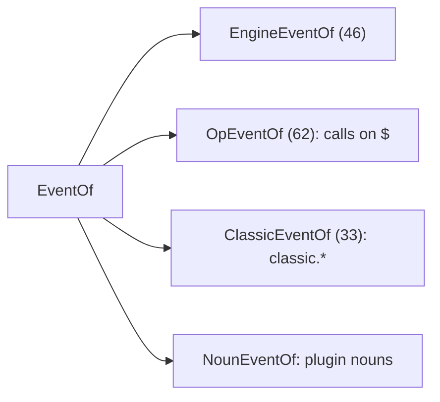

# Events reference

Every event a mod can hook in Claude Code 2.1.295. Four groups: 46 engine events, 62 API-call events, 33 `classic.<Event>` events, and events of plugin-declared nouns.

Authority: [claude-code.d.ts](../sources/claude-code-2.1.295/types/claude-code.d.ts). Line links below point into it. If this page and the file disagree, the file wins.

## How to read this page

- A hook is `on(event, [matcher], ($, e, next) => result)`. `next(e)` runs the hooks beneath, then core. See [dispatch-and-guards](../concepts/dispatch-and-guards.md).
- **Gating**: "Yes" means an answer can refuse or replace the action. "No" means the hook can observe or rewrite only.
- **Stream**: "Yes" means the hook must be an async generator (`async function* ($, e, next) {}`). Only `turn.step` and `process.spawn` stream ([d.ts:12171](../sources/claude-code-2.1.295/types/claude-code.d.ts#L12171)).
- **Guard**: a gating hook that throws, times out or answers a wrong shape is skipped and the action goes on. Add `.catch` to fail closed. Sample: `.catch(($, e, next) => next.called ? next(e) : { deny: "no" })`. The refusal word differs by event (`deny`, `drop`, `isOffered: false`, `refuse`, `decision`).
- **Matcher**: a second argument that filters by fields of `e`. A scalar matches by `===`, a RegExp tests the string, an array matches any of its members ([d.ts:5801](../sources/claude-code-2.1.295/types/claude-code.d.ts#L5801), [d.ts:5840](../sources/claude-code-2.1.295/types/claude-code.d.ts#L5840)). The matcher keys named below come from the `@example` lines in the doc comments. Other known keys of the input type also work.
- **Pattern**: `Pattern = EventName | Glob | Negation` ([d.ts:7466](../sources/claude-code-2.1.295/types/claude-code.d.ts#L7466)). `*` and `Namespace.*` (for example `classic.*`) are globs. `!name` negates. `*` selects every event except telemetry events. Name those, or use `telemetry.*` ([d.ts:5036-5040](../sources/claude-code-2.1.295/types/claude-code.d.ts#L5036)).
- Event names are `keyof EventOf` ([d.ts:4772](../sources/claude-code-2.1.295/types/claude-code.d.ts#L4772)). `EventOf` joins `EngineEventOf`, `ClassicEventOf`, `OpEventOf` and the plugin nouns' events ([d.ts:3623](../sources/claude-code-2.1.295/types/claude-code.d.ts#L3623)).



## 1. Engine events (46)

`EngineEventOf` is at [d.ts:3943](../sources/claude-code-2.1.295/types/claude-code.d.ts#L3943). Results are in `EngineResultOf` ([d.ts:4505](../sources/claude-code-2.1.295/types/claude-code.d.ts#L4505)). The count by family: tool 3, ui 9, agent 2, prompt 10, command 2, config 2, telemetry 2, session 9, plugin and engine 2, turn 3, other 2.

The "Input → Result" column shows type names. `Foo` means `export type Foo` in the d.ts. Find it with `grep -n "type Foo" claude-code.d.ts`.

### Tool events

| Event | Input → Result | Gating | Stream | What `next(e)` does / valid answers | d.ts |
|---|---|---|---|---|---|
| `tool.call` | `ToolCallInput` → `ToolCallResult` | Yes: `{ deny }` refuses; `{ result }` answers in place of `next` | No | Fires before a tool runs. `next(e)` runs the hooks beneath, then core (permission prompt, tool). A deny after `next` undoes nothing. Managed-settings deny comes first. Guard that fails lets the tool run. | [d.ts:3955](../sources/claude-code-2.1.295/types/claude-code.d.ts#L3955) |
| `tool.check` | `ToolCheckInput` → `ToolCheckResult` | Yes: `{ decision }` (deny) | No | Fires after `tool.call` and PreToolUse, before the mode settles an ask. `next(e)` returns the engine verdict and runs no tool. `$.tool.check` runs the same chain. Guard that fails leaves the verdict beneath. Matcher: `tool`. | [d.ts:3969](../sources/claude-code-2.1.295/types/claude-code.d.ts#L3969) |
| `tool.describe` | `ToolDescribeInput` → `ToolDescribeResult` | No (`isDeferred` moves a tool, does not refuse) | No | Fires when the tool schema is first rendered per session (MCP tools twice). `next(e)` resolves `{ description, isDeferred? }`. Cached until `$.ui.invalidate("tool.describe")`. Matcher: `tool`. | [d.ts:4225](../sources/claude-code-2.1.295/types/claude-code.d.ts#L4225) |

### UI events

Render, press, input and select events concern elements a render hook drew. See [ui.md](ui.md).

| Event | Input → Result | Gating | Stream | What `next(e)` does / valid answers | d.ts |
|---|---|---|---|---|---|
| `ui.render` | `RenderInput` → `RenderElement` | No | No | Fires per draw of a component (input change, plugin load, `$.ui.invalidate("ui.render")`). `next(e)` gives the drawing; a bad tree or a throw draws the engine's instead. | [d.ts:3981](../sources/claude-code-2.1.295/types/claude-code.d.ts#L3981) |
| `ui.resolve` | `ResolveInput` → `ElementTable` | No | No | Fires once per surface, component and plugin at plugin load. `next(e)` gives the surface table that `$.ui.resolve(e)` reads. Own table: hook skipped. | [d.ts:3990](../sources/claude-code-2.1.295/types/claude-code.d.ts#L3990) |
| `ui.press` | `UiPressArgument` → `UiPressResult` | No | No | Fires when a `Button` drawn by a render hook is pressed. `next(e)` runs core's `onPress`. Return `{ element }` to take the press. | [d.ts:3999](../sources/claude-code-2.1.295/types/claude-code.d.ts#L3999) |
| `ui.input` | `UiInputArgument` → `UiInputResult` | No | No | Fires when an `Input` drawn by a render hook changes or is submitted. `next({ ...e, value })` rewrites the typing. | [d.ts:4008](../sources/claude-code-2.1.295/types/claude-code.d.ts#L4008) |
| `ui.select` | `UiSelectArgument` → `UiSelectResult` | No | No | Fires when a `Select` drawn by a render hook is picked. `next` runs `onSelect` with the value as it stands. `next({ ...e, value })` rewrites the pick. | [d.ts:4017](../sources/claude-code-2.1.295/types/claude-code.d.ts#L4017) |
| `ui.message` | `UiMessageArgument` → `UiMessageResult` | No | No | Fires when a `Client` this plugin drew posts from its surface module. Only this plugin's hooks see it. `next({ ...e, data })` rewrites data. `{ props }` sets the next props without redraw. Core answers `{}`. | [d.ts:4026](../sources/claude-code-2.1.295/types/claude-code.d.ts#L4026) |
| `ui.fault` | `UiFaultInput` → `UiFaultResult` | No | No | Observe only. Fires when a `Client` this plugin drew fails (load, draw, or later code). `e.phase` says when, `e.reason` says why. The engine redraws that site; leave the `Client` out to fall back. | [d.ts:4040](../sources/claude-code-2.1.295/types/claude-code.d.ts#L4040) |
| `ui.scroll` | `UiScrollInput` → `UiScrollResult` | Yes: `{ deny }` or no `next` leaves the window undrawn | No | Fires before a `Pane` body or `AbovePrompt` band scrolls. `next(e)` moves to `e.offset`. Matcher: `requestId`. | [d.ts:4052](../sources/claude-code-2.1.295/types/claude-code.d.ts#L4052) |
| `ui.focus` | `UiFocusInput` → `UiFocusResult` | Yes: `{ deny }` or no `next` keeps focus where it was | No | Fires before the focus ring moves (Tab, arrows, click, `autoFocus`). `next(e)` lands on `e.element`; absent means an engine stop. Matcher: `requestId`. | [d.ts:4064](../sources/claude-code-2.1.295/types/claude-code.d.ts#L4064) |

### Agent events

| Event | Input → Result | Gating | Stream | What `next(e)` does / valid answers | d.ts |
|---|---|---|---|---|---|
| `agent.offer` | `AgentOfferInput` → `AgentOfferResult` | Yes: `{ isOffered: false }` hides the type from the listing and refuses dispatch | No | Fires when an agent type is offered to the model, in the listing and at dispatch. `next(e)` resolves `{ isOffered: true }`. A failing hook passes through. Matcher: `agent`. | [d.ts:4077](../sources/claude-code-2.1.295/types/claude-code.d.ts#L4077) |
| `agent.spawn` | `AgentSpawnInput` → `AgentSpawnResult` | Yes: `{ deny: reason }` | No | Fires before the Agent tool starts a subagent (model not yet resolved). Also fires for a workflow `agent()` call (`e.workflow`), where only deny applies. `next(e)` resolves `{ model }`. A guard that fails lets the subagent start. | [d.ts:4091](../sources/claude-code-2.1.295/types/claude-code.d.ts#L4091) |

### Prompt events

| Event | Input → Result | Gating | Stream | What `next(e)` does / valid answers | d.ts |
|---|---|---|---|---|---|
| `prompt.submit` | `PromptSubmitInput` → `PromptSubmitResult` | Yes: `{ drop: reason }` stops the prompt | No | Fires when a prompt is submitted, before the turn starts. `next` runs the hooks beneath and the UserPromptSubmit settings hooks, then enters. `next({ ...e, text })` rewrites. A failing guard lets the prompt through. | [d.ts:4103](../sources/claude-code-2.1.295/types/claude-code.d.ts#L4103) |
| `prompt.fill` | `PromptFillInput` → `PromptFillResult` | Yes: `{ isFilled: false }` without `next` keeps the text out | No | Fires before text goes into the prompt box as the draft (`$.prompt.fill`). `next(e)` writes it by `e.mode` (replace, append, insert). Rewrites `text` or `mode` on the way down. | [d.ts:4115](../sources/claude-code-2.1.295/types/claude-code.d.ts#L4115) |
| `prompt.suggest` | `PromptSuggestInput` → `PromptSuggestResult` | Yes: `{ isShown: false }` without `next` drops the suggestion | No | Fires when text is proposed as the dim suggestion (Tab to take). `next(e)` shows it and resolves `{ isShown }`. `next({ ...e, text })` rewrites. | [d.ts:4127](../sources/claude-code-2.1.295/types/claude-code.d.ts#L4127) |
| `prompt.edit` | `PromptEditInput` → `PromptEditResult` | Consumes the edit (no deny): `{ text, cursor }` without `next` takes the edit | No | Fires on each edit of the main prompt box (a key the editor took as an edit, or a paste). `e` holds the draft before and the splice (`start`, `end`, `inputText`). `next` resolves the box the editor shows. | [d.ts:4139](../sources/claude-code-2.1.295/types/claude-code.d.ts#L4139) |
| `prompt.autocomplete` | `PromptAutocompleteInput` → `PromptAutocompleteResult` | No | No | Fires as the person types a token at the cursor. `next(e)` resolves `{ suggestions }`. These rows join the engine's rows beneath them. Nothing waits on it. | [d.ts:4151](../sources/claude-code-2.1.295/types/claude-code.d.ts#L4151) |
| `prompt.section` | `PromptSectionInput` → `PromptSectionResult` | No | No | Fires once per named system prompt section when it is assembled. `next(e)` resolves `{ text }`. Cached until `$.ui.invalidate("prompt.section")`. Matcher: `name`. | [d.ts:4163](../sources/claude-code-2.1.295/types/claude-code.d.ts#L4163) |
| `prompt.context` | `PromptContextInput` → `PromptContextResult` | No | No | Fires once per conversation, for the context blocks the first user message carries. `next({ ...e, blocks })` appends, drops, reorders or rewrites. Cached until `$.ui.invalidate("prompt.context")` or a re-read. | [d.ts:4175](../sources/claude-code-2.1.295/types/claude-code.d.ts#L4175) |
| `prompt.compose` | `PromptComposeInput` → `PromptComposeResult` | No | No | Fires when the system prompt is rendered. `next(e)` resolves `{ sections }`, each `{ id, text, scope }`. Ids depend on `e.traits` (`lean`, `bare`). A list with a `shared` section after a `session` one skips the hook. | [d.ts:4184](../sources/claude-code-2.1.295/types/claude-code.d.ts#L4184) |
| `prompt.attachment` | `PromptAttachmentInput` → `PromptAttachmentResult` | Soft: `{ text: null }` leaves the injected message out | No | Fires once per message the engine injects for the model (reminder, mode change, mentioned file). `next(e)` resolves `{ text }`. Answer holds per attachment for the process. Matcher: `type`. | [d.ts:4196](../sources/claude-code-2.1.295/types/claude-code.d.ts#L4196) |
| `prompt.mention` | `PromptMentionInput` → `PromptMentionResult` | Yes: `{ deny: reason }` so nothing is read | No | Fires once per path named after `@`, before the engine reads it. `next(e)` reads it and resolves `{ type }`. No `tool.call` is raised for this read. A failing guard reads the file. Matcher: `path` (RegExp example). | [d.ts:4210](../sources/claude-code-2.1.295/types/claude-code.d.ts#L4210) |

### Command events

| Event | Input → Result | Gating | Stream | What `next(e)` does / valid answers | d.ts |
|---|---|---|---|---|---|
| `command.run` | `CommandRunInput` → `CommandRunResult` | Yes: `{ text }` answers in place of the command | No | Fires when a slash command is about to run (typed, or `$.command.run`). `next` runs core's command, and `next({ ...e, args })` rewrites args. `{ text }` without `next` replaces the run. A failing guard lets the command run. Matcher: `command`. | [d.ts:4239](../sources/claude-code-2.1.295/types/claude-code.d.ts#L4239) |
| `command.describe` | `CommandDescribeInput` → `CommandDescribeResult` | No | No | Fires once per command when it is listed for typeahead and `/help`. `next(e)` resolves `{ description, argumentHint, isHidden }`. Cached until `$.ui.invalidate("command.describe")`. | [d.ts:4251](../sources/claude-code-2.1.295/types/claude-code.d.ts#L4251) |

### Config events

| Event | Input → Result | Gating | Stream | What `next(e)` does / valid answers | d.ts |
|---|---|---|---|---|---|
| `config.set` | `ConfigSetInput` → `ConfigSetResult` | Yes: `{ deny: reason }` leaves the row as it is | No | Fires when a `/config` row is about to change (menu or `$.config.set`). `next` writes and resolves `{ value }`. `next({ ...e, value })` clamps. A wrong-kind value is refused. Matcher: `key`. | [d.ts:4265](../sources/claude-code-2.1.295/types/claude-code.d.ts#L4265) |
| `config.describe` | `ConfigDescribeInput` → `ConfigDescribeResult` | No | No | Fires once per `/config` row when listed (menu, `$.config.list`). `next(e)` resolves `{ label, description, isHidden }`. Cached until `$.ui.invalidate("config.describe")` or the plugin set changes. Matcher: `key`. | [d.ts:4277](../sources/claude-code-2.1.295/types/claude-code.d.ts#L4277) |

### Telemetry events

Hooked by name or by `telemetry.*`. `*` does not select a telemetry event ([d.ts:5036-5040](../sources/claude-code-2.1.295/types/claude-code.d.ts#L5036)).

| Event | Input → Result | Gating | Stream | What `next(e)` does / valid answers | d.ts |
|---|---|---|---|---|---|
| `telemetry.log` | `TelemetryLogInput` → `TelemetryLogResult` | Yes: `{ deny }` rejects the caller | No | Fires when a record is about to be logged to `e.to`. `e.to` is pinned: a hook rewrites the record, never the destination. `next(e)` resolves `{ value: undefined }`. Matcher: `to` (`collector`). | [d.ts:4289](../sources/claude-code-2.1.295/types/claude-code.d.ts#L4289) |
| `telemetry.mark` | `TelemetryMarkInput` → `TelemetryMarkResult` | Yes: `{ deny }` rejects the caller | No | Fires when one feature use is marked (`$.telemetry.mark`). Always for `anthropic`; no `to`. The engine does nothing with a mark. `next(e)` resolves `{ value: undefined }`. Matcher: `kind`. | [d.ts:4300](../sources/claude-code-2.1.295/types/claude-code.d.ts#L4300) |

### Session events

| Event | Input → Result | Gating | Stream | What `next(e)` does / valid answers | d.ts |
|---|---|---|---|---|---|
| `session.start` | `SessionStartInput` → `SessionStartResult` | No (observe) | No | Fires once per process per loaded plugin before the first prompt (first call is awaited), and once per fresh load later. `next(e)` resolves `{ cwd }`. A `$.tool.register` here is listed by turn one. | [d.ts:4334](../sources/claude-code-2.1.295/types/claude-code.d.ts#L4334) |
| `session.receive` | `SessionReceiveInput` → `SessionReceiveResult` | Yes: `{ consumed: reason }` takes the delivery; nothing is queued or read | No | Fires when a delivery reaches the session (relay event, peer message, Remote Control prompt, artifact room event), before it is queued. `next({ ...e, text })` rewrites. Matcher: `origin` (`peer`). | [d.ts:4347](../sources/claude-code-2.1.295/types/claude-code.d.ts#L4347) |
| `session.append` | `SessionAppendInput` → `SessionAppendResult` | No (rewrites only) | No | Fires once per conversation row (prompt, response block, tool result, notice) before it is stored. `next({ ...e, message })` rewrites content. The screen may show the row before the rewrite; the model and transcript do not. Matcher: `door` (`tool-result`). | [d.ts:4359](../sources/claude-code-2.1.295/types/claude-code.d.ts#L4359) |
| `session.send` | `SessionSendInput` → `SessionSendResult` | Yes: `{ isDelivered: false, reason }` without `next` refuses | No | Fires when a plain-text message is about to leave for another agent or session (SendMessage, `$.session.send`). `next` resolves queued. Rewrites `text` or `to`; a new `to` is judged again. `e.origin` and `e.agentId` say who sent it. | [d.ts:4371](../sources/claude-code-2.1.295/types/claude-code.d.ts#L4371) |
| `session.compact` | `SessionCompactInput` → `SessionCompactResult` | Yes: `{ skip: reason }` leaves the conversation as it is | No | Fires before compaction (`/compact`, threshold, plugin, ahead of time). `next` resolves `{ messages }`. Can rewrite `instructions` or `messages`, or answer `{ messages }` itself. Matcher: `trigger` (`precompute`). | [d.ts:4383](../sources/claude-code-2.1.295/types/claude-code.d.ts#L4383) |
| `session.attach` | `SessionAttachInput` → `SessionAttachResult` | No | No | Fires when a remote client joins the roster (it said so, or first asked to draw). `next(e)` resolves `{ clientId }`. A different return changes nothing. Matcher: `surface` (`mobile`). | [d.ts:4395](../sources/claude-code-2.1.295/types/claude-code.d.ts#L4395) |
| `session.detach` | `SessionDetachInput` → `SessionDetachResult` | No | No | Fires when a client leaves the roster (detached, or session ended with it attached; `e.reason`). `next(e)` echoes `{ clientId }`. With reason `end`, runs inside `session.end`'s time bound (`next.budget`, `next.signal`). | [d.ts:4403](../sources/claude-code-2.1.295/types/claude-code.d.ts#L4403) |
| `session.measure` | `SessionMeasureInput` → `SessionMeasureResult` | No | No | Fires when session usage moved: after each main-thread turn, or when a rate-limit window moves a point. `next(e)` echoes `{ changed }`. Bursts fold into one more call. | [d.ts:4415](../sources/claude-code-2.1.295/types/claude-code.d.ts#L4415) |
| `session.end` | `SessionEndInput` → `SessionEndResult` | No | No | Fires once when the session ends (exit, `/clear`, resume, logout, signal, `-p` done), after the SessionEnd settings hooks. `next(e)` runs the engine's end step and resolves `{ sessionId }`. The whole chain shares one short wall-clock bound (`next.budget`). | [d.ts:4427](../sources/claude-code-2.1.295/types/claude-code.d.ts#L4427) |

### Plugin and engine events

| Event | Input → Result | Gating | Stream | What `next(e)` does / valid answers | d.ts |
|---|---|---|---|---|---|
| `plugin.register` | `PluginRegisterInput` → `PluginRegisterResult` | Yes: `{ refuse: reason }` means the module never joins | No | Fires once per hooks module before it joins the chain (at load and at reload). `e.tier` says which tier loaded it. Its judges are the plugins admitted before it and the binary's. Matcher: `tier` (`user`). Guard that fails lets the module join. | [d.ts:4441](../sources/claude-code-2.1.295/types/claude-code.d.ts#L4441) |
| `engine.create` | `EngineCreateInput` → `EngineCreateResult` | Withholds nouns (not an answer refusal). A step that replaces another's noun fails its plugin | No | Fires while `$` is built, once per plugin load or reload, before any other hook of that plugin. `next(e)` resolves `$` built so far. A step may add nouns and, outside `user`, withhold them. | [d.ts:4473](../sources/claude-code-2.1.295/types/claude-code.d.ts#L4473) |

### Turn events

| Event | Input → Result | Gating | Stream | What `next(e)` does / valid answers | d.ts |
|---|---|---|---|---|---|
| `turn.start` | `TurnStartInput` → `TurnStartResult` | No (observe) | No | Fires when a model turn begins, before its first model call. `next(e)` resolves `{ turnId }`. A different return changes nothing. | [d.ts:4446](../sources/claude-code-2.1.295/types/claude-code.d.ts#L4446) |
| `turn.step` | `TurnStepInput` → `TurnStepResult` | Yes: an answer without `next` sends no model request | Yes | Fires before each model request of a turn (main or subagent, `e.agentId`). `next({ ...e, model })` or `effort` sends a different request. Turn, index and message count are pinned. Chunks: `TurnStepChunk` (`claude-code.d.ts:13403`). Budget counts the hook's own code only. | [d.ts:4455](../sources/claude-code-2.1.295/types/claude-code.d.ts#L4455) |
| `turn.complete` | `TurnCompleteInput` → `TurnCompleteResult` | No (display only) | No | Fires when a turn ends, where its duration is reported. `next(e)` resolves `{ text }`. Return `{ text }` to show a different text beneath the answer. The transcript record is not rewritten. `e.reason` says why it ended. | [d.ts:4464](../sources/claude-code-2.1.295/types/claude-code.d.ts#L4464) |

### Skill and attribution events

| Event | Input → Result | Gating | Stream | What `next(e)` does / valid answers | d.ts |
|---|---|---|---|---|---|
| `skill.prompt` | `SkillPromptInput` → `SkillPromptResult` | No | No | Fires when a skill prompt is expanded (`/name`, Skill tool, preload). `next(e)` resolves `{ text }`. Return `{ text }` to give the model different text. Matcher: `skill`. | [d.ts:4311](../sources/claude-code-2.1.295/types/claude-code.d.ts#L4311) |
| `attribution.text` | `AttributionTextInput` → `AttributionTextResult` | No | No | Fires when a git text the model writes is composed (`kind`: `commit`, `pr`, `exemption`, `remedy`). Return `{ text }` to replace it. Matcher: `kind`. | [d.ts:4322](../sources/claude-code-2.1.295/types/claude-code.d.ts#L4322) |


### Notes on the engine events

- Typed inputs: `ToolCallInput = ToolCallEnvelope & AgentLoop & ToolRequestMeta` ([d.ts:12665](../sources/claude-code-2.1.295/types/claude-code.d.ts#L12665)). The `e` of `tool.call` narrows by `e.tool` for each built-in tool (`BuiltinToolInputs`, [d.ts:15987](../sources/claude-code-2.1.295/types/claude-code.d.ts#L15987)).
- `tool.call` result: `{ result, context? }` or `{ deny }` ([d.ts:12701](../sources/claude-code-2.1.295/types/claude-code.d.ts#L12701)). From core the result also has `ref`, `text`, `isError`, `isReadOnly`. A `deny` returned after the tool ran undoes nothing. The model reads `<tool> ran, and a plugin withheld its result: <text>`.
- `tool.check` input has `tool`, `input`, `tool_use_id?`, `agentId?` and `ceiling?` ([d.ts:12812](../sources/claude-code-2.1.295/types/claude-code.d.ts#L12812)). `ceiling` is set by the engine and pinned. The result is `{ decision, reason?, rule?, hook?, ceiling? }` ([d.ts:12859](../sources/claude-code-2.1.295/types/claude-code.d.ts#L12859)).
- `turn.complete` input has `answer`, `durationMs`, `isAborted`, `turnId`, `agentId?`, `usage?` and a `reason` of `answer`, `aborted`, `refusal` or `error` ([d.ts:13324](../sources/claude-code-2.1.295/types/claude-code.d.ts#L13324)). The result is `{ text, usage? }` ([d.ts:13348](../sources/claude-code-2.1.295/types/claude-code.d.ts#L13348)).
- `session.end` `reason` is one of `prompt_input_exit`, `clear`, `resume`, `logout`, `other` ([d.ts:11077](../sources/claude-code-2.1.295/types/claude-code.d.ts#L11077)). A `/clear` raises `session.end` with `clear` and no `session.start` ([reference.md](../sources/claude-code-2.1.295/reference.md#L26)).
- `prompt.submit` result is `{ text, context?, origin? }` or `{ drop }` ([d.ts:9104](../sources/claude-code-2.1.295/types/claude-code.d.ts#L9104)). A `drop` after `next(e)` already let the prompt through fails the hook ([docs: events](../sources/code-claude-com-2026-10-09/mods/events.md)).
- `session.start` fires once per process per loaded plugin. The first call is awaited, so a `$.tool.register` made there is listed by turn one ([d.ts:4334](../sources/claude-code-2.1.295/types/claude-code.d.ts#L4334)). Registering `session.start` twice without a matcher fails the load ([docs: events](../sources/code-claude-com-2026-10-09/mods/events.md)).

## 2. API calls as events (62)

Every call on `$` that the host serves is also an event. The name is `<noun>.<method>`, for example `fs.read`, `model.complete`, `ui.open`, `process.spawn`. `OpEventOf` is at [d.ts:6836](../sources/claude-code-2.1.295/types/claude-code.d.ts#L6836). Values are in `OpValueOf` ([d.ts:7197](../sources/claude-code-2.1.295/types/claude-code.d.ts#L7197)).

Rules ([d.ts:6825-6835](../sources/claude-code-2.1.295/types/claude-code.d.ts#L6825), [docs: api](../sources/code-claude-com-2026-10-09/mods/api.md)):

- `e` is the call's argument as it crosses to the host.
- A hook above the caller can pass the call on, rewrite it, refuse it with `{ deny }`, or answer with `{ value }`. Core is the host's own implementation.
- The calling hook alone is skipped. `next.origin` names the caller.
- The hook's result type is `{ value } | { deny }` (`ValueOrDeny`, [d.ts:14675](../sources/claude-code-2.1.295/types/claude-code.d.ts#L14675)). Hooks match by name, by `*` and by `<noun>.*`.
- An organization restricts what mods reach by hooking these events (for example `fs.read`, `process.run`, `http.fetch`).
- A guard that fails is skipped and the call goes on, unless its `.catch` answers `{ deny }`.
- `process.spawn` streams: its hook is an async generator ([d.ts:12171](../sources/claude-code-2.1.295/types/claude-code.d.ts#L12171)).
- `turn.abort` is in `LateOverload` ([d.ts:5632](../sources/claude-code-2.1.295/types/claude-code.d.ts#L5632)). It shares `turnId` with the turn events.
- `session.surface` is deprecated. Hook `session.surfaces` instead ([d.ts:6917](../sources/claude-code-2.1.295/types/claude-code.d.ts#L6917)).
- `state.set` is raised by the value's owner only. A `{ deny }` after `next(e)` answered fails the hook ([d.ts:7122](../sources/claude-code-2.1.295/types/claude-code.d.ts#L7122)).
- `ui.notify` is heard twice: by `ui.notify` hooks and by `classic.Notification` hooks. Two mods that each notify again on hearing one echo each other without end ([d.ts:7038](../sources/claude-code-2.1.295/types/claude-code.d.ts#L7038)).
- `ui.log` always carries `to`. `next({ ...e, to: "debug" })` keeps a line off screen ([d.ts:6990](../sources/claude-code-2.1.295/types/claude-code.d.ts#L6990)).
- `ui.close` is raised by the engine too, with `origin` of `person` or `unload` ([d.ts:7016](../sources/claude-code-2.1.295/types/claude-code.d.ts#L7016)).
- `ui.copy` and `ui.notify` results: a hook above that answers without acting says `reason: 'refused'` ([d.ts:13720](../sources/claude-code-2.1.295/types/claude-code.d.ts#L13720), [d.ts:14079](../sources/claude-code-2.1.295/types/claude-code.d.ts#L14079)).

| Event | `$` call | Argument `e` | Result `value` | d.ts |
|---|---|---|---|---|
| `model.complete` | `$.model.complete(…)` | `ModelCompleteInput` | `ModelCompleteResult` | [d.ts:6843](../sources/claude-code-2.1.295/types/claude-code.d.ts#L6843) |
| `model.classify` | `$.model.classify(…)` | `{ text: string; labels: readonly string[]; options?: ClassifyOptions }` | `string \| undefined` | [d.ts:6847](../sources/claude-code-2.1.295/types/claude-code.d.ts#L6847) |
| `model.fork` | `$.model.fork(…)` | `ModelForkRequest` | `ModelForkResult` | [d.ts:6855](../sources/claude-code-2.1.295/types/claude-code.d.ts#L6855) |
| `audio.play` | `$.audio.play(…)` | `{ clip: AudioClip; shouldLoop: boolean; gain?: number }` | `void` | [d.ts:6860](../sources/claude-code-2.1.295/types/claude-code.d.ts#L6860) |
| `audio.speak` | `$.audio.speak(…)` | `SpeakRequest` | `SpeakResult` | [d.ts:6868](../sources/claude-code-2.1.295/types/claude-code.d.ts#L6868) |
| `mcp.call` | `$.mcp.call(…)` | `{ server: string; tool: string; args: Record<string, unknown> }` | `McpToolResult` | [d.ts:6872](../sources/claude-code-2.1.295/types/claude-code.d.ts#L6872) |
| `mcp.connect` | `$.mcp.connect(…)` | `{ server: string }` | `McpConnectResult` | [d.ts:6880](../sources/claude-code-2.1.295/types/claude-code.d.ts#L6880) |
| `session.cwd` | `$.session.cwd(…)` | — | `string` | [d.ts:6886](../sources/claude-code-2.1.295/types/claude-code.d.ts#L6886) |
| `session.root` | `$.session.root(…)` | — | `string` | [d.ts:6890](../sources/claude-code-2.1.295/types/claude-code.d.ts#L6890) |
| `session.model` | `$.session.model(…)` | — | `string` | [d.ts:6894](../sources/claude-code-2.1.295/types/claude-code.d.ts#L6894) |
| `session.turns` | `$.session.turns(…)` | — | `number` | [d.ts:6898](../sources/claude-code-2.1.295/types/claude-code.d.ts#L6898) |
| `session.id` | `$.session.id(…)` | — | `string` | [d.ts:6902](../sources/claude-code-2.1.295/types/claude-code.d.ts#L6902) |
| `session.messages` | `$.session.messages(…)` | `SessionMessagesArgs` | `SessionMessagesValue` | [d.ts:6907](../sources/claude-code-2.1.295/types/claude-code.d.ts#L6907) |
| `session.repo` | `$.session.repo(…)` | — | `SessionRepo \| null` | [d.ts:6911](../sources/claude-code-2.1.295/types/claude-code.d.ts#L6911) |
| `session.surface` | `$.session.surface(…)` | — | `RenderSurface \| null` | [d.ts:6917](../sources/claude-code-2.1.295/types/claude-code.d.ts#L6917) |
| `session.surfaces` | `$.session.surfaces(…)` | — | `readonly RenderSurface[]` | [d.ts:6921](../sources/claude-code-2.1.295/types/claude-code.d.ts#L6921) |
| `session.authorize` | `$.session.authorize(…)` | — | `SessionAuthorization` | [d.ts:6925](../sources/claude-code-2.1.295/types/claude-code.d.ts#L6925) |
| `session.usage` | `$.session.usage(…)` | `SessionUsageArgs` | `SessionUsage` | [d.ts:6929](../sources/claude-code-2.1.295/types/claude-code.d.ts#L6929) |
| `session.version` | `$.session.version(…)` | — | `SessionVersion` | [d.ts:6933](../sources/claude-code-2.1.295/types/claude-code.d.ts#L6933) |
| `turn.abort` | `$.turn.abort(…)` | `{ turnId: string }` | `void` | [d.ts:6937](../sources/claude-code-2.1.295/types/claude-code.d.ts#L6937) |
| `prompt.read` | `$.prompt.read(…)` | — | `PromptBox` | [d.ts:6943](../sources/claude-code-2.1.295/types/claude-code.d.ts#L6943) |
| `tool.list` | `$.tool.list(…)` | — | `ToolInfo[]` | [d.ts:6947](../sources/claude-code-2.1.295/types/claude-code.d.ts#L6947) |
| `tool.register` | `$.tool.register(…)` | `RegisteredToolSpec` | `{ tool: string }` | [d.ts:6951](../sources/claude-code-2.1.295/types/claude-code.d.ts#L6951) |
| `command.list` | `$.command.list(…)` | — | `CommandInfo[]` | [d.ts:6955](../sources/claude-code-2.1.295/types/claude-code.d.ts#L6955) |
| `command.register` | `$.command.register(…)` | `CommandSpec` | `{ command: string }` | [d.ts:6959](../sources/claude-code-2.1.295/types/claude-code.d.ts#L6959) |
| `config.list` | `$.config.list(…)` | — | `ConfigRow[]` | [d.ts:6963](../sources/claude-code-2.1.295/types/claude-code.d.ts#L6963) |
| `agent.list` | `$.agent.list(…)` | — | `AgentInfo[]` | [d.ts:6967](../sources/claude-code-2.1.295/types/claude-code.d.ts#L6967) |
| `agent.register` | `$.agent.register(…)` | `AgentSpec` | `{ agent: string }` | [d.ts:6972](../sources/claude-code-2.1.295/types/claude-code.d.ts#L6972) |
| `ui.toast` | `$.ui.toast(…)` | `{ text: string; timeoutMs?: number }` | `void` | [d.ts:6976](../sources/claude-code-2.1.295/types/claude-code.d.ts#L6976) |
| `ui.status` | `$.ui.status(…)` | `{ text: string \| undefined }` | `void` | [d.ts:6983](../sources/claude-code-2.1.295/types/claude-code.d.ts#L6983) |
| `ui.log` | `$.ui.log(…)` | `{ text: string; to: UiLogSink }` | `void` | [d.ts:6990](../sources/claude-code-2.1.295/types/claude-code.d.ts#L6990) |
| `ui.notice` | `$.ui.notice(…)` | `{ tool_use_id: string; text: string \| undefined }` | `void` | [d.ts:6997](../sources/claude-code-2.1.295/types/claude-code.d.ts#L6997) |
| `ui.invalidate` | `$.ui.invalidate(…)` | `{ event: InvalidatableEventName }` | `void` | [d.ts:7004](../sources/claude-code-2.1.295/types/claude-code.d.ts#L7004) |
| `ui.open` | `$.ui.open(…)` | `PaneOpenArgs` | `UiOpenResult` | [d.ts:7011](../sources/claude-code-2.1.295/types/claude-code.d.ts#L7011) |
| `ui.close` | `$.ui.close(…)` | `PaneCloseInput` | `void` | [d.ts:7016](../sources/claude-code-2.1.295/types/claude-code.d.ts#L7016) |
| `ui.panes` | `$.ui.panes(…)` | — | `readonly UiPane[]` | [d.ts:7020](../sources/claude-code-2.1.295/types/claude-code.d.ts#L7020) |
| `ui.selection` | `$.ui.selection(…)` | — | `UiSelection \| undefined` | [d.ts:7024](../sources/claude-code-2.1.295/types/claude-code.d.ts#L7024) |
| `ui.copy` | `$.ui.copy(…)` | `UiCopyArgs` | `UiCopyResult` | [d.ts:7029](../sources/claude-code-2.1.295/types/claude-code.d.ts#L7029) |
| `ui.notify` | `$.ui.notify(…)` | `{ text: string; title?: string }` | `UiNotifyResult` | [d.ts:7038](../sources/claude-code-2.1.295/types/claude-code.d.ts#L7038) |
| `ui.blit` | `$.ui.blit(…)` | `UiBlitArgs` | `UiBlitResult` | [d.ts:7046](../sources/claude-code-2.1.295/types/claude-code.d.ts#L7046) |
| `fs.read` | `$.fs.read(…)` | `{ path: string; as: FsReadAs }` | `string \| FsBytes` | [d.ts:7051](../sources/claude-code-2.1.295/types/claude-code.d.ts#L7051) |
| `fs.write` | `$.fs.write(…)` | `{ path: string; text: string }` | `void` | [d.ts:7058](../sources/claude-code-2.1.295/types/claude-code.d.ts#L7058) |
| `fs.list` | `$.fs.list(…)` | `{ path: string }` | `FsEntry[]` | [d.ts:7065](../sources/claude-code-2.1.295/types/claude-code.d.ts#L7065) |
| `fs.exists` | `$.fs.exists(…)` | `{ path: string }` | `boolean` | [d.ts:7071](../sources/claude-code-2.1.295/types/claude-code.d.ts#L7071) |
| `fs.stat` | `$.fs.stat(…)` | `{ path: string; resolve: boolean }` | `FsStat` | [d.ts:7078](../sources/claude-code-2.1.295/types/claude-code.d.ts#L7078) |
| `fs.ancestors` | `$.fs.ancestors(…)` | `FsAncestorsRequest` | `readonly FsAncestor[]` | [d.ts:7085](../sources/claude-code-2.1.295/types/claude-code.d.ts#L7085) |
| `store.get` | `$.store.get(…)` | `{ key: string }` | `unknown` | [d.ts:7089](../sources/claude-code-2.1.295/types/claude-code.d.ts#L7089) |
| `store.set` | `$.store.set(…)` | `{ key: string; value: unknown }` | `void` | [d.ts:7095](../sources/claude-code-2.1.295/types/claude-code.d.ts#L7095) |
| `store.delete` | `$.store.delete(…)` | `{ key: string }` | `void` | [d.ts:7102](../sources/claude-code-2.1.295/types/claude-code.d.ts#L7102) |
| `store.keys` | `$.store.keys(…)` | — | `string[]` | [d.ts:7108](../sources/claude-code-2.1.295/types/claude-code.d.ts#L7108) |
| `state.get` | `$.state.get(…)` | `StateGetEvent` | `StateRead` | [d.ts:7113](../sources/claude-code-2.1.295/types/claude-code.d.ts#L7113) |
| `state.set` | `$.state.set(…)` | `StateSetEvent` | `StateSetResult` | [d.ts:7122](../sources/claude-code-2.1.295/types/claude-code.d.ts#L7122) |
| `clock.now` | `$.clock.now(…)` | — | `number` | [d.ts:7126](../sources/claude-code-2.1.295/types/claude-code.d.ts#L7126) |
| `clock.sleep` | `$.clock.sleep(…)` | `ClockWait` | `void` | [d.ts:7131](../sources/claude-code-2.1.295/types/claude-code.d.ts#L7131) |
| `clock.after` | `$.clock.after(…)` | `ClockWait` | `void` | [d.ts:7136](../sources/claude-code-2.1.295/types/claude-code.d.ts#L7136) |
| `clock.every` | `$.clock.every(…)` | `ClockWait` | `void` | [d.ts:7141](../sources/claude-code-2.1.295/types/claude-code.d.ts#L7141) |
| `http.fetch` | `$.http.fetch(…)` | `{ url: string; init?: HttpInit }` | `HttpResponse` | [d.ts:7145](../sources/claude-code-2.1.295/types/claude-code.d.ts#L7145) |
| `process.run` | `$.process.run(…)` | `{ argv: readonly string[]; init?: ProcessRunInit }` | `ProcessRunResult` | [d.ts:7152](../sources/claude-code-2.1.295/types/claude-code.d.ts#L7152) |
| `process.spawn` | `$.process.spawn(…)` | `ProcessSpawnRequest` | `ProcessSpawnResult` | [d.ts:7163](../sources/claude-code-2.1.295/types/claude-code.d.ts#L7163) |
| `settings.read` | `$.settings.read(…)` | `SettingsReadArgs` | `Settings` | [d.ts:7167](../sources/claude-code-2.1.295/types/claude-code.d.ts#L7167) |
| `env.get` | `$.env.get(…)` | `{ name: string }` | `string \| undefined` | [d.ts:7171](../sources/claude-code-2.1.295/types/claude-code.d.ts#L7171) |
| `env.set` | `$.env.set(…)` | `{ name: string; value?: string }` | `void` | [d.ts:7181](../sources/claude-code-2.1.295/types/claude-code.d.ts#L7181) |

### `$` members that are engine events, not API-call events

These `$` calls run the engine event of the same name (`EventCalls`, [d.ts:4706](../sources/claude-code-2.1.295/types/claude-code.d.ts#L4706)). A plugin's call runs the same chain with the calling hook skipped.

| `$` call | Event |
|---|---|
| `$.tool.call`, `$.tool.check` | `tool.call`, `tool.check` |
| `$.command.run` | `command.run` |
| `$.config.set` | `config.set` |
| `$.prompt.submit`, `.fill`, `.suggest`, `.compose` | `prompt.submit`, `prompt.fill`, `prompt.suggest`, `prompt.compose` |
| `$.agent.spawn` | `agent.spawn` |
| `$.session.compact`, `.send`, `.append` | `session.compact`, `session.send`, `session.append` |
| `$.telemetry.log`, `.mark` | `telemetry.log`, `telemetry.mark` |
| `$.ui.scroll`, `.focus`, `.resolve` | `ui.scroll`, `ui.focus`, `ui.resolve` |

`$.ui.ask` has no event of its own. It is a `tool.call` of `AskUserQuestion` through every hook but the caller's ([d.ts:2430](../sources/claude-code-2.1.295/types/claude-code.d.ts#L2430)).

### Events of plugin-declared nouns

A plugin can add a noun to `$` in `engine.create`. Each function member of the noun becomes the event `<noun>.<method>` with the same `{ value } | { deny }` result. They are empty until a plugin declares a noun ([d.ts:6732](../sources/claude-code-2.1.295/types/claude-code.d.ts#L6732), [d.ts:6756](../sources/claude-code-2.1.295/types/claude-code.d.ts#L6756)).

## 3. Classic events: `classic.<Event>` (33)

Settings hooks (the `hooks` key in `settings.json`) are hookable as `classic.<Event>`. `ClassicEventName` is at [d.ts:1238](../sources/claude-code-2.1.295/types/claude-code.d.ts#L1238). Inputs are in `ClassicEventOf` ([d.ts:1251](../sources/claude-code-2.1.295/types/claude-code.d.ts#L1251)). Results are in `ClassicResultOf` ([d.ts:1386](../sources/claude-code-2.1.295/types/claude-code.d.ts#L1386)).

- `e` is the whole stdin JSON the settings hook receives, base fields (`transcript_path`, `cwd`) included.
- The chain is: managed settings hooks, then hooks modules, then the other settings hooks as core. A managed block ends the chain above every module ([d.ts:1244-1246](../sources/claude-code-2.1.295/types/claude-code.d.ts#L1244)).
- Each event fires wherever the engine runs the classic hook, whether or not a settings hook exists.
- `classic.*` selects them all. A hook that blocks and fails is skipped unless `.catch` answers.
- Every classic result may carry `block`, `preventContinuation`, `stopReason`. Own fields per event are in the table ([d.ts:1276](../sources/claude-code-2.1.295/types/claude-code.d.ts#L1276), [d.ts:1360](../sources/claude-code-2.1.295/types/claude-code.d.ts#L1360)).
- `classic.PreToolUse` takes the same envelope as `tool.call` and keeps `allow` / `ask` / `deny`. Managed `PreToolUse` hooks run before the first module's `tool.call` ([docs: events](../sources/code-claude-com-2026-10-09/mods/events.md)).
- The names match the 33 hook events in the [classic hooks doc](../sources/code-claude-com-2026-10-09/hooks/hooks.md).

| Event | Input type | Own result fields (besides `block`, `preventContinuation`, `stopReason`) |
|---|---|---|
| `classic.ConfigChange` | `ConfigChangeHookInput` ([d.ts:1911](../sources/claude-code-2.1.295/types/claude-code.d.ts#L1911)) | — |
| `classic.CwdChanged` | `CwdChangedHookInput` ([d.ts:3625](../sources/claude-code-2.1.295/types/claude-code.d.ts#L3625)) | — |
| `classic.DirectoryAdded` | `DirectoryAddedHookInput` ([d.ts:3752](../sources/claude-code-2.1.295/types/claude-code.d.ts#L3752)) | — |
| `classic.Elicitation` | `ElicitationHookInput` ([d.ts:3879](../sources/claude-code-2.1.295/types/claude-code.d.ts#L3879)) | — |
| `classic.ElicitationResult` | `ElicitationResultHookInput` ([d.ts:3892](../sources/claude-code-2.1.295/types/claude-code.d.ts#L3892)) | — |
| `classic.FileChanged` | `FileChangedHookInput` ([d.ts:4811](../sources/claude-code-2.1.295/types/claude-code.d.ts#L4811)) | — |
| `classic.InstructionsLoaded` | `InstructionsLoadedHookInput` ([d.ts:5550](../sources/claude-code-2.1.295/types/claude-code.d.ts#L5550)) | — |
| `classic.MessageDisplay` | `MessageDisplayHookInput` ([d.ts:6049](../sources/claude-code-2.1.295/types/claude-code.d.ts#L6049)) | displayContent |
| `classic.Notification` | `NotificationHookInput` ([d.ts:6692](../sources/claude-code-2.1.295/types/claude-code.d.ts#L6692)) | — |
| `classic.PermissionDenied` | `PermissionDeniedHookInput` ([d.ts:7479](../sources/claude-code-2.1.295/types/claude-code.d.ts#L7479)) | retry |
| `classic.PermissionRequest` | `PermissionRequestHookInput` ([d.ts:7507](../sources/claude-code-2.1.295/types/claude-code.d.ts#L7507)) | decision |
| `classic.PostCompact` | `PostCompactHookInput` ([d.ts:7789](../sources/claude-code-2.1.295/types/claude-code.d.ts#L7789)) | — |
| `classic.PostModelSwitch` | `PostModelSwitchHookInput` ([d.ts:7798](../sources/claude-code-2.1.295/types/claude-code.d.ts#L7798)) | additionalContext |
| `classic.PostToolBatch` | `PostToolBatchHookInput` ([d.ts:7839](../sources/claude-code-2.1.295/types/claude-code.d.ts#L7839)) | additionalContext |
| `classic.PostToolUseFailure` | `PostToolUseFailureHookInput` ([d.ts:7851](../sources/claude-code-2.1.295/types/claude-code.d.ts#L7851)) | additionalContext |
| `classic.PostToolUse` | `PostToolUseHookInput` ([d.ts:7865](../sources/claude-code-2.1.295/types/claude-code.d.ts#L7865)) | additionalContext, updatedToolOutput, updatedMCPToolOutput |
| `classic.PreCompact` | `PreCompactHookInput` ([d.ts:7878](../sources/claude-code-2.1.295/types/claude-code.d.ts#L7878)) | — |
| `classic.PreModelSwitch` | `PreModelSwitchHookInput` ([d.ts:7884](../sources/claude-code-2.1.295/types/claude-code.d.ts#L7884)) | permissionDecision, permissionDecisionReason |
| `classic.PreToolUse` | `ToolCallEnvelope` ([d.ts:12654](../sources/claude-code-2.1.295/types/claude-code.d.ts#L12654)) | `PreToolUseResult`: `allow` / `ask` / `deny` ([d.ts:7984](../sources/claude-code-2.1.295/types/claude-code.d.ts#L7984)) |
| `classic.SessionEnd` | `SessionEndHookInput` ([d.ts:11036](../sources/claude-code-2.1.295/types/claude-code.d.ts#L11036)) | — |
| `classic.SessionStart` | `SessionStartHookInput` ([d.ts:11643](../sources/claude-code-2.1.295/types/claude-code.d.ts#L11643)) | additionalContext, initialUserMessage, sessionTitle, watchPaths, reloadSkills |
| `classic.Setup` | `SetupHookInput` ([d.ts:11818](../sources/claude-code-2.1.295/types/claude-code.d.ts#L11818)) | additionalContext |
| `classic.StopFailure` | `StopFailureHookInput` ([d.ts:12110](../sources/claude-code-2.1.295/types/claude-code.d.ts#L12110)) | — |
| `classic.Stop` | `StopHookInput` ([d.ts:12117](../sources/claude-code-2.1.295/types/claude-code.d.ts#L12117)) | additionalContext |
| `classic.SubagentStart` | `SubagentStartHookInput` ([d.ts:12238](../sources/claude-code-2.1.295/types/claude-code.d.ts#L12238)) | additionalContext |
| `classic.SubagentStop` | `SubagentStopHookInput` ([d.ts:12244](../sources/claude-code-2.1.295/types/claude-code.d.ts#L12244)) | additionalContext |
| `classic.TaskCompleted` | `TaskCompletedHookInput` ([d.ts:12316](../sources/claude-code-2.1.295/types/claude-code.d.ts#L12316)) | — |
| `classic.TaskCreated` | `TaskCreatedHookInput` ([d.ts:12328](../sources/claude-code-2.1.295/types/claude-code.d.ts#L12328)) | — |
| `classic.TeammateIdle` | `TeammateIdleHookInput` ([d.ts:12340](../sources/claude-code-2.1.295/types/claude-code.d.ts#L12340)) | — |
| `classic.UserPromptExpansion` | `UserPromptExpansionHookInput` ([d.ts:14652](../sources/claude-code-2.1.295/types/claude-code.d.ts#L14652)) | additionalContext, suppressOriginalPrompt |
| `classic.UserPromptSubmit` | `UserPromptSubmitHookInput` ([d.ts:14661](../sources/claude-code-2.1.295/types/claude-code.d.ts#L14661)) | additionalContext, sessionTitle, suppressOriginalPrompt |
| `classic.WorktreeCreate` | `WorktreeCreateHookInput` ([d.ts:14683](../sources/claude-code-2.1.295/types/claude-code.d.ts#L14683)) | worktreePath |
| `classic.WorktreeRemove` | `WorktreeRemoveHookInput` ([d.ts:14688](../sources/claude-code-2.1.295/types/claude-code.d.ts#L14688)) | — |

## 4. Telemetry and the `to` matcher

Two events: `telemetry.log` ([d.ts:4289](../sources/claude-code-2.1.295/types/claude-code.d.ts#L4289)) and `telemetry.mark` ([d.ts:4300](../sources/claude-code-2.1.295/types/claude-code.d.ts#L4300)). Hook them by name or by `telemetry.*`. `*` and negations do not select them.

| Matcher | Values | Applies to |
|---|---|---|
| `to` | `'collector'`, `'anthropic'` | `telemetry.log`. `TelemetryDestination` ([d.ts:12386](../sources/claude-code-2.1.295/types/claude-code.d.ts#L12386)) |
| `kind` | `'ok'`, `'sad'`, `'bad'` | `telemetry.mark` ([d.ts:12412](../sources/claude-code-2.1.295/types/claude-code.d.ts#L12412)) |

- `collector` is the customer's OpenTelemetry collector. `anthropic` is Anthropic's own analytics. Built-in plugins stand on `anthropic` ([reference.md](../sources/claude-code-2.1.295/reference.md#L31)).
- `e.to` is pinned. A hook rewrites what a record carries, never where it goes.
- `TelemetryLogInput = TelemetryRowEntry | TelemetryRecordEntry` ([d.ts:12398](../sources/claude-code-2.1.295/types/claude-code.d.ts#L12398)). A first-party row (`anthropic`) holds closed choices (`TelemetryChoice`), so no free text reaches it.
- `telemetry.mark` has no `to`. It always means `anthropic`. The engine does nothing with a mark. Built-in plugins queue the row.
- `{ deny }` rejects the caller of `$.telemetry.log` or `$.telemetry.mark`. A collector record reaches the collector only when the engine raised it ([d.ts:3146](../sources/claude-code-2.1.295/types/claude-code.d.ts#L3146)).
- `claude plugin validate` lists the streams a module's hooks stand on, and per public docs it fails a telemetry hook in an installed mod that has no `to` filter ([docs: reference](../sources/code-claude-com-2026-10-09/mods/reference.md)). The types do not state the `validate` rule.

## 5. Streaming events

`StreamingEventName = 'turn.step' | 'process.spawn'` ([d.ts:12171](../sources/claude-code-2.1.295/types/claude-code.d.ts#L12171)). The hook is `StreamHook` ([d.ts:12145](../sources/claude-code-2.1.295/types/claude-code.d.ts#L12145)). `next` is `StreamNext` ([d.ts:12185](../sources/claude-code-2.1.295/types/claude-code.d.ts#L12185)).

| Event | Kind | Chunk type | What a hook can do |
|---|---|---|---|
| `turn.step` | engine event ([d.ts:4455](../sources/claude-code-2.1.295/types/claude-code.d.ts#L4455)) | `TurnStepChunk` ([d.ts:13403](../sources/claude-code-2.1.295/types/claude-code.d.ts#L13403)): text, thinking, tool, input, stop and engine chunks | `return yield* next(e)` forwards. `for await (const c of next(e)) yield f(c)` rewrites chunks. Yielding without `next` answers alone and sends no request. `next({ ...e, model })` or `effort` sends another request. |
| `process.spawn` | API-call event ([d.ts:7163](../sources/claude-code-2.1.295/types/claude-code.d.ts#L7163)) | `ProcessSpawnChunk` ([d.ts:8065](../sources/claude-code-2.1.295/types/claude-code.d.ts#L8065)): `{ stream, text }` pieces, then the result `{ code, signal }` | Forward or rewrite the pieces. `{ deny }` rejects the caller and kills a running child. |

- `ChunkOf` ([d.ts:1204](../sources/claude-code-2.1.295/types/claude-code.d.ts#L1204)) maps each streaming event to its chunk type.
- `next(e)` opens a fresh stream on every call. Calling it twice makes two model requests, or two children.
- A hook that fails mid-stream is left where it stood. Chunks already yielded stay.
- The hook budget counts the hook's own code only. A wait on `next` or at a `yield` is free ([d.ts:12185](../sources/claude-code-2.1.295/types/claude-code.d.ts#L12185)).
- A plain function is a type error for a streaming event, even when it returns `next(e)` ([d.ts:12155](../sources/claude-code-2.1.295/types/claude-code.d.ts#L12155)).

## 6. session.append in depth

Source: [reference.md, "The rows a conversation keeps"](../sources/claude-code-2.1.295/reference.md#L135), types [d.ts:10533](../sources/claude-code-2.1.295/types/claude-code.d.ts#L10533), [d.ts:10556](../sources/claude-code-2.1.295/types/claude-code.d.ts#L10556), [d.ts:10566](../sources/claude-code-2.1.295/types/claude-code.d.ts#L10566), [d.ts:10603](../sources/claude-code-2.1.295/types/claude-code.d.ts#L10603), [d.ts:10644](../sources/claude-code-2.1.295/types/claude-code.d.ts#L10644), [d.ts:10673](../sources/claude-code-2.1.295/types/claude-code.d.ts#L10673).

**What it is.** `session.append` is the append itself. Every place the engine adds a row to a conversation calls it once. Its bottom performs the store. While no plugin hooks it, the call is the store.

**Covered rows.** The person's prompt, a command's record and output, each block of a model response, a tool result and rows a tool hands over, folded-in prompts and notifications, injected reminders and listings, settings-hook context, the loop's nudges, a compaction's boundary and summary, and notices. It applies to the main conversation and to every subagent's (`e.agentId`).

**Not covered.** Progress rows, rows that ride one request alone, and rows from a load (`--resume`, teleport, a subagent's saved transcript). The engine's later edits of a kept row (a tool result cut to budget, compaction) are not appends.

**Doors.** `e.door` names the route in. It is the matcher key, for example `{ door: "tool-result" }`. The set is closed ([d.ts:10556](../sources/claude-code-2.1.295/types/claude-code.d.ts#L10556)).

| Door | Row (reference.md order; *inference* for the 1:1 pairing) |
|---|---|
| `prompt` | The person's prompt |
| `command` | A slash command's record and output |
| `response` | Each block of the model's response |
| `tool-result` | A tool's result |
| `tool-message` | Rows a tool hands over beside its result |
| `delivery` | A prompt or notification folded into a running turn |
| `attachment` | Reminders and listings the engine injects |
| `hook-context` | A settings hook's or chain's context |
| `note` | The loop's own nudges. Also the door of a plugin's `$.session.append` |
| `compaction` | A compaction's boundary and summary |
| `notice` | Notices the transcript shows |

**Origin.** `e.origin` says who caused the row: a prompt's sender, `{ kind: 'model', model }`, `{ kind: 'tool', tool }`, the engine, a settings hook, or a plugin ([d.ts:10644](../sources/claude-code-2.1.295/types/claude-code.d.ts#L10644)). `e.uuid` is the row's id in the transcript. It is the same on every later read.

**Pinned fields.** `door`, `origin`, `uuid`, `agentId`, and `message.type`, `name`, `role`, `isMeta`. A field left out is kept. A field changed makes the hook fail, and the hook is skipped.

**What `content` may change.** Rewrite with `next({ ...e, message })`.

| Allowed | Not allowed (put back by the bottom) |
|---|---|
| Edit, add, drop, reorder text blocks | Change `thinking` and `redacted_thinking` blocks |
| Change a `tool_result`'s `content` and `is_error` | Change `tool_use` blocks, or any block the engine authors |
| Drop or move an image or document block | Change or add an image or document block |
| | Change a `tool_result`'s `tool_use_id`, or the set of results |

Other rules:

- Text a hook puts ahead of every pinned block follows the row's leading thinking blocks or tool results.
- Empty content removes every droppable block. A row left with no block is stored as `(no content)`.
- A rewrite of an attachment rendered per request, or one that carries media, keeps the row as made. The debug log says so.
- `next(e)` resolves `{ message, uuid }` when the row is stored. A hook that answers without `next` is skipped and the row is kept. The engine never refuses a row it appends.
- The screen, an SDK stream or Remote Control may show the row just before the rewrite. The model and the transcript file never read the old form ([d.ts:4359](../sources/claude-code-2.1.295/types/claude-code.d.ts#L4359)).
- Stored as made, not rewritable: a tool result's structured record (`toolUseResult`), timestamps, parent links, an attachment's payload, and the message queue's own record of a prompt (`queue-operation` entries). To change a prompt's words everywhere, rewrite at `prompt.submit`, before it is queued.
- In a hooked session, appends of one conversation store strictly in order. A synchronous notice lands after its chain.

**`$.session.append({ message: { type, content }, agentId? })`** ([d.ts:2901](../sources/claude-code-2.1.295/types/claude-code.d.ts#L2901), args [d.ts:10533](../sources/claude-code-2.1.295/types/claude-code.d.ts#L10533)):

- It REALLY appends. `type: "user"` makes a user-role row the person does not see as typed. The model reads it. Stored `isMeta`. `type: "system"` makes a notice the model never reads (one text block).
- Only text blocks, in this release. The bottom rejects any other row or block, an `agentId` that names no running loop, and a run no plugin may shape (settings hooks off, or a delegated observation).
- Door is `note`. Origin is `{ kind: 'plugin', name }`. The engine mints the id.
- The row is in the list at once. A running turn's requests carry it from the loop's next top.
- A plugin above may rewrite the row like any row. It may also refuse it with `{ deny: reason }` in place of `next`. The call then resolves `{ deny }` and nothing is stored. A deny after `next` fails the hook.
- A hook's answer must be what its `next` answered, unchanged. A different row fails the hook. This is the only `session.append` a hook may refuse. An organization's policy plugin sees the event after the person's plugins.

```js
on("session.append", { door: "tool-result" }, ($, e, next) =>
  next({ ...e, message: redact(e.message) }))
  .catch(($, e, next) => next({ ...e, message: placeholderFor(e.message) }))
```

## 7. Choosing an event

| Goal | Event |
|---|---|
| Refuse, rewrite or answer a tool call | `tool.call` (answer with `{ deny }` or `{ result }`) |
| Decide the permission verdict | `tool.check` |
| Change a tool's description or defer it | `tool.describe` |
| Serve a tool your mod registers | `$.tool.register` in `session.start`, then `tool.call` with `{ tool: 'mcp__<plugin>__<name>' }` |
| Rewrite or drop a typed prompt | `prompt.submit` |
| Add text only Claude reads after the prompt | `prompt.submit`, `context` |
| Change one system-prompt section | `prompt.section` (`{ name }`) |
| Change the whole system prompt | `prompt.compose` |
| Change the first message's context blocks | `prompt.context` |
| Drop or reword an engine reminder | `prompt.attachment` (`{ type }`) |
| Block or redirect an `@file` read | `prompt.mention` |
| Reword a skill's text | `skill.prompt` |
| Reword commit or PR text | `attribution.text` |
| Redact what the conversation stores | `session.append` (`{ door }`) |
| Pick a model or effort per request | `turn.step` |
| Pick a model for a subagent, or refuse one | `agent.spawn` |
| Hide an agent type from Claude | `agent.offer` |
| Show a line under the answer, or read turn usage | `turn.complete` |
| Watch usage and rate limits | `session.measure` |
| Run setup, register tools, start timers | `session.start` |
| Save state or clean up on exit | `session.end` (short wall-clock bound) |
| Add a slash command | `$.command.register` in `session.start`, then `command.run` |
| Hide or relabel a command | `command.describe` |
| Hide, relabel or clamp a `/config` row | `config.describe`, `config.set` |
| Veto or rewrite compaction | `session.compact` |
| Filter messages between sessions | `session.receive`, `session.send` |
| Watch a remote client join or leave | `session.attach`, `session.detach` |
| Draw a pane, band or hint | `ui.render` (see [ui.md](ui.md)) |
| React to a press, typing or a pick | `ui.press`, `ui.input`, `ui.select` |
| Control scroll or focus | `ui.scroll`, `ui.focus` |
| Admit or refuse other mods | `plugin.register` |
| Add or withhold a noun on `$` | `engine.create` |
| Limit what mods reach (files, processes, network) | API-call events: `fs.read`, `process.run`, `http.fetch` and the rest |
| Observe or filter telemetry | `telemetry.log` (`{ to }`), `telemetry.mark` |
| React to a settings hook event | `classic.<Event>` |
| Take over the draft box | `prompt.fill`, `prompt.edit`, `prompt.suggest`, `prompt.autocomplete` |
| Transform streaming output | `turn.step`, `process.spawn` (async generators) |

## 8. Cross-check with the public docs

Compared: [docs: events](../sources/code-claude-com-2026-10-09/mods/events.md) and [docs: reference](../sources/code-claude-com-2026-10-09/mods/reference.md) (snapshot 2026-10-09, "as of v2.1.290").

| Item | Docs | Types (2.1.295) |
|---|---|---|
| `prompt.autocomplete` | Not listed in the event tables | In `EngineEventOf` ([d.ts:4151](../sources/claude-code-2.1.295/types/claude-code.d.ts#L4151)) |
| `ui.close` | Listed under Interface events | An API-call event, not in `EngineEventOf` ([d.ts:7016](../sources/claude-code-2.1.295/types/claude-code.d.ts#L7016)) |
| `$.ui.notify`, `ui.notice` | The `$.ui` method list omits `notify` | `ui.notify` ([d.ts:7038](../sources/claude-code-2.1.295/types/claude-code.d.ts#L7038)) and `ui.notice` ([d.ts:6997](../sources/claude-code-2.1.295/types/claude-code.d.ts#L6997)) exist as API-call events |
| `$.session.surface` | Not listed | Deprecated ([d.ts:6917](../sources/claude-code-2.1.295/types/claude-code.d.ts#L6917)) |
| `telemetry.mark` filter | Docs say give a telemetry hook `{ to: 'collector' }` | `telemetry.mark` has no `to` ([d.ts:12412](../sources/claude-code-2.1.295/types/claude-code.d.ts#L12412)). Its doc example matches `{ kind: "bad" }` ([d.ts:4300](../sources/claude-code-2.1.295/types/claude-code.d.ts#L4300)) |
| `telemetry.log` | `{ to: 'collector' }` | Matches ([d.ts:4289](../sources/claude-code-2.1.295/types/claude-code.d.ts#L4289)) |
| `session.start` after `/clear`, `/resume`, `/branch` | "Not after" any of them | "never `/clear`" ([d.ts:4334](../sources/claude-code-2.1.295/types/claude-code.d.ts#L4334)). A reload or enable can fire it again |
| `session.end` `reason` | `clear`, `resume`, `logout`, `prompt_input_exit`, `other` | Matches ([d.ts:11077](../sources/claude-code-2.1.295/types/claude-code.d.ts#L11077)) |
| `turn.complete` fields | `answer`, `durationMs`, `usage`, `isAborted` | Matches, plus `reason` and `turnId` ([d.ts:13324](../sources/claude-code-2.1.295/types/claude-code.d.ts#L13324)) |
| `agent.spawn` `isTeammate` | Documented | Present in the spawn input family ([d.ts:343](../sources/claude-code-2.1.295/types/claude-code.d.ts#L343)) |
| `tool.check` `agentId`, `ceiling` | Need v2.1.290 | Present ([d.ts:12812](../sources/claude-code-2.1.295/types/claude-code.d.ts#L12812)) |
| Classic events | 33 in the hooks doc | 33 in `HookInput`, same names |
| Engine event count | Not stated | 46 keys in `EngineEventOf` and in `EngineResultOf` |
| `$.fs.list` entry | `{ name, kind, size, isLink }` | Also `mtimeMs` ([d.ts:3263](../sources/claude-code-2.1.295/types/claude-code.d.ts#L3263)) |

Other public-doc notes:

- Docs say the `plugin.register` input `e.uses` lists events, API calls, env variables and state. This agrees with `PluginRegisterInput` (`name`, `root`, `version`, `provenance`, `tier`, `uses`, [d.ts:7668](../sources/claude-code-2.1.295/types/claude-code.d.ts#L7668)).

## See also

- [engine-interface.md](engine-interface.md): the `$` nouns and their methods
- [ui.md](ui.md): `ui.render` and elements
- [testing-kit.md](testing-kit.md): firing events from a test
- [limits-and-diagnostics.md](limits-and-diagnostics.md): budgets, failures
- [../concepts/dispatch-and-guards.md](../concepts/dispatch-and-guards.md): chain order, `.catch`
- [../gotchas.md](../gotchas.md)
