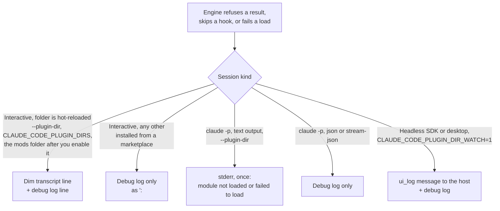

# Limits and diagnostics

Every budget and size limit in one table, then where the engine writes its messages, the exact message formats, and a symptom-to-fix table. Pinned to Claude Code 2.1.295. Where the types file and prose differ, the types win and the page says so.

**2.1.302 notes.** Claims added for the architecture refactor ([issue #55](https://github.com/martin-macak/claude-code-mod-tracking/issues/55)) cite the 2.1.302 snapshot with the label `d.ts 302:N` or `reference.md 302:N`, for example [d.ts 302:1439-1440](../sources/claude-code-2.1.302/types/claude-code.d.ts#L1439-L1440). Old citations keep the 2.1.295 snapshot. A grade tells how a new claim was checked:

- *verified-live*: seen in a real interactive session (Claude Code 2.1.302 in tmux).
- *verified-kit*: seen in `claude plugin validate`, `claude plugin test` or `tsc`.
- *types-only*: stated by the types file or `reference.md`, not run.
- *inference*: derived, not seen.

## 1. Limits

Sources: the types file (d.ts), the bundled long form ([reference.md:130](../sources/claude-code-2.1.295/reference.md#L130)), and the public mods reference ([docs: reference](../sources/code-claude-com-2026-10-09/mods/reference.md), "as of v2.1.290"). A row marked *docs only* is not stated in the 2.1.295 types.

### Time and rate

| Limit | Value | Applies to | Source |
| --- | --- | --- | --- |
| Hook budget | 10,000 ms per dispatch | A hook's own code time for one event. The clock stops while a `next(e)` or `$` call is in flight, except `$.clock` waits. Past it the hook is absent: its `.catch` is asked, else `next(e)` runs for it. | [d.ts:5100-5110](../sources/claude-code-2.1.295/types/claude-code.d.ts#L5100-L5110), [docs: reference:278](../sources/code-claude-com-2026-10-09/mods/reference.md#L278) |
| Streaming hook budget | Counts only the hook's own code, not at a `yield` or while it reads beneath | `turn.step`: sum over the response. `process.spawn`: per piece, anew at each pull. | [d.ts:5100-5110](../sources/claude-code-2.1.295/types/claude-code.d.ts#L5100-L5110) |
| `prompt.edit` hook | 50 ms | That event only. *docs only* | [docs: reference:278](../sources/code-claude-com-2026-10-09/mods/reference.md#L278) |
| `.catch` handler | 1,000 ms, fresh clock | The grace after a hook failed. Past it the hook is absent as if it had no handler. | [d.ts:5111-5118](../sources/claude-code-2.1.295/types/claude-code.d.ts#L5111-L5118) |
| Linger after abort | 5,000 ms | How long a hook may run after `next.signal` aborted before it is reported as lingering. | [d.ts:5119-5126](../sources/claude-code-2.1.295/types/claude-code.d.ts#L5119-L5126) |
| `session.end` hooks | 1.5 s together, by default | Every `session.end` hook, its `$` waits and core. At the bound `next.signal` aborts. Live on 2.1.302: `next.budget.ms` read 1500; a `$.store.set` took 1 to 2 ms, a `$.fs.write` 0 to 1 ms, and 1485 ms were left after a 300 KB `$.store.set` plus a `$.fs.write` (*verified-live*). The kit reports `next.budget.ms` 10000, not 1500 (*verified-kit*). *Inference:* write first, then call `next(e)`. | [d.ts:11045](../sources/claude-code-2.1.295/types/claude-code.d.ts#L11045), [d.ts 302:11473-11476](../sources/claude-code-2.1.302/types/claude-code.d.ts#L11473-L11476), [docs: reference:280](../sources/code-claude-com-2026-10-09/mods/reference.md#L280) |
| `engine.create` | No budget | | [d.ts:5115](../sources/claude-code-2.1.295/types/claude-code.d.ts#L5115) |
| `$.process.run` timeout | 30 s default, 10 min at most | The child is killed and the call rejects. | [d.ts:3509](../sources/claude-code-2.1.295/types/claude-code.d.ts#L3509), [d.ts:8015](../sources/claude-code-2.1.295/types/claude-code.d.ts#L8015) |
| `$.model.complete` `maxTokens` | 1,024 default; at most 64,000 or the model's output limit | One past the limit is refused. | [d.ts:6196-6205](../sources/claude-code-2.1.295/types/claude-code.d.ts#L6196-L6205) |
| `$.ui.toast` display time | 4,000 ms default; `timeoutMs` a whole number from 1 to 60,000 | A call outside the range is dropped with a debug line. The 60,000 bound is *docs only*. | [d.ts:2443](../sources/claude-code-2.1.295/types/claude-code.d.ts#L2443), [d.ts:12631](../sources/claude-code-2.1.295/types/claude-code.d.ts#L12631), [docs: troubleshoot:200](../sources/code-claude-com-2026-10-09/mods/troubleshoot.md#L200) |
| `$.ui.invalidate('ui.render')` | 10 a second; 30 a second in the terminal for the shown pane, expanded band and prompt hint | Faster calls fold into one redraw. | [d.ts:2351-2353](../sources/claude-code-2.1.295/types/claude-code.d.ts#L2351-L2353) |
| `$.ui.blit` | Up to 120 a second taken, some 60 shown | Calls between frames fold into one. | [d.ts:2366](../sources/claude-code-2.1.295/types/claude-code.d.ts#L2366) |
| `Client` module call | 1 s per call at most | A throw, an overrun, or a tree past the bounds unmounts it. | [d.ts:1433](../sources/claude-code-2.1.295/types/claude-code.d.ts#L1433) |
| Redraw on resize | A width change re-runs every hooked site once the resize settles | A height change alone re-draws nothing. Live on 2.1.302: a resize that switched a pane from dock (120 columns) to inline (100 columns) also dropped the pane's keyboard focus (*verified-live*). | [reference.md:114-117](../sources/claude-code-2.1.295/reference.md#L114-L117) |
| Hot reload of a `--plugin-dir` folder | A lone save reloads within a quarter second; a run of saves seconds apart reloads once the run stops. A save that leaves a loaded file holding the text it was loaded from reloads nothing. After a failed reload, any new save tries again. | Pending `$.clock` timers are dropped, and no event reaches the old copy after the save. In 4 reloads the old copy heard no `session.end`, `ui.close` or `plugin.register`. In 2 reloads a catch-all `on('*')` hook heard no event at all after the save (it left `fs.*` out). A pending 25 s `$.clock.after` never fired. A debounced flush is lost. The new copy's `session.start` came 458, 704 and 725 ms after the save, with the same session id. A pane the old copy opened stayed open and the new copy redrew it (*verified-live*). | [reference.md 302:73](../sources/claude-code-2.1.302/reference.md#L73), [d.ts 302:3506-3507](../sources/claude-code-2.1.302/types/claude-code.d.ts#L3506-L3507) |
| `claude plugin test` | 5,000 ms per test, or `timeoutMs` | | [d.ts:15912](../sources/claude-code-2.1.295/types/claude-code.d.ts#L15912), [docs: reference:294](../sources/code-claude-com-2026-10-09/mods/reference.md#L294) |

### Text and size

| Limit | Value | Applies to | Source |
| --- | --- | --- | --- |
| Text in one tree | First 100,000 characters drawn, in the order written | Children, `Code` sources, `Markdown` texts, labels, alts. The cut text ends with words saying how much is left out. A cut `Code` draws as plain code. A tree is never refused for text length. **Rows after the cut draw empty and lose their `Button`s and `Link`s**, so they cannot be pressed (see [Sizing a table in a pane](#sizing-a-table-in-a-pane)). | [reference.md:130](../sources/claude-code-2.1.295/reference.md#L130), [reference.md 302:155](../sources/claude-code-2.1.302/reference.md#L155), [d.ts:5708](../sources/claude-code-2.1.295/types/claude-code.d.ts#L5708), [d.ts:1631](../sources/claude-code-2.1.295/types/claude-code.d.ts#L1631) |
| Nodes in one `Pane` tree | 20,000 counted values: element nodes plus string children | Past it the tree is refused: `refused: more than 20000 nodes; the engine drew its own`. The types state the bound in the `Client` text ("every tree's bounds"). The kit shows it holds for an ordinary `Pane` tree (*verified-kit*). | [d.ts 302:1439-1440](../sources/claude-code-2.1.302/types/claude-code.d.ts#L1439-L1440) |
| Depth of one `Pane` tree | 32 levels | Past it: `refused: deeper than 32; the engine drew its own` (*verified-kit*: depth 32 drew, 33 was refused). | [d.ts 302:1439-1440](../sources/claude-code-2.1.302/types/claude-code.d.ts#L1439-L1440) |
| Serialized size of a `Pane` tree | No 100,000-character bound | A 500-row tree of 685 KB as JSON drew (*verified-kit*). The d.ts words the serialized bound as "every tree's bounds", in the `Client` text. Why it does not show for a `Pane` is *inference*. | [d.ts 302:1439-1440](../sources/claude-code-2.1.302/types/claude-code.d.ts#L1439-L1440) |
| Text of an `Input`'s `value` | Its own room, as large again | So text beside a field does not move its cut. | [reference.md:130](../sources/claude-code-2.1.295/reference.md#L130) |
| Rewritten props | 100,000 characters of keys and short strings, or 32 deep | A prop past it is drawn as the engine had it. Keys and strings up to 256 characters are never altered. | [reference.md:130](../sources/claude-code-2.1.295/reference.md#L130) |
| `UserMessage.text` rewrite | 100,000 characters drawn | | [d.ts:9800](../sources/claude-code-2.1.295/types/claude-code.d.ts#L9800) |
| Names that hold a thing | 10,000 characters | `Code` `language`/`path`, `Client` `key`/`module`, `Image`/`Raster`/`Markdown` `key`, `Select` `value` and option `value`. Past it the tree is refused. | [reference.md:130](../sources/claude-code-2.1.295/reference.md#L130), [docs: reference:287](../sources/code-claude-com-2026-10-09/mods/reference.md#L287) |
| `Link` `href` | 2,048 characters (once percent-encoded) | A longer one keeps the whole tree from drawing. | [d.ts:5645](../sources/claude-code-2.1.295/types/claude-code.d.ts#L5645), [reference.md:130](../sources/claude-code-2.1.295/reference.md#L130) |
| `Markdown` `pressableLinks` | 256 entries of at most 2,048 characters | | [d.ts:5730](../sources/claude-code-2.1.295/types/claude-code.d.ts#L5730) |
| `Svg` `source` | 131,072 characters | | [d.ts:12274](../sources/claude-code-2.1.295/types/claude-code.d.ts#L12274), [reference.md:130](../sources/claude-code-2.1.295/reference.md#L130) |
| `Raster` | `columns` 1-512, `rows` 1-256 | Palette paints 1,024 distinct color pairs at once. | [d.ts:9252-9257](../sources/claude-code-2.1.295/types/claude-code.d.ts#L9252-L9257), [d.ts:9243](../sources/claude-code-2.1.295/types/claude-code.d.ts#L9243) |
| `Image` | `columns` 1-255, `rows` 1-255; base64 bytes at most 2 MiB decoded | | [d.ts:5327](../sources/claude-code-2.1.295/types/claude-code.d.ts#L5327), [d.ts:5331](../sources/claude-code-2.1.295/types/claude-code.d.ts#L5331), [d.ts:5342](../sources/claude-code-2.1.295/types/claude-code.d.ts#L5342) |
| `Client` `props` | 100,000 characters serialized | | [d.ts:1521](../sources/claude-code-2.1.295/types/claude-code.d.ts#L1521) |
| `Client` tree | 20,000 nodes, 32 deep, 100,000 characters serialized | Past it the instance unmounts. | [d.ts:1406](../sources/claude-code-2.1.295/types/claude-code.d.ts#L1406) |
| `Client` `post(data)` | 20,000 values, 32 deep, 100,000 characters; one per frame | Otherwise the post is not sent. | [d.ts:1602](../sources/claude-code-2.1.295/types/claude-code.d.ts#L1602) |
| Hover `scope` | 1-64 characters, no control characters | | [d.ts:869](../sources/claude-code-2.1.295/types/claude-code.d.ts#L869) |
| Pane `id` | 1-64 of letters, digits, `_`, `-` | | [d.ts:7392](../sources/claude-code-2.1.295/types/claude-code.d.ts#L7392) |
| Command, tool, agent type, pane names | Letters, digits, `_`, `-`; up to 64 | | [d.ts:448](../sources/claude-code-2.1.295/types/claude-code.d.ts#L448), [d.ts:13119](../sources/claude-code-2.1.295/types/claude-code.d.ts#L13119), [docs: reference:293](../sources/code-claude-com-2026-10-09/mods/reference.md#L293) |
| Approval-dialog tree rows | A `Button` or `Input` label and an `Svg` `alt` count a row to the line plus one per 40 columns. A `Select` and an `Input`'s field count one row, cut at the end. | Trees around the `AskUserQuestion` dialog. Painter marks (`[ ]`, `1:` plus a space) are not counted. | [reference.md:130](../sources/claude-code-2.1.295/reference.md#L130) |
| Registration text | 4,096 characters | A command's or agent's `description`, a command's `argumentHint`, a pane's `title`. Kept up to the limit. | [reference.md:130](../sources/claude-code-2.1.295/reference.md#L130) |
| Tool `description` | 2,048; 16,384 once the model loads the tool through tool search | What reaches the model. | [reference.md:130](../sources/claude-code-2.1.295/reference.md#L130) |
| Tool `inputSchema` | Whole; a line past 65,536 characters says it rides on every request | | [reference.md:130](../sources/claude-code-2.1.295/reference.md#L130) |
| One-line hook answers | 4,096 characters kept, ellipsis after | `command.describe`/`config.describe` fields, a `config.set` deny, a `prompt.submit` drop, a `turn.complete` text. The drop or deny still applies. The cut needs 2.1.292; earlier the hook failed. | [reference.md:130](../sources/claude-code-2.1.295/reference.md#L130), [docs: reference:284](../sources/code-claude-com-2026-10-09/mods/reference.md#L284) |
| `$.audio.speak` text | First 4,096 characters spoken | | [d.ts:11942](../sources/claude-code-2.1.295/types/claude-code.d.ts#L11942), [reference.md:130](../sources/claude-code-2.1.295/reference.md#L130) |
| `$.ui.log`, `$.ui.toast`, `$.ui.status` text | 2,000 characters on the terminal, 10,000 on a remote surface | An unpaired surrogate half draws as U+FFFD. The debug log holds a `$.ui.log` line to 10,000. | [d.ts:2407](../sources/claude-code-2.1.295/types/claude-code.d.ts#L2407), [d.ts:2441](../sources/claude-code-2.1.295/types/claude-code.d.ts#L2441), [d.ts:2472](../sources/claude-code-2.1.295/types/claude-code.d.ts#L2472), [reference.md:130](../sources/claude-code-2.1.295/reference.md#L130) |
| `$.ui.notice` text | 2,000 characters | | [reference.md:130](../sources/claude-code-2.1.295/reference.md#L130) |
| `$.ui.notify` text | Any length, sent as given | | [d.ts:2465](../sources/claude-code-2.1.295/types/claude-code.d.ts#L2465) |
| `prompt.submit` `context` | Past 100,000 characters (200,000 together) the model reads a head and a path | | [d.ts:9066](../sources/claude-code-2.1.295/types/claude-code.d.ts#L9066) |
| Toast stack | 50 toasts in all; a plugin's own oldest gives way after 50 of its own while the bar is held | Fullscreen draws at most three at a time. | [reference.md:130](../sources/claude-code-2.1.295/reference.md#L130), [docs: troubleshoot:204](../sources/code-claude-com-2026-10-09/mods/troubleshoot.md#L204) |
| `$.fs.read`, `$.fs.write` | 4 MiB per file | A larger read or write rejects. `$.fs.write` overwrites in place: no atomic replace, so a reader can see mixed or cut content of a large file (*verified-live*, 2.1.302). Numbers and the retry advice: [fs-and-config](./fs-and-config.md). | [d.ts:3220](../sources/claude-code-2.1.295/types/claude-code.d.ts#L3220), [d.ts 302:3299-3333](../sources/claude-code-2.1.302/types/claude-code.d.ts#L3299-L3333) |
| `$.store` | 4 MiB of JSON text in all | A larger store rejects. | [d.ts:3364](../sources/claude-code-2.1.295/types/claude-code.d.ts#L3364) |
| `$.process.run` output | First 4,194,304 bytes per stream | `isStdoutTruncated`/`isStderrTruncated` say when cut. | [d.ts:3510](../sources/claude-code-2.1.295/types/claude-code.d.ts#L3510) |
| `process.spawn` stream | 1,048,576 unread characters, then the child blocks | Nothing is dropped. | [d.ts:8073](../sources/claude-code-2.1.295/types/claude-code.d.ts#L8073) |
| `$.session.messages()` | Newest 4,096 entries | | [d.ts:2752](../sources/claude-code-2.1.295/types/claude-code.d.ts#L2752), [docs: reference:289](../sources/code-claude-com-2026-10-09/mods/reference.md#L289) |
| Pane seating, unasked | From 144 terminal columns; 110 once the person opened that id | Below it `$.ui.open` resolves `isPlaced: false`. | [d.ts:7380-7389](../sources/claude-code-2.1.295/types/claude-code.d.ts#L7380-L7389) |
| Docked pane | Terminal fullscreen from 110 columns | | [d.ts:10333-10338](../sources/claude-code-2.1.295/types/claude-code.d.ts#L10333-L10338) |
| Band rows | Capped at half the terminal's rows, the prompt's included | | [d.ts:10268](../sources/claude-code-2.1.295/types/claude-code.d.ts#L10268) |
| Band width | Column width less 5 cells for `[-]` | | [d.ts:10284](../sources/claude-code-2.1.295/types/claude-code.d.ts#L10284) |
| Plugin option picker | A `string` `userConfig` field with `options` is a picker; a stored value outside them is unset | | [reference.md:74](../sources/claude-code-2.1.295/reference.md#L74) |

### Sizing a table in a pane

*Grade: verified-kit* (2.1.302, spike [`kit-tree`](../sources/spikes-2026-10-17/kit-tree/)), then *verified-live* (spike [`tbl`](../sources/spikes-2026-10-17/tbl/), see [Live results](#live-results-for-a-pane-tree)). The kit draws the engine's own validator text, not paint. The 20,000-node bound is not the limit that bites first. The 100,000-character text budget is.

What counts:

- **Nodes.** One counted unit is an element node or a string child. A flat row of 6 cells is 16 nodes and 6 strings with a detail row (22 counted), or 13 and 6 without (19). The real `/track` row shape (8 cells, 3 `Button`s, a `Link`) is 21 nodes and 6 strings (27), plus 3 for a detail row (30). Counted units were 11,020 for 500 flat rows with details, which is 55 percent of the bound.
- **Text characters.** Calibration with 98,000 characters of text first, then 3,000 copies of one element:
  - A `Box` `key` counts (`box-key20` kept 90 texts, `box-nokey` kept 2,000).
  - A `Button` `key` and a `Text` `key` do not count. A `Button` `label` counts (`btn-label10` kept 200 buttons, `btn-key5` and `btn-key50` kept 2,000).
  - A `Link` costs its `href` plus its label (`link40` kept 43 links).
- **Past the cut** nothing is refused. Later rows draw empty, end in `… N more characters, not drawn`, and lose their `Button`s and `Link`s ([reference.md 302:155](../sources/claude-code-2.1.302/reference.md#L155) says a `Button` whose label would not be drawn whole "gives way"). Such a row cannot be focused or pressed.

Measured on a `Pane` tree with 17-character titles:

| Shape | Rows tried | Result |
| --- | --- | --- |
| 500 flat rows with detail rows | 500 | Drawn. 8,014 nodes, 3,006 strings, 47,852 text characters, 685 KB as JSON, mount 77 ms. |
| Flat rows | 1,000 | Refused: `more than 20000 nodes`. |
| Most rows under the node bound | | Flat: 908 with detail rows, 1,051 without. Real `/track` shape: 666 with, 740 without. |

First row that lost its `Button`s to the text cut:

| Shape | Rows tried | First cut row |
| --- | --- | --- |
| Flat, no detail rows | 1,000 | 907 |
| Flat, detail rows | 900 | 640 |
| Real `/track` shape, no detail rows | 700 | 686 |
| Real `/track` shape, detail rows | 650 | 522 |
| Real shape with the real `Box` key format (`cell-<name>-gh:github.com/acme/web#N`), no detail rows | 700 | 248 |
| The same, detail rows | 650 | 223 |

Design consequences (*inference*):

- Window the rows: draw a slice and a "N more" row, or fold by default.
- Use short `Box` keys (a row index or a short hash). Clip long titles in the data, because the budget counts the text written into the tree, so `wrap="truncate-end"` saves nothing.
- Count nodes and characters in the table component before it returns the tree. Stop at a safe margin.
- Rule of thumb: 20 to 30 counted units per row, and 100,000 divided by (visible characters + `Box` key characters + `Link` `href` characters) rows before the cut.
- Test it: in the kit, count the `Button`s per row after `ui.mount`. A cut row has none ([testing-kit](./testing-kit.md#10-what-the-kit-cannot-show)).
- The current `/track` pane would lose `Button`s past roughly 250 items (real `Box` key format, 17-character titles in the kit). The live run below shows the same cut rows as the kit for the same shapes, and shows that a row with short keys and 40 to 80 character titles is cheap.

### Live results for a pane tree

*verified-live,* Claude Code 2.1.302 in tmux (120 by 40, docked), spike `tbl`. A row has five cells and one focus `Button` (`r<idx>`), with short or no `Box` keys. The counted unit is a node or a string child.

| Rows | Shape | Counted | Text characters | Result |
| --- | --- | --- | --- | --- |
| 600 | Natural titles of 40 to 80 characters | 9,029 of 20,000 (11 nodes + 4 strings per row, 15.03 counted per row) | 43,254 of 100,000 (about 72 per row) | Drawn whole. The ring reached `r599`. The footer `Button`s exist. The engine logged nothing. |
| 1300 | Natural titles | 19,516 | | Drawn. |
| 1400 | Natural titles | 21,016 | | **Refused.** The pane body is blank except the close mark, and Tab reaches only that mark. |
| 600 | Titles padded to 200 characters | | 127,920 | Cut. `Button`s survive up to `r469` (the kit gave `r469`). |
| 600 | Natural titles, legacy long `Box` keys (`row-gh:github.com/acme/web#N`, `cell-<name>-…`) | | | Cut. `Button`s survive up to `r354` (the kit gave `r354`). |

- **The refusal.** The limit counts nodes plus string children. The mod's render hook completes without error and cannot see the refusal. The engine reports it in the transcript as `⏺ hooks: ui.render (Pane) refused: more than 20000 nodes; the engine drew its own` and in the debug log as `[WARN] ui.render (Pane): a hook returned a tree that does not validate (more than 20000 nodes); drawing the engine's own`, twice (the open render and the Tab render). A refused tree is blank and keyboard-dead. [reference.md 302:155](../sources/claude-code-2.1.302/reference.md#L155) describes the same message.
- **The text cut.** Rows past the cut get no `Button`s and cannot be reached by keyboard. The footer `Button`s (`fx`, `fy`, `fd`), and with them their hotkeys, disappear too, because the footer sits after the rows. The engine ends the drawing with `… N more characters, not drawn`. The count includes `Text` strings, `Button` labels and `Box` keys: 127,920 = 127,201 body text + 600 labels (`>`) + 119 header and footer. A header line that counted body `Text` only (127,201) understated the engine's total.
- **The log line.** `[WARN] hooks: ui.render (Pane): 127920 characters of text are drawn up to the first 100000`, with a `$.ui.log` copy, and the same line in the transcript. The prefix is `hooks:`, not the plugin name. The engine logs the cut **once per load and component**. After a second overflow the debug log still held the one `[WARN]` from the first run. A mod cannot rely on the log line, even in development.
- **What to build from it.** The budget guard must run before the tree is returned. Count nodes plus string children, `Text` strings, `Button` labels, `Box` keys and `Link` hrefs, and leave margin. Keep `Box` keys short or leave them off. Cap title length in the data. A row cap of about 300 rows in total is far inside both budgets (4,529 counted and 21,635 characters at 300 rows). The budgets bite at about 1,330 rows (nodes) or 1,390 rows (text) with this row shape, and earlier with long titles, long keys, several `Button`s per row or open detail rows. Put the footer and hotkey `Button`s before the rows, or keep the rows far below the cut, so a cut cannot remove the key registry (*inference*).

## 2. Where the engine writes

Two sinks.

- **Transcript dim line.** One dim line naming the plugin, the event and the reason. Written once per load, event and reason. Only while the session **hot-reloads the plugin folder**.
- **Debug log.** A line for every occurrence and every result the engine refused. Written in every session, led by `<plugin>:` where the line comes from a plugin.



Sources: [reference.md:79-80](../sources/claude-code-2.1.295/reference.md#L79-L80), [reference.md:130](../sources/claude-code-2.1.295/reference.md#L130), [SKILL.md:51](../sources/claude-code-2.1.295/SKILL.md#L51), [docs: troubleshoot:11-19](../sources/code-claude-com-2026-10-09/mods/troubleshoot.md#L11-L19), [reference.md:73](../sources/claude-code-2.1.295/reference.md#L73).

Details:

- A `claude -p` run has no transcript. A text-output run prints a `--plugin-dir` plugin whose module was not loaded, or failed to load, once on stderr with the reason (a switch that is off included). A refusal by another mod goes to the debug log only ([docs: troubleshoot:17-19](../sources/code-claude-com-2026-10-09/mods/troubleshoot.md#L17-L19), [reference.md:80](../sources/claude-code-2.1.295/reference.md#L80)).
- *Inference:* the sources name only module-load lines for `-p` stderr. A `ui.render` refusal line is then debug log only.
- A skipped hook's debug line has the error's **name and message length** in place of its text. The first one's text, cut to a short line, is on the transcript line, which the debug log also has ([reference.md:80](../sources/claude-code-2.1.295/reference.md#L80)).
- Per-load limit: each of these lines appears once per load and component (or event), so a repeating fault does not flood the transcript.
- `$.ui.log(text, { to: 'debug' })` writes your own debug line. Without the option it adds a dim transcript line ([d.ts:2414](../sources/claude-code-2.1.295/types/claude-code.d.ts#L2414)).

### How to read the debug log

```bash
claude --debug-file ./mod-debug.log --plugin-dir ./first-mod
tail -f ./mod-debug.log | grep first-mod
```

`claude --debug` writes the log to the default place. `--debug-file <path>` picks the file ([docs: troubleshoot:242-262](../sources/code-claude-com-2026-10-09/mods/troubleshoot.md#L242-L262)).

A mod that loaded has a line that names it and the events it handles. A `--plugin-dir` mod has the `@inline` suffix:

```text
hooks module first-mod@inline loaded (worker, environment 2, tier user); events: session.start,tool.call,command.run,ui.render
```

While you edit a `--plugin-dir` mod, the transcript shows a line per reload naming the mod and listing its hooks. If a save breaks the module the line says `reload failed, the previous version stays loaded: <reason>`. The last working version keeps running until the next reload, such as `/reload-plugins` ([docs: troubleshoot:264](../sources/code-claude-com-2026-10-09/mods/troubleshoot.md#L264)).

## 3. Message formats

`<plugin>` is the plugin name. `<Component>` is a render site name. Quote marks are literal.

### Drawing

| Line | Meaning | Source |
| --- | --- | --- |
| `<plugin>: ui.render (<Component>) refused: <reason>; the engine drew its own` | The tree did not validate. `<plugin>` is the one plugin whose hook could have drawn it, else `hooks`. Example: `first-mod: ui.render (Pane) refused: Box prop "flexDirection" must be one of row, column, row-reverse, column-reverse; the engine drew its own`. | [reference.md:130](../sources/claude-code-2.1.295/reference.md#L130), [SKILL.md:51](../sources/claude-code-2.1.295/SKILL.md#L51), [docs: troubleshoot:168-172](../sources/code-claude-com-2026-10-09/mods/troubleshoot.md#L168-L172) |
| `ui.render (<Component>): a hook returned a tree that does not validate` + reason | The debug-log form of the same refusal. Written in every session. | [SKILL.md:51](../sources/claude-code-2.1.295/SKILL.md#L51), [reference.md:130](../sources/claude-code-2.1.295/reference.md#L130) |
| `<plugin>: ui.render (<Component>) threw while drawn: <reason>; the engine drew its own` | The tree validated, then the draw threw (or a rewritten prop could not draw). Costs that site alone. `<plugin>` is the one the draw shows the answer is owed to (a built-in hooked there that never ran is left out); `hooks` when several had a hand in it. That answer is not tried again. The next one (other props, invalidate, reload) draws afresh. | [reference.md:130](../sources/claude-code-2.1.295/reference.md#L130), [docs: troubleshoot:174-180](../sources/code-claude-com-2026-10-09/mods/troubleshoot.md#L174-L180) |
| ... line ends `nothing was drawn` | The engine draws nothing at this site (an empty band). | [reference.md:130](../sources/claude-code-2.1.295/reference.md#L130) |
| ... line ends `the pane was closed` | The engine draws nothing for a pane, so the pane closes. | [reference.md:130](../sources/claude-code-2.1.295/reference.md#L130) |
| `<plugin>: ui.render (<Component>): <n> characters of text are drawn up to the first <m>` | Text past the 100,000-character cap was cut. Not a refusal. Later `Button`s, `Link`s and `Box` keys give way, so those rows cannot be pressed. Written to the debug log always, and to the transcript while a plugin folder hot-reloads, once per load and component. *types-only*: the kit and the mod see no error. See [Sizing a table in a pane](#sizing-a-table-in-a-pane). | [reference.md 302:155](../sources/claude-code-2.1.302/reference.md#L155), [reference.md:130](../sources/claude-code-2.1.295/reference.md#L130) |
| `<plugin>: ui.render (<Component>): props.<name> rewritten with more than 100000 characters of keys and short strings, or nested past 32 deep; the engine's own is drawn` | A rewritten prop is too big. That prop alone reverts. | [reference.md:130](../sources/claude-code-2.1.295/reference.md#L130) |
| `<plugin>: ui.render (<Component>): Box borderStyle "<style>" is not a border style (the styles are ...); the Box is drawn with no border` | A `borderStyle` outside the ten names. A non-string reads `Box borderStyle is a number, not a style name (...)`. The rest draws. | [reference.md:130](../sources/claude-code-2.1.295/reference.md#L130) |
| `<plugin>: ui.render (<Component>): Code <n> is drawn as plain code, its source not a unified diff: <reason>` | `format: 'diff'` with a source that does not parse as hunks (cut mid-hunk, no `@@` header). `<n>` is the `Code`'s place among the tree's `Code` elements, with `(path "<path>")` after it when it names one. In a `Client` module's tree, `Client <module>:` stands where `ui.render (<Component>):` does. | [reference.md:130](../sources/claude-code-2.1.295/reference.md#L130) |
| `my-mod: Client client/spinner.js: boom` | A `Client` file failed. The dim line takes the `Client`'s place on the terminal. The rest still draws. | [docs: interface:456](../sources/code-claude-com-2026-10-09/mods/interface.md#L456) |
| `my-mod: Client client/spinner.js: the module failed without a message` | The `Client` threw an error with no message. Give it one. (Before 2.1.289 it read `Error`.) | [docs: troubleshoot:182-188](../sources/code-claude-com-2026-10-09/mods/troubleshoot.md#L182-L188) |
| `ui.render (Pane) refused: Text prop "bogusProp" is not allowed; the engine drew its own` | Another example reason: a prop the element does not take. | [docs: interface:438](../sources/code-claude-com-2026-10-09/mods/interface.md#L438) |
| `<plugin>: ui.render (Pane) refused: more than 20000 nodes; the engine drew its own` | A `Pane` tree past 20,000 counted values (element nodes plus string children). Under `$.ui.mount` the rejection reads `$.ui.mount: <plugin> drew nothing on the terminal surface: <plugin>: ui.render (Pane) refused: more than 20000 nodes; the engine drew its own`. *verified-kit*. | [d.ts 302:1439-1440](../sources/claude-code-2.1.302/types/claude-code.d.ts#L1439-L1440) |
| `<plugin>: ui.render (Pane) refused: deeper than 32; the engine drew its own` | A `Pane` tree 33 levels deep or more. Depth 32 drew. *verified-kit*. | [d.ts 302:1439-1440](../sources/claude-code-2.1.302/types/claude-code.d.ts#L1439-L1440) |
| `hooks: ui.render (Pane) refused: Text prop "color" must be a color (a theme key, a name, or hex); the engine drew its own` | A color string with a colon, for example `ansi:red`. The whole pane tree is refused and the pane showed blank. Here `<plugin>` read `hooks`. Other bad color strings draw uncolored with no line (see [ui](./ui.md#colors)). *verified-live*, 2.1.302. | [d.ts 302:1716](../sources/claude-code-2.1.302/types/claude-code.d.ts#L1716) |

Causes of a refusal: an element the surface lacks, a prop the element does not take, a child where none goes, a name past its length cap ([docs: interface:436](../sources/code-claude-com-2026-10-09/mods/interface.md#L436)).

### Registration and hook answers

| Line | Meaning | Source |
| --- | --- | --- |
| `<plugin>: <event> hook: a drop of <n> characters, kept up to its first 4096` | A one-line answer (a drop, a deny, a text) was cut to 4,096 characters. The drop or deny still applies. A `context` beside a `prompt.submit` drop is ignored. | [reference.md:130](../sources/claude-code-2.1.295/reference.md#L130) |
| `<plugin>: $.audio.speak: a text (<n> characters) is spoken up to its first 4096` | A long `$.audio.speak` text. | [reference.md:130](../sources/claude-code-2.1.295/reference.md#L130) |
| (a line per op and kind of text) | A registration through at any length says what became of the rest, once per op and kind of text, naming the first it is so of. The sources give no exact wording. | [reference.md:130](../sources/claude-code-2.1.295/reference.md#L130) |

### Module and hook faults

| Line | Meaning | Source |
| --- | --- | --- |
| `hooks module <name>@inline not loaded: <reason>` | The loader refused the module. The reasons: `hooks modules are turned off for installed plugins in this process: the rollout switch served off`, `... was saved off by an earlier session`, `disableAllHooks in managed settings`, `only managed plugins and built-in plugins run`, `installed plugins that are not managed load no hooks module in this mode (--bare)`, `another plugin of that name loads first`. | [docs: troubleshoot:42-70](../sources/code-claude-com-2026-10-09/mods/troubleshoot.md#L42-L70) |
| `<name>: hooks module did not load: <reason>` | The module threw at load. The reason gives file and line. | [docs: troubleshoot:85-90](../sources/code-claude-com-2026-10-09/mods/troubleshoot.md#L85-L90) |
| `<name>: hooks module did not load: options do not fit plugin.json userConfig: <reason>` | An option fails its `userConfig` field (above `max`, or a required one has no value). The end of the line names the `pluginConfigs` entry. | [docs: troubleshoot:91-96](../sources/code-claude-com-2026-10-09/mods/troubleshoot.md#L91-L96) |
| `<name>: <event> hook skipped: <reason>` | A hook threw, ran out of time, or answered the wrong shape. Example: `first-mod: tool.call hook skipped: threw Error: boom`. Once per event and kind of failure until reload. The debug log has a line per occurrence. | [docs: troubleshoot:113-118](../sources/code-claude-com-2026-10-09/mods/troubleshoot.md#L113-L118), [reference.md:80](../sources/claude-code-2.1.295/reference.md#L80) |
| `<name> registered /<command> but no command.run hook answered it` | A registered command reached the end of the chain unanswered. | [docs: troubleshoot:119-127](../sources/code-claude-com-2026-10-09/mods/troubleshoot.md#L119-L127) |
| `<name> was unloaded: it crashed the hooks worker` | Installed mods share a worker thread. It stopped, and the engine traced it to this mod. | [docs: troubleshoot:128-133](../sources/code-claude-com-2026-10-09/mods/troubleshoot.md#L128-L133) |
| `hooks: mods that run in the hooks worker are off for this session: it crashed 3 times` | The worker stopped three times with no one culprit. Every non-built-in mod is unloaded. Run `/reload-plugins`. | [docs: troubleshoot:142-146](../sources/code-claude-com-2026-10-09/mods/troubleshoot.md#L142-L146) |
| `<name>: its session.start ran again in a fresh copy; the $.prompt.submit call it had already made was not made again` | The module was loaded again. The call returned its first result. Nothing to fix. | [docs: troubleshoot:134-140](../sources/code-claude-com-2026-10-09/mods/troubleshoot.md#L134-L140), [reference.md:162](../sources/claude-code-2.1.295/reference.md#L162) |
| `reload failed, the previous version stays loaded: <reason>` | A save broke the module. | [docs: troubleshoot:264](../sources/code-claude-com-2026-10-09/mods/troubleshoot.md#L264) |
| `<plugin>@<marketplace> re-read from its folder: <folder>` | `/reload-plugins` re-read a folder-marketplace plugin. | [reference.md:76](../sources/claude-code-2.1.295/reference.md#L76) |
| `hooks module <name>@inline loaded (worker, environment N, tier user); events: ...` | The module loaded. Lists its events. | [docs: troubleshoot:254-258](../sources/code-claude-com-2026-10-09/mods/troubleshoot.md#L254-L258) |
| `<plugin>: reloaded (8 hooks: session.start, ...)` | The dim transcript line after a hot reload of a `--plugin-dir` folder. It lists the hooks of the new copy. *verified-live*, 2.1.302. | [reference.md 302:73](../sources/claude-code-2.1.302/reference.md#L73) |

**Changed in 2.1.302** (*types-only*). `HookFailure.kind` is now `'throw' | 'timeout'`. The `re-entry` kind and `cause: 'lent'` are gone ([d.ts 302:5269-5289](../sources/claude-code-2.1.302/types/claude-code.d.ts#L5269-L5289)). The 2.1.295 text ([reference.md:79](../sources/claude-code-2.1.295/reference.md#L79)) said a `.catch` handler also answers for a call another hook makes beneath this hook's own `$` call. The guard form is unchanged: `.catch(($, e, next) => next.called ? next(e) : { deny })`.

**The behaviour did not change.** A hook is still not run beneath its own call: a plugin's call "runs the same chain with the calling hook alone skipped" ([d.ts 302:4843-4844](../sources/claude-code-2.1.302/types/claude-code.d.ts#L4843-L4844)). *verified-kit:* an `on('session.append')` and an `on('tool.call')` hook that appended or called once per run ran once, through its own `$`, a `$` from another hook, and a timer ([dispatch-and-guards](../concepts/dispatch-and-guards.md#a-hook-is-not-run-beneath-its-own-call)). A `ui.render` hook that calls `$.ui.invalidate` is run again (*verified-kit*). The "third identical open call waits behind the second" rule ([d.ts 302:7801-7807](../sources/claude-code-2.1.302/types/claude-code.d.ts#L7801-L7807)) covers nouns a plugin declares on `$`, not `tool`, `session` or `ui` (*types-only*; not tested). [reference.md 302:168](../sources/claude-code-2.1.302/reference.md#L168) still says "the re-entry rule". The sentence is right about the behaviour. Only the name is old. What a `.catch` does when its hook is skipped is not shown ([architecture Q24](../../claude-code-mod-architecture/open-questions.md#1-unknowns)).

### Static scan messages (validate and kit)

The same static reader runs in `claude plugin validate`, in the kit and at load. The kit shows a violation as `HooksError: <plugin>: hooks module did not load: <reason>` and fails every test in the file. The validator cuts a long message itself (`[+101 chars]`), even with `--json`. Read the quoted source line and the first 150 characters. The rules behind these lines are in [validate-test-debug](../workflow/validate-test-debug.md). All lines below are *verified-kit* on 2.1.302.

| Line (start) | Cause |
| --- | --- |
| `"on" is used other than as a call or an argument to a function of the module's own (bound, spread or read); $ is always spelled $.noun.e...` | `new X(on)`. `on` is read as a value. |
| `"on" is passed to something other than a function named at the top of this file or imported from one of the module's own files` | `new X().attach(on)` and `obj.method(on)`. Pass `on` only to a `function` declaration or a const-bound arrow. |
| `the callee "install" is not a function declared at the top of this file (a function declaration, or a const bound to a function), nor imported fro...` | `for (const install of LIST) install(on)`. Use a static chain of named calls. |
| `the value of install(on) is kept (assigned, passed, read, or returned from a nested function); it takes ...` | `LIST.forEach(install => install(on))`. |
| `on("turn.complete") is registered twice without a matcher; the first is at <file>:<line>` | Two matcherless `on` calls for one event anywhere in the import tree. The module is refused before any hook runs, so `try/catch` around an install cannot rescue it. The same matcher twice is allowed and both hooks run. |
| `$ is passed to "nowOf", a name bound to a function expression, outside the hook's own file` | `$` goes to an imported arrow const. An imported `function` declaration passes on 2.1.300 and later. |
| `the state library's update takes a source the scan can read: a reference whose plugin and key are string literals ...` | An atom or ref const imported from another file, a ref builder `slot(id)`, an atom in a class, or a generic `read($, atomParam)`. Keep the atom in the file that uses it. |
| `$.state.set refers to <plugin>.<key>, which <plugin> owns: only a value's owner writes it` | `plugin.json` `name` differs from the plugin key in `PluginState`. |
| `<plugin>.<key> is not declared: the manifest's types contract must name it in interface PluginState` | A state key missing from the one file `plugin.json` `types` names. A second `.d.ts` is ignored. |
| ``types: line 8: `export` at the top level is followed by `type` or `interface`: a contract exports types and nothing else`` | `export {}` in the contract. |
| `<plugin>: cannot import "../../shared/x" (from hooks/register.ts): it is outside the plugin's folder` | An import that leaves the plugin folder. A sibling folder inside it, such as `../core/x`, loads. |

### Throws you will see in the kit

| Message | Cause |
| --- | --- |
| `no implementation for fs.read`, `fs.write`, `fs.exists` | An unstubbed `$.fs` call in `claude plugin test`. It never reaches the disk. Stub `fs.*` ([testing-kit](./testing-kit.md#8-files-fs-in-the-kit)). |
| `returned something that is not a result object` | A kit stub returned a bare value. Return `{ value }` or `{ deny }`. In 2.1.295 the text read `returned neither { value } nor { deny }`. |
| `no implementation for ui.focus`, `no implementation for session.end` | `$.ui.focus` or `$.session.end` with no stub beneath the plugins. |
| `state.set: denied: it was made while ui.render is being dispatched, and drawing is pure (...) (host check)` | A render hook wrote `$.state`. Write from `onPress` or another event. A `ui.focus` hook may write. |
| `a rejection nothing handled: this drawing was unmounted` | A test forgot to `await ui.drawn()`. |

### Toasts

| Line | Meaning | Source |
| --- | --- | --- |
| `$.ui.toast (<plugin>): <text>` | The call ran. | [docs: troubleshoot:198](../sources/code-claude-com-2026-10-09/mods/troubleshoot.md#L198) |
| `<plugin>: $.ui.toast dropped: timeoutMs is a whole number of ms, 1 to 60000` | The call was refused. | [docs: troubleshoot:200](../sources/code-claude-com-2026-10-09/mods/troubleshoot.md#L200) |
| `... gave way, cut short` / `... gave way, unseen` | A newer toast of the same plugin took its place while it showed / before it showed (classic renderer). | [docs: troubleshoot:203](../sources/code-claude-com-2026-10-09/mods/troubleshoot.md#L203) |
| `... left the stack, never drawn` | Fullscreen drew three at a time and this one ran out of time. Put messages in one toast. | [docs: troubleshoot:204](../sources/code-claude-com-2026-10-09/mods/troubleshoot.md#L204) |
| `within 2000ms of the last; dropped` | Before 2.1.290 only: a toast within 2 s of the last was dropped. | [docs: troubleshoot:206](../sources/code-claude-com-2026-10-09/mods/troubleshoot.md#L206) |

### Guard and policy

| Line contains | Meaning | Source |
| --- | --- | --- |
| `mods are limited to your organization's by policy (allowManagedModsOnly)` | The mod was refused. | [docs: troubleshoot:69-77](../sources/code-claude-com-2026-10-09/mods/troubleshoot.md#L69-L77) |
| `tried to lift a deny rule in your settings` | A `tool.check` hook approved a call a `deny` rule refuses. The call stays denied. | [docs: troubleshoot:69-77](../sources/code-claude-com-2026-10-09/mods/troubleshoot.md#L69-L77) |
| `the deny rules in your settings could not be checked for this call, so it is refused` | The guard failed while checking a call a mod approved. | [docs: troubleshoot:69-77](../sources/code-claude-com-2026-10-09/mods/troubleshoot.md#L69-L77) |
| `a hook changed this call's input after the model wrote it` | Auto mode: a hook changed the input after the classifier reviewed it. | [docs: troubleshoot:152-157](../sources/code-claude-com-2026-10-09/mods/troubleshoot.md#L152-L157) |

### Throws you will see in code

| Message | Cause |
| --- | --- |
| `ui.open: focus is true or left out` | `focus`, `closeOnEscape` or `holdToasts` set to `false`. Omit instead. ([docs: interface:323](../sources/code-claude-com-2026-10-09/mods/interface.md#L323)) |
| `takes a source the scan can read` | `claude plugin validate`: an `atom` held in `let`, not `const`. ([docs: interface:793](../sources/code-claude-com-2026-10-09/mods/interface.md#L793)) |
| `<plugin>.<key> is not declared` | `claude plugin validate`: a `$.state` key missing from the contract. ([docs: interface:794](../sources/code-claude-com-2026-10-09/mods/interface.md#L794)) |
| `no implementation for <name>`; `on("ui.render") after the test first called $`; `returned neither { value } nor { deny }` (2.1.302: `returned something that is not a result object`); `declares no test(): nothing ran` | Test-kit errors. See [testing-kit](./testing-kit.md) and [Throws you will see in the kit](#throws-you-will-see-in-the-kit). |

## 4. Troubleshooting

First step for a mod that "does nothing": run `claude plugin validate <dir>`, then look for the line your session writes (section 2). A failed hook is skipped and the chain goes on, so a broken mod can look like a silent one ([docs: troubleshoot:7-9](../sources/code-claude-com-2026-10-09/mods/troubleshoot.md#L7-L9)). To check whether mods can load at all, run `claude plugin test` in a folder with no mod ([docs: troubleshoot:21-32](../sources/code-claude-com-2026-10-09/mods/troubleshoot.md#L21-L32)).

### Mod does not load

| Symptom | Cause | Fix |
| --- | --- | --- |
| Nothing the mod adds appears. `/plugin` `mods active` line lacks the mod. | Module refused. The debug log has `hooks module <name> not loaded: <reason>`. | Read the reason. See the refusal list in section 3. |
| `claude -p` prints `hooks module not loaded` on stderr. | Same, non-interactive. | Same. |
| `validate` passes and shows no `hooks` line. | `hooks/hooks.json` has no `modules` key, or it is misspelled. | Add `"modules": ["./register.js"]`. |
| `hooks module did not load: <file:line>` | Top-level code threw, or the module holds `import()`. | Fix the error the reason names. |
| `options do not fit plugin.json userConfig` | An option fails its field rules. | Set or change the value in `pluginConfigs`. |
| No mod loads in a directory opened for the first time. | The trust prompt is unanswered. | Start `claude` there and accept it. |
| No installed plugin loads. | `--safe-mode`. | Start without the flag. |
| `hooks modules are turned off here` from `claude plugin test`. | `disableAllHooks` or organization policy. | Change the setting, or ask the admin. |
| `...rollout switch was saved off by an earlier session` | A stale saved value. | Start `claude` once, then retry. |
| Version too old. | Mods need Claude Code 2.1.287 or later (terminal). | Upgrade. ([docs: overview](../sources/code-claude-com-2026-10-09/mods/overview.md)) |
| Edits to an installed plugin do not apply. | The engine runs the cached copy for that version. | Develop with `claude --plugin-dir <dir>`. |
| A save in a `--plugin-dir` folder reloads nothing. | The file holds the text it was loaded from, for example after a formatter run that changed nothing. | Change the text. After a failed reload, any new save tries again ([reference.md 302:73](../sources/claude-code-2.1.302/reference.md#L73)). |

### Hook skipped or mod unloaded

| Symptom | Cause | Fix |
| --- | --- | --- |
| `<event> hook skipped: <reason>` | The hook threw, passed 10 s of own time, or answered a wrong shape. | Fix the error. For a guard, add `.catch(($, e, next) => next.called ? next(e) : { deny: 'why' })`. |
| `registered /x but no command.run hook answered it` | No hook for that command, a filter naming another command, a hook that returned `next(e)`, or a skipped hook (for example `focus: false` in `$.ui.open`). | Add or fix the `command.run` hook. Look for a `hook skipped` line that names it. |
| `was unloaded: it crashed the hooks worker` | A hook blocked the worker thread (a loop that never awaits). | Fix the hook. |
| `mods that run in the hooks worker are off for this session` | Three worker crashes, no single culprit. | `/reload-plugins`. |
| A tool call is denied with `a hook changed this call's input after the model wrote it`. | Auto mode: a `tool.call`/`turn.step`/`PreToolUse` hook rewrote the input after review. | Issue the call again as recorded. If it repeats, turn off the hook or leave auto mode. |
| `tried to lift a deny rule in your settings` | Your `tool.check` approved what a `deny` rule refuses. | Do not approve it. The call stays denied. |

### Drawing does not appear or respond

| Symptom | Cause | Fix |
| --- | --- | --- |
| A pane or band is empty, or shows the usual content. | The tree did not validate. Look for `ui.render (<Component>) refused:` (transcript, if hot-reloaded) or `a hook returned a tree that does not validate` (debug log). | Read the reason. Common: a prop the element does not take, or an element the surface lacks. |
| `threw while drawn` | The draw threw: a bad value in the tree, or in `props` passed to `next`. | Fix the value that caused it. |
| Nothing draws on desktop but works in the terminal. | The site or element is not available there. (`Raster`, `Image` are terminal only.) | Check the render sites and elements tables in [ui](./ui.md). Branch on `e.surface`. |
| A `Svg` or other absent element draws nothing, no error. | The surface's table completes an absent element to a fragment. (Observed under the test kit.) | Branch on `e.surface` and draw `Text` instead. |
| `$.ui.open` runs and no pane appears. | The call did not come from something the person did, and the terminal is narrower than 144 columns (110 once opened by them). | Open from a command or a press. Check `isPlaced`. |
| Hotkeys do nothing. | The pane does not hold the keyboard. | ctrl+x Tab, click, or open with `focus: true` from a command. |
| A toast does not appear. | The call was refused; a `holdToasts` pane is open; the toast sits under the prompt (classic renderer); a newer toast replaced it; or it ran out of time undrawn. | See the toast lines in section 3. Put messages in one toast. |
| A press changes nothing on screen. | The callback changed a module variable and nothing asked for a redraw. | Use `$.state` (`atom`, `update`) or call `$.ui.invalidate('ui.render')`. |
| `$.state.set` fails while drawing. | A render hook never writes. | Write from `onPress`, `onSubmit` or another event's hook. |
| Redraw is slow or skips frames. | Redraws are throttled (10 a second, 30 for the shown pane). | Fold changes. Use `$.ui.blit` for frames. |
| A long text ends in "left out" words. | The 100,000-character tree cap. | Draw the part in view. |
| Rows far down a long table do not react to Enter, a click or their hotkey. | The text budget cut them: later rows draw empty and lose their `Button`s and `Link`s. The tree is not refused. The kit and the mod see no error. The engine logs `<plugin>: ui.render (<Component>): <n> characters of text are drawn up to the first <m>` (*types-only*, [reference.md 302:155](../sources/claude-code-2.1.302/reference.md#L155)). Read it in `claude --debug`. (*verified-kit* for the lost Buttons) | Window the rows, shorten `Box` keys and titles. See [Sizing a table in a pane](#sizing-a-table-in-a-pane). |
| The kit rejects `$.ui.mount` with `more than 20000 nodes`. | A `Pane` tree past the node bound. (*verified-kit*) | Window the rows. |
| The first Tab after opening a pane highlights nothing. | A `display: 'none'` `Button` is a Tab stop. (*verified-live*) | Give `autoFocus` to a visible row `Button`, or keep hotkey `Button`s visible. |
| Up and Down scroll the pane and the selection stays. | The tree is taller than the pane. The arrows move the ring only when the tree fits. Left and Right do nothing. (*verified-live*) | Walk rows with Tab and Shift+Tab. See [ui](./ui.md#ring-walk-and-scroll). |
| `e.props.scroll.offset` is stale after Tab. | The engine's own scroll to keep the ring in view raises no `ui.scroll` and no render. (*verified-live*) | Use the offset as a hint. The next render after a state write reads the real one. |
| A letter typed in the pane shows in the composer and the pane lost the keys. | The letter has no hotkey, and an unbound printable key goes to the composer. (*verified-live*) | Bind it as a hotkey `Button`. Refocus with ctrl+x Tab after reading `e.props.isFocused`. |
| A pane lost the keys after a resize. | A resize that changed the placement from dock to inline dropped the focus. (*verified-live*) | Refocus with ctrl+x Tab, or reopen. |
| A hotkey fired for a `Button` that is hidden or scrolled out of view. | Pane hotkeys are gated by the pane focus alone. (*verified-live*) | Expected. Remove the `Button`, or check inside `onPress`. |
| A text or fill has no color, and there is no error. | The color string is not a theme key, a hex, `rgb()`, `ansi256()` or a basic name (`orange`, `Red`, `hsl()` draw uncolored). (*verified-live*) | Whitelist color tokens. A string with a colon (`ansi:red`) refuses the whole pane tree. |
| An end-to-end test sees `38;5;196` where the code wrote `#ff0000`. | With `TMUX` set Claude Code uses the 256-color palette. (*verified-live*) | Expect 256-color indices in tmux assertions, or start `claude` with `env -u TMUX`. |
| Columns of CJK text or symbols do not line up. | The mod measured with `.length`. The renderer measures grapheme clusters, with wide characters as 2 cells. | Use a `cellWidth` helper. See [ui](./ui.md#measuring-a-cell). |

### An edit or value is lost

| Symptom | Cause | Fix |
| --- | --- | --- |
| A value resets when the module reloads. | Module variables re-initialize on each reload. | Keep it in `$.state` or `$.store`. |
| A value resets after `/clear`, `/resume`, `/branch`. | Each resets `$.state` to defaults. `session.start` does not fire again ([d.ts 302:11482-11483](../sources/claude-code-2.1.302/types/claude-code.d.ts#L11482-L11483)). | Store in `session.end` (reason `clear`) and detect the new session by its id at the first `session.append`. The documented route, a `classic.SessionStart` hook ([docs: interface:830](../sources/code-claude-com-2026-10-09/mods/interface.md#L830)), never ran for a `--plugin-dir` mod on 2.1.302. Detail and grades: [lifecycle, `/clear`](../concepts/lifecycle.md#clear). (*verified-live*) |
| A flush armed with `$.clock.after` is lost after an edit. | A hot reload drops pending timers, and no event reaches the old copy. (*verified-live*) | Write through, or debounce only to coalesce. Flush in `session.end`. Rebuild module variables from `$.state` or `$.store` at `session.start`, which fires again. |
| Two sessions overwrite each other's `$.store` value. | `get` then `set` is not atomic; all sessions share one store. | One key per item. Read again right before the write. ([docs: interface:842](../sources/code-claude-com-2026-10-09/mods/interface.md#L842)) |
| A reader sees half-written or mixed text in a shared file. | `$.fs.write` overwrites in place and has no rename or lock. See the `$.fs` row in section 1. (*verified-live*) | Keep the file small, parse the whole text, retry once on a parse error and keep the last good value. Compare `mtimeMs` and `size` to invalidate. See [fs-and-config](./fs-and-config.md). |
| Data saved by an installed copy is missing in a `--plugin-dir` run. | `$.store` is one JSON file per plugin and per provenance (`~/.claude/plugins/store/<name>_<provenance>-<hash>.json`). A dev run and an installed copy have separate stores. (*verified-live*) | Share data through a file read with `$.fs`. |
| A saved `$.state` value is written back as the default. | A callback saved the `$.state` value after a reset. | Same fix as `/clear` above. |

## See also

- [ui](./ui.md): render sites, elements, panes, band, status/toast/log.
- [testing-kit](./testing-kit.md): test-kit errors and the 5 s limit.
- [events](./events.md): hook budgets per event, matchers.
- [engine-interface](./engine-interface.md): `$.ui.log`, `$.store`, `$.fs`, `$.process` limits at the source.
- [validate-test-debug workflow](../workflow/validate-test-debug.md): `claude plugin validate` output and the debug loop.
- [gotchas](../gotchas.md).
