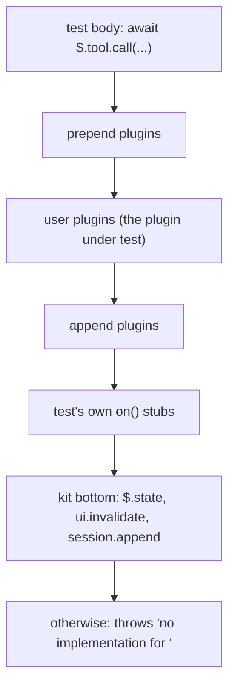

# Testing kit: `claude plugin test` and `claude-code/testing`

How to test a mod with no session, sign-in or network. Covers the CLI, the kit's exports, what sits beneath your hooks, the mocks, the `$.ui.mount` handle, and one complete example. Pinned to Claude Code 2.1.295.

**2.1.302 notes.** Claims added for the architecture refactor ([issue #55](https://github.com/martin-macak/claude-code-mod-tracking/issues/55)) cite the 2.1.302 snapshot with the label `d.ts 302:N`, for example [d.ts 302:16208](../sources/claude-code-2.1.302/types/claude-code.d.ts#L16208). Old citations keep the 2.1.295 snapshot. The kit module moved to [d.ts 302:15590-16704](../sources/claude-code-2.1.302/types/claude-code.d.ts#L15590-L16704) and is near-identical (see [section 11](#11-changed-in-21302)). A grade tells how a new claim was checked:

- *verified-kit*: seen in `claude plugin validate`, `claude plugin test` or `tsc` on 2.1.302.
- *verified-live*: seen in a real interactive session.
- *types-only*: stated by the types file, not run.
- *inference*: derived, not seen.

## 1. The command

```bash
claude plugin test [dir]
```

| Fact | Value | Source |
| --- | --- | --- |
| Default dir | The current folder. | [cli-help.txt:73-86](../sources/claude-code-2.1.295/cli-help.txt#L73-L86) |
| Files run | Every `*.test.ts` and `*.test.tsx` under `dir`. Public docs name the same two suffixes. | [cli-help.txt:84](../sources/claude-code-2.1.295/cli-help.txt#L84), [docs: reference:322](../sources/code-claude-com-2026-10-09/mods/reference.md#L322) |
| Isolation | Each file runs in a child of the `claude` binary, in an environment like the one the hooks run in. No fs, network or process. | [cli-help.txt:84](../sources/claude-code-2.1.295/cli-help.txt#L84), [d.ts:31](../sources/claude-code-2.1.295/types/claude-code.d.ts#L31) |
| Flags | None beyond `-h`. | [cli-help.txt:73-86](../sources/claude-code-2.1.295/cli-help.txt#L73-L86) |
| Exit status | 1 when a test fails. Works in CI. | [cli-help.txt:86](../sources/claude-code-2.1.295/cli-help.txt#L86) |
| Time limit | 5,000 ms per test, or `timeoutMs`. | [d.ts:15912](../sources/claude-code-2.1.295/types/claude-code.d.ts#L15912) |
| Empty file | A file with no `test()` fails: `declares no test(): nothing ran`. | [docs: test:15](../sources/code-claude-com-2026-10-09/mods/test.md#L15) |
| Mods turned off | Prints `claude plugin test: hooks modules are turned off` plus the reason. Exit 1. | [docs: test:55](../sources/code-claude-com-2026-10-09/mods/test.md#L55) |

Run it from a folder with no mod to check whether mods can load at all. `no hooks module to load` means yes ([docs: troubleshoot:21-32](../sources/code-claude-com-2026-10-09/mods/troubleshoot.md#L21-L32)).

A test file may import the mod's own files and sibling helpers. Real mods import their hook code (`import Hooks from '../hooks'`) and call plain functions with no kit ([github: anthropics/claude-code@e47cc82 mods/agents-md/tests/register.test.ts](https://github.com/anthropics/claude-code/blob/e47cc82/mods/agents-md/tests/register.test.ts)).

## 2. What the kit exports

`declare module 'claude-code/testing'` spans [d.ts:14874-15985](../sources/claude-code-2.1.295/types/claude-code.d.ts#L14874-L15985). It exports 5 values and 47 types.

| Value | Signature | Use | Source |
| --- | --- | --- | --- |
| `test` | `(name, body)` or `(name, options, body)` | One test. Passes when the body returns or resolves. | [d.ts:15921](../sources/claude-code-2.1.295/types/claude-code.d.ts#L15921) |
| `describe` | `(name, body)` | A group. Its name leads each inner title. The body runs at once, while the file loads. | [d.ts:14961](../sources/claude-code-2.1.295/types/claude-code.d.ts#L14961) |
| `expect` | `(received, message?) => Expectation` | Checks a value. | [d.ts:15162](../sources/claude-code-2.1.295/types/claude-code.d.ts#L15162) |
| `mock` | `{ clock, store, env, session }` | Mocked world beneath the plugins. | [d.ts:15490](../sources/claude-code-2.1.295/types/claude-code.d.ts#L15490) |
| `tier` | `(tier) => void` | Which tier the plugin under test loads in. Once, at the top of the file. | [d.ts:15973](../sources/claude-code-2.1.295/types/claude-code.d.ts#L15973) |

`tier` takes `prepend`, `user` (default), `append` or `builtin` ([d.ts:15864](../sources/claude-code-2.1.295/types/claude-code.d.ts#L15864)). Use it to test a policy mod ([docs: test:350-411](../sources/code-claude-com-2026-10-09/mods/test.md#L350-L411)).

### `test(name, options?, body)`

```ts
test('name', { plugins: [...], timeoutMs: 8000, options: { greeting: 'yo' } }, async ($, on) => { ... })
```

| Option | Meaning | Source |
| --- | --- | --- |
| `plugins` | Inline plugins loaded beside the one under test: `{ name, tier?, register }`. `register` must be self-contained. It closes over nothing of the test file. | [d.ts:15855](../sources/claude-code-2.1.295/types/claude-code.d.ts#L15855), [d.ts:15939](../sources/claude-code-2.1.295/types/claude-code.d.ts#L15939) |
| `timeoutMs` | Test time limit. Default 5,000. | [d.ts:15939](../sources/claude-code-2.1.295/types/claude-code.d.ts#L15939) |
| `options` | The plugin's `userConfig` values, as if stored in settings. Values outside a field's `options` count as unset, defaults fill in, then validation runs. A bad required field fails the load. Omitted: the manifest defaults. Inline plugins get none. | [d.ts:15939](../sources/claude-code-2.1.295/types/claude-code.d.ts#L15939), [reference.md:81](../sources/claude-code-2.1.295/reference.md#L81) |

The body is `($: Engine, on: On) => unknown` ([d.ts:15931](../sources/claude-code-2.1.295/types/claude-code.d.ts#L15931)). `$` is the engine's own `$`. `on` registers stub hooks.

### Matchers

`expect(x)` has 23 matchers, each also under `.not`; `.resolves` and `.rejects` take the async forms ([d.ts:15252-15385](../sources/claude-code-2.1.295/types/claude-code.d.ts#L15252-L15385)).

| Group | Matchers |
| --- | --- |
| Equality | `toBe` (`Object.is`), `toEqual`, `toStrictEqual`, `toMatchObject` |
| Collections | `toContain`, `toContainEqual`, `toHaveLength`, `toHaveProperty(path, value?)` |
| Truth | `toBeUndefined`, `toBeDefined`, `toBeNull`, `toBeTruthy`, `toBeFalsy`, `toBeNaN` |
| Numbers | `toBeGreaterThan`, `toBeGreaterThanOrEqual`, `toBeLessThan`, `toBeLessThanOrEqual` |
| Strings | `toMatch(string \| RegExp)`, `toStartWith`, `toEndWith` |
| Types, errors | `toBeInstanceOf`, `toThrow(string \| RegExp \| Constructor \| { message })` |

Asymmetric matchers inside an expected value ([d.ts:15391-15434](../sources/claude-code-2.1.295/types/claude-code.d.ts#L15391-L15434)): `expect.any(Ctor)`, `expect.anything()`, `expect.stringContaining`, `expect.stringMatching`, `expect.objectContaining`, `expect.arrayContaining`.

The public docs list only 8 matchers ([docs: test:196](../sources/code-claude-com-2026-10-09/mods/test.md#L196)). The types list 23. The types win.

A failed `expect` inside a stub you passed to `on` skips that hook and fails the test. The failure names the hook and its event ([d.ts:15153](../sources/claude-code-2.1.295/types/claude-code.d.ts#L15153), [docs: test:198](../sources/code-claude-com-2026-10-09/mods/test.md#L198)).

## 3. What sits beneath your hooks

The test's `on` hooks sit beneath every plugin. They stand for the engine. What one answers reaches the plugin as given, including fields only the engine sets, such as a `tool.call` answer's `isReadOnly` ([reference.md:81](../sources/claude-code-2.1.295/reference.md#L81)). Plugins in the test, wherever they stand, are read as in a session.



Rules:

- **Register every stub before the first call on `$`.** The first call loads the plugins. A later `on(...)` throws `on("ui.render") after the test first called $` ([docs: test:120](../sources/code-claude-com-2026-10-09/mods/test.md#L120)).
- **The kit answers three things itself:** `$.state`, a render's `$.ui.invalidate`, and `session.append` ([d.ts:15925-15931](../sources/claude-code-2.1.295/types/claude-code.d.ts#L15925-L15931), [reference.md:81](../sources/claude-code-2.1.295/reference.md#L81)). Everything else needs a stub or a mock, or it throws `no implementation for <name>`. `$.clock.now()` fails the same way without `mock.clock(on)`.
- **`session.start` does not run by itself.** A test starts with a fresh module and no hook called. Fire `$.session.start(...)` first if the mod depends on it ([docs: test:122-133](../sources/code-claude-com-2026-10-09/mods/test.md#L122-L133)).
- **A hook that returns `next(e)` needs a stub to answer.** For `ui.render`: `on('ui.render', () => ({ type: 'Text', props: {}, children: ['engine'] }))` ([docs: test:135-142](../sources/code-claude-com-2026-10-09/mods/test.md#L135-L142)).
- **Stub shapes.** A stub for a `$` call (`store.get`, `ui.toast`, `model.complete`) returns `{ value }` or `{ deny }`. Name it without the `$.`. A stub for an event (`tool.call`, `turn.step`, `prompt.submit`) returns that event's result. A bare value fails with `returned neither { value } nor { deny }` ([docs: test:104-114](../sources/code-claude-com-2026-10-09/mods/test.md#L104-L114)). *Changed in 2.1.302* (*verified-kit*): the message reads `returned something that is not a result object`, then `in the test's fs.exists hook`. The fix is the same: return `{ value }`. Meanwhile the mod gets `no implementation for fs.exists`.
- **`turn.step` and `process.spawn` stubs are async generators.** Read the stream to its end for the result ([docs: test:144-162](../sources/code-claude-com-2026-10-09/mods/test.md#L144-L162)).
- **A failed test prints `the engine reported:`**, listing each skipped hook and why ([d.ts:15912](../sources/claude-code-2.1.295/types/claude-code.d.ts#L15912), [docs: test:104](../sources/code-claude-com-2026-10-09/mods/test.md#L104)).

Stub cheat sheet for common names: [docs: test:166-198](../sources/code-claude-com-2026-10-09/mods/test.md#L166-L198) ("Look up what a stub returns").

## 4. Mocks

`mock.*(on, ...)` register stubs on the `on` you pass ([d.ts:15440](../sources/claude-code-2.1.295/types/claude-code.d.ts#L15440)).

| Call | Returns | Effect | Source |
| --- | --- | --- | --- |
| `mock.clock(on, { now? })` | `MockClock` | Answers `$.clock` from memory. Starts at `now` (default 0). Moves only when the test moves it. A wait held past 10 s of real time is let go. | [d.ts:15453](../sources/claude-code-2.1.295/types/claude-code.d.ts#L15453), [d.ts:15545](../sources/claude-code-2.1.295/types/claude-code.d.ts#L15545) |
| `mock.store(on, entries?)` | nothing | Answers `$.store` (`get`, `set`, `delete`, `keys`) from memory. To read back what the mod saved, write the two `store` stubs yourself. | [d.ts:15461](../sources/claude-code-2.1.295/types/claude-code.d.ts#L15461) |
| `mock.env(on, vars)` | nothing | Answers `$.env.get`. Names not listed are unset. | [d.ts:15468](../sources/claude-code-2.1.295/types/claude-code.d.ts#L15468) |
| `mock.session(on)` | `MockSession` | `appended()` lists the rows the mod added with `$.session.append`, oldest first. Needs 2.1.293 or later. | [d.ts:15480](../sources/claude-code-2.1.295/types/claude-code.d.ts#L15480), [d.ts:15553](../sources/claude-code-2.1.295/types/claude-code.d.ts#L15553) |

There is no `mock.fs`. In 2.1.302 `mock` still holds `clock`, `store`, `env` and `session` only ([d.ts 302:16208](../sources/claude-code-2.1.302/types/claude-code.d.ts#L16208), *types-only*). Stub `fs.*` yourself, see [section 8](#8-files-fs-in-the-kit).

`MockClock` ([d.ts:15496](../sources/claude-code-2.1.295/types/claude-code.d.ts#L15496)): `now()`, `advance(ms)`, `set(ms)`, `settle()` (same as `advance(0)`), `sleep(ms)` (resolves once the clock moves that far, so a stub can answer late).

Timer test, in short:

```ts
const clock = mock.clock(on)
await $.command.run({ command: 'countdown', args: '3' })
await clock.advance(2000) // timers due on the way have run
await clock.advance(1000)
```

## 5. `$` in a test

`$` is type `Engine` ([d.ts:15011](../sources/claude-code-2.1.295/types/claude-code.d.ts#L15011)): every noun of the real `$`, except each call raises the event as the engine does, over every plugin.

| Noun | In a test |
| --- | --- |
| Most nouns | `$.tool.call(...)`, `$.command.run(...)`, `$.prompt.submit(...)`, `$.session.start(...)`, `$.turn.complete(...)`. Each takes the event's whole input and resolves its result. |
| `$.classic` | One call per classic event: `await $.classic.SessionStart({ source: 'clear' })`. Envelope fields (`session_id`, `transcript_path`, `cwd`, `hook_event_name`) are stamped unless given. All events but `PreToolUse` ([d.ts:15034](../sources/claude-code-2.1.295/types/claude-code.d.ts#L15034), [d.ts:14929](../sources/claude-code-2.1.295/types/claude-code.d.ts#L14929)). No settings hook runs beneath, so your `on('classic.X')` is the bottom. |
| `$.tool.call` | Raises `classic.PreToolUse` as a session does: beneath every plugin's `tool.call` hook, above the test's own. A deny there ends the call with an errored result (`isError`, the reason as `text`) and your stub never runs. A rewrite, pass, ask or allow goes on to it ([reference.md:81](../sources/claude-code-2.1.295/reference.md#L81)). |
| `$.ui` | The `ui` noun plus `press`, `input`, `select`, `mount` (below). `ui.resolve` is not on it. |

Observed on 2.1.295 (not stated in the sources): a plugin's own `tool.call` hook that returns `{ deny: 'no rm' }` makes the test's `$.tool.call(...)` resolve `{ deny: 'no rm' }`.

Input shapes follow the types, not always the public examples. Examples:

| Call | Types require | Public docs show |
| --- | --- | --- |
| `$.prompt.submit` | `{ text, wait: boolean, origin }`, e.g. `origin: { kind: 'composer' }` ([d.ts:9051](../sources/claude-code-2.1.295/types/claude-code.d.ts#L9051)) | Named, with no fields shown |
| `$.turn.complete` | `reason` (`'answer'`, `'aborted'`, `'error'`, or `'refusal'` with `refusal`) ([d.ts:13324](../sources/claude-code-2.1.295/types/claude-code.d.ts#L13324)); `usage` is a `TurnUsage` or omitted | `{ turnId, answer, durationMs, isAborted: false, usage: null }` ([docs: test:196](../sources/code-claude-com-2026-10-09/mods/test.md#L196)) |

The public `usage: null` and missing `reason` do not type-check against the 2.1.295 declarations. Type-check your test files.

### Drive a tree drawn through the `ui` noun

```ts
const tree = await $.ui.render({ surface: 'terminal', component: 'Pane', requestId: 'p', props })
await $.ui.press({ plugin: 'my-mod', key: 'go' })           // Button
await $.ui.input({ plugin: 'my-mod', key: 'q', text: 'x', kind: 'change' })
await $.ui.select({ plugin: 'my-mod', key: 'sort', value: 'date' })
```

| Call | Target | Notes |
| --- | --- | --- |
| `$.ui.press` | `{ plugin, key, requestId?, surface?, link? }` ([d.ts:15870](../sources/claude-code-2.1.295/types/claude-code.d.ts#L15870)) | A Button, or a Markdown link with `link`. Resolves `{ element }`. |
| `$.ui.input` | `{ plugin, key, text, kind?, requestId?, surface? }` ([d.ts:15223](../sources/claude-code-2.1.295/types/claude-code.d.ts#L15223)) | `submit` (default) is Enter, reaching `onSubmit`. `change` is one edit, reaching `onInput`. |
| `$.ui.select` | `{ plugin, key, value, requestId?, surface? }` ([d.ts:15892](../sources/claude-code-2.1.295/types/claude-code.d.ts#L15892)) | Picks the option by `value`. |

Each act resolves once the chain, the element's handler, and any work the handler left unawaited have settled. Assert on the next line. Work asleep on the mocked clock waits for the test to advance it ([d.ts:15107](../sources/claude-code-2.1.295/types/claude-code.d.ts#L15107)). The act rejects when no such element is drawn, or several are and `requestId`/`surface` do not tell them apart.

*Observed on 2.1.295:* `$.ui.render` resolves the serialized tree. A `Button` carries `press: { plugin, handle }`.

## 6. `$.ui.mount`: hold a drawing

```ts
const ui = await $.ui.mount({ plugin, surface, component, props, requestId?, viewport? })
```

`MountTarget` ([d.ts:15800](../sources/claude-code-2.1.295/types/claude-code.d.ts#L15800)) is the envelope a `ui.render` hook sees as `e`, plus `plugin` (whose elements bare `key`s address). `surface` is never defaulted: one body over several surfaces shows independence. `requestId` is minted when absent.

It resolves when the tree validated and every `Client` in it drew once. It rejects when: no surface is named, the surface cannot draw the tree, or a `Client` module failed ([d.ts:15072](../sources/claude-code-2.1.295/types/claude-code.d.ts#L15072)).

*Observed on 2.1.295:* the refusal message reads `$.ui.mount: <plugin> drew nothing on the <surface> surface: <plugin>: ui.render (<Component>) refused: <reason>; the engine drew its own`.

The handle `Mounted<P, C>` ([d.ts:15574](../sources/claude-code-2.1.295/types/claude-code.d.ts#L15574)) keeps only the members the surface's table supports ([d.ts:14971](../sources/claude-code-2.1.295/types/claude-code.d.ts#L14971)).

| Member | Needs | Does | Source |
| --- | --- | --- | --- |
| `surface` | | The surface as named. | [d.ts:15590](../sources/claude-code-2.1.295/types/claude-code.d.ts#L15590) |
| `drawn(scope?)` | | The tree as last drawn (plain data). With `{ in }`, a `Client` module's tree. | [d.ts:15603](../sources/claude-code-2.1.295/types/claude-code.d.ts#L15603) |
| `find(query)` | | First match, outermost first, or `undefined`. Query: `{ type?, key?, text?: string \| RegExp, in? }`. A string `text` matches by inclusion. | [d.ts:15613](../sources/claude-code-2.1.295/types/claude-code.d.ts#L15613) |
| `findAll(query)` | | All matches, document order. | [d.ts:15622](../sources/claude-code-2.1.295/types/claude-code.d.ts#L15622) |
| `press({ key, plugin?, link? })` | | Presses a Button, or a Markdown link. | [d.ts:15636](../sources/claude-code-2.1.295/types/claude-code.d.ts#L15636) |
| `input({ key, text, kind?, plugin? })` | `Input` | Types into an Input. | [d.ts:15649](../sources/claude-code-2.1.295/types/claude-code.d.ts#L15649) |
| `select({ key, value, plugin? })` | `Select` | Picks an option. | [d.ts:15659](../sources/claude-code-2.1.295/types/claude-code.d.ts#L15659) |
| `key({ key, ctrl?, shift?, meta?, in? })` | `Client` | Hands a Client's `onKey` one key. | [d.ts:15670](../sources/claude-code-2.1.295/types/claude-code.d.ts#L15670) |
| `pointer({ type, x, y, button?, in? })` | `Client` | Hands `onPointer` one event. | [d.ts:15679](../sources/claude-code-2.1.295/types/claude-code.d.ts#L15679) |
| `post(data, scope?)` | `Client` | Posts as the Client's `surface.post(data)` does, running the plugin's `ui.message` hooks. | [d.ts:15692](../sources/claude-code-2.1.295/types/claude-code.d.ts#L15692) |
| `advance(ms)` | `Client` | Moves the frame clock, firing `surface.every` timers. | [d.ts:15701](../sources/claude-code-2.1.295/types/claude-code.d.ts#L15701) |
| `resize({ columns, rows, in? })` | `Client` | Lays a Client region out at a size. | [d.ts:15710](../sources/claude-code-2.1.295/types/claude-code.d.ts#L15710) |
| `redraw(props?)` | | Draws again, as on a props change. A plugin's own `$.ui.invalidate` needs no stub, but the kit does not draw the pane again for it (measured with the plan key: with no `redraw` the view that the plugin showed never appeared in 20 s, with and without `isolateState`; `tests/clean-key.test.tsx`, `shows`). A test that waits for work that ends in `$.ui.invalidate` calls `redraw` each time it looks. | [d.ts:15722](../sources/claude-code-2.1.295/types/claude-code.d.ts#L15722) |
| `unmount()` | | Drops the instance. Later acts reject. | [d.ts:15730](../sources/claude-code-2.1.295/types/claude-code.d.ts#L15730) |

`FoundElement` is `{ type, key, props, text, children }` as plain data. Handlers never cross ([d.ts:15194](../sources/claude-code-2.1.295/types/claude-code.d.ts#L15194)). `text` is the element's whole shown text: string children, a Button or Link `label`, a Markdown `text`, a Code `source`, an Input `value` ([d.ts:14992](../sources/claude-code-2.1.295/types/claude-code.d.ts#L14992)).

Table by surface: `input` and `select` need `Input`/`Select` (not on mobile). `key`, `pointer`, `post`, `advance`, `resize` need `Client` (terminal and desktop only). TypeScript hides the member on a surface that lacks it.

The kit tests your hooks and the tree they return under each surface's rules. It does not test any surface's paint ([d.ts:15586](../sources/claude-code-2.1.295/types/claude-code.d.ts#L15586), [reference.md:81](../sources/claude-code-2.1.295/reference.md#L81)). Look at a new layout in a real session as well. See [section 10](#10-what-the-kit-cannot-show) for the list.

`drawn()` returns a `Promise` ([d.ts 302:16321](../sources/claude-code-2.1.302/types/claude-code.d.ts#L16321)). Always `await ui.drawn()`. Without the `await`, the JSON of the result is `{}` and the assertion checks nothing. The file then ends with `a rejection nothing handled: this drawing was unmounted`. `tsc` catches the missing `await` (*verified-kit*).

### The surface-loop pattern

Write the body once. Run it for each surface. Two forms:

```ts
// A. One test per surface (recommended: fresh $.state and module per test).
for (const surface of ['terminal', 'desktop'] as const) {
  test(`name (${surface})`, async ($, on) => {
    const ui = await $.ui.mount({ ...PROPS, surface })
    // ...
  })
}

// B. Loop inside one test (only when the acts do not change state).
test('name', async ($, on) => {
  for (const surface of ['terminal', 'desktop'] as const) {
    const ui = await $.ui.mount({ ...PROPS, surface })
    // read-only checks
    await ui.unmount()
  }
})
```

Why A is safer: both mounts in one test use the same loaded module, so state carries over from the first to the second ([docs: test:307](../sources/code-claude-com-2026-10-09/mods/test.md#L307)). In the band example below, the `hide` press set `isHidden`, and the second iteration found the band already hidden. I hit this while checking the example. One test per surface avoids it.

Use the render sites table in [ui](./ui.md) for the `props` of each component. Pass `viewport` when your hook reads `e.viewport`.

## 7. Complete example

A test for the turn band from [ui](./ui.md#minimal-band). Layout:

```text
turn-band/
  .claude-plugin/plugin.json      { "name": "turn-band", ..., "types": "./types/index.d.ts" }
  hooks/hooks.json                { "modules": ["./register.tsx"] }
  hooks/register.tsx              the band example
  types/index.d.ts                PluginState contract
  tests/band.test.ts              below
```

`tests/band.test.ts`

```ts
import { expect, mock, test } from 'claude-code/testing'

// What the engine passes to the AbovePrompt hook, apart from the surface.
const BAND = {
  plugin: 'turn-band',
  component: 'AbovePrompt',
  viewport: { columns: 100, rows: 30 },
  props: {
    hasSurvey: false,
    isWorking: false,
    maxRows: 6,
    bodyColumns: 90,
    scroll: { offset: 0, bodyRows: 6 },
    view: {},
  },
} as const

// One body, run once per surface. A test starts with fresh `$.state`,
// so each surface gets its own test.
for (const surface of ['terminal', 'desktop'] as const) {
  test(`the band shows the last turn and hides on press (${surface})`, async ($, on) => {
    const clock = mock.clock(on)
    on('prompt.submit', ($, e) => ({ text: e.text }))
    on('tool.call', () => ({ result: 'ok' }))
    on('turn.complete', () => ({ text: '' }))
    // Stands for the engine's own band, which the hook returns as next(e).
    on('ui.render', () => ({ type: 'Text', props: {}, children: ['engine band'] }))

    // One short turn with one tool call.
    await $.prompt.submit({ text: 'go', wait: false, origin: { kind: 'composer' } })
    await $.tool.call({ tool: 'Bash', command: 'ls' })
    await clock.advance(3000)
    await $.turn.complete({ turnId: 't', answer: 'ok', durationMs: 3000, isAborted: false, reason: 'answer' })

    const ui = await $.ui.mount({ ...BAND, surface })
    expect(await ui.find({ text: 'Last turn: 3s, 1 tool calls' })).toBeDefined()

    await ui.press({ key: 'hide' })
    // Hidden: the hook returned next(e), so the stub's drawing stands.
    expect(await ui.find({ text: 'Last turn' })).toBeUndefined()
    expect(await ui.find({ text: 'engine band' })).toBeDefined()
    await ui.unmount()
  })
}
```

Run (checked on 2.1.295; the file also type-checks clean against the shipped declarations with the header's `tsconfig`):

```text
$ claude plugin test .
tests/band.test.ts:
(pass) the band shows the last turn and hides on press (terminal) [24.41ms]
(pass) the band shows the last turn and hides on press (desktop) [11.37ms]

 2 pass
 0 fail
Ran 2 tests across 1 file. [0.18s]
```

What each stub is for:

| Stub | Answers |
| --- | --- |
| `mock.clock(on)` | The hook's `$.clock.now()` calls. |
| `prompt.submit`, `tool.call`, `turn.complete` | The events the test raised, at the bottom of the chain. |
| `ui.render` | The `next(e)` the hook returns when quiet. |
| (none for `$.state`) | The kit answers it. |

The mod also calls `$.ui.toast` when a turn runs over 120 s. This test never reaches that branch. If it did, it would need `on('ui.toast', () => ({ value: undefined }))`.

## 8. Files: `$.fs` in the kit

*Grade: verified-kit* (2.1.302, one spike mod with a `/fsprobe` command). The same facts, with the live behaviour of `$.fs`, are in [fs-and-config](./fs-and-config.md).

The kit answers `$.state`, `ui.invalidate` and `session.append` itself. It does not answer `$.fs`. An unstubbed `$.fs.read`, `$.fs.write` or `$.fs.exists` is refused inside the kit and never reaches the real disk:

```text
UNSTUBBED write  -> ERR write: no implementation for fs.write
UNSTUBBED exists -> ERR exists: no implementation for fs.exists
UNSTUBBED read   -> ERR read: no implementation for fs.read
```

- A file that exists on disk (content `REAL-DISK-CONTENT`) was not read. A write created nothing (`ls` of the target folder: `No such file or directory`). A path under `$.plugin.root` was refused the same way.
- The test body cannot call `$.fs`. `Engine` has no `fs` noun. `tsc` says `Property 'fs' does not exist on type 'Engine'`, and at run time `undefined is not an object (evaluating '$.fs.read')`. Drive `fs` through the mod: a command (`$.command.run`) or a hook that calls it. The `fs.*` events are core events, not noun methods ([d.ts 302:4915-4925](../sources/claude-code-2.1.302/types/claude-code.d.ts#L4915-L4925); *inference* for why `Engine` lacks the noun).
- Event inputs and results: `fs.read` takes `{ path, as }`, `fs.write` takes `{ path, text }`, `fs.exists` takes `{ path }` ([d.ts 302:7205-7230](../sources/claude-code-2.1.302/types/claude-code.d.ts#L7205-L7230)). The results are `string | FsBytes`, `void` and `boolean` ([d.ts 302:7433-7437](../sources/claude-code-2.1.302/types/claude-code.d.ts#L7433-L7437)). `e.as` is `text` by default.
- A stub returns `{ value }` or `{ deny }`. A bare value fails (`returned something that is not a result object`).
- A `deny` reaches the mod as a rejection: `kit-fs: $.fs.read: ENOENT: no such file or directory, open <path>` and `kit-fs: $.fs.write: EACCES: permission denied`.

A Map-backed fake covers the file, the missing file (ENOENT) and the refused write (EACCES). Register the stubs before the first call on `$`.

```ts
const disk = new Map<string, string>()

test('the mod reads and writes its config on a fake disk', async ($, on) => {
  on('fs.exists', (_$, e) => ({ value: disk.has(e.path) }))
  on('fs.read', (_$, e) => {
    const text = disk.get(e.path)

    return text === undefined
      ? { deny: `ENOENT: no such file or directory, open '${e.path}'` }
      : { value: text }
  })
  on('fs.write', (_$, e) => {
    disk.set(e.path, e.text)

    return { value: undefined }
  })

  await $.command.run({ command: 'my-command', args: '' })
  // assert on disk.get(...) here
})
```

Design consequences (*inference*):

- A config manager that takes an `FsPort { read, write, exists }` closes over `$` in one top-level function of the hooks file. Unit tests then use an in-memory port and need no kit. Wiring tests use the stubs above.
- The artifact-tracking test world stubs only `fs.stat` (`plugins/artifact-tracking/tests/fixtures/world.ts:240`, files in `fake.files` at `:138`). Add a seeded Map and switches for ENOENT and EACCES there.
- Never assume a real disk in `claude plugin test`. Live access to a path under `~/.config` is a separate fact: on 2.1.302 an interactive session read, wrote, listed and stat'ed `~/.config/claude-code/mods/tracker-spike/` with no prompt in the default and auto permission modes (*verified-live*).

## 9. Lifecycle: `session.end` and `/clear` in the kit

*Grade: verified-kit* for the kit column, *verified-live* for the live column (2.1.302). The live side is told in full in [lifecycle](../concepts/lifecycle.md).

`$.session.end({ reason, sessionId, resume })` runs the mod's `session.end` hook once. The call shape is `$.session.end(input)` ([d.ts 302:4890](../sources/claude-code-2.1.302/types/claude-code.d.ts#L4890)), which `Engine` raises as an event ([d.ts 302:15727](../sources/claude-code-2.1.302/types/claude-code.d.ts#L15727)). The input is `SessionEndInput` ([d.ts 302:11477-11496](../sources/claude-code-2.1.302/types/claude-code.d.ts#L11477-L11496)). All five reasons reached the hook (`prompt_input_exit`, `resume`, `logout`, `other`, `clear`).

| Fact | In the kit | Live |
| --- | --- | --- |
| `$.session.id()` inside the hook | The leaving stub id | The leaving id, equal to `e.sessionId`, before and after `next(e)` |
| `$.state` inside the hook | The leaving value. A write inside succeeds. | The leaving value, before and after `next(e)` |
| After the hook | **No reset.** `$.state` keeps its value and `$.session.id()` does not change. | `$.state` is reset when the first `session.append` of the new session arrives, 11 to 15 ms after `session.end` |
| `next.budget.ms` | 10000 | 1500 |
| Bottom of the chain | Needs a stub, else `no implementation for session.end` | The engine's end step |
| `session.start` after `/clear` | Not fired | Not fired ([d.ts 302:11482-11483](../sources/claude-code-2.1.302/types/claude-code.d.ts#L11482-L11483)) |

- The bottom stub is `on('session.end', (_$, e) => ({ sessionId: e.sessionId }))`.
- Live, `/resume` and `/branch` also reach `session.end`, both with `reason: 'resume'`, and both leave `$.state` empty (*verified-live*, [lifecycle](../concepts/lifecycle.md#resume-and-branch)). The kit drives the reason with `$.session.end({ reason: 'resume', … })`, but it resets nothing. A test of the new-session path must flip the stub id itself, and must not expect `$.state` to come back.
- The kit does not emulate the 1.5 s bound or the real reset. A store phase that must finish inside `session.end` is not proven by a kit test. The live run measured `$.store.set` at 1 to 2 ms, `$.fs.write` at 0 to 1 ms, and 1485 ms of budget left after a 300 KB `$.store.set` plus a `$.fs.write`.
- A `classic.SessionStart` driver works in the kit: `await $.classic.SessionStart({ source: 'clear' })` runs a hook registered as `on('classic.SessionStart', { source: ['clear', 'resume'] }, ...)`, and `claude plugin validate` prints `classic.SessionStart{source=clear|resume}`. **A kit pass is not proof for the live engine.** In the live runs on 2.1.302 a `classic.SessionStart` or `classic.SessionEnd` function hook in a `--plugin-dir` mod never ran at start-up, `/clear` or `/exit`, while shell settings hooks for the same events did. `claude plugin validate` warns that these hooks do not run in an installed plugin where an organization manages Claude Code. Whether that gate explains the live result is *inference*. See [lifecycle](../concepts/lifecycle.md) and [limits-and-diagnostics](./limits-and-diagnostics.md#an-edit-or-value-is-lost).

A full `/clear` driver, with state stubs keyed by the session id (*verified-kit*; the helper is *inference*):

```ts
async function clearSession($: Engine, world: { current: { id: string } }, nextId: string) {
  await $.session.end({ reason: 'clear', sessionId: world.current.id, resume: { id: world.current.id } })
  world.current.id = nextId // the id-keyed state stubs now read a fresh bucket
  await $.classic.SessionStart({ source: 'clear' }) // optional: run the new-session hook
}
```

With the state stubs keyed by id, the in-hook write landed in the leaving session's bucket and the new session read `n: 0`. The artifact-tracking world already keeps `$.state` per session id with `isolateState` (`plugins/artifact-tracking/tests/fixtures/world.ts:190`) and a mutable `current.id` (`:16`, `:169`). The helper would replace the bare id flip and would run the store phase in the hook.

## 10. What the kit cannot show

*Grade: verified-live.* The kit exercises hooks and the trees they return. These facts came only from live tmux runs on 2.1.302:

- The focus ring: which stop Tab reaches, the dead stop of a `display: 'none'` `Button`, the close mark, Up and Down scroll against move. See [ui](./ui.md#ring-walk-and-scroll).
- Hotkeys: that every letter and digit fires, and that a hotkey fires for a `Button` scrolled out of view. See [ui](./ui.md#hotkeys-in-a-pane).
- Paint: colors, color depth under `TMUX`, cell widths, alignment, clipping. See [ui](./ui.md#aligning-and-clipping-a-cell).
- `Client` keyboard focus (needs a click).
- The redraw rate and the cost of a Tab (measured live: [ui](./ui.md#redraw-cost)). That the ring stays on one `Button` key after the redraw that a `ui.focus` write causes was seen live: it does ([ui](./ui.md#selected-row-from-a-uifocus-hook)).

What the kit does show for a table:

- The node and depth bounds of an ordinary `Pane` tree. A tree past 20,000 counted values is refused: `$.ui.mount: kit-tree drew nothing on the terminal surface: kit-tree: ui.render (Pane) refused: more than 20000 nodes; the engine drew its own`. Deeper than 32 reads `refused: deeper than 32`. See [limits-and-diagnostics](./limits-and-diagnostics.md#text-and-size).
- The 100,000-character cut is not a refusal. Later rows mount empty and lose their `Button`s. A test must count the `Button`s per row (`ui.findAll({ type: 'Button' })` grouped by row) and fail on a row with none. A mount of 500 rows took 47 to 88 ms.
- A `ui.focus` hook that writes state, and the selected-row highlight it draws ([ui](./ui.md#selected-row-from-a-uifocus-hook)). The kit needs `on('ui.focus', () => ({}))` beneath the plugins, else `$.ui.focus` rejects with `no implementation for ui.focus` (`plugins/artifact-tracking/tests/fixtures/world.ts:264` has it). In a test, `$.ui.focus` takes the event input `UiFocusInput` ([d.ts 302:14548](../sources/claude-code-2.1.302/types/claude-code.d.ts#L14548)): `{ component, requestId, plugin, element, origin }`.
- The Client's keys, through `ui.key({ key, in })`.

Other kit facts (*verified-kit*):

- The kit runs the same static scan as `claude plugin validate`. A rule violation shows as `HooksError: <plugin>: hooks module did not load: ...` and fails every test in the file. Run `claude plugin validate` first. Treat that prefix as a scan error, not a test error. The scan rules are in [validate-test-debug](../workflow/validate-test-debug.md).
- `test(name, { options }, body)` toggles a conditional install such as `if (options.withB === true) installB(on)`. Validate lists the hooks whatever the option says.
- A test file needs `declare const console: { log: (...a: unknown[]) => void }` (and `performance` if used) to type-check, because the declared libs have no DOM or Node types. `console.log` output does appear in the `claude plugin test` output, although the types give only a surface module a `console` ([d.ts 302:15450-15460](../sources/claude-code-2.1.302/types/claude-code.d.ts#L15450-L15460)).
- The test child has `Intl.Segmenter` and the Unicode property escapes, and has no `Bun`, `process` or `Buffer`. A `cellWidth` helper can be tested against vectors made by `Bun.stringWidth(text, { ambiguousIsNarrow: true })` (see [ui](./ui.md#measuring-a-cell)). Such a test passed on 2.1.302.
- **Mounting a Pane whose plugin has a `ui.focus` hook needs the bottom stub** `on('ui.focus', () => ({}))`, else `HooksError: no implementation for ui.focus`. A hook that calls `next(e)` in `ui.render` needs a bottom `on('ui.render', …)` too, else `HooksError: $.ui.mount: no implementation for ui.render`. A bottom tree built by hand must not give a `Text` a `key` prop (`Text prop "key" is not allowed; the engine drew its own`).
- A recorder with a `{ requestId }` matcher, registered before `world(on)`, sees a `$.ui.focus` call and passes it on with `next(e)`. A matcherless `on('ui.focus')` next to `world(on)`, which registers one, fails the file with `on("ui.focus") registered twice`. A row press or `x` sent no mod ring request to that recorder within 8 s (Claude Code 2.1.306). The selected-row highlight after a press proves the state write, not the request: `Refocus.to` writes `selected` before it calls `$.ui.focus`, so the highlight is the same when the request is never made. To prove the request, use the fake ports (`w.ui.focused` in `pane-session.test.ts`).
- `claude plugin test` runs only the `tests/*.test.ts` files. For a UI test use `$.ui.mount` and `await ui.drawn()`. `mock.clock(on)` returns a clock: `clock.settle()` and `clock.advance(ms)` run work that waits on `$.clock.sleep` or `$.clock.after`.
- The test's `$.tool.call` drops `agentId`: the hook never sees an agent id on a call that the test raises, so a subagent's own tool call cannot come through the kit. A subagent's rows come in as `session.append` rows with an `agentId`. A test of a tool call with an `agentId` calls the manager over fake ports instead (`plugins/artifact-tracking/tests/slot-turns-trackers.test.ts`, spike of issue [#133](https://github.com/martin-macak/claude-code-mod-tracking/issues/133), `verified-kit`).
- In the kit the test's `$.session.append` takes the whole `SessionAppendInput` (`door`, `origin`, `uuid`). In a plugin `$.session.append` takes `SessionAppendArgs` only, and its rows always have the door `note` and the origin `{ kind: 'plugin', name }` (*verified-kit*).
- The kit loads the plugin fresh for each test, so module variables (counters) do not carry across tests. In a real session they do, until a reload. Read a count out through `$.store.set` with a store stub in the test, or through the plugin's store file in a headless run.
- `tsc` 7.0.2 (`npx -y -p typescript@7.0.2 tsc -p .`) type-checks the test files against the 2.1.302 declarations when `include` names that file. The repo's `plugins/artifact-tracking/tsconfig.json` still includes the 2.1.295 declarations.

## 11. Changed in 2.1.302

*Grade: types-only*, plus the kit runs above.

- `claude plugin test` help is byte-identical to 2.1.295 (`cli-help.txt`).
- The `claude-code/testing` module is near-identical. The only type change is `EngineNoun`: a `skill.prompt` call takes the call-input type, where `frontmatter` and `source` are optional ([d.ts 302:15811](../sources/claude-code-2.1.302/types/claude-code.d.ts#L15811)).
- `mock` holds `clock`, `store`, `env` and `session` ([d.ts 302:16208](../sources/claude-code-2.1.302/types/claude-code.d.ts#L16208)). There is no `mock.fs`.
- `TestOptions.options` still injects `userConfig` values ([d.ts 302:16657-16671](../sources/claude-code-2.1.302/types/claude-code.d.ts#L16657-L16671)). `PluginOptions` is unchanged.
- The `fs`, `store` and `state` blocks of `$` are byte-identical to 2.1.295 (new lines 3306-3480).
- A stub that returns a bare value now fails with `returned something that is not a result object` (*verified-kit*, see [section 3](#3-what-sits-beneath-your-hooks)).
- `mount` and `drawn` behave as before. `drawn` is `Promise<RenderElement>` ([d.ts 302:16321](../sources/claude-code-2.1.302/types/claude-code.d.ts#L16321)).

## See also

- [ui](./ui.md): render sites, elements and the examples under test.
- [limits-and-diagnostics](./limits-and-diagnostics.md): the 5 s test limit and the log lines.
- [events](./events.md): inputs and results for the stubs.
- [validate-test-debug workflow](../workflow/validate-test-debug.md): `claude plugin validate`, then test, then debug.
- [state-and-storage](../concepts/state-and-storage.md): why `$.state` resets per test.
- [examples](../examples/README.md).
