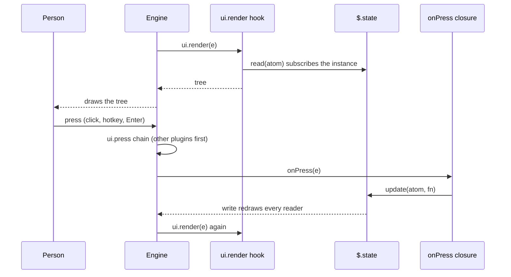

# UI reference: drawing with `ui.render`

How a mod draws: the `ui.render` event, its 15 render sites, the elements per surface, panes, the band, buttons, focus, and the small display calls (`status`, `toast`, `log`, `notice`, `notify`). Pinned to Claude Code 2.1.295. The types file wins over prose where they differ.

## 1. The `ui.render` event

The engine fires `ui.render` before it draws a component instance. It fires once per input value (props, viewport width), on plugin load, and on `$.ui.invalidate("ui.render")` ([d.ts:3971-3980](../sources/claude-code-2.1.295/types/claude-code.d.ts#L3971-L3980)). A width change re-runs every hooked site after the resize settles. A height change alone re-draws nothing ([reference.md:114-117](../sources/claude-code-2.1.295/reference.md#L114-L117)).

### Input `e`

| Field | Meaning | Source |
| --- | --- | --- |
| `component` | One of the 15 [render sites](#2-render-sites). Matchers narrow on it. | [d.ts:9715](../sources/claude-code-2.1.295/types/claude-code.d.ts#L9715) |
| `surface` | `terminal`, `desktop`, `mobile` or `vscode`. One literal per union member, so `if (e.surface === 'terminal')` narrows `e` and `$.ui.resolve(e)`. Over the wire it is what the client declared. Do not key policy on it. | [d.ts:9720](../sources/claude-code-2.1.295/types/claude-code.d.ts#L9720) |
| `requestId` | Which instance. See the table in section 2. | [d.ts:9734](../sources/claude-code-2.1.295/types/claude-code.d.ts#L9734) |
| `props` | The component's plain-data props (`RenderPropsOf[C]`). | [d.ts:9763](../sources/claude-code-2.1.295/types/claude-code.d.ts#L9763) |
| `viewport?` | `{ columns, rows, isFullscreen? }`. Absent until a surface measures. `rows` is the whole surface height, not the room for your tree. | [d.ts:10390](../sources/claude-code-2.1.295/types/claude-code.d.ts#L10390) |
| `viewport.isFullscreen` | `true` when the surface docks panes beside the transcript. Terminal always says it (fixed per session). A remote surface says it once its client reports. | [d.ts:10390](../sources/claude-code-2.1.295/types/claude-code.d.ts#L10390) |
| `props.onScreen?` | `{ first, last, of }`, or `null` while the row is off screen. Absent where the surface does not say (the terminal main screen). The hook re-runs when it changes. Transcript sites only. | [d.ts:6789](../sources/claude-code-2.1.295/types/claude-code.d.ts#L6789), [reference.md:114](../sources/claude-code-2.1.295/reference.md#L114) |
| `props.bodyColumns` | `Pane` and `AbovePrompt` only. Cells you may use. Size the tree to this, not to `viewport.columns`. | [reference.md:117](../sources/claude-code-2.1.295/reference.md#L117), [d.ts:10284](../sources/claude-code-2.1.295/types/claude-code.d.ts#L10284) |

### Answers

| Your hook returns | Effect |
| --- | --- |
| A tree | The engine validates it and draws it in the site's place. |
| `next({ ...e, props })` | The engine draws its own component with your props. The component validates them. An invalid rewrite draws the original. |
| `next(e)` | Leave the site alone. It resolves to the engine's drawing, `{ type: 'engine', ref }`, unless a plugin beneath returned a tree. |

Rules:

- Read-only props are pinned. A rewrite that changes or drops one is refused and the hook fails. Examples: `Pane.placement`, `view`, `AssistantMessage.isSummary`, `CommandOutput.command`, `onScreen` ([d.ts:10338](../sources/claude-code-2.1.295/types/claude-code.d.ts#L10338), [d.ts:9875](../sources/claude-code-2.1.295/types/claude-code.d.ts#L9875), [d.ts:10043](../sources/claude-code-2.1.295/types/claude-code.d.ts#L10043)).
- A tree from a hook replaces what the plugins after it draw. To keep theirs, put `await next(e)` inside your `Box` ([docs: interface:204](../sources/code-claude-com-2026-10-09/mods/interface.md#L204)).
- You may place the engine reference beside your own elements: `<Box>{await next(e)}<Text>…</Text></Box>` ([docs: interface:280-290](../sources/code-claude-com-2026-10-09/mods/interface.md#L280-L290)).
- `AskUserQuestion` is special. A tree for it must hold the engine reference exactly once. Otherwise the engine draws its own dialog ([docs: interface:292](../sources/code-claude-com-2026-10-09/mods/interface.md#L292)).
- The permission dialog is not a render site. Use `$.ui.notice` to add a line to it ([d.ts:9356](../sources/claude-code-2.1.295/types/claude-code.d.ts#L9356)).
- The hook may be slow. A render hook never writes `$.state`. It may read it, and the read subscribes the instance ([reference.md:118](../sources/claude-code-2.1.295/reference.md#L118)).



### `$.ui.resolve(e)`

- It is a read, not a dispatch. It returns the frozen element table of `e.surface` ([d.ts:2397](../sources/claude-code-2.1.295/types/claude-code.d.ts#L2397)).
- The engine ran the `ui.resolve` event once at load, per surface, component and plugin ([d.ts:3983-3990](../sources/claude-code-2.1.295/types/claude-code.d.ts#L3983-L3990)). A plugin may restyle an element for all later plugins, or leave a key out.
- Destructure the tags: `const { Box, Text, Button } = $.ui.resolve(e)`. JSX `<Box gap={1}>` compiles to `h(Box, { gap: 1 })`.
- Element tables per surface: see section 3.

## 2. Render sites

15 sites. The keys of `RenderPropsOf` ([d.ts:9763](../sources/claude-code-2.1.295/types/claude-code.d.ts#L9763)). `RenderComponent` lists the same names ([d.ts:9360](../sources/claude-code-2.1.295/types/claude-code.d.ts#L9360)). Line numbers in the Component column point at each site's props type.

| Component | `requestId` is | Raised on | Key props (read-only marked `ro`) | Notes |
| --- | --- | --- | --- | --- |
| `AskUserQuestion` [d.ts:9769](../sources/claude-code-2.1.295/types/claude-code.d.ts#L9769) | tool call id | all | `tool`, `questions`, `metadataSource?` | Rewrite must fit the tool's schema or the original draws. |
| `UserMessage` [d.ts:9795](../sources/claude-code-2.1.295/types/claude-code.d.ts#L9795) | message id | all | `text`, `origin` ro, `isExpanded` ro, `task?` ro, `from?` ro, `onScreen?` | One site for every user-role row: prompt, task notification, message from another agent or session. Narrow with `{ props: { origin: { kind: 'task-notification' } } }`. A `text` rewrite changes the row only, never what the model read. Return `next(e)` while `isExpanded` so ctrl+o shows all. |
| `AssistantMessage` [d.ts:9854](../sources/claude-code-2.1.295/types/claude-code.d.ts#L9854) | message id | all | `text`, `isFirstOfReply`, `isSummary?` ro, `onScreen?` | Rewrite changes the drawing, not the stored message. |
| `ToolUse` [d.ts:9892](../sources/claude-code-2.1.295/types/claude-code.d.ts#L9892) | tool call id | all | `tool_use_id` ro, `tool`, `input`, `isRunning`, `isErrored`, `isInterrupted`, `output?`, `onScreen?` | Row only. The call was decided at `tool.call`. |
| `ToolResult` [d.ts:9951](../sources/claude-code-2.1.295/types/claude-code.d.ts#L9951) | tool call id | all | `tool_use_id` ro, `tool` ro, `output`, `isErrored` ro | `output` rewrite is checked against the tool's output schema. A bad one draws nothing, or hits the row's error boundary. |
| `ToolGroup` [d.ts:9997](../sources/claude-code-2.1.295/types/claude-code.d.ts#L9997) | tool call id | all | `calls`, `isActive`, `isExpanded`, `onScreen?` | Setting `isExpanded` unfolds each call into a `ToolUse` row. Fullscreen ctrl+o has no groups. |
| `CommandOutput` [d.ts:10035](../sources/claude-code-2.1.295/types/claude-code.d.ts#L10035) | message id | all | `command` ro, `args` ro, `text`, `isErrored` ro, `onScreen?` | Draws the `text` of a `command.run` answer. See [CommandOutput](#commandoutput-and-usermessage-sites). |
| `ToolProgress` [d.ts:10079](../sources/claude-code-2.1.295/types/claude-code.d.ts#L10079) | tool call id | terminal | `tool_use_id` ro, `kind` ro (`'background_hint'`), `hint` | The run-in-background pill. `hint: ""` draws nothing. |
| `Spinner` [d.ts:10110](../sources/claude-code-2.1.295/types/claude-code.d.ts#L10110) | agent id | terminal, desktop | `word`, `message`, `suffix`, `mode` | `mode` is `requesting`, `responding`, `thinking`, `tool-input` or `tool-use`. Desktop never says `tool-input`. |
| `TurnDuration` [d.ts:10143](../sources/claude-code-2.1.295/types/claude-code.d.ts#L10143) | message id | terminal | `word`, `durationMs`, `onScreen?` | The line that closes a turn. |
| `InfoNotice` [d.ts:10169](../sources/claude-code-2.1.295/types/claude-code.d.ts#L10169) | message id | terminal | `text`, `command`, `onScreen?` | Dim line under the logo. |
| `SessionMode` [d.ts:10198](../sources/claude-code-2.1.295/types/claude-code.d.ts#L10198) | one instance | terminal, desktop | `modes` | Add a mode by rewriting `modes`. Filter to remove one. |
| `PromptHint` [d.ts:10217](../sources/claude-code-2.1.295/types/claude-code.d.ts#L10217) | one instance | terminal, desktop | `isDraft` ro, `isWorking` ro, `hint`, `tail?` | `tail` adds text after the engine's line and keeps its pills live. Only the terminal draws `tail`. |
| `AbovePrompt` [d.ts:10255](../sources/claude-code-2.1.295/types/claude-code.d.ts#L10255) | one instance | terminal, desktop | `hasSurvey` ro, `isWorking` ro, `maxRows` ro, `bodyColumns` ro, `scroll` ro, `view` ro | The [band](#4-the-band-above-the-prompt). |
| `Pane` [d.ts:10312](../sources/claude-code-2.1.295/types/claude-code.d.ts#L10312) | the pane `id` | all | `title`, `isFocused`, `bodyColumns`, `placement`, `scroll`, `view` (all ro) | The [pane](#3-panes). Only `Pane` has instances a plugin opens. |

Sources for the `requestId` column and the surface list: the "Raised on" lines in [d.ts:9767](../sources/claude-code-2.1.295/types/claude-code.d.ts#L9767), [d.ts:10077](../sources/claude-code-2.1.295/types/claude-code.d.ts#L10077), [d.ts:10108](../sources/claude-code-2.1.295/types/claude-code.d.ts#L10108) and the public render-site table ([docs: reference:200-228](../sources/code-claude-com-2026-10-09/mods/reference.md#L200-L228)). The public table lists only `terminal` and `desktop`. It says it is "as of v2.1.290". The types list four surfaces. The types win.

`SiteScroll` is `{ offset, bodyRows }`: the window over a tall tree, engine-owned ([d.ts:11848](../sources/claude-code-2.1.295/types/claude-code.d.ts#L11848)). `SiteView` is `{ agentId? }`: which transcript is on screen. A switch re-runs the hook ([d.ts:11872](../sources/claude-code-2.1.295/types/claude-code.d.ts#L11872)).

### `CommandOutput` and `UserMessage` sites

- A command that answers `command.run` with `{ text, context? }` prints `text` in the transcript. Hook the row with `{ component: 'CommandOutput', props: { command: 'mine' } }` and draw `text` as a tree ([reference.md:133](../sources/claude-code-2.1.295/reference.md#L133), [d.ts:10035](../sources/claude-code-2.1.295/types/claude-code.d.ts#L10035)).
- `text` is what the model also reads. `context` is only for the model. A tree you draw changes the row, not the stored message.
- A `UserMessage` rewrite of `text` is drawn up to 100,000 characters ([d.ts:9800](../sources/claude-code-2.1.295/types/claude-code.d.ts#L9800)).

## 3. Panes

A pane is a framed region. It is docked beside the transcript in a wide fullscreen terminal. Otherwise it sits inline above the prompt ([d.ts:10312](../sources/claude-code-2.1.295/types/claude-code.d.ts#L10312)). With more than one pane open, each gets a tab. One pane per `id`.

### Open and close

`$.ui.open(args)` resolves `UiOpenResult` ([d.ts:2500](../sources/claude-code-2.1.295/types/claude-code.d.ts#L2500), [d.ts:7390](../sources/claude-code-2.1.295/types/claude-code.d.ts#L7390), [d.ts:14134](../sources/claude-code-2.1.295/types/claude-code.d.ts#L14134)). Opening draws nothing by itself. The engine then fires `ui.render` for `{ component: 'Pane', requestId: id }`.

| Option | Type | Effect |
| --- | --- | --- |
| `id` | string, 1-64 of letters, digits, `_`, `-` | Names the pane. Reopening an open id retitles it. Pinned at hooks. |
| `title?` | string | Tab label while more than one pane is open. Default: the id. |
| `focus?` | `true` only | A request. Granted only while the prompt has the keys over an empty composer. |
| `closeOnEscape?` | `true` only | Esc closes the pane (`ui.close`, origin `person`). A hook may refuse. |
| `holdToasts?` | `true` only | While this pane shows, the surface holds every transient toast, other plugins' too. Leave off a pane that stays open. |
| `rows?` | positive integer | Inline height wanted. A request. The person's drag wins. The dock ignores it. |
| `columns?` | positive integer | Docked width wanted. A request. The inline block ignores it. |

`focus`, `closeOnEscape` and `holdToasts` accept only `true`. Passing `false` throws `ui.open: focus is true or left out`. Add the field only when the condition holds ([docs: interface:323-328](../sources/code-claude-com-2026-10-09/mods/interface.md#L323-L328)).

`$.ui.close({ id })` closes a pane. Every close raises `ui.close` with `origin.kind` of `plugin`, `person` or `unload` ([d.ts:7353](../sources/claude-code-2.1.295/types/claude-code.d.ts#L7353)). A hook that answers without `next` keeps the pane open, except on `unload`. `$.ui.panes()` lists your own open panes ([d.ts:2527](../sources/claude-code-2.1.295/types/claude-code.d.ts#L2527)).

### Seating: `isPlaced`

| Who opened it | Where it shows |
| --- | --- |
| Something the person did (command, prompt, press) | Any width. `{ isPlaced: true }`. |
| The mod on its own (timer, `turn.start`, `session.start`) | From 144 columns. From 110 once the person has opened that id themselves. |
| A narrower terminal, or a surface that places no panes | `{ isPlaced: false, reason }`. The pane waits until the person opens it or the terminal widens. |

Sources: [d.ts:7380-7389](../sources/claude-code-2.1.295/types/claude-code.d.ts#L7380-L7389), [d.ts:14134](../sources/claude-code-2.1.295/types/claude-code.d.ts#L14134), [docs: interface:338-345](../sources/code-claude-com-2026-10-09/mods/interface.md#L338-L345), [SKILL.md:23](../sources/claude-code-2.1.295/SKILL.md#L23). A `-p` run places all panes ([d.ts:2481-2492](../sources/claude-code-2.1.295/types/claude-code.d.ts#L2481-L2492)). `placement` in the `Pane` props is `dock` (terminal fullscreen from 110 columns) or `inline` ([d.ts:10338](../sources/claude-code-2.1.295/types/claude-code.d.ts#L10338)).

Tell the person when a pane waits: `if (!opened.isPlaced) $.ui.toast('widen the terminal')`.

### Size

- Width: use `e.props.bodyColumns`. It is the box inside the frame. It is narrower than the viewport while docked ([reference.md:117](../sources/claude-code-2.1.295/reference.md#L117)).
- Height, docked: `e.props.scroll.bodyRows` is the rows available. Inline: the pane grows with the tree up to a limit; `bodyRows` is that limit. A taller tree scrolls as a whole ([docs: reference:224-229](../sources/code-claude-com-2026-10-09/mods/reference.md#L224-L229)).
- `e.viewport.isFullscreen === true` means a pane you open is a sidebar. Use it to decide whether to open unasked ([d.ts:10404](../sources/claude-code-2.1.295/types/claude-code.d.ts#L10404)).

### Keys inside a pane

Keys reach a pane only while it has focus. It gets focus from `focus: true`, ctrl+x then Tab, or a click ([docs: interface:520-530](../sources/code-claude-com-2026-10-09/mods/interface.md#L520-L530)).

| Key | Effect |
| --- | --- |
| Tab | Next control. |
| Up, Down | Move between controls while the drawing fits. Otherwise scroll. |
| Enter | Press the focused `Button`, submit the `Input`, pick in the `Select`. |
| A button's `hotkey` | Press it. While an `Input` has focus, printable keys go to the field. |
| PageUp, PageDown, Home, End | Scroll. |
| ctrl+x, arrow | Resize the pane. |
| ctrl+x, x | Close the pane, even from a field. |
| Esc | Back to the prompt. With `closeOnEscape`, also closes. |

A mod cannot bind Tab or the arrows ([docs: interface:532-545](../sources/code-claude-com-2026-10-09/mods/interface.md#L532-L545)).

A pane opened with `focus`, `closeOnEscape` and `holdToasts` behaves as a dialog ([reference.md:133](../sources/claude-code-2.1.295/reference.md#L133)).

### Minimal pane

A `/counter` command opens a pane with one button. The count lives in `$.state`, so a press redraws without `$.ui.invalidate`. Adapted from [examples/pane.tsx](../sources/claude-code-2.1.295/examples/pane.tsx). Checked on 2.1.295: type-check clean, `claude plugin validate` passes, and a mount test passes.

`hooks/register.tsx`

```tsx
import { atom, read, update } from 'claude-code'
import type { Register } from 'claude-code'

const PANE = 'counter'
const count = atom({ plugin: 'counter', key: 'count' } as const, 0)

export const register: Register = on => {
  on('session.start', async ($, e, next) => {
    await $.command.register({ name: 'counter', description: 'Open the counter pane' })

    return next(e)
  })

  on('command.run', { command: 'counter' }, async $ => {
    // The person ran the command, so the pane is placed at any width.
    const opened = await $.ui.open({ id: PANE, title: 'Counter', focus: true, closeOnEscape: true })

    return { text: opened.isPlaced ? 'Counter pane opened.' : 'The pane waits for a wider terminal.' }
  })

  on('ui.render', { component: 'Pane', requestId: PANE }, async ($, e) => {
    const { Box, Button, Text } = $.ui.resolve(e)
    const n = await read($, count)

    return (
      <Box flexDirection="row" columnGap={2}>
        <Button key="more" label="Add one" hotkey="a" onPress={() => update($, count, v => v + 1)} />
        <Text>Count: {n}</Text>
      </Box>
    )
  })
}
```

`types/index.d.ts` (named in `plugin.json` as `"types": "./types/index.d.ts"`)

```ts
declare module 'claude-code' {
  interface PluginState {
    counter: { count: number }
  }
}
```

`hooks/hooks.json`: `{ "modules": ["./register.tsx"] }`. See [state-and-storage](../concepts/state-and-storage.md) for the contract rules.

## 4. The band above the prompt

`AbovePrompt` is the strip directly above the prompt input. One instance, shared by all mods. The engine draws a `[-]` beside the tree and an `n more` row under it ([d.ts:10255](../sources/claude-code-2.1.295/types/claude-code.d.ts#L10255)). The person collapses it (ctrl+x ctrl+a, `[-]`) or focuses it (click, ctrl+x Tab). Raised on terminal and desktop only.

| Prop | Meaning |
| --- | --- |
| `hasSurvey` | `true` while a survey holds the band. Yield: return `next(e)`. |
| `isWorking` | `true` while a model turn runs. |
| `maxRows` | Rows the band may take. In fullscreen: what the bottom slot has left, capped at half the terminal. A taller tree scrolls in a window of `scroll.bodyRows`. |
| `bodyColumns` | The column's width less the engine's five cells for `[-]`. Size to this. |
| `scroll`, `view` | Engine-owned window and transcript view. |

A digit `hotkey` on a band `Button` also fires when the person types that digit alone in an empty prompt and pauses ([docs: reference:249](../sources/code-claude-com-2026-10-09/mods/reference.md#L249)). A bare digit arms only buttons wholly inside the scroll window ([d.ts:10270](../sources/claude-code-2.1.295/types/claude-code.d.ts#L10270)).

### Minimal band

The hook shows the last turn and a Hide button. It yields to surveys. Verbatim from [examples/band.tsx](../sources/claude-code-2.1.295/examples/band.tsx), with its contract [examples/band-state.d.ts](../sources/claude-code-2.1.295/examples/band-state.d.ts). Checked on 2.1.295: type-check clean, validate passes, a two-surface test passes (see [testing-kit](./testing-kit.md)).

```tsx
import { atom, read, update } from 'claude-code'
import type { Register } from 'claude-code'

import type { Turn } from '../types'

const last = atom({ plugin: 'turn-band', key: 'last' } as const, null)
const isHidden = atom({ plugin: 'turn-band', key: 'isHidden' } as const, false)

export const register: Register = on => {
  let startedAt = 0
  let tools = 0

  on('prompt.submit', async ($, e, next) => {
    startedAt = await $.clock.now()
    tools = 0

    return next(e)
  })

  on('tool.call', ($, e, next) => {
    tools += 1

    return next(e)
  })

  on('turn.complete', async ($, e, next) => {
    const seconds = Math.round(((await $.clock.now()) - startedAt) / 1000)
    const turn: Turn = { seconds, tools }
    await update($, last, () => turn)

    if (seconds > 120) {
      $.ui.toast(`That turn took ${seconds}s`)
    }

    return next(e)
  })

  on('ui.render', { component: 'AbovePrompt' }, async ($, e, next) => {
    const turn = await read($, last)
    const isQuiet = e.props.hasSurvey || turn === null || (await read($, isHidden))

    if (isQuiet) {
      return next(e)
    }

    const { Box, Button, Text } = $.ui.resolve(e)

    return (
      <Box>
        <Text dimColor>
          Last turn: {turn.seconds}s, {turn.tools} tool calls{' '}
        </Text>
        <Button
          key="hide"
          label="Hide"
          onPress={() => update($, isHidden, () => true)}
        />
      </Box>
    )
  })
}
```

Contract (`types/index.d.ts`):

```ts
export type Turn = { seconds: number; tools: number }

declare module 'claude-code' {
  interface PluginState {
    'turn-band': { last: Turn | null; isHidden: boolean }
  }
}
```

## 5. Elements

### Matrix

`Elements` maps each surface to its constructor table ([d.ts:3802](../sources/claude-code-2.1.295/types/claude-code.d.ts#L3802)). 12 distinct names.

| Element | terminal | desktop | vscode | mobile | Props type |
| --- | :-: | :-: | :-: | :-: | --- |
| `Box` | yes | yes | yes | yes | [d.ts:901](../sources/claude-code-2.1.295/types/claude-code.d.ts#L901) |
| `Text` | yes | yes | yes | yes | [d.ts:12563](../sources/claude-code-2.1.295/types/claude-code.d.ts#L12563) |
| `Button` | yes | yes | yes | yes | [d.ts:1060](../sources/claude-code-2.1.295/types/claude-code.d.ts#L1060) |
| `Link` | yes | yes | yes | yes | [d.ts:5642](../sources/claude-code-2.1.295/types/claude-code.d.ts#L5642) |
| `Code` | yes | yes | yes | yes | [d.ts:1626](../sources/claude-code-2.1.295/types/claude-code.d.ts#L1626) |
| `Markdown` | yes | yes | yes | yes | [d.ts:5698](../sources/claude-code-2.1.295/types/claude-code.d.ts#L5698) |
| `Input` | yes | yes | yes | no | [d.ts:5471](../sources/claude-code-2.1.295/types/claude-code.d.ts#L5471) |
| `Select` | yes | yes | yes | no | [d.ts:10491](../sources/claude-code-2.1.295/types/claude-code.d.ts#L10491) |
| `Svg` | no | yes | yes | yes | [d.ts:12272](../sources/claude-code-2.1.295/types/claude-code.d.ts#L12272) |
| `Client` | yes | yes | no | no | [d.ts:1499](../sources/claude-code-2.1.295/types/claude-code.d.ts#L1499) |
| `Raster` | yes | no | no | no | [d.ts:9245](../sources/claude-code-2.1.295/types/claude-code.d.ts#L9245) |
| `Image` | yes | no | no | no | [d.ts:5315](../sources/claude-code-2.1.295/types/claude-code.d.ts#L5315) |

Counts: terminal 11, desktop 10, vscode 9, mobile 7 ([d.ts:3802-3872](../sources/claude-code-2.1.295/types/claude-code.d.ts#L3802-L3872)). Mobile has no `Input`/`Select` because the app draws none yet, not because of the device or protocol ([d.ts:3836](../sources/claude-code-2.1.295/types/claude-code.d.ts#L3836)). VS Code has no `Client` because the client asks name no surface ([d.ts:3851](../sources/claude-code-2.1.295/types/claude-code.d.ts#L3851)).

The public reference lists only terminal and desktop and says `Svg` is desktop only ([docs: reference:230-245](../sources/code-claude-com-2026-10-09/mods/reference.md#L230-L245), [docs: interface:430](../sources/code-claude-com-2026-10-09/mods/interface.md#L430)). The types add `vscode` and `mobile`. The types win.

### What happens when an element is missing

Two sources disagree.

- Prose: a tree that uses an element the app does not have is not drawn. The engine draws its own ([docs: interface:436](../sources/code-claude-com-2026-10-09/mods/interface.md#L436), [reference.md:127](../sources/claude-code-2.1.295/reference.md#L127)).
- Types: a constructor for an element a surface lacks "draws a fragment" ([d.ts:3788](../sources/claude-code-2.1.295/types/claude-code.d.ts#L3788), [d.ts:9242](../sources/claude-code-2.1.295/types/claude-code.d.ts#L9242)). A hand-written tree with an `Image` on a surface without it is refused ([d.ts:9675](../sources/claude-code-2.1.295/types/claude-code.d.ts#L9675)).
- Observed on 2.1.295 under `claude plugin test`: calling `Svg(...)` from a terminal table mounted without a refusal and drew nothing. *Inference:* the table completes absent names to fragments, so only a hand-built `{ type: 'Svg' }` node is refused.

Branch on `e.surface`. Do not rely on the fragment.

### Box and Text

`Box` ([d.ts:901](../sources/claude-code-2.1.295/types/claude-code.d.ts#L901)): a flex container.

| Group | Props |
| --- | --- |
| Hover scope | `key` (a keyed Box scopes the hover beneath it), `hover` ([d.ts:862](../sources/claude-code-2.1.295/types/claude-code.d.ts#L862): `borderStyle`, `borderColor`, `borderDimColor`, `backgroundColor`, `display: 'flex'`, `top`, `left`, `right`, `bottom`, `scope`) |
| Position | `position: 'relative' \| 'absolute'`, `top`, `left`, `right`, `bottom` (cells) |
| Flex | `flexDirection`, `flexGrow`, `flexShrink`, `flexWrap`, `alignItems`, `alignSelf`, `justifyContent`, `gap`, `columnGap`, `rowGap` |
| Size | `width`, `height`, `minWidth`, `minHeight` (number or string) |
| Spacing | `margin*`, `padding*` (all, X, Y, Top, Bottom, Left, Right) |
| Look | `borderStyle`, `borderColor`, `borderDimColor`, `backgroundColor`, `overflow: 'visible' \| 'hidden'`, `display: 'flex' \| 'none'` |

`borderStyle` names: `single`, `double`, `round`, `bold`, `singleDouble`, `doubleSingle`, `classic`, `arrow`, `dashed`, `quote`. Any other value draws no border, and the rest still draws ([docs: reference:253-270](../sources/code-claude-com-2026-10-09/mods/reference.md#L253-L270), [reference.md:130](../sources/claude-code-2.1.295/reference.md#L130)).

`Text` ([d.ts:12563](../sources/claude-code-2.1.295/types/claude-code.d.ts#L12563)): `color`, `backgroundColor`, `dimColor`, `bold`, `italic`, `underline`, `strikethrough`, `inverse`, `hover` ([d.ts:12539](../sources/claude-code-2.1.295/types/claude-code.d.ts#L12539)), and `wrap` (`wrap`, `end`, `middle`, `truncate`, `truncate-start`, `truncate-middle`, `truncate-end`).

### Other elements

| Element | Notable props | Notes |
| --- | --- | --- |
| `Input` [d.ts:5471](../sources/claude-code-2.1.295/types/claude-code.d.ts#L5471) | `key` (required), `label`, `placeholder`, `value`, `submitLabel`, `autoFocus`, `onInput(value, e)`, `onSubmit(value, e)` (required) | `value` is the text when drawn. The person's typing replaces it until you draw again. Draw `''` to clear after submit. Submitting starts no turn. |
| `Select` [d.ts:10491](../sources/claude-code-2.1.295/types/claude-code.d.ts#L10491) | `key`, `label`, `options` (`{ value, label? }`, at least one, unique values), `value`, `autoFocus`, `onSelect(value, e)` | Arrows move, Enter picks. |
| `Link` [d.ts:5642](../sources/claude-code-2.1.295/types/claude-code.d.ts#L5642) | `href` (required, at most 2,048 chars once percent-encoded), `label?` | Terminal draws label then URL. Desktop draws plain text unless `href` is `https:` (or `http://localhost`), has no `@`, and equals `new URL(href).href` ([docs: interface:444-450](../sources/code-claude-com-2026-10-09/mods/interface.md#L444-L450)). |
| `Code` [d.ts:1626](../sources/claude-code-2.1.295/types/claude-code.d.ts#L1626) | `source` (required), `language`, `path`, `startLine`, `format: 'source' \| 'diff'`, `wrap` | `format: 'diff'` wants unified hunks with an `@@` header. Otherwise it draws as plain code and logs a line. |
| `Markdown` [d.ts:5698](../sources/claude-code-2.1.295/types/claude-code.d.ts#L5698) | `text` (required, not children), `key`, `dimColor`, `onLinkPress`, `pressableLinks` | See [Markdown links](#markdown-links). |
| `Svg` [d.ts:12272](../sources/claude-code-2.1.295/types/claude-code.d.ts#L12272) | `source` (at most 131,072 chars), `alt` (required), `width`, `height`, `isInteractive` | `isInteractive: true` draws in a script-less sandboxed frame so hover and CSS work. |
| `Client` [d.ts:1499](../sources/claude-code-2.1.295/types/claude-code.d.ts#L1499) | `key`, `module` (string literal), `props`, `width`, `height`, `flexGrow` | See [Client modules](#client-modules). |
| `Raster` [d.ts:9245](../sources/claude-code-2.1.295/types/claude-code.d.ts#L9245) | `key`, `columns` (1-512), `rows` (1-256), `cells` | See [Raster, Image, blit](#raster-image-and-blit). |
| `Image` [d.ts:5315](../sources/claude-code-2.1.295/types/claude-code.d.ts#L5315) | `key?`, `source`, `columns` (1-255), `rows` (1-255), `alt` (required) | Same section. |

A text field, `Select` and `Button` keep their handlers in the plugin. Each use raises `ui.input`, `ui.select` or `ui.press` first. Another plugin may rewrite or take it ([d.ts:3992-4018](../sources/claude-code-2.1.295/types/claude-code.d.ts#L3992-L4018), [docs: interface:512](../sources/code-claude-com-2026-10-09/mods/interface.md#L512)).

## 6. Buttons

`ButtonProps` ([d.ts:1060](../sources/claude-code-2.1.295/types/claude-code.d.ts#L1060)). On the terminal a button is `[ label ]`. A desktop draws a native button.

| Prop | Meaning |
| --- | --- |
| `key?` | The address: `e.element` at `ui.press`. Defaults to `label` or the one string child. Set it when the label changes (a count, an age). |
| `label?` / children | Text drawn. Children may be strings and `Text` only. Any other child is refused. A button with children needs a `key` or a `label`. |
| `hotkey?` | One digit or one lowercase letter. Presses the button while its site holds the focus. Two on one key: the later wins. |
| `action?` | An engine keybinding action (`'app:cycleDiffBase'`). The person's chord for it presses the button from the prompt while mounted. Unknown names are refused. |
| `plain?` | `true`: no chrome. Draws `1: label` with a hotkey, or the label alone. A one-glyph label is still a control. |
| `dimColor?` | Dim at rest, full strength under pointer or focus. |
| `variant?` | `'primary'` (accent color on the terminal) or `'secondary'`. `plain` wins. |
| `role?` | `'dismiss'`: a drawing hint. The terminal ignores it. A desktop draws its native close control. `onPress` still closes. |
| `autoFocus?` | `true` only. The focus ring starts here. |
| `hover?` | `Text` style overrides while the enclosing keyed `Box` (or a `scope`) is hovered. Refused outside a keyed Box unless it names a `scope`. |
| `onPress(e)` | Required. `e.surface` is the surface the press came from. |

Example with children: `<Button key={id} plain onPress={open}>{name} <Text dimColor>2m</Text></Button>`.

A hotkey works only while the site holds the keyboard: the band after ctrl+x Tab or a click, or a pane that is focused. The composer never gets it, except a bare digit in an empty prompt that answers a band button ([d.ts:1060-1115](../sources/claude-code-2.1.295/types/claude-code.d.ts#L1060-L1115)).

## 7. Focus, scroll, hover

### Focus ring

- Tab, arrows or a click move the ring inside a pane or the band. `autoFocus: true` starts it on one element. Of several in a site, the first drawn wins. A ring the person moved stays put ([d.ts:1141](../sources/claude-code-2.1.295/types/claude-code.d.ts#L1141)).
- Every move raises `ui.focus` first ([d.ts:4054](../sources/claude-code-2.1.295/types/claude-code.d.ts#L4054)). `e.element` is the key now holding the ring. It is absent on the engine's close mark. `next(e)` lands it. `next({ ...e, element })` lands it on another of your elements. `{}` or `{ deny }` keeps it where it was.
- `$.ui.focus({ requestId, key })` moves the ring from code. It works only while the site holds the keys, and only for your own elements. It returns `{}` or `{ deny }` ([d.ts:2558](../sources/claude-code-2.1.295/types/claude-code.d.ts#L2558)).
- `ui.scroll` fires before a site's window moves ([d.ts:4042](../sources/claude-code-2.1.295/types/claude-code.d.ts#L4042)). `$.ui.scroll({ in, to, block })` scrolls an element or an edge into view ([d.ts:2542](../sources/claude-code-2.1.295/types/claude-code.d.ts#L2542)).
- A pane opened with `focus` only gets the keys while the prompt is empty and nothing else has focus ([docs: interface:520-530](../sources/code-claude-com-2026-10-09/mods/interface.md#L520-L530)).

### Hover and absolute positioning

- A keyed `Box` is a hover scope. The surface applies `hover` styles with no hook run and nothing crossing to the plugin. A `scope` string (1-64 chars, no control characters) groups elements across sites ([d.ts:862](../sources/claude-code-2.1.295/types/claude-code.d.ts#L862), [d.ts:901](../sources/claude-code-2.1.295/types/claude-code.d.ts#L901)).
- `position: 'absolute'` with cell offsets (`top: -2, left: 2`) paints over the surroundings and moves nothing. Pair `display: 'none'` with `hover: { display: 'flex' }` to make a card that appears over a hovered glyph ([reference.md:133](../sources/claude-code-2.1.295/reference.md#L133)).

## 8. Raster, Image, and blit

- **`Raster`** ([d.ts:9245](../sources/claude-code-2.1.295/types/claude-code.d.ts#L9245)): terminal only. One element for a grid of colored cells (sparkline, heat map, frame). `cells` is standard padded base64 of `columns * rows` little-endian u32 triplets `[codePoint, foreground, background]`. A code point is one printable width-1 BMP character. A color is `0x00RRGGBB`, or `0x01000000` for the terminal default. The palette paints 1,024 distinct color pairs at once. Never draw a `Box` per cell.
- **`Image`** ([d.ts:5315](../sources/claude-code-2.1.295/types/claude-code.d.ts#L5315)): terminal only. `source` is `{ png }`, `{ rgba, width, height }`, `{ file, format }` or `{ shm, format, width, height }` ([d.ts:5358](../sources/claude-code-2.1.295/types/claude-code.d.ts#L5358)). Base64 bytes are at most 2 MiB decoded. It draws with the kitty graphics protocol (kitty 0.28+, Ghostty). Elsewhere it draws `alt`, dim. Detection fails inside tmux or screen and in background sessions. `CLAUDE_CODE_FORCE_TERMINAL_IMAGES=1` skips detection ([docs: gallery:380-386](../sources/code-claude-com-2026-10-09/mods/gallery.md#L380-L386)).
- **`$.ui.blit(args)`** ([d.ts:2381](../sources/claude-code-2.1.295/types/claude-code.d.ts#L2381)): repaints a mounted `Raster` with new `cells`, or swaps a keyed `Image`'s `source`, with no `ui.render` run. Args: `requestId` (the site), `key`, and `cells` or `source`; `columns` and `rows` must equal the mounted size. It resolves `{}` or `{ deny }` (not mounted, not yours, another size, bad cells). It takes up to 120 a second and shows some 60.

```js
$.clock.every(33, () => $.ui.blit({ requestId, key: 'grid', columns: 3, rows: 2, cells: frame() }))
```

## 9. Markdown links

`Markdown` draws text as an assistant reply is drawn: headings, lists, tables, fences, links. A link outside `https:`, `http:` and `file:` draws as text.

- With `key` and `onLinkPress(link, e)`, a plain single click on a link raises `ui.press` with `e.link.href` instead of the surface opening it. This works where the surface reports clicks (the fullscreen terminal). Ctrl- or alt-click still opens it ([d.ts:5725](../sources/claude-code-2.1.295/types/claude-code.d.ts#L5725), [reference.md:125](../sources/claude-code-2.1.295/reference.md#L125)).
- `pressableLinks` limits which `href`s the press owns: at most 256 entries of at most 2,048 chars. Others keep the surface's behaviour ([d.ts:5734](../sources/claude-code-2.1.295/types/claude-code.d.ts#L5734)).
- `key` is required with `onLinkPress`. A press needs an address.
- A test presses a link with `ui.press({ key, link: { href } })` ([testing-kit](./testing-kit.md)).

## 10. Client modules

`Client` draws a region with a second file of yours, for animation and pointer input. Terminal and desktop only.

- `module` must be a string literal path relative to the hooks file. A variable, a template with a substitution, or a computed path is refused at load ([d.ts:3813](../sources/claude-code-2.1.295/types/claude-code.d.ts#L3813)). The default export draws, else the one PascalCase export.
- The module is `ClientModule<P, S> = (props, surface) => RenderElement` ([d.ts:1440](../sources/claude-code-2.1.295/types/claude-code.d.ts#L1440)). It has no `$`. It reaches your hooks by `surface.post(data)`, which arrives as a `ui.message` event that only your plugin sees ([d.ts:4019](../sources/claude-code-2.1.295/types/claude-code.d.ts#L4019)).
- `surface` offers: `elements` (the terminal table less `Client`, `Raster`, `Image`), `state`/`setState`, `columns`, `rows`, `every(ms, fn)`, `onPointer(fn)`, `onKey(fn)`, `post(data)` ([d.ts:1550](../sources/claude-code-2.1.295/types/claude-code.d.ts#L1550)). Escape never reaches `onKey`.
- Bounds: tree 20,000 nodes, 32 deep, 100,000 chars serialized, else the instance unmounts ([d.ts:1406](../sources/claude-code-2.1.295/types/claude-code.d.ts#L1406)). `props` at most 100,000 chars serialized ([d.ts:1521](../sources/claude-code-2.1.295/types/claude-code.d.ts#L1521)). `post` at most 20,000 values, 32 deep, 100,000 chars ([d.ts:1602](../sources/claude-code-2.1.295/types/claude-code.d.ts#L1602)), one per frame. Three `setState` renders in a row with no input between is a render loop and unmounts.
- A failure raises `ui.fault` with `e.phase` (`load`, `render`, `run`) and `e.reason` ([d.ts:4028](../sources/claude-code-2.1.295/types/claude-code.d.ts#L4028)). The engine then draws the site again. Fall back by leaving the `Client` out. On the terminal a dim line like `my-mod: Client client/spinner.js: boom` takes its place ([docs: interface:456](../sources/code-claude-com-2026-10-09/mods/interface.md#L456)).

## 11. `status`, `toast`, `log`, `notice`, `notify`

All five show something without starting a turn. They differ in where, how long, and who sees it.

| Call | Shows | Lifetime | Text cap (terminal / remote) | Notes |
| --- | --- | --- | --- | --- |
| `$.ui.status(text \| undefined)` [d.ts:2477](../sources/claude-code-2.1.295/types/claude-code.d.ts#L2477) | One pinned line under the prompt, beside the engine's own notices. | Until the next call. `undefined` clears. | 2,000 / 10,000 | One per plugin. |
| `$.ui.toast(text, { timeoutMs? })` [d.ts:2447](../sources/claude-code-2.1.295/types/claude-code.d.ts#L2447) | A small box on the toast stack at the transcript's top right. One line on the notification bar when the transcript is in scrollback. | 4 s by default. A click removes it. The pointer over it holds it. | 2,000 / 10,000 | Touches neither transcript nor model. Waits while a `holdToasts` pane shows. See below. |
| `$.ui.log(text, { to? })` [d.ts:2414](../sources/claude-code-2.1.295/types/claude-code.d.ts#L2414) | A dim transcript row, not sent to the model. | Permanent row. | 2,000 / 10,000 | `to: 'debug'` writes the debug log only. The debug log has every line, to 10,000 chars, led by the plugin name. A `-p` or SDK host gets it as `ui_log`. A `ui.log` hook may rewrite `e.to`. |
| `$.ui.notice(tool_use_id, text \| undefined)` [d.ts:2346](../sources/claude-code-2.1.295/types/claude-code.d.ts#L2346) | One line under the open dialog for that call. | Removed when the call resolves, or on `undefined`. | 2,000 | Refused if the call is not open, or if it is another plugin's `$.tool.call` run. This is how a plugin adds context to the permission dialog. |
| `$.ui.notify(text, { title? })` [d.ts:2465](../sources/claude-code-2.1.295/types/claude-code.d.ts#L2465) | A native notification through the person's `preferredNotifChannel`. | Out of our hands. | None | Async. Their classic `Notification` hooks run first. Resolves `{ isSent: true, channel }` or `{ isSent: false, reason }` (`disabled`, `no-channel`, `no-surface`, `refused`). `terminal_bell` is a bell, no text. |

Toast rules ([reference.md:130](../sources/claude-code-2.1.295/reference.md#L130), [d.ts:2441](../sources/claude-code-2.1.295/types/claude-code.d.ts#L2441)):

- Text: an unpaired surrogate half draws as U+FFFD.
- A toast replaces only its own plugin's toast. On the bar it waits while another plugin's shows.
- While the bar is held (a `holdToasts` pane, the diff panel), each toast waits. A plugin's own oldest gives way after 50.
- The stack holds 50 in all. Past that, the oldest toast of the plugin that holds the most leaves. The stack draws at most three at a time in fullscreen.
- `timeoutMs` must be a whole number of ms from 1 to 60000, or the call is dropped with a debug line ([docs: troubleshoot:196-206](../sources/code-claude-com-2026-10-09/mods/troubleshoot.md#L196-L206)).
- A toast of a plugin in a managed seat (`prependPlugins`, `appendPlugins`) goes in front of the others. A plugin cannot ask for that.

`notify` echo warning: a notification is also heard by `classic.Notification` hooks. Two mods that each notify again on hearing one echo each other forever. Nothing in the engine stops them ([d.ts:7034](../sources/claude-code-2.1.295/types/claude-code.d.ts#L7034)).

Related calls, covered in [engine-interface](./engine-interface.md): `$.ui.ask` (an `AskUserQuestion` dialog; rejects in `-p`), `$.ui.copy` (surface clipboard), `$.ui.selection` (mouse selection in fullscreen terminal), `$.ui.invalidate` (redraw: 10 a second, 30 for the shown pane, expanded band and prompt hint; faster calls fold into one).

## 12. When the tree is refused

A tree that does not validate is not drawn. Validation fails on: an element the surface lacks, a prop the element does not take, a child where none goes, a name past its length cap. The engine draws its own, and the debug log says why. The exact lines and where they go: see [limits-and-diagnostics](./limits-and-diagnostics.md).

Short form:

- `<plugin>: ui.render (<Component>) refused: <reason>; the engine drew its own`
- `<plugin>: ui.render (<Component>) threw while drawn: <reason>; the engine drew its own`
- Where the engine draws nothing, the line ends `nothing was drawn` (band) or `the pane was closed` (pane).

A long text is not a refusal. The first 100,000 characters of a tree's text draw, and the cut text ends with words saying how much is left out ([reference.md:130](../sources/claude-code-2.1.295/reference.md#L130)).

## See also

- [limits-and-diagnostics](./limits-and-diagnostics.md): every size limit, log line formats, troubleshooting table.
- [testing-kit](./testing-kit.md): mount a pane or band on each surface and press its buttons.
- [events](./events.md): `ui.press`, `ui.input`, `ui.select`, `ui.focus`, `ui.scroll`, `ui.message`, `ui.fault`.
- [engine-interface](./engine-interface.md): the full `$.ui` noun.
- [state-and-storage](../concepts/state-and-storage.md): `$.state`, atoms, `$.store`.
- [develop workflow](../workflow/develop.md) and [examples](../examples/README.md).
