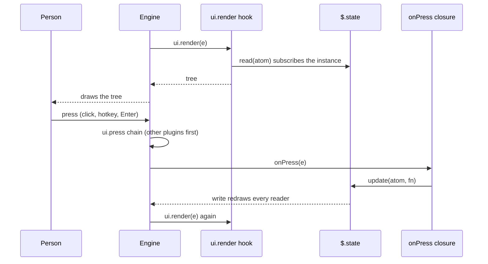
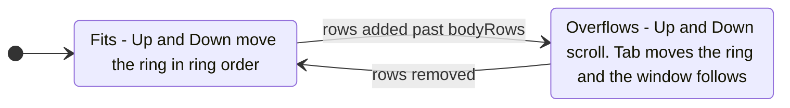
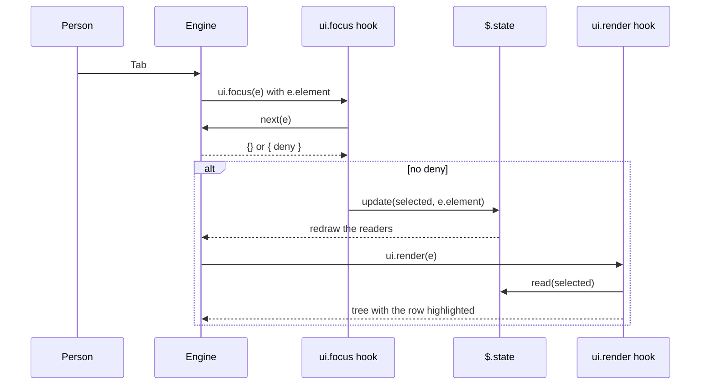

# UI reference: drawing with `ui.render`

How a mod draws: the `ui.render` event, its 15 render sites, the elements per surface, panes, the band, buttons, focus, and the small display calls (`status`, `toast`, `log`, `notice`, `notify`). Pinned to Claude Code 2.1.295. The types file wins over prose where they differ.

**2.1.302 notes.** Claims added for the architecture refactor ([issue #55](https://github.com/martin-macak/claude-code-mod-tracking/issues/55)) cite the 2.1.302 snapshot with the label `d.ts 302:N`, for example [d.ts 302:1439-1440](../sources/claude-code-2.1.302/types/claude-code.d.ts#L1439-L1440). Old citations keep the 2.1.295 snapshot. A grade tells how a new claim was checked:

- *verified-live*: seen in a real interactive session (Claude Code 2.1.302 in tmux).
- *verified-kit*: seen in `claude plugin validate` or `claude plugin test`.
- *types-only*: stated by the types file or `reference.md`, not run.
- *inference*: derived, not seen.

The pane facts in section 3 and the layout facts in section 5 were checked in a docked pane (120 columns) and an inline pane (100 columns). The kit cannot drive the focus ring, the arrow keys or hotkeys, and it draws no paint. Everything about those comes from the live runs.

## 1. The `ui.render` event

The engine fires `ui.render` before it draws a component instance. It fires once per input value (props, viewport width), on plugin load, and on `$.ui.invalidate("ui.render")` ([d.ts:3971-3980](../sources/claude-code-2.1.295/types/claude-code.d.ts#L3971-L3980)). A width change re-runs every hooked site after the resize settles. A height change alone re-draws nothing ([reference.md:114-117](../sources/claude-code-2.1.295/reference.md#L114-L117)).

### Input `e`

| Field | Meaning | Source |
| --- | --- | --- |
| `component` | One of the 15 [render sites](#2-render-sites). Matchers narrow on it. | [d.ts:9715](../sources/claude-code-2.1.295/types/claude-code.d.ts#L9715) |
| `surface` | `terminal`, `desktop`, `mobile` or `vscode`. One literal per union member, so `if (e.surface === 'terminal')` narrows `e` and `$.ui.resolve(e)`. Over the wire it is what the client declared. Do not key policy on it. | [d.ts:9720](../sources/claude-code-2.1.295/types/claude-code.d.ts#L9720) |
| `requestId` | Which instance. See the table in section 2. | [d.ts:9734](../sources/claude-code-2.1.295/types/claude-code.d.ts#L9734) |
| `props` | The component's plain-data props (`RenderPropsOf[C]`). | [d.ts:9763](../sources/claude-code-2.1.295/types/claude-code.d.ts#L9763) |
| `viewport?` | `{ columns, rows, isFullscreen? }`. Absent until a surface measures. `rows` is the whole surface height, not the room for your tree. | [d.ts:10390](../sources/claude-code-2.1.295/types/claude-code.d.ts#L10390) |
| `viewport.isFullscreen` | `true` when the surface docks panes beside the transcript. Terminal always says it (fixed per session). A remote surface says it once its client reports. | [d.ts:10390](../sources/claude-code-2.1.295/types/claude-code.d.ts#L10390) |
| `props.onScreen?` | `{ first, last, of }`, or `null` while the row is off screen. Absent where the surface does not say (the terminal main screen). The hook re-runs when it changes. Transcript sites only. | [d.ts:6789](../sources/claude-code-2.1.295/types/claude-code.d.ts#L6789), [reference.md:114](../sources/claude-code-2.1.295/reference.md#L114) |
| `props.bodyColumns` | `Pane` and `AbovePrompt` only. Cells you may use. Size the tree to this, not to `viewport.columns`. | [reference.md:117](../sources/claude-code-2.1.295/reference.md#L117), [d.ts:10284](../sources/claude-code-2.1.295/types/claude-code.d.ts#L10284) |

### Answers

| Your hook returns | Effect |
| --- | --- |
| A tree | The engine validates it and draws it in the site's place. |
| `next({ ...e, props })` | The engine draws its own component with your props. The component validates them. An invalid rewrite draws the original. |
| `next(e)` | Leave the site alone. It resolves to the engine's drawing, `{ type: 'engine', ref }`, unless a plugin beneath returned a tree. |

Rules:

- Read-only props are pinned. A rewrite that changes or drops one is refused and the hook fails. Examples: `Pane.placement`, `view`, `AssistantMessage.isSummary`, `CommandOutput.command`, `onScreen` ([d.ts:10338](../sources/claude-code-2.1.295/types/claude-code.d.ts#L10338), [d.ts:9875](../sources/claude-code-2.1.295/types/claude-code.d.ts#L9875), [d.ts:10043](../sources/claude-code-2.1.295/types/claude-code.d.ts#L10043)).
- A tree from a hook replaces what the plugins after it draw. To keep theirs, put `await next(e)` inside your `Box` ([docs: interface:204](../sources/code-claude-com-2026-10-09/mods/interface.md#L204)).
- You may place the engine reference beside your own elements: `<Box>{await next(e)}<Text>…</Text></Box>` ([docs: interface:280-290](../sources/code-claude-com-2026-10-09/mods/interface.md#L280-L290)).
- `AskUserQuestion` is special. A tree for it must hold the engine reference exactly once. Otherwise the engine draws its own dialog ([docs: interface:292](../sources/code-claude-com-2026-10-09/mods/interface.md#L292)).
- The permission dialog is not a render site. Use `$.ui.notice` to add a line to it ([d.ts:9356](../sources/claude-code-2.1.295/types/claude-code.d.ts#L9356)).
- The hook may be slow. A render hook never writes `$.state`. It may read it, and the read subscribes the instance ([reference.md:118](../sources/claude-code-2.1.295/reference.md#L118)). The refusal covers a `ui.render` dispatch only. Another event's hook, such as `ui.focus`, may write ([d.ts 302:3486-3489](../sources/claude-code-2.1.302/types/claude-code.d.ts#L3486-L3489); *verified-kit*, see [section 7](#selected-row-from-a-uifocus-hook)).
- A `requestId` matcher may be a `RegExp`: `on('ui.render', { component: 'Pane', requestId: /^c-/ })` passes `claude plugin validate`, which lists it as `requestId=/"^c-"/` (*verified-kit*).



### `$.ui.resolve(e)`

- It is a read, not a dispatch. It returns the frozen element table of `e.surface` ([d.ts:2397](../sources/claude-code-2.1.295/types/claude-code.d.ts#L2397)).
- The engine ran the `ui.resolve` event once at load, per surface, component and plugin ([d.ts:3983-3990](../sources/claude-code-2.1.295/types/claude-code.d.ts#L3983-L3990)). A plugin may restyle an element for all later plugins, or leave a key out.
- Destructure the tags: `const { Box, Text, Button } = $.ui.resolve(e)`. JSX `<Box gap={1}>` compiles to `h(Box, { gap: 1 })`.
- The result is a union of the surface tables. Destructuring `Client` fails `tsc` (`Property 'Client' does not exist`) until `e.surface` is narrowed: `if (e.surface !== 'terminal') return next(e)` (*verified-kit*, `tsc` 7.0.2).
- Element tables per surface: see section 3.

## 2. Render sites

15 sites. The keys of `RenderPropsOf` ([d.ts:9763](../sources/claude-code-2.1.295/types/claude-code.d.ts#L9763)). `RenderComponent` lists the same names ([d.ts:9360](../sources/claude-code-2.1.295/types/claude-code.d.ts#L9360)). Line numbers in the Component column point at each site's props type.

| Component | `requestId` is | Raised on | Key props (read-only marked `ro`) | Notes |
| --- | --- | --- | --- | --- |
| `AskUserQuestion` [d.ts:9769](../sources/claude-code-2.1.295/types/claude-code.d.ts#L9769) | tool call id | all | `tool`, `questions`, `metadataSource?` | Rewrite must fit the tool's schema or the original draws. |
| `UserMessage` [d.ts:9795](../sources/claude-code-2.1.295/types/claude-code.d.ts#L9795) | message id | all | `text`, `origin` ro, `isExpanded` ro, `task?` ro, `from?` ro, `onScreen?` | One site for every user-role row: prompt, task notification, message from another agent or session. Narrow with `{ props: { origin: { kind: 'task-notification' } } }`. A `text` rewrite changes the row only, never what the model read. Return `next(e)` while `isExpanded` so ctrl+o shows all. |
| `AssistantMessage` [d.ts:9854](../sources/claude-code-2.1.295/types/claude-code.d.ts#L9854) | message id | all | `text`, `isFirstOfReply`, `isSummary?` ro, `onScreen?` | Rewrite changes the drawing, not the stored message. |
| `ToolUse` [d.ts:9892](../sources/claude-code-2.1.295/types/claude-code.d.ts#L9892) | tool call id | all | `tool_use_id` ro, `tool`, `input`, `isRunning`, `isErrored`, `isInterrupted`, `output?`, `onScreen?` | Row only. The call was decided at `tool.call`. |
| `ToolResult` [d.ts:9951](../sources/claude-code-2.1.295/types/claude-code.d.ts#L9951) | tool call id | all | `tool_use_id` ro, `tool` ro, `output`, `isErrored` ro | `output` rewrite is checked against the tool's output schema. A bad one draws nothing, or hits the row's error boundary. |
| `ToolGroup` [d.ts:9997](../sources/claude-code-2.1.295/types/claude-code.d.ts#L9997) | tool call id | all | `calls`, `isActive`, `isExpanded`, `onScreen?` | Setting `isExpanded` unfolds each call into a `ToolUse` row. Fullscreen ctrl+o has no groups. |
| `CommandOutput` [d.ts:10035](../sources/claude-code-2.1.295/types/claude-code.d.ts#L10035) | message id | all | `command` ro, `args` ro, `text`, `isErrored` ro, `onScreen?` | Draws the `text` of a `command.run` answer. See [CommandOutput](#commandoutput-and-usermessage-sites). |
| `ToolProgress` [d.ts:10079](../sources/claude-code-2.1.295/types/claude-code.d.ts#L10079) | tool call id | terminal | `tool_use_id` ro, `kind` ro (`'background_hint'`), `hint` | The run-in-background pill. `hint: ""` draws nothing. |
| `Spinner` [d.ts:10110](../sources/claude-code-2.1.295/types/claude-code.d.ts#L10110) | agent id | terminal, desktop | `word`, `message`, `suffix`, `mode` | `mode` is `requesting`, `responding`, `thinking`, `tool-input` or `tool-use`. Desktop never says `tool-input`. |
| `TurnDuration` [d.ts:10143](../sources/claude-code-2.1.295/types/claude-code.d.ts#L10143) | message id | terminal | `word`, `durationMs`, `onScreen?` | The line that closes a turn. |
| `InfoNotice` [d.ts:10169](../sources/claude-code-2.1.295/types/claude-code.d.ts#L10169) | message id | terminal | `text`, `command`, `onScreen?` | Dim line under the logo. |
| `SessionMode` [d.ts:10198](../sources/claude-code-2.1.295/types/claude-code.d.ts#L10198) | one instance | terminal, desktop | `modes` | Add a mode by rewriting `modes`. Filter to remove one. |
| `PromptHint` [d.ts:10217](../sources/claude-code-2.1.295/types/claude-code.d.ts#L10217) | one instance | terminal, desktop | `isDraft` ro, `isWorking` ro, `hint`, `tail?` | `tail` adds text after the engine's line and keeps its pills live. Only the terminal draws `tail`. |
| `AbovePrompt` [d.ts:10255](../sources/claude-code-2.1.295/types/claude-code.d.ts#L10255) | one instance | terminal, desktop | `hasSurvey` ro, `isWorking` ro, `maxRows` ro, `bodyColumns` ro, `scroll` ro, `view` ro | The [band](#4-the-band-above-the-prompt). |
| `Pane` [d.ts:10312](../sources/claude-code-2.1.295/types/claude-code.d.ts#L10312) | the pane `id` | all | `title`, `isFocused`, `bodyColumns`, `placement`, `scroll`, `view` (all ro) | The [pane](#3-panes). Only `Pane` has instances a plugin opens. |

Sources for the `requestId` column and the surface list: the "Raised on" lines in [d.ts:9767](../sources/claude-code-2.1.295/types/claude-code.d.ts#L9767), [d.ts:10077](../sources/claude-code-2.1.295/types/claude-code.d.ts#L10077), [d.ts:10108](../sources/claude-code-2.1.295/types/claude-code.d.ts#L10108) and the public render-site table ([docs: reference:200-228](../sources/code-claude-com-2026-10-09/mods/reference.md#L200-L228)). The public table lists only `terminal` and `desktop`. It says it is "as of v2.1.290". The types list four surfaces. The types win.

`SiteScroll` is `{ offset, bodyRows }`: the window over a tall tree, engine-owned ([d.ts:11848](../sources/claude-code-2.1.295/types/claude-code.d.ts#L11848)). `SiteView` is `{ agentId? }`: which transcript is on screen. A switch re-runs the hook ([d.ts:11872](../sources/claude-code-2.1.295/types/claude-code.d.ts#L11872)).

### `CommandOutput` and `UserMessage` sites

- A command that answers `command.run` with `{ text, context? }` prints `text` in the transcript. Hook the row with `{ component: 'CommandOutput', props: { command: 'mine' } }` and draw `text` as a tree ([reference.md:133](../sources/claude-code-2.1.295/reference.md#L133), [d.ts:10035](../sources/claude-code-2.1.295/types/claude-code.d.ts#L10035)).
- `text` is what the model also reads. `context` is only for the model. A tree you draw changes the row, not the stored message.
- A `ui.render` rewrite of `text` is drawn as Markdown, and the stored row keeps what the command answered, so the next request holds the reply and not the rewrite (*verified-live*, 2.1.310 to 2.1.312; see [questions-and-plans](../concepts/questions-and-plans.md#keeping-track-qa-from-the-model)). The rewrite replaces the whole drawn text, the `<plugin>:` prefix included. A hook must carry every other prop on as received (`onScreen` is set in the fullscreen layout).
- `requestId` is the uuid of the stored stdout row. `args` is all that follows the command name. `text` is `<plugin>: <reply>`: the engine puts the plugin name in front, and Markdown starts after it on the same line. A reply that starts with a title draws a literal `#`. One leading line break draws the title as a heading (*verified-live*, 2.1.311).
- The row draws 100 000 characters of `text` at most, then `… N more characters, not drawn`. The engine adds a notice row that no request holds (*verified-live*, 2.1.310). A text that must fit keeps whole units and names the rest.
- A `UserMessage` rewrite of `text` is drawn up to 100,000 characters ([d.ts:9800](../sources/claude-code-2.1.295/types/claude-code.d.ts#L9800)).

## 3. Panes

A pane is a framed region. It is docked beside the transcript in a wide fullscreen terminal. Otherwise it sits inline above the prompt ([d.ts:10312](../sources/claude-code-2.1.295/types/claude-code.d.ts#L10312)). With more than one pane open, each gets a tab. One pane per `id`.

### Open and close

`$.ui.open(args)` resolves `UiOpenResult` ([d.ts:2500](../sources/claude-code-2.1.295/types/claude-code.d.ts#L2500), [d.ts:7390](../sources/claude-code-2.1.295/types/claude-code.d.ts#L7390), [d.ts:14134](../sources/claude-code-2.1.295/types/claude-code.d.ts#L14134)). Opening draws nothing by itself. The engine then fires `ui.render` for `{ component: 'Pane', requestId: id }`.

| Option | Type | Effect |
| --- | --- | --- |
| `id` | string, 1-64 of letters, digits, `_`, `-` | Names the pane. Reopening an open id retitles it. Pinned at hooks. |
| `title?` | string | Tab label while more than one pane is open. Default: the id. |
| `focus?` | `true` only | A request. Granted only while the prompt has the keys over an empty composer. |
| `closeOnEscape?` | `true` only | Esc closes the pane (`ui.close`, origin `person`). A hook may refuse. |
| `holdToasts?` | `true` only | While this pane shows, the surface holds every transient toast, other plugins' too. Leave off a pane that stays open. |
| `rows?` | positive integer | Inline height wanted. A request. The person's drag wins. The dock ignores it. |
| `columns?` | positive integer | Docked width wanted. A request. The inline block ignores it. |

`focus`, `closeOnEscape` and `holdToasts` accept only `true`. Passing `false` throws `ui.open: focus is true or left out`. Add the field only when the condition holds ([docs: interface:323-328](../sources/code-claude-com-2026-10-09/mods/interface.md#L323-L328)).

`$.ui.close({ id })` closes a pane. Every close raises `ui.close` with `origin.kind` of `plugin`, `person` or `unload` ([d.ts:7353](../sources/claude-code-2.1.295/types/claude-code.d.ts#L7353)). A `ui.close` hook keeps the pane open when it answers `{ deny: 'reason' }`. It cannot refuse an `unload` close. `$.ui.panes()` lists your own open panes ([d.ts:2527](../sources/claude-code-2.1.295/types/claude-code.d.ts#L2527)).

- `{ deny }` is the only answer that keeps the pane. An answer of `{}` does not: it has neither `{ value }` nor `{ deny }`, so the engine skips the hook and closes the pane. *verified-live* on Claude Code 2.1.310 (a probe mod in tmux against a fake API, design study of issue #57, probe P2). The transcript says `ui.close hook skipped: returned the wrong shape (neither { value } nor { deny })`. *types-only*: the 2.1.302 types give `ui.close` the result `ValueOrDeny<void>` ([d.ts:7345](../sources/claude-code-2.1.302/types/claude-code.d.ts#L7345), [d.ts:7414](../sources/claude-code-2.1.302/types/claude-code.d.ts#L7414)), and `tsc` 7.0.2 rejects `return {}` from a `ui.close` hook with `Type '{}' is not assignable to type 'OpEventResult<"ui.close">'`.
- `{ deny }` alone leaves the pane open but moves the keys to the prompt (`isFocused` went `false`: *verified-live*, same probe). To keep the keys in the pane, call `$.ui.open({ id, focus: true, closeOnEscape: true })` inside the hook, do not await it, and answer `{ deny }`. The pane then stays with the keys, and the next Esc closes it when the hook answers `next(e)`.
- A hook that always calls `next(e)` is not affected: it never refuses a close.

### Seating: `isPlaced`

| Who opened it | Where it shows |
| --- | --- |
| Something the person did (command, prompt, press) | Any width. `{ isPlaced: true }`. |
| The mod on its own (timer, `turn.start`, `session.start`) | From 144 columns. From 110 once the person has opened that id themselves. |
| A narrower terminal, or a surface that places no panes | `{ isPlaced: false, reason }`. The pane waits until the person opens it or the terminal widens. |

Sources: [d.ts:7380-7389](../sources/claude-code-2.1.295/types/claude-code.d.ts#L7380-L7389), [d.ts:14134](../sources/claude-code-2.1.295/types/claude-code.d.ts#L14134), [docs: interface:338-345](../sources/code-claude-com-2026-10-09/mods/interface.md#L338-L345), [SKILL.md:23](../sources/claude-code-2.1.295/SKILL.md#L23). A `-p` run places all panes ([d.ts:2481-2492](../sources/claude-code-2.1.295/types/claude-code.d.ts#L2481-L2492)). `placement` in the `Pane` props is `dock` (terminal fullscreen from 110 columns) or `inline` ([d.ts:10338](../sources/claude-code-2.1.295/types/claude-code.d.ts#L10338)).

Tell the person when a pane waits: `if (!opened.isPlaced) $.ui.toast('widen the terminal')`.

**Changed in 2.1.302** (*types-only*). `isPlaced: false` also covers "no surface is attached", for example every open in a `-p` run. The `reason` then starts with `no-surface`. The `deny` of `$.ui.focus` and `$.ui.scroll` starts with `no-surface` in the same case. `$.ui.panes()` shows no pane as shown or focused while an open answers `no-surface` ([d.ts 302:14828-14844](../sources/claude-code-2.1.302/types/claude-code.d.ts#L14828-L14844), [d.ts 302:14614](../sources/claude-code-2.1.302/types/claude-code.d.ts#L14614), [d.ts 302:15107](../sources/claude-code-2.1.302/types/claude-code.d.ts#L15107), [d.ts 302:14880-14883](../sources/claude-code-2.1.302/types/claude-code.d.ts#L14880-L14883)). Code that reads `isPlaced: false` as "narrow terminal" must handle this case too. A new call `$.ui.view({ agentId })` switches the main view to an agent's transcript, or `$.ui.view({})` goes back. It works only while the call answers the person's own input (a press, a pick, a typed prompt). A site reads the view as `e.props.view` ([d.ts 302:2620-2636](../sources/claude-code-2.1.302/types/claude-code.d.ts#L2620-L2636)).

### Size

- Width: use `e.props.bodyColumns`. It is the box inside the frame. It is narrower than the viewport while docked ([reference.md:117](../sources/claude-code-2.1.295/reference.md#L117)).
- Height, docked: `e.props.scroll.bodyRows` is the rows available. Inline: the pane grows with the tree up to a limit; `bodyRows` is that limit. A taller tree scrolls as a whole ([docs: reference:224-229](../sources/code-claude-com-2026-10-09/mods/reference.md#L224-L229)).
- `e.viewport.isFullscreen === true` means a pane you open is a sidebar. Use it to decide whether to open unasked ([d.ts:10404](../sources/claude-code-2.1.295/types/claude-code.d.ts#L10404)).
- Live on 2.1.302: in a docked pane `e.viewport` is the transcript beside the pane (24 columns, 37 rows in a 120 by 37 terminal), not the terminal. `e.props.bodyColumns` was 95 docked at 120 columns and 96 inline at 100 columns. Size cells from `bodyColumns` (*verified-live*). `bodyColumns` leaves out the engine's close mark, which sits on a row of the frame's own ([d.ts 302:10747-10748](../sources/claude-code-2.1.302/types/claude-code.d.ts#L10747-L10748)).
- The pane scrolls as a whole ([d.ts 302:10760-10767](../sources/claude-code-2.1.302/types/claude-code.d.ts#L10760-L10767)). A header row inside the tree scrolls away with the rows, so a pane has no sticky header (*types-only*; live, with the window at End the header `Button` was above it). A table that needs one would have to live in a `Client` region.

### Keys inside a pane

Keys reach a pane only while it has focus. It gets focus from `focus: true`, ctrl+x then Tab, or a click ([docs: interface:520-530](../sources/code-claude-com-2026-10-09/mods/interface.md#L520-L530)).

| Key | Effect |
| --- | --- |
| Tab, Shift+Tab | Next or previous control. Live: every `Button` is a stop, hidden ones too ([ring walk](#ring-walk-and-scroll)). |
| Up, Down | Move between controls while the drawing fits. Otherwise scroll. Live: with a tall tree they scroll and the ring stays ([ring walk](#ring-walk-and-scroll)). |
| Left, Right | Nothing (live). |
| Enter | Press the focused `Button`, submit the `Input`, pick in the `Select`. |
| A button's `hotkey` | Press it. While an `Input` has focus, printable keys go to the field. |
| PageUp, PageDown, Home, End | Scroll. |
| ctrl+x, arrow | Resize the pane. |
| ctrl+x, x | Close the pane, even from a field. |
| ctrl+x, Tab | Toggle: give the pane the keys, or return them to the prompt when it has them (live). |
| Esc | Back to the prompt. With `closeOnEscape`, also closes. |

A mod cannot bind Tab or the arrows ([docs: interface:532-545](../sources/code-claude-com-2026-10-09/mods/interface.md#L532-L545)).

A pane opened with `focus`, `closeOnEscape` and `holdToasts` behaves as a dialog ([reference.md:133](../sources/claude-code-2.1.295/reference.md#L133)).

### Ring walk and scroll

*Grade: verified-live.* Claude Code 2.1.302 in tmux (120 by 37 docked, `placement: 'dock'`, `bodyRows` 30; 100 columns inline, `bodyRows` 10). A spike pane drew 40 row `Button`s, a header `Button` and a footer `Button` in one tree (48 content rows).

- **Tab walks every `Button` in document order.** The order was: a `display: 'none'` hotkey `Button`, the header `Button`, rows 01 to 40, the footer `Button`, the engine's close mark `✕`, then the first stop again. Shift+Tab walks back along the same order.
- **The `display: 'none'` `Button` is a dead stop.** The first Tab after open landed on it with nothing inverted on screen. The pane looked dead. The `ui.focus` log read `F:hidden-z/person`.
- **The close mark is a stop.** A docked pane draws `✕` on its own top row. Focus on it raises `ui.focus` with no `e.element`.
- **The window follows the ring one row at a time.** With the ring on row 23 the window showed rows 1 to 23. One Tab later the window moved by one row. The same held inline.
- **Up and Down scroll while the tree overflows.** The ring stays where it was. Home goes to offset 0 and End to the end. The `ui.scroll` log read `S:by1 off1 body30 of48`, then `off2`, `off3`.
- **Up and Down move the ring only when the whole tree fits.** They then move it in ring order, not in screen order. Left and Right do nothing. A tree that grows past the pane flips the keys from "move" to "scroll" with no warning.
- **Enter presses a ring `Button` that scrolled out of view.** Ring on row 05, End scrolls the window to rows 12 to 40, Enter logs `P:row-05`. The next Tab goes to row 06 and the window scrolls back to it.
- **The engine's own scroll is silent.** Following the ring raises no `ui.scroll` hook and no `ui.render`. `e.props.scroll.offset` can be stale until the next render. The next render after a state write reads the real offset. The types say the same ([d.ts 302:12336-12345](../sources/claude-code-2.1.302/types/claude-code.d.ts#L12336-L12345)).
- **`autoFocus` works.** On row 7 the ring starts there (`F:row-07/plugin`). On an off-screen row 35 the pane opens already scrolled to it ([d.ts 302:1165-1174](../sources/claude-code-2.1.302/types/claude-code.d.ts#L1165-L1174)).
- **`autoFocus` on the first row `Button` moves the first Tab on.** *verified-live,* spike [`tbl`](../sources/spikes-2026-10-17/tbl/) (300 rows, docked): with `autoFocus` the ring and the selection exist when the pane opens (`F el=r0 origin=plugin`), and the first Tab goes to the **second** row (`F el=r1 origin=person`). Without `autoFocus` the ring starts on nothing, the first Tab lands on the first row `Button` (`F el=r0`), **not** on the close mark, and the first Shift+Tab goes to the close mark. The ring order was the rows, the footer `Button`s (`fx`, `fy`, `fd`), then the close mark.
- **A resize from dock to inline dropped the pane focus.** The render log went from `foc1` to `foc0` when the terminal changed from 120 to 100 columns. Refocus with ctrl+x Tab, but read `e.props.isFocused` first because the chord toggles.



Design consequences (*inference* from the runs):

- One focus `Button` per row gives a row walker with Tab and Shift+Tab. Do not promise Up and Down row navigation for a table taller than the pane.
- Give `autoFocus` to the first or the selected row `Button`, so the first Tab does not land on a hidden stop.
- Keep `display: 'none'` `Button`s out of the ring. A `ui.focus` hook may redirect with `next({ ...e, element })` ([d.ts 302:4154-4164](../sources/claude-code-2.1.302/types/claude-code.d.ts#L4154-L4164)). The redirect is *types-only*; it was not run live.

### Hotkeys in a pane

*Grade: verified-live* unless marked.

- **The engine reserves no letter and no digit in a pane.** A bank of 36 `Button`s with hotkeys `a` to `z` and `0` to `9` fired all 36 on a focused pane. The composer stayed empty.
- **Shift folds to lowercase.** `W`, `X` and `Q` pressed the buttons for `w`, `x` and `q`.
- **The pane focus alone gates a hotkey.** The `Button` fired while it was below the window, above it, in the footer, or inside a `<Box display="none">`. The ring did not need to be on it. It sat on the close mark, or nowhere.
- **This differs from the band.** In the band a bare digit arms only the `Button`s wholly inside the scroll window ([d.ts 302:10692](../sources/claude-code-2.1.302/types/claude-code.d.ts#L10692), *types-only*). No such rule applies to a `Pane`.
- **Two `Button`s on one hotkey: the later one wins.** Seen live (`last=dup-a-late`), as the types say ([d.ts 302:1119](../sources/claude-code-2.1.302/types/claude-code.d.ts#L1119)).
- **A hotkey press does not move the ring.** *verified-live,* spike `tbl`: with the ring on row 4, `x` wrote `last action: x on row 4` and no `ui.focus` event followed. `x` and `y` fire from whichever `Button` holds the ring, also the close mark or a footer `Button`. So a registry action must read the selected row from state at press time (an atom), not from a closure captured at draw.
- **The pane header and footer are not sticky.** A status line in either is out of view while the window is scrolled between them. A hotkey `Button` in the footer still fires. Mirror feedback elsewhere.
- **The `ui.press` hook sees every press** (hotkey, Enter or click) with `e.element` set to the `Button` key. A key registry can log or reroute there.
- **Anything but one digit or one lowercase letter is refused** by the prop ([d.ts 302:1114-1115](../sources/claude-code-2.1.302/types/claude-code.d.ts#L1114-L1115), *types-only*; the refusal was not run).

A hotkey registry therefore needs no reserved set for `[a-z0-9]`. It must check that each key is one character in `[a-z0-9]`, treat uppercase as the same key, and reject a duplicate, because the engine lets the later `Button` win without a message.

### Keys the engine keeps

*Grade: verified-live.* With a plugin pane focused:

| Key | What happened |
| --- | --- |
| Letters and digits | None are bound. A letter with no hotkey goes to the composer and the pane loses focus (the pane header flipped from `foc=1` to `foc=0`). |
| `?` | Opens the engine's shortcut overlay. The pane keeps focus and its body shrinks from 30 to 24 rows. |
| `!` | Enters shell mode at the prompt. |
| `/`, `@`, `,`, `.`, `;`, `:`, `[`, space | Go to the composer. The pane loses focus. |
| Tab, Shift+Tab, Up, Down, Enter, Esc, Home, End, PageUp, PageDown | Engine keys, as in the table above. |
| ctrl+x, Tab | Toggle the pane focus. |

Typing any unbound printable key while the pane has the keys types into the composer. Tell the person which keys the pane binds, or draw them as hotkey `Button`s.

### Minimal pane

A `/counter` command opens a pane with one button. The count lives in `$.state`, so a press redraws without `$.ui.invalidate`. Adapted from [examples/pane.tsx](../sources/claude-code-2.1.295/examples/pane.tsx). Checked on 2.1.295: type-check clean, `claude plugin validate` passes, and a mount test passes.

`hooks/register.tsx`

```tsx
import { atom, read, update } from 'claude-code'
import type { Register } from 'claude-code'

const PANE = 'counter'
const count = atom({ plugin: 'counter', key: 'count' } as const, 0)

export const register: Register = on => {
  on('session.start', async ($, e, next) => {
    await $.command.register({ name: 'counter', description: 'Open the counter pane' })

    return next(e)
  })

  on('command.run', { command: 'counter' }, async $ => {
    // The person ran the command, so the pane is placed at any width.
    const opened = await $.ui.open({ id: PANE, title: 'Counter', focus: true, closeOnEscape: true })

    return { text: opened.isPlaced ? 'Counter pane opened.' : 'The pane waits for a wider terminal.' }
  })

  on('ui.render', { component: 'Pane', requestId: PANE }, async ($, e) => {
    const { Box, Button, Text } = $.ui.resolve(e)
    const n = await read($, count)

    return (
      <Box flexDirection="row" columnGap={2}>
        <Button key="more" label="Add one" hotkey="a" onPress={() => update($, count, v => v + 1)} />
        <Text>Count: {n}</Text>
      </Box>
    )
  })
}
```

`types/index.d.ts` (named in `plugin.json` as `"types": "./types/index.d.ts"`)

```ts
declare module 'claude-code' {
  interface PluginState {
    counter: { count: number }
  }
}
```

`hooks/hooks.json`: `{ "modules": ["./register.tsx"] }`. See [state-and-storage](../concepts/state-and-storage.md) for the contract rules.

## 4. The band above the prompt

`AbovePrompt` is the strip directly above the prompt input. One instance, shared by all mods. The engine draws a `[-]` beside the tree and an `n more` row under it ([d.ts:10255](../sources/claude-code-2.1.295/types/claude-code.d.ts#L10255)). The person collapses it (ctrl+x ctrl+a, `[-]`) or focuses it (click, ctrl+x Tab). Raised on terminal and desktop only.

| Prop | Meaning |
| --- | --- |
| `hasSurvey` | `true` while a survey holds the band. Yield: return `next(e)`. |
| `isWorking` | `true` while a model turn runs. |
| `maxRows` | Rows the band may take. In fullscreen: what the bottom slot has left, capped at half the terminal. A taller tree scrolls in a window of `scroll.bodyRows`. |
| `bodyColumns` | The column's width less the engine's five cells for `[-]`. Size to this. |
| `scroll`, `view` | Engine-owned window and transcript view. |

A digit `hotkey` on a band `Button` also fires when the person types that digit alone in an empty prompt and pauses ([docs: reference:249](../sources/code-claude-com-2026-10-09/mods/reference.md#L249)). A bare digit arms only buttons wholly inside the scroll window ([d.ts:10270](../sources/claude-code-2.1.295/types/claude-code.d.ts#L10270)).

### Minimal band

The hook shows the last turn and a Hide button. It yields to surveys. Verbatim from [examples/band.tsx](../sources/claude-code-2.1.295/examples/band.tsx), with its contract [examples/band-state.d.ts](../sources/claude-code-2.1.295/examples/band-state.d.ts). Checked on 2.1.295: type-check clean, validate passes, a two-surface test passes (see [testing-kit](./testing-kit.md)).

```tsx
import { atom, read, update } from 'claude-code'
import type { Register } from 'claude-code'

import type { Turn } from '../types'

const last = atom({ plugin: 'turn-band', key: 'last' } as const, null)
const isHidden = atom({ plugin: 'turn-band', key: 'isHidden' } as const, false)

export const register: Register = on => {
  let startedAt = 0
  let tools = 0

  on('prompt.submit', async ($, e, next) => {
    startedAt = await $.clock.now()
    tools = 0

    return next(e)
  })

  on('tool.call', ($, e, next) => {
    tools += 1

    return next(e)
  })

  on('turn.complete', async ($, e, next) => {
    const seconds = Math.round(((await $.clock.now()) - startedAt) / 1000)
    const turn: Turn = { seconds, tools }
    await update($, last, () => turn)

    if (seconds > 120) {
      $.ui.toast(`That turn took ${seconds}s`)
    }

    return next(e)
  })

  on('ui.render', { component: 'AbovePrompt' }, async ($, e, next) => {
    const turn = await read($, last)
    const isQuiet = e.props.hasSurvey || turn === null || (await read($, isHidden))

    if (isQuiet) {
      return next(e)
    }

    const { Box, Button, Text } = $.ui.resolve(e)

    return (
      <Box>
        <Text dimColor>
          Last turn: {turn.seconds}s, {turn.tools} tool calls{' '}
        </Text>
        <Button
          key="hide"
          label="Hide"
          onPress={() => update($, isHidden, () => true)}
        />
      </Box>
    )
  })
}
```

Contract (`types/index.d.ts`):

```ts
export type Turn = { seconds: number; tools: number }

declare module 'claude-code' {
  interface PluginState {
    'turn-band': { last: Turn | null; isHidden: boolean }
  }
}
```

## 5. Elements

### Matrix

`Elements` maps each surface to its constructor table ([d.ts:3802](../sources/claude-code-2.1.295/types/claude-code.d.ts#L3802)). 12 distinct names.

| Element | terminal | desktop | vscode | mobile | Props type |
| --- | :-: | :-: | :-: | :-: | --- |
| `Box` | yes | yes | yes | yes | [d.ts:901](../sources/claude-code-2.1.295/types/claude-code.d.ts#L901) |
| `Text` | yes | yes | yes | yes | [d.ts:12563](../sources/claude-code-2.1.295/types/claude-code.d.ts#L12563) |
| `Button` | yes | yes | yes | yes | [d.ts:1060](../sources/claude-code-2.1.295/types/claude-code.d.ts#L1060) |
| `Link` | yes | yes | yes | yes | [d.ts:5642](../sources/claude-code-2.1.295/types/claude-code.d.ts#L5642) |
| `Code` | yes | yes | yes | yes | [d.ts:1626](../sources/claude-code-2.1.295/types/claude-code.d.ts#L1626) |
| `Markdown` | yes | yes | yes | yes | [d.ts:5698](../sources/claude-code-2.1.295/types/claude-code.d.ts#L5698) |
| `Input` | yes | yes | yes | no | [d.ts:5471](../sources/claude-code-2.1.295/types/claude-code.d.ts#L5471) |
| `Select` | yes | yes | yes | no | [d.ts:10491](../sources/claude-code-2.1.295/types/claude-code.d.ts#L10491) |
| `Svg` | no | yes | yes | yes | [d.ts:12272](../sources/claude-code-2.1.295/types/claude-code.d.ts#L12272) |
| `Client` | yes | yes | no | no | [d.ts:1499](../sources/claude-code-2.1.295/types/claude-code.d.ts#L1499) |
| `Raster` | yes | no | no | no | [d.ts:9245](../sources/claude-code-2.1.295/types/claude-code.d.ts#L9245) |
| `Image` | yes | no | no | no | [d.ts:5315](../sources/claude-code-2.1.295/types/claude-code.d.ts#L5315) |

Counts: terminal 11, desktop 10, vscode 9, mobile 7 ([d.ts:3802-3872](../sources/claude-code-2.1.295/types/claude-code.d.ts#L3802-L3872)). Mobile has no `Input`/`Select` because the app draws none yet, not because of the device or protocol ([d.ts:3836](../sources/claude-code-2.1.295/types/claude-code.d.ts#L3836)). VS Code has no `Client` because the client asks name no surface ([d.ts:3851](../sources/claude-code-2.1.295/types/claude-code.d.ts#L3851)).

The public reference lists only terminal and desktop and says `Svg` is desktop only ([docs: reference:230-245](../sources/code-claude-com-2026-10-09/mods/reference.md#L230-L245), [docs: interface:430](../sources/code-claude-com-2026-10-09/mods/interface.md#L430)). The types add `vscode` and `mobile`. The types win.

### Changed in 2.1.302

*Grade: types-only.* The element tables per surface are the same. No `Tree`, `Table`, `DataTable` or expandable element exists on any surface. A tree table must be built from `Box`, `Text`, `Button`, `Input`, `Select`, or a `Client` region.

| Element | Change in 2.1.302 | Source |
| --- | --- | --- |
| Surface tables | `Elements` is an `interface` and `RenderSurface` is `keyof Elements & string`, so a new surface table can come by declaration merging. An element a surface does not know renders as a fragment. | [d.ts 302:3891](../sources/claude-code-2.1.302/types/claude-code.d.ts#L3891), [d.ts 302:10803](../sources/claude-code-2.1.302/types/claude-code.d.ts#L10803) |
| `Box` spacing | `gap`, `columnGap`, `rowGap`, `margin*` and `padding*` take `Space = number \| 'xs' \| 'sm' \| 'md' \| 'lg' \| 'xl'`. A number is cells on every surface. The terminal and VS Code draw a step as cells: across `xs` and `sm` 1, `md` 2, `lg` 3, `xl` 4; down `xs` and `sm` 0, `md` and `lg` 1, `xl` 2. Use numbers for exact column math. | [d.ts 302:990-1020](../sources/claude-code-2.1.302/types/claude-code.d.ts#L990-L1020), [d.ts 302:12499-12508](../sources/claude-code-2.1.302/types/claude-code.d.ts#L12499-L12508) |
| `Text` | New props: `size` (`caption`, `footnote`, `body`, `heading`, `title`), `weight` (`regular`, `medium`, `semibold`, `bold`), `mono`, `tabular` (digits of one width) and `dir` (`ltr`, `rtl`). `bold` is deprecated and reads as `weight: 'semibold'`. The terminal ignores `size`, `mono` and `tabular` (*types-only*: the d.ts says the terminal has one size, is always monospaced, and draws digits one cell wide). For `dir` the d.ts says only that a terminal that reorders text itself draws the `Text` as without `dir`, and that `rtl` rows are flush right where the engine orders letters itself. It does not say what Claude Code's terminal does (*inference*: no effect). The terminal draws `semibold` and `bold` as bold. `color` and `backgroundColor` are unchanged. | [d.ts 302:13154-13220](../sources/claude-code-2.1.302/types/claude-code.d.ts#L13154-L13220) |
| `Input` | New `rows`: 1 is one line, 2 or more is a multi-line field. Enter still submits. Up and Down walk the rows of the field, then go to the element before or after. `onInput` and `onSubmit` get the whole text with lines joined by `\n`. | [d.ts 302:5620-5650](../sources/claude-code-2.1.302/types/claude-code.d.ts#L5620-L5650) |

A multi-row `Input` inside a row-navigated table changes what Up and Down do while it holds the ring (*inference* from the `rows` text).

No change between 2.1.295 and 2.1.302: the props of `Pane` and `AbovePrompt`, `Button` `hotkey` and `action`, `Client` `onKey`, `$.ui.focus` and `autoFocus` (no diff hunk touches them; only the `no-surface` wording in [section 3](#3-panes) changed).

### What happens when an element is missing

Two sources disagree.

- Prose: a tree that uses an element the app does not have is not drawn. The engine draws its own ([docs: interface:436](../sources/code-claude-com-2026-10-09/mods/interface.md#L436), [reference.md:127](../sources/claude-code-2.1.295/reference.md#L127)).
- Types: a constructor for an element a surface lacks "draws a fragment" ([d.ts:3788](../sources/claude-code-2.1.295/types/claude-code.d.ts#L3788), [d.ts:9242](../sources/claude-code-2.1.295/types/claude-code.d.ts#L9242)). A hand-written tree with an `Image` on a surface without it is refused ([d.ts:9675](../sources/claude-code-2.1.295/types/claude-code.d.ts#L9675)).
- Observed on 2.1.295 under `claude plugin test`: calling `Svg(...)` from a terminal table mounted without a refusal and drew nothing. *Inference:* the table completes absent names to fragments, so only a hand-built `{ type: 'Svg' }` node is refused.

- 2.1.302 types (*types-only*): `ElementName` says a table is "completed" to every element name, and an omitted one "draws a fragment" ([d.ts 302:3870-3873](../sources/claude-code-2.1.302/types/claude-code.d.ts#L3870-L3873)). On a surface unknown at compile time, an element it does not know "renders as a fragment" ([d.ts 302:3886-3887](../sources/claude-code-2.1.302/types/claude-code.d.ts#L3886-L3887)). This agrees with the behaviour seen under the kit on 2.1.295 and settles the *inference* above in favour of the types.

Branch on `e.surface`. Do not rely on the fragment.

### Box and Text

`Box` ([d.ts:901](../sources/claude-code-2.1.295/types/claude-code.d.ts#L901)): a flex container.

| Group | Props |
| --- | --- |
| Hover scope | `key` (a keyed Box scopes the hover beneath it), `hover` ([d.ts:862](../sources/claude-code-2.1.295/types/claude-code.d.ts#L862): `borderStyle`, `borderColor`, `borderDimColor`, `backgroundColor`, `display: 'flex'`, `top`, `left`, `right`, `bottom`, `scope`) |
| Position | `position: 'relative' \| 'absolute'`, `top`, `left`, `right`, `bottom` (cells) |
| Flex | `flexDirection`, `flexGrow`, `flexShrink`, `flexWrap`, `alignItems`, `alignSelf`, `justifyContent`, `gap`, `columnGap`, `rowGap` |
| Size | `width`, `height`, `minWidth`, `minHeight` (number or string). `BoxProps` has no `maxWidth` and no `flexBasis` ([d.ts 302:928](../sources/claude-code-2.1.302/types/claude-code.d.ts#L928), *types-only*). |
| Spacing | `margin*`, `padding*` (all, X, Y, Top, Bottom, Left, Right). Since 2.1.302 a `Space`, see [Changed in 2.1.302](#changed-in-21302). |
| Look | `borderStyle`, `borderColor`, `borderDimColor`, `backgroundColor`, `overflow: 'visible' \| 'hidden'`, `display: 'flex' \| 'none'` |

`borderStyle` names: `single`, `double`, `round`, `bold`, `singleDouble`, `doubleSingle`, `classic`, `arrow`, `dashed`, `quote`. Any other value draws no border, and the rest still draws ([docs: reference:253-270](../sources/code-claude-com-2026-10-09/mods/reference.md#L253-L270), [reference.md:130](../sources/claude-code-2.1.295/reference.md#L130)).

`Text` ([d.ts:12563](../sources/claude-code-2.1.295/types/claude-code.d.ts#L12563)): `color`, `backgroundColor`, `dimColor`, `bold`, `italic`, `underline`, `strikethrough`, `inverse`, `hover` ([d.ts:12539](../sources/claude-code-2.1.295/types/claude-code.d.ts#L12539)), and `wrap` (`wrap`, `end`, `middle`, `truncate`, `truncate-start`, `truncate-middle`, `truncate-end`). In 2.1.302 `Text` also takes `size`, `weight`, `mono`, `tabular` and `dir`, and `bold` is deprecated ([Changed in 2.1.302](#changed-in-21302)). `Text` has no align prop ([d.ts 302:13154-13220](../sources/claude-code-2.1.302/types/claude-code.d.ts#L13154-L13220)).

### Aligning and clipping a cell

*Grade: verified-live* (2.1.302, docked and inline). A table cell is a fixed-width `Box` with one `Text`.

- **`justifyContent` aligns the `Text` inside a `Box` with a `width`.** For `ab` in `width={12}`: `flex-start` puts it at offset 0, `center` at offset 5, `flex-end` at offset 10. Right-aligned numbers in a `width={8}` `Box` share one right edge. A status in a `width={10}` `Box` with `center` is centered.
- **`wrap="truncate-end"` clips inside the cell** and draws an ellipsis: `ABCDEFGHIJKLMNOPQRSTUVWXYZ0123` in `width={8}` draws `ABCDEFG…`. With no `wrap` the text wraps inside the cell and the row grows taller (the same text drew on four rows). Give every cell `wrap="truncate-end"`.
- `truncate-middle` draws `abcd…jkl` and `truncate-start` draws `…fghijkl`.
- `flexGrow` on one cell with a fixed-width sibling splits a 30-cell `Box`. `minWidth` pads. `width="50%"` works. `paddingLeft` indents. `columnGap` works.
- `Box` `backgroundColor` fills the whole fixed width, and every row of a taller `Box`. A `Text` `backgroundColor` paints only the characters. A row `Box` with a background paints its children as one band, including children of mixed widths. `inverse` is SGR 7. `bold` with `underline` is SGR `1;4`.

Design consequences (*inference*): put the background on the cell or row `Box`, not on the `Text`. A row highlight can be a `Box` `backgroundColor` or `inverse`, with no extra element. `Box` has no `maxWidth`, so the mod clamps content widths itself and uses `width`, `flexGrow` and `minWidth`.

### Measuring a cell

*Grade: verified-live* for the rule and the helper; *types-only* for the missing API.

The types offer no width helper. The only size hints are `bodyColumns` ([d.ts 302:10747-10748](../sources/claude-code-2.1.302/types/claude-code.d.ts#L10747-L10748)) and `Text` `wrap`. The renderer measures with Bun's native width, with ambiguous-width characters counted as narrow. The hooks environment has no `Bun`, `process` or `Buffer`. It does have `Intl.Segmenter` and the Unicode property escapes. The `global` list in the types names host globals only ([d.ts 302:15450-15560](../sources/claude-code-2.1.302/types/claude-code.d.ts#L15450-L15560)). So the mod ships its own `cellWidth(text)`.

The rule the live renderer follows, per grapheme cluster:

| Cluster | Cells |
| --- | --- |
| East Asian Wide or Fullwidth (CJK, Hangul, fullwidth forms) | 2 |
| East Asian Ambiguous (`★ ▲ ▽ ● ✓ ✗ … · ↳ →`, box drawing) | 1 |
| Emoji cluster: RGI emoji, VS16 (`⚠️`), ZWJ sequence, flag, keycap, skin tone | 2 |
| Control, format and joiner characters, combining marks | 0 |
| Any other cluster | The sum of its code points |
| Tab | Expands to the next 8-column stop |

- A 65-line port (`Intl.Segmenter`, three Unicode property regexes and a 126-range Wide table) matched the live renderer on 24 of 24 probe rows inside a real `ui.render` hook. Two cases are known to deviate: decomposed Hangul jamo (L+V, L+V+T) and the Indic visarga.
- Do not use the "first visible scalar" rule of the `string-width` library for non-emoji clusters. Devanagari conjuncts, Thai SARA AM and halfwidth voiced marks came out one cell short live.
- Normalize first. Replace tabs, newlines and other control characters with spaces, and strip ANSI. The renderer expands a tab to the next 8-column stop (`a<TAB>b` took 9 cells), while a plain width function counts a tab as 0.
- Let the renderer be the last clipper. Size a column as the maximum `cellWidth` over the header and the visible rows, clamp it, and still draw each cell as `<Box width={n}><Text wrap="truncate-end">`. A mis-measure then costs one ellipsis, not a broken row.
- Do not cut a label with `slice(0, n)`. It counts UTF-16 units, so a cut through a surrogate pair leaves a lone half. The types say a pane `title` draws it as U+FFFD ([d.ts 302:7562-7563](../sources/claude-code-2.1.302/types/claude-code.d.ts#L7562-L7563)); other texts probably do the same (*inference*). It also counts 60 CJK characters as 60 cells when they are 120.
- Width code in the wild follows one of three rules: per code point (`wcwidth`, Rich `cell_len`, Go `StringWidthWc`), per cluster with East Asian Width (`string-width`, Ink, `Bun.stringWidth`, ratatui) and terminal-side clustering (DEC private mode 2027). The renderer follows the second. The table is in [tree-table §3.5](../../claude-code-mod-architecture/tree-table.md#35-cell-width) (*public-docs*).
- Terminals disagree with the renderer about emoji clusters. The ZWJ farmer emoji is 2, 4, 5 or 6 cells depending on the terminal (a public article by Mitchell Hashimoto, "Grapheme Clusters and Terminal Emulators"). The mod cannot fix that. Keep emoji and VS16 glyphs out of fixed-width aligned cells, and do not add ambiguous-width glyphs to the set the mod draws now.
- Where the rule comes from: strings in the installed 2.1.302 binary show `Bun.stringWidth(text, { ambiguousIsNarrow: true })` for measuring and truncating, and `Bun.ant.CellSegmenter({ ambiguousIsNarrow: true })` for the screen writer. A second estimator with `ambiguousIsNarrow: false` also exists. Its callers were not found, so it is not shown to be on the layout path (*inference* that the first pair is the whole path).

### Colors

*Grade: verified-live* (2.1.302). The type is `Color = ThemeKey | (string & {})` ([d.ts 302:1716](../sources/claude-code-2.1.302/types/claude-code.d.ts#L1716)), so any string type-checks. The terminal does not paint every string.

| Value | Result |
| --- | --- |
| `#rrggbb`, `#rgb`, `rgb(r,g,b)` (spaces allowed), `ansi256(n)` | Painted. |
| Basic names: `red`, `green`, `blue`, `yellow`, `cyan`, `magenta`, `white`, `black`, `gray`, `redBright` | Painted from the theme palette, not from SGR 30 to 37. |
| Theme keys ([d.ts 302:13229](../sources/claude-code-2.1.302/types/claude-code.d.ts#L13229)), for example `success`, `error`, `warning`, `claude`, `inactive`, `subtle`, `text`, `inverseText`, `diffAdded`, `merged` | Painted, and follow the person's theme. |
| `orange`, `bogus`, `Red`, `brightRed`, `hsl(0,100%,50%)`, `ansi256(300)` | Accepted, but drawn with no color (SGR 39 or 49). No error. |
| A string with a colon, for example `ansi:red` | **The engine refuses the whole `Pane` tree** and draws its own, so the pane is blank. |

The refusal line reads `hooks: ui.render (Pane) refused: Text prop "color" must be a color (a theme key, a name, or hex); the engine drew its own`. See [limits-and-diagnostics](./limits-and-diagnostics.md).

- Loose parses: `#12345` and `#ff000080` were accepted (the second as `#ff0000`). `rgb(300,0,0)` gave a wrong color on 256 colors and none on truecolor.
- **Color depth depends on `TMUX`.** With `TMUX` set, Claude Code drew 256-color codes even with `COLORTERM=truecolor` and an RGB terminal feature: `#ff0000` became `ESC[38;5;196m`, `red` became `38;5;168`. Started with `env -u TMUX`, the same colors drew as `38;2;255;0;0` and `red` as `38;2;229;72;77`. `ansi256(208)` is `38;5;208` in both. An end-to-end test that runs `claude` inside tmux sees 256-color codes.
- Theme keys: `permission` and `suggestion` read empty for the foreground in one probe. That result is inconclusive.

Design consequences (*inference*): use theme keys for meaning and raw hex only when an exact color matters. A table component must whitelist its color tokens, because a colon kills the whole pane and a typo draws unstyled with no error.

### Other elements

| Element | Notable props | Notes |
| --- | --- | --- |
| `Input` [d.ts:5471](../sources/claude-code-2.1.295/types/claude-code.d.ts#L5471) | `key` (required), `label`, `placeholder`, `value`, `submitLabel`, `autoFocus`, `onInput(value, e)`, `onSubmit(value, e)` (required) | `value` is the text when drawn. The person's typing replaces it until you draw again. Draw `''` to clear after submit. Submitting starts no turn. |
| `Select` [d.ts:10491](../sources/claude-code-2.1.295/types/claude-code.d.ts#L10491) | `key`, `label`, `options` (`{ value, label? }`, at least one, unique values), `value`, `autoFocus`, `onSelect(value, e)` | Arrows move, Enter picks. |
| `Link` [d.ts:5642](../sources/claude-code-2.1.295/types/claude-code.d.ts#L5642) | `href` (required, at most 2,048 chars once percent-encoded), `label?` | Terminal draws label then URL. Desktop draws plain text unless `href` is `https:` (or `http://localhost`), has no `@`, and equals `new URL(href).href` ([docs: interface:444-450](../sources/code-claude-com-2026-10-09/mods/interface.md#L444-L450)). |
| `Code` [d.ts:1626](../sources/claude-code-2.1.295/types/claude-code.d.ts#L1626) | `source` (required), `language`, `path`, `startLine`, `format: 'source' \| 'diff'`, `wrap` | `format: 'diff'` wants unified hunks with an `@@` header. Otherwise it draws as plain code and logs a line. |
| `Markdown` [d.ts:5698](../sources/claude-code-2.1.295/types/claude-code.d.ts#L5698) | `text` (required, not children), `key`, `dimColor`, `onLinkPress`, `pressableLinks` | See [Markdown links](#9-markdown-links). |
| `Svg` [d.ts:12272](../sources/claude-code-2.1.295/types/claude-code.d.ts#L12272) | `source` (at most 131,072 chars), `alt` (required), `width`, `height`, `isInteractive` | `isInteractive: true` draws in a script-less sandboxed frame so hover and CSS work. |
| `Client` [d.ts:1499](../sources/claude-code-2.1.295/types/claude-code.d.ts#L1499) | `key`, `module` (string literal), `props`, `width`, `height`, `flexGrow` | See [Client modules](#10-client-modules). |
| `Raster` [d.ts:9245](../sources/claude-code-2.1.295/types/claude-code.d.ts#L9245) | `key`, `columns` (1-512), `rows` (1-256), `cells` | See [Raster, Image, blit](#8-raster-image-and-blit). |
| `Image` [d.ts:5315](../sources/claude-code-2.1.295/types/claude-code.d.ts#L5315) | `key?`, `source`, `columns` (1-255), `rows` (1-255), `alt` (required) | Same section. |

A text field, `Select` and `Button` keep their handlers in the plugin. Each use raises `ui.input`, `ui.select` or `ui.press` first. Another plugin may rewrite or take it ([d.ts:3992-4018](../sources/claude-code-2.1.295/types/claude-code.d.ts#L3992-L4018), [docs: interface:512](../sources/code-claude-com-2026-10-09/mods/interface.md#L512)).

## 6. Buttons

`ButtonProps` ([d.ts:1060](../sources/claude-code-2.1.295/types/claude-code.d.ts#L1060)). On the terminal a button is `[ label ]`. A desktop draws a native button.

| Prop | Meaning |
| --- | --- |
| `key?` | The address: `e.element` at `ui.press`. Defaults to `label` or the one string child. Set it when the label changes (a count, an age). |
| `label?` / children | Text drawn. Children may be strings and `Text` only. Any other child is refused. A button with children needs a `key` or a `label`. |
| `hotkey?` | One digit or one lowercase letter. Presses the button while its site holds the focus. Two on one key: the later wins. In a pane the engine reserves no letter or digit, and the key fires even when the button is scrolled out of view or inside `display: 'none'` (*verified-live*, see [Hotkeys in a pane](#hotkeys-in-a-pane)). |
| `action?` | An engine keybinding action (`'app:cycleDiffBase'`). The person's chord for it presses the button from the prompt while mounted. Unknown names are refused. |
| `plain?` | `true`: no chrome. Draws `1: label` with a hotkey, or the label alone. A one-glyph label is still a control. |
| `dimColor?` | Dim at rest, full strength under pointer or focus. |
| `variant?` | `'primary'` (accent color on the terminal) or `'secondary'`. `plain` wins. |
| `role?` | `'dismiss'`: a drawing hint. The terminal ignores it. A desktop draws its native close control. `onPress` still closes. |
| `autoFocus?` | `true` only. The focus ring starts here. Live: on an off-screen row the pane opens scrolled to it. |
| `hover?` | `Text` style overrides while the enclosing keyed `Box` (or a `scope`) is hovered. Refused outside a keyed Box unless it names a `scope`. |
| `onPress(e)` | Required. `e.surface` is the surface the press came from. |

Example with children: `<Button key={id} plain onPress={open}>{name} <Text dimColor>2m</Text></Button>`.

A hotkey works only while the site holds the keyboard: the band after ctrl+x Tab or a click, or a pane that is focused. The composer never gets it, except a bare digit in an empty prompt that answers a band button ([d.ts:1060-1115](../sources/claude-code-2.1.295/types/claude-code.d.ts#L1060-L1115)).

## 7. Focus, scroll, hover

### Focus ring

- Tab, arrows or a click move the ring inside a pane or the band. Live on 2.1.302, the arrows move it only while the whole tree fits. Otherwise they scroll ([Ring walk and scroll](#ring-walk-and-scroll)). `autoFocus: true` starts it on one element. Of several in a site, the first drawn wins. A ring the person moved stays put ([d.ts:1141](../sources/claude-code-2.1.295/types/claude-code.d.ts#L1141)).
- Every move raises `ui.focus` first ([d.ts:4054](../sources/claude-code-2.1.295/types/claude-code.d.ts#L4054)). `e.element` is the key now holding the ring. It is absent on the engine's close mark. `next(e)` lands it. `next({ ...e, element })` lands it on another of your elements. `{}` or `{ deny }` keeps it where it was.
- `$.ui.focus({ requestId, key })` moves the ring from code. It works only while the site holds the keys, and only for your own elements. It returns `{}` or `{ deny }` ([d.ts:2558](../sources/claude-code-2.1.295/types/claude-code.d.ts#L2558)).
- `ui.scroll` fires before a site's window moves ([d.ts:4042](../sources/claude-code-2.1.295/types/claude-code.d.ts#L4042)). `$.ui.scroll({ in, to, block })` scrolls an element or an edge into view ([d.ts:2542](../sources/claude-code-2.1.295/types/claude-code.d.ts#L2542)).
- A pane opened with `focus` only gets the keys while the prompt is empty and nothing else has focus ([docs: interface:520-530](../sources/code-claude-com-2026-10-09/mods/interface.md#L520-L530)).

### Selected row from a `ui.focus` hook

*Grade: verified-kit* for the hook, the state write and the tree. *verified-live* for the ring, the redraw and the hotkeys (spike `tbl`, below). The kit does not draw a ring.

A `ui.focus` hook may write `$.state`. A `Pane` render that reads the atom then draws the new highlight on the next `ui.drawn()`. No `$.ui.invalidate` or `redraw()` is needed, because a state write redraws every reader ([d.ts 302:3463-3464](../sources/claude-code-2.1.302/types/claude-code.d.ts#L3463-L3464)).



- **The refusal is scoped to a `ui.render` dispatch.** A render hook that writes fails with `state.set: denied: it was made while ui.render is being dispatched, and drawing is pure (a render hook reads state and returns a tree; write from a handler such as onPress, or from another event) (host check)` ([d.ts 302:3488-3489](../sources/claude-code-2.1.302/types/claude-code.d.ts#L3488-L3489)). A `ui.focus` hook is not a render dispatch, so its write succeeds.
- **Write after `next(e)`, and only when there is no deny.** The hook runs before the ring moves ([d.ts 302:4154-4164](../sources/claude-code-2.1.302/types/claude-code.d.ts#L4154-L4164)). A write made before `next(e)` stays when core denies the move or the bottom throws. In the spike, row B was highlighted while `$.ui.focus` rejected with `no implementation for ui.focus`. The safe form is `const r = await next(e); if (r.deny === undefined) await update($, selected, () => e.element)`. A core deny then left the old row highlighted (`{"deny":"ring stayed"}`).
- **The input is `UiFocusInput`:** `component`, `requestId`, `plugin?`, `element?`, `origin` ([d.ts 302:14548](../sources/claude-code-2.1.302/types/claude-code.d.ts#L14548)). The highlight moved on a person's Tab and on `$.ui.focus` with origin `plugin`. An engine stop (no `element`) cleared it.
- **Draw the highlight on the row `Box`** (`backgroundColor`) and add a marker glyph, so it shows without color. In the spike the selected row drew `backgroundColor: 'blue'` and a `>` marker.
- `claude plugin validate` lists the write under `state writes:` and prints `gating hook without .catch: ui.focus{requestId=p}` as an info line. Add a `.catch`.

A selected-row atom can replace a module variable for the focused row (*inference*). A module variable resets on a hot reload and redraws nobody.

**Live results** (*verified-live*, Claude Code 2.1.302 in tmux, 120 by 40 docked, spike `tbl`: 300 rows, one focus `Button` `r<idx>` per row, a `Box` `backgroundColor` highlight, a `ui.focus` hook that calls `next(e)` and then writes the atom; full captures in [spikes-2026-10-17](../sources/spikes-2026-10-17/README.md#second-pass-tree-table)):

- **Tab to row N: the highlight follows, and the ring stays on the same `Button`.** One Tab raised one `ui.focus` event. The hook wrote `selected` after `next(e)`. The write caused one render. No second `ui.focus` event followed, so the ring did not jump. `events.log`: `F el=r4 origin=person next=0ms upd=18ms deny=- wrote=r4`, then `R rows=300 … sel=r4 foc=1`. The colored capture, read with `an.py`: `row=#4 ring='>' highlight_bg=['68']` (the ring is SGR 7, the `Box` background 48;5;68, `blue` under tmux). No `redraw()` call and no ring reassertion were needed. Over 20 Tabs there were 21 person focus events and 23 renders. `next(e)` took 0.3 ms on average (1 ms at most).
- **A hotkey acts on the selected row.** See [Hotkeys in a pane](#hotkeys-in-a-pane).
- **Enter toggles detail rows and keeps the ring.** The label went from `>` to `v` under the same key. No `ui.focus` event followed. The next Tab went to the next row `Button` (`r5`) and skipped the detail rows, which hold `Text` and no `Button`. Two one-line detail rows cost 5 nodes, 2 strings and 70 characters. Open rows count against the budgets.
- **The literal hook loses the selection on a stop that is not a row.** A hook that writes `e.element ?? null` writes `null` on the close mark (no `element`), and writes the footer key (`fd`) on a footer `Button`. Both match no row, so the highlight vanishes and a hotkey reports `x on no row`. A hook that writes only when `e.element` matches the row-key pattern (`/^r\d+$/`) keeps the selection on the last row while the ring sits on the footer or the close mark, and the hotkeys still act on it. Making the selection sticky is a design choice (*inference*). It costs one line in the hook, and the row-key scheme then doubles as the filter. `UiFocusInput.element` is absent for the engine's own stops ([d.ts 302:14570](../sources/claude-code-2.1.302/types/claude-code.d.ts#L14570)).
- Not tested: whether the ring stays on the same key after a **re-sort** or a data refresh between two Tabs; what happens when the selected row's key disappears from the next draw; inline placement (all live runs were docked).

### Redraw cost

*verified-live,* spike `tbl`, docked 120 by 40, one focus `Button` per row. Time per Tab from `tmux send-keys` to the first changed frame and to the last changed frame (ring moved and highlight drawn). Each figure includes up to 10 ms of polling.

| Rows in the tree | First changed frame (mean) | Last changed frame (mean) | Tabs timed |
| --- | --- | --- | --- |
| 100 | 17 ms | 29 ms | 20 |
| 300 | 27 ms | 58 ms | 20 |
| 600 | 43 ms | 109 ms | 10 |
| 1300 | 85 ms | 221 ms | 8 |

- The cost is about 0.17 ms per row to a settled screen, and it grows with the **total** rows, not the visible rows. A Tab costs one engine repaint and one full-tree hook render (a build of 5.5 ms at 300 rows, 2.9 ms at 100).
- No lag was visible at 100 or 300 rows. 600 rows is acceptable. 1300 rows is perceptible. These are measured latencies, not a person's judgment.
- Landing the ring does not call the render hook. `next(e)` took 0.3 ms.
- The `upd=` figure in the hook log is not the cost of the atom write. It grew with the row count even when nothing was written (9 to 19 ms on the close mark, 24 to 101 ms on footer `Button`s at 600 to 1300 rows). It looks like a wait behind the engine repaint (*inference*).

### Redraw by state, not by `$.ui.invalidate`

*verified-kit,* 2.1.302, spike [`r05-render`](../sources/spikes-2026-10-17/r05-render/). A `ui.render` hook that calls `$.ui.invalidate('ui.render')` once per draw is **run again beneath its own call**. With a cap of N invalidates it drew N+1 times: cap 0 gave 1 draw, cap 3 gave 4, cap 20 gave 21. Without a cap it would loop. `validate` printed `calls: $.ui.invalidate, $.ui.resolve`.

- The reason (*types-only*): `$.ui.invalidate` is not one of the `EventCalls`, whose doc says the calling hook alone is skipped ([d.ts 302:4843-4844](../sources/claude-code-2.1.302/types/claude-code.d.ts#L4843-L4844)). It asks the engine to re-run the event ([d.ts 302:2381-2393](../sources/claude-code-2.1.302/types/claude-code.d.ts#L2381-L2393)), and "an invalidate is any plugin's whose matcher may select it", the caller's too ([d.ts 302:4078-4079](../sources/claude-code-2.1.302/types/claude-code.d.ts#L4078-L4079)). Other events differ: see [dispatch-and-guards](../concepts/dispatch-and-guards.md#a-hook-is-not-run-beneath-its-own-call).
- The kit drew in bursts of 4 per 100 ms step of the mock clock (4, 8, 12, 16, 20, 21), then stopped at cap plus 1. It does not model the live pace (ten a second, thirty for a shown pane, "sooner calls fold"). A `-p` run has no surface. Whether the folding collapses a self-invalidate loop needs an interactive session.
- **Never call `$.ui.invalidate` from inside a render.** Redraw by state instead. Read the `selected` and the data atoms while drawing. A later `$.state.set` from a `ui.focus` hook or an event handler then draws exactly the readers ([reference.md 302:143](../sources/claude-code-2.1.302/reference.md#L143), [d.ts 302:3463-3464](../sources/claude-code-2.1.302/types/claude-code.d.ts#L3463-L3464)). Put an invalidate in an event handler (a data refresh), never in the draw.
- The kit needs a bottom `on('ui.render', …)` for the mount, else `HooksError: $.ui.mount: no implementation for ui.render`.

### Hover and absolute positioning

- A keyed `Box` is a hover scope. The surface applies `hover` styles with no hook run and nothing crossing to the plugin. A `scope` string (1-64 chars, no control characters) groups elements across sites ([d.ts:862](../sources/claude-code-2.1.295/types/claude-code.d.ts#L862), [d.ts:901](../sources/claude-code-2.1.295/types/claude-code.d.ts#L901)).
- `position: 'absolute'` with cell offsets (`top: -2, left: 2`) paints over the surroundings and moves nothing. Pair `display: 'none'` with `hover: { display: 'flex' }` to make a card that appears over a hovered glyph ([reference.md:133](../sources/claude-code-2.1.295/reference.md#L133)).

## 8. Raster, Image, and blit

- **`Raster`** ([d.ts:9245](../sources/claude-code-2.1.295/types/claude-code.d.ts#L9245)): terminal only. One element for a grid of colored cells (sparkline, heat map, frame). `cells` is standard padded base64 of `columns * rows` little-endian u32 triplets `[codePoint, foreground, background]`. A code point is one printable width-1 BMP character. A color is `0x00RRGGBB`, or `0x01000000` for the terminal default. The palette paints 1,024 distinct color pairs at once. Never draw a `Box` per cell.
- **`Image`** ([d.ts:5315](../sources/claude-code-2.1.295/types/claude-code.d.ts#L5315)): terminal only. `source` is `{ png }`, `{ rgba, width, height }`, `{ file, format }` or `{ shm, format, width, height }` ([d.ts:5358](../sources/claude-code-2.1.295/types/claude-code.d.ts#L5358)). Base64 bytes are at most 2 MiB decoded. It draws with the kitty graphics protocol (kitty 0.28+, Ghostty). Elsewhere it draws `alt`, dim. Detection fails inside tmux or screen and in background sessions. `CLAUDE_CODE_FORCE_TERMINAL_IMAGES=1` skips detection ([docs: gallery:380-386](../sources/code-claude-com-2026-10-09/mods/gallery.md#L380-L386)).
- **`$.ui.blit(args)`** ([d.ts:2381](../sources/claude-code-2.1.295/types/claude-code.d.ts#L2381)): repaints a mounted `Raster` with new `cells`, or swaps a keyed `Image`'s `source`, with no `ui.render` run. Args: `requestId` (the site), `key`, and `cells` or `source`; `columns` and `rows` must equal the mounted size. It resolves `{}` or `{ deny }` (not mounted, not yours, another size, bad cells). It takes up to 120 a second and shows some 60.

```js
$.clock.every(33, () => $.ui.blit({ requestId, key: 'grid', columns: 3, rows: 2, cells: frame() }))
```

## 9. Markdown links

`Markdown` draws text as an assistant reply is drawn: headings, lists, tables, fences, links. A link outside `https:`, `http:` and `file:` draws as text.

- With `key` and `onLinkPress(link, e)`, a plain single click on a link raises `ui.press` with `e.link.href` instead of the surface opening it. This works where the surface reports clicks (the fullscreen terminal). Ctrl- or alt-click still opens it ([d.ts:5725](../sources/claude-code-2.1.295/types/claude-code.d.ts#L5725), [reference.md:125](../sources/claude-code-2.1.295/reference.md#L125)).
- `pressableLinks` limits which `href`s the press owns: at most 256 entries of at most 2,048 chars. Others keep the surface's behaviour ([d.ts:5734](../sources/claude-code-2.1.295/types/claude-code.d.ts#L5734)).
- `key` is required with `onLinkPress`. A press needs an address.
- A test presses a link with `ui.press({ key, link: { href } })` ([testing-kit](./testing-kit.md)).

## 10. Client modules

`Client` draws a region with a second file of yours, for animation and pointer input. Terminal and desktop only.

- `module` must be a string literal path relative to the hooks file. A variable, a template with a substitution, or a computed path is refused at load ([d.ts:3813](../sources/claude-code-2.1.295/types/claude-code.d.ts#L3813)). The default export draws, else the one PascalCase export.
- The module is `ClientModule<P, S> = (props, surface) => RenderElement` ([d.ts:1440](../sources/claude-code-2.1.295/types/claude-code.d.ts#L1440)). It has no `$`. It reaches your hooks by `surface.post(data)`, which arrives as a `ui.message` event that only your plugin sees ([d.ts:4019](../sources/claude-code-2.1.295/types/claude-code.d.ts#L4019)).
- `surface` offers: `elements` (the terminal table less `Client`, `Raster`, `Image`), `state`/`setState`, `columns`, `rows`, `every(ms, fn)`, `onPointer(fn)`, `onKey(fn)`, `post(data)` ([d.ts:1550](../sources/claude-code-2.1.295/types/claude-code.d.ts#L1550)). Escape never reaches `onKey`.
- Bounds: tree 20,000 nodes, 32 deep, 100,000 chars serialized, else the instance unmounts ([d.ts:1406](../sources/claude-code-2.1.295/types/claude-code.d.ts#L1406)). `props` at most 100,000 chars serialized ([d.ts:1521](../sources/claude-code-2.1.295/types/claude-code.d.ts#L1521)). `post` at most 20,000 values, 32 deep, 100,000 chars ([d.ts:1602](../sources/claude-code-2.1.295/types/claude-code.d.ts#L1602)), one per frame. Three `setState` renders in a row with no input between is a render loop and unmounts.
- **Keyboard focus is mouse-gated** (*verified-live*, 2.1.302). Tab skips a `Client` between two `Button`s. `$.ui.focus({ requestId, key })` with the `Client`'s key is denied with `no element of its own is drawn under that key`. ctrl+x Tab focuses the pane, not the `Client`. `ClientProps` has no `autoFocus` ([d.ts 302:1532-1600](../sources/claude-code-2.1.302/types/claude-code.d.ts#L1532-L1600); `autoFocus` exists on `Button`, `Input` and `Select` only). Only a click gives the `Client` the keyboard ([d.ts 302:1624-1628](../sources/claude-code-2.1.302/types/claude-code.d.ts#L1624-L1628)). After a click it receives every key (letters, arrows, Tab, Enter) through `onKey`, and each can be posted to the `ui.message` hook. Esc takes the focus back. A letter typed while the pane has the keys, with no click, goes to the composer and not to the `Client`. The test used a synthetic SGR mouse press sent as bytes, which the engine took as a click. A real mouse was not tried. A keyboard-only table must not depend on a `Client`.
- A failure raises `ui.fault` with `e.phase` (`load`, `render`, `run`) and `e.reason` ([d.ts:4028](../sources/claude-code-2.1.295/types/claude-code.d.ts#L4028)). The engine then draws the site again. Fall back by leaving the `Client` out. On the terminal a dim line like `my-mod: Client client/spinner.js: boom` takes its place ([docs: interface:456](../sources/code-claude-com-2026-10-09/mods/interface.md#L456)).

## 11. `status`, `toast`, `log`, `notice`, `notify`

All five show something without starting a turn. They differ in where, how long, and who sees it.

| Call | Shows | Lifetime | Text cap (terminal / remote) | Notes |
| --- | --- | --- | --- | --- |
| `$.ui.status(text \| undefined)` [d.ts:2477](../sources/claude-code-2.1.295/types/claude-code.d.ts#L2477) | One pinned line under the prompt, beside the engine's own notices. | Until the next call. `undefined` clears. | 2,000 / 10,000 | One per plugin. |
| `$.ui.toast(text, { timeoutMs? })` [d.ts:2447](../sources/claude-code-2.1.295/types/claude-code.d.ts#L2447) | A small box on the toast stack at the transcript's top right. One line on the notification bar when the transcript is in scrollback. | 4 s by default. A click removes it. The pointer over it holds it. | 2,000 / 10,000 | Touches neither transcript nor model. Waits while a `holdToasts` pane shows. See below. |
| `$.ui.log(text, { to? })` [d.ts:2414](../sources/claude-code-2.1.295/types/claude-code.d.ts#L2414) | A dim transcript row, not sent to the model. | Permanent row. | 2,000 / 10,000 | `to: 'debug'` writes the debug log only. The debug log has every line, to 10,000 chars, led by the plugin name. A `-p` or SDK host gets it as `ui_log`. A `ui.log` hook may rewrite `e.to`. |
| `$.ui.notice(tool_use_id, text \| undefined)` [d.ts:2346](../sources/claude-code-2.1.295/types/claude-code.d.ts#L2346) | One line under the open dialog for that call. | Removed when the call resolves, or on `undefined`. | 2,000 | Refused if the call is not open, or if it is another plugin's `$.tool.call` run. This is how a plugin adds context to the permission dialog. |
| `$.ui.notify(text, { title? })` [d.ts:2465](../sources/claude-code-2.1.295/types/claude-code.d.ts#L2465) | A native notification through the person's `preferredNotifChannel`. | Out of our hands. | None | Async. Their classic `Notification` hooks run first. Resolves `{ isSent: true, channel }` or `{ isSent: false, reason }` (`disabled`, `no-channel`, `no-surface`, `refused`). `terminal_bell` is a bell, no text. |

Live on 2.1.302 (*verified-live*): `$.ui.status` drew `⚠ <plugin>: <text>` under the prompt. It can be called from `ui.focus`, `ui.scroll`, `ui.press` and `ui.render` hooks, so it works as a probe for the order of events. `$.fs.write` with an absolute path also worked from a render hook.

Toast rules ([reference.md:130](../sources/claude-code-2.1.295/reference.md#L130), [d.ts:2441](../sources/claude-code-2.1.295/types/claude-code.d.ts#L2441)):

- Text: an unpaired surrogate half draws as U+FFFD.
- A toast replaces only its own plugin's toast. On the bar it waits while another plugin's shows.
- While the bar is held (a `holdToasts` pane, the diff panel), each toast waits. A plugin's own oldest gives way after 50.
- The stack holds 50 in all. Past that, the oldest toast of the plugin that holds the most leaves. The stack draws at most three at a time in fullscreen.
- `timeoutMs` must be a whole number of ms from 1 to 60000, or the call is dropped with a debug line ([docs: troubleshoot:196-206](../sources/code-claude-com-2026-10-09/mods/troubleshoot.md#L196-L206)).
- A toast of a plugin in a managed seat (`prependPlugins`, `appendPlugins`) goes in front of the others. A plugin cannot ask for that.

`notify` echo warning: a notification is also heard by `classic.Notification` hooks. Two mods that each notify again on hearing one echo each other forever. Nothing in the engine stops them ([d.ts:7034](../sources/claude-code-2.1.295/types/claude-code.d.ts#L7034)).

Related calls, covered in [engine-interface](./engine-interface.md): `$.ui.ask` (an `AskUserQuestion` dialog; rejects in `-p`), `$.ui.copy` (surface clipboard), `$.ui.selection` (mouse selection in fullscreen terminal), `$.ui.invalidate` (redraw: 10 a second, 30 for the shown pane, expanded band and prompt hint; faster calls fold into one).

## 12. When the tree is refused

A tree that does not validate is not drawn. Validation fails on: an element the surface lacks, a prop the element does not take, a child where none goes, a name past its length cap. The engine draws its own, and the debug log says why. The exact lines and where they go: see [limits-and-diagnostics](./limits-and-diagnostics.md).

Short form:

- `<plugin>: ui.render (<Component>) refused: <reason>; the engine drew its own`
- `<plugin>: ui.render (<Component>) threw while drawn: <reason>; the engine drew its own`
- Where the engine draws nothing, the line ends `nothing was drawn` (band) or `the pane was closed` (pane).

A long text is not a refusal. The first 100,000 characters of a tree's text draw, and the cut text ends with words saying how much is left out ([reference.md:130](../sources/claude-code-2.1.295/reference.md#L130)). The cut does hurt the rows after it: they draw empty and lose their `Button`s and `Link`s. An ordinary `Pane` tree is also refused past 20,000 nodes or 32 levels. See [limits-and-diagnostics](./limits-and-diagnostics.md#text-and-size) for the counting rules, the sizes measured and the exact lines. Both limits behave live as in the kit (*verified-live*): a refused tree leaves the pane blank and keyboard-dead, and the mod gets no error ([limits-and-diagnostics: live](./limits-and-diagnostics.md#sizing-a-table-in-a-pane)).

## See also

- [limits-and-diagnostics](./limits-and-diagnostics.md): every size limit, log line formats, troubleshooting table.
- [testing-kit](./testing-kit.md): mount a pane or band on each surface and press its buttons. What the kit cannot show (ring, arrows, hotkeys, paint).
- [events](./events.md): `ui.press`, `ui.input`, `ui.select`, `ui.focus`, `ui.scroll`, `ui.message`, `ui.fault`.
- [engine-interface](./engine-interface.md): the full `$.ui` noun.
- [state-and-storage](../concepts/state-and-storage.md): `$.state`, atoms, `$.store`.
- [develop workflow](../workflow/develop.md) and [examples](../examples/README.md).
