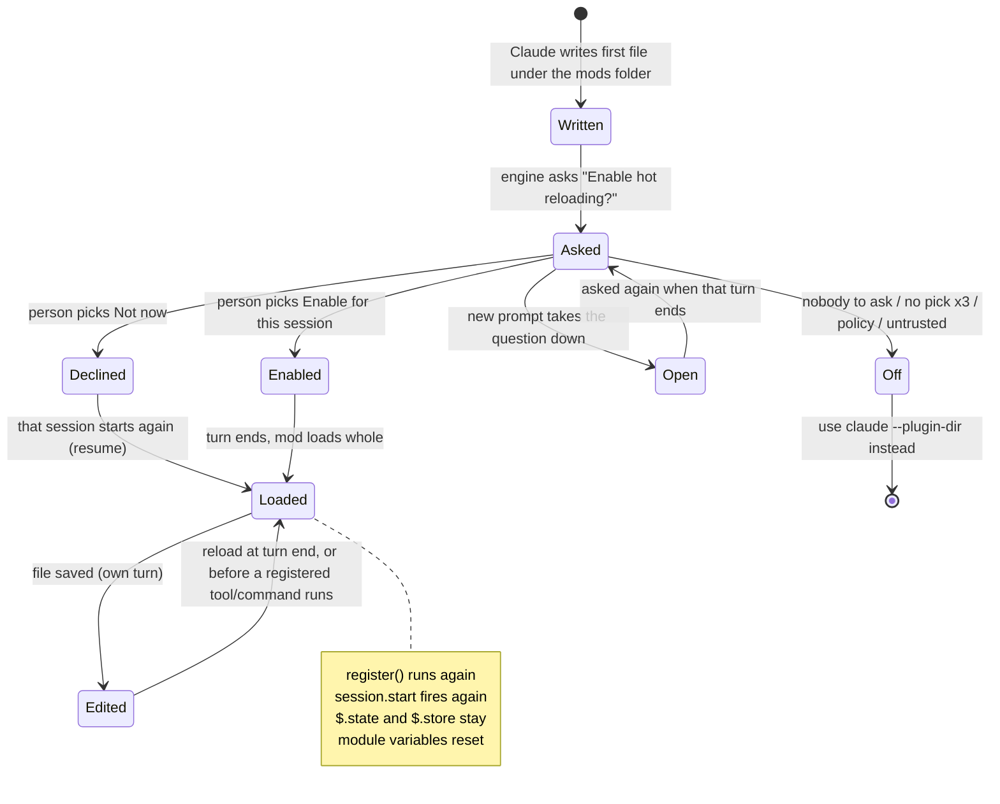

# Develop a mod

How to lay out a mod, type it, load it into a session, and what a reload does. Pinned to the Claude Code 2.1.295 snapshot, with a checked delta for 2.1.302 ([changes](../reference/changes-2.1.302.md)). Text marked *2.1.302* was run there. Grades: *verified-kit* = seen in `validate` or `test`; *verified-live* = seen in an interactive session; *types-only*; *inference*.

Link keys: `[types]` = [claude-code.d.ts](../sources/claude-code-2.1.295/types/claude-code.d.ts), `[ref]` = [reference.md](../sources/claude-code-2.1.295/reference.md), `[skill]` = [SKILL.md](../sources/claude-code-2.1.295/SKILL.md). Public docs live in [`../sources/code-claude-com-2026-10-09/`](../sources/code-claude-com-2026-10-09/).

## File layout

```text
<mod>/
├── .claude-plugin/plugin.json      required: the manifest
├── hooks/
│   ├── hooks.json                  required: { "modules": ["./register.tsx"] }
│   └── register.tsx                required: exports register(on, options)
├── types/index.d.ts                only with $.state values or a new $ noun
├── agents/*.md                     optional: agent types the mod ships
├── tests/*.test.ts                 optional: run by `claude plugin test`
└── (assets)                        optional: files the mod plays or reads
```

| File | Rule | Source |
| --- | --- | --- |
| `.claude-plugin/plugin.json` | Mods add no required field. `name` is the only required key. | [docs: reference](../sources/code-claude-com-2026-10-09/mods/reference.md#L21), [docs: manifest](../sources/code-claude-com-2026-10-09/plugins/manifest-reference.md#L120) |
| `hooks/hooks.json` | `modules` holds **one** path, relative to this file. This key makes the plugin a mod. It may also hold classic settings hooks under `hooks`. | [skill:9](../sources/claude-code-2.1.295/SKILL.md#L9), [docs: reference](../sources/code-claude-com-2026-10-09/mods/reference.md#L22) |
| hooks module | `export const register: Register = (on, options) => { ... }`. Type `Register` is `(on: On, options: PluginOptions) => unknown`. | [types:9301](../sources/claude-code-2.1.295/types/claude-code.d.ts#L9301) |
| `types/index.d.ts` | Needed when the mod keeps `$.state` values or adds a noun to `$`. Name it in `plugin.json` as `"types": "./types/index.d.ts"`. `validate` holds every `$.state` key the module names to it. | [skill:11](../sources/claude-code-2.1.295/SKILL.md#L11), [ref:66](../sources/claude-code-2.1.295/reference.md#L66) |
| `agents/*.md` | Declare agent types, named `<plugin>:<name>`. | [ref:215](../sources/claude-code-2.1.295/reference.md#L215) |
| `*.test.ts`, `*.test.tsx` | Found anywhere under the mod folder. | [cli-help](../sources/claude-code-2.1.295/cli-help.txt) (`plugin test`) |

Module rules ([ref:14](../sources/claude-code-2.1.295/reference.md#L14), [types:19-24](../sources/claude-code-2.1.295/types/claude-code.d.ts#L19)):

- Allowed suffixes: `.ts` `.tsx` `.jsx` `.js` `.mjs` `.cjs` `.mts` `.cts`. Another suffix is not loaded.
- Every file is an ES module, whatever its suffix. There is no `require`.
- Import plugin files with an `import` declaration. A module with `import()` does not load.
- The only bare import is `claude-code` (types and a few helpers; empty at run time). Import only plugin files by relative path, and stay inside the plugin folder (see [Sibling folders](#sibling-folders-beside-hooks)).
- No DOM and no Node. Everything outside reaches the module through `$`. JSX compiles against the global `h`.
- `claude plugin init` makes a **different** plugin (command hooks under `~/.claude/skills`). It does not make a mod. ([ref:9](../sources/claude-code-2.1.295/reference.md#L9))

### Sibling folders beside `hooks/`

*(2.1.302, *verified-kit*, and the same load in a headless `claude -p --plugin-dir` run.)*

`hooks/register.ts` may import runtime code from a folder beside `hooks/`, inside the plugin folder:

```text
<mod>/
├── hooks/
│   ├── hooks.json          { "modules": ["./register.ts"] }
│   └── register.ts         import { installCore } from '../core/install'
├── core/                   managers, ports, a tracker registry
│   ├── install.ts          calls on('tool.call', { tool: 'Bash' }, …)
│   └── x.ts
└── trackers/
```

- `validate` follows the import. It printed `./register.ts hooks: tool.call{tool=Bash}, tool.call{tool=Read}` and `calls: $.session.id` for hooks registered in `core/install.ts`, and ended `✔ Validation passed`. The kit test `register.ts imports ../core/*.ts (outside hooks/)` passed. `tsc` exited 0 once `include` listed the new folder.
- A file in `core/` may receive `on` and register hooks. The rules for `on` and `$` are in [ports-and-injection](../concepts/ports-and-injection.md).
- The module `hooks.json` names is a path relative to `hooks.json`, so `register.ts` stays beside it. Nobody tried a `modules` path that climbs out of `hooks/`.
- An import that **leaves the plugin folder** is refused by `validate` and by the loader. *verified-kit:*

  ```text
  plug: cannot import "../../shared/x" (from hooks/register.ts): it is outside the plugin's folder
  HooksError: plug: hooks module did not load: cannot import "../../shared/x" …
  ```

- Add each new folder to `include` in the tsconfig (`"core/**/*.ts"`).
- A zip or `git archive` of the plugin folder carries every file, so `core/` ships. This repo's `make dist` archives `HEAD:plugins/artifact-tracking` with no whitelist ([Makefile:160](../../../../Makefile#L160)).
- *verified-live:* a save of a file in `core/` reloads the mod, exactly like a save of `hooks/register.tsx`. The same holds for a file that `core/` imports and for `trackers/a.ts`. A file that nothing imports does not reload it. Watching follows the import graph. See [lifecycle: what triggers a reload](../concepts/lifecycle.md#what-triggers-a-reload). [reference.md:73](../sources/claude-code-2.1.302/reference.md#L73) adds that a save which leaves a loaded file unchanged reloads nothing.

### plugin.json fields that matter to a mod

| Field | Use |
| --- | --- |
| `name` | Plugin id. kebab-case. `validate` fails a name that looks like an Anthropic name, such as a `claude-` prefix. Never rename a published plugin. ([docs: create](../sources/code-claude-com-2026-10-09/mods/create.md#L369), [docs: publish](../sources/code-claude-com-2026-10-09/plugins/publish.md#L180)) |
| `version` | Pins the installed version. Users stay on it until you change it. See [share-and-admin](share-and-admin.md#versions-caching-and-updates). |
| `description`, `author` | Metadata. `validate` warns when `author` is missing. *(observed, 2.1.295)* |
| `types` | Path to the contract `.d.ts` ([manifest](../sources/code-claude-com-2026-10-09/plugins/manifest-reference.md#L146)). |
| `dependencies` | Plugins this mod needs. The engine lays each one's contract into `.claude-plugin/types/<plugin>/index.d.ts`. ([ref:66](../sources/claude-code-2.1.295/reference.md#L66)) |
| `userConfig` | Declares the fields that arrive as `options` in `register`. Strict object: an unknown key inside a field fails the load. ([manifest:423](../sources/code-claude-com-2026-10-09/plugins/manifest-reference.md#L423)) |

`userConfig` field keys: `type` (`string` `number` `boolean` `directory` `file`), `title`, `description` (all required), then `required`, `default`, `options`, `multiple`, `sensitive`, `min`, `max`. ([manifest:431-441](../sources/code-claude-com-2026-10-09/plugins/manifest-reference.md#L431))

`options` makes a `string` field a picker in `/config`:

```json
"userConfig": {
  "tone": { "type": "string", "title": "Tone", "description": "Voice",
            "options": ["neutral", "warm", "formal"], "default": "neutral" }
}
```

- Each label is 1 to 64 characters. `default` must be one of them (or set `required: true`). Not allowed with `multiple` or `sensitive`. A plugin that breaks this fails to load. Needs Claude Code 2.1.271 or later. ([manifest:463-473](../sources/code-claude-com-2026-10-09/plugins/manifest-reference.md#L463))
- A stored value outside `options` counts as unset, so the default applies. ([types:7650](../sources/claude-code-2.1.295/types/claude-code.d.ts#L7650))
- Real example: `agents-md` declares `instructionFiles` with four `options`. (`github: anthropics/claude-code@e47cc82 mods/agents-md/.claude-plugin/plugin.json`)

### Where option values live: `pluginConfigs`

- Non-secret values are stored in settings under `pluginConfigs[<plugin>].options`. Sensitive ones go to secure storage. ([types:7650](../sources/claude-code-2.1.295/types/claude-code.d.ts#L7650))
- A `--plugin-dir` plugin uses its `plugin.json` `name`, or `<name>@inline`, as key. ([ref:74](../sources/claude-code-2.1.295/reference.md#L74))
- Each non-secret field is also a row in `/config`. A change there reloads the module with the new `options`. ([ref:74](../sources/claude-code-2.1.295/reference.md#L74))
- `options` are fixed for one activation. A change reloads the plugin and `register` runs again. ([types:9294](../sources/claude-code-2.1.295/types/claude-code.d.ts#L9294))
- A value that fails its declared type, or a required field with no value, fails the load. The debug line reads `options do not fit plugin.json userConfig`. ([docs: troubleshoot](../sources/code-claude-com-2026-10-09/mods/troubleshoot.md#L93))

## Types and tsconfig

The engine writes the types. No command exists for it. ([skill:17](../sources/claude-code-2.1.295/SKILL.md#L17))

| When | Where the types are |
| --- | --- |
| Before the mod has loaded | `<SKILL_DIR>/types/claude-code.d.ts`, written when the `plugin-authoring` skill loads. Snapshot: [claude-code.d.ts](../sources/claude-code-2.1.295/types/claude-code.d.ts). |
| After the engine loads the mod from a folder it hot-reloads (dev-mods, `--plugin-dir`, `CLAUDE_CODE_PLUGIN_DIRS`) | `<mod>/.claude-plugin/types/`, rewritten at every load and reload |
| Installed plugin, or `claude -p`, or an SDK host | Never written. Type-check with the header's tsconfig, kept **outside** the mod folder. |

What `.claude-plugin/types/` holds ([ref:44-49](../sources/claude-code-2.1.295/reference.md#L44), [docs: create](../sources/code-claude-com-2026-10-09/mods/create.md#L274)):

| Path | Declares |
| --- | --- |
| `claude-code/index.d.ts` | Every event, `$` noun and method, element, and `claude-code/testing` |
| `claude-code-tools/index.d.ts` | Built-in tool inputs, so `e.tool === 'Bash'` narrows `e` |
| `claude-code-mcp/index.d.ts` | MCP tools connected when the mod last reloaded. A restart never refreshes it; saving the mod does. |
| `<plugin>/index.d.ts` | The contract of each plugin in `dependencies` |
| `tsconfig.json` | Options that fit a hooks module |

A mod with no `tsconfig.json` of its own gets one that extends `.claude-plugin/types/tsconfig.json`. Then `tsc -p <mod>` works with no setup. ([types:85-90](../sources/claude-code-2.1.295/types/claude-code.d.ts#L85))

The header's `tsconfig.json` ([types:67-80](../sources/claude-code-2.1.295/types/claude-code.d.ts#L67)); TypeScript 5.4 or newer reads the file:

```json
{
  "compilerOptions": {
    "target": "es2023", "lib": ["es2023"], "types": [],
    "module": "esnext", "moduleResolution": "bundler",
    "strict": true, "noUncheckedIndexedAccess": true,
    "noEmit": true, "skipLibCheck": true,
    "jsx": "react", "jsxFactory": "h", "jsxFragmentFactory": "Fragment"
  },
  "include": [".claude-plugin/types", "hooks", "types", "tests"]
}
```

- `lib` names no DOM on purpose. The DOM `Text` type would shadow the `Text` element. ([types:85-87](../sources/claude-code-2.1.295/types/claude-code.d.ts#L85))
- *Observed:* `claude plugin validate`, `claude plugin test` and a headless `claude -p "..." --plugin-dir <mod>` run did **not** create `.claude-plugin/types/` (checked on a clean mod folder). Consistent with [ref:50-53](../sources/claude-code-2.1.295/reference.md#L50). An interactive session load was not run here, so "the engine lays the types" is cited, not observed.
- *2.1.302:* this repo's `plugins/artifact-tracking/tsconfig.json` lists the 2.1.295 snapshot file in `include`. The 2.1.302 file type-checks the spike mods too (`tsc` 7.0.2, exit 0; [spikes-2026-10-17](../sources/spikes-2026-10-17/README.md)). Move the path when the pin moves. See [validate-test-debug](validate-test-debug.md#2-tsc--p).
- *Observed:* with the d.ts copied by hand to `.claude-plugin/types/claude-code/index.d.ts` and the tsconfig above, `tsc -p .` (TypeScript 5.6) passed on the bundled `tool-call.ts` example. For a mod outside a hot-reloaded folder, point `include` at the d.ts and the mod's `hooks`.

## Ways to load a mod

| Way | Command or setting | Reload on save | Writes `.claude-plugin/types/` |
| --- | --- | --- | --- |
| Session mods folder (dev-mods) | `plugin-authoring` skill, then write files | Yes, after the person enables hot reloading | Yes |
| `--plugin-dir` | `claude --plugin-dir <dir>` (repeatable) | Yes, in an interactive session | Yes |
| `CLAUDE_CODE_PLUGIN_DIRS` | env var | Same as `--plugin-dir`; interactive sessions watch | Yes (watched sessions) |
| `CLAUDE_CODE_PLUGIN_DIR_WATCH=1` | env var | Makes a long-lived headless session (SDK, desktop) watch too | n/a |
| Skills folder | save under `~/.claude/skills/<name>` (config-dir path: *inference*) or `.claude/skills/<name>` | Yes (watched) | Yes |
| Folder marketplace | `claude plugin marketplace add <folder>`, then `/reload-plugins` | No; run `/reload-plugins` | No |
| Installed copy | `/plugin install` | No; new version, then update and `/reload-plugins` | No |

Sources: [ref:72-76](../sources/claude-code-2.1.295/reference.md#L72), [docs: cli-reference](../sources/code-claude-com-2026-10-09/plugins/cli-reference.md#L877), [docs: loading](../sources/code-claude-com-2026-10-09/plugins/loading.md#L47).

### 1. Session mods folder (dev-mods)

The `plugin-authoring` skill tells Claude to write each mod in `<MODS_DIR>/<mod-name>/`.

- Public docs: `~/.claude/dev-mods/<session-id>/`. ([docs: create:28](../sources/code-claude-com-2026-10-09/mods/create.md#L28))
- This machine uses `CLAUDE_CONFIG_DIR=~/.claude-personal`. The SKILL.md snapshot header records `~/.claude-personal/dev-mods/<session-id>`. ([skill:5](../sources/claude-code-2.1.295/SKILL.md#L5)) Observed on 2026-10-09: the live skill text named `/Users/<user>/.claude-personal/dev-mods/<session-id>/` as this session's mods folder. The snapshot replaced it with `<MODS_DIR>`. So the folder follows the config directory, not a fixed `~/.claude`.
- Loading the skill (Skill tool or `/plugin-authoring`) starts the engine's watch on the folder. ([skill:19](../sources/claude-code-2.1.295/SKILL.md#L19))
- The first file written under it raises one question, once, while the turn goes on: **"Enable hot reloading for this session?"** Options: `How does this work?`, `Enable for this session`, `Not now`.
- **Only the person answers.** No permission mode, rule or hook answers it. An agent must not try to. ([skill:19](../sources/claude-code-2.1.295/SKILL.md#L19))
- The answer reaches Claude as a notice at the start of the next turn:

| Outcome | Meaning |
| --- | --- |
| enabled | The folder joins the session's plugin folders. The mod loads when the turn ends. The notice says what the load came to. |
| declined | The mods are written. They load the next time **that session** starts (a resume). The person can ask for the question again. |
| still open | A new prompt took the question down. The engine asks again when that turn ends. |
| off | Nobody could be asked (`claude -p`), the question got no pick three times, organization policy, or an untrusted workspace. Use `claude --plugin-dir <mod>`. |

- An enabled folder loads again by itself after a process restart. ([skill:19](../sources/claude-code-2.1.295/SKILL.md#L19))
- Writes under `~/.claude` (or a `--plugin-dir` folder) are protected paths. In `default` and `acceptEdits` modes each file write prompts. ([docs: create:31,264](../sources/code-claude-com-2026-10-09/mods/create.md#L31))
- The folder is deleted once older than `cleanupPeriodDays`. Copy a keeper out. ([docs: create:55](../sources/code-claude-com-2026-10-09/mods/create.md#L55))
- No load at all when: nobody can approve (`-p`, `dontAsk`), the workspace is untrusted, or `--safe-mode`, `--bare`, `disableAllHooks`, or managed policy blocks it. ([docs: create:64-68](../sources/code-claude-com-2026-10-09/mods/create.md#L64))



Source for the states: [skill:19-21](../sources/claude-code-2.1.295/SKILL.md#L19), [docs: create:35-42](../sources/code-claude-com-2026-10-09/mods/create.md#L35).

### 2. `claude --plugin-dir`

- `claude --plugin-dir ./mod` loads the folder for one session. It also takes a `.zip`, and a folder of plugins loads each child that has a `.claude-plugin/plugin.json`. ([docs: cli-reference:877](../sources/code-claude-com-2026-10-09/plugins/cli-reference.md#L877))
- Id is `<name>@inline`. A same-named installed plugin is skipped for the session. ([docs: cli-reference:882](../sources/code-claude-com-2026-10-09/plugins/cli-reference.md#L882))
- Use it to change an existing mod with Claude: start the session with the flag, so the edits reload in the same session. ([docs: create:258](../sources/code-claude-com-2026-10-09/mods/create.md#L256))
- Rejected when managed `disableSideloadFlags` is on. See [share-and-admin](share-and-admin.md#admin-managed-settings).

### 3. `CLAUDE_CODE_PLUGIN_DIRS` and `CLAUDE_CODE_PLUGIN_DIR_WATCH`

- For hosts where no flag can be given (desktop app, SDK host). One or more absolute paths (`~` allowed), each loaded as `--plugin-dir`. ([ref:72](../sources/claude-code-2.1.295/reference.md#L72))
- Separator: `:`, or `;` on Windows. ([docs: reference](../sources/code-claude-com-2026-10-09/mods/reference.md#L302))
- May be set in the process environment or in the `env` block of `~/.claude/settings.json`. **Never** in a project's settings. ([ref:72](../sources/claude-code-2.1.295/reference.md#L72)) *Inference:* with a custom config dir, that file is `$CLAUDE_CONFIG_DIR/settings.json`. No source says so.
- Interactive sessions watch the folders. A long-lived headless session (SDK, desktop) watches only with `CLAUDE_CODE_PLUGIN_DIR_WATCH=1`. Its reload lines reach the host as `ui_log` messages and the debug log. A plain `claude -p` always loads fresh. ([ref:73](../sources/claude-code-2.1.295/reference.md#L73))

### 4. Skills folder

A plugin folder with `.claude-plugin/plugin.json` saved under `~/.claude/skills/<name>` or `<project>/.claude/skills/<name>` loads as `<name>@skills-dir` and is watched. ([ref:72](../sources/claude-code-2.1.295/reference.md#L72), [docs: loading:47](../sources/code-claude-com-2026-10-09/plugins/loading.md#L47))

- Project scope loads only from the primary working directory's `.claude/skills/`, after the trust prompt.
- A mod Claude writes in a session loads under an allowlist only when the allowlist includes `skills-dir`. ([docs: admin:95](../sources/code-claude-com-2026-10-09/mods/admin.md#L95))

### 5. Folder marketplace and installed copies

- A marketplace that is a **folder**, with a relative-path entry (`"source": "./mods/tally"`), is read from that folder, not from the install copy. Edit it, then run `/reload-plugins`. No new version, no reinstall. `claude plugin list` shows `Read from:`. ([ref:76](../sources/claude-code-2.1.295/reference.md#L76))
- Every other installed plugin runs the copy made at install (git, npm, archive, remote marketplace). An edit reaches a session only as a new version or commit, through `claude plugin update`, then `/reload-plugins`. ([ref:76](../sources/claude-code-2.1.295/reference.md#L76))
- Installed plugins are cached by version. Develop against the directory with `--plugin-dir`, not an installed copy. ([docs: create:371](../sources/code-claude-com-2026-10-09/mods/create.md#L371))

## Reload semantics

| Question | Answer | Source |
| --- | --- | --- |
| What does a reload do? | Fresh load of the module. `register` runs again in a fresh environment. Timers of the old environment are dropped. | [skill:21](../sources/claude-code-2.1.295/SKILL.md#L21), [ref:73](../sources/claude-code-2.1.295/reference.md#L73) |
| Does `session.start` fire again? | Yes. In 2.1.302 it came 0.46 to 0.73 s after the save (three reloads, *verified-live*), with `{ cwd, surface, isInteractive }` and the same session id. | [skill:21](../sources/claude-code-2.1.295/SKILL.md#L21), [lifecycle](../concepts/lifecycle.md#hot-reload) |
| Does anything reach the old copy before it goes? | **No.** No `session.end`, `ui.close` or `plugin.register`, and with a catch-all hook no event of any kind (four reloads, *verified-live*). A pending `$.clock.after` never fires. There is no teardown event, so write through. | [lifecycle](../concepts/lifecycle.md#hot-reload) |
| Which saves reload? | A save of any file in the module's import graph, in `hooks/` or in a sibling folder such as `core/` or `trackers/` (0.5 to 0.65 s to the new `session.start`). A file that nothing imports does not. *verified-live*, 2.1.302. | [lifecycle](../concepts/lifecycle.md#what-triggers-a-reload) |
| Does a save with identical text reload? | **No.** A save that leaves a loaded file with the text it was loaded from reloads nothing. After a failed reload any new save tries again. New in 2.1.302. *verified-live* with `cp`. | [ref:73 (2.1.302)](../sources/claude-code-2.1.302/reference.md#L73) |
| What happens to an open pane? | It stays open. The new copy draws it. No `ui.close` fires. Reattach with `$.ui.panes()`. *verified-live* | [lifecycle](../concepts/lifecycle.md#hot-reload) |
| What survives? | `$.state` (session) and `$.store` (across sessions). | [skill:21](../sources/claude-code-2.1.295/SKILL.md#L21), [types:3378](../sources/claude-code-2.1.295/types/claude-code.d.ts#L3378) |
| What resets? | The module's own variables. | [skill:21](../sources/claude-code-2.1.295/SKILL.md#L21) |
| When do saves by the model reload? | Once, when the turn ends. Sooner when a tool or command the plugin registered is about to run, so the turn can try what it wrote. | [ref:73](../sources/claude-code-2.1.295/reference.md#L73) |
| When do saves from elsewhere reload? | Once the folder has been quiet: a lone save within 0.25 s, a run of saves seconds apart once the run stops. | [ref:73](../sources/claude-code-2.1.295/reference.md#L73) |
| Does a `$.prompt.submit` / `$.command.run` / `$.agent.spawn` in `session.start` run twice after a reload or worker loss? | No. With the same input it resolves to the first call's result (2.1.292 and later). | [ref:162](../sources/claude-code-2.1.295/reference.md#L162), [docs: troubleshoot](../sources/code-claude-com-2026-10-09/mods/troubleshoot.md#L136) |
| Where do failure lines appear? | Hot-reloaded folder: one dim transcript line. Other interactive session: debug log (`claude --debug`). `claude -p` text mode: stderr. | [ref:79](../sources/claude-code-2.1.295/reference.md#L79), [docs: troubleshoot](../sources/code-claude-com-2026-10-09/mods/troubleshoot.md#L15) |

Practical rules:

- Keep drawn state in `$.state`, not in module variables. A hot reload loses variables. ([ref:118](../sources/claude-code-2.1.295/reference.md#L118))
- Do not park work in a `$.clock` timer across a reload. The new copy drops it. Write through, or flush in `session.end`. ([lifecycle](../concepts/lifecycle.md))
- Make `session.start` idempotent: it runs again on every reload.
- Start long work in `session.start` with `$.clock.every` / `$.clock.after`. Timers run until cancelled or until reload. ([ref:157-161](../sources/claude-code-2.1.295/reference.md#L157))
- Example: the public tutorial mod `first-mod` resets its `calls` counter to `0` on each reload, because `calls` is a module variable. ([docs: create:250](../sources/code-claude-com-2026-10-09/mods/create.md#L250))

## Typical loop

1. Scaffold the three files. Run `claude plugin validate <mod>`.
2. Load it: `claude --plugin-dir <mod>` (or the dev-mods folder).
3. Edit. The mod reloads at turn end or after the save settles.
4. Type-check with `tsc -p <mod>`. Test with `claude plugin test <mod>`.

Details: [validate-test-debug](validate-test-debug.md).

## See also

- [validate-test-debug](validate-test-debug.md): the check loop
- [share-and-admin](share-and-admin.md): marketplace file, install line, admin controls
- [../examples/README.md](../examples/README.md): complete mods to copy from
- [../reference/testing-kit.md](../reference/testing-kit.md), [../reference/limits-and-diagnostics.md](../reference/limits-and-diagnostics.md)
- [../concepts/state-and-storage.md](../concepts/state-and-storage.md): `$.state` and `$.store`
- [../concepts/lifecycle.md](../concepts/lifecycle.md): start, reload, `/clear`, `session.end`
- [../concepts/ports-and-injection.md](../concepts/ports-and-injection.md): hand `on` and `$` to other files
