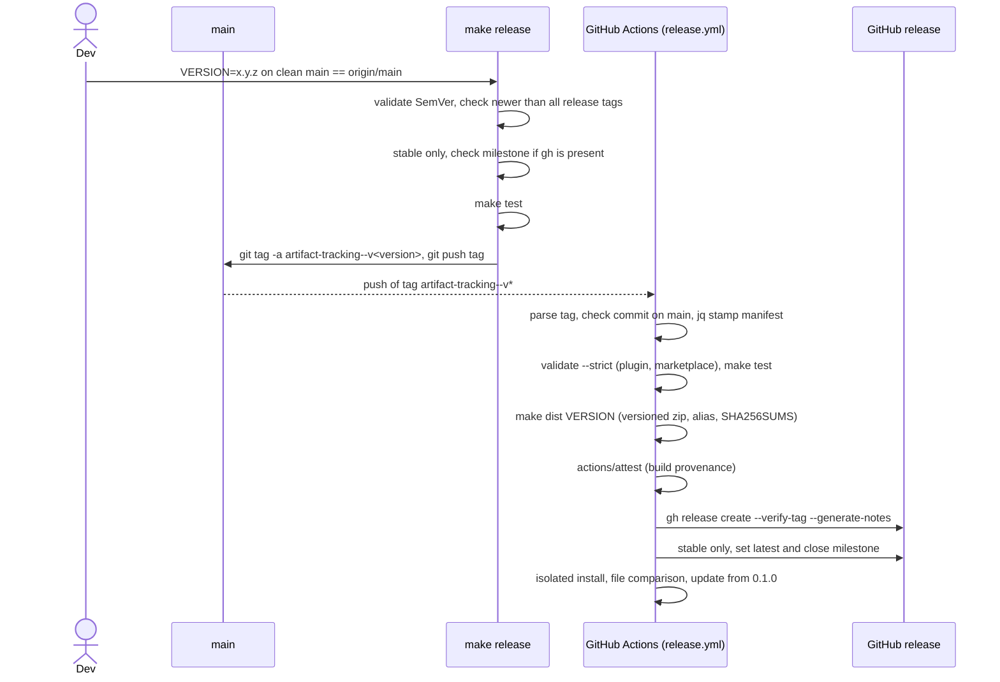

# Release a mod

How to cut a versioned release of a mod: a git tag, a GitHub release, and a zip artifact. Pinned to Claude Code 2.1.295 (types) and 2.1.296 (CLI runs). Claims come from the public docs snapshot of 2026-10-09 unless marked *observed* or *inference*. For marketplaces, scopes and admin, see [share-and-admin.md](share-and-admin.md).

## What Claude Code gives you

Claude Code has no release command and no registry upload. A "release" is made of three parts:

| Part | What it does | Source |
| --- | --- | --- |
| `version` in `plugin.json` | Detects updates. Users get a new copy only when the computed version changes. | [loading:268-295](../sources/code-claude-com-2026-10-09/plugins/loading.md#L268) |
| Tag `<name>--v<version>` | Names a release in git. Dependency ranges of other plugins resolve against these tags. | [dependencies:134-166](../sources/code-claude-com-2026-10-09/plugins/dependencies.md#L134) |
| A `.zip` of the plugin folder | Loads for one session with `--plugin-dir <zip>` or `--plugin-url <url>`. A marketplace `archive` entry installs it. | [cli-reference:877-878](../sources/code-claude-com-2026-10-09/plugins/cli-reference.md#L877), [marketplace-reference:260](../sources/code-claude-com-2026-10-09/plugins/marketplace-reference.md#L260) |

The docs say a tag is needed only when other plugins declare a version range on yours. ([publish:174-178](../sources/code-claude-com-2026-10-09/plugins/publish.md#L174)) A tag per release still gives a fixed point for a GitHub release and its assets. *(inference)*

## The version rules

- Version resolution, for every source type but `command`: manifest `version`, then marketplace-entry `version`, then a value from the source (12-char commit SHA for git sources and for a relative path in a git-hosted marketplace; 12-char SHA-256 for `archive`). ([loading:282-295](../sources/code-claude-com-2026-10-09/plugins/loading.md#L282))
- Choose one: bump `version` on each release, or omit it so users track commits. ([publish:43-44](../sources/code-claude-com-2026-10-09/plugins/publish.md#L43), [host-marketplace:184-195](../sources/code-claude-com-2026-10-09/plugins/host-marketplace.md#L184))
- Do not set `version` in both `plugin.json` and the marketplace entry. The manifest wins without a warning at load. `validate` reports `Entry declares version "<a>" but <path>/plugin.json says "<b>"`. ([host-marketplace:195](../sources/code-claude-com-2026-10-09/plugins/host-marketplace.md#L195))
- With a pinned `version` and a relative-path entry on the default branch, a **fresh** install copies the branch head under the last version string. Commits after the last bump reach new installs but not existing ones. *(inference from the resolution order)* To hold users on released code, use a `git-subdir` entry with `ref` set to a tag, or let users add `<owner>/<repo>#<tag>`. A relative-path entry has no `ref`. ([host-marketplace:197-203](../sources/code-claude-com-2026-10-09/plugins/host-marketplace.md#L197))
- For two release lines (stable, early access), host two marketplaces with different `name`s whose entries point at different refs. Claude Code has no channel concept. ([host-marketplace:218-246](../sources/code-claude-com-2026-10-09/plugins/host-marketplace.md#L218))

## `claude plugin tag`

```text
claude plugin tag [path] [--push] [--dry-run] [-f|--force] [-m <msg>] [--remote <name>]
```

- Creates an **annotated** tag `<name>--v<version>`. The message defaults to `<name> <version>`; `%s` in `-m` stands for the version. ([cli-reference:524-545](../sources/code-claude-com-2026-10-09/plugins/cli-reference.md#L524))
- Finds the marketplace entry by walking up from `[path]` to a `.claude-plugin/marketplace.json` that lists the plugin.
- Checks before tagging: validates the plugin; `plugin.json` and the marketplace entry agree on the version; the working tree under the plugin folder is clean; the tag does not exist. `--force` skips the last two. ([dependencies:153-158](../sources/code-claude-com-2026-10-09/plugins/dependencies.md#L153), [cli-reference:560-564](../sources/code-claude-com-2026-10-09/plugins/cli-reference.md#L560))
- If the push fails, the tag stays local and the command exits 1.
- In a session: `/plugin tag [path] [--push] [--dry-run] [--force]`. ([cli-reference:824](../sources/code-claude-com-2026-10-09/plugins/cli-reference.md#L824))
- A plain `git tag <name>--v<version>` also works. Then you keep the versions in sync yourself. ([dependencies:166](../sources/code-claude-com-2026-10-09/plugins/dependencies.md#L166))

*Observed* (2.1.296, plugin under `plugins/artifact-tracking`, marketplace at the repo root):

```text
Plugin:  artifact-tracking
Version: 0.1.0 (from plugin.json)
Tag:     artifact-tracking--v0.1.0

✔ Dry run — would create tag artifact-tracking--v0.1.0 at HEAD in <repo>
  git -C <repo> tag -a artifact-tracking--v0.1.0 -m "artifact-tracking 0.1.0"
  git -C <repo> push origin refs/tags/artifact-tracking--v0.1.0
```

## The zip artifact

- `--plugin-dir` takes a folder or a `.zip`. `--plugin-url` fetches a `.zip` from a URL. Both extract into a session temp folder and load the plugin as `<name>@inline`. ([cli-reference:877-878](../sources/code-claude-com-2026-10-09/plugins/cli-reference.md#L877), [loading:184](../sources/code-claude-com-2026-10-09/plugins/loading.md#L184))
- The publish docs name the case: attach a `.zip` to a release and let people start with `--plugin-url`. ([publish:72](../sources/code-claude-com-2026-10-09/plugins/publish.md#L72))
- *Observed:* a zip with one top folder (`git archive --format=zip --prefix=<name>/ HEAD:<plugin dir>`) loads. `claude --plugin-dir <zip> plugin list` shows `artifact-tracking@inline`, `Version: 0.1.0`, `Status: ✔ loaded`. A zip without the top folder was not tried.
- *Observed:* `claude plugin validate <file>.zip` fails with `json: Invalid JSON syntax: JSON Parse error: Unexpected identifier "PK"`. Validate the folder, not the zip.
- A marketplace `archive` entry takes `url` and `sha256` (64 hex chars). With `sha256`, Claude Code refuses a changed download. Needs 2.1.224 or later. ([marketplace-reference:144,260-275](../sources/code-claude-com-2026-10-09/plugins/marketplace-reference.md#L260))
- Download limits for an `archive` zip: 256 MiB, 120 s, at most five `https://` redirects. Headers are dropped on a cross-origin redirect. ([host-marketplace:47-63](../sources/code-claude-com-2026-10-09/plugins/host-marketplace.md#L47)) A GitHub release asset URL redirects to another origin. So a private repo's asset cannot be fetched with a header. *(inference)*

## The pipeline in this repo

Tag first. A person sets the version in `make release VERSION=x.y.z`. CI reads the tag and stamps the manifest. The source manifest is a development value; it does not select the release version.



| Piece | File |
| --- | --- |
| Marketplace `mod-tracking`, path entry until the guarded archive cutover | `.claude-plugin/marketplace.json` |
| `dist`, `release`, `release-dry`, `marketplace-release` targets | `Makefile` |
| SemVer, guards, stamping, publication and smoke checks | `scripts/release/` |
| Release workflow | `.github/workflows/release.yml` |
| Steps for people | `plugins/artifact-tracking/README.md`, section "Release" |

Decisions:

- **Tag format** `<name>--v<version>`. It is the Claude Code convention, and it lets one repo hold several plugins.
- **Version authority:** only the tag. CI stamps `plugin.json` before validate, test and dist. A later change to the manifest on `main`, including issue 55's 0.2.0 bump, cannot alter a published archive.
- **Guards:** `make release VERSION=x.y.z` requires clean `main` equal to fetched `origin/main`, valid SemVer and a version newer than every release tag. `release-dry` applies the same guards without testing, tagging or pushing. Numeric prerelease identifiers compare numerically; build metadata does not affect precedence.
- **Milestones:** stable releases refuse open issues in `artifact-tracking <version>` when `gh` is present. Pre-releases and machines without `gh` skip this check. Missing milestones do not block; API failures do. After stable publication CI closes the matching milestone with `issues: write`.
- **The workflow re-checks the tag.** It parses SemVer, checks main ancestry and requires a version newer than every other release tag before building. It refreshes remote tags and repeats these checks at publication. The incoming tag is excluded from comparison with itself; equal precedence with different build metadata is still refused. It does not require the tagged manifest to match the tag.
- **CI checks milestones again.** Immediately before stable publication, the milestone must have no open issues. Closure also checks for newly open blockers. API failures stop either operation. Pre-releases skip these milestone calls. A failed or empty latest-release lookup stops the workflow before publication.
- **The zip uses `git archive` from the tagged tree.** Only the manifest version changes in a temporary staging folder. Ignored, untracked and other edited files never enter it. `artifact-tracking-<version>.zip` and `artifact-tracking.zip` are identical. `SHA256SUMS` covers both. The source tree stays unchanged by `make dist VERSION=x.y.z`.
- **Stable versus pre-release:** `x.y.z-*` publishes with `--prerelease --latest=false`; stable versions publish with `--latest`. Build metadata with a hyphen does not make a version a pre-release. Publication jobs are serialized.
- **Marketplace rollout:** keep the relative path until a stable release contains the alias asset. Then run `make marketplace-release`, validate and submit that diff in a PR. The command checks release metadata before replacing the source with an `archive` at `https://github.com/martin-macak/claude-code-mod-tracking/releases/latest/download/artifact-tracking.zip`. No `sha256` is pinned because the URL moves on stable releases. `latest` is repo-wide, which assumes this repo ships one plugin.
- **Post-release smoke:** download and verify both archives; install through a marketplace in a temporary `CLAUDE_CONFIG_DIR`; compare the manifest, registered version and every file. Install the real 0.1.0 tag with its path entry, change that catalog to archive, run marketplace refresh and `claude plugin update`, and compare again. Before cutover, smoke uses a temporary archive catalog and reports that the public cutover is pending. An RC checks its own archive and that `latest` is unchanged; stable checks wait if the old release lacks an alias.
- **Dependency cost:** the tagged manifest keeps the development version. Tag-based dependency range resolution against the source tree is no longer supported. Consumers that need it must be checked before rollout; no consumer audit has been recorded.
- **Release notes** come from GitHub's generator, which lists the merged PRs. PR titles are Conventional Commits, so the notes read as a changelog. The start point is the previous tag of the same plugin.
- **Provenance:** `actions/attest@v4` signs the zip. It needs `id-token: write`, `attestations: write` and `artifact-metadata: write`. Check with `gh attestation verify <zip> --repo <owner>/<repo>`. Public repos only on Free, Pro and Team plans (actions/attest README).

## Recorded checks and rollout status

*Observed on 2026-10-18 with Claude Code 2.1.302:* `claude --plugin-url https://github.com/martin-macak/claude-code-mod-tracking/releases/download/artifact-tracking--v0.1.0/artifact-tracking-0.1.0.zip plugin list --json` loaded `artifact-tracking@inline` at 0.1.0. This settles open question 20: the GitHub asset URL works through its redirect.

Open question 21 is obsolete for this pipeline. It no longer calls `claude plugin tag --push`; it creates an annotated tag with Git. The existing published 0.1.0 release shows that a release tag has reached GitHub. A push from the new pipeline still needs live release evidence.

*Observed in the same probe:* archive installs add a root `.in_use` cache marker. Smoke compares a snapshot without that CLI-owned marker; it still detects missing, extra or changed plugin files.

At implementation time, the latest 0.1.0 release has no unversioned asset. The marketplace therefore still uses its path entry. Publishing 0.2.0-rc.1, the first stable alias, the cutover PR and a live update to that release remain rollout checks. Shell tests cover parser, local guards, milestone requests, stamping, zip content and publication flags; they do not prove a GitHub publication or public marketplace migration.

## See also

- [share-and-admin.md](share-and-admin.md): marketplaces, the install line, scopes, auto-update
- [validate-test-debug.md](validate-test-debug.md): `validate --strict` and `plugin test`
- [../open-questions.md](../open-questions.md): items 20 and 21
