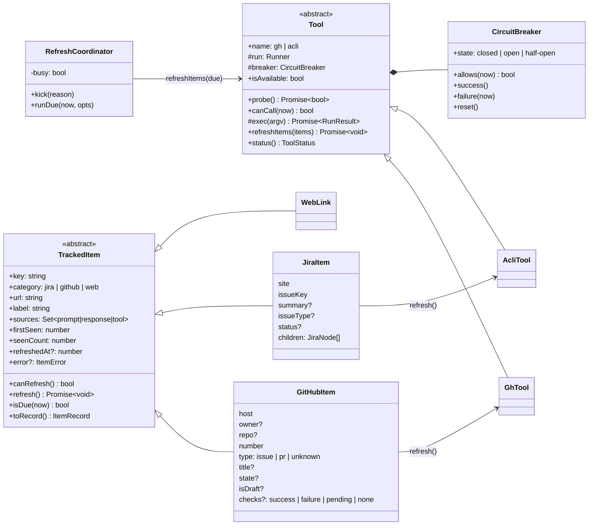
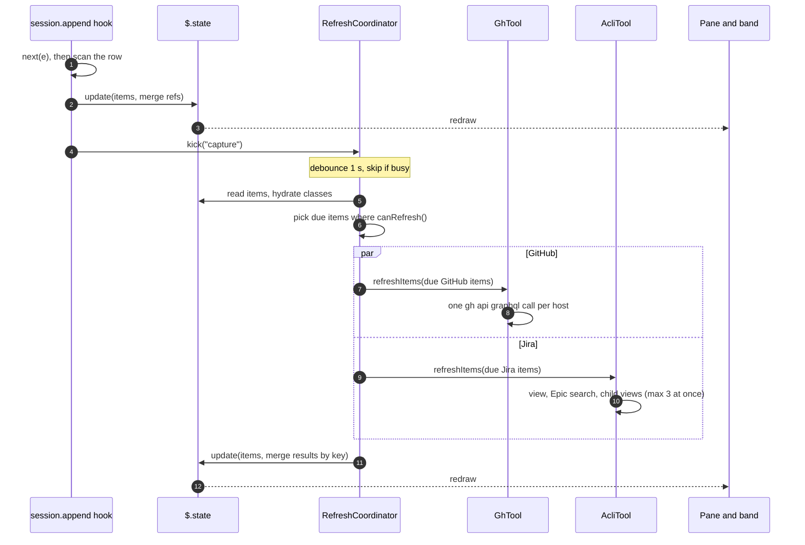
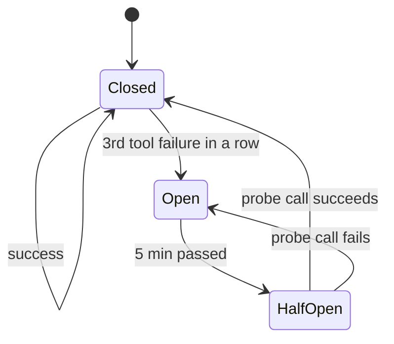

# Artifact tracking mod: design

Status: approved 2026-10-10. Branch: `feat/artifact-tracking`.

## 1. Goal

A Claude Code mod tracks the artifacts that the person or Claude mentions in a session:

- GitHub issues and pull requests,
- Jira work items,
- web links.

It shows them in a pane as a tree table, one section per category. The pane is both a session index and a live status board. Optional CLI tools enrich each item: `gh` for GitHub and `acli` for Jira.

Research and evidence: [knowledge base `claude-code-artifact-tracking`](../../knowledge-base/claude-code-artifact-tracking/README.md). Mod basics: [`claude-code-mods`](../../knowledge-base/claude-code-mods/README.md). Capture basics: [`claude-code-link-capture`](../../knowledge-base/claude-code-link-capture/README.md).

## 2. Versions

| Thing | Version |
| --- | --- |
| Claude Code | 2.1.295 and 2.1.296 (mod API is early access) |
| gh | 2.102.0 |
| acli | 1.3.19-stable (design target; 1.3.39 exists, not probed) |

## 3. Decisions

| # | Topic | Decision |
| --- | --- | --- |
| D1 | Rows that count as "mentioned" | Prompt and response rows: all patterns. Tool-result rows: explicit GitHub issue/PR URLs and Jira URLs only. |
| D2 | Bare `#N` | Match outside code and URLs with `(?<![\w/&#])#(\d{1,7})\b`. |
| D3 | Prompt origins | `composer`, `bridge`, `sdk`, `unclassified`; never `isMeta`; never with `agentId`. |
| D4 | Hook for the person's text | `session.append` door `prompt`, plus door `command` with origin `composer` (`<command-args>`). |
| D5 | Bare `#N` with no repo | Keep as unresolved. Try `gh repo view --json nameWithOwner` once per session. |
| D6 | Web link name | Markdown label, else host + path. No network. |
| D7 | Refresh triggers | Capture (debounced 1 s), pane open, `/track refresh`, and a 30 s tick while the pane is open. Stale after 5 min; 60 s for a PR with pending checks. The tick part is superseded by [auto-tracking A1](2026-10-10-auto-tracking-design.md): the tick runs from `session.start`. |
| D8 | Circuit breaker | Per tool. 3 tool failures in a row open it for 5 min. Then one half-open probe call. |
| D9 | Pane | `/track` opens it. A one-line band above the prompt shows counts. |
| D10 | Persistence | Items survive `/clear`. `--resume` restores from `$.store` and the transcript. |
| D11 | Location | `plugins/artifact-tracking/` |
| D12 | Scanner | Copy the link-capture `links.ts` and its tests, with an origin note. |
| D13 | Jira on a non-active acli site | Track-only. Never run `acli jira auth switch`. |
| D14 | Jira on a non-Cloud host | Track-only. |
| D15 | GitHub Enterprise | Refresh when `gh auth status --hostname <host>` exits 0. |
| D16 | acli version | Design on 1.3.19. Record the version. Parse defensively. |
| D17 | Jira tree depth | Epic → children → subtasks. |
| D18 | Other github.com URLs | Web links. |
| D19 | Refresh architecture | Batched through `Tool.refreshItems(items)`. `TrackedItem.refresh()` calls the same path with one item. |

## 4. Components

```text
plugins/artifact-tracking/
├── .claude-plugin/plugin.json
├── types/index.d.ts              PluginState contract: items, tools, ui
├── hooks/
│   ├── hooks.json                { "modules": ["./register.tsx"] }
│   ├── register.tsx              hooks, commands, timers, state, store, render. Only file that uses $.
│   ├── contracts.ts              shared types: Runner, RunResult, ItemRecord, Ref, ToolStatus, ...
│   ├── scan/
│   │   ├── links.ts              copied from link-capture
│   │   └── refs.ts               text → Ref[]
│   ├── model/
│   │   ├── tracked-item.ts       abstract TrackedItem
│   │   ├── github-item.ts        GitHubItem
│   │   ├── jira-item.ts          JiraItem
│   │   ├── web-link.ts           WebLink
│   │   └── registry.ts           merge, dedupe, caps, record conversion
│   ├── tools/
│   │   ├── tool.ts               abstract Tool
│   │   ├── circuit-breaker.ts    CircuitBreaker
│   │   ├── gh-tool.ts            GhTool
│   │   └── acli-tool.ts          AcliTool
│   ├── refresh/coordinator.ts    RefreshCoordinator
│   └── ui/
│       ├── pane.tsx              tree table
│       └── band.tsx              counts line
└── tests/                        pure unit tests, kit tests, fixtures
```

Rule: only `register.tsx` touches `$`. `claude plugin validate` refuses `$` passed to a function, method or class. It accepts a closure such as `(argv, init) => $.process.run(argv, init)`. So every class gets plain injected functions (a `Runner`, a `now()` clock). Unit tests need no engine.

## 5. Class model



- `Runner = (argv: readonly string[], init?: { timeoutMs?: number; cwd?: string }) => Promise<RunResult>`. It rejects when the command cannot start or times out. A non-zero exit resolves.
- `canRefresh()` is synchronous. It reads the cached probe and the breaker.
  - GitHub also needs a resolved owner/repo and an authed host.
  - Jira needs the item's site to equal acli's active site, and a valid key.
  - `WebLink.canRefresh()` is always false.
- `Tool.probe()` runs `<tool> --version` once per module load and caches the promise. Callers do not await it in `session.start`, because acli takes about 0.6 s. "Not probed yet" reads as not available.
- `TrackedItem.refresh()` calls `tool.refreshItems([this])`. The coordinator calls `tool.refreshItems(dueItems)`. `refreshItems` mutates the given items in place.
- Items persist as plain `ItemRecord` objects in `$.state`. Classes are rebuilt from records for each operation. Results merge back by key with compare-and-set (`update`), so a refresh never drops a capture that happened during it.

## 6. Capture

All capture hooks only observe. Each hook calls `next(e)` first, scans the stored row, and returns the stored row unchanged. Each hook has a `try/catch` and a `.catch(($, e, next) => next(e))`. There is one hook per matcher.

| Row | Filter | Extracted |
| --- | --- | --- |
| `session.append` door `prompt` | D3 origins, no `isMeta`, no `agentId` | All patterns |
| door `command` | origin `composer` only. Our own `/track` output has origin `engine` and is skipped. | All patterns, from `<command-args>…</command-args>` |
| door `response` | main loop and subagents | All patterns |
| door `tool-result` | any tool | Explicit GitHub issue/PR URLs and Jira URLs only |
| `session.start` | after `--resume` / `--continue` | Backfill from `$.session.messages()` with the same rules (user role = prompt rules, assistant = response rules, tool uses = tool rules) |

### 6.1 Reference classification (`scan/refs.ts`)

`refs.ts` first runs the link-capture `scanMarkdown` to get links and to blank code and URLs. Then it finds bare and qualified `#N` in the masked text.

| Text | Ref |
| --- | --- |
| `https://<host>/o/r/issues/N`, `/pull/N`, `/pull/N/files`, `/pull/N/checks`, with `#issuecomment-…` | `github`, host, owner, repo, number, type from the path |
| `o/r#N` | `github`, host `github.com`, type unknown |
| bare `#N` (D2) | `github`, unresolved repo. Resolved later from `$.session.repo().remote`, else from one `gh repo view` per session. |
| `https://<site>.atlassian.net/browse/KEY-1` and URLs with `selectedIssue=KEY-1` | `jira`, site, key |
| `/browse/KEY-1` on another host | `jira`, track-only (D14) |
| other github.com URLs, any other http(s) URL | `web`. Label is the Markdown label, else host + path. |

A host counts as GitHub when it is `github.com` or a host that `gh auth status --hostname` accepted. A GHE issue URL on an unknown host is treated as a web link until `gh` knows the host. `#issuecomment-` and query strings are dropped from the key.

### 6.2 Keys and dedupe

| Category | Key |
| --- | --- |
| github | `gh:<host>/<owner>/<repo>#<n>`; unresolved: `gh:?#<n>` |
| jira | `jira:<site>/<KEY>` |
| web | `web:<normalized url>` (lower-case scheme and host, no fragment) |

A repeat adds its source to `sources` and raises `seenCount`. An unresolved `#N` is re-keyed when the repo becomes known. Caps: 500 items in `$.state` (oldest unseen first out); 20 sessions in `$.store`.

## 7. Refresh



### 7.1 Triggers and due rule

- Capture: `kick('capture')`, debounced 1 s. It refreshes new items only.
- `/track` (pane open): refreshes all due items.
- `/track refresh`: clears `not-logged-in` and `not-found` marks, moves open breakers to half-open, and refreshes all refreshable items.
- Tick: `$.clock.every(30_000)` while the pane is open. It has a re-entry guard, because `every` callbacks overlap. It reads the items from `$.state` each time, because timers survive `/clear`. It is cancelled when the pane closes.
- Due: never refreshed, or older than 5 min, or older than 60 s for a PR with `checks: pending`. An item with `error.kind === 'not-found'` is not due until a manual refresh.

### 7.2 GitHub (`GhTool`)

- One `gh api graphql -f query=<q>` per host (`--hostname <host>` for GHE). It has one alias per item, grouped by repo, and requests `rateLimit { cost remaining }`.
- Per item: `__typename`, `number`, `title`, `state`, `stateReason`, `url`. For a PR, also `isDraft`, `reviewDecision`, and `commits(last:1){nodes{commit{statusCheckRollup{state}}}}`.
- stdout is parsed as JSON on every exit code. Each alias error with `NOT_FOUND` marks that item `not-found`.
- Rollup state maps to `checks`:
  - `SUCCESS` → success
  - `FAILURE`, `ERROR` → failure
  - `PENDING`, `EXPECTED` → pending
  - null → none
- `defaultRepo()`: `gh repo view --json nameWithOwner`, at most once per session.
- `isHostAuthed(host)`: `gh auth status --hostname <host>`. Exit 0 means authed. The result is cached per host.

### 7.3 Jira (`AcliTool`)

- `activeSite()`: `acli jira auth status`. It reads the `Site:` line. It runs on first use and again when the breaker leaves `open`. An unauthenticated result sets `not-logged-in`.
- `view(key)`: `acli jira workitem view KEY --fields issuetype,status,summary,parent,subtasks --json`. The subtasks carry type and status.
- If `issuetype` is Epic: `acli jira workitem search --jql "parent = KEY" --fields issuetype,status,summary --limit 50 --json`. Then one `view` per child gives its subtasks. At most 3 acli calls run at once.
- The key must match `^[A-Z][A-Z0-9_]+-\d+$` before any call.

## 8. Errors and circuit breaker



| Outcome | Breaker | Effect |
| --- | --- | --- |
| Runner rejects (ENOENT, timeout) | failure | tool error shown |
| gh exit 4; acli `auth status` unauthorized | failure | tool `not-logged-in`; no calls until `/track refresh` |
| HTTP 401, `error connecting`, network text | failure | |
| gh `Could not resolve to an issue or pull request` / alias `NOT_FOUND` | not counted | item `not-found` |
| gh `Could not resolve to a Repository` | not counted | item `not-found` (repo) |
| acli `does not exist or you do not have permission` | not counted | item `not-found` |
| Batch exit 1 with valid JSON | success | per-alias data applied |
| Unparsable output | failure | |

- Breaker counters are module variables. A hot reload resets them. A copy goes to `$.state.tools` for display.
- A hook never throws to the engine. Every scan and state write is wrapped. Timer callbacks catch everything.

## 9. UI

### 9.1 Pane

`/track` opens the pane with `{ id: 'track', title: 'Tracking', focus: true, closeOnEscape: true }`. If `isPlaced` is false, a toast says to widen the terminal.

```text
Jira work items  acli · <site> · refreshed 1m ago
[-] ISS-101    Onboarding revamp            Epic     In Progress
    [-] ISS-102 Welcome email flow          Story    In Progress
        ISS-103 Template copy             Sub-task Done
    [+] ISS-110 Profile wizard              Bug      To Do
    ISS-200    Billing export (other site)  ·        track-only

GitHub  gh · refreshed 20s ago
    #14640     Fix pager on Windows         PR       open  ✗ checks
    #14622     Crash on empty config        Issue    open
    #3         unresolved: no repo

Web links
    Mods overview                    code.claude.com/docs/en/plugins/mods
```

- Each row is a `Box` with fixed-width cells: key, title (`Text wrap="truncate-end"`), type, status, extra. Widths come from `e.props.bodyColumns`.
- Keys and web-link labels are `Link` elements.
- A Jira row with children has a fold `Button` (`[-]` / `[+]`). Fold state is in `$.state.ui.folded`, so a press redraws by itself.
- A section header shows the tool state: `not installed`, `not logged in`, `paused 4m` (breaker open), or the refresh age.
- A GitHub key shows `#N` for the session repo and `o/r#N` otherwise. Status colours: open green, merged or closed dim; checks failure red, pending yellow.
- The footer shows `r refresh` (button hotkey `r` runs a refresh) and `Esc close`.

### 9.2 Band

The band is one line on `AbovePrompt`: `tracking  Jira 6 · GitHub 4 (1 ✗) · Links 2   /track`. The `(n ✗)` counts PRs with failing checks. It draws nothing when there are no items.

### 9.3 Commands

| Command | Action |
| --- | --- |
| `/track` | Open the pane, then refresh due items. |
| `/track refresh` | Manual refresh (section 7.1). |
| `/track clear` | Remove all items of this session and its store entry. |

Commands are registered in `session.start` (`argumentHint: '[refresh|clear]'`). The command text output is a short plain list, so it also works in `claude -p`.

## 10. State and persistence

- `$.state` atoms (`types/index.d.ts`):
  - `items: ItemRecord[]`
  - `tools: { gh: ToolStatus; acli: ToolStatus }`
  - `ui: { folded: string[]; paneOpen: boolean }`
- `$.store` mirror: key `s:<sessionId>` holds the records. Key `index` holds the newest 20 session ids. Writes are debounced 1.5 s, once per burst. Only extracted fields are stored, never raw CLI output. An empty list never overwrites a stored one.
- `/clear` gives a new session id. The next hook or tick sees the change and copies the previous session's items into the new state (D10).
- `--resume`: restore `s:<id>` if present, then backfill from the transcript. Restored items are due.

## 11. Testing

The work is test-driven. Commands run from `plugins/artifact-tracking/`.

| Layer | How |
| --- | --- |
| Scanner and refs | Pure tests. The 32 copied link tests, plus `#N` cases: `#fff`, `# 1` heading, code spans, `a/b#12`, `src/a.ts#12` file anchor, `&#123;`, `rank #1` (accepted, documented). |
| Items and registry | Pure. Dedupe, source merge, caps, record round-trip, `isDue`, re-key of unresolved `#N`. |
| Tools | Fake `Runner` with fixtures copied from the KB `sources/gh-2.102.0` and `sources/acli-1.3.19`: batch with a missing alias (exit 1 + JSON), exit 4, ENOENT reject, Epic tree, acli permission text, unparsable output. |
| Breaker, coordinator | Fake clock. 3 failures → open → 5 min → half-open → closed or open. Re-entry guard. Due picking. Concurrency limit 3. |
| Wiring | `claude plugin test` kit with `process.run`, `session.repo`, `session.id`, `command.register`, `ui.open`, `mock.clock` and `mock.store` stubs. Rows → `/track` text. `/clear` carry-over. Pane mount and fold press. Band mount. |
| Gates | `claude plugin validate .`, `tsc -p .` (tsconfig as in link-capture), `claude plugin test .`, then one live `claude --plugin-dir plugins/artifact-tracking` smoke run. |

Open points to settle in tests: gh exit 8 for pending checks, the `issueType` shape, and the batch cost with check rollups ([KB open-questions](../../knowledge-base/claude-code-artifact-tracking/open-questions.md)).

## 12. Out of scope

- Fetching web page titles.
- Switching acli sites.
- Jira hierarchy above Epic.
- Click capture.
- Desktop, VS Code and mobile surfaces beyond what the shared elements give for free.
- Write actions on GitHub or Jira.
