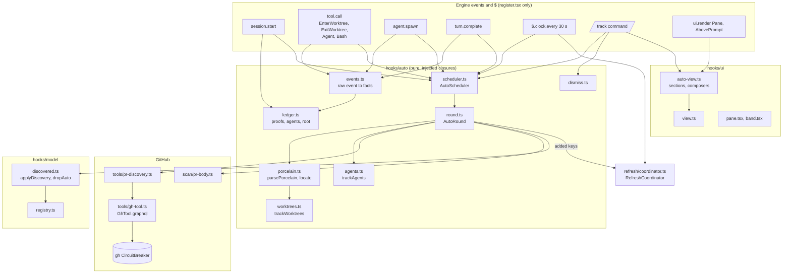
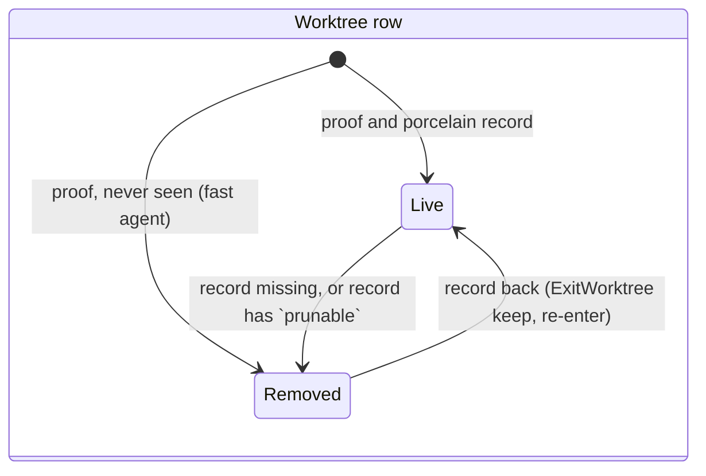
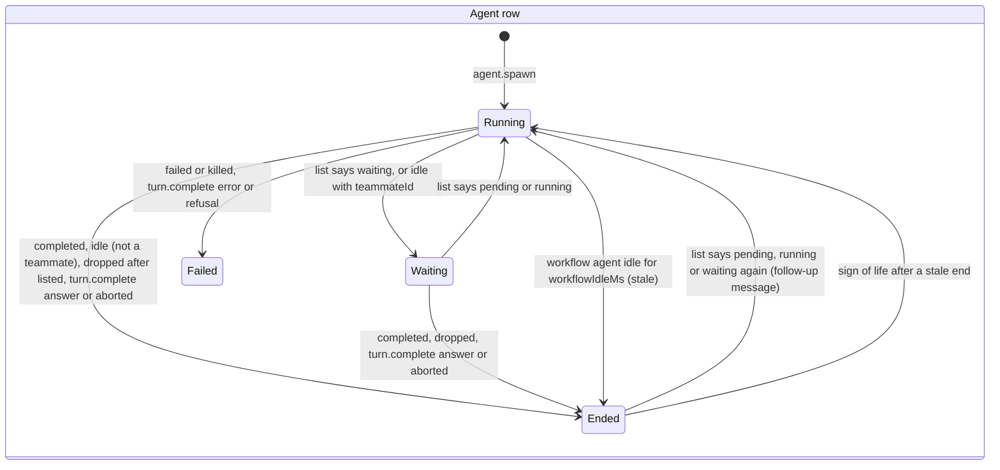
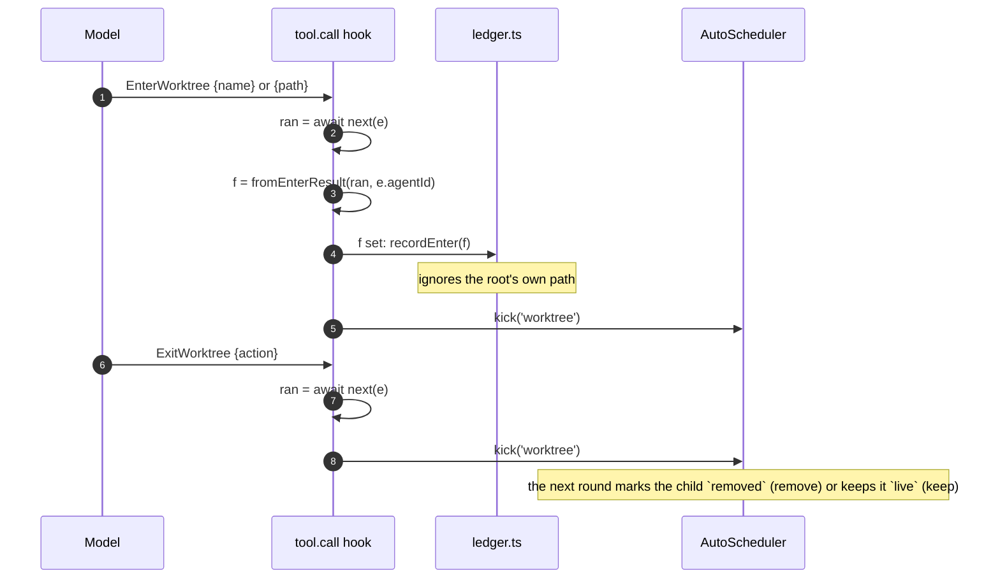
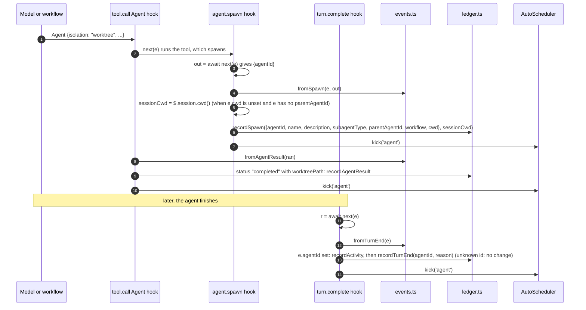
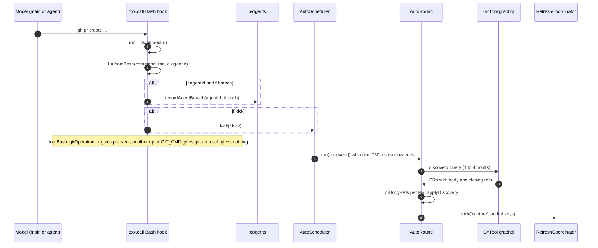
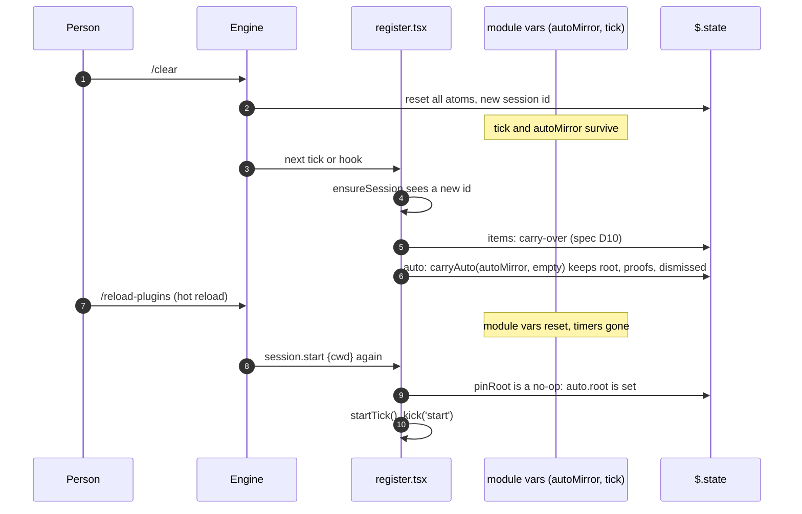

# Auto tracking: design

Status: draft 2026-10-10, revised after the second review. Branch: `feat/auto-tracking`. Issue: [#5](https://github.com/martin-macak/claude-code-mod-tracking/issues/5). Builds on the [artifact-tracking design](2026-10-10-artifact-tracking-design.md) ("the base spec").

## 1. Goal

The `/track` pane shows only what the conversation mentions. Auto tracking adds the work around the session, without a mention:

- **Worktrees** that this session or its agents made, under a pinned root.
- **Agents** of this session: the main loop, its subagents and its workflow agents, each with branch and worktree.
- **Pull requests** whose head or base is a tracked branch, and the references inside each PR body.

It starts with the session. It polls every 30 s, also with the pane closed. Engine events make it update sooner. The band shows counts.

### 1.1 Non-goals

- Peer sessions in other processes (`$.store` presence, `ListAgents`, `claude agents --json`). Rejected in issue #5.
- Parent links from git ancestry, reflog or merge-base. Rejected in issue #5.
- `classic.*` hooks of any kind. A managed machine bypasses them.
- A file watcher process for `.git/worktrees` (KB N6).
- Recursive scans: a PR found inside a PR body is not scanned.
- Write actions on GitHub, git or worktrees.
- Fold buttons in the new sections beyond the root and master rows.

### 1.2 Sources

- Requirement and decisions: [issue #5](https://github.com/martin-macak/claude-code-mod-tracking/issues/5). It is authoritative.
- Research: [knowledge base `claude-code-auto-tracking`](../../knowledge-base/claude-code-auto-tracking/README.md), in short "KB". Its matrix is [feasibility.md](../../knowledge-base/claude-code-auto-tracking/feasibility.md).
- Mod API: [`claude-code.d.ts` 2.1.295](../../knowledge-base/claude-code-mods/sources/claude-code-2.1.295/types/claude-code.d.ts), cited as `d.ts:N`. Testing kit: [testing-kit.md](../../knowledge-base/claude-code-mods/reference/testing-kit.md).

## 2. Versions

| Thing | Version |
| --- | --- |
| Claude Code | 2.1.295 (types) and 2.1.296 (probes) |
| git | 2.56.0 |
| gh | 2.102.0 |

## 3. Terms

| Term | Meaning |
| --- | --- |
| Run | The life of the mod in one Claude Code process, from the first `session.start`. A `/clear`, `/resume` or `/branch` keeps the run. A hot reload keeps the run. A new process starts a new run. "Session" in issue #5 means the run. |
| Root | The git toplevel of the cwd at the start of the run. Pinned. Never changes in the run. |
| Main tree | The first record of `git worktree list --porcelain`. Claude makes every worktree under `<main tree>/.claude/worktrees/`. |
| Proof | A record, made from an event of this run, that this run made a worktree. Only proven worktrees show as children. |
| Auto item | A tracked item that discovery added: a PR on a tracked branch (`Source` `auto`) or a ref in a PR body (`Source` `pr-body`). |
| Auto-only | An auto item with no conversation source (`prompt`, `response`, `tool`). |
| `via` | The keys of the discovered PRs whose body named an item. |
| Round | One discovery pass: worktrees, then agents, then PRs. |
| Tracked branch | The branch of the root or of a proven child, live or removed, and not dismissed. |

## 4. Decisions

Numbering: `A1` and up are this spec. `spec Dn` is the base spec. `KB Dn` is a recommendation in [KB open-questions §4](../../knowledge-base/claude-code-auto-tracking/open-questions.md#4-decisions-for-the-user). Where issue #5 differs from a KB recommendation, the issue wins and the row says so.

| # | Topic | Decision | Why | Evidence |
| --- | --- | --- | --- | --- |
| A1 | Tick | One `$.clock.every(30 s)`, armed in `session.start`. It runs with the pane open or closed. `ui.close` no longer cancels it. `lastBeatAt = now` is set when the tick is armed and on each beat. Each beat runs a round and `coordinator.kick('tick')`. A watchdog re-arms it: every hook, kick, command and button press calls `ensureTick($)`, which cancels and re-arms the tick when `now - lastBeatAt > 2 × tickMs`. `now` and `lastBeatAt` both come from `$.clock.now()`, as the flush watchdog does today (`register.tsx:210-226`), so a mock clock moves them in the kit. So `ensureTick` is async. Render hooks do not call it: a render must not start timers or write. | "Auto tracking starts with the session." The band is the only consumer while the pane is closed. One refused period ends a `clock.every` for good ([d.ts:3458](../../knowledge-base/claude-code-mods/sources/claude-code-2.1.295/types/claude-code.d.ts#L3458)); the flush timer has the same watchdog today. **Supersedes spec D7.** | KB D1(a); [triggers §3, §4](../../knowledge-base/claude-code-auto-tracking/triggers-and-polling.md#4-the-always-on-tick-and-spec-d7); F1, F2; [d.ts:4325](../../knowledge-base/claude-code-mods/sources/claude-code-2.1.295/types/claude-code.d.ts#L4325) |
| A2 | Triggers | Polling is the baseline. Engine events only speed it up: `tool.call` for `EnterWorktree`, `ExitWorktree`, `Agent`, `Bash`; `agent.spawn`; `turn.complete` with `agentId`. No `classic.*` hook. No watcher. | No event exists for `git worktree add`, a branch change, or a PR opened elsewhere. A managed machine bypasses `classic.*`. | KB D7(a), D12(a); [triggers §1, §2](../../knowledge-base/claude-code-auto-tracking/triggers-and-polling.md#1-event-inventory); F3 to F7, F22 |
| A3 | Root | At the first `session.start` of the run, pin `e.cwd`. The first round resolves it to `git rev-parse --show-toplevel` once. A later `session.start` (reload) keeps the pinned root. | `EnterWorktree` moves the session cwd into the new worktree. A followed cwd would re-root the tree. The cwd can be a subfolder or a symlink path; porcelain lists toplevels. | KB D13(a); [events-run1](../../knowledge-base/claude-code-auto-tracking/sources/live-probe-2026-10-10/events-run1.jsonl); F9 |
| A4 | Proven children | A worktree is a child only with a proof from this run: (1) an `EnterWorktree` result path; (2) an `Agent` result `worktreePath`; (3) a porcelain path `agentWorktreePath(main, id)` = `<main>/.claude/worktrees/agent-<id>` where `<id>` is a recorded agent; (4) a porcelain path `<main>/.claude/worktrees/<runId>-<digits>` where `<runId>` is a recorded workflow run id (origin `workflow`, the run is the owner). Proof 4 needs no `n == agentIndex` assumption: the basename is the full recorded run id, a `-`, and digits only, so it cannot match another run. The join of such a worktree to one agent of the run waits for the T0 probe (A23). All children sit at depth 1 under the root. | Git has no parent link. Claude worktrees start from `origin/main`, so ancestry is wrong for them. Claude puts every worktree flat under the main tree. A workflow worktree path `.claude/worktrees/wf_a35565d1-fd4-21` is observed in a subagent `meta.json`; run ids start `wf_` and can hold `-`. **Overrides KB D2(a)** (issue #5). | [worktrees §2, §3, §4](../../knowledge-base/claude-code-auto-tracking/worktrees.md#3-git-records-no-parent); F10; R15 in KB open-questions; [session registry sample, item 6](../../knowledge-base/claude-code-auto-tracking/sources/claude-code-2.1.296/claude-session-registry-and-transcript-structure.txt); [d.ts:360](../../knowledge-base/claude-code-mods/sources/claude-code-2.1.295/types/claude-code.d.ts#L360) |
| A5 | Agent scope | This session only: the main loop, subagents (`agent.spawn` without `workflow`) and workflow agents (`agent.spawn` with `workflow`). An agent exists only through its `agent.spawn` record. A `$.agent.list()` entry with no record (a forked skill, [d.ts:3185](../../knowledge-base/claude-code-mods/sources/claude-code-2.1.295/types/claude-code.d.ts#L3185)) is ignored. | Peers need the mod in every process and a shared config dir. No supported parent link exists between processes. **Overrides KB D3(a)** (issue #5). | [agents §1 to §3](../../knowledge-base/claude-code-auto-tracking/agents-and-sessions.md#1-subagents-of-this-session); F13 to F17 |
| A6 | Agent location | First match wins: exact `Agent` result path; `agent-<id>` porcelain path; the worktree of a branch the agent committed or pushed; the worktree that holds the recorded spawn cwd; else the parent's location. The recorded spawn cwd is `agent.spawn.cwd` when set. Else it is fixed at spawn: `$.session.cwd()` for a child of the main loop (register reads it in the `agent.spawn` hook), or the parent's recorded spawn cwd for a nested child. | `$.agent.list()` has no cwd or branch. `cwd` undefined means the parent's cwd at spawn time, not later: a later `EnterWorktree` of the master must not move its earlier subagents. The branch step is the only location source for a workflow agent until the T0 probe joins a workflow worktree to its agent. The `<runId>-<agentIndex>` step and the expected-path step (which needs the `Agent` input's `isolation`) are deferred (A23). | [agents §1](../../knowledge-base/claude-code-auto-tracking/agents-and-sessions.md#worktree-and-branch-of-a-subagent); [d.ts:264](../../knowledge-base/claude-code-mods/sources/claude-code-2.1.295/types/claude-code.d.ts#L264), [d.ts:16006](../../knowledge-base/claude-code-mods/sources/claude-code-2.1.295/types/claude-code.d.ts#L16006); R11 in KB open-questions |
| A7 | Agent end | Status table (one table in `agents.ts`): `pending`, `running` → Running; `waiting`, or `idle` with `teammateId` → Waiting; `completed`, or `idle` without `teammateId` → Ended; `failed`, `killed` → Failed; dropped after it was listed → Ended. While the list holds a subagent, the list wins: a later `pending`, `running` or `waiting` clears `endedAt`. `turn.complete` with an `agentId` ends only an agent the list does not hold (a workflow agent, or a subagent already dropped): `reason` `error` or `refusal` → Failed; `answer` or `aborted` (the person interrupted) → Ended. A `turn.complete` with an unknown id is ignored. Idle bound for workflow agents: a workflow agent with no end and no sign of life for `LIMITS.workflowIdleMs` (60 min) → Ended, with `stale: true`. A sign of life is its spawn, or one of the mod's `tool.call` hooks (`EnterWorktree`, `ExitWorktree`, `Agent`, `Bash`, `Monitor`, `TaskStop`, `Write`, `Edit`, `Read`) or a `turn.complete` with its `agentId`; each sets `lastActiveAt` of a workflow agent. `recordActivity` returns `s` unchanged for a subagent (the list rules its end), and when `lastActiveAt` is less than a minute old, so a busy agent does not write `auto` on every command. A sign of life after a stale end clears `endedAt` and `stale`. | The list keeps a finished subagent as `idle` and later drops it. Workflow agents are never listed. A subagent that gets a follow-up message runs one more turn, so one `turn.complete` is not final for it. A workflow agent can miss its own `turn.complete`: `next` of `agent.spawn` settles with the first attempt's `agentId`, and a stalled agent's retry is not raised again ([d.ts:350](../../knowledge-base/claude-code-mods/sources/claude-code-2.1.295/types/claude-code.d.ts#L350)); a hot reload can skip the event too. No event marks a run's end: the `Workflow` tool result is `async_launched` at launch ([d.ts:21397](../../knowledge-base/claude-code-mods/sources/claude-code-2.1.295/types/claude-code.d.ts#L21397)), and `background_tasks` exists only on `classic.*` inputs. 60 min is long enough for an agent that only searches (`Grep` and `Glob` do not count as a sign of life). | C3 in KB open-questions; [d.ts:125](../../knowledge-base/claude-code-mods/sources/claude-code-2.1.295/types/claude-code.d.ts#L125), [d.ts:13307](../../knowledge-base/claude-code-mods/sources/claude-code-2.1.295/types/claude-code.d.ts#L13307), [d.ts:539](../../knowledge-base/claude-code-mods/sources/claude-code-2.1.295/types/claude-code.d.ts#L539) (`AgentStatus`), [d.ts:13330](../../knowledge-base/claude-code-mods/sources/claude-code-2.1.295/types/claude-code.d.ts#L13330) (`TurnCompleteReason`) |
| A8 | PR discovery | One aliased GraphQL query per PR step: per tracked branch one `headRefName` alias (open, merged, closed; first 5) and one `baseRefName` alias (open; first 10). Skip both aliases for the repo's default branch. Drop cross-repo head matches. Cap at 12 branches. It runs through `GhTool` and shares the gh breaker, but only auth and transport failures count against it (A21). GHE needs a known `gh auth status` yes. | 1 to 4 rate points per step. A base alias on `main` would list every PR of the repo. Same-named fork branches collide. **Overrides KB D6(a): stacked PRs are in** (issue #5). | KB D9(a), D15(b); [pull-requests §2](../../knowledge-base/claude-code-auto-tracking/pull-requests.md#2-polling-pull-requests-of-tracked-branches); F18; spec D15 |
| A9 | PR body scan | Strip HTML comments. Run `extractRefs` in mode `full` with the PR's repo as default. Add `closingIssuesReferences`. Drop the PR's own ref. One level only. At most 50 refs per body. **Amends spec D1** with a fourth row kind: PR body. | Template comments give false refs. `closingIssuesReferences` is exact. A deeper scan fans out across repos. | KB D5(a), D17(a); [pull-requests §3](../../knowledge-base/claude-code-auto-tracking/pull-requests.md#3-parsing-the-pr-summary); F19; R13 |
| A10 | Model boundary | Worktrees and agents are **not** `ItemRecord`s. They live in a new `$.state` atom `auto`. Discovered PRs and body refs are `ItemRecord`s with `Source` `auto` or `pr-body` and a `via` list. `Category`, `HydratedItem`, `Tools`, `Reason` and `SECTIONS` stay closed. | A worktree is not a reference: no URL key, no `seenCount`, no refresh, no persistence. This keeps R1 and R2 out of scope. | [feasibility risks R1 to R6](../../knowledge-base/claude-code-auto-tracking/feasibility.md#risks-for-the-design-stage); [worktrees §7](../../knowledge-base/claude-code-auto-tracking/worktrees.md#7-data-model-for-the-section) |
| A11 | Auto items in the list | Upsert never bumps `seenCount` or `lastSeen`. A new auto record has `seenCount` 0. A discovered PR gets its status fields from the discovery reply. Its `refreshedAt` moves to `at` only when a discovery field changed (section 8.4), or when it is older than `LIMITS.staleMs / 2` (2.5 min). So the coordinator does not fetch it again, and a quiet step changes no record. `applyDiscovery` returns the input `list` itself when nothing changed (A22). Cap: `enforceCap` counts only records without an auto source against `maxItems`, and evicts only those. Auto-only items have their own cap, `maxAutoItems` 100: `applyDiscovery` adds no new auto-only item past it (PRs first, in reply order, then body refs), and the Pull requests note says `+<k> not tracked`. A mentioned item that discovery also names is in neither count; it goes back into the `maxItems` count when prune removes its auto sources. So the list holds at most `maxItems + maxAutoItems + M`, where `M` is the mentioned items that a tracked PR also names. | `mergeRefs` would inflate counts on every poll. Today's `enforceCap` counts the whole list, so 100 auto items would push out 100 mentioned items at the 500 boundary. Without a cap, 12 branches × 15 PRs × 50 refs could add thousands of items, each refreshed and mirrored to the 4 MiB store. A cap at the source does not churn: an evicted item would come back on the next step. A `refreshedAt: at` on every step would write `items` every 30 s. The 2.5 min bump costs at most one item write per 2.5 min per quiet run, and keeps the PR out of the coordinator's 5 min refresh. | KB D8(a); [pull-requests §4](../../knowledge-base/claude-code-auto-tracking/pull-requests.md#4-adding-the-references-to-the-tracked-items); F20; R3 to R5 |
| A12 | Prune | Only after a complete PR step (data present, no alias error): drop source `auto` from a PR not in the result; cut `via` to the PRs that are in the result and whose current body still lists the ref (an edited body can remove a ref); drop `pr-body` when `via` is empty; delete a record with no source left. A mentioned item never goes; it loses only its auto sources. Restore: a list that `restore` reads from `$.store` loses every auto source (`dropAuto` over each key with an auto source). The first complete PR step of the run adds back what is still tracked. A `/clear` carry-over inside the run is not a restore and keeps them. | "Removed when the PR leaves the tracked set." A partial reply must not delete. A new process has no proofs, so a restored auto item may name a PR that is no longer on a tracked branch. If gh is missing, logged out or paused, no PR step completes, and such an item would stay for the whole run. A stripped item comes back within one tick when gh works. Issue #5 says body refs are persisted: this reads it as persisted with the item mirror inside the run (across `/clear` and reload). Across processes the tracked set starts from zero proofs, so the auto items are derived again too. | Issue #5 lifecycle |
| A13 | Lifecycle | Worktree and agent rows are recomputed each round from the proofs, git and `$.agent.list()`. They are never written to `$.store`. Proofs stay for the run, so a removed worktree or an ended agent stays as a dimmed row. Auto items persist with the item mirror, and lose their auto sources at a restore (A12). | Derived state goes stale. The store is 4 MiB, shared. | KB D11(a), D16(a); issue #5 |
| A14 | Dismiss | A run-wide list `auto.dismissed` of row ids and item keys. Each auto row in the pane has an `x` button. `/track clear` dismisses every current auto id, then clears as before. The query still returns a dismissed PR, but its body is not scanned and it adds no item; its auto-only refs go at the next complete step. A later mention of a dismissed item tracks it again. | Without it `/track clear` is undone 30 s later. One per-row path is enough; no `/track dismiss` argument. | KB D14(a); issue #5 |
| A15 | Source isolation | A round runs three steps. Each catches its own failure. A git failure sets a note and keeps the last worktree rows. A `$.agent.list()` failure keeps the last statuses. A gh failure feeds the shared gh breaker and never stops the other steps. Git has no breaker. The PR step runs in its own lane (A16), so a slow gh never holds back a worktree or agent update. | "A GitHub failure trips the existing circuit breaker and does not stop worktree or agent tracking." Git costs 7 ms and fails for stable reasons. | KB D9(a); spec D8; issue #5 |
| A16 | Scheduling | One round at a time. The first event kick arms a fixed 750 ms window; later kicks join it and do not reset it. Requests during a run queue as one. `tick` and `manual` run at once. The PR step runs on `start`, `tick`, `manual` and `pr-event`, or when the tracked branch set changed. PR lane: the round starts the PR step and does not wait for it. One PR step at a time; a request while one is in flight queues as one, and runs after it. A PR step polls the `branches` of the snapshot committed when it starts. `AutoRound.idle()` waits for the lane. The discovery call has its own timeout, `LIMITS.discoveryTimeoutMs` 10 s, not the 30 s `toolTimeoutMs`. `AutoScheduler` is its own class, built on the coordinator's timer pattern (`timerAt`, the overdue-timer replacement, `idle()`). | A workflow can spawn many agents at once. A fixed window cannot starve: a burst gives at most one round per 750 ms. Each PR step costs rate points. A hung gh with the 30 s timeout equals one tick; three of them in the round would hold every worktree and agent update for 90 s. 750 ms differs from the 1 s capture and 1.5 s flush delays, so kit tests can tell the timers apart. A shared `Debounced` helper would change the tested coordinator for about 20 lines, and the two queues merge different things (keys and `force` there, a reason set here). | [triggers §5](../../knowledge-base/claude-code-auto-tracking/triggers-and-polling.md#5-a-trigger-design); KB D15(b) |
| A17 | UI | Three new sections above the existing ones: Worktrees, Agents, Pull requests. A discovered PR shows only in Pull requests. A body ref shows in its own category section with a `↳#N` title prefix. Per-section column layouts fit 62 columns. Branch cells truncate in the middle. The band adds three counts. **Amends spec D9.** | One item, one place. 62 is the docked body at 140 columns. Claude branch names reach 32 characters. | KB D10(a); F21; R7; [d.ts:12580](../../knowledge-base/claude-code-mods/sources/claude-code-2.1.295/types/claude-code.d.ts#L12580) |
| A18 | Run carry-over | The `auto` atom is kept twice: in `$.state` (survives reload) and in a module variable (survives `/clear`). Every read and write merges the two: the `$.state` copy wins whenever it has a root; the module copy is used only when `$.state` has none (after `/clear`). **Amends spec D10.** | `/clear` resets `$.state` and keeps module variables. A reload does the opposite. `$.state` is the copy that `update` serializes, so it must win; the module copy can lag one write. | [triggers §3](../../knowledge-base/claude-code-auto-tracking/triggers-and-polling.md#3-timer-behaviour); gotchas 10, 11 |
| A20 | Round writes | A round reads `auto` once for its inputs, but never writes that copy back. Each write is a change function on the current value. The snapshot write re-runs `trackWorktrees` and `trackAgents` on the current value inside the change; the item write reads `dismissed` inside its change. | `update` reads, applies, writes with `ifVersion` and retries on a miss ([d.ts:14728](../../knowledge-base/claude-code-mods/sources/claude-code-2.1.295/types/claude-code.d.ts#L14728)). A round waits milliseconds on git and the agent list before its snapshot save, and its PR lane waits seconds on gh before its item write. A `recordSpawn`, an `x` press or a `/track clear` in that gap must not be lost or undone. Both units are pure and cost microseconds. | Review of this spec |
| A21 | GraphQL outcomes | `GhTool.graphql` returns a tagged outcome, not `null`. Only `auth` and transport failures (cannot start, timeout, non-JSON output that is not cut) count against the breaker. A query-level error (`errors` with no `data`) and a cut reply (`isStdoutTruncated`) record as `item-error` (breaker success), set the Pull requests note, and make the step incomplete. One classifier serves `graphql` and `refreshChunk`; refresh keeps its outcomes as today. `graphql` tells the kinds apart before it calls `exec`: `this.available` not true → `no-gh`; `this.breaker.peek(now)` false → `blocked` (nothing recorded). Then `exec(argv, { timeoutMs: LIMITS.discoveryTimeoutMs })`. A `null` from `exec` after `peek` said yes is a rejected run (cannot start, timeout), which `exec` recorded as `tool-failure`: `transport`. (A lost half-open slot also gives `null` there; it reads as `transport` too, which is harmless.) `available`, `breaker` and `exec` are `protected` in `Tool`, so `tool.ts` does not change. | A deterministic discovery failure (an older GHE that rejects `closingIssuesReferences`, a reply over 4 MiB) must not pause item refresh every 5 min. `$.process.run` keeps only the first 4 MiB of stdout ([d.ts:3510](../../knowledge-base/claude-code-mods/sources/claude-code-2.1.295/types/claude-code.d.ts#L3510)). | `gh-tool.ts:141-146`, `tool.ts:96-100` |
| A22 | Quiet ticks | A quiet tick writes nothing: no `auto` write, no `items` write, no `$.store` write. Rule for the units: a change that changes nothing returns its input object (`===`). The units keep unchanged entries as the same object. The snapshot is compared without `at` and `prs.at`. Rule for the write wrappers: `setAuto` and `applyItems` read the atom, run the change once, and call `update` only when the result is not the input; `update` then runs the change again on the current value. `flush` skips `store.set` (both `s:<id>` and `index`) when the list's JSON equals the last copy it wrote for that session id (a module variable). The time of the last round lives in a module variable `lastRoundAt`, passed to the view as `ViewContext.autoCheckedAt`. After a reload it falls back to `snapshot.at`. | A write per tick re-renders the band and the pane every 30 s for nothing. `update` does not promise to skip a write when the change returns its input, so the wrappers skip it themselves, as `publishTools` compares first (`register.tsx:91-97`). A writer that lands between the read and the skipped write runs its own `update` and kicks its own round, so nothing is lost. The always-on tick ends in the coordinator's `onRun`, which calls `schedule` and `flush` every 30 s; before this feature that ran only with the pane open. | `register.tsx:80-105`, `register.tsx:211-239`; `coordinator.ts:160-166` |
| A23 | Deferred until the T0 probe | Not in v1 until the T0 probe (section 15) observes them: the join of a workflow worktree to one agent (`<n> == agentIndex`) and the A6 step that reads it, `PendingCalls` and `AgentProof.isolation`, and the A6 expected-path step. The `gone` row state folds into `removed`, since both draw dimmed. Kept: workflow agents from `agent.spawn.workflow` (issue #5 asks for them), the run-prefix proof of workflow worktrees (A4 proof 4: it needs only the recorded run id), and the caps `maxProofs`, `maxAgents`, `maxDismissed` (a long workflow-heavy run can spawn hundreds of agents; one line each bounds `$.state`). | K1, K2 and K6 are inferences. The `agent-<id>` convention, the `Agent` result path and one `wf_<run>-<n>` worktree path are observed. That `<n>` is the `agentIndex` is not. | KB N4, N11; review of this spec |
| A19 | Manual refresh | `/track refresh` and the pane's Refresh button also kick a `manual` round with the PR step. | The person expects one button to refresh all. | Spec section 7.1 |

> **Note, 2026-10-20 (issue [#62](https://github.com/martin-macak/claude-code-mod-tracking/issues/62)).** The rows A10 to A13, section 3 and sections 8.3 to 8.5 name the sources `auto` and `pr-body`. They are gone. `sources` keeps channels only (`prompt`, `response`, `tool`). The PR lane now writes three things, and no source word:
>
> - the reason `discovered` on every item that discovery found;
> - a kind-local `lane` marker on the `GitHubRecord` of a PR that the lane found (read through `isLanePr`, always beside the reason);
> - `via`, the keys of the PRs whose body names the item. A ref in a PR body has the reason and `via`, and no marker.
>
> Read "source `auto`" as "reason `discovered` and the `lane` marker". Read "source `pr-body`" as "reason `discovered` and `via`". Read "auto-only" as "`discovered` is the only reason". The cap, the prune, `dropAuto` at a restore and the dismiss ids read the reason. The design of these rows is otherwise unchanged. See [arch hardening design, section 5.9](2026-10-18-arch-hardening-design.md#59-item-store-item-kinds-and-capture).

### 4.1 Changes to the base spec

| Base | Change |
| --- | --- |
| spec D1 | Amended by A9: a PR body is a fourth scan input. |
| spec D7 | **Superseded** by A1. The tick no longer depends on the pane. |
| spec D9 | Amended by A17: three sections and three band counts. |
| spec D10 | Amended by A18: the `auto` atom carries over `/clear` like the items. |
| spec section 9.3 | `/track clear` also dismisses current auto items (A14). |

## 5. Architecture

### 5.1 Components



Rule from the base spec: only `register.tsx` touches `$`. Every new unit takes plain closures (`git`, `listAgents`, `sessionCwd`, `load`, `save`) and a clock. Each unit is testable alone. `events.ts` turns raw engine events into plain facts, so the hooks in `register.tsx` only call it, record and kick.

Import rule for the UI: `auto-view.ts` imports `view.ts` only. `view.ts` does not import `auto-view.ts`. `auto-view.ts` also holds the three composers that join the auto sections and the item sections. `register.tsx` imports them for the pane sections, the band text and the `/track` text. `pane.tsx` imports types and `cellsFor` from `view.ts` only. So no import cycle exists.

### 5.2 Files

```text
plugins/artifact-tracking/
├── types/index.d.ts           + Source values, via, head/base, auto-state types, `auto` atom
├── hooks/
│   ├── contracts.ts           + GitWorktree, LiveAgent, DiscoveredPr, GraphqlReply, AutoReason, event facts, DiscoveryApplied, LIMITS
│   ├── register.tsx           + auto atom, hooks, tick from session.start, dismiss, wiring
│   ├── auto/                  NEW
│   │   ├── events.ts          raw engine events to facts and a kick reason, GIT_CMD
│   │   ├── ledger.ts          proof and agent records, root pin, carry-over
│   │   ├── dismiss.ts         dismiss list, current auto ids
│   │   ├── porcelain.ts       parse `git worktree list --porcelain`, locate, agentWorktreePath
│   │   ├── worktrees.ts       proven children, rows, tracked branches
│   │   ├── agents.ts          agent rows, location, end state
│   │   ├── scheduler.ts       AutoScheduler: debounce, busy guard, queue
│   │   └── round.ts           AutoRound: the three steps
│   ├── tools/
│   │   ├── gh-tool.ts         + graphql(host, query), shared reply classifier
│   │   └── pr-discovery.ts    NEW: query builder, reply parser, discoverPrs
│   ├── scan/pr-body.ts        NEW: strip comments, refs of one PR body
│   ├── model/
│   │   ├── discovered.ts      NEW: upsert, prune, dropAuto
│   │   └── registry.ts        + cap counts and evicts only non-auto items, fold and union keep `via`
│   └── ui/
│       ├── auto-view.ts       NEW: Worktrees, Agents, Pull requests sections, band parts, composers
│       ├── view.ts            + cellsFor, section ids, dim rows, dismiss ids, via prefix, auto items out of GitHub
│       ├── pane.tsx           + cells from cellsFor, wrap modes, dim rows, `x` button, dismiss action
│       └── band.tsx           + truncate-end
└── tests/                     + unit tests per unit (events.test.ts among them), kit tests in auto-wiring.test.tsx,
                                 4 fixtures (world.ts is the kit world shared by both kit files)
```

### 5.3 Unit interfaces

The signatures below are the contract between parallel tasks. Types come from section 6. Every type that two tasks share lives in `contracts.ts` or `types/index.d.ts` (T1), so each wave 2 task typechecks alone.

```ts
// contracts.ts (T1): shared facts and results, so T2, T6, T8 and T9 need only T1
export type EnterFacts = { path: string; branch?: string; agentId?: string }
export type AgentResultFacts = { agentId: string; worktreePath?: string; worktreeBranch?: string }
export type BashFacts = { agentId?: string; branch?: string; kick?: 'pr-event' | 'git' }
/** Copied from the `agent.spawn` input and its `next(e)` answer. */
export type SpawnFacts = {
  agentId: string
  name?: string
  description: string
  subagentType: string
  parentAgentId?: string
  workflow?: { runId: string; agentIndex: number }
  /** `agent.spawn` cwd. Absent: the parent's at spawn time (A6). */
  cwd?: string
}
/** What `applyDiscovery` returns. `list` is the input list itself when nothing changed (A22). */
export type DiscoveryApplied = { list: ItemRecord[]; added: string[]; untracked: number }

// auto/events.ts (pure: raw engine input and results to facts; unknown shapes give null)
export const GIT_CMD: RegExp
/** EnterWorktree result: `worktreePath`, `worktreeBranch`. null when `ran` has no result. */
export function fromEnterResult(ran: unknown, agentId?: string): EnterFacts | null
/** Agent result: `status` `completed` with `agentId` and `worktreePath`. `async_launched`: agentId only. */
export function fromAgentResult(ran: unknown): AgentResultFacts | null
/** agent.spawn input plus the `next(e)` answer. */
export function fromSpawn(input: unknown, answer: unknown): SpawnFacts | null
/** Bash: `gitOperation.commit.branch` or `push.branch` (for an agent), `gitOperation.pr` → `pr-event`, other op or GIT_CMD → `git`. */
export function fromBash(command: string, ran: unknown, agentId?: string): BashFacts
/** turn.complete with an agentId. */
export function fromTurnEnd(e: unknown): { agentId: string; reason: TurnCompleteReason } | null

// auto/ledger.ts
export function emptyAuto(): AutoState
export function pinRoot(s: AutoState, cwd: string, at: number): AutoState // no-op when pinned
export function setRootTop(s: AutoState, top: string | null): AutoState
export function recordEnter(s: AutoState, ev: EnterFacts, at: number): AutoState
/**
 * `sessionCwd`: `$.session.cwd()` read in the agent.spawn hook. The proof's `cwd` is `ev.cwd`, else the
 * parent's recorded `cwd` for a nested child, else `sessionCwd` for a child of the main loop (A6).
 */
export function recordSpawn(s: AutoState, ev: SpawnFacts, at: number, sessionCwd?: string): AutoState
/** A sign of life (A7): sets `lastActiveAt` of a workflow agent; clears a stale end. Returns `s` for an unknown id, a subagent, or a `lastActiveAt` under 60 s old. */
export function recordActivity(s: AutoState, agentId: string, at: number): AutoState
export function recordAgentResult(s: AutoState, ev: AgentResultFacts, at: number): AutoState
export function recordAgentBranch(s: AutoState, agentId: string, branch: string): AutoState
/** Ends an agent the list does not hold: `error`, `refusal` → failed; `answer`, `aborted` → ended (A7). Unknown ids: returns `s`. */
export function recordTurnEnd(s: AutoState, agentId: string, reason: TurnCompleteReason, at: number): AutoState
/**
 * /clear and reload (A18). `cur` is the $.state copy, `held` the module copy.
 * Returns `cur` whenever `cur.root` is set. Returns `held` only when `cur` has no root (after /clear).
 * Else `emptyAuto()`.
 */
export function carryAuto(held: AutoState | undefined, cur: AutoState | undefined): AutoState

// auto/dismiss.ts
export function autoIds(s: AutoState, items: readonly ItemRecord[]): string[]
export function dismiss(s: AutoState, ids: readonly string[]): AutoState // adds ids, drops their rows from the snapshot
export function isDismissed(s: AutoState, id: string): boolean

// auto/porcelain.ts (wave 1, with T1)
export function parsePorcelain(text: string): GitWorktree[]
/** The record whose path equals `path` or holds it (longest prefix). */
export function locate(list: readonly GitWorktree[], path: string): GitWorktree | undefined
/** `<main>/.claude/worktrees/agent-<id>`. The one source of the convention path for T3 and T4 (A4, A6). */
export function agentWorktreePath(main: string, id: string): string

// auto/worktrees.ts
export type WorktreeView = { state: AutoState; rows: WorktreeRow[]; branches: string[]; overflow: number }
/** Pure and synchronous: the round calls it again inside its `save` change (A20). */
export function trackWorktrees(s: AutoState, list: readonly GitWorktree[], at: number): WorktreeView

// auto/agents.ts
/** Pure and synchronous: the round calls it again inside its `save` change (A20). */
export function trackAgents(
  s: AutoState,
  live: readonly LiveAgent[] | null, // null: $.agent.list() failed this round
  list: readonly GitWorktree[],
  masterCwd: string | null,
  at: number,
): { state: AutoState; rows: AgentRow[] }

// auto/scheduler.ts
export type SchedulerDeps = {
  now: Now
  after: (ms: number, fn: () => void | Promise<void>) => Timer
  run: (reasons: ReadonlySet<AutoReason>) => Promise<void>
  onError?: (err: unknown) => void
}
export class AutoScheduler {
  constructor(deps: SchedulerDeps)
  /** tick and manual run at once. The rest join a fixed LIMITS.autoDebounceMs window that the first kick arms. */
  kick(reason: AutoReason): void
  idle(): Promise<void>
  get busy(): boolean
}

// auto/round.ts
export type RoundDeps = {
  now: Now
  /** Read for inputs only. The round never writes this copy back (A20). */
  load: () => Promise<AutoState>
  /** register: setAuto. `change` gets the current value and may run more than once. */
  save: (change: (cur: AutoState) => AutoState) => Promise<AutoState>
  git: (argv: readonly string[], cwd: string) => Promise<RunResult> // rejects like Runner
  listAgents: () => Promise<LiveAgent[]>
  sessionCwd: () => Promise<string>
  /** Session repo after ensureRepo. null: none. */
  repo: () => Promise<RepoRef | null>
  gh: GitHubDiscoveryApi
  /** Waits for the cached `gh --version` probe. */
  ghReady: () => Promise<boolean>
  githubHosts: () => readonly string[]
  /**
   * Change the item list. `change` gets the current list and the current dismiss list, read inside
   * the change (register: from `autoMirror`), and may run more than once. Returns the committed result.
   * Register reads first and skips `update` when the change returns the input list itself (A22).
   */
  applyItems: (change: (list: ItemRecord[], dismissed: ReadonlySet<string>) => DiscoveryApplied) => Promise<DiscoveryApplied>
  /** New keys to refresh: register passes coordinator.kick('capture', keys). */
  onAdded: (keys: string[]) => void
}
export class AutoRound {
  constructor(deps: RoundDeps)
  /**
   * One round. Never rejects. Keeps the last porcelain list for rounds where git fails.
   * Settles after the snapshot save. It starts the PR step in its lane and does not wait for it (A16).
   */
  run(reasons: ReadonlySet<AutoReason>): Promise<void>
  /** Settles when no PR step is in flight or queued. */
  idle(): Promise<void>
}

// contracts.ts: a new interface, so the existing GitHubToolApi fakes in tests still compile
export interface GitHubDiscoveryApi extends GitHubToolApi {
  /** One `gh api graphql --hostname <host> -f query=<q>` through the breaker, with `LIMITS.discoveryTimeoutMs` (A21). */
  graphql(host: string, query: string): Promise<GraphqlOutcome>
}

// tools/gh-tool.ts
/** One classifier for `graphql` and `refreshChunk` (A21). */
export function classifyReply(r: RunResult): ReplyClass
// GhTool implements GitHubDiscoveryApi.

// tools/pr-discovery.ts
export type Alias = { branch: string; by: 'head' | 'base' }
export function buildDiscoveryQuery(repo: RepoRef, branches: readonly string[], defaultBranch?: string): { query: string; aliases: Map<string, Alias> }
export function parseDiscovery(reply: GraphqlReply, repo: RepoRef, aliases: ReadonlyMap<string, Alias>): { prs: DiscoveredPr[]; complete: boolean; defaultBranch?: string }
export function discoverPrs(gh: GitHubDiscoveryApi, repo: RepoRef | null, branches: readonly string[], now: number, defaultBranch?: string): Promise<DiscoveryOutcome>

// scan/pr-body.ts
export function stripHtmlComments(text: string): string
export function prBodyRefs(pr: DiscoveredPr, githubHosts: readonly string[]): Ref[]

// model/discovered.ts
export function isAutoOnly(rec: ItemRecord): boolean
export function prKey(pr: DiscoveredPr): string // keyOf of the PR as a GitHubRef
export function applyDiscovery(
  list: readonly ItemRecord[],
  input: { prs: readonly DiscoveredPr[]; refsByPr: ReadonlyMap<string, readonly Ref[]>; complete: boolean; dismissed: ReadonlySet<string>; at: number },
): DiscoveryApplied
export function dropAuto(list: readonly ItemRecord[], keys: ReadonlySet<string>): ItemRecord[]

// ui/view.ts: columnsFor(bodyColumns), buildPane(items, ctx), bandText(items) and commandText(items, ctx) keep their signatures and results.
export type SectionId = 'worktrees' | 'agents' | 'prs' | Category
export type Layout = 'worktrees' | 'agents' | 'prs' | 'items'
export type CellName = 'key' | 'title' | 'type' | 'status' | 'extra' | 'x'
/** One rendered cell. `width` absent: the cell grows. */
export type Cell = { name: CellName; width?: number; wrap: 'truncate-end' | 'truncate-middle' }
/** `category` stays set on item sections. `layout` absent: 'items'. `dismissable` absent: false. */
export type PaneSection = { id: SectionId; category?: Category; title: string; note: string; rows: PaneRow[]; layout?: Layout; dismissable?: boolean }
export type ViewContext = { /* ...existing fields... */ auto?: AutoState | null; autoCheckedAt?: number }
/** The cells to render, left to right. A hidden cell is not in the list (section 10.1). */
export function cellsFor(bodyColumns: number | undefined, layout: Layout, dismissable: boolean): Cell[]
/** The band parts of the item categories; bandText joins them. */
export function bandParts(items: readonly ItemRecord[]): string[]

// ui/pane.tsx
/** `dismiss` is optional, so register.tsx compiles before T10 wires it. No `dismiss`: no `x` cells. */
export type PaneActions = { fold(id: string): void; refresh(): void; dismiss?(id: string): void }
/** Unchanged signature: every section draws with the `items` cells of `cols`. register.tsx calls it until T10. */
export function renderPane(el: PaneElements, sections: PaneSection[], cols: Columns, actions: PaneActions): RenderElement
/** New: each section draws with cellsFor(bodyColumns, section.layout ?? 'items', section.dismissable && !!actions.dismiss). T10 switches to it. */
export function renderSections(el: PaneElements, sections: PaneSection[], bodyColumns: number | undefined, actions: PaneActions): RenderElement
// The section box key becomes 'section-' + section.id.

// ui/auto-view.ts (imports view.ts only; register.tsx calls only the three composers)
export function compactIds(text: string): string
export function buildAutoSections(auto: AutoState | null, items: readonly ItemRecord[], ctx: ViewContext): PaneSection[]
export function autoBandParts(auto: AutoState | null, items: readonly ItemRecord[]): string[]
/** Auto sections first, then buildPane(items, ctx). */
export function composePane(items: readonly ItemRecord[], ctx: ViewContext): PaneSection[]
/** bandParts(items) then autoBandParts; null when both are empty. */
export function composeBand(items: readonly ItemRecord[], auto: AutoState | null): string | null
/** commandText(items, ctx) plus the auto sections as text. */
export function composeCommandText(items: readonly ItemRecord[], ctx: ViewContext): string
```

## 6. Data model

### 6.1 Changes to existing types (`types/index.d.ts`)

```ts
/** Where a reference was seen. `auto`: a PR on a tracked branch. `pr-body`: named in a discovered PR body. */
export type Source = 'prompt' | 'response' | 'tool' | 'auto' | 'pr-body'

export type ItemRecordBase = {
  // ...existing fields...
  /** Keys of discovered PRs whose body names this item (A9). Absent when none. */
  via?: string[]
}

export type GitHubFields = {
  // ...existing fields...
  /** PR branches. Set by discovery only (A8). */
  headRefName?: string
  baseRefName?: string
}
```

`Source` is the only union that opens. Every reader of `sources` must treat `auto` and `pr-body` as non-conversation sources. `contracts.ts` exports `AUTO_SOURCES = new Set<Source>(['auto', 'pr-body'])`. The transcript backfill and the capture hooks never write these values.

### 6.2 New types (`types/index.d.ts`)

```ts
/** `workflow`: the run-prefix proof (A4 proof 4). */
export type WorktreeOrigin = 'enter' | 'agent' | 'workflow'

/** A4: proof that this run made a worktree. Kept for the run. Row id: `wt:<path>`. */
export type WorktreeProof = {
  /** Absolute path as git prints it. */
  path: string
  origin: WorktreeOrigin
  /** Agent id (enter from a subagent, agent). */
  owner?: string
  /** Workflow run id (origin `workflow`). The agent of the run waits for T0 (A23). */
  runId?: string
  /** Last branch known: from the event, then from each round. */
  branch?: string
  provenAt: number
  /** Set when a round first matches it in a live porcelain record, and again when it is matched live after it was `removed`. A prunable record never sets it. Not set on every match, so an unchanged round changes no proof (A22). Absent: never seen live. */
  seenAt?: number
}

export type AgentKind = 'subagent' | 'workflow'

/** A5, A6, A7: one agent of this session, recorded from events. Row id: `ag:<id>`. */
export type AgentProof = {
  id: string
  kind: AgentKind
  /** `name`, else `description`, else `subagentType`. */
  label: string
  /** The loop that spawned it. Absent: the main loop. */
  parentId?: string
  workflow?: { runId: string; agentIndex: number }
  /** Spawn cwd: `agent.spawn.cwd`, else the parent's at spawn time (A6). Absent: unknown; use the parent's location. */
  cwd?: string
  /** Exact path from the Agent tool result. */
  worktreePath?: string
  /** From the agent's own Bash `gitOperation.commit.branch` or `push.branch`. */
  branch?: string
  /** Last `$.agent.list()` status (AgentStatus). Absent for workflow agents. */
  status?: string
  teammate?: boolean
  /** True once `$.agent.list()` listed it. */
  listed?: boolean
  spawnedAt: number
  /** Last sign of life (A7): spawn, a hooked tool call, a turn.complete. Absent: `spawnedAt`. */
  lastActiveAt?: number
  endedAt?: number
  failed?: boolean
  /** Ended by the workflow idle bound, not by an event (A7). */
  stale?: boolean
}

export type Health = { ok: boolean; at: number; error?: string }

/** A prunable record (directory gone) is `removed` too (A23). */
export type WorktreeRowState = 'live' | 'removed'
export type WorktreeRow = {
  /** `wt:<path>`. */
  id: string
  path: string
  /** Basename of the path. */
  name: string
  branch?: string
  detached: boolean
  state: WorktreeRowState
  depth: 0 | 1
}

export type AgentRowState = 'running' | 'waiting' | 'ended' | 'failed'
export type AgentRow = {
  /** `ag:master` or `ag:<id>`. */
  id: string
  kind: 'master' | AgentKind
  label: string
  depth: number
  branch?: string
  /** Basename of the worktree. */
  worktree?: string
  worktreeLive: boolean
  state: AgentRowState
  workflow?: { runId: string; agentIndex: number }
}

export type PrSkip = 'no-repo' | 'no-gh' | 'not-logged-in' | 'paused' | 'host-not-authed' | 'no-branches'

/** What the last round computed. Derived: never written to $.store. Written only when it changed (A22). */
export type AutoSnapshot = {
  /** The round that last changed it. The "checked" note reads `lastRoundAt` first (A22). */
  at: number
  /** Root first, then children by provenAt. */
  worktrees: WorktreeRow[]
  /** Master first, then a depth-first tree by spawnedAt. */
  agents: AgentRow[]
  /** Branches the PR step polls, root first. */
  branches: string[]
  /** Tracked branches over the cap, not polled. */
  overflow: number
  git: Health
  agentList: Health
  /** `untracked`: auto-only items not added over `maxAutoItems` (A11). */
  prs: { at?: number; ok: boolean; skipped?: PrSkip; error?: string; untracked?: number }
  defaultBranch?: string
}

export type AutoState = {
  /** A3. null until the first session.start of the run. `top` undefined: not resolved yet; null: not a git repo. */
  root: { cwd: string; at: number; top?: string | null } | null
  worktrees: WorktreeProof[]
  agents: AgentProof[]
  /** A14: row ids (`wt:`, `ag:`) and item keys. */
  dismissed: string[]
  snapshot: AutoSnapshot | null
}

declare module 'claude-code' {
  interface PluginState {
    'artifact-tracking': {
      items: ItemRecord[]
      tools: { gh: ToolStatus; acli: ToolStatus }
      ui: UiState
      auto: AutoState
    }
  }
}
```

### 6.3 New types (`contracts.ts`)

```ts
export type GitWorktree = {
  path: string
  head?: string
  /** Without `refs/heads/`. Absent when detached or bare. */
  branch?: string
  detached: boolean
  bare: boolean
  /** Lock reason ('' when locked with none). */
  locked?: string
  prunable?: string
}

/** The part of AgentInfo the round reads. */
export type LiveAgent = { id: string; status: string; teammateId?: string }

export type DiscoveredPr = {
  host: string
  owner: string
  repo: string
  number: number
  url: string
  title: string
  state: GitHubState
  isDraft: boolean
  reviewDecision?: string
  checks: Checks
  headRefName: string
  baseRefName: string
  body: string
  closing: { host: string; owner: string; repo: string; number: number; url: string }[]
  /** Which alias found it. A PR found by both keeps `head`. */
  by: 'head' | 'base'
}

export type GraphqlReply = { data: Record<string, unknown>; errors: unknown[] }

/** A21. `blocked`: breaker open; `no-gh`: the probe found no gh; `transport`: cannot start, timeout or non-JSON output. */
export type GraphqlOutcome =
  | { ok: true; reply: GraphqlReply }
  | { ok: false; kind: 'blocked' | 'no-gh' | 'auth' | 'transport' | 'truncated' | 'query-error'; error?: string }

/** One gh reply, classified once for `graphql` and `refreshChunk`. */
export type ReplyClass =
  | { kind: 'data'; data: Record<string, unknown>; errors: unknown[] }
  | { kind: 'auth' | 'truncated' | 'query-error' | 'unparsable'; detail?: string }

export type DiscoveryOutcome =
  | { ok: true; prs: DiscoveredPr[]; complete: boolean; defaultBranch?: string }
  | { ok: false; skipped?: PrSkip; error?: string }

export type AutoReason = 'start' | 'tick' | 'worktree' | 'agent' | 'git' | 'pr-event' | 'manual'

export const AUTO_SOURCES: ReadonlySet<Source>

// LIMITS additions
autoDebounceMs: 750,
gitTimeoutMs: 5_000,
discoveryTimeoutMs: 10_000,
workflowIdleMs: 60 * 60_000,
maxBranches: 12,
headPrsPerBranch: 5,
basePrsPerBranch: 10,
closingRefsPerPr: 10,
maxBodyRefs: 50,
maxAutoItems: 100,
maxProofs: 100,
maxAgents: 200,
maxDismissed: 500,
```

`GitHubToolApi` does not change. The new `GitHubDiscoveryApi` (section 5.3) adds `graphql`, so the typed `GitHubToolApi` fakes in `tests/model.test.ts` still compile. `RefreshTool`, `Tools`, `HydratedItem` and the coordinator's `Reason` do not change. `RunResult` already has `isStdoutTruncated`.

### 6.4 Row states





`Removed`, `Ended` and `Failed` rows are dimmed for the rest of the run. `turn.complete` moves only an agent the list does not hold (A7). `Failed` shows `✗`. The idle bound applies to workflow agents only; a subagent's end comes from the list.

## 7. Event flow

Every hook is observe-only. It calls `next(e)` first, then turns the event into facts with `events.ts`, then records, then kicks. The hook holds no parsing of its own. A body `try/catch` wraps the work after `next`. Each hook has `.catch((_$, e, next) => next(e))`, as in the base spec. Each `tool.call` hook has a `{ tool }` matcher, so four hooks on one event load (gotcha 5). Each of the four, and the `turn.complete` hook, also calls `recordActivity(agentId)` when `e.agentId` is set (A7).

A `tool.call` catch handler must never run a tool twice. The rule holds because a catch handler's `next(e)` after a settled `next` resolves to that result and runs nothing beneath again; before `next` it runs the tool once, which is the fail-open an observer wants ([d.ts:3936](../../knowledge-base/claude-code-mods/sources/claude-code-2.1.295/types/claude-code.d.ts#L3936), [dispatch-and-guards](../../knowledge-base/claude-code-mods/concepts/dispatch-and-guards.md)). The hook body still catches everything after `next`. T10 adds one kit test: a Bash hook body that throws after `next` leaves the `process.run` count of the tool's own command at one.

### 7.1 Session start and tick

```mermaid
sequenceDiagram
  autonumber
  participant E as Engine
  participant R as register.tsx
  participant S as $.state auto
  participant Sch as AutoScheduler
  participant Ro as AutoRound
  participant C as RefreshCoordinator
  E->>R: session.start {cwd}
  R->>S: update(auto, pinRoot(cwd)) (no-op if pinned)
  R->>R: ensureTick(): $.clock.every(30 s) when none, or when lastBeatAt is over 2 × 30 s old; lastBeatAt = now on arming
  R->>Sch: kick('start') (750 ms window)
  R-->>E: next(e) (the hook does not wait for git or gh)
  Sch->>Ro: run({start})
  Ro->>Ro: rev-parse once, worktree list, agent list, PR step
  Ro->>S: save snapshot
  loop every 30 s, pane open or closed
    E->>R: tick
    R->>R: lastBeatAt = now
    R->>R: ensureSession (carry items and auto), ensureRepo
    R->>Sch: kick('tick')
    R->>C: kick('tick')
  end
```

### 7.2 Worktree events



### 7.3 Agents: spawn, result, end



A workflow `agent()` raises `agent.spawn` with `workflow: {runId, agentIndex}`. A retry of a stalled workflow agent is not raised, so its tool calls and its `turn.complete` carry an id the ledger does not know. They are ignored: the retry's branch is lost, and the first attempt ends by the idle bound (A7). Accepted. A background `Agent` call resolves with `status: "async_launched"` and no path; the porcelain poll and the `agent-<id>` convention find the worktree. v1 does not join the `Agent` input's `isolation` to the spawn by `tool_use_id`. That join fed only the expected-path step, which is deferred (A23).

### 7.4 Bash and PR events



`GIT_CMD` is `/\bgit\s+(?:-C\s+\S+\s+)?(?:worktree|checkout|switch|branch)\b/`. The URL capture of the base spec still adds the new PR from the tool output at once.

### 7.5 `/clear`, `/resume` and hot reload



Every write to the `auto` atom goes through `setAuto($, change)`. It reads the atom and runs `change(carryAuto(autoMirror, cur))` once. When the result is `cur` itself, it stops: no write (A22). Else it runs `update($, auto, cur => change(carryAuto(autoMirror, cur)))` and then sets `autoMirror` to the result. After `/clear`, `carryAuto` returns the module copy, which is not `cur`, so the carry-over always writes. `carryAuto` returns `cur` whenever `cur.root` is set, so the `ifVersion` retry of `update` serializes all writers, and a lagging `autoMirror` is never read while `$.state` holds a root. The module copy fills in only after `/clear`. So a hook that writes after `/clear` but before the next tick cannot lose the root. The round's `load` reads the same way.

`setAuto` needs no session-id guard, unlike `setItems` (`register.tsx:100-105`). The `auto` atom belongs to the run, not to a session id, and it never goes to `$.store`. One gap stays: two writes resolve out of order, `autoMirror` keeps the older one, and a `/clear` lands before the next write. The lost part is one proof or one dismiss. Accepted: the window is a few milliseconds.

## 8. The round

`AutoRound.run(reasons)` runs three steps in order. Each step has its own `try/catch` (A15). One `save` writes the snapshot after the agents step. Then `run` starts the PR step in its lane and settles; it does not wait for gh (A16). The PR step saves its own health.

State rules (A20):

- `s = load()` gives the inputs: the root, the proofs and the agents to look for. The round never writes `s`, or any value built from `s`, back.
- Each `save(change)` gets the current value `cur` and may run more than once (`update` retries on an `ifVersion` miss). The change re-runs the pure units on `cur` with the round's gathered inputs (`list`, `live`, `masterCwd`, `at`). So a `recordSpawn`, `recordEnter`, `x` press or `/track clear` that lands while the round waits on git or gh stays.
- No change writes `root` or `dismissed` from `s`. `setRootTop` runs on `cur` inside the change.
- The item write reads `dismissed` inside its change (`applyItems`). Register reads it from `autoMirror`. `load()` and every `setAuto` assign `autoMirror`, so it is set before any round reaches `applyItems`, also right after a hot reload. A dismiss action writes `auto` first and the items second (section 10.5). So when the round's item change runs after the dismiss's item write, it sees the new dismiss list. When it runs before, the dismiss's `dropAuto` removes what it added.

```mermaid
sequenceDiagram
  autonumber
  participant Ro as AutoRound
  participant S as $.state auto
  participant I as $.state items
  participant H as hook or x button
  Ro->>S: s = load() (inputs only)
  Ro->>Ro: git, agent.list
  H->>S: setAuto(recordSpawn or dismiss)
  Ro->>S: save(cur => snapshot of trackWorktrees(cur), trackAgents(cur))
  Note over Ro,S: cur holds the hook's write, so it stays
  Ro->>Ro: PR lane: gh (seconds); run has settled
  H->>S: setAuto(dismiss)
  H->>I: setItems(dropAuto)
  Ro->>I: applyItems((list, dismissed) => applyDiscovery(...))
  Note over Ro,I: dismissed is read now, not at load
```

### 8.1 Step 1: worktrees

1. `s = load()`. If `s.root` is null, stop: no run yet.
2. If `s.root.top` is undefined: run `git rev-parse --show-toplevel` in `s.root.cwd`. Exit 0: `top` = trimmed stdout. Stderr has `not a git repository`: `top` = null. Else leave it undefined and retry next round. A resolved `top` is written with `save(cur => setRootTop(cur, top))`.
3. If `top` is null: no git work this run. Worktrees section hidden. Agents still listed, with no branch.
4. Run `git worktree list --porcelain` in `top`. Exit 0: `list = parsePorcelain(stdout)`, `git = {ok: true}`, keep `list` as `lastList`. Else (non-zero or reject): `git = {ok: false, error: firstLine}`, use `lastList` and keep the last worktree rows.
5. `trackWorktrees(s, list, at)` (a preview; the save in section 8.2 step 4 runs it again on the current value):
   - `main` = `list[0].path`. `rootRec` = `locate(list, top)`.
   - New proofs: a record at `agentWorktreePath(main, id)` for a recorded agent id gets origin `agent`. A record directly under `<main>/.claude/worktrees/` whose basename is `<runId>-<digits>`, for a run id of a recorded workflow agent, gets origin `workflow` and `runId` (A4 proof 4). The check is `basename.startsWith(runId + '-')` and the rest is digits only. Which agent of the run owns it waits for T0 (A23). These convention proofs are added only while the list holds fewer than `maxProofs`. A full list takes no new one, so a path is never proved, evicted and proved again (A22). An event proof (`recordEnter`, `recordAgentResult`) still evicts the oldest proof.
   - Match each proof to a record by path. Fallback: same branch, when the proof has a branch and the record is not the root (covers a symlinked path).
   - A matched proof gets `branch` when it differs, and `seenAt` per its doc comment. A proof with no change stays the same object (`===`).
   - Rows: the root (depth 0), then each non-dismissed proof (depth 1) by `provenAt`. State: `live` when matched and not `prunable`, else `removed`. A `locked` record is `live`: Claude locks its own session worktrees.
   - Branches: the root's branch, then live children's branches newest first, then removed children's last branches newest first. No detached or dismissed. Unique. The first `maxBranches`; the rest count as `overflow`. Removed children stay in the set so a PR that an agent opened stays after its worktree is cleaned up: `ExitWorktree remove` and agent cleanup delete the local branch, not the remote branch or the PR.

### 8.2 Step 2: agents

1. `live = await listAgents()`; on reject `live = null` and `agentList = {ok: false}`.
2. `masterCwd = await sessionCwd()`; on reject null.
3. `trackAgents(s, live, list, masterCwd, at)`:
   - Master row: location = `locate(list, masterCwd)`. Label `this session`. Never dismissable.
   - Rows come only from `s.agents`, the `agent.spawn` records. A listed id with no record is ignored (A5).
   - Status per A7. With `live` null, keep each agent's last status. A listed subagent with `running` or `waiting` loses its `endedAt`. A workflow agent with no end and `at - (lastActiveAt ?? spawnedAt) > LIMITS.workflowIdleMs` gets `endedAt = at` and `stale: true`.
   - Location per A6, in spawn order, so a parent resolves before its child. The convention path is `agentWorktreePath(main, id)` from `porcelain.ts`. The spawn-cwd step reads the proof's recorded `cwd`, never the parent's current location.
   - Depth: 1 for a child of the main loop; parent depth + 1 for a nested agent, at most 3. A dismissed agent hides its subtree.
   - `worktreeLive` is true when the location is a porcelain record.
4. `save(cur => …)`: inside the change, run `trackWorktrees(cur, list, at)` and `trackAgents(view.state, live, list, masterCwd, at)` again on the current value. Build the snapshot from their rows, plus `git` and `agentList`. Keep `cur.snapshot.prs` and `cur.snapshot.defaultBranch`. If the new snapshot equals `cur.snapshot` without `at` and `prs.at`, and no proof or agent changed (compared by value; the units keep unchanged entries as the same object), return `cur` unchanged: no write, no re-render (A22). `trackAgents` writes `status`, `listed`, `endedAt` and `failed` only when they change. Register sets `lastRoundAt = at` in the `run` closure it gives `AutoScheduler`, after `round.run` settles; `round.ts` itself holds no module state.
5. The PR step uses the `branches` of the committed snapshot.

### 8.3 Step 3: pull requests

> Since 2026-10-20 (issue [#62](https://github.com/martin-macak/claude-code-mod-tracking/issues/62)) the step writes the reason `discovered`, the `lane` marker and `via` in place of the sources `auto` and `pr-body`. See the note before section 4.1.

Runs when `reasons` holds `start`, `tick`, `manual` or `pr-event`, or when `branches` differs from the snapshot's `branches` before this round's save. It runs in the PR lane (A16): one at a time, one queued request, and the queued one reads the `branches` of the snapshot committed when it starts.

1. Skip with a reason, first match wins: no branches (`no-branches`); `ghReady()` false (`no-gh`); no session repo (`no-repo`); `gh.canCall(now)` false: `gh.status().loggedIn === false` gives `not-logged-in`, else `paused`; GHE host not known as authed (`host-not-authed`).
2. `discoverPrs` builds the query (section 9.2) and calls `gh.graphql`. An `ok: false` outcome maps to `prs`: `blocked` → `skipped: 'paused'`; `auth` → `skipped: 'not-logged-in'`; `no-gh` → `skipped: 'no-gh'`; `transport` → `error` = `gh.status().lastError`; `truncated` → `error: 'reply over 4 MiB'`; `query-error` → `error` = the first GraphQL message. The step stops there; nothing is pruned. The breaker already got its outcome (A21).
3. `parseDiscovery`:
   - Each alias's nodes become `DiscoveredPr`. Same PR from a head and a base alias: one entry, `by: 'head'`.
   - Drop head matches with `isCrossRepository: true`.
   - Drop matches on the default branch (`defaultBranchRef.name`), for the first round when it was not known yet.
   - `complete` is false when `errors` names any alias, or an alias or the repository is null.
4. For each PR: `refsByPr.set(prKey(pr), prBodyRefs(pr, githubHosts()))`. The dismiss filter runs later, in `applyDiscovery`.
5. `r = applyItems((list, dismissed) => applyDiscovery(list, {prs, refsByPr, complete, dismissed, at}))`. `dismissed` is the current list, read inside the change.
6. `onAdded(r.added)`: the coordinator refreshes the new body refs. Discovered PRs carry a `refreshedAt` at most 2.5 min old (section 8.4), so they are not due.
7. `save(cur => …)` sets `prs = {at, ok: true, untracked: r.untracked}` and `defaultBranch` on the current snapshot. Equal values skip the write, as in section 8.2 step 4.

### 8.4 `applyDiscovery`

0. `budget` = `maxAutoItems` minus the auto-only items in `list`. A new auto-only record needs one unit of `budget`. With none left, it is not added and `untracked` counts it. Existing records always update.
1. PRs, in reply order (head aliases first): for each non-dismissed PR, key `gh:<host>/<owner>/<repo>#<n>`.
   - Existing record: the discovery fields are `title`, `state`, `isDraft`, `reviewDecision`, `checks`, `headRefName`, `baseRefName`, `type: 'pr'` and `url`. If each equals the record's value (`checks` by value), the record has source `auto` and no `error`, and `at - refreshedAt < LIMITS.staleMs / 2`: keep the same object. Else copy it: add source `auto` (no `seenCount` or `lastSeen` change), write the discovery fields and `refreshedAt: at`, delete `error`.
   - New record: the same fields, `refreshedAt: at`, `sources: ['auto']`, `seenCount: 0`, `firstSeen = lastSeen = at`. Its key does not go to `added`: it already has its status.
2. Body refs: for each non-dismissed PR, for each ref not dismissed:
   - Existing record: add source `pr-body`, add the PR key to `via` (unique). When both are there already, keep the same object.
   - New record: `recordFromRef(ref, {source: 'pr-body', at})`, then `seenCount: 0`, `via: [prKey]`. Key goes to `added`.
3. If `complete`: prune per A12. The live set is the PR keys of this result minus the dismissed keys. A `via` entry stays only when its PR is live and `refsByPr` for that PR lists the record's key. A record that prune does not change stays the same object.
4. `enforceCap` (registry change): only records without an auto source count against `maxItems`, and only they are evicted. Step 0 bounds the auto-only records. Total bound: A11.
5. If no record changed, none was added and none was deleted, return the input `list` itself. `enforceCap` returns its input when it evicts nothing, so the identity survives step 4. `applyItems` then makes no write (A22).

`dropAuto(list, keys)` removes `auto` and `pr-body` and `via` from the given keys, and deletes a record left with no source. The dismiss button and `/track clear` use it.

### 8.5 PR body scan (`prBodyRefs`)

1. `stripHtmlComments`: replace each `<!--` … `-->` with one space. An unclosed `<!--` removes the rest of the text.
2. `extractRefs(clean, {mode: 'full', defaultRepo: {host, owner, repo of the PR}, githubHosts})`.
3. Each `closing` entry becomes a `GitHubRef` with `type: 'issue'` and its `url`.
4. Drop the ref whose key equals the PR's own key.
5. Unique by `keyOf`. Keep the first `maxBodyRefs`.

## 9. Commands, recipes and costs

### 9.1 git

| Purpose | argv | cwd | When | Cost |
| --- | --- | --- | --- | --- |
| Root toplevel | `git rev-parse --show-toplevel` | pinned `root.cwd` | Until resolved, once per run | about 7 ms |
| All worktrees | `git worktree list --porcelain` | `root.top` | Each round | 6 to 9 ms |
| Master location | none: `locate(list, $.session.cwd())` | — | Each round | 0 |
| Agent location | none: porcelain list and recorded events | — | Each round | 0 |

- All git calls go through the injected `Runner` with `timeoutMs: LIMITS.gitTimeoutMs`. No shell.
- Porcelain format: records split by a blank line; `worktree <path>`, `HEAD <sha>`, `branch refs/heads/<name>` or `detached`, optional `bare`, `locked [reason]`, `prunable <reason>`. The first record is the main tree. [worktrees §1](../../knowledge-base/claude-code-auto-tracking/worktrees.md#1-the-porcelain-format).
- Cost per round: under 20 ms ([git-command-costs.txt](../../knowledge-base/claude-code-auto-tracking/sources/git-2.56.0/git-command-costs.txt)).

### 9.2 gh

One call per PR step: `gh api graphql --hostname <host> -f query=<q>`, with `timeoutMs: LIMITS.discoveryTimeoutMs` (10 s). String values are `JSON.stringify`-quoted, as in `buildQuery` today.

```graphql
query {
  rateLimit { cost remaining }
  repository(owner: "<owner>", name: "<repo>") {
    defaultBranchRef { name }
    h0: pullRequests(headRefName: "<branch-0>", first: 5, states: [OPEN, MERGED, CLOSED], orderBy: {field: UPDATED_AT, direction: DESC}) { nodes { ...pr } }
    b0: pullRequests(baseRefName: "<branch-0>", first: 10, states: [OPEN], orderBy: {field: UPDATED_AT, direction: DESC}) { nodes { ...pr } }
    h1: pullRequests(headRefName: "<branch-1>", ...) { nodes { ...pr } }
    b1: pullRequests(baseRefName: "<branch-1>", ...) { nodes { ...pr } }
  }
}
fragment pr on PullRequest {
  number title state isDraft url headRefName baseRefName isCrossRepository reviewDecision body
  commits(last: 1) { nodes { commit { statusCheckRollup { state } } } }
  closingIssuesReferences(first: 10) { nodes { number url repository { nameWithOwner } } }
}
```

- `hN` and `bN` are left out for the default branch once it is known.
- `state` lower-cases to `GitHubState`. The rollup maps with the existing `rollupToChecks`.
- The refresh query of the base spec does not change (R12). Kit stubs tell the two apart: discovery holds `pullRequests(`.
- One classifier, `classifyReply(r)`, serves `graphql` and `refreshChunk` (A21). Order: JSON with `data` is `data` (alias errors ride along); exit 4 or `gh auth login` in stderr is `auth`; `isStdoutTruncated` is `truncated`; JSON with `errors` and no `data` is `query-error`; anything else is `unparsable`.
- Breaker outcomes. `graphql`: `data` → `ok`; `auth` → `auth`; `truncated` and `query-error` → `item-error` (counts as a success); `unparsable`, timeout or cannot start → `tool-failure`. `refreshChunk` keeps today's mapping: every class but `data` and `auth` → `tool-failure`. So its behavior and `gh-tool.test.ts` do not change; only the parsing is shared. A refresh chunk is at most 50 items with no bodies, so it does not reach 4 MiB.
- Size: the reply holds at most 12 × 15 = 180 PR bodies. GitHub caps a body at 65 536 characters, but real bodies are a few KiB, so a reply stays far below 4 MiB. A cut reply is still safe: the step is incomplete, nothing is pruned, and the breaker stays closed. If the live smoke run or a user sees `reply over 4 MiB`, lower `headPrsPerBranch` and `basePrsPerBranch`.

Cost [inference from GitHub's node formula; KB observed 1 point for 3 aliases]: a head alias asks up to 1 + 5 + 5 nodes, a base alias up to 1 + 10 + 10. That is 32 per branch. 3 branches cost 1 point. 12 branches (the cap) cost 4. At one step per 30 s: 120 to 480 points per hour of 5 000. Event steps add a few. Every session polls on its own (KB D15(b), N18).

## 10. UI

### 10.1 Layouts

`PaneRow` keeps its fields (key, title, type, status, extra). It gains `dim?: boolean` (whole row dimmed) and `dismissId?: string` (draw an `x` button). `PaneSection` gains `id: SectionId` (`'worktrees' | 'agents' | 'prs' | Category`), an optional `layout` and an optional `dismissable`. `category` becomes optional but stays set on item sections, so `buildPane` and its tests keep working. `pane.tsx` keys a section by `id`.

`cellsFor(bodyColumns, layout, dismissable)` (in `view.ts`) returns the cells to render, left to right, each with a width (absent: grow) and a wrap mode. It is the only source of widths: `pane.tsx` renders exactly these cells, each in a box with the key `cell-<name>-<row id>`, and the tests check them. A hidden cell is not in the list, so `pane.tsx` does not render it. (A zero-width box would still take a `columnGap`.) The key cell holds the 2-column fold box and an indent of `depth * 2`. Cells have `columnGap` 1. The title cell has no width: it grows and shrinks (`flexGrow 1`, `flexShrink 1`), and every other cell has `flexShrink 0`. The `x` cell is 2 wide and is in the list only when the section is dismissable. It holds a plain one-glyph `Button` in its own fixed box, like the 2-wide fold box: the live notes saw a `Button` in a fixed cell shift the next column ([mod-api-notes](../../knowledge-base/claude-code-artifact-tracking/mod-api-notes.md)), and a 1-wide `Button` is not verified.

`columnsFor(bodyColumns)` stays as it is for source compatibility. For `items` without `x`, `cellsFor` gives the same widths, so the existing `view.test.ts` cases pass unchanged.

| Layout | Cells (narrow: body below 70 columns) | Sum at 62 | Wide (70 and more) |
| --- | --- | --- | --- |
| `worktrees` | key 24 · title=branch grow (middle) · status 8 · x 2 | 24+25+8+2 + 3 gaps | key 30 · status 9 |
| `agents` | key 20 · title=branch grow (middle) · type=worktree 14 (middle) · x 2 | 20+23+14+2 + 3 gaps | key 24 · type 20 |
| `prs` | key 8 · title grow (end) · type=branch 20 (middle) · status 8 · x 2 | 8+20+20+8+2 + 4 gaps | type 26 · status 8 · extra 10 (checks) |
| `items` | key 16 · title grow · type 9 · status 13 · x 2 when dismissable | 16+18+9+13+2 + 4 gaps | as today, plus x |

The narrow `items` type cell was 6. It is 9 since issue #29: an artifact row puts `published` or `mentioned` there, and 6 cut them.

Sections appear in this order: Worktrees, Agents, Pull requests, then Jira, GitHub, Web links. Visibility:

- Worktrees: `root.top` is a path and at least one child row exists.
- Agents: at least one row besides the master.
- Pull requests: at least one PR row, or tracked branches exist and the step was skipped for `no-gh`, `not-logged-in`, `paused` or `host-not-authed` (header only, so the person sees why).

### 10.2 The pane at 62 columns

```text
Worktrees  git · 2 live · 1 removed · checked 12s ago
- claude-code-mod-track… main
    auto-tracking        feat/auto-tracking                  x
    agent-a94bdd45       worktree-agent-a94bdd45             x
    probe-wt             worktree-probe-wt          removed  x

Agents  2 running · 1 ended
- ● this session     feat/auto-tracking       auto-tracking
    ● Explore code   worktree-agent-a94bdd45  agent-a94bdd45 x
    ● wf·3 architect feat/auto-tracking       auto-tracking  x
    ✓ iso agent      worktree-agent-17c0e2aa  agent-17c0e2aa x

Pull requests  gh · refreshed 20s ago
  #7     Track worktrees, age… feat/auto-tracking   open ✗   x
  #9     Stack: band counts    →feat/auto-tracking  draft    x
  #4     Add GitHub conventio… chore/rul…nd-linters merged   x

Jira work items  acli · acme.atlassian.net · refreshed 1m ago
  ISS-101        ↳#7 Onboarding revamp  Epic   In Progress   x
  ISS-200        Billing export         Bug    To Do
```

The removed row, the ended agent and the merged PR draw dimmed. `#9` is stacked: its type cell shows only `→` and the base branch, cut at the end. The arrow stays visible, so the stacking shows. The head branch is the tracked branch the row was found by, so it adds little.

### 10.3 Text rules

| Rule | Where | Example |
| --- | --- | --- |
| Agent ids compact to 8 hex | names, branches, worktree cells (`compactIds`) | `agent-a94bdd45b56e2c631` → `agent-a94bdd45` |
| Workflow run ids compact to 6 | same. Anchor on the last `-<digits>`; compact only the part between `wf_` and it, since a run id can hold `-` | `wf_a35565d1-fd4-21` → `wf_a35565-21` |
| Worktree name | basename of the path | `/r/.claude/worktrees/probe-wt` → `probe-wt` |
| Branch cells | `wrap="truncate-middle"` | `feat/band…o-tracking` |
| Titles and names | `wrap="truncate-end"` | `Track worktrees, age…` |
| Agent label | marker + `name ?? description ?? subagentType`; workflow agents get the prefix `wf·<agentIndex>` and a space | `● wf·3 architect` |
| Agent marker | `●` running or waiting, `✓` ended, `✗` failed | |
| PR key | `#N` for the session repo, else `o/r#N` | `#7` |
| PR type cell | head branch, `truncate-middle`; for a stacked PR (base is not the default branch) `→` and the base branch, `truncate-end` | `→feat/auto-tracking` |
| PR status (narrow) | `draft`, `open`, `merged`, `closed`, then a space and `✗`, `…` or `✓` for checks | `open ✗` |
| Body ref title | `↳#7` and a space as prefix (all PR numbers from `via`, comma-separated) | `↳#7,#9 Billing` |
| Paths | never shown | |

Section notes:

| Section | Note |
| --- | --- |
| Worktrees | `git · <n> live · <m> removed · checked <age> ago` (age from `ctx.autoCheckedAt`, else `snapshot.at`, A22), or `git failed: <first line>` |
| Agents | `<n> running · <m> ended` (zero parts left out); when `agentList.ok` is false, add `· agent list failed` |
| Pull requests | `gh · <toolNote>`, plus `+<k> branches not polled` on overflow and `+<k> not tracked` over `maxAutoItems`; skip reasons: `no GitHub repo`, `gh not logged in to <host>`; errors: `discovery failed: <error>` (A21) |

### 10.4 Band

`composeBand(items, auto)` joins `bandParts(items)` and `autoBandParts(auto, items)`. `bandText(items)` stays for compatibility; it joins `bandParts(items)` alone.

```text
tracking  Jira 6 · GitHub 4 (1 ✗) · Links 2 · Worktrees 2 · Agents 1 · PRs 2 (1 ✗)   /track
```

- GitHub counts items without source `auto`. Body refs count in their category.
- Worktrees: live children. Agents: running or waiting, master excluded. PRs: open discovered PRs; `(n ✗)` counts failing checks.
- A zero part is left out. No part at all: the hook yields to the engine, as today.
- The text cell uses `wrap="truncate-end"`.

### 10.5 Actions and commands

| Action | Effect |
| --- | --- |
| `x` button (key `dismiss-<id>`) | `actions.dismiss(id)`. register: first `await setAuto(dismiss([id]))`, then for an item key `setItems(dropAuto(list, {id}))`. The order matters (section 8). Runs in `onPress`, which may write state. |
| Fold on root or master row (ids `wt:<root>`, `ag:master`) | Hides the children. Uses `ui.folded` as today. |
| `/track` | As today. The text output includes the new sections. |
| `/track refresh` | As today, plus `scheduler.kick('manual')`. |
| Refresh button (hotkey `r`) | As today, plus `scheduler.kick('manual')`. |
| `/track clear` | `ids = autoIds(auto, items)`; `await setAuto(dismiss(ids))`; then the old clear. A round in flight reads `dismissed` inside its item change (A20). If that change commits after the clear, it already sees `ids`. If it commits before, the clear removes what it added. Either way the items stay gone. |

## 11. Errors and isolation

| Failure | Effect | Other steps |
| --- | --- | --- |
| `git rev-parse` says not a git repository | `root.top = null`. No more git calls this run. Worktrees hidden. | Agents run without branches. PR step skips `no-branches`. |
| `git worktree list` fails or times out | Worktrees note `git failed: …`. Last rows and `lastList` stay. | Agents use `lastList`. PR step uses the last branches. |
| `$.agent.list()` rejects | `agentList.ok = false`. Last statuses stay. | Unchanged. |
| `$.session.cwd()` rejects | Master location stays as last drawn. | Unchanged. |
| gh not installed | PR step skips `no-gh`. | Unchanged. |
| gh logged out, 401, network, timeout (10 s), unparsable | `GhTool.graphql` records it. Three in a row open the shared breaker for 5 min. Item refresh pauses too (KB D9(a)). | Worktrees and agents keep running each tick: the PR step has its own lane (A16). |
| Query-level GraphQL error (`errors`, no `data`), or stdout cut at 4 MiB | Recorded as `item-error`: the breaker stays closed (A21). Pull requests note `discovery failed: …`. No upsert, no prune. | Item refresh goes on. |
| Alias error or null repository | `complete = false`: upsert runs, prune does not. | Unchanged. |
| A hook throws after `next` | Caught in the hook body. The tool result goes back unchanged. | — |
| A round throws | `AutoRound.run` never rejects. The scheduler's `onError` swallows. | The next tick runs. |
| A workflow agent misses its own `turn.complete` (a retry, a hot reload) | The row ends by the idle bound after `workflowIdleMs`, marked `stale` (A7). | — |
| A debounce timer the engine refused | The scheduler re-arms a debounce timer that is long overdue, as the coordinator does. | — |
| A tick period the engine refused | The interval ends for good ([d.ts:3458](../../knowledge-base/claude-code-mods/sources/claude-code-2.1.295/types/claude-code.d.ts#L3458)). The next hook, kick, command or button press sees `now - lastBeatAt > 2 × tickMs` and re-arms it (A1). | Polling resumes; with no event at all it stays stopped until the next one. The band shows the last counts meanwhile. |

## 12. Persistence

| Data | Where | `/clear`, `/resume`, `/branch` | Hot reload | New process |
| --- | --- | --- | --- | --- |
| Items, including auto items with `via` | `$.state.items`, module `mirror`, `$.store` `s:<id>` | Carried over (spec D10) | Kept | Restored from the store without auto sources: `restore` runs `dropAuto` on every key with an auto source (A12). The first complete PR step adds back what is still tracked. The same holds for a `/resume` that restores a stored session. |
| Root, proofs, agents, dismiss list | `$.state.auto`, module `autoMirror` | Carried over (A18) | Kept in `$.state` | Lost: a new run |
| Snapshot rows | `$.state.auto.snapshot` | Carried, redrawn on the next round | Kept | Rebuilt |
| Last porcelain list | `AutoRound` field | Kept | Lost: next round reads git | — |
| Tick, `lastBeatAt` | `$.clock.every`, module | Keeps running | Re-armed by `session.start` | Armed by `session.start`; re-armed by the watchdog after a refused period |
| Last flushed copy (`flushed`: id and JSON) | Module | Kept | Lost: the next flush writes once | — |
| `lastRoundAt` | Module | Kept | Lost: the note falls back to `snapshot.at` | — |
| gh breaker | Module | Kept | Reset | Reset |

Nothing of the `auto` atom goes to `$.store`. The store holds only what it held before, plus the new optional fields on item records. The always-on tick adds no store writes: `flush` skips a list equal to the last copy it wrote (A22).

## 13. Testing

The work is test-driven. Commands run from `plugins/artifact-tracking/`. Gates:

- Each task: `make typecheck` (tsc over `hooks/**` and `tests/**`) and the whole suite (`claude plugin test .`; it has no file filter and takes about 3 s). The task's new tests pass, and the existing tests stay green.
- Each wave, after its tasks merge: `make test` and `make lint`.

This holds because every existing export keeps its signature (section 5.3): `columnsFor(bodyColumns)`, `buildPane`, `bandText(items)`, `commandText`, `renderPane`, `GitHubToolApi`, and `PaneActions` (its `dismiss` is optional). New behavior comes through new names: `cellsFor`, `bandParts`, `renderSections`, the composers in `auto-view.ts`, `GitHubDiscoveryApi`. T1 also fixes any exhaustive `switch` over `Source` that the two new values break.

### 13.1 Unit tests (pure, no engine)

| File | Covers |
| --- | --- |
| `tests/porcelain.test.ts` | KB sample: main, prunable, locked, detached, bare. Empty input. Trailing blank lines. A path with spaces. `locate`: exact path, a subfolder, longest prefix wins, no match. `agentWorktreePath`. |
| `tests/events.test.ts` | Against `fixtures/events.ts`. `fromEnterResult`: path and branch, no result gives null. `fromAgentResult`: `completed` with `worktreePath`, `async_launched` without path. `fromSpawn`: subagent, nested (`parentAgentId`), workflow (`workflow`), answer without `agentId` gives null. `fromBash`: `gitOperation.pr` gives `pr-event`; `commit.branch` and `push.branch` with an agent id give the branch; a `git worktree add` command with no op gives `git`; `echo git` gives nothing; no result gives nothing. `fromTurnEnd`: each `reason`. This file is the only automated cover of agent-scoped events (section 13.3). |
| `tests/ledger.test.ts` | `pinRoot` idempotent. `recordEnter` ignores the root path. `recordSpawn` with and without workflow; with no `cwd`, a main-loop child takes `sessionCwd` and a nested child takes the parent's recorded `cwd`. `recordActivity` sets `lastActiveAt` of a workflow agent and clears a stale end; it returns the same object for an unknown id, for a subagent, and within 60 s of the last bump. `recordTurnEnd` with an unknown id returns the same object. `recordTurnEnd` per reason (`error`, `refusal` fail; `answer`, `aborted` end). `carryAuto`: `cur` with a root wins over a `held` with a root (tie); `held` wins only when `cur` has no root (/clear); reload (`held` undefined); both empty. Two interleaved `setAuto`-style writes through a fake `update` with retry: both changes survive. Caps. |
| `tests/worktrees.test.ts` | EnterWorktree proof gives a live child. Removed gives `removed`. Prunable gives `removed`. `agent-<id>` proves only for a recorded id. `wf_a35565d1-fd4-21` proves (origin `workflow`) when `wf_a35565d1-fd4` is a recorded run id; it does not prove for a recorded `wf_a35565d1`, nor when no run is recorded; `wf_a35565d1-fd4-x` never proves. A manual worktree and an unknown `agent-x` never show. Symlink path falls back to branch. Branch order, cap and overflow. Dismissed children leave rows and branches. |
| `tests/agents.test.ts` | Master located after EnterWorktree. Isolated subagent by convention. Exact path from the Agent result. Branch from gitOperation locates a workflow agent. Non-isolated agent takes the location of its recorded spawn cwd: after the master enters a worktree, an earlier subagent keeps its old worktree and branch. A listed agent with no `agent.spawn` record makes no row (A5). A workflow agent with no sign of life for `workflowIdleMs` ends with `stale`; a later `recordActivity` makes it run again; a subagent never ends by the bound. Status table of A7, including `pending` and teammate idle. Listed then dropped ends it. `turn.complete` then a listed `running` makes it run again; `turn.complete` of a workflow agent ends it, with `error` it fails. `live` null keeps statuses. Depth and the hidden subtree of a dismissed agent. |
| `tests/dismiss.test.ts` | `autoIds` lists children, agents, auto items; never root or master. `dismiss` drops rows from the snapshot. Cap. |
| `tests/scheduler.test.ts` | A fixed 750 ms window merges reasons; a kick inside the window does not move its end; a steady kick stream every 100 ms still runs once per window. Tick runs at once. Busy guard queues one merged request. Never rejects. A refused timer is replaced. |
| `tests/round.test.ts` | Fake deps; `load`, `save` and `applyItems` share one fake atom with an `update`-like retry, and the fake wrappers skip a write when the change returns its input (A22). Git failure: note set, agents still computed, PR step uses the last branches. gh blocked: worktrees and agents still saved. PR step gating (an `agent` kick without a branch change makes no gh call). `rev-parse` runs once. Not a repo: no further git calls. **Writes in flight (A20):** (a) while a deferred `listAgents` is pending, a `recordSpawn` lands: the agent row is in the saved snapshot; while a deferred `gh.graphql` is pending, (b) an `x` dismiss of a PR lands: after resolve the PR and its auto-only refs are absent; (c) a `/track clear` lands: after resolve no auto item is back. **PR lane (A16):** while a deferred `gh.graphql` is pending, a second `run` settles and its snapshot is saved; two more PR requests queue as one gh call after the first resolves; `idle()` settles only after it. Two rounds in a row with the same git, agent and gh replies, with `idle()` awaited between them: the second makes no `save` write and no item write (A22), even though each live proof was matched again. Each `GraphqlOutcome` kind maps to the `prs` note of section 8.3 step 2. |
| `tests/pr-discovery.test.ts` | Query shape: `hN` and `bN` per branch, default branch left out, quoting of `feat/"x"`. Parse: head and base dedupe, cross-repo head dropped, base on default dropped, alias error makes `complete` false. `discoverPrs` skip reasons. |
| `tests/pr-body.test.ts` | `<!-- see #12 -->` gives nothing. An unclosed comment. The KB PR 4 body. Closing refs as issues. Self ref dropped. Bare `#N` resolves to the PR repo. Jira and web URLs. Cap 50. |
| `tests/discovered.test.ts` | New PR: `seenCount` 0, `sources ['auto']`, status and `refreshedAt` set. The same reply twice, 30 s apart: the second call returns the input list object (`===`). A changed `checks` gives a new list with a new record and `refreshedAt: at`. The same reply after `staleMs / 2`: `refreshedAt` moves. A mentioned PR gains `auto` with no count change. Body refs get `via`. Dismissed keys, and the refs of a dismissed PR, are skipped. Prune only when complete. A mentioned item survives prune and loses `via`. `dropAuto`. `maxAutoItems`: at the cap no new auto-only item is added and `untracked` counts it; existing ones still update; a mentioned item does not use the budget. |
| `tests/registry.test.ts` (added cases) | 500 mentioned items plus 100 auto-only items: nothing is evicted. 501 mentioned plus 100 auto-only: one mentioned item goes, no auto item. A mentioned item with source `auto` is not counted and not evicted. `unionRecords` follows the same rule. `fold` and `unionRecords` merge `via`. `mergeResults` keeps `via`, `headRefName` and `baseRefName` (it clones the stored record). |
| `tests/gh-tool.test.ts` (added cases) | `classifyReply` for each class. `graphql`: gh not probed available is `no-gh` with no run; an open breaker is `blocked` with no run and nothing recorded; a rejected run is `transport` and counts; the run gets `timeoutMs` 10 000; ok; exit 4 is `auth`; unparsable is `transport` and counts; three of those open the breaker, which then also blocks `refreshItems`. A query-level error and a cut stdout (`isStdoutTruncated`) return their kinds and leave the breaker closed after three in a row. The existing `refreshChunk` cases pass unchanged. |
| `tests/auto-view.test.ts` | For each layout and dismissable flag at 62 and at 100 columns: `cellsFor` gives the cells of section 10.1 (`x` is 2 wide), and the fixed widths plus the gaps leave the title at least 12 columns. Hidden cells are absent from the list. `compactIds`, including the hyphenated run id `wf_a35565d1-fd4-21` → `wf_a35565-21`. Section order, visibility and notes, including `agent list failed`. Dimmed rows. Via prefix. Stacked PR type cell `→base`. A discovered PR shows only under Pull requests. Band parts. Composers: auto sections come first; `composeBand` with no items and no auto is null. |
| `tests/view.test.ts` (kept) | Existing cases pass unchanged. Added: items with source `auto` are not in the GitHub section; `cellsFor(c, 'items', false)` widths equal `columnsFor(c)`. |

### 13.2 Fixtures

| File | Content | Source |
| --- | --- | --- |
| `tests/fixtures/git.ts` | `PORCELAIN_SAMPLE` (paths shortened to `/x/repo`), `PORCELAIN_SESSION` (root, `probe-wt`, `agent-a94bdd45b56e2c631`, a manual worktree), `NOT_A_REPO_STDERR` | [git-worktree-list-porcelain-sample.txt](../../knowledge-base/claude-code-auto-tracking/sources/git-2.56.0/git-worktree-list-porcelain-sample.txt), [events-run1](../../knowledge-base/claude-code-auto-tracking/sources/live-probe-2026-10-10/events-run1.jsonl) |
| `tests/fixtures/gh-discovery.ts` | Aliased replies with `data` wrapper: head match, base match, a cross-repo head, an alias error, a body with `<!-- see #12 -->` and `Closes #1` | The KB saves jq-reduced JSON. Rebuild the GraphQL shape from [base-filter-and-closing-issues](../../knowledge-base/claude-code-auto-tracking/sources/gh-2.102.0/gh-graphql-base-filter-and-closing-issues.json), [PR 4 body](../../knowledge-base/claude-code-auto-tracking/sources/gh-2.102.0/gh-pr-4-body-sample.md) |
| `tests/fixtures/world.ts` (T1, wave 1) | The kit world of `register.test.tsx`, moved out with no change to any case: `world()`, its stubs, the `current` session state, `res`, `sleep`, `quiet`, `track` and the row builders. Both kit files import it. T10 adds the new stubs and `refuseEvery` here, once. | `tests/register.test.tsx:15-200` |
| `tests/fixtures/events.ts` (T8, wave 2) | `EnterWorktree` and `ExitWorktree` results, the `Agent` `completed` and `async_launched` results, the `agent.spawn` input and answer (subagent and workflow), Bash results with `gitOperation.pr`, `commit` and `push`, `turn.complete` per reason | [events-run1](../../knowledge-base/claude-code-auto-tracking/sources/live-probe-2026-10-10/events-run1.jsonl), [gh-pr-create-tool-result](../../knowledge-base/claude-code-auto-tracking/sources/live-probe-2026-10-10/gh-pr-create-tool-result.jsonl) |

### 13.3 Kit tests (`tests/auto-wiring.test.tsx`)

It uses the shared `world()` from `tests/fixtures/world.ts`. Stubs before the first `$` call.

What the kit can drive ([testing-kit §5](../../knowledge-base/claude-code-mods/reference/testing-kit.md#5--in-a-test)): `$` is `Engine`, and `$.agent.spawn(input)` takes the event's input whole (`workflow` included) and raises the `agent.spawn` hooks over every plugin ([d.ts:15011-15022](../../knowledge-base/claude-code-mods/sources/claude-code-2.1.295/types/claude-code.d.ts#L15011)). But `$.tool.call` drops `tool_use_id` and `agentId` and gives the run its own id ([d.ts:12640-12644](../../knowledge-base/claude-code-mods/sources/claude-code-2.1.295/types/claude-code.d.ts#L12640)). So the kit cannot raise a tool call made by a subagent: a subagent's Bash `gitOperation` (`recordAgentBranch`) and a subagent's `EnterWorktree`. `events.test.ts`, `ledger.test.ts` and `agents.test.ts` cover those paths, and the live smoke run checks them end to end. The AC3 and AC5 kit test below passes through the `agent-<id>` convention only.

Stubs:

- `process.run`: `git rev-parse` answers the root; `git worktree list` answers a mutable porcelain string; `gh api graphql` with `pullRequests(` answers a mutable discovery reply; `--version` probes as today.
- `session.cwd` answers a mutable path. `session.id`, `session.repo`, `store.*`, `command.register`, `ui.open` as today.
- `agent.list` answers a mutable list (`{ value: [...] }`).
- `tool.call` stubs per tool answer the fixture results (`{ result: … }`). The test raises calls with `$.tool.call({ tool: 'EnterWorktree', name: 'probe-wt' })`.
- `agent.spawn` stub answers `{ model, agentId }`. The test raises `$.agent.spawn(input)`.
- `turn.complete` stub answers `{ text: '' }`: the new hook returns `next(e)`, so without a stub the kit throws `no implementation` ([testing-kit](../../knowledge-base/claude-code-mods/reference/testing-kit.md)). The test raises the end with `$.turn.complete({ turnId, agentId, reason: 'answer', … })`.
- `mock.clock(on)`; `clock.advance(LIMITS.autoDebounceMs + 10)` for events, `clock.advance(LIMITS.tickMs)` for ticks.

| Test | Proves |
| --- | --- |
| session.start arms the tick; with no pane, the band shows `Worktrees 1` after one tick | AC1 |
| EnterWorktree adds a child; ExitWorktree keep keeps it live; remove makes it `removed`; the root stays | AC2, AC4 |
| `agent.spawn` plus an `agent-<id>` porcelain record: a Worktrees child and an Agents row with branch `worktree-agent-…` (by convention only, see above) | AC3, AC5 |
| `turn.complete` with the agent id dims an agent the list does not hold; `reason: 'error'` marks it `✗` | AC4 |
| A workflow `agent.spawn` (with `workflow`) lists a `wf·1` row | AC5 |
| Bash result with `gitOperation.pr`: the discovery call runs after the debounce, before any tick | AC6 |
| A PR added to the fake reply shows after one tick; a base match shows as stacked; no `b` alias for the default branch | AC7 |
| A PR body ref becomes an item with `↳#7`; the commented `#12` does not; the ref goes when the PR leaves the reply | AC8 |
| Press `dismiss-<id>`, tick: still hidden. `/track clear`, tick: auto items stay gone. `/track clear` while a held discovery reply is pending: after it resolves, the items stay gone | AC9 |
| `/clear` (new id, `isolateState`): the next tick keeps root, children and the dismiss list | AC10 |
| A second `session.start` with another cwd keeps the root; one tick makes one discovery call, not two | AC10 |
| Three gh failures: breaker open, GitHub note `paused`; the next tick still updates Worktrees and Agents | AC10 |
| Three discovery replies with `errors` and no `data`: the breaker stays closed and item refresh still runs | AC10 |
| `world({ refuseEvery: LIMITS.tickMs })` refuses one tick period: after `2 × tickMs`, the next hook re-arms the tick and a later tick runs a round | AC10 |
| Pane mounted with `bodyColumns: 62`: per layout, the row has exactly the `cell-<name>-<row id>` boxes that `cellsFor` lists (a hidden cell is not found); the `x` button presses | AC11 (tree only) |
| A stored copy holds an auto-only PR and a mentioned PR with source `auto`. A new process restores it: the auto-only PR is gone, the mentioned PR has no `auto` and no `via`. With gh not available, a tick does not bring them back | A12 |
| Pane closed, items unchanged: three ticks make no `store.set` | A22 |

### 13.4 Changes to existing kit tests (`tests/register.test.tsx`)

- T1 moves `world()` and its helpers to `tests/fixtures/world.ts` with no change to any case. T10 edits it there.
- `world()` adds stubs for `agent.list` (empty), `session.cwd` (`/work`), `turn.complete` (`{ text: '' }`) and git (`git rev-parse` exits 128 with `not a git repository`). Without them the round logs "no implementation" errors. The round catches them, but explicit stubs keep the tests quiet.
- Added: a tick with unchanged items makes no `store.set` (A22). Any case that counts `store.set` calls per tick is updated to the new count.
- `the tick refreshes while the pane is open …` asserts "no pane yet: no tick". Rewrite it: after `session.start`, a tick refreshes with the pane closed (A1).
- `after a reload an open pane gets its tick back at session.start` becomes: every `session.start` re-arms the tick, with or without a pane, and one tick makes one refresh.
- Tests that pass `refuseAfter` keep working: the auto debounce is 750 ms, not 1 000 or 1 500.
- `world()` gains `refuseEvery?: number`: the same `clockOn` wrapper refuses the first `clock.every` period with that delay.
- GraphQL call counts stay the same: with git failing, no branch is tracked and the PR step makes no gh call.

### 13.5 Live smoke run

The kit cannot reset module variables or make real worktrees. After the kit passes, run `claude --plugin-dir plugins/artifact-tracking` at 140 columns in this repo:

1. Open `/track`. Call `EnterWorktree`, then an `Agent` with `isolation: "worktree"`. Have that subagent commit on its branch (checks `recordAgentBranch`, which the kit cannot drive). Then run a one-agent workflow with worktree isolation (T0 already recorded KB N4 and N11; this step checks the result in the pane).
2. Run `gh pr create --draft` on a scratch repo, not this one (KB N7, N8).
3. `/clear`, then `/reload-plugins`. Check root, children and dismissals.
4. Close the pane. Check the band counts change on the next tick.
5. Visual check of AC11. The kit tests the tree, not the paint ([testing-kit §6](../../knowledge-base/claude-code-mods/reference/testing-kit.md#6-uimount-hold-a-drawing)). Dock the pane at 140 columns (62-column body). Have on screen: a Claude branch name of 30 characters or more, a stacked PR, a nested agent at depth 3, and a dimmed row in each new section. Check that no row wraps or runs past the edge, that `→` shows in the stacked PR cell, and that each title keeps at least a few characters. Take a screenshot for the PR.

## 14. Acceptance criteria

| # | Issue #5 criterion | Design | Tests |
| --- | --- | --- | --- |
| AC1 | Starts at `session.start`, polls every 30 s with the pane closed. Band shows counts. | A1, 7.1, 10.4 | auto-wiring: tick with no pane; auto-view band parts |
| AC2 | Pinned root survives EnterWorktree and ExitWorktree. Each EnterWorktree adds a child. | A3, A4, 7.2, 8.1 | worktrees, ledger, auto-wiring |
| AC3 | Agent worktrees (`isolation: "worktree"`) show under the root with branches. | A4, A6, 7.3, 8.1 | events, worktrees, agents, auto-wiring (convention path), live smoke |
| AC4 | Removed worktrees and ended agents show dimmed until the session ends. | A7, A13, 6.4 | worktrees, agents, auto-view, auto-wiring |
| AC5 | Agents lists master, subagents, workflow agents, with branch and worktree. | A5, A6, 8.2 | events, agents, auto-wiring, live smoke |
| AC6 | `gh pr create` in this session shows without waiting for a tick. | A2, A16, 7.4 | events, scheduler, auto-wiring |
| AC7 | PRs opened elsewhere on a tracked head or base show within one tick. | A8, 8.3, 9.2 | pr-discovery, round, auto-wiring |
| AC8 | PR body refs become items with a via link. HTML-comment refs ignored. | A9, A11, A12, 8.4, 8.5 | pr-body, discovered, auto-wiring |
| AC9 | Dismissed auto items stay hidden. `/track clear` dismisses current auto items. | A14, A20, 8, 10.5 | dismiss, discovered, round (writes in flight), auto-wiring |
| AC10 | Tick survives `/clear` and hot reload. A GitHub failure trips the breaker and does not stop worktree or agent tracking. | A1, A15, A18, A21, 7.5, 11 | ledger, round, gh-tool, auto-wiring (refused tick), live smoke |
| AC11 | Rows fit the 62-column docked pane. | A17, 10.1 to 10.3 | auto-view (`cellsFor`), auto-wiring (cells in the tree), live smoke step 5 (paint) |
| AC12 | `make test` and `make lint` pass. | 13 | CI |

## 15. Implementation tasks

Waves run in order. Tasks inside a wave touch disjoint files and can run in parallel. Each task writes its tests first. Gates per section 13: each task passes `make typecheck` and the suite; each wave ends with `make test` and `make lint` on the merged tree.

| Wave | Task | Files | Needs |
| --- | --- | --- | --- |
| 0 | T0 Probe (no code) | KB notes only: `docs/knowledge-base/claude-code-auto-tracking/` | — |
| 1 | T1 Contracts, porcelain and kit world | `types/index.d.ts`; `hooks/contracts.ts` with every shared type of section 5.3 (`EnterFacts`, `AgentResultFacts`, `SpawnFacts`, `BashFacts`, `DiscoveryApplied`, `GitHubDiscoveryApi`, the section 6.3 types, LIMITS); `hooks/auto/porcelain.ts` (`parsePorcelain`, `locate`, `agentWorktreePath`); `tests/fixtures/git.ts`, `tests/porcelain.test.ts`; `tests/fixtures/world.ts` and `tests/register.test.tsx` (move the kit world, no case changes); any exhaustive `Source` switch that breaks | — |
| 2 | T2 Ledger and dismiss | `hooks/auto/ledger.ts`, `hooks/auto/dismiss.ts`, `tests/ledger.test.ts`, `tests/dismiss.test.ts` | T1 |
| 2 | T3 Worktrees | `hooks/auto/worktrees.ts`, `tests/worktrees.test.ts` | T1 |
| 2 | T4 Agents | `hooks/auto/agents.ts`, `tests/agents.test.ts` | T1 (`locate` and `agentWorktreePath` are in T1) |
| 2 | T5 PR discovery and body | `hooks/tools/gh-tool.ts`, `hooks/tools/pr-discovery.ts`, `hooks/scan/pr-body.ts`, `tests/fixtures/gh-discovery.ts`, `tests/gh-tool.test.ts`, `tests/pr-discovery.test.ts`, `tests/pr-body.test.ts` | T1 |
| 2 | T6 Item model | `hooks/model/discovered.ts`, `hooks/model/registry.ts`, `tests/discovered.test.ts`, `tests/registry.test.ts` | T1 |
| 2 | T7 UI | `hooks/ui/auto-view.ts`, `hooks/ui/view.ts`, `hooks/ui/pane.tsx`, `hooks/ui/band.tsx`, `tests/auto-view.test.ts`, `tests/view.test.ts` | T1 |
| 2 | T8 Event facts | `hooks/auto/events.ts`, `tests/fixtures/events.ts`, `tests/events.test.ts` | T1 |
| 3 | T9 Scheduler and round | `hooks/auto/scheduler.ts`, `hooks/auto/round.ts`, `tests/scheduler.test.ts`, `tests/round.test.ts` | T2 to T6 |
| 4 | T10 Wiring | `hooks/register.tsx`, `tests/fixtures/world.ts`, `tests/register.test.tsx`, `tests/auto-wiring.test.tsx`, `plugins/artifact-tracking/README.md` | all |
| 5 | T11 Deferred items (only if T0 confirms) | `hooks/auto/ledger.ts`, `hooks/auto/worktrees.ts`, `hooks/auto/agents.ts`, `hooks/auto/events.ts`, `hooks/register.tsx` and their tests | T0, T10 |

T0 runs a one-agent workflow with worktree isolation in a live session, with a throwaway logging mod or the KB probe mod. It records: the worktree name of a workflow agent and whether `<n>` equals `agentIndex` (KB N11, K2), the `agent.spawn` input with `workflow` and the `turn.complete` of a workflow agent (KB N4, K1), and any engine event that marks the end of a workflow run (K1: it would replace the idle bound). It writes the result to the KB. T11 then adds what T0 confirmed (A23): the join of a workflow worktree to its agent and its A6 step, an end event for workflow runs if one exists, and, only if K6 shows up in practice, the `Agent` input `isolation` join and the expected-path step. If T0 refutes a convention, T11 drops that part and the spec records it. If T0 shows that workflow worktrees do not use `<runId>-<digits>`, T11 also removes proof 4.

T10 only wires: each hook calls `next`, then an `events.ts` function, then a `ledger.ts` function, then a kick. It adds `ensureTick` (A1), `setAuto` with the read-first skip (A18, A22), `applyItems` with the `dismissed` read and the read-first skip (A20, A22), the `flush` skip (A22), the `$.session.cwd()` read in the `agent.spawn` hook (A6), `recordActivity` calls (A7), `dropAuto` in `restore` (A12), `lastRoundAt` (A22) and `actions.dismiss`. It switches the pane from `renderPane` and `buildPane` to `renderSections` and `composePane`, the band to `composeBand`, and `/track` to `composeCommandText`, all from `auto-view.ts`.

T10 stays one task. A split into wiring and kit tests was considered and rejected: the kit tests cannot pass the per-task gate before the wiring lands, and the shared `world()` (moved in T1) already removes the duplicate test setup that a split would aim at.

## 16. Open risks

| # | Risk | Effect | Mitigation |
| --- | --- | --- | --- |
| K1 | Workflow agents: `agent.spawn.workflow` and their `turn.complete` are not observed live (KB N4). A retry of a stalled agent is not raised, so the first attempt never gets its own `turn.complete` ([d.ts:350](../../knowledge-base/claude-code-mods/sources/claude-code-2.1.295/types/claude-code.d.ts#L350)); a hot reload can skip it too. The `Workflow` tool settles at launch (`async_launched`), so its result cannot end the run's agents. | Without a fallback, workflow rows stay `running` and count in the band for the whole run. | The idle bound (A7) ends them after 60 min with no sign of life. T0 probe before wave 2, and a search for a run-end event. |
| K2 | That `<n>` in a workflow worktree name `<runId>-<n>` is the `agentIndex` is an inference (KB N11). The name shape itself is observed once (`wf_a35565d1-fd4-21`). | Until T11, a workflow worktree shows as a child of the run, but no agent row points at it; workflow agents fall back to a branch they committed or pushed, the recorded spawn cwd, or the parent's location. | The run-prefix proof (A4 proof 4) needs no index. T0 records the index rule; T11 adds the agent join only if T0 confirms it. |
| K3 | Stacked-PR query not observed live (KB N8). | Stacked PRs miss. | Live smoke step 2 on a scratch repo. |
| K4 | `gitOperation.pr` misses chained commands (KB N7). | The PR shows at the next tick, not at once. URL capture still adds it. | Accept. |
| K5 | `/clear` followed by a hot reload before any hook or tick runs. | The module copy is gone and `$.state` is empty: the root re-pins to the current cwd, proofs are lost. | Accept. The window is one tick (30 s). |
| K6 | A worktree made and removed between two polls by a background agent with no `Agent` result path. | No Worktrees row. The agent row shows the parent's location, since v1 does not know the agent asked for isolation. | Accept (A4 proves only what was seen or reported). T11 adds the `isolation` join and the expected `agent-<id>` path only if T0 or real use shows the case. |
| K7 | GraphQL cost is computed, not measured, for more than 3 aliases. | More points per hour than planned. | Every reply carries `rateLimit.cost`. The live smoke run reads it. Lower `maxBranches` if the cost is higher. |
| K8 | Several sessions on one repo each poll (KB N18). | Points add up per session. | Accept for v1 (KB D15(b)). |
| K9 | The kit's `$.tool.call` drops `tool_use_id` and `agentId` ([d.ts:12640](../../knowledge-base/claude-code-mods/sources/claude-code-2.1.295/types/claude-code.d.ts#L12640)). | Kit tests cannot raise a subagent's tool calls (`recordAgentBranch`, a subagent's `EnterWorktree`). | `events.test.ts`, `ledger.test.ts`, `agents.test.ts`, and live smoke step 1 (section 13.3). The kit does raise `agent.spawn` from `$.agent.spawn` ([d.ts:15011](../../knowledge-base/claude-code-mods/sources/claude-code-2.1.295/types/claude-code.d.ts#L15011)), so the earlier doubt is settled. |
| K10 | Session cwd and porcelain paths differ by a symlink. | Master location misses. | `locate` falls back to no location; the master row shows no worktree. Root uses `rev-parse` (A3). |
| K11 | `$.agent.list()` status words may change (`idle` for done). | Wrong running counts. | Status mapping is one table in `agents.ts`; an unknown word maps to Running. |
| K12 | Multi-repo workspace: `EnterWorktree {path}` may enter a worktree of a repo nested in the launch directory ([d.ts:16300](../../knowledge-base/claude-code-mods/sources/claude-code-2.1.295/types/claude-code.d.ts#L16300)). That path is not in `git worktree list` of `root.top`. If the launch directory is no git repo, `root.top` is null. | The child shows as `removed` while it is live; or the Worktrees section is hidden although the session works in worktrees. | Accept for v1 (section 17). Later: for a proof path not under `<main>`, run `git worktree list` in that path's toplevel too. |
| K13 | A discovery reply over 4 MiB (180 PR bodies). | The step is incomplete every tick: no new PRs, no prune. The breaker stays closed (A21). | Note `discovery failed: reply over 4 MiB`. Lower `headPrsPerBranch` and `basePrsPerBranch` if it shows. A body-only second query for new or changed PRs is the larger fix; not in v1. |

## 17. Out of scope

- Everything in section 1.1.
- Undo for a dismissal. A new run starts with an empty list.
- Branches a session pushed but no longer has checked out in a tracked worktree. The URL capture of the base spec still keeps their PRs.
- Worktree nesting deeper than one level.
- Multi-repo workspaces: worktrees of a repo nested in the launch directory, and a launch directory that is no git repo (K12).
- `$.store` copies of worktree and agent rows.
