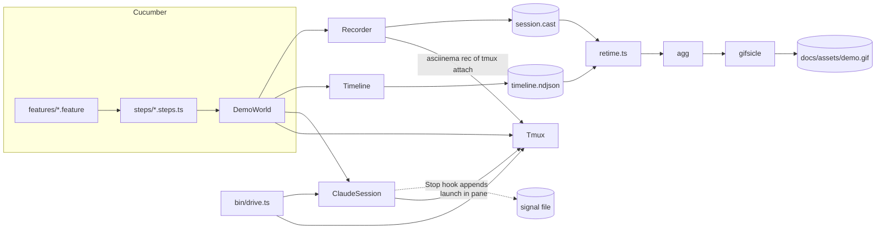
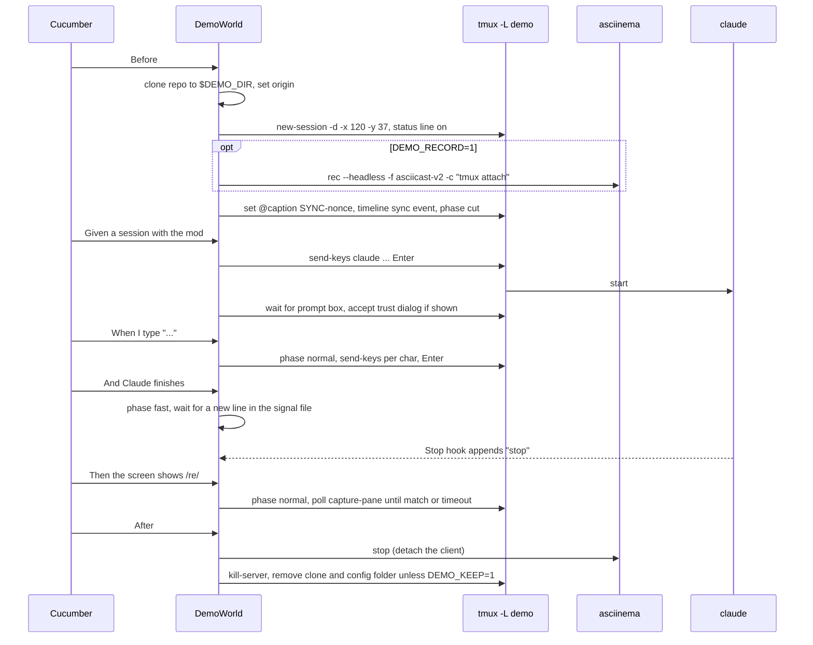
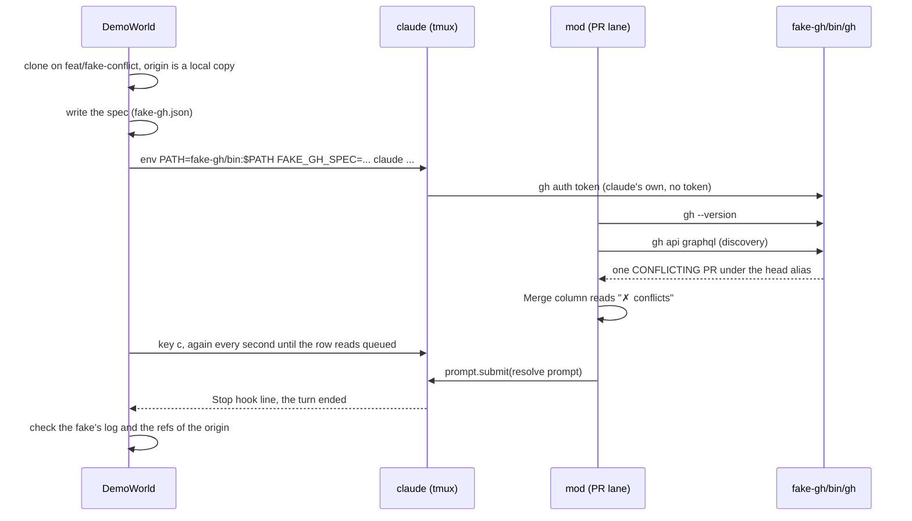

# Demo pipeline: design

Status: implemented 2026-10-11. Branch: `feat/demo-pipeline`.

## 1. Goal

`make demo` records a real Claude Code session that uses the `artifact-tracking` mod. It writes a small animated GIF for the README. The same scenario files also run as local end-to-end (E2E) tests under `make e2e-safe`. `make e2e` adds the `@artifacts` scenario.

Three parts:

- **Harness.** Gherkin feature files with TypeScript step definitions. They drive a real `claude` in tmux and assert on the screen.
- **Recorder.** asciinema records the session. A retime step speeds up or cuts dull phases. `agg` renders the GIF. Captions come from the scenario and stay in sync.
- **Skill.** `demo-scenario` tells an agent how to explore the mod, write the `@demo` scenario, add missing steps, record the GIF and update the README.

### 1.1 Non-goals

- E2E in CI. CI has no Claude login, and a real model costs money on each run.
- Stubbed `gh` or `acli` in the demo. The demo uses this repo's live issues and PRs. A feature scenario that needs a PR state real GitHub gives not on demand (a merge conflict) uses the fake `gh` of section 14.
- A deterministic model. The scenario asserts on mod output (band, pane), not on Claude's words.
- Prompt delivery over a socket or the local peer channel. Peer prompts render as teammate messages, not as typed input.
- Video formats other than GIF. Several GIFs per README.
- A Gherkin linter.

## 2. Decisions

| # | Decision | Reason |
| --- | --- | --- |
| D1 | Cucumber-js with TS steps, run by Node 24 type stripping. | Standard Gherkin runner. No build step, same as the plugin. Fallback: `tsx` loader if Cucumber cannot `--import` `.ts` that way. |
| D2 | Prompts go in through `tmux send-keys`, one character at a time. | It shows real typing in the GIF. The recording already runs through tmux. |
| D3 | The session runs with `--setting-sources project --plugin-dir <clone>/plugins/artifact-tracking`. | It keeps the OAuth login but skips user hooks, plugins and statusline. `--bare` needs an API key. |
| D4 | A `Stop` hook passed with `--settings` signals turn end. | Probed on 2.1.296: the hook fires under `--setting-sources project`. More exact than screen scraping. |
| D5 | The session runs in a fresh clone at a short, neutral path, with the real `origin`, on branch `main` at our `HEAD`. `--plugin-dir` points at the working-tree plugin (`<repo>/plugins/artifact-tracking`). | It hides home paths. `#N` still resolves to this repo. A clone has no `.claude/skills/artifact-tracking` link, so the mod loads once. Uncommitted mod changes are part of the run. |
| D6 | Captions live in the tmux status line as `#{@caption}`. | They are part of the cast, so every retime keeps them in sync. No font or video pipeline. |
| D7 | Steps tag phases (`cut`, `fast`, `normal`) in a timeline file. A retime step rewrites the cast. | The Claude spinner redraws all the time, so idle cutting alone saves nothing during a model turn. |
| D8 | Model: `$DEMO_MODEL`, default `haiku`. | Short waits, low cost. |
| D9 | Live data from this repo. | Authentic status. Risk: the GIF changes when the data changes (section 11). |
| D10 | GIF budget 2 MB. Output: `docs/assets/demo.gif`. | Readable on GitHub. `make demo` fails above the budget. |

Probe results, 2026-10-11, Claude Code 2.1.296:

- `--settings '{"hooks":{"Stop":[…]}}'` with `--setting-sources project`: the hook wrote its line.
- `--plugin-dir` beside the `.claude/skills/artifact-tracking` link: the `--plugin-dir` copy loads. The link copy is rejected with "name already taken" in the debug log.
- tmux 3.8 has `allow-set-title`.
- The workspace trust dialog lists "No, exit" first and selects it. A bare Enter quits.
- The idle prompt line starts with `❯` and a no-break space (U+00A0).
- asciinema 3.2.1 `rec --headless` records a `tmux attach` client.
- Cucumber 13.3.0 loads the `.ts` steps with Node 24 type stripping. No loader is needed.
- The banner shows the plan name (`Claude Max`). A usage notice shows the use, the reset time and the time zone.

## 3. Architecture

### 3.1 Components



| Unit | Does | Depends on |
| --- | --- | --- |
| `Tmux` | Starts a private server (`tmux -L <name>`). Sets the size, the status line and the caption. Sends keys. Captures the pane as plain text. Kills the server. | `tmux` |
| `ClaudeSession` | Makes the clone. Builds the `claude` command line and the `--settings` JSON. Watches the signal file. | `git`, `Tmux` |
| `Recorder` | Starts and stops `asciinema rec` on `tmux attach`. No-op when recording is off. | `asciinema` |
| `Timeline` | Appends phase and sync events with wall-clock times. | none |
| `DemoWorld` | Cucumber World. Owns one of each unit per scenario. `Before` and `After` hooks. | all above |
| `retime.ts` | Pure function: cast plus timeline in, cast out. | none |
| `render.ts` | CLI: retime, then `agg`, then `gifsicle`, then a size check. | `agg`, `gifsicle` |
| `drive.ts` | CLI for the skill's exploration. Same `Tmux` and `ClaudeSession` code, state kept in `e2e/out/drive/`. | `Tmux`, `ClaudeSession` |

### 3.2 Files

```text
e2e/
  package.json          @cucumber/cucumber, @types/node; npm scripts
  package-lock.json
  tsconfig.json         noEmit, erasableSyntaxOnly, strict
  cucumber.mjs          profiles: default (every scenario but @artifacts, make e2e-safe), all (every scenario, make e2e),
                        artifacts (@artifacts alone), one (no paths: only what the command line names), demo (record, tags @demo)
  features/
    tracking.feature    written by the skill
    conflicts.feature   the conflict chip and the resolve key, on the fake gh (section 14)
  steps/
    session.steps.ts
    prompt.steps.ts
    screen.steps.ts
    narrative.steps.ts
    fake-gh.steps.ts    fake repo, fake PR, checks of the fake gh log and origin
  fake-gh/
    bin/gh              the shim: the one file that goes first on PATH of claude
    main.ts             the shim's program: reads the spec, logs the call
  support/
    config.ts           env to config, defaults
    fake-gh.ts          the answers of the fake gh (no import, so a contract test can load it)
    fake-gh-env.ts      the shim dir and the env that puts it on PATH
    tmux.ts
    session.ts
    slug.ts             scenario name to folder name
    drive.ts            the drive CLI commands
    recorder.ts
    timeline.ts
    world.ts            DemoWorld, Before and After hooks (needs the Cucumber runtime)
  render/
    cast.ts             asciicast v2 parse and write
    retime.ts
    render.ts
  bin/
    drive.ts
  tests/
    *.test.ts           node:test, one file per support or render module
  out/                  git-ignored: casts, timelines, screen dumps
docs/assets/demo.gif
.agents/skills/demo-scenario/SKILL.md
.claude/skills/demo-scenario -> ../../.agents/skills/demo-scenario
```

### 3.3 Configuration

| Env var | Default | Use |
| --- | --- | --- |
| `DEMO_RECORD` | `0` (`1` in the `demo` profile) | Turns the recorder on. |
| `DEMO_MODEL` | `haiku` | `--model` value. |
| `DEMO_DIR` | `/tmp/cc-demo` | Parent of the clone. The clone is `$DEMO_DIR/claude-code-mod-tracking`. |
| `DEMO_COLS`, `DEMO_ROWS` | `120`, `36` | Pane size. The tmux client is one row taller for the status line. 120 columns keeps the `/track` pane from waiting on a narrow terminal. A scenario sets another size with the step `Given a terminal of {int} columns by {int} rows` (section 5). |
| `DEMO_LOCK_WAIT_S` | `1800` | How long a scenario waits for the run lock of another run (section 4.1). `0` fails at once. |
| `DEMO_TYPE_DELAY_MS` | `35` | Delay between typed characters. |
| `DEMO_TURN_TIMEOUT_S` | `120` | Upper bound for one model turn. |
| `DEMO_SCREEN_TIMEOUT_S` | `20` | Upper bound for one screen assertion. |
| `DEMO_KEEP` | `0` | `1` keeps the clone, the tmux server and the tracker config folder after the run. |

## 4. Session lifecycle



### 4.1 Before

1. Take the run lock in `<os tmpdir>/cc-demo-lock` (one lock for the fixed tmux socket). Only then wipe and make the scenario folder: `e2e/out/<scenario-slug>/` for `make e2e-safe` and `make e2e`, `e2e/out/demo/` when recording. It holds `signal`, `timeline.ndjson`, `session.cast` and failure dumps. A second run waits for the lock, one try every 5 s for at most `DEMO_LOCK_WAIT_S` (30 minutes by default), and prints which run holds it. After that it fails with a clear message, and the later scenarios of that run fail at once. It never removes the lock of a live run and touches no file of the first run.
2. `git clone --quiet <repo root> $DEMO_DIR/claude-code-mod-tracking`, after a wipe of the old folder. Set `origin` to the URL of the checkout under test. Check out the current `HEAD` as branch `main`.
3. Make an empty tracker config folder with `mkdtemp` (`<os tmpdir>/cc-tracker-config-…`). Section 4.2 passes it to `claude`, so no run reads or writes the developer's real `config.json`.
4. Start the tmux server and session with these options: `status on`, `status-position top`, `status-left ''`, `status-right ''`, `status-format[0] '#[align=centre]#{@caption}'`, `set-titles off`, `allow-rename off`, `allow-set-title off`, `focus-events on` (else Claude Code shows a notice), `default-shell /bin/sh`. The tmux socket is fixed (`cc-demo`). `setUp` kills a server that a crashed run left. Every tmux call uses `-u` for UTF-8. The pane runs `exec env 'PS1=$ ' /bin/sh` in the clone: the non-interactive default shell drops `PS1`, so the command sets it again. No personal shell prompt or rc file shows. Set `TERM=xterm-256color` and `COLORTERM=truecolor`.
5. When recording, start `asciinema rec --headless --window-size <cols>x<rows+1> -f asciicast-v2 -c 'tmux -L <name> attach -t demo' <cast>`. `--headless` works in asciinema 3.2.1.
6. Set the caption to `SYNC-<nonce>`. Write a `sync` event to the timeline. Open a `cut` phase.

### 4.2 Launch

The step `Given a Claude Code session with the artifact-tracking mod` replaces the pane shell with this command (`tmux respawn-pane -k`). Nothing echoes the command line, so its home paths never reach the recording:

```sh
env CLAUDE_TRACKER_CONFIG_DIR=<config folder> \
  claude --setting-sources project \
  --plugin-dir <repo>/plugins/artifact-tracking \
  --model "$DEMO_MODEL" \
  --append-system-prompt '<one short sentence, no tools>' \
  --tools '' \
  --strict-mcp-config \
  --settings '{"hooks":{"Stop":[{"hooks":[{"type":"command","command":"echo stop >> <signal>"}]}]}}'
```

The `env` prefix is there only when the launch has variables, and the step always has one. A variant step adds a first prompt as the positional argument. The appended system prompt keeps each turn short. `--tools ''` (built-in tools) and `--strict-mcp-config` (MCP servers of the account) keep it tool-free, so no permission dialog opens: the sentence alone did not hold (issue #215). A step that gives tools passes `--allowedTools` in its place. The step waits until the prompt box shows (a line that starts with `❯` and white space). If the workspace trust dialog shows, the step presses Down until "Yes, I trust this folder" is selected, then Enter. The whole launch stays in the `cut` phase.

### 4.3 Turn end and slash commands

- A model turn ends when the signal file gains a line. The step reads the line count before it sends Enter, and waits for count + 1.
- A slash command handled by the mod (`/track`) runs no model turn. Its steps wait on screen text instead.

### 4.4 After

1. Write an `end` mark to the timeline. Stop the recorder: detach the tmux client, then wait for asciinema to exit. The retime drops the output after the mark, so the tmux detach screen is not in the GIF.
2. On failure: write `screen.txt` (`capture-pane -p`, ANSI stripped) and keep the cast and timeline.
3. Kill the tmux server. Remove the clone and the tracker config folder unless `DEMO_KEEP=1`.

## 5. Step vocabulary

The skill reuses these steps first. It adds a step only when no step fits.

| Step | Phase | Action |
| --- | --- | --- |
| `Given a terminal of {int} columns by {int} rows` | cut | Resize the tmux session before the launch. It fails after the launch and in a recorded scenario. |
| `Given a Claude Code session with the artifact-tracking mod` | cut | Launch as in 4.2. |
| `Given a Claude Code session with the artifact-tracking mod and the prompt {string}` | cut, then fast | Launch with a first prompt. Wait for turn end. |
| `When I type {string}` | normal | Type per character, then Enter. |
| `When I press {string}` | normal | One key, for example `Escape`, `r`, `Down`. |
| `When Claude finishes` | fast | Wait for turn end (4.3). |
| `When I wait for {int} seconds` | fast | Wall-clock wait, for example for a refresh. |
| `Then the screen shows {string}` | fast, then normal | Poll until the plain text holds the string. |
| `Then the screen matches {regex}` | fast, then normal | Poll until the regex matches. |
| `Then the screen does not show {string}` | normal | One check, no wait. |
| `Then no permission dialog is open` | normal | Fails when a tool approval dialog shows. |
| `Given the caption {string}` | none | Set `@caption`. |
| `Given the tracker config file:` | cut | Write the doc string to `config.json` in the scenario's config folder, before the session starts. |
| `Given the tracker config file path is {int} cells wide` | cut | Make the config folder again, with a name padded so that the path of `config.json` has that width. Fails after the launch, after the config file is written, and when the temporary folder is wider than that already. |
| `Then the pane is {word}` | fast, then normal | Poll until the close mark of the pane shows where it sits: `docked` (a row of its own beside the transcript) or `inline` (a top border `╭──✕─╮`). |
| `Then the tracker config file sets {string} to {string}` | fast, then normal | Poll until the value at the dotted path equals the JSON text. |
| `When I pause for {float} seconds` | normal | Hold the frame so a viewer can read it. At most 5 s, the agg idle limit. |
| `When I press {string} until the screen matches {regex}, then Claude finishes` | normal, then fast | Read the signal count, then press the key every second until the screen matches, then wait for the turn it started. For a key that sends a prompt but can do nothing at first (the resolve key needs the PR lane to have looked at the PR). A second press is safe: a queued PR refuses it. |
| `Given a fake GitHub repo {string} with the clone on the branch {string}` | cut | Section 14: the clone goes on the branch, its origin becomes a local copy, the fake `gh` is on for the launch. |
| `Given the fake gh reports PR #{int} {string} from {string} into {string} as {word}` | cut | Add a PR to the fake. The word is `CONFLICTING`, `MERGEABLE` or `UNKNOWN`. |
| `Then the fake gh answered {string}` | fast, then normal | Poll the fake's log for a call with that name and exit 0. |
| `Then the fake gh answered no unsupported call` | normal | Fails when the log is empty (the fake is not first on PATH) or holds a call the fake does not know. |
| `Then the fake origin got no push` | normal | Fails when a ref of the local copy of the origin differs from the start. |

Every wait has a timeout from section 3.3. A timeout fails the step with the last screen in the message.

### 5.1 Example feature

The skill writes the real feature: [`e2e/features/tracking.feature`](../../../e2e/features/tracking.feature). This example only shows the shape.

```gherkin
@demo
Feature: Track what a session mentions

  Scenario: Mention work, see it in the band and the pane
    Given the caption "Mention GitHub work in a prompt"
    And a Claude Code session with the artifact-tracking mod
    When I type "Summarize https://github.com/martin-macak/claude-code-mod-tracking/pull/16 in one line"
    And Claude finishes
    Then the screen matches /tracking .*GitHub 1/
    Given the caption "Open the /track pane for live status"
    When I type "/track"
    Then the screen shows "merged"
    And I pause for 3 seconds
```

## 6. Timeline and retime

### 6.1 Timeline file

`timeline.ndjson` has one JSON object per line. `t` is wall-clock milliseconds from `performance.timeOrigin + performance.now()`.

```json
{"t": 1760000000000, "kind": "sync", "nonce": "SYNC-3f9a"}
{"t": 1760000000500, "kind": "phase", "phase": "cut"}
{"t": 1760000004200, "kind": "phase", "phase": "normal"}
{"t": 1760000006900, "kind": "phase", "phase": "fast"}
```

A phase lasts until the next `phase` event, or until the end of the cast. An `end` event (`{"t": …, "kind": "end"}`) marks the end of the scenario.

### 6.2 Sync

The cast header has a timestamp in whole seconds. That is too coarse. So the retime finds the first output event whose data holds the nonce. Its cast time `c_s` and the timeline `sync` time `T_s` give `offset = c_s − T_s / 1000`. Every phase time becomes `t / 1000 + offset` on the cast clock. No match fails the render.

### 6.3 Retime function

`retime(cast, phases, opts) → cast`. It is pure.

- It builds a piecewise linear map from old cast time to new cast time:
  - `normal`: slope 1.
  - `cut`: length 0. All its events keep their order and get the same new time. So the terminal state stays correct, and no frame from the cut shows.
  - `fast`: length `min(d, opts.fastSeconds)`, default 1.0 s, scaled evenly.
- Events before the sync point fall into the first `cut`.
- Output times never go down.
- Events at or after the `end` mark are dropped.
- Input and output are asciicast v2: absolute times, `[t, "o", data]`. Resize and other event types pass through with mapped times.

Unit tests cover:

- a `normal`-only cast,
- a `cut` at the start,
- a long `fast` phase,
- a short `fast` phase, kept as is,
- a missing sync nonce,
- monotonic output.

### 6.4 Render

`render.ts <cast> <timeline> <out.gif>`:

1. Retime to `session.retimed.cast`.
2. Clean the output text:
   - No-break spaces become spaces, because agg draws them as a stray glyph.
   - Account data is blanked with spaces of the same width: the plan name, usage notices and the reset time zone (`REDACTIONS` in `render.ts`). The match runs over all output joined, because asciinema can split a line over two events.
3. Fail closed: strip escape codes from all output joined, and fail the render when any `LEAKS` pattern still matches (home path, email, plan name, usage, reset time, `Organization`). The message names the text.
4. Run `agg --theme dracula --font-family 'JetBrains Mono,Menlo,DejaVu Sans Mono' --font-size 14 --fps-cap 15 --idle-time-limit 5 --last-frame-duration 4`.
5. Run `gifsicle -O3 --lossy=60 --colors 128` in place.
6. Fail when the file exceeds 2 MB (2 097 152 bytes). The message names the size and the knobs: fewer beats, a lower `--fps-cap`, a higher `--lossy`.

## 7. Make targets

| Target | Does |
| --- | --- |
| `e2e-deps` | `npm ci` in `e2e/` when `package-lock.json` is newer than `node_modules`. |
| `e2e-unit` | `node --test e2e/tests` (no `claude`, no tmux). |
| `e2e-safe` | `e2e-deps`, then a bare `cucumber-js`. The default profile: all scenarios except `@artifacts`, which publishes a page to claude.ai. No recording. This is the default local run. |
| `e2e` | `e2e-deps`, then `cucumber-js -p all`. All scenarios, `@artifacts` included, no recording. |
| `demo` | `e2e-deps`, then `cucumber-js -p demo`, then `render.ts` to `docs/assets/demo.gif`. |
| `typecheck` | Also runs `tsc -p e2e`. |
| `init` | Also reports `tmux`, `asciinema`, `agg` and `gifsicle`. They are needed by `e2e-safe`, `e2e` and `demo` only. |

Node runs through `mise exec node@24`, as for the plugin. The Makefile variable `NODE_RUN` holds that prefix. CI sets it empty: `make test … NODE_RUN=` and `make e2e-unit NODE_RUN=`.

## 8. Repo integration

| File | Change | Reason |
| --- | --- | --- |
| `biome.json` | `files.includes` adds `e2e/**`. | The new TS code gets the same format and lint. |
| `.pre-commit-config.yaml` | The `typecheck` hook matches `^(plugins\|e2e)/`. | `tsc` must see the harness. |
| `.pre-commit-config.yaml` | `check-added-large-files` (512 KB) excludes `^docs/assets/demo\.gif$`. A second entry checks that path at 2048 KB. | Only the demo GIF may be large. |
| `.gitignore` | `e2e/node_modules/`, `e2e/out/`. | Local artifacts. |
| `.github/workflows/test.yml` | Runs `make e2e-unit`. | The retime is pure and cheap to test in CI. |
| `README.md` | New "Demo" section near the top: GIF, short narrative, feature list. | The goal of the pipeline. The skill writes it. |
| `AGENTS.md` | One line: `make e2e-safe` after a change to `plugins/` or `e2e/`, when a Claude login is at hand. | Contributors know the suite exists. |

## 9. The `demo-scenario` skill

Location: `.agents/skills/demo-scenario/SKILL.md`, linked from `.claude/skills/demo-scenario`. That is the same pattern as the other repo skills. Build it with `superpowers:writing-skills`.

Trigger: an agent must make or refresh the demo GIF, write a demo or E2E scenario, or update the README demo section.

Loop:

1. **Learn the features.** Read `plugins/artifact-tracking/README.md` and the specs in `docs/superpowers/specs/`. List the user-visible features. Rank them by how well they show in 30–45 s.
2. **Explore live.** Use `node e2e/bin/drive.ts start | type | key | wait-turn | screen | caption | stop`. It uses its own tmux socket (`cc-demo-drive`) and clone folder (`DEMO_DIR`, default `/tmp/cc-demo-drive`). Try each candidate beat in a real session. Note the exact screen text to assert on. Prefer refs that the mod admits now. Full GitHub URLs are safe. Bare `#N` refs to closed issues may be gated out.
3. **Write the scenario.** Write one `@demo` scenario with 3–4 beats in `e2e/features/`. Give each beat a caption that tells the story. Assert on mod output, not on Claude's words. Use prompts that need no tool approval.
4. **Add steps.** Use the vocabulary in section 5 first. Add a step only when none fits. Keep the phase rules.
5. **Run E2E.** `make e2e` must pass. This is an exit criterion.
6. **Record.** Run `make demo`. Pull 4–6 frames with `ffmpeg -i docs/assets/demo.gif -vf "select=…" frame-%02d.png` into the scratchpad. Read them. Check for:
   - readability,
   - caption sync,
   - no dull stretches,
   - no personal data (home paths, email, account or org names).
7. **Update the README.** Write the "Demo" section: the GIF, a 3–5 sentence narrative that matches the captions, and a feature list.
8. **Clean up.** Delete scratch frames. Commit the feature, steps, GIF and README together.

The skill text does not get markdownlint, because hooks skip `.agents/` and `.claude/`. The skill author checks it by hand.

## 10. Testing

| Layer | What | Where |
| --- | --- | --- |
| Unit | `retime`, cast parse and write, ANSI strip, config parsing. | `make e2e-unit`, local and CI. |
| E2E | All feature files against a real session. | `make e2e-safe`, or `make e2e` with the `@artifacts` scenario. Local only. |
| Demo | The `@demo` scenario recorded and rendered, with a size check. | `make demo`, local only. |

## 11. Risks

| Risk | Mitigation |
| --- | --- |
| Live repo data changes, so a step or the GIF goes stale. | Assert on stable text (state words, counts). Re-run the skill when the README GIF looks wrong. |
| A Claude Code release changes the trust dialog, the prompt box or banner text. | The launch step waits on a small set of markers, kept in one place in `session.ts`. |
| The model calls a tool and a permission dialog opens mid-GIF. | The demo session has no tool (`--tools ''`, `--strict-mcp-config`). A scenario that gives tools must use prompts that need no approval. `Then no permission dialog is open` fails E2E early. |
| `asciinema rec --headless` behaves differently from the docs. | Checked: it works in 3.2.1. |
| Cucumber cannot load `.ts` with Node type stripping. | Checked: it loads them in 13.3.0. Fallback if that changes: `tsx` as a dev dependency, `--import tsx`. |
| The banner shows account or org data. | The launch stays in a `cut` phase. The skill checks frames for personal data. |
| Two runs at once share the tmux socket, `e2e/out` or `$DEMO_DIR`. | One lock in `<os tmpdir>/cc-demo-lock`, taken before any file is touched, holds a second run back: it waits for the lock up to `DEMO_LOCK_WAIT_S`. A lock of a dead process is taken over. |
| Claude Code prints new account data. | The render fails closed on `LEAKS`. The frame check in the skill is the second line. Add the pattern to `REDACTIONS`, with a test. |

## 12. Acceptance criteria

1. `make e2e-unit` passes locally and in CI.
2. `make e2e` passes on a machine with a Claude login, `gh` login, tmux, Node 24.
3. `make demo` writes `docs/assets/demo.gif` of at most 2 MB. Its play time is 30–45 s.
4. In the GIF, model waits take about 1 s each. Startup and the trust dialog do not show. Captions change in step with the beats.
5. No frame shows a home path, an email address or an account name.
6. `README.md` shows the GIF, a narrative that matches the captions, and a feature list.
7. The `demo-scenario` skill loads in this repo. An agent that follows it can redo steps 1–7 of section 9 without other guidance.
8. `make lint` passes. The only large-file exception is `docs/assets/demo.gif`.

## 13. Out of scope

- Recording Jira beats. Possible later, if `acli` has a demo site.
- Recording auto-tracking beats that need Claude to make worktrees or agents. They cost more model time and add tool dialogs. The skill may add one if a cheap path exists.
- Hosting the GIF outside the repo.

## 14. Fake gh for a scenario (issue #106)

Question of the spike: can a fake `gh` drive the merge conflict chip and the resolve key of issue #50 in E2E? The owner had moved both scenarios out of #50, because the harness drove the real `gh` and could not fake a conflict.

**Answer: yes, for both.** `e2e/features/conflicts.feature` holds one scenario for each, and both pass. Evidence label: *verified-live* (Claude Code 2.1.304, tmux 3.8, `haiku`, 2026-10-20), plus unit tests of the fake and of its clone and env helpers (`make e2e-unit`, also in CI) and a contract test that runs the real `GhTool` of the mod against the fake (`scripts/contracts/fake-gh-contract.test.mjs`, `make test-scripts`, also in CI).

### 14.1 Evidence

| Claim | Evidence |
| --- | --- |
| A `gh` first on the `PATH` of claude is the `gh` of the mod. `claudeCommand` already sets variables through `env(1)`, and the engine's process runner (`$.process.run`) honors the `PATH` that claude got. | The fake's log in the chip scenario holds the mod's calls `--version` and `graphql discovery`, both with exit 0 (excerpt below). |
| The PR lane draws the chip from the fake's reply. | Step `the screen matches /│[^\n]*#7[^\n]*✗ conflicts/` passes. The row reads `★ ▸ #7  Fix the fake conflict  feat/fake-conflict  open  ✗ conflicts  ✓ checks`. |
| The chip comes from the reply, not from the harness. | The same two scenarios fail at the chip step with `as MERGEABLE` in place of `as CONFLICTING` (run once by hand, 2026-10-20). |
| The resolve key works on the fake PR. | After `c`, the row reads `queued`. The session ran a model turn (the Stop hook signal), so the prompt reached the engine. The model said it could not run tools. |
| The session ran no tool. | `no permission dialog is open` and `the fake origin got no push` pass: no ref of the local copy of the origin changed. This is a tripwire for a scenario that gives tools. The session has no tool here (`--tools ''`, `--strict-mcp-config`), so the steps cannot fail today. The rewrite that keeps a push off GitHub is proved by the unit test of `fakeGithubClone`. |

Log of the chip scenario (long query cut):

```text
{"call":"auth token","exit":1,"argv":["auth","token"]}
{"call":"auth token","exit":1,"argv":["auth","token","--hostname","github.com"]}
{"call":"--version","exit":0,"argv":["--version"]}
{"call":"graphql discovery","exit":0,"argv":["api","graphql","--hostname","github.com","-f","query=query {..."]}
```

The two `auth token` calls are not the mod's. Claude Code itself runs `gh auth token` at start (and again after a turn) for its own PR status. A `gh` first on `PATH` answers claude too. The fake gives no token, so claude cannot call GitHub for the fake repo. The footer then reads `gh auth login for PR status`.

### 14.2 How it works



`bin/gh` is a short shell script that runs `main.ts` with the node of the harness. `main.ts` reads the spec file, asks `answer()` in `support/fake-gh.ts` and appends one JSON line per call to the log. `bin/` holds `gh` alone, so putting it on `PATH` adds no other command. Without `FAKE_GH_SPEC` the shim exits 2: a stray `PATH` never fakes GitHub silently.

### 14.3 What the fake answers

| Call | Answer |
| --- | --- |
| `--version`, `auth status` | Exit 0. |
| `auth token` | Exit 1, no token (see 14.1). |
| `repo view --json nameWithOwner,url` | The fake repo. The mod does not ask while the remote names github.com. |
| `api graphql`, discovery (`defaultBranchRef` in the query) | `defaultBranchRef` is `main`. A head alias gets the PRs with that head, in any state. A base alias gets the open PRs with that base. Another repo gets `NOT_FOUND`, exit 1. |
| `api graphql`, item refresh (`issueOrPullRequest(` in the query) | The PR by number. A number the fake does not know gets `null`. |
| Anything else | Exit 1, log name `unsupported`. The step `the fake gh answered no unsupported call` fails on it. |

The formats come from `buildDiscoveryQuery` (`trackers/github/pr-discovery.ts`) and `buildQuery` (`trackers/github/gh-tool.ts`). A change of an alias name makes the fake answer `unsupported`, so a scenario fails loud. It fails sooner too: `scripts/contracts/fake-gh-contract.test.mjs` runs the real `GhTool` and `discoverPrs` against `answer()`, in `make verify` and in CI, so the break shows before a local `make e2e`. That test lives beside the other contracts and not in the plugin tests, because the kit refuses an import from outside the plugin folder. The live runs showed no `graphql refresh` call: a discovered PR stays current for half of `staleMs` (2.5 min), and a scenario lasts seconds. That path has unit tests only.

### 14.4 Guards: nothing reaches GitHub

1. The fake has no network code.
2. It answers `auth token` with no token, so claude has no credential for the fake repo. `env(1)` cannot unset a variable, so `fakeGhEnv` sets `GH_TOKEN` and `GITHUB_TOKEN` to an empty value: a token in the environment of the harness does not reach claude. Whether Claude Code treats an empty value as no token is not verified. The worst case is a read of `e2e-owner/e2e-repo`, which does not exist.
3. The fake repo is `e2e-owner/e2e-repo`. A query for any other repo gets `NOT_FOUND`, never a PR.
4. `origin` keeps the URL `https://github.com/e2e-owner/e2e-repo.git` in its config, which is where the mod reads the repo. `url.<copy>.insteadOf` sends every fetch and push to a bare copy of the clone (`$DEMO_DIR/fake-origin.git`). The step `the fake origin got no push` compares the refs of the copy with the start. The unit test of `fakeGithubClone` proves the rewrite: a push lands in the copy, and the source repo does not see it.

   The design leans on one fact about the engine. The PR lane gets the repo from the engine (`session.repo()`), which reads the URL in the config of the clone (*verified-live*, 2.1.304). `git remote get-url origin` returns the copy, and the repos tracker reads the remote that way (`trackers/repos/tracker.ts`). If a Claude Code release reads the remote with `get-url`, discovery stops and the chip scenario fails at the chip step. Check this first.
5. The resolve key sends a real prompt (a model turn). The session has the demo system prompt and no tool (`--tools ''` and `--strict-mcp-config`, issue #215). The system prompt alone did not hold: a model ran `gh pr view`, which the fake gh does not answer, and a machine in auto mode ran it with no dialog. Without the flag, a tool call that needs approval would open a permission dialog that nobody approves. The turn would stall, so `waitForTurnEnd` would time out first, after 120 s, with the last screen in the message. `no permission dialog is open` and `the fake origin got no push` guard a later scenario that gives tools. They cannot fail in these two scenarios. The model's words change from run to run, so no step reads them.
6. The mod never rebases, merges or pushes. It only asks Claude to.

### 14.5 Limits

- A scenario states a static PR. A PR that stops conflicting, or the `UNKNOWN` retries (3 s, 6 s, 12 s), needs a step that rewrites the spec and a refresh. None exists.
- The `f` key (conflict files) runs `git fetch` from `origin`. With the copy as origin it stays local. No scenario yet.
- The second press of `c` being ignored (AC9) is proved by kit tests only (`github-actions.test.ts`, `github-resolve.test.tsx`). A screen cannot tell a second prompt from the first.
- The resolve scenario costs one model turn (about 5 to 25 s).
