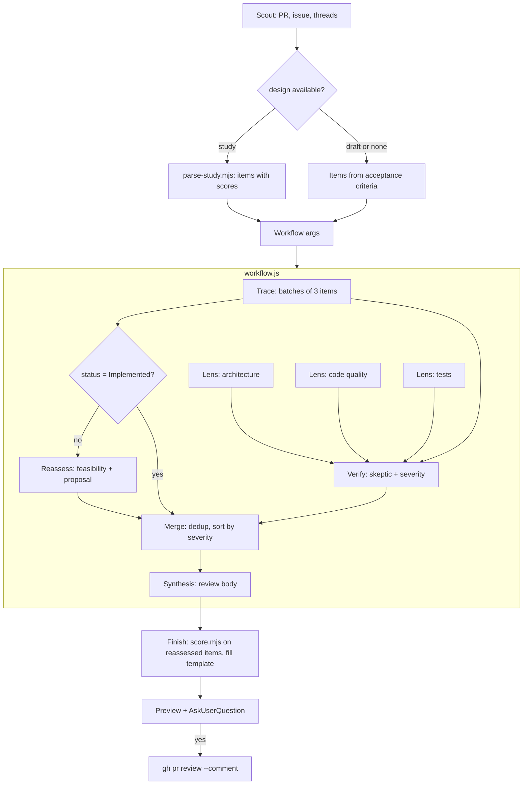

# PR review skill: design

Status: approved for planning 2026-10-14. Branch: `chore/pr-review-skill`.

## 1. Goal

`pr-review` is a repo skill that reviews a pull request against its issue and its design. It answers three questions:

1. Does the PR do what the issue asks? One verdict per requirement item.
2. Is each item implemented correctly and accurately?
3. Is the code sound under four lenses: architecture, code quality, tests, match to the requirements?

The review is constructive. Every finding has a severity and a concrete fix. Items that are not implemented, or that the review cannot decide, get a second feasibility check and a proposed implementation. The first study may have missed a path.

### 1.1 Non-goals

- Applying fixes. The skill proposes fixes only. `pr-shepherd` applies them.
- Approving or requesting changes. The skill posts a review of type `COMMENT` only.
- Inline comments per line. One review body holds all findings.
- Replacing the built-in `/code-review`. That skill hunts bugs in a diff. This one checks a PR against its issue and design.
- Writing the design study. `design-study` does that.

## 2. Decisions

| # | Decision | Reason |
| --- | --- | --- |
| D1 | Name: `pr-review`. | No clash with the built-in `/code-review` or the `code-review` plugin. |
| D2 | Output: show a preview, ask, then post one PR review with `gh pr review <N> --comment --body-file`. | The user decides what goes public. One review keeps the thread readable. |
| D3 | Fixes: propose only, as a code snippet or a GitHub `suggestion` block. | The review stays read-only. `pr-shepherd` applies fixes with TDD. |
| D4 | Fallback: Workflow and Jev when present. Else the same steps run serially, with own judgments and a one-line reason each. | Copilot and Codex read `.agents/skills/` too and have neither tool. |
| D5 | Hybrid run: the main agent scouts and finishes; `workflow.js` fans out the middle. | A workflow script has no file system, no Node API and no imports. Parsing and posting need them. Scripts in `scripts/` stay unit-testable. |
| D6 | The workflow script ships in the skill folder and runs through `Workflow({ scriptPath, args })`. | It versions with the skill. Copilot ignores it. |
| D7 | Reassessment reuses the design-study vocabulary: verdicts, Evidence, Ease, Safety, and `scripts/score.mjs`. | One scale across both skills. Scores stay comparable with the study. |
| D8 | Severity levels double as Jev `classify` option text. | Same trick as `design-study/scoring.md`: one text, used by people and by the model. |
| D9 | The skill instruction to call `Workflow` counts as the user's opt-in. | The Workflow tool names "a skill whose instructions tell you to call Workflow" as opt-in. |
| D10 | The review reads the PR head with `git fetch origin pull/<N>/head` and `git show <sha>:<path>`. It never checks out the branch. | The review may run in any worktree. It must not touch the working tree. |

## 3. Inputs

### 3.1 Linked issue

1. `gh pr view <N> --json closingIssuesReferences,body,title,labels,baseRefOid,headRefOid,files,reviews,comments`.
2. The first entry of `closingIssuesReferences`. Else the first `Closes|Fixes|Resolves #N` in the body. Else a `Refs #N`, marked as partial.
3. No issue: a `Major` finding "No linked issue". The review goes on with the PR body's Requirements section as the requirement source.

### 3.2 Requirement items

- From the issue body: each acceptance criterion and each "should" sentence under a use-case heading gives one item `R1..Rn`.
- When a design study exists (3.3), its items replace these. The study already split and prioritised them.
- Priority: the study's priority. Else `Must` for an acceptance criterion, `Should` for the rest.

### 3.3 Design study

The issue has the label `design available`. The study lives in an issue comment.

| Shape | How to find it | What the parser gets |
| --- | --- | --- |
| Design study (#28–#31, #63, #69) | Comment starts with `## Design study:` | One score table per phase (`Rank`, `Item`, `Priority`, `Verdict`, `Evidence`, `Ease`, `Safety`, `Score`), each under a whole-line bold label such as `**Phase 1, PR 1**`. An item in several phase tables takes its scores from the first table that holds it, and `phases` lists the label of each table. A score table in `<details>` is a roll-up: it runs last and adds no phase to a known item. A phase table must not sit in `<details>`. Section 2 rows give mechanism and caveat, matched by header name. Overall line. |
| Design draft (#33) | Comment starts with `## Design draft` or the issue body has `### Proposal` | No scores. The parser returns `{ kind: 'draft', items: [] }`. The review uses the acceptance criteria and states "Design has no feasibility scores" under How the review ran. |
| Label but no comment | — | A `Minor` finding: "Label `design available` but no design found". |

The score table comes from `design-study/scripts/score.mjs`, so its shape is stable. Two feasibility-table variants exist: a merged table (`Item | Priority | Verdict | Mechanism | Caveat | Evidence`, #30) and a split pair (`Item | Priority | From` plus `Item | Verdict | Mechanism | Caveat | Evidence`, #31). The parser merges by item id and header name. It never relies on column position.

`scripts/parse-study.mjs` input: the comment text on stdin or as a file. Output:

```json
{
  "kind": "study",
  "title": "Track other repositories that the session visits",
  "overall": { "verdict": "Go with caveats", "mean": 74 },
  "items": [
    { "id": "R2", "name": "Shell: cd, git -C, gh -R", "priority": "Must", "verdict": "Partial",
      "evidence": 5, "ease": 3, "safety": 3, "score": 60,
      "mechanism": "splitShell + stripWrappers …", "caveat": "Not seen: commands inside quotes …" },
    { "id": "R12", "name": "Hook timing across the two phases", "priority": "Must", "verdict": "Feasible",
      "evidence": 4, "ease": 4, "safety": 4, "score": 90,
      "mechanism": "…", "caveat": "…", "phases": ["Phase 1, PR 1", "Phase 2"] }
  ],
  "warnings": []
}
```

`warnings` lists each item with no verdict or no score, each item on which two phases give a different verdict or a different evidence, ease, safety or score (the warning names each field that differs, and the first phase's value stays), and each section 2 row that names an item no score table holds. The list is empty when the study is clean.

`phases` appears on an item only when the study has more than one score table. It lists the label of each table that holds the item. R2 comes from a one-table study, so it has no `phases`. R12 is illustrative: it shows an item that two phase tables hold.

### 3.4 Existing review threads

Unresolved threads and their first comment go into `args.threads`. Lens agents do not repeat a finding that a thread already raised. They may cite it.

## 4. Architecture



Trace and the three lenses start together. `pipeline` carries each trace batch to Reassess and each lens to Verify without a barrier. Merge is the only barrier: dedup needs every finding.

### 4.1 Agents and models

| Stage | Agents | Model | Jev |
| --- | --- | --- | --- |
| Trace | ceil(items / 3) | `sonnet` | `jev_check` per item: "Does this change implement this requirement correctly?" State: item text, mechanism, the cited code and test. |
| Reassess | one per item not `Implemented` | `opus` | `jev_ask` per item: Ease and Safety as `score`, verdict as `classify`. Levels from `design-study/scoring.md`. |
| Lens | 3 | `sonnet` | — |
| Verify | one per lens and one for trace findings | `sonnet` | `jev_classify` per finding over the four severity texts. |
| Dedup | 0 or 1 | `sonnet` | `jev_check` per candidate pair: "Do these two findings describe the same problem?" |
| Synthesis | 1 | `opus` | — |

A study with 15 items and 4 open items needs 5 + 4 + 3 + 4 + 1 + 1 = 18 agents. The PR #42 run (14 open items) used 31 agents and about 2.6 M subagent tokens; Reassess on `opus` is the largest part. The workflow logs every item or finding it drops.

Agents load the `jev_*` tools with `ToolSearch`. A Jev answer is a proposal: `review`, `abstain` or `uncertain` means the agent reads the evidence itself. Each judgment goes into the result with the Jev answer and confidence, or `own`.

### 4.2 Data contracts

`args` (from Scout):

```json
{
  "pr": { "number": 42, "title": "…", "base": "<sha>", "head": "<sha>", "files": ["…"] },
  "issue": { "number": 31, "title": "…", "source": "closing" },
  "design": { "kind": "study", "overall": { "verdict": "Go with caveats", "mean": 74 } },
  "items": [ { "id": "R1", "text": "…", "priority": "Must", "study": { "verdict": "Partial", "score": 63, "mechanism": "…", "caveat": "…", "phases": ["…"] } } ],
  "threads": [ { "path": "…", "line": 204, "body": "…", "resolved": false } ],
  "jev": true
}
```

Trace result per item:

```json
{ "id": "R1", "status": "Implemented|Partial|Not implemented|Inconclusive",
  "correct": true, "code": ["path:line"], "tests": ["path:line test name"],
  "reason": "…", "judgment": { "source": "jev|own", "answer": "…", "confidence": 0.8 },
  "findings": [ "<finding>" ] }
```

Finding:

```json
{ "lens": "architecture|quality|tests|requirements", "severity": "Critical|Major|Minor|Nit",
  "title": "…", "file": "path", "line": 120, "item": "R2",
  "problem": "…", "evidence": "…", "fix": "…", "suggestion": "optional GitHub suggestion block" }
```

Reassess result:

```json
{ "id": "R12", "verdict": "Feasible|Partial|Heuristic|Untested|Not feasible",
  "evidence": 4, "ease": 4, "safety": 4, "missed": "what the first study missed, or None",
  "proposal": "implementation or fix, with files and a test" }
```

Verify result per finding: `{ "refuted": bool, "reason": "…", "severity": "…", "judgment": { … } }`. A refuted finding is dropped and counted under How the review ran.

### 4.3 Merge rules

- Code: two findings are duplicates when they name the same file and their lines are at most 3 apart, and they share the lens or the requirement item.
- Judgment: two findings from different lenses, in the same file, at most 5 lines apart (and not on two different items) are a candidate pair. One `dedup` agent (`sonnet`, one `jev_check` per pair) decides whether both describe the same problem. A line rule cannot decide this: the PR #42 run had two different problems on one line. No pair means no agent.
- A merged finding keeps the highest severity and its title, joins the fixes, and lists all its lenses in `lenses`.
- Text before the `## PR review` heading in the synthesis output is cut. Harness notes can appear there.
- Sort: severity (`Critical` first), then file, then line.
- Review verdict: any `Critical` → **Not ready**. Else any `Major` → **Ready after fixes**. Else **Ready**.

## 5. Lenses

`lenses.md` holds a checklist per lens. Each check names what to look for and what a fix looks like.

| Lens | Checks |
| --- | --- |
| Architecture | Single responsibility per module. Open-closed: a new case adds code, it does not edit a switch in many places. Reuse of existing repo patterns (name the pattern and file). Dependency direction. No new state where existing state fits. |
| Code quality | Clear names. No dead code. Error paths fail soft where the repo does. No hot-path cost. Match to the surrounding idiom and comment density. |
| Tests | Each changed behavior has a test. Each test name states the behavior. One reason to fail per test. Fixtures from observed shapes. A test fails without the change (the repo's TDD rule). |
| Requirements | The Trace stage. Each item: status, correctness, accuracy against the issue text, and the test that proves it. |

## 6. Severity

`severity.md` holds the levels. The same text is the Jev option text.

| Level | Text |
| --- | --- |
| `Critical` | Wrong behavior, data loss, a privacy leak, a crash or a blocked session, or a `Must` item not implemented. Blocks the merge. |
| `Major` | A requirement only partly met, changed behavior without a test, or a design flaw that will force a rework. Fix before the merge. |
| `Minor` | A quality or clarity problem with low risk. Fix in this PR when cheap, else file a follow-up. |
| `Nit` | Style or wording. Optional. |

## 7. Review body

`templates.md` holds the template. Every slot is filled. An empty slot says "None".

```markdown
## PR review: <PR title>

**Verdict: <Ready | Ready after fixes | Not ready>.** <One sentence: why.>
Requirements: <n implemented> of <n> (<Must open: list>). Findings: <n Critical>, <n Major>, <n Minor>, <n Nit>.

### 1. Requirements
| Item | Priority | Study | Status | Correct | Code | Test |

### 2. Reassessed items
score.mjs output for the reassessed items, then per item: what the first study missed, and the proposal.

### 3. Findings
#### Critical
**C1 <title>** (`file:line`, lens, item). Problem. Evidence. Fix, as a snippet or a suggestion block.
#### Major
#### Minor
#### Nit

<details><summary>How the review ran</summary>
Issue source. Design shape. Agents and models. Decision model used (or why not). Dropped or refuted findings. Items or files not covered.
</details>
```

The body stays under 60,000 characters. When it is longer, the Nit section collapses into a `<details>` block first.

## 8. Skill files

| File | Holds |
| --- | --- |
| `.agents/skills/pr-review/SKILL.md` | Steps, the fallback branch, decision-model rules, common mistakes. |
| `.agents/skills/pr-review/lenses.md` | Section 5 in full. |
| `.agents/skills/pr-review/severity.md` | Section 6, and the Jev `classify` call. |
| `.agents/skills/pr-review/templates.md` | Section 7. |
| `.agents/skills/pr-review/workflow.js` | The fan-out of section 4. |
| `.agents/skills/pr-review/scripts/parse-study.mjs` | Section 3.3. |
| `.agents/skills/pr-review/tests/*.test.mjs` | Section 9. |
| `.claude/skills/pr-review` | Symlink to the skill folder. |
| `Makefile` | `test-scripts` also runs `node --test .agents/skills/pr-review/tests/`. |
| `AGENTS.md` | One line under "Pull requests", next to the `pr-shepherd` line: review a PR against its issue and design with `pr-review`. |

## 9. Testing

- `parse-study.test.mjs`: fixtures cut from the #30 and #31 study comments (merged and split tables), the #33 draft, and the #63 and #69 studies (`study-63.md` and `study-69.md`, each with several phase tables). Checks: item ids, priorities, verdicts, scores, mechanism and caveat merged by id, overall line, `kind: 'draft'` with no items, an error on text with no table. For phase tables: every phase gives its items; an item in two phases keeps both labels; a later table fills a blank; a disagreement between phases warns, also when only one of evidence, ease or safety differs; a `<details>` roll-up adds no phase; a study with one table has no `phases`; a section 2 row alone gives a warning; no verdict or no score gives a warning, never a 0.
- `workflow.test.mjs`: loads `workflow.js` with fake `agent`, `pipeline`, `parallel`, `phase`, `log` and `args`. Checks: only items not `Implemented` reach Reassess; a refuted finding is dropped; duplicates merge with the highest severity; findings sort by severity; the verdict rule; dropped items are logged.
- Acceptance run: the skill reviews PR #42 against #31 and stops at the preview. Nothing is posted. The preview must list R1–R15 with a status each and at least one reassessed item.

## 10. Risks

| Risk | Mitigation |
| --- | --- |
| The study table shape drifts. | Parse by header name. A test per known shape. An unknown shape gives a `Minor` finding and falls back to acceptance criteria. |
| Jev is absent in a workflow agent. | Agents check with `ToolSearch`. Without it they judge themselves and mark `own`. |
| A large PR overflows an agent. | Trace agents read only the files their items cite. Lens agents get the file list and read with `git show`. |
| Cost. | Batches of 3 items. `opus` only for Reassess and Synthesis. |
| A false finding gets posted. | Skeptic verify per finding. The user sees the preview before any post. |

## 11. Acceptance criteria

1. The skill finds the linked issue from `closingIssuesReferences`, a closing keyword or `Refs`. No issue gives a `Major` finding.
2. Every acceptance criterion or study item gets one row with a status.
3. With `design available` and a study, each item shows its study verdict and score.
4. Each item not `Implemented` gets a reassessed verdict, axes, and a proposal.
5. Findings come from the architecture, quality and tests lenses, and from Trace.
6. Every finding has a severity, a `file:line` and a fix.
7. The review is shown before it is posted. It is posted only after a yes, as a `COMMENT` review.
8. Without Workflow or Jev, the skill still runs and says so under How the review ran.
9. `make test-scripts` runs the parser and workflow tests.
