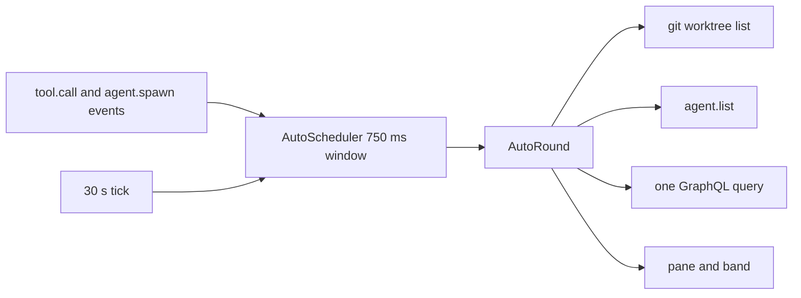

# artifact-tracking

A Claude Code mod. It tracks the GitHub issues and pull requests, the Jira work items and the web links that you or Claude mention in a session. It shows them in a `/track` pane and in a one-line band above the prompt.

`gh` and `acli` are optional. With them, the mod also shows live status: title, state, failing checks, Jira status and the Epic tree.

Design: [`docs/superpowers/specs/2026-10-10-artifact-tracking-design.md`](../../docs/superpowers/specs/2026-10-10-artifact-tracking-design.md). Evidence: [`docs/knowledge-base/claude-code-artifact-tracking/`](../../docs/knowledge-base/claude-code-artifact-tracking/README.md).

## Load it

Mods are in early access. Tested on Claude Code 2.1.295 and 2.1.296.

```bash
claude --plugin-dir plugins/artifact-tracking
```

## What it captures

| Row | Taken |
| --- | --- |
| Your prompt (typed, bridge, `-p`) | Every pattern below. |
| Your slash command | The text inside `<command-args>`. |
| Claude's reply, also from subagents | Every pattern below. |
| Tool output | Explicit GitHub issue and PR URLs and Jira URLs only. No bare `#N`, no web links. |

Not captured: notifications from background tasks, meta rows, prompts that a subagent or a coordinator wrote, and our own `/track` output.

| Pattern | Item |
| --- | --- |
| `https://github.com/o/r/issues/N`, `/pull/N` | GitHub issue or PR |
| `o/r#N` | GitHub item, type found by `gh` |
| `#N` outside code and URLs | GitHub item of the session repo |
| `https://<site>.atlassian.net/browse/KEY-1`, `…?selectedIssue=KEY-1` | Jira work item |
| `/browse/KEY-1` on another host | Jira item, track-only |
| Any other `http` or `https` URL | Web link. The name is the Markdown label, else host and path. |

The same item written as a URL and as `#N` is one item. The session repo comes from the git `origin` remote. Without a remote, the mod asks `gh repo view` once.

## Commands

| Command | Action |
| --- | --- |
| `/track` | Opens the pane and starts a refresh of the due items. Prints a short list. |
| `/track refresh` | Forgets "not logged in" and "not found", closes open circuit breakers, refreshes every item, waits, and prints the list. Use it in `claude -p`. |
| `/track clear` | Removes all items of this session and its stored copy. |

The pane has one section for each of Jira, GitHub and web links. A Jira row with children has a `[-]` or `[+]` button. The `Refresh` button (key `r`) does what `/track refresh` does. Esc closes the pane. A 30 s tick runs from the start of the session, with the pane open or closed. An item is stale after 5 minutes, or after 60 s for a PR with pending checks.

The band shows `tracking  Jira 6 · GitHub 4 (1 ✗) · Links 2  /track`. `(n ✗)` counts PRs with failing checks. The band is empty when nothing is tracked.

## Auto tracking

The mod also tracks the work around the session, with no mention:

| Section | Content |
| --- | --- |
| Worktrees | The root (the cwd at session start, pinned) and the worktrees that this session or its agents made. Only proven children show. A removed one stays, dimmed. |
| Agents | The main loop, its subagents and its workflow agents, each with branch and worktree. An ended agent stays, dimmed. |
| Pull requests | PRs whose head is a tracked branch, or whose base is a tracked branch (stacked PRs). One GraphQL query for each 30 s tick. |

The refs in a PR body become items with a `↳#N` prefix. HTML comments are skipped. The items go when the PR leaves the tracked set. The band adds `Worktrees n · Agents n · PRs n`.



Press `x` on an auto row to hide it for the run. `/track clear` hides every auto row that is on screen. A gh failure trips the same circuit breaker as item refresh. It never stops worktree or agent tracking.

Limits: peer sessions in other processes are not tracked. A worktree that git created without this session is not shown. Design: [`docs/superpowers/specs/2026-10-10-auto-tracking-design.md`](../../docs/superpowers/specs/2026-10-10-auto-tracking-design.md).

## Requirements

- Claude Code with mods (2.1.295 or newer).
- Optional: `gh` 2.102 or newer, logged in. It refreshes GitHub items with one GraphQL call for each host. A GitHub Enterprise host works when `gh auth status --hostname <host>` succeeds.
- Optional: `acli` 1.3.19 or newer, logged in. It refreshes Jira items on its active site.
- Without a tool, its section says `not installed` or `not logged in`. The items stay in the list.

A tool that fails three times in a row is paused for 5 minutes (circuit breaker). The section says `paused 4m`. `/track refresh` lifts the pause.

## Persistence

- Items live in `$.state` and are copied to `$.store` 1.5 s after a change. The store keeps the newest 20 sessions, and each session keeps up to 500 items. Only the extracted fields are stored, never raw CLI output.
- `/clear` gives a new session. The items of the old session carry over.
- `--resume` and `--continue` restore the stored copy, then add what the transcript holds. Restored items are due for a refresh.

## Known limits

- **False positives.** `rank #1` counts as issue 1 of the session repo. The scanner cannot tell it from `fixed in #1`.
- **Jira sites.** `acli` works on one site at a time. A work item on any other site is `track-only`. The mod never runs `acli jira auth switch`. A host that is not `*.atlassian.net` is also `track-only`.
- **GitHub Enterprise.** A GHE issue URL is a web link, unless the host is the host of the session repo and `gh` is logged in to it.
- **Other github.com URLs** (repo pages, commits, files) are web links.
- **Bare `#N` without a repo** stays unresolved. It has no link and no status.
- **`/clear`.** The items come back at the next hook, command or 30 s tick, not at the `/clear` itself. The tick runs from session.start. A `/resume` of a session that the store knows restores that session only, not the one you left.
- **`--resume` backfill.** The transcript has no `isMeta` or origin flags. The backfill skips the wrappers it knows (`<system-reminder>`, `<teammate-message>`, command output, task notifications). Other meta rows, for example a skill body or a coordinator message, may add items that the live session did not track.
- **`claude -p "/track"`** ends before its background refresh finishes. Use `/track refresh`.
- **A narrow terminal.** The pane may wait until you widen the terminal. The mod shows a toast.
- **Out of scope:** page titles of web links, switching Jira sites, Jira levels above Epic, click capture, write actions on GitHub or Jira, and surfaces other than the terminal.

## Develop

Only `hooks/register.tsx` uses `$`. Every other module gets plain functions, so the unit tests need no engine.

```bash
cd plugins/artifact-tracking
claude plugin validate .
mise exec node@24 -- npx -y -p typescript tsc -p .
claude plugin test .
```

| Folder | Content |
| --- | --- |
| `hooks/register.tsx` | Hooks, command, timers, state, store, render. |
| `hooks/scan/` | Text to references (`refs.ts`) and the link scanner (`links.ts`). |
| `hooks/model/` | Items, keys, merge, dedupe, caps. |
| `hooks/tools/` | `GhTool`, `AcliTool`, the base `Tool` and the circuit breaker. |
| `hooks/refresh/` | The refresh coordinator. |
| `hooks/auto/` | Ledger, worktrees, agents, events, scheduler and round of auto tracking. |
| `hooks/ui/` | The view model, the pane and the band. |
| `tests/` | Unit tests, fixtures, and the kit tests of the wiring (`register.test.tsx`). |

## CI

`.github/workflows/test.yml` runs on every pull request, on each push to `main`, and by hand. It installs Claude Code 2.1.296 and TypeScript 7.0.2 at fixed versions. Then it runs `make test`: `claude plugin validate`, `tsc -p .`, `claude plugin test`. No login or secret is needed.

## Make targets

Run `make` from the repo root. `make help` lists the targets. Set `PLUGIN=<dir>` to use another plugin folder.

| Target | Action |
| --- | --- |
| `init` | Checks `claude`, `mise` and node. Reports `gh`, `acli` and `pre-commit` as present or missing. A missing optional tool does not fail. Warms the TypeScript cache for offline runs. |
| `build` | Runs `claude plugin validate`, then `typecheck`. Nothing is emitted. Claude Code loads the `.ts` and `.tsx` files as they are. |
| `typecheck` | Runs `tsc` only. The `typecheck` pre-commit hook calls it. |
| `lint` | Runs every pre-commit hook on all files. |
| `hooks` | Installs the `pre-commit` and `commit-msg` git hooks. |
| `test` | Runs `build`, then `claude plugin test`. `check` is an alias. |
| `install` | Links the mod into `$CLAUDE_CONFIG_DIR/skills/`. Without that variable, it uses `~/.claude/skills/`. |
| `uninstall` | Removes that link. It removes only a link that points at this plugin. |
| `install-local` | Links the mod into `<repo>/.claude/skills/`. Only a session that starts in this repo loads it. The user config dir stays untouched. |
| `uninstall-local` | Removes that link and its line in `.git/info/exclude`. |
| `clean` | Deletes `.claude-plugin/types/`. The engine writes that folder on a real load. |

`install` makes a symlink, so Claude Code loads the mod in place as `artifact-tracking@skills-dir`. Edits reload by themselves. Run `make install` from the checkout that you keep, not from a temporary worktree. Start a new session or run `/reload-plugins` after `make install`. Running it twice is safe.

`install-local` uses a project skills folder. Start `claude` at the repo root. A subfolder does not load the mod. Claude Code asks you to trust the folder first. `claude -p` never counts as trust. The link is not tracked by git, because `install-local` adds it to `.git/info/exclude`. That file is shared by all worktrees of the repo.
