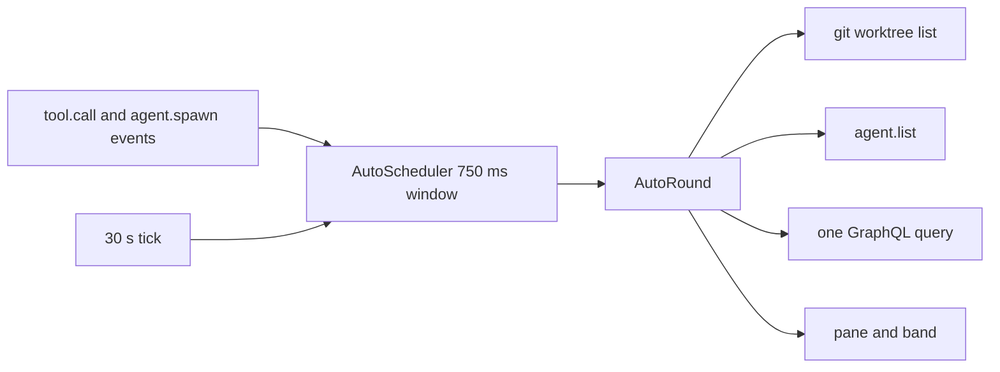

# artifact-tracking

A Claude Code mod. It tracks the GitHub issues and pull requests, the Jira work items, Claude artifacts and the web links that you or Claude mention in a session, and the Markdown files that Claude writes, edits, reads or names. It shows them in a `/track` pane and in a one-line band above the prompt.

`gh` and `acli` are optional. With them, the mod also shows live status: title, state, failing checks, Jira status and the Epic tree.

Design: [`docs/superpowers/specs/2026-10-10-artifact-tracking-design.md`](../../docs/superpowers/specs/2026-10-10-artifact-tracking-design.md). Evidence: [`docs/knowledge-base/claude-code-artifact-tracking/`](../../docs/knowledge-base/claude-code-artifact-tracking/README.md).

## Load it

Mods are in early access. Tested on Claude Code 2.1.295 and 2.1.296.

Install it from the marketplace of this repo. In a Claude Code session (2.1.275 or later):

```text
/plugin install artifact-tracking --marketplace martin-macak/claude-code-mod-tracking
```

Answer `y` to add the marketplace `mod-tracking`, then pick a scope. From a shell (2.1.292 or later): `claude plugin install artifact-tracking --marketplace martin-macak/claude-code-mod-tracking`. Get a new release with `claude plugin update artifact-tracking@mod-tracking`.

Load a release zip for one session. Each [GitHub release](https://github.com/martin-macak/claude-code-mod-tracking/releases) attaches `artifact-tracking-<version>.zip`:

```bash
claude --plugin-url https://github.com/martin-macak/claude-code-mod-tracking/releases/download/artifact-tracking--v<version>/artifact-tracking-<version>.zip
```

Load the checkout for one session:

```bash
claude --plugin-dir plugins/artifact-tracking
```

## What it captures

| Row | Taken |
| --- | --- |
| Your prompt (typed, bridge, `-p`) | Every pattern below. |
| Your slash command | The text inside `<command-args>`. |
| Claude's reply, also from subagents | Every pattern below. |
| Tool output | Explicit GitHub issue and PR URLs and Jira URLs only. No bare `#N`, no web links. |
| Artifact tool call, also from subagents | A publish, a republish, an Artifact made from a type and an asset upload: the artifact, `published`. A delete marks its row `deleted`. An error, a refusal and the other actions add nothing. |
| `Write`, `Edit` and `Read` tool calls | A `.md` path: see [Markdown files](#markdown-files). |
| File tools, Bash and `agent.spawn` | Other git repos that the session or subagents touch (`Read`, `Edit`, `Write`, `NotebookEdit`, `Grep`, `Glob`, `cd`, `git -C`, `gh -R`, spawn `cwd`). |

Repo tracking runs in the background, after the tool has returned. One queue runs the git lookups one at a time and drops new ones when 32 wait. A file-tool call that failed or was denied adds nothing. A denied Bash command adds nothing. A Bash command that failed still counts: it touched the repo. A relative path in a Bash command starts from the session cwd as it was before the command ran. In a subagent the cwd is unknown, so only absolute paths count.

Repo tracking has two limits:

- Bash is read only for `cd`, `pushd`, `git -C` and `gh -R`. Other paths in a command are not tracked. A `cd` or `-C` target with `$`, a backtick, `*` or `?`, or with `-`, `~` or `~name`, is skipped.
- A relative path in a file-tool call is ignored.

Each Repos row has an `x` button. It hides the repo for the rest of the run: a later visit, a restore and `/clear` do not bring it back. The dismiss list is not stored, so a new run shows the repo again. When the last repo is dismissed, the flush skips the empty list, so the stored copy may still hold it until the next write.

Not captured: notifications from background tasks, meta rows, prompts that a subagent or a coordinator wrote, and our own `/track` output.

The own repo never shows as a foreign repo. It is the toplevel of the session root, any worktree that shares its git common dir, and any clone with the same `origin`. A repo nested inside the root folder counts as own. A repo without a remote gets a `local:<git common dir>` key, so its worktrees share one row.

| Pattern | Item |
| --- | --- |
| `https://github.com/o/r/issues/N`, `/pull/N` | GitHub issue or PR |
| `o/r#N` | GitHub item, type found by `gh` |
| `#N` outside code and URLs | GitHub item of the session repo |
| `https://<site>.atlassian.net/browse/KEY-1`, `…?selectedIssue=KEY-1` | Jira work item |
| `/browse/KEY-1` on another host | Jira item, track-only |
| `https://claude.ai/artifact/<id>`, `https://claude.ai/code/artifact/<uuid>` | Claude artifact, `mentioned`. The two forms of one artifact are one item. Another path or a bad id is a web link. |
| Any other `http` or `https` URL | Web link. The name is the Markdown label, else host and path. |

An artifact row shows its name: the page title from the Artifact tool, else the Markdown label, else the file name or the id. A mention never changes a `published` row back. The same item written as a URL and as `#N` is one item. The session repo comes from the git `origin` remote. Without a remote, the mod asks `gh repo view` once.

## Commands

| Command | Action |
| --- | --- |
| `/track` | Opens the pane and starts a refresh of the due items. Prints a short list. |
| `/track refresh` | Forgets "not logged in" and "not found", closes open circuit breakers, refreshes every item, waits, and prints the list. Use it in `claude -p`. |
| `/track clear` | Removes all items of this session and its stored copy. |

The pane has one section for each of Jira, GitHub, Artifacts, Repos, web links and files. A Jira row with children has a `[-]` or `[+]` button. The `Refresh` button (key `r`) does what `/track refresh` does. Esc closes the pane. A 30 s tick runs from the start of the session, with the pane open or closed. An item is stale after 5 minutes, or after 60 s for a PR with pending checks.

A deleted artifact stays in its section, dim and without a link.

The band shows `tracking  Jira 6 · GitHub 4 (1 ✗) · Artifacts 3 · Links 2 · Files 3 · Repos 2  /track`. `(n ✗)` counts PRs with failing checks. `Artifacts n` counts the artifacts that are not deleted. `Repos` and the auto parts (Worktrees, Agents, PRs) come after `Files`. The band is empty when nothing is tracked.

### Markdown files

The Files section has one row per Markdown file (issue #28):

```text
Files  3 files
  docs/plan.md      created  edited 3  viewed 2
  README.md                  edited 1  viewed 5
  docs/notes.md     mentioned          viewed 1  subagent
```

| Cell | Counts |
| --- | --- |
| path | Relative to the session root when the file is below it, else absolute. |
| `created` | A successful `Write` of type `create` made the file. It stays set. |
| `mentioned` | Your prompt, your command arguments or Claude's reply named the path, and the file exists. Shown when the file was not created. |
| `edited N` | Successful `Edit` calls and `Write` calls of type `update`. |
| `viewed N` | Successful `Read` calls. A `Read` alone never adds a row: it counts only on a row that a write, an edit or a mention made. |
| `subagent` | A subagent wrote, edited or read the file. |

An empty cell means that activity did not happen. The `/track` text leaves empty cells out.

Rules:

- Only `.md` paths count, in any case. A failed, denied or staged call adds nothing.
- A relative path joins the cwd: the spawn cwd of a subagent, else the session cwd. `~/` in a mention joins `HOME`.
- A row is keyed by where the file lands (`file:<real path>`): two spellings of one file, such as `/tmp/a.md` and `/private/tmp/a.md`, are one row. A case alias or a hard link stays a second row. The row keeps the path as first spelled.
- Mentions: at most 20 paths per prompt or reply, each checked with one stat. A URL, a missing file and tool output are not mentions. A trailing line number (`a.md:42`) or anchor (`a.md#L7`) is cut.
- Ignored paths, fixed: a `.git` or `node_modules` folder, auto-memory under `<config dir>/projects/<project>/memory/` or under the `autoMemoryDirectory` setting, and the Claude scratchpad (`claude-<uid>/<project>/<session>/scratchpad/` under any temp folder). The config dir is `CLAUDE_CONFIG_DIR`, else `~/.claude`. Below the session root, only a `.git` or `node_modules` folder below the root counts, so a project inside such a folder keeps its files. `CLAUDE.md`, `AGENTS.md` and plans stay tracked.
- File rows count against the 500-item session cap like other items. The oldest row goes first.
- The `x` button dismisses a file row for the run. A later write, edit, read or mention of the same file does not bring it back.
- A resume restores file rows from the stored copy, then from the `Write`, `Edit` and `Read` results and the mentions in the transcript. A subagent's writes come back from the stored copy only: its transcript holds no results.
- Paths only. The mod never reads or stores file contents.

## Auto tracking

The mod also tracks the work around the session, with no mention:

| Section | Content |
| --- | --- |
| Worktrees | The root (the cwd at session start, pinned) and the worktrees that this session or its agents made. Only proven children show. A removed one stays, dimmed. |
| Agents | The main loop, its subagents and its workflow agents, each with branch and worktree. An ended agent stays, dimmed. |
| Pull requests | PRs whose head is a tracked branch, or whose base is a tracked branch (stacked PRs). One GraphQL query for each 30 s tick. |

The refs in a PR body become items with a `↳#N` prefix. HTML comments are skipped. The items go when the PR leaves the tracked set. The band adds `Worktrees n · Agents n · PRs n`.



Press `x` on an auto row to hide it for the run. `/track clear` hides every auto row that is on screen. A gh failure trips the same circuit breaker as item refresh. It never stops worktree or agent tracking.

Limits: peer sessions in other processes are not tracked. A worktree that git created without this session is not shown. Design: [`docs/superpowers/specs/2026-10-10-auto-tracking-design.md`](../../docs/superpowers/specs/2026-10-10-auto-tracking-design.md).

## Requirements

- Claude Code with mods (2.1.295 or newer).
- Optional: `gh` 2.102 or newer, logged in. It refreshes GitHub items with one GraphQL call for each host. A GitHub Enterprise host works when `gh auth status --hostname <host>` succeeds.
- Optional: `acli` 1.3.19 or newer, logged in. It refreshes Jira items on its active site.
- Without a tool, its section says `not installed` or `not logged in`. The items stay in the list.

A tool that fails three times in a row is paused for 5 minutes (circuit breaker). The section says `paused 4m`. `/track refresh` lifts the pause.

## Persistence

- Items live in `$.state` and are copied to `$.store` 1.5 s after a change. The store keeps the newest 20 sessions, and each session keeps up to 500 items. Only the extracted fields are stored, never raw CLI output.
- `/clear` gives a new session. The items of the old session carry over.
- `--resume` and `--continue` restore the stored copy, then add what the transcript holds. Restored items are due for a refresh.

## Known limits

- **False positives.** `rank #1` counts as issue 1 of the session repo. The scanner cannot tell it from `fixed in #1`.
- **Jira sites.** `acli` works on one site at a time. A work item on any other site is `track-only`. The mod never runs `acli jira auth switch`. A host that is not `*.atlassian.net` is also `track-only`.
- **GitHub Enterprise.** A GHE issue URL is a web link, unless the host is the host of the session repo and `gh` is logged in to it.
- **Other github.com URLs** (repo pages, commits, files) are web links.
- **Bare `#N` without a repo** stays unresolved. It has no link and no status.
- **`/clear`.** The items come back at the next hook, command or 30 s tick, not at the `/clear` itself. The tick runs from session.start. A `/resume` of a session that the store knows restores that session only, not the one you left.
- **`--resume` backfill.** The transcript has no `isMeta` or origin flags. The backfill skips the wrappers it knows (`<system-reminder>`, `<teammate-message>`, command output, task notifications). Other meta rows, for example a skill body or a coordinator message, may add items that the live session did not track.
- **`claude -p "/track"`** ends before its background refresh finishes. Use `/track refresh`.
- **Artifact tool.** `claude -p` does not offer it, so nothing is published there. A mentioned artifact URL is still tracked.
- **Artifacts after `--resume`.** The stored copy keeps the origin, the title and the delete mark. Without a stored copy, the transcript gives them back, except for a subagent's publish: the main transcript does not hold it, so its URL comes back `mentioned` at most. Only deletes in this session mark a row.
- **Older versions** stored artifact URLs as web links. A session moves them to Artifacts when it loads its list.
- **A narrow terminal.** The pane may wait until you widen the terminal. The mod shows a toast.
- **Out of scope:** page titles of web links, switching Jira sites, Jira levels above Epic, click capture, write actions on GitHub or Jira, and surfaces other than the terminal.

## Develop

Only `hooks/register.tsx` uses `$`. Every other module gets plain functions, so the unit tests need no engine.

```bash
cd plugins/artifact-tracking
claude plugin validate .
mise exec node@24 -- npx -y -p typescript tsc -p .
claude plugin test .
```

| Folder | Content |
| --- | --- |
| `hooks/register.tsx` | Hooks, command, timers, state, store, render. |
| `hooks/scan/` | Text to references (`refs.ts`), artifact URLs and ids (`artifact-url.ts`), Markdown paths (`files.ts`) and the link scanner (`links.ts`). |
| `hooks/capture/` | An Artifact tool call as an event (`artifact-tool.ts`), for the hook and the resume backfill. |
| `hooks/model/` | Items, keys, merge, dedupe, caps. |
| `hooks/tools/` | `GhTool`, `AcliTool`, the base `Tool` and the circuit breaker. |
| `hooks/refresh/` | The refresh coordinator. |
| `hooks/auto/` | Ledger, worktrees, agents, events, scheduler and round of auto tracking. |
| `hooks/ui/` | The view model, the pane and the band. |
| `tests/` | Unit tests, fixtures, and the kit tests of the wiring (`register.test.tsx`, `artifact-wiring.test.tsx`). |

## CI

`.github/workflows/test.yml` runs on every pull request, on each push to `main`, and by hand. It installs Claude Code 2.1.296 and TypeScript 7.0.2 at fixed versions. Then it runs `make test`: `claude plugin validate`, `tsc -p .`, `claude plugin test`. No login or secret is needed.

## Release

A release is a git tag `artifact-tracking--v<version>`. The `<version>` is the `version` in `.claude-plugin/plugin.json`. Marketplace users get a new copy only when that `version` changes.

1. In a PR, bump `version` in `.claude-plugin/plugin.json`. Use semver. Merge the PR.
2. On `main`, in a clean and current checkout, run `make release-dry`. Check the tag name.
3. Run `make release`. It runs `make test`, then `claude plugin tag --push`.

The tag push runs `.github/workflows/release.yml`. The workflow:

- checks that the tag equals `<name>--v<version>` of `plugin.json` and that the tagged commit is on `main`,
- runs `claude plugin validate --strict` on the plugin and the marketplace, then `make test`,
- runs `make dist`: `artifact-tracking-<version>.zip` (the plugin folder at the tag) and `SHA256SUMS`,
- signs a build provenance attestation for the zip,
- creates the GitHub release with both files and notes generated from the merged PRs. A version with a `-` suffix, such as `0.3.0-rc.1`, becomes a prerelease.

Verify a downloaded zip:

```bash
sha256sum -c SHA256SUMS
gh attestation verify artifact-tracking-<version>.zip --repo martin-macak/claude-code-mod-tracking
```

## Make targets

Run `make` from the repo root. `make help` lists the targets. Set `PLUGIN=<dir>` to use another plugin folder.

| Target | Action |
| --- | --- |
| `init` | Checks `claude`, `mise` and node. Reports `gh`, `acli` and `pre-commit` as present or missing. A missing optional tool does not fail. Warms the TypeScript cache for offline runs. |
| `build` | Runs `claude plugin validate` on the plugin, and `--strict` on the repo root (the marketplace), then `typecheck`. Nothing is emitted. Claude Code loads the `.ts` and `.tsx` files as they are. |
| `typecheck` | Runs `tsc` only. The `typecheck` pre-commit hook calls it. |
| `lint` | Runs every pre-commit hook on all files. |
| `hooks` | Installs the `pre-commit`, `commit-msg` and `pre-push` git hooks. |
| `verify` | The gate before every push: `lint` with auto-fix, then `test`, `e2e-unit` and `test-scripts`. Fails on untracked files, because the hooks skip them. |
| `test` | Runs `build`, then `claude plugin test`. `check` is an alias. |
| `test-scripts` | Tests `scripts/dev/install-local-watch.sh`. Needs no `claude`. |
| `dist` | Builds `dist/<name>-<version>.zip` from the committed plugin folder at `HEAD`, and `dist/SHA256SUMS`. Uncommitted edits are not in the zip. |
| `release` | On a clean `main` equal to `origin/main`: runs `test`, then `claude plugin tag --push`. See [Release](#release). |
| `release-dry` | Prints the tag that `release` would create. |
| `install` | Links the mod into `$CLAUDE_CONFIG_DIR/skills/`. Without that variable, it uses `~/.claude/skills/`. |
| `uninstall` | Removes that link. It removes only a link that points at this plugin. |
| `install-local` | Copies the mod into `<repo>/.claude/skills/artifact-tracking-dev/` as `artifact-tracking-dev`. Only a session that starts in this repo loads it. The user config dir stays untouched. The `.envrc` runs it for you. |
| `uninstall-local` | Removes that copy and its line in `.git/info/exclude`. |
| `clean` | Deletes `.claude-plugin/types/` and `dist/`. The engine writes that folder on a real load. |

`install` makes a symlink, so Claude Code loads the mod in place as `artifact-tracking@skills-dir`. Edits reload by themselves. Run `make install` from the checkout that you keep, not from a temporary worktree. Start a new session or run `/reload-plugins` after `make install`. Running it twice is safe.

`install-local` uses a project skills folder. Start `claude` at the repo root. A subfolder does not load the mod. Claude Code asks you to trust the folder first. `claude -p` never counts as trust. The copy is not tracked by git: `.gitignore` lists it.

The copy differs from `install` in three ways:

- It is a copy, not a link. A symlinked hooks folder fails with "Path escapes plugin directory". So the copy must be refreshed after each code change. The `.envrc` does that, see below. Run `/reload-plugins` to load the new copy.
- It is named `artifact-tracking-dev`. A second plugin named `artifact-tracking` is refused while the released one is installed.
- It owns its state as `artifact-tracking-dev.*`. State belongs to the plugin name, and the copy may not write `artifact-tracking.*`.

An earlier `install-local` made a symlink named `artifact-tracking` instead. `/plugin` then reports "the name "artifact-tracking" is already taken". `install-local` and `uninstall-local` remove that old link from every worktree of the repo, not only from the current one.

The released `artifact-tracking` still loads next to the copy, and both answer `/track`. Disable it while you test: `claude plugin disable artifact-tracking@mod-tracking`, and later `claude plugin enable artifact-tracking@mod-tracking`. If `/reload-plugins` leaves `/track` unknown, restart with `claude --continue`.

With [direnv](https://direnv.net/), the repo's `.envrc` keeps the copy in step with no manual step. Run `direnv allow` once in each checkout and each worktree. Then:

- `cd` into the checkout runs `install-local` when the copy is missing or stale, and starts a background watcher (`scripts/dev/install-local-watch.sh`).
- The watcher copies again when a file under `plugins/artifact-tracking/` changes, also when `claude` edits it.
- When no process of yours (shell, `claude`) has its cwd in the checkout any more, the watcher runs `uninstall-local` and exits. A `claude` that still runs there keeps the copy.

The watcher logs to `install-local-watch.log` in the checkout's git dir (`git rev-parse --git-dir`).
